# SpineML

SpineML simuliert eine Fabrik mit Aufträgen, Werkstücken, Maschinen,
Werkzeugen, Lagern und Robotern. Diese README beschreibt den Zweig `Foroogh`.

- **Simulation:** Salabim bildet die zeitlichen Abläufe und die Folgen der
  ausgeführten Aktionen ab.
- **Steuerung:** Eine Policy entscheidet, welche der aktuell möglichen
  Aktionen ausgeführt werden. Die `SimulationBridge` verbindet sie mit der
  Simulation.
- **Optimierung:** Vollständige Simulationsläufe dienen dazu, geeignete
  lokale Gewichtssätze für die heuristische Aktionsbewertung zu finden.
- **Gliederung:** Zuerst werden die Konfigurations- und Simulationsklassen
  erklärt, danach Bridge, Steuerung, Bewertung und Optimierung.

## Inhalt

- [Installation und Start](#installation-und-start)
- [Fabrikkonfiguration](#fabrikkonfiguration)
- [Diskrete Simulation](#diskrete-simulation)
- [SimulationBridge](#simulationbridge)
- [GeneralControl](#generalcontrol)
- [HeuristicControl](#heuristiccontrol)
- [Optimierungsvorgang](#optimierungsvorgang)
- [Optimierung starten und Ergebnisse lesen](#optimierung-starten)

## Installation und Start

### Installation

- **Voraussetzung:** Python ab Version `3.10`.
- **Installation:** Die folgenden Befehle legen eine virtuelle Umgebung an
  und installieren das Projekt. Beispiel für PowerShell:

```powershell
git clone --branch Foroogh --single-branch https://github.com/ghackenberg/SpineML.git
cd SpineML
python -m venv .venv
.\.venv\Scripts\Activate.ps1
python -m pip install -e .
```

- **Projekt und Abhängigkeiten installieren:** `pip install -e .` verwendet
  die [pyproject.toml](pyproject.toml). Der Punkt bezeichnet den aktuellen
  Projektordner. Eine zusätzliche Installation von
  [sources/requirements.txt](sources/requirements.txt) ist nicht erforderlich.
- **Interpreter auswählen:** In VS Code wird die Python-Umgebung `.venv`
  verwendet.
- **Ausführungsordner:** Die folgenden Startbefehle werden aus dem
  Projektordner ausgeführt, in dem `pyproject.toml` liegt.

### Normale Simulation

```powershell
python sources/examples/normal/example-5.py
```

- **Konfiguration laden:** Die Beispieldatei definiert Fabrik und Aufträge.
- **Simulation ausführen:** Sie startet `simulate(layout, scenario, ...)`.
  Bei aktivierter Animation wird der Ablauf mit Salabim dargestellt;
  danach werden Statistiken ausgegeben.

### Optimierung mit Webinterface

```powershell
python -m streamlit run sources/optimization.py
```

- **Optimierung ausführen:** Im Browser auf **Start optimization** klicken.
  Dadurch startet der Vergleich verschiedener Gewichtssätze.
- **Produktionsbeispiel:** Verwendet wird `example-5.py`.
- **Weitere Einstellungen und Ergebnisse:** Modellwahl und Diagramme sind
  unter [Optimierung starten](#optimierung-starten) erklärt.

## Fabrikkonfiguration

Dieser Abschnitt beschreibt die Erweiterungen der Fabrikkonfiguration
gegenüber `main`. Die Klassen liegen unter
[sources/SpineML/Configuration](sources/SpineML/Configuration).

### `Layout.py`

- **Lagerkapazität ergänzen:** Das neue `storage_capacity` bestimmt, wie
  viele Jobs Start- und Endlager jeweils aufnehmen können.
- **Beispiel:** Bei `storage_capacity=10` haben beide Lager jeweils zehn
  Plätze, nicht zehn gemeinsam.

### `Machine.py`

`Machine` beschreibt eine konkrete Maschine mit Namen, `MachineType`,
Korridor und Position auf der linken oder rechten Korridorseite. Der
`MachineType` fasst die möglichen Operationen einer Maschinenklasse zusammen.

#### Defektwahrscheinlichkeit

Die Defektwahrscheinlichkeit ist jetzt der konkreten Maschine zugeordnet,
nicht mehr der Operation.

- **Direkt angeben:** Beispielsweise legt `defect_probability=0.05` fünf Prozent
  Defektwahrscheinlichkeit pro Bearbeitung fest. Dieser Wert bleibt unabhängig
  vom Seed gleich und muss zwischen `0` und `1` liegen.
- **Weglassen oder `None` angeben:** `Machine.resolve_defect_probability(seed)`
  erzeugt beim Aufbau der `SimMachine` einen gleichverteilten Zufallswert in
  `[0, 1)`. Derselbe Seed liefert für dieselbe Maschine denselben Wert.

Ohne direkte Angabe genügt beispielsweise:

```python
Machine("CNC automatisch", cnc_type, corridor, True, 10, 10)
```

- **Im Lauf verwenden:** `SimMachine` übernimmt den Wert als
  `self.defect_probability`. Er bleibt während des gesamten Laufs gleich
  und gilt für alle Bearbeitungen dieser Maschine.
- **Maschinen unterscheiden:** Auch Maschinen desselben `MachineType`
  können unterschiedliche Defektwahrscheinlichkeiten haben.
- **Seed berücksichtigen:** Ein anderer Seed kann einen anderen automatisch
  erzeugten Wert liefern. Ein ausdrücklich angegebener Wert bleibt gleich.
- **Konfiguration und Beobachtung unterscheiden:** `None` kennzeichnet in
  der Konfiguration die automatische Auswahl. Die Laufzeitbeobachtung
  enthält unter `defect_probability` den tatsächlich verwendeten Zahlenwert.
- **Operation ohne Defektwahrscheinlichkeit konfigurieren:** Ihr Aufruf
  lautet beispielsweise:

```python
OperationType("Fräsen", 4, 3, cnc_type, milling_tool, blank, finished)
```

#### Getrennte Maschinenpuffer

- **Eingangspuffer begrenzen:** `input_storage_capacity` legt seine
  maximale Anzahl aufnehmbarer Jobs fest.
- **Ausgangspuffer begrenzen:** `output_storage_capacity` legt dessen
  maximale Anzahl aufnehmbarer Jobs fest.
- **Unterschiedliche Werte erlauben:** Beide Kapazitäten werden getrennt
  angegeben und müssen nicht gleich sein.

#### Erlaubte Werkzeugtypen

- **Individuelle Ausstattung festlegen:** `tool_types` erlaubt eine eigene
  Werkzeugliste für jede konkrete Maschine.
- **Reale Unterschiede abbilden:** Zwei CNC-Maschinen müssen nicht dieselbe
  vollständige Werkzeugliste haben, nur weil beide dieselbe Operation
  ausführen können.
- **Beispiel:** CNC A unterstützt nur ein Schruppwerkzeug, CNC B zusätzlich
  ein Fräswerkzeug. Beide können schruppen. CNC B kann zusätzlich fräsen,
  sofern die Fräsoperation ihrem Maschinentyp zugeordnet ist.
- **Bisherige Ableitung beibehalten:** Ohne explizite Liste bestimmt
  `MachineType.computeToolTypes()` die Werkzeuge weiterhin aus den
  Operationen des Maschinentyps.
- **Kompatibilität prüfen:** Für jede konkrete Operation müssen weiterhin
  der Maschinentyp und der benötigte Werkzeugtyp passen.

#### Verarbeitungsgeschwindigkeit

- **Geschwindigkeitsfaktor ergänzen:** `processing_speed_factor` beschreibt
  die relative Bearbeitungsgeschwindigkeit der Maschine. Der Anfangswert in
  `Machine` ist `1.0`.
- **Bearbeitungsdauer beeinflussen:** `SimMachine` verwendet den Faktor bei
  der [Berechnung der Bearbeitungsdauer](#verarbeitungsdauer).

#### Schutzwerkzeugzeiten

- **Anfangszustand abbilden:** Das Schutzwerkzeug (`dummy_tool`) ist zu
  Beginn montiert; ein Produktionswerkzeug ist noch nicht eingesetzt.
- **Erste Bearbeitung vorbereiten:** Das Schutzwerkzeug wird entfernt und
  das benötigte Produktionswerkzeug montiert.
- **Zeiten konfigurieren:** `dummy_tool_mount_time=1.0` und
  `dummy_tool_unmount_time=1.0` sind Attribute jeder `Machine`, keine
  Konstruktorargumente. Sie bestimmen Montage- und Demontagezeit.
- **Werkzeugabschluss getrennt ausführen:** `SimMachineShutdown` kann das
  Schutzwerkzeug wieder montieren. Die tatsächlichen Aufrufbedingungen
  stehen [bei dieser Komponente](#simmachineshutdown-in-simmachinepy).

## Diskrete Simulation

Der Simulationskern liegt unter
[sources/SpineML/Simulation](sources/SpineML/Simulation).

- **Vorhandene Grundlage:** Salabim bildet die zeitlichen Abläufe ab.
  Jobs, Maschinen und Roboter besitzen jeweils einen eigenen Simulationsprozess.
- **Erweiterter Austausch:** Die Komponenten melden Zustände an die
  `SimulationBridge`, empfangen die von der Steuerung ausgewählten Aktionen
  und führen sie aus.

### `SimLayout.py`

`SimLayout` baut das Simulationslayout mit Startlager, Endlager, Korridoren
und Main-Roboter auf. Dieser grundlegende Aufbau war bereits in `main`
vorhanden. Ein Store ist ein Salabim-Puffer, der Jobs aufnimmt.

Erweiterungen gegenüber `main`:

- **Start- und Endlager begrenzen:** Beide Stores verwenden jetzt
  `layout.storage_capacity` als maximale Anzahl aufnehmbarer Jobs.
- **Bezugsgrößen für die Bearbeitungsdauer bestimmen:** Ausgehend von den
  Zielprodukttypen der Aufträge werden über die erzeugenden Operationen
  auch alle vorgeschalteten Roh- und Zwischenprodukttypen gesammelt. Aus
  diesen Produkttypen werden das maximale Gewicht (`max_product_weight`)
  und Volumen (`max_product_volume`) ermittelt. Die Werte werden über die
  Korridore und Korridorarme an die Maschinen weitergegeben und dienen der
  [Berechnung der größenabhängigen Bearbeitungsdauer](#verarbeitungsdauer).
- **Bridge weitergeben:** Beim Erzeugen der `SimCorridor`-Komponenten und
  des `SimRobotMain` wird dieselbe `SimulationBridge` übergeben, damit diese
  Komponenten mit der Steuerung verbunden sind.

### `SimCorridor.py`

`SimCorridor` erzeugt die drei Korridor-Stores sowie den linken und rechten
Korridorarm. Dieser Aufbau war bereits in `main` vorhanden.

Erweiterungen gegenüber `main`:

- **Korridorlager begrenzen:** Die drei Stores verwenden jetzt jeweils
  `corridor.storage_capacity` als maximale Anzahl aufnehmbarer Jobs.
- **Korridor und Stores registrieren:** `bridge.register_corridor()` meldet
  den Korridor zusammen mit seinen drei Stores bei der `SimulationBridge` an.
- **Bridge und Produktgrößen weitergeben:** Beide `SimCorridorArm`-Komponenten
  erhalten dieselbe Bridge sowie `max_product_weight` und
  `max_product_volume`. `SimCorridor` berechnet diese Größen nicht selbst.

### `SimCorridorArm.py`

`SimCorridorArm` erzeugt die Maschinen und den Korridorroboter einer
Korridorseite. Dieser Aufbau war bereits in `main` vorhanden.

Erweiterungen gegenüber `main`:

- **Bridge weitergeben:** Die erzeugten `SimMachine`-Komponenten und der
  `SimRobotCorridorArm` erhalten die `SimulationBridge` für den Austausch mit
  der Steuerung.
- **Produktgrößen an die Maschinen weitergeben:** Jede `SimMachine` erhält
  `max_product_weight` und `max_product_volume` für die
  [Berechnung ihrer Bearbeitungsdauer](#verarbeitungsdauer).

### `SimOrder.py`

`SimOrder` erzeugt für jedes bestellte Produktstück eine eigene
`SimOrderJob`-Komponente. Diese Job-Erzeugung war bereits in `main` vorhanden.

Erweiterungen gegenüber `main`:

- **Bridge an die Jobs weitergeben:** Jeder erzeugte Job erhält die
  `SimulationBridge`, damit er Aktionen von der Steuerung anfordern kann.

### `SimOrderJob.py`

`SimOrderJob` beschreibt ein einzelnes Werkstück. In `main` wurden seine
vollständige Operationsfolge und Maschinenroute bei der Erzeugung zufällig
ausgewählt. Der Job wurde anschließend direkt im Startlager abgelegt.

Erweiterungen gegenüber `main`:

- **Job bei der Bridge registrieren:** Jeder Job meldet sich selbst unter
  einer ID aus Auftragsname und Jobnummer an.
- **Aktionen von der Steuerung empfangen:** Der Job fordert über
  `bridge.request_action(self)` eine Aktion an und empfängt sie über
  `bridge.action(self)`. Er legt seine Route nicht mehr selbst zufällig fest.
- **Freigabe ausführen:** `release_job` übergibt den Startprodukttyp und die
  Freigabedaten. Der Job wartet gegebenenfalls bis zum übergebenen
  Freigabezeitpunkt und legt sich im angegebenen Startlager ab.
- **Nächste Verarbeitung speichern:** `selected_operation` und
  `selected_machine` enthalten die von der Steuerung ausgewählte nächste
  Operation und Maschine.
- **Zustände getrennt verwalten:** Produktzustand, Qualität und Terminstatus
  werden getrennt gespeichert. Zusätzlich werden Freigabe, Standort,
  Priorität und Abschlusszeit festgehalten.
- **Defektbehandlung ausführen:** Der Job übernimmt die gewählte Nacharbeit
  auf derselben oder einer alternativen Maschine, Herabstufung oder
  Ausschussentscheidung. Er speichert Defektdaten, Strategie und Zähler;
  die Strategieauswahl erfolgt in der Steuerung.
- **Warten und Abschluss ausführen:** `wait_job` lässt den Job eine
  Simulationszeiteinheit warten. Eine Abschlussaktion mit
  `finish_process=True` beendet seinen Prozess.

<a id="herkunft-und-aktualisierung-der-jobattribute"></a>

#### Wie Steuerung und Simulation die Jobdaten ändern

- **Die Steuerung entscheidet:** Welche Operation soll auf welcher Maschine
  ausgeführt werden? Soll ein defekter Job nachgearbeitet oder herabgestuft
  werden?
- **Die Simulation führt aus:** Roboter transportieren den Job, Maschinen
  bearbeiten ihn. Dabei werden seine gespeicherten Daten aktualisiert.
- **Der Job entscheidet nicht selbst:** Er speichert die Auswahl und die
  Ergebnisse. Außerdem führt er seine empfangenen Aktionen aus, etwa
  Freigabe, Warten oder Abschluss.

**Beispiel aus `example-5.py`:** Die Steuerung wählt die Operation
`Rough blank A` (Schruppen) auf der Maschine `Near basic`. Aus dem Rohteil
`Blank A` wird bei erfolgreicher Bearbeitung ein `Base body` (Grundkörper).

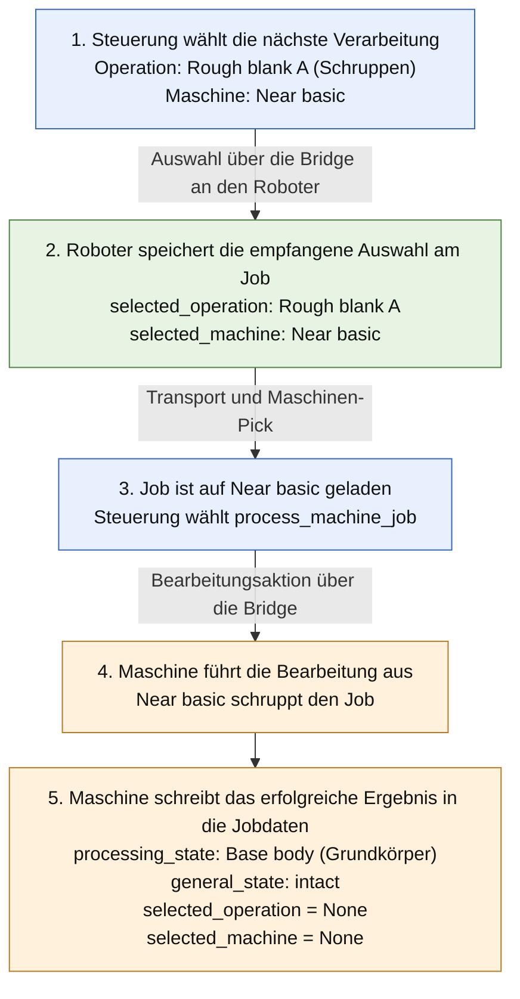

- **Warum wird die Auswahl gelöscht?** Diese Bearbeitung ist erledigt.
  `None` bedeutet, dass noch keine nächste Operation und Maschine gewählt
  sind. Die Steuerung kann nun die nächste Verarbeitung auswählen.
- **Was wird als Auswahl gespeichert?** `selected_operation` und
  `selected_machine` verweisen auf die gewählten Objekte. Im Diagramm
  stehen zur besseren Lesbarkeit ihre Namen.
- **Warum ändern beide Seiten Jobdaten?** Die Steuerung liefert zum Beispiel
  die Maschinenauswahl; die Simulation speichert diese Auswahl und setzt sie
  nach der Bearbeitung zurück. Das sind unterschiedliche Aufgaben.

#### Laufzeitstatus eines `SimOrderJob`

Die folgenden Tabellen enthalten alle 29 eigenen Attribute aus dem
Konstruktor. Sie erklären Bedeutung, Anfangswerte und Änderungen im
Produktionsablauf mit den vorhandenen Steuerungen.

- **Gespeicherte Werte:** `processing_state`, `general_state` und
  `due_state` sind Salabim-`State`-Objekte. In den Tabellen stehen die
  darin gespeicherten Werte, die über `.get()` gelesen werden.
- **Entscheidung und Eintragen unterscheiden:** Die Steuerung liefert ihre
  Auswahl über Aktionen. Die ausführende Simulationskomponente trägt diese
  Werte am Job ein. Ergebnisse wie Defekte entstehen in der Simulation.

##### Beim Erzeugen des Jobs

`SimOrder` übergibt diese sechs Werte an den Konstruktor von `SimOrderJob`:

| Attribut | Was wird beim Erzeugen gespeichert? |
| --- | --- |
| `layout` | Das Layout, in dem der Job produziert wird. |
| `scenario` | Das Szenario mit den Produktionsaufträgen. |
| `order` | Der Auftrag dieses Jobs. |
| `number` | Der Jobindex innerhalb des Auftrags: `0` bis `quantity - 1`. |
| `store_start` | Der Startlager-Store. |
| `bridge` | Die Verbindung zur Steuerung. |

##### Freigabe, Standort und Abschluss

| Attribut | Startwert | Bedeutung | Wer ändert den Wert und wann? |
| --- | --- | --- | --- |
| `released` | `False` | Eine Freigabeaktion wurde übernommen. | Der Job übernimmt `True` aus `release_job`, bevor er gegebenenfalls bis zur Freigabezeit wartet und sich im Startlager ablegt. `True` bedeutet daher nicht, dass die Ablage bereits erfolgt ist. |
| `queue_priority` | `0.0` | Termindruck-Teilwert für die Pick-Bewertung; zusätzlich Sortierwert des Jobs im Store. | Die Heuristik berechnet ihn für jeden Pick-Kandidaten aus Deadline und aktueller Zeit neu. Beim ausgewählten Pick speichern Roboter oder Maschine den übergebenen Wert am Job. Die `RandomPolicy` übergibt `0.0`. |
| `location` | `"start_storage"` | Zuletzt am Job gespeicherte Ortskennung, keine laufend berechnete Roboterposition. | Der Job schreibt den Store-Namen nach seiner Ablage; Roboter und Maschine schreiben bei ihren vorgesehenen Pick- und Place-Schritten Lade- oder Store-Kennungen. Die aktuelle Einschränkung steht direkt unter der Tabelle. |
| `completed_time` | `None` | Gespeicherter Abschlusszeitpunkt für Terminbewertung und Makespan. | `SimRobotMain` ruft `job.mark_finished()` nach dem Absenken zum Endlager auf: vor der letzten Einlagerungszeit und vor `to_store()`. Der Wert ist deshalb nicht der Zeitpunkt der tatsächlichen Endlagerablage. |
| `due_state` | `None` | Abschließende Terminbewertung, keine laufende Anzeige des Termindrucks. | Sobald `completed_time` vorliegt, erzeugt die Steuerung `complete_job`: `"late"` bei `completed_time > latest_end_time`, sonst `"on-time"`. Der Job übernimmt diesen Wert; genau bei der Deadline gilt der Job als pünktlich. |
| `process_finished` | `False` | Der eigene Simulationsprozess dieses Jobs ist beendet. | Bei der Abschlussaktion mit `finish_process=True` setzt der Job das Flag auf `True` und verlässt seine Prozessschleife. Der `SimCompletionWatcher` prüft dieses Flag für alle Jobs. |

- **Pick-Auswahl:** Die Steuerung vergleicht vollständige Aktionsscores;
  `queue_priority` ist dabei nur ein Teilwert. Die Simulation entnimmt
  anschließend genau den ausgewählten Job, nicht automatisch den ersten
  Job im Store.
- **Store-Sortierung:** Beim späteren Ablegen wird der gespeicherte Wert
  an `to_store(..., priority=job.queue_priority)` übergeben. Er beeinflusst
  die Position des Jobs im Store, nicht die zeitliche Reihenfolge der
  Ablageaktionen. Zwischen Picks wird er nicht automatisch neu berechnet.
- **Grenze von `location`:** Der Anfangswert `"start_storage"` wird schon
  vor der tatsächlichen Freigabe gesetzt. Außerdem aktualisiert
  `SimRobotCorridorArm` den Wert beim Pick aus einem Maschinenausgangspuffer
  derzeit nicht. Bis zur nächsten Ablage kann deshalb noch die vorherige
  Store-Kennung stehen. Das Attribut ist somit keine lückenlose Ortserfassung.

##### Produktzustand und nächste Verarbeitung

| Attribut | Startwert | Bedeutung | Wer ändert den Wert und wann? |
| --- | --- | --- | --- |
| `processing_state` | `"unconfigured"` | Name des aktuellen Produkttyps, etwa `"Blank A"` oder `"Base body"`. | Der Job übernimmt den Startprodukttyp aus `release_job`. Nach erfolgreicher Bearbeitung setzt `SimMachine` den Ausgangsprodukttyp der Operation. Bei einem Defekt bleibt der bisherige Produkttyp zunächst erhalten. |
| `selected_operation` | `None` | Das ausgewählte `OperationType`-Objekt für die nächste Bearbeitung, nicht nur dessen Name. | Die Steuerung wählt eine Aktion mit dieser Operation. Je nach Aktion übernehmen Job oder Roboter die Auswahl aus dem Payload. |
| `selected_machine` | `None` | Das ausgewählte konfigurierte `Machine`-Objekt als Bearbeitungs- und Transportziel. | Die Steuerung wählt eine Aktion mit dieser Maschine. Je nach Aktion übernehmen Job oder Roboter die Auswahl aus dem Payload. |

- **Auswahl zurücksetzen:** `SimMachine` setzt beide Auswahlfelder nach
  jeder Bearbeitung auf `None`, auch bei einem Defekt. Zusätzlich löschen
  Herabstufungs- und Ausschussaktionen die Auswahl; der Main-Roboter löscht
  sie ebenfalls beim Transport zum Endlager.
- **Produktzustand bei Defektaktionen:** Nacharbeit setzt
  `processing_state` auf `defect_product_state_before`. Herabstufung setzt
  ihn auf `defect_product_state_target`. Eine Ausschussaktion ändert den
  Produkttyp nicht.

##### Qualität und Herabstufung

| Attribut | Startwert | Bedeutung | Wer ändert den Wert und wann? |
| --- | --- | --- | --- |
| `general_state` | `"intact"` | Qualitätsstatus: `"intact"`, `"defect"` oder `"scrap"`. | Die Maschine setzt nach erfolgreicher Bearbeitung `"intact"`; `job.mark_defective()` setzt `"defect"`. Der Job übernimmt aus einer Herabstufungsaktion `"intact"` und aus einer Ausschussaktion `"scrap"`. |
| `downgraded` | `False` | Der Job wurde als qualitativ herabgestuft akzeptiert. Er erhält keine weitere normale Bearbeitung und wird zum Endlager gebracht. | Der Job übernimmt `True` aus der von der Steuerung gewählten Aktion `downgrade_product`. |
| `downgrade_product_type` | `None` | Das bei der Herabstufung übernommene `ProductType`-Objekt; es kann ein Zwischenprodukt sein. | Die Steuerung übergibt die Typ-ID des vorgesehenen Ergebnisses der fehlerhaften Operation. Die Bridge löst sie zum Objekt auf; der Job speichert es beim Ausführen von `downgrade_product`. |

- **Nacharbeit ist noch kein intaktes Ergebnis:** Bei ihrer Auswahl bleibt
  `general_state="defect"`. Erst eine erfolgreiche Nachbearbeitung setzt
  den Wert auf `"intact"`.

- **Beispiel:** Nach einer misslungenen Polieroperation kann die Steuerung
  herabstufen. Dann speichert der Job den vorgesehenen Produkttyp „poliert“,
  `general_state="intact"` und `downgraded=True`. Das zusätzliche Flag
  kennzeichnet die geringere Qualität.

##### Defektdaten und Nacharbeit

- **Defekt erkennen:** Nach der Bearbeitung prüft `SimMachine`, ob ein
  relevanter Defekt vorliegt. Ab Schweregrad `0.001` ruft sie
  `job.mark_defective()` auf und übergibt die Defektdaten.
- **Reaktion auswählen:** Der [ActionGenerator](#actiongenerator) erzeugt
  die möglichen Defektaktionen. Die Steuerung wählt eine davon; der Job
  führt sie aus.
- **Letzten Defekt speichern:** Die sechs `defect_...`-Angaben zu Zeitpunkt,
  Operation, Maschine, Produktzuständen und Schweregrad beschreiben den
  letzten erkannten Defekt. Ein neuer Defekt überschreibt sie. Eine
  erfolgreiche Nacharbeit, Herabstufung oder Ausschussaktion löscht sie nicht.

| Attribut | Startwert | Bedeutung | Wer ändert den Wert und wann? |
| --- | --- | --- | --- |
| `defect_detected_time` | `None` | Simulationszeit des letzten erkannten Defekts. | `job.mark_defective()` speichert beim Aufruf durch die Maschine `env.now()`. |
| `defect_operation` | `None` | Das `OperationType`-Objekt der fehlerhaften Operation. | Die Maschine übergibt es an `job.mark_defective()`. |
| `defect_machine` | `None` | Das konfigurierte `Machine`-Objekt, auf dem der Defekt entstand. | Die Maschine übergibt ihre Konfiguration an `job.mark_defective()`. |
| `defect_product_state_before` | `None` | Name des Eingangsprodukttyps der fehlerhaften Operation. | Die Maschine übergibt `operation.consumes_product_type.name`. Die Nacharbeitsaktion verwendet diesen Namen als Produktzustand. |
| `defect_product_state_target` | `None` | Name des vorgesehenen Ausgangsprodukttyps dieser Operation; nicht automatisch das Auftragsziel. | Die Maschine übergibt `operation.produces_product_type.name`. Die Herabstufungsaktion verwendet diesen Namen als Produktzustand. |
| `defect_severity` | `None` | Schweregrad des letzten erkannten Defekts. | Die Maschine erzeugt den Schweregrad bei ihrer Qualitätsprüfung und übergibt ihn ab `0.001` an `job.mark_defective()`. |
| `defect_recovery_strategy` | `None` | Gewählte Reaktion: Nacharbeit auf derselben oder einer anderen Maschine, Herabstufung oder Ausschuss. | Job oder Main-Roboter übernehmen die von der Steuerung gewählte Strategie. Ein neuer Defekt setzt sie auf `None`; eine erfolgreiche Bearbeitung entfernt eine gespeicherte Nacharbeitsstrategie. |
| `recovery_in_progress` | `False` | Eine gewählte Nacharbeit steht noch aus oder läuft. | Job oder Main-Roboter setzen `True`, wenn sie die Nacharbeit übernehmen. Nach der Maschinenoperation wird es wieder `False`, auch bei einem erneuten Defekt. |
| `defect_count` | `0` | Gesamtzahl der bei diesem Job erkannten Defekte. | Jeder Aufruf von `job.mark_defective()` erhöht den Zähler um `1`. Derselbe Job kann mehrere Defekte haben. |
| `rework_count` | `0` | Anzahl ausgewählter Nacharbeiten; keine Anzahl erfolgreich abgeschlossener Nachbearbeitungen. | Der Job zählt jede empfangene Nacharbeitsaktion. Der Main-Roboter zählt eine übernommene Nacharbeit nur, wenn zuvor noch keine Nacharbeitsstrategie gespeichert war. |
| `scrap_count` | `0` | Anzahl empfangener Ausschussaktionen für diesen Job. | Bei jeder Aktion `job_scrap` erhöht der Job den Zähler um `1`. |

- **Zufallsprüfung bei Nacharbeit:** `rework_count` geht in den Schlüssel
  für die Qualitätszufallszahlen ein. Eine weitere Nacharbeit erhält damit
  einen anderen Kontextschlüssel.
- **Aktionsdaten direkt übernehmen:** `SimOrderJob.process()` kann die im
  Code vorgesehenen Attributfelder auch direkt aus einem Aktions-Payload
  übernehmen. Die Tabellen beschreiben, welche Komponenten sie im Ablauf
  der vorhandenen Steuerungen liefern und aktualisieren.

#### UML-Zustandsdiagramm eines Jobs

- **Darstellung:** Das Diagramm zeigt den fachlichen Ablauf eines Werkstücks.
- **Abgrenzung zum Code:** `processing` und `completed` fassen mehrere
  Codefelder zusammen und sind keine zusätzlichen Werte von
  `processing_state`. Die Produktnamen hängen vom jeweiligen Modell ab.

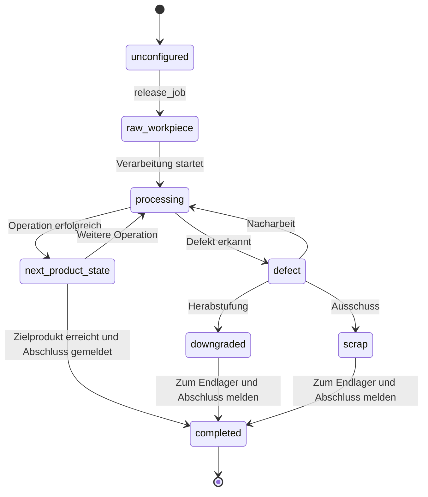

- **Herabstufung im Code:** Der Diagrammzustand `downgraded` entspricht der
  Markierung `downgraded=True` zusammen mit dem übernommenen Produktzustand.

### `SimRobot.py`

`SimRobot` stellt die gemeinsame Bewegungslogik für X, Y und Z sowie die
Positionsdarstellung bereit. Diese Funktionen waren bereits in `main`
vorhanden.

Erweiterungen gegenüber `main`:

- **Genau den ausgewählten Job aufnehmen:**
  `take_selected_job_from_store()` entnimmt den im Aktions-Payload angegebenen
  Job.
- **Geschwindigkeit schwanken lassen:** Jeder Aufruf von `move_x`, `move_y`
  oder `move_z` zieht einen neuen Faktor zwischen `0.95` und `1.05`.
  Die effektive Geschwindigkeit ist `Grundgeschwindigkeit × Zufallsfaktor`.
- **Aktuelle Geschwindigkeit speichern:** `effective_movement_speed()`
  speichert den Zufallsfaktor in `movement_speed_multiplier`. `move_x()`,
  `move_y()` und `move_z()` speichern die effektive Geschwindigkeit in
  `movement_speed`. Am Ende der Bewegung setzen sie diesen Wert auf `0.0`:
  Der Roboter steht; seine Grundgeschwindigkeit bleibt unverändert.

### `SimRobotMain.py`

Der Main-Roboter transportiert Jobs zwischen Startlager, Korridoren und
Endlager. Diese Transportaufgabe war bereits in `main` vorhanden.

Erweiterungen gegenüber `main`:

- **Bei der Bridge registrieren:** Der Roboter meldet sich selbst zusammen
  mit Start- und Endlager an.
- **Aktionen statt festem Transportablauf ausführen:** Er fordert Aktionen
  an und führt `pick_main_robot`, `place_main_robot` oder `wait_main_robot`
  aus. Job, Transportziel sowie Ein- und Auslagerzeiten kommen aus dem
  Aktions-Payload.
- **Auswahl und Beladung speichern:** `current_job` enthält den geladenen
  Job. Der Roboter übernimmt die von der Steuerung vorgegebene Priorität
  sowie gegebenenfalls die nächste Operation und Maschine.
- **Bewegungsgeschwindigkeit festlegen:** Die Grundgeschwindigkeit beträgt
  jetzt `2.0`; die Schwankung pro Achsenbewegung berechnet `SimRobot`.
- **Abschlusszeit erfassen:** Beim Transport zum Endlager ruft der Roboter
  `job.mark_finished()` auf. Das geschieht nach dem Absenken, aber vor der
  letzten Einlagerungszeit und dem tatsächlichen Ablegen im Endlager.
- **Ablage melden:** Nach dem Ablegen aktualisiert er die betroffenen Daten
  und benachrichtigt die Bridge mit `notify_state_change()`.

### `SimRobotCorridorArm.py`

Der Korridorroboter transportiert Jobs zwischen Korridor- und Maschinenpuffern.
Diese Transportaufgabe war bereits in `main` vorhanden.

Erweiterungen gegenüber `main`:

- **Bei der Bridge registrieren:** Jeder Roboter meldet sich selbst unter
  einer ID aus Korridorname und Korridorseite an.
- **Aktionen von der Steuerung ausführen:** Er fordert Aktionen an und führt
  `pick_corridor_arm_robot`, `place_corridor_arm_robot` oder
  `wait_corridor_arm_robot` aus. Job, Ziel und Lagerzeiten werden übergeben;
  der Roboter bestimmt keine eigene Route.
- **Auswahl und Beladung speichern:** Der Roboter verwaltet `current_job`
  und übernimmt die im Payload vorgegebenen Jobdaten, beispielsweise die
  Priorität und die ausgewählte Maschine.
- **Bewegungsgeschwindigkeit festlegen:** Die Grundgeschwindigkeit beträgt
  jetzt `1.5`; die Schwankung pro Achsenbewegung berechnet `SimRobot`.
- **Ablage melden:** Nach dem Ablegen aktualisiert er die betroffenen Daten
  und benachrichtigt die Bridge mit `notify_state_change()`.

### `SimMachine.py`

`SimMachine` simuliert genau eine konfigurierte `Machine`. Maschinenpuffer,
Werkzeugwechsel und Werkzeuglebensdauer waren bereits in `main` vorhanden.
Die Bearbeitungsdauer entsprach dort unmittelbar `operation.duration`.

Erweiterungen gegenüber `main`:

- **Steuerung und Ausführung trennen:** Die Maschine fordert Aktionen über
  die Bridge an und führt getrennte Pick-, Verarbeitungs- und Warteaktionen
  aus. Sie wählt Job, Operation und Werkzeug nicht mehr selbst aus.
- **Kapazitäten und Ausstattung übernehmen:** Die Puffer verwenden die
  konfigurierten Kapazitäten; die Werkzeugliste stammt von der konkreten
  `Machine`. Neu ist auch der Zustand mit montiertem Schutzwerkzeug.
- **Bearbeitungsdauer erweitern:** Produktgröße, Maschinengeschwindigkeit
  und ein maschinenspezifischer Variationsfaktor beeinflussen die Dauer.
- **Qualität prüfen:** Nach jeder Bearbeitung wird mit der
  Defektwahrscheinlichkeit dieser Maschine geprüft, ob ein Defekt entsteht.
  Das Ergebnis wird am Job gespeichert; die Steuerung wählt die Reaktion.

#### Aufbau und Laufzeitdaten

- **Konfiguration:** `self.machine` verweist auf die konfigurierte Maschine.
- **Puffer:** `store_in` und `store_out` sind getrennte Eingangs- und
  Ausgangspuffer mit den konfigurierten Kapazitäten.
- **Registrierung bei der Bridge:** Jede `SimMachine` registriert sich selbst
  unter ihrer eigenen ID und meldet dabei auch `store_in` und `store_out` an.
- **Bezugsgrößen:** `max_product_weight` und `max_product_volume` sind das
  größte Gewicht und Volumen der Auftragsziele und aller Roh- und
  Zwischenprodukttypen auf deren definierten Herstellungswegen. Sie dienen
  der Größenanpassung der Bearbeitungsdauer.
- **Werkzeugausstattung:** `self.tool_types` ist eine eigene Kopie der
  Werkzeugliste der konkreten `Machine`.
- **Werkzeuglebensdauer:** Pro Werkzeugtyp werden vier Werte verwaltet:
  - `remaining_life_units`: aktueller Restwert.
  - `remaining_life_units_t`: Simulationszeitpunkt dieses Restwerts.
  - `remaining_life_units_next`: erwarteter Restwert nach der Operation.
  - `remaining_life_units_next_t`: erwarteter Abschlusszeitpunkt der Operation.
- **Anfangszustand:** `dummy_tool_mounted=True` bedeutet, dass das
  Schutzwerkzeug montiert ist. `tool_type=None` und `current_job=None`
  bedeuten, dass noch kein Produktionswerkzeug und kein Job geladen sind.
- **Maschinengeschwindigkeit:** Einmal beim Erzeugen der Maschine wird
  `machine.processing_speed_factor` mit einem Zufallsfaktor zwischen `0.45`
  und `2.0` multipliziert. Dieser Wert bleibt für den Lauf unverändert.
- **Dauervariation:** `processing_variation` wird einmal pro Maschine
  zwischen `0.90` und `1.10` gezogen und skaliert jede ihrer Bearbeitungsdauern.
- **Anlaufverzögerung:** `startup_delay` wird einmal zwischen `0` und `4`
  Zeiteinheiten gezogen. Sie wird nur vor der ersten Bearbeitung angewendet;
  `_startup_delay_applied` verhindert ihre Wiederholung.

#### Prozess und Aktionen

Der Prozess läuft wiederholt ab:

1. Ist der Ausgangspuffer voll, setzt die Maschine den Zustand `blocked`,
   sonst `waiting`.
2. Die Maschine meldet ihren Zustand mit `bridge.request_action(self)` und
   wartet auf die von der Steuerung gelieferte Aktion.
3. Bei `pick_machine_job` nimmt sie genau den im Payload genannten Job aus dem
   genannten Store. Sie aktualisiert dessen `location`, übernimmt die
   `queue_priority` und speichert den Job in `self.current_job`.
4. Bei `process_machine_job` führt sie genau die übergebene Operation mit dem
   übergebenen Werkzeug aus.
5. Bei `wait_machine` wartet sie eine Simulationszeiteinheit und fordert
   anschließend eine neue Aktion an.

- **Keine Ersatzwahl:** Fehlt der ausgewählte Job im angegebenen Store,
  wird die Pick-Aktion beendet, ohne einen anderen Job aufzunehmen.

#### Werkzeugwechsel und Lebensdauer

Der Aktions-Payload von `process_machine_job` liefert die auszuführende
Operation, das Werkzeug und die benötigten Ausführungsdaten:

- `operation` und `tool_type`: ausgewählte Operation und Werkzeugtyp.
- `total_life_units`: vollständige Lebensdauer des verwendeten Werkzeugs.
- `consumed_life_units`: Lebensdauer, die die aktuelle Operation verbraucht.
- `remaining_life_units_before_operation`: verbleibende Lebensdauer vor Beginn
  der Operation.
- `tool_setup_action`: Anweisung, ob das Werkzeug beibehalten, montiert,
  demontiert oder ersetzt wird.
- `target_store`: Ausgangspuffer, in den die Maschine den Job nach der
  Verarbeitung ablegt.

Je nach `tool_setup_action` führt die Maschine folgende Schritte aus:

- `keep_tool`: Das aktuelle Werkzeug bleibt montiert.
- `unmount_dummy_tool_and_mount_tool`: Das Schutzwerkzeug wird entfernt und
  das Produktionswerkzeug montiert.
- `unmount_and_mount_tool`: Das bisherige Produktionswerkzeug wird entfernt
  und das neue Werkzeug montiert.
- `replace_tool_same_type`: Das verbrauchte Werkzeug wird entfernt und durch
  ein Werkzeug desselben Typs ersetzt.

- **Werkzeug ersetzen:** Reicht die verbleibende Lebensdauer für die
  Operation nicht aus, wird beim Werkzeugwechsel ein neues Werkzeug mit
  `total_life_units` angenommen.
- **Verbrauch verbuchen:** Nach der Operation wird die Lebensdauer um
  `consumed_life_units` reduziert.
- **Anzeige aktualisieren:** Während der Verarbeitung wird der erwartete
  Restwert anhand der geplanten Dauer geführt. Nach dem Abschluss entspricht
  er dem tatsächlichen Restwert.

#### Verarbeitungsdauer

- **Verwendetes Produkt:** Die Größenberechnung verwendet den
  Eingangsprodukttyp der ausgeführten Operation
  (`operation.consumes_product_type`). Damit zählen Gewicht und Volumen
  des Werkstücks vor dieser Bearbeitung, nicht die des bestellten Endprodukts.
- **Berücksichtigte Produkttypen:** Die bestellten Endprodukte aller
  Aufträge im Szenario sowie alle Roh- und Zwischenprodukttypen auf ihren
  definierten Herstellungswegen.
- **`max_product_weight`:** Größtes Gewicht unter diesen Produkttypen.
  Das Gewicht des gerade bearbeiteten Werkstücks wird durch diesen Wert geteilt.
- **`max_product_volume`:** Größtes Volumen unter diesen Produkttypen.
  Das Volumen des gerade bearbeiteten Werkstücks wird durch diesen Wert geteilt.
- **Unabhängige Maxima:** Das größte Gewicht und das größte Volumen können
  zu unterschiedlichen Produkttypen gehören. `SimLayout` bestimmt beide
  Werte beim Aufbau des Simulationslayouts.
- **Größenfaktor berechnen:**

```python
product = operation.consumes_product_type
volume = product.length * product.width * product.depth
weight_ratio = float(product.weight) / self.max_product_weight
volume_ratio = float(volume) / self.max_product_volume
size_factor = 1.0 + 0.5 * weight_ratio + 0.5 * volume_ratio
```

- **Wirkung des Größenfaktors:** Bei positiven Produktgrößen liegen die
  Verhältnisse zwischen `0` und `1`. Der Faktor liegt damit zwischen `1.0`
  und `2.0` und verlängert die konfigurierte Operationsdauer.
- **Bearbeitungsdauer berechnen:**

```python
duration = operation.duration * size_factor / self.processing_speed_factor
duration *= self.processing_variation
```

- **Maschinengeschwindigkeit berücksichtigen:** Ein größerer
  `processing_speed_factor` verkürzt die Bearbeitungsdauer.
- **Dauervariation berücksichtigen:** Die berechnete Bearbeitungsdauer wird
  mit `processing_variation` multipliziert. Dieser Faktor wird einmal pro
  Maschine gezogen und bleibt während des Laufs gleich.

#### Defektprüfung und Recovery

- **Maschinenrisiko übernehmen:** `self.defect_probability` wird beim
  Erzeugen der `SimMachine` einmal bestimmt und gilt während des Laufs für
  alle Bearbeitungen dieser Maschine.
- **Nach jeder Bearbeitung prüfen:** Nach Ablauf der Bearbeitungsdauer wird
  `_sample_defect_severity(job, operation)` aufgerufen, auch nach einer
  Nacharbeit.
- **Zufallszahlen reproduzierbar erzeugen:** Seed, Szenario, Auftrag,
  Jobnummer, Operation und `rework_count` bilden den Schlüssel. Aus dessen
  SHA-256-Fingerabdruck wird der Startwert eines eigenen Zufallsgenerators
  abgeleitet. Derselbe Schlüssel liefert dieselbe Zufallszahlenfolge.
- **Defekt und Schweregrad bestimmen:** Die erste Zufallszahl wird mit der
  Defektwahrscheinlichkeit der Maschine verglichen. Nur wenn sie kleiner
  ist, wird eine zweite Zufallszahl als Schweregrad zurückgegeben:

```python
if quality_rng.random() < self.defect_probability:
    return quality_rng.random()
return None
```

- **Relevanten Defekt speichern:** Bei einem Schweregrad ab `0.001` ruft die
  Maschine `job.mark_defective()` auf. Operation, Maschine, Produktzustände
  und Schweregrad werden im Job gespeichert; sein bisheriger
  `processing_state` bleibt erhalten.
- **Intaktes Ergebnis speichern:** Bei `None` oder einem Schweregrad unter
  `0.001` erhält der Job den von der Operation erzeugten Produktzustand und
  `general_state="intact"`.
- **Nacharbeit abschließen:** Nach einer Nacharbeitsoperation wird
  `recovery_in_progress=False` gesetzt, auch wenn erneut ein Defekt entsteht.
  Eine erledigte Nacharbeitsstrategie wird bei intaktem Ergebnis entfernt;
  bei einem neuen Defekt löscht `mark_defective()` die bisherige Strategie.
- **Zuständigkeit abgrenzen:** Die Maschine erzeugt und speichert das
  Qualitätsergebnis. Welche Defektstrategie danach gewählt wird, entscheidet
  die Steuerung.

#### Abschluss der Verarbeitung und Zustände

- **Auswahl zurücksetzen:** Nach der Bearbeitung werden `selected_operation`
  und `selected_machine` des Jobs auf `None` gesetzt.
- **Job ablegen:** Die Maschine legt ihn mit seiner Priorität im übergebenen
  Zielstore ab und aktualisiert seine `location`.
- **Maschine freigeben:** `current_job` wird auf `None` gesetzt. Mit der
  nächsten `request_action()`-Anfrage wird wieder eine Aktion angefordert.

Die wichtigsten Maschinenzustände sind:

- `waiting`: Die Maschine wartet auf eine Aktion.
- `blocked`: Der Ausgangspuffer kann keinen fertigen Job aufnehmen.
- `unmounting`: Ein Schutz- oder Produktionswerkzeug wird entfernt.
- `mounting`: Ein Produktions- oder Schutzwerkzeug wird montiert.
- `working`: Die Operation wird ausgeführt.
- `returning`: Die Verarbeitung ist beendet und der Job wird abgelegt.

#### UML-Zustandsdiagramm von `SimMachine`

- **Darstellung:** Das Diagramm zeigt die Maschinenzustände während eines
  normalen Simulationslaufs.
- **Jobauswahl:** Die Steuerung bestimmt über die `SimulationBridge`,
  welcher Job geladen und verarbeitet wird.

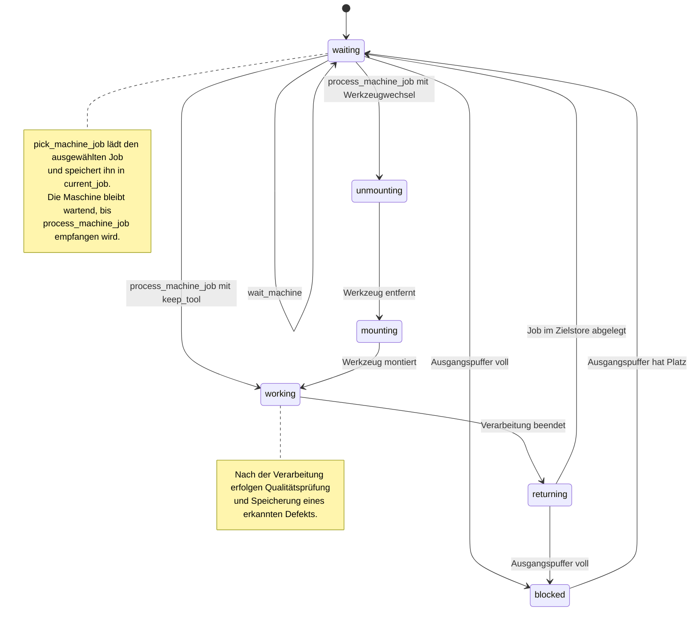

### `SimMachineShutdown` in `SimMachine.py`

Diese zusätzliche Salabim-Komponente ist neu gegenüber `main`. Sie führt
einen einmaligen Werkzeugabschluss aus, getrennt von der wiederholten
Jobverarbeitung in `SimMachine`.

- **Produktionswerkzeug entfernen:** Falls eines montiert ist, wird es unter
  Berücksichtigung seiner Demontagezeit entfernt.
- **Schutzwerkzeug montieren:** Anschließend wird das Schutzwerkzeug mit
  `dummy_tool_mount_time` montiert. Ist es bereits montiert, ist nichts zu tun.
- **Tatsächlichen Aufruf beachten:** Der `SpineMLSimulationRunner` startet
  diesen Prozess derzeit nicht. `simulate()` startet ihn nur bei
  `till == sim.inf`, wenn der erste Simulationslauf ohne Stopp durch den
  `SimCompletionWatcher` zurückkehrt. Er wird daher nicht automatisch nach
  jedem Produktionslauf ausgeführt.
- **Kennzahlen abgrenzen:** `tool_change_time` enthält nur tatsächlich
  ausgeführte Montage- und Demontagezeiten. Ein separat ausgeführter
  Werkzeugabschluss verändert die gespeicherten Jobabschlusszeiten und damit
  den daraus berechneten Makespan nicht.

### `SimScenario.py`

`SimScenario` erzeugt für jeden Auftrag eine `SimOrder`-Komponente. Dieser
Aufbau war bereits in `main` vorhanden.

Erweiterungen gegenüber `main`:

- **Bridge weitergeben:** Jeder `SimOrder` erhält dieselbe
  `SimulationBridge` und reicht sie an seine Jobs weiter.
- **Produktionsende überwachen lassen:** Nach dem Erzeugen der Aufträge
  wird ein `SimCompletionWatcher` angelegt, der die Jobabschlüsse überwacht.

### `SimCompletionWatcher` in `SimScenario.py`

Der Watcher ist eine neue, eigenständige Salabim-Komponente. Er überwacht,
wann alle Jobprozesse abgeschlossen sind, und beendet dann den Lauf.

#### Automatisches Simulationsende

1. **Jobs sammeln:** Der Konstruktor sammelt einmalig die Jobs aus den
   erzeugten Aufträgen.
2. **Abschlussflags prüfen:** Der eigene `process()`-Ablauf prüft in
   Abständen von einer Simulationszeiteinheit, ob alle Jobs
   `process_finished=True` besitzen. Dieses Flag setzt der Job beim Empfang
   einer Abschlussaktion mit `finish_process=True`.
3. **Simulation stoppen:** Ist die Jobliste nicht leer und sind alle
   Jobprozesse abgeschlossen, löst der Watcher `sim.SimulationStopped` aus.
   Der Stopp erfolgt bei der nächsten Prüfung der Flags.
4. **Ergebnisse auswerten:** Der Simulationsrunner fängt dieses Signal ab
   und sammelt anschließend die Produktionskennzahlen.

### Seed und Reproduzierbarkeit

Ein Seed ist der Startwert eines Zufallszahlengenerators. Die gemeinsame
Seed-Vorgabe übernimmt der `SpineMLSimulationRunner`, nicht eine der oben
beschriebenen Aufbauklassen.

- **Seed vor dem Lauf setzen:** Der Runner setzt `random.seed(seed)`,
  `sim.Environment(random_seed=seed)` und `SimMachine.QUALITY_SEED`.
- **Maschinenfaktoren wiederholen:** Geschwindigkeit, Dauervariation und
  Anlaufverzögerung werden einmal pro Maschine gezogen. Gleiche
  Konfiguration und gleicher Seed liefern dieselben Anfangswerte.
- **Bewegungsschwankungen wiederholen:** Für jede Achsenbewegung wird ein
  neuer Faktor gezogen. Bei gleichem Seed und gleichem Entscheidungsablauf
  ist die Folge dieser Ziehungen reproduzierbar.
- **Automatisches Maschinenrisiko bestimmen:**
  `Machine.resolve_defect_probability()` verwendet einen eigenen Generator
  aus Seed und Maschinenidentität. Ein ausdrücklich vorgegebener Wert wird
  nicht verändert.
- **Qualitätsprüfung wiederholen:** Derselbe Kontextschlüssel liefert
  dieselben Qualitätszufallszahlen. Der Vergleich mit dem Risiko der
  ausgewählten Maschine ist unter
  [Defektprüfung und Recovery](#defektprüfung-und-recovery) beschrieben.
- **Normalen Start unterscheiden:** `simulate(...)` besitzt derzeit kein
  `seed`-Argument. Die hier beschriebene Seed-Vorgabe erfolgt über den Runner
  bei der Optimierung.

## SimulationBridge

Die `SimulationBridge` ist die neue Schnittstelle zwischen Simulationskern
und Policy.

- **Simulationsseite:** Verwendet die tatsächlichen Python- und
  Salabim-Objekte und führt Aktionen aus.
- **Steuerungsseite:** Erhält Zustandsdaten und IDs statt direkter
  Referenzen auf die Simulationskomponenten.
- **Aufgabe der Bridge:** Zustände sammeln, Entscheidungen anfordern und
  ausgewählte Aktionen an die zuständigen Komponenten verteilen.

### Registrierung und Aktions-Stores

- **Aktionsfähige Komponenten anmelden:** Jobs, Maschinen, Main-Roboter und
  Korridorarm-Roboter verwenden `register()`. Die Bridge speichert ihre IDs
  und erzeugt jeweils einen eigenen Aktions-Store für ausgewählte Aktionen.
- **Korridore und Puffer anmelden:** `register_corridor()` und
  `register_store()` machen diese Objekte für die ID-Auflösung bekannt.
  Sie erhalten keine eigenen Steuerungsaktionen.
- **Aufbauklassen abgrenzen:** `SimLayout`, `SimCorridorArm`, `SimOrder`,
  `SimScenario` und `SimCompletionWatcher` benötigen ebenfalls keinen
  eigenen Aktions-Store.

### Warum die Policy IDs verwendet

- **Ziel:** Die Policy soll anhand von Zustandsdaten entscheiden, ohne
  direkt mit den laufenden Salabim-Komponenten zu arbeiten. Die echten
  Objekte bleiben auf der Simulationsseite; die Policy bezeichnet sie über IDs.
- **Vorteil:** Eine andere Policy kann dieselben Daten empfangen und
  Entscheidungen über dieselbe Schnittstelle zurückgeben. Sie muss dafür
  die Salabim-Komponenten nicht selbst kennen oder verändern.

**Beispiel: Die Policy wählt die Maschine `Near basic`.**

1. **Policy gibt die ID zurück:** Im Aktions-Payload steht
   `selected_machine_id: "Near basic"`.
2. **Bridge sucht das Objekt:** Ihre Nachschlagetabelle
   `machines_by_id` ordnet dieser ID das konfigurierte `Machine`-Objekt zu.
3. **Bridge übergibt das Objekt an die Simulation:** In der ausführbaren
   Aktion steht anschließend `selected_machine` mit diesem Objekt anstelle
   von `selected_machine_id`. Der ausführende Roboter kann die gewählte
   Maschine damit am Job speichern.

**Die beiden Funktionen im Code:**

- `policy_payload_id_mappings()` in `InterfaceTypes.py` legt fest, welche
  Nachschlagetabelle zu einem ID-Feld gehört. Für `selected_machine_id`
  ist das beispielsweise `machines_by_id`.
- `create_simulation_actions()` in `SimulationBridge.py` verwendet diese
  Zuordnung: ID nachschlagen, Objekt in den Payload einsetzen und eine
  `SimulationAction` für die ausführende Komponente erstellen.

**Maschinenauswahl, Aktionsempfänger und Puffer unterscheiden:**

| ID-Angabe | Was bezeichnet sie? |
| --- | --- |
| `selected_machine_id: "Near basic"` | Die konfigurierte Maschine, die für die Bearbeitung ausgewählt wurde. |
| `target_id: "SimMachine:Near basic:left"` | Die ausführende Maschinenkomponente, wenn eine Aktion an diese Maschine geschickt wird. |
| `target_store_id: "Near basic in"` | Den Eingangspuffer, in dem ein Job abgelegt oder aus dem er aufgenommen werden soll. |

### Zustände melden und Aktionen empfangen

Ein aktionsfähiges Objekt durchläuft wiederholt diese Schritte:

1. `yield bridge.request_action(self)` markiert es als wartend und meldet eine
   Zustandsänderung.
2. `action = yield bridge.action(self)` entnimmt die ausgewählte Aktion aus
   seinem Aktions-Store.
3. Das Objekt führt die Aktion aus und aktualisiert seine Daten.
4. Für seine nächste Entscheidung fordert es erneut eine Aktion an.

- **Anforderung intern melden:** `request_action()` ruft
  `notify_state_change()` auf. Diese Methode erhöht die Zustandsversion und
  legt einen `PolicyTrigger` im zentralen `policy_trigger_store` ab.
- **Meldung zuordnen:** Der Trigger enthält Sender-ID, Ereignis-ID,
  Simulationszeit und Versionsnummer.
- **Nur eine Änderung melden:** `notify_state_change()` kann auch ohne
  gleichzeitige Anforderung einer neuen Aktion verwendet werden.
- **Aufrufe in den Komponenten:** Bei `SimMachine` meldet die nächste
  `request_action()`-Anfrage den Zustand nach der Ablage. Roboter und Jobs
  verwenden zusätzlich `notify_state_change()` an den vorgesehenen Übergängen.

### Snapshot und Aktualitätsprüfung

- **Trigger bündeln:** Bereits eingegangene Trigger derselben
  Simulationszeit werden gemeinsam berücksichtigt.
- **Snapshot erzeugen:** `create_policy_observation()` erstellt ein
  Datenabbild des aktuellen Zustands mit folgenden Inhalten:

- `time` und `state_version`: Simulationszeit und gemeldete Zustandsversion.
- `simulation_object_states_by_id`: Zustände der registrierten Jobs,
  Maschinen und Roboter. Dazu gehören auch Daten ihrer Stores und enthaltenen
  Jobs sowie die Markierung `is_waiting_for_action`.
- `configuration_model`: ID-basierte Daten zu Layouts, Korridoren, Maschinen,
  Operationen, Produkt- und Werkzeugtypen. Dieses Modell wird beim ersten
  Snapshot aufgebaut und danach wiederverwendet.
- Trigger- und Sender-IDs als Metadaten, wenn eine Triggergruppe vorliegt.

- **Entscheidung anfordern:** Die `PolicyObservation` geht an
  `policy.make_decision()`. Die Triggerobjekte selbst bleiben bei der Bridge.
- **Aktualität prüfen:** Vor der Verwendung der Entscheidung wird die
  `state_version` des Snapshots mit der aktuellen Version verglichen.
- **Veraltete Entscheidung erneuern:** Wurde inzwischen eine weitere
  Zustandsänderung gemeldet, erstellt die Bridge Snapshot und Entscheidung
  erneut.
- **Aktuelle Entscheidung ausführen lassen:** Erst bei übereinstimmenden
  Versionen werden `SimulationAction`-Objekte erzeugt und verteilt.

### Ablauf zwischen Simulation und Policy

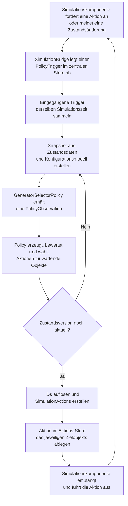

### UML-Sequenzdiagramm eines Simulationszyklus

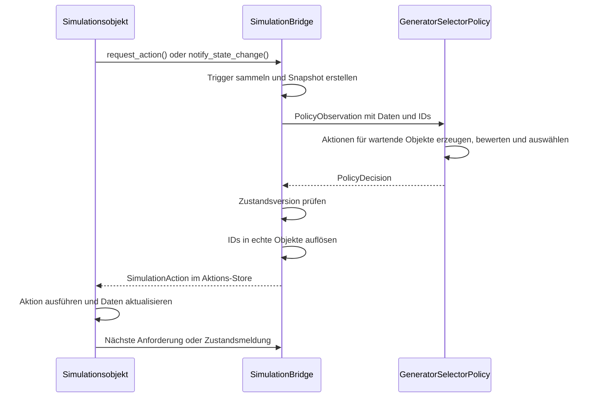

- **Mehrere Zielobjekte berücksichtigen:** Eine `PolicyDecision` kann
  Aktionen für mehrere wartende Objekte enthalten. Jede Komponente erhält
  nur die für sie ausgewählte Aktion.

## GeneralControl

Die Klassen unter
[Control/GeneralControl](sources/SpineML/Control/GeneralControl) verbinden
Aktionsgenerierung, Bewertung und Auswahl.

- **Standardsteuerung:** Die heuristische `GeneratorSelectorPolicy`
  verwendet bewertete Aktionskandidaten. Bei der Optimierung werden ihre
  lokalen Gewichtssätze verändert.
- **Vergleichssteuerung:** Die
  [RandomPolicy](#randompolicy-zufällige-vergleichssteuerung) wählt ohne
  heuristische Scores unter den technisch möglichen Nicht-Warteaktionen.
  Warten bleibt ihr Fallback.

### Ablauf der GeneralControl

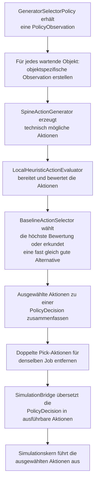

### GeneratorSelectorPolicy

Aus Sicht der Simulation ist `GeneratorSelectorPolicy` die Policy. Sie ist
für die Koordination zuständig und verbindet drei austauschbare Bausteine:

- `ActionGenerator` erzeugt aus der Beobachtung die technisch möglichen
  Aktionen für das aktuell betrachtete wartende Simulationsobjekt.
- `ActionEvaluator` bewertet diese Aktionen anhand gewichteter
  Dispatching-Regeln, zum Beispiel EDD-Termindruck, Queue-Priorität,
  Transportzeit, Verarbeitungszeit, Werkzeugzustand und Defekt-Recovery.
- `ActionSelector` wählt normalerweise die Aktion mit dem höchsten Score aus.
  Der `BaselineActionSelector` kann gelegentlich auch eine fast gleich gute
  Alternative zur Exploration auswählen.

- **Gemeinsame Entscheidung zurückgeben:** Die Policy sammelt die für
  wartende Objekte ausgewählten Aktionen in einer `PolicyDecision` und
  entfernt doppelte Picks desselben Jobs. Der Ablauf steht direkt darunter.
- **Standardbausteine verwenden:** Beim normalen Simulationsstart werden
  `SpineActionGenerator`, `BaselineActionSelector` und
  `LocalHeuristicActionEvaluator` mit einem festen `HeuristicWeights`-Satz
  verbunden.

#### Ablauf von `make_decision()`

1. Die Policy liest aus dem Snapshot alle Simulationskomponenten, die auf eine
   Aktion warten.
2. Für jedes wartende Objekt wird eine eigene `PolicyObservation` mit seiner
   `current_object_id` erstellt.
3. `ActionGenerator` erzeugt die technisch möglichen Aktionen dieses Objekts.
4. `ActionSelector` lässt diese Kandidaten durch den `ActionEvaluator` bewerten
   und wählt normalerweise die Aktion mit dem höchsten Score aus.
5. Die ausgewählten `SelectedObjectAction`-Objekte werden zu einer
   `PolicyDecision` zusammengefasst und an die Bridge zurückgegeben.
6. Ein Job darf nicht gleichzeitig von mehreren Pick-Aktionen ausgewählt
   werden; solche doppelten Picks entfernt die Policy vor der Rückgabe.

### ActionGenerator

- **Aufgabe:** `SpineActionGenerator.generate_actions()` liefert die
  Aktionskandidaten für genau ein Simulationsobjekt anhand des Snapshots und
  der Konfiguration. Die Policy ruft ihn für Objekte auf, die eine Aktion
  angefordert haben.
- **Kandidaten erzeugen:** `_generate_actions()` verzweigt anhand von
  Objekttyp und Zustand.
- **Duplikate entfernen:** `generate_actions()` entfernt anschließend
  identische Kandidaten aus der Liste dieses Objekts.
- **Keine Bewertung oder Ausführung:** Der Generator berechnet keine
  Scores und wählt keine Aktion aus. Bei der heuristischen Policy folgen
  Bewertung und Auswahl; erst die Simulation führt die gewählte Aktion aus.

#### Einfache Zustandsregeln

`_generate_actions()` prüft zuerst den Typ und den aktuellen Zustand des
Objekts. Die folgenden Regeln gelten jeweils für das betrachtete Objekt.

##### Job

Die Jobbedingungen werden in dieser Reihenfolge geprüft. Sobald ein Fall
zutrifft, liefert der Generator dessen Kandidaten zurück.

1. **Abschlusszeit vorhanden, Terminstatus noch offen:** Bei
   `completed_time is not None` und `due_state is None` wird `complete_job`
   erzeugt. Die Aktion übergibt den Terminstatus und `finish_process=True`.
2. **Job ist defekt:** Bei `general_state == "defect"` ruft der Generator
   `create_defect_actions_for_job()` auf. Diese Methode prüft nacheinander:

   - **Nacharbeit wurde bereits gewählt:** Bei
     `recovery_in_progress == True` wird für den Job nur `wait_job`
     erzeugt. Transport und Bearbeitung der gewählten Nacharbeit werden
     durch Roboter- und Maschinenaktionen ausgeführt; der Job soll keine
     zweite Defektstrategie erhalten.
   - **Sonst: Defekt ist nicht nacharbeitbar:** Liegt der Schweregrad
     außerhalb von `0.001 <= defect_severity < 0.6`, wird nur `job_scrap`
     erzeugt.
   - **Sonst: Defekt ist nacharbeitbar:** Folgende Kandidaten werden
     gemeinsam zur Auswahl angeboten:

     - `job_rework_on_defect_machine`: Nacharbeit auf derselben Maschine,
       sofern die Defektmaschine verfügbar ist.
     - `job_rework_on_alternative_machine`: Nacharbeit auf einer anderen
       Maschine, je gefundener Alternativroute.
     - `downgrade_product`: Den Job herabstufen.
     - `wait_job`: Die Entscheidung zunächst aufschieben.

3. **Job ist noch nicht freigegeben:** Bei `released == False` werden
   `release_job` und `wait_job` angeboten. Die Freigabeaktion enthält
   `release_time = max(aktuelle Zeit, earliest_start_time)`. Der Job wartet
   bei ihrer Ausführung gegebenenfalls bis zu diesem Zeitpunkt und legt sich
   anschließend im Startlager ab.
4. **Keiner der vorherigen Fälle trifft zu:** Es wird nur `wait_job`
   angeboten.

- **Herabgestufte Jobs:** Nach der Herabstufung erhält der Job zunächst
  `wait_job`, bis seine Abschlussaktion ansteht. Für den Transport erzeugt
  der Generator Roboteraktionen zum Endlager. `downgraded=True` verhindert
  dabei eine weitere normale Bearbeitungsroute.

##### Main-Roboter

- **Kein Job geladen (`current_job_id is None`):** Für jeden Job im
  Startlager und in den Main-Stores der Korridore wird ein
  `pick_main_robot`-Kandidat erzeugt. Zusätzlich gibt es `wait_main_robot`.
- **Job geladen (`current_job_id is not None`):** Der Generator erzeugt
  passende `place_main_robot`-Kandidaten und zusätzlich `wait_main_robot`.
  Bei normaler Weiterbearbeitung ist das Ziel der Arm-Eingangspuffer für
  die nächste Maschine. Fertige, herabgestufte oder als Ausschuss markierte
  Jobs erhalten einen Transportkandidaten zum Endlager, sofern dort Platz ist.

##### Korridorroboter

- **Kein Job geladen (`current_job_id is None`):** Für jeden Job im
  eigenen Arm-Eingangspuffer und in den Ausgangspuffern seiner Maschinen
  wird ein `pick_corridor_arm_robot`-Kandidat erzeugt. Zusätzlich gibt es
  `wait_corridor_arm_robot`.
- **Job geladen (`current_job_id is not None`):** Der Generator erzeugt
  passende `place_corridor_arm_robot`-Kandidaten und zusätzlich
  `wait_corridor_arm_robot`. Das Ziel ergibt sich aus der nächsten Maschine:
  eigener Maschineneingang, Eingangspuffer des anderen Arms oder Main-Store
  des aktuellen Korridors. Fertige, herabgestufte oder als Ausschuss markierte
  Jobs werden zum Main-Store für den Weitertransport zum Endlager geführt.

##### Maschine

- **Kein Job geladen (`current_job_id is None`):** Für jeden Job im
  Eingangspuffer wird ein `pick_machine_job`-Kandidat erzeugt. Zusätzlich
  gibt es `wait_machine`.
- **Job geladen und Ausgangspuffer hat Platz:** Es wird nur
  `process_machine_job` erzeugt, keine zusätzliche Wartealternative.
- **Job geladen und Ausgangspuffer voll:** Es wird nur `wait_machine`
  erzeugt.
- **Bearbeitungsdaten übernehmen:** Die Verarbeitungsaktion verwendet die
  am geladenen Job gespeicherte Operation und Maschine. Die Werkzeugdaten
  und eine nötige Werkzeugvorbereitung werden aus dem Snapshot übernommen
  beziehungsweise daraus abgeleitet. Hier wird keine neue Route berechnet.

#### Technische Prüfungen des ActionGenerators

Diese Prüfungen gehören zu unterschiedlichen Erzeugungsmethoden, nicht zu
den Zustandsregeln einer einzelnen Maschine:

- **Maschinen zu einer Route zuordnen:**
  `calculate_machine_sequences_from_operation_sequence()` prüft den
  Maschinentyp, die Zugehörigkeit zum ausgewählten Layout und die erlaubten
  Werkzeugtypen. Diese Zuordnung sagt noch nicht, ob eine Maschine gerade
  frei ist.
- **Unmittelbares Transportziel prüfen:** Die Place-Methoden bestimmen aus
  dem nächsten Bearbeitungsschritt den Zielstore und erzeugen die Ablageaktion
  nur bei freier Zielkapazität. Sie prüfen nicht pauschal alle Puffer des
  weiteren Herstellungswegs.
- **Nacharbeit auf der Defektmaschine anbieten:**
  `machine_available_for_rework()` prüft für
  `job_rework_on_defect_machine` alle vier Bedingungen:

  - Kein Job auf der Maschine geladen.
  - Maschinenzustand ist `"waiting"`.
  - Mindestens ein freier Platz im Eingangspuffer.
  - Mindestens ein freier Platz im Ausgangspuffer.

- **Alternative Nacharbeitsroute bestimmen:**
  `find_alternative_rework_routes()` sucht Routen, auf denen dieselbe
  fehlerhafte Operation zuerst auf einer anderen Maschine wiederholt wird.
  Dabei werden weder die aktuelle Belegung noch die Pufferkapazitäten
  dieser alternativen Maschine geprüft. Beim späteren Transport wird
  jeweils die Kapazität des unmittelbar nächsten Zielstores geprüft.
- **Werkzeugvorbereitung festlegen:** Bei `process_machine_job` steht im
  Payload, ob das Werkzeug beibehalten, gewechselt oder wegen verbrauchter
  Lebensdauer ersetzt werden soll. Dafür werden keine separaten
  Werkzeugwechsel-Kandidaten erzeugt.

#### Mehrere Kandidaten pro wartendem Objekt

- **Möglichkeiten sammeln:** Lässt die Zustandsregel mehrere Aktionen zu,
  erzeugt der Generator sie gemeinsam als Kandidatenliste.
- **Auswahl der Policy überlassen:** `GeneratorSelectorPolicy` übergibt die
  Liste an den Selector zur Bewertung und Auswahl. `RandomPolicy` wählt
  stattdessen ohne Scores. Der Generator führt keinen Kandidaten selbst aus.
- **Payload-Beispiele lesen:** Die folgenden Beispiele zeigen jeweils
  einen einzelnen Kandidaten aus einer solchen Liste.

**Beispiel: Herabstufung eines defekten Jobs**

- **Verfügbare Defektaktionen:** Ihre Erzeugung ist unter
  [Job](#job) beschrieben. Die Herabstufung ist im Nacharbeitsbereich eine
  Alternative zur Nacharbeit und zum Warten.
- **Keine Nacharbeitskandidaten:** Gibt es im nacharbeitbaren Bereich
  weder eine alternative Route noch eine verfügbare Defektmaschine,
  bleiben `downgrade_product` und `wait_job`. Die Policy wählt zwischen
  diesen Kandidaten; die Herabstufung erfolgt nicht automatisch.
- **Herabstufungsprodukt bestimmen:** Verwendet wird der vorgesehene
  Produkttyp der fehlerhaften Operation. Er kann ein Zwischenprodukt sein
  und muss nicht dem Auftragsziel entsprechen.
- **Herabstufung kennzeichnen:** Der Payload setzt diesen Produkttyp als
  `processing_state`, dazu `general_state="intact"` und `downgraded=True`.
  Die Qualitätsabweichung bleibt durch das zusätzliche Flag erkennbar.

Beispiel für eine Herabstufungsaktion:

```json
{
  "action_type": "downgrade_product",
  "payload": {
    "selected_operation_id": null,
    "selected_machine_id": null,
    "processing_state": "produkt_b",
    "general_state": "intact",
    "downgraded": true,
    "downgrade_product_type_id": "produkt_b",
    "defect_recovery_strategy": "downgrade"
  }
}
```

**Beispiel: Pick eines Roboters**

1. Eine eigene `pick_*`-Aktion für jeden auswählbaren Job im Store (Beispiel:
   zwei Jobs erzeugen zwei Pick-Kandidaten).
2. Zusätzlich eine `wait_*`-Aktion.

Beispiel für eine Pick-Aktion des Main-Roboters:

```json
{
  "action_type": "pick_main_robot",
  "payload": {
    "target_type": "start_storage",
    "target_store_id": "start",
    "selected_job_id": "auftrag_1:1",
    "storage_out_time": 1.0
  }
}
```

**Beispiel: Place eines Roboters**

1. Eine Route legt die nächste Operation und Maschine fest. Daraus ergibt
   sich der nächste Zielstore des Roboters.
2. Hat dieser Store Platz, wird ein `place_*`-Kandidat erzeugt. Zwei
   unterschiedliche nächste Schritte können so zwei Place-Kandidaten ergeben.
3. Zusätzlich gibt es eine `wait_*`-Aktion. Identische Kandidaten werden
   anschließend entfernt.

Beispiel für eine Place-Aktion des Main-Roboters:

```json
{
  "action_type": "place_main_robot",
  "payload": {
    "target_type": "sim_corridor_store_arm_input",
    "selected_operation_id": "operation_1",
    "selected_machine_id": "machine_1",
    "sim_corridor_id": "corridor_1",
    "target_store_id": "corridor_1 left",
    "storage_in_time": 1.0
  }
}
```

**Beispiel: Verarbeitung auf einer Maschine**

- **Voraussetzung:** Ein Job ist geladen und der Ausgangspuffer hat Platz.
- **Payload:** Er enthält die auszuführende Operation, das Werkzeug, dessen
  Lebensdauerwerte, die Werkzeugvorbereitung und den Ausgangsstore.

Beispiel für eine Verarbeitungsaktion:

```json
{
  "action_type": "process_machine_job",
  "payload": {
    "operation_id": "operation_1",
    "planned_machine_id": "machine_1",
    "tool_type_id": "tool_1",
    "total_life_units": 100,
    "consumed_life_units": 5,
    "remaining_life_units_before_operation": 80,
    "tool_setup_action": "keep_tool",
    "target_store_id": "machine_1 out"
  }
}
```

#### Identische Kandidaten entfernen

- **Identische Kandidaten erkennen:** Nur gleicher `action_type` und
  gleicher Payload gelten als Duplikat. Verschiedene vollständige Routen
  können denselben nächsten Schritt und damit eine identische Aktion ergeben.
- **Unterschiedliche Kandidaten behalten:** Aktionen mit unterschiedlichen
  Payloads bleiben erhalten und stehen dem Selector zur Auswahl.
- **Nur die Liste dieses Objekts bereinigen:** Der Generator entfernt hier
  keine konkurrierenden Picks verschiedener Roboter. Diese zusätzliche
  Prüfung übernimmt die [GeneratorSelectorPolicy](#generatorselectorpolicy).

#### Berechnung von Operations- und Maschinenrouten

- **Operationsfolgen bestimmen:** `calculate_operation_sequences_between()`
  ermittelt die Folgen vom aktuellen Produkttyp bis zum Auftragsziel.
- **Maschinen zuordnen:**
  `calculate_machine_sequences_from_operation_sequence()` ermittelt die
  passenden Maschinenfolgen. Jede Kombination aus Operations- und
  Maschinenfolge bildet eine Route.
- **Routen eines Jobs bereitstellen:** `selectable_routes_for_job()`
  liefert für normale, intakte und noch nicht fertige Jobs diese Routen.
  Defekte, als Ausschuss markierte, herabgestufte oder noch nicht konfigurierte
  Jobs erhalten keine normale Produktionsroute. Bei bereits gewählter
  Nacharbeit mit konkreter Operation und Maschine liefert die Methode nur
  den festgelegten Nacharbeitsschritt.
- **Alternative Nacharbeit vorbereiten:**
  `find_rework_routes_with_alternative_machine()` liest die nötigen IDs aus
  der Beobachtung. `find_alternative_rework_routes()` berechnet den weiteren
  Weg ab dem vorgesehenen Ergebnis der fehlerhaften Operation.
- **Fehlerhafte Operation wiederholen:** Die Operation wird vor jede
  Restfolge gesetzt; dazu werden Maschinenfolgen berechnet. Routen mit der
  Defektmaschine als erster Maschine werden ausgeschlossen. Für spätere
  Operationen darf diese Maschine wieder vorkommen.
- **Defekttransport beim Main-Roboter:** Ist für den geladenen defekten Job
  eine Operation und Maschine gespeichert, wird diese Auswahl verwendet.
  Fehlt sie, erzeugt die Main-Place-Methode eigene Transportkandidaten zur
  Defektmaschine und zu gefundenen Alternativen. Das ist von den oben
  beschriebenen Job-Defektaktionen zu unterscheiden.
- **Defekttransport beim Korridorroboter:** Er übernimmt eine vorhandene
  Operations- und Maschinenauswahl. Ohne solche Auswahl berechnet er für
  einen defekten Job keine Ersatzroute aus den Defektdaten.

### ActionSelector

- **Eingabe:** Die gesamte Kandidatenliste eines wartenden Objekts.
- **Aufgabe:** Kandidaten vom `ActionEvaluator` vorbereiten und bewerten
  lassen und daraus eine Aktion auswählen. Der Selector erzeugt keine
  neuen Aktionen.

Der Standard-`BaselineActionSelector` arbeitet in folgenden Schritten:

1. Gibt es für das wartende Objekt keine Aktion, gibt er eine leere
   `PolicyDecision` zurück.
2. Für jede vorhandene Aktion ergänzt der `ActionEvaluator` zunächst die
   benötigten Payload-Werte und berechnet danach ihren Score.
3. Der höchste Score wird gesucht. Alle Aktionen mit genau diesem Score gelten
   als beste Aktionen.
4. Zusätzlich gelten Aktionen als fast gleich gut, wenn ihr Score höchstens
   `0.05` unter dem höchsten Score liegt. Bei einem Höchstwert von `0.80`
   werden zum Beispiel auch Aktionen ab `0.75` als fast gleich gut gesammelt.
5. **Exploration:** Mit `EXPLORATION_EPSILON = 0.10` wird mit einer
   Wahrscheinlichkeit von `10 %` eine fast gleich gute, aber nicht exakt
   beste Alternative ausprobiert. Nicht-Warteaktionen werden unter diesen
   Alternativen bevorzugt. Gibt es keine solche Alternative, bleibt eine
   exakt beste Aktion die Auswahl.
6. **Keine Exploration:** In den übrigen Fällen wählt der Selector zufällig
   eine der exakt besten Aktionen. Diese Zufallsauswahl löst nur Gleichstände
   auf und bleibt mit demselben Simulations-Seed reproduzierbar.

- **Ergebnis zurückgeben:** Die gewählte Aktion geht als `PolicyDecision`
  für das Zielobjekt an die `GeneratorSelectorPolicy`.
- **Ziel der Exploration:** Auch fast gleich gute Produktionsentscheidungen
  ausprobieren, ohne deutlich schlechter bewertete Aktionen zu verwenden.
- **Auswirkung auf die Produktion:** Andere Aktionen können den weiteren
  Simulationsverlauf und die globalen Kennzahlen verändern. Gemeinsame Seeds
  und die Mittelung mehrerer Läufe beziehen diesen Einfluss in den Vergleich
  ein.
- **Abgrenzung zur Gewichtssuche:** Die Exploration verändert weder Scores
  noch lokale Gewichtssätze. Der Vergleich von Defektstrategien wie
  `job_rework_on_defect_machine` und `job_rework_on_alternative_machine`
  beruht weiterhin auf der normalen Score-Berechnung.

### RandomPolicy: zufällige Vergleichssteuerung

[`RandomPolicy`](sources/SpineML/Control/GeneralControl/RandomPolicy.py) ist die
zufällige Vergleichssteuerung.

- **Gemeinsame technische Grundlage:** Sie verwendet denselben
  `SpineActionGenerator` und dieselbe `SimulationBridge` wie die Heuristik.
- **Keine heuristische Bewertung:** Sie verwendet weder Evaluator noch
  Scores, Gewichte oder EDD-Priorität.

`make_decision()` wählt für jedes wartende Objekt:

1. Der Generator liefert die technisch möglichen Aktionskandidaten.
2. Picks für einen in dieser Entscheidung bereits ausgewählten Job werden
   ausgeschlossen, damit derselbe Job nicht gleichzeitig zweimal gepickt wird.
3. Gibt es Nicht-Warteaktionen, wird **gleichverteilt unter diesen Kandidaten**
   gewählt. Jeder verbleibende Kandidat hat die Wahrscheinlichkeit `1 / n`.
4. Nur wenn keine Nicht-Warteaktion verfügbar ist, wird eine angebotene
   `wait_*`-Aktion gewählt. Ohne Kandidaten wird keine Aktion zurückgegeben.

- **Nicht-Warteaktionen:** Dazu zählen Freigabe, Pick, Ablegen, Verarbeitung
  und technisch mögliche Defektbehandlungen. Sie heißen im Code „produktiv“.
- **Pro Kandidat auswählen:** Drei verschiedene Routenkandidaten sind drei
  Auswahlmöglichkeiten, auch wenn sie dieselbe Aktionsart haben.
- **Keine Deadline-Priorität setzen:** Bei Picks gilt `queue_priority = 0.0`.
  Die vorhandene Store-Reihenfolge bei gleicher Priorität bleibt bestehen.
- **Technische Zulässigkeit beibehalten:** Der Generator prüft weiterhin,
  welche Aktionen möglich sind. Zufällig ist nur die Auswahl unter diesen
  Kandidaten; Warten bleibt der Fallback.
- **Als Alternative einsetzen:** Die Heuristik bleibt die Standardsteuerung.

Ein Headless-Lauf mit dieser Policy:

```python
from SpineML.Control.GeneralControl import RandomPolicy
from SpineML.Control.HeuristicControl import SpineMLSimulationRunner

runner = SpineMLSimulationRunner(layout, scenario)
metrics = runner.run_policy(RandomPolicy(seed=101), seed=101)
```

- **Frische Policy pro Lauf:** Jeder Lauf verwendet eine neue Policy.
- **Zufallsquellen trennen:** Der eigene Generator der Policy steuert nur die
  Aktionsauswahl; der Runner setzt zusätzlich den Simulations-Seed. Auch der
  heuristische Selector besitzt im Headless-Runner einen eigenen Generator.
  Policy-Entscheidungen verbrauchen dadurch keine Zufallszahlen des
  Simulationskerns.

## HeuristicControl

### Ziel und Grundidee

`HeuristicControl` bewertet technisch mögliche Aktionskandidaten mit einem
numerischen Score.

- **Bewertung:** Der `ActionGenerator` liefert die Kandidaten der aktuellen
  Entscheidungsrunde; der `ActionEvaluator` berechnet ihre Scores.
- **Auswahl und Ausführung:** Der `ActionSelector` vergleicht die Scores und
  wählt eine Aktion. Erst der Simulationskern führt sie aus.
- **Heuristische Regeln:** Vereinfachte Regeln wie „Bevorzuge einen
  dringenden Job“ oder „Bevorzuge einen kurzen Transport“ werden mit ihren
  Gewichten verbunden. Das ermöglicht eine schnelle Auswahl, garantiert aber
  keine insgesamt optimale Produktionsplanung.
- **Dispatching-Regel:** Eine solche lokale Prioritätsregel bevorzugt eine
  aktuelle Aktion, ohne einen vollständigen Plan für zukünftige Zustände zu
  berechnen.
- **Dynamische Produktionsplanung:** Bei jeder neuen Beobachtung werden die
  Kandidaten anhand des aktuellen Zustands erneut bewertet, etwa wenn eine
  Maschine frei wird oder ein Defekt auftritt.

### Ablauf der Bewertung

- **Umsetzung:** Der Bewertungsteil der Policy steht in
  [LocalHeuristicActionEvaluator.py](sources/SpineML/Control/HeuristicControl/LocalHeuristicActionEvaluator.py).

1. **Kandidaten vorbereiten:** `prepare_action_candidate()` kopiert den
   Kandidaten. Bei Pick-Aktionen ergänzt es die aktuelle Termindruckpriorität
   des ausgewählten Jobs als `queue_priority` im Payload.
2. **Rohwerte ermitteln:** `evaluate_action()` ruft je nach `action_type`
   die passende Bewertungsmethode auf, etwa `evaluate_machine_pick_action()`.
   Diese liest die **Bewertungsgrößen** (Rohwerte der Kriterien, zum Beispiel
   eine Transportzeit von vier Zeiteinheiten) aus dem Simulationszustand,
   der Konfiguration und den Aktionsdaten.
3. **Rohwerte abbilden:** Die heuristischen Regeln bestimmen, wie daraus
   **Teilwerte** (auf den Bereich `0` bis `1` abgebildete Werte) entstehen.
   Zum Beispiel liefert `inverse_scale(4)` den Teilwert `0.2`.
4. **Score berechnen:** `calculate_action_score()` verbindet die Teilwerte
   mit ihren Gewichten (relativer Wichtigkeit) zu einem Gesamtscore.
   Bei bestimmten Defektaktionen wird anschließend eine Deadline-Strafe
   abgezogen. Der Endscore kann dadurch negativ werden und wird nicht
   nachträglich begrenzt.

5. **Aktion auswählen:** Der `BaselineActionSelector` wählt mit den fertigen
   Scores eine bestbewertete Aktion oder erkundet gelegentlich eine fast
   gleich gute Alternative. Erst der Simulationskern führt sie aus.

### Bewertungsgrößen und heuristische Regeln

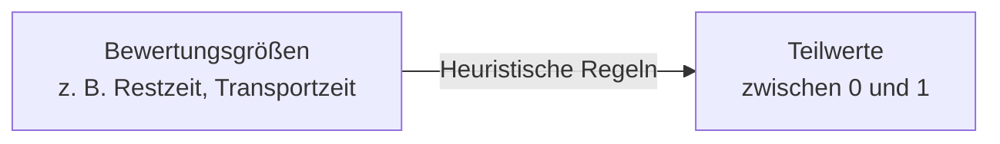

- **Regel und Formel:** Die Regel legt die bevorzugte Eigenschaft fest;
  ihre Formel bildet den Rohwert auf einen Teilwert ab. So setzt
  `inverse_scale(4) = 0.2` die Regel „Kürzere Transportzeiten bevorzugen“ um.
- **Gemeinsame Vorteilsrichtung:** Teilwerte sind dimensionslos, auch wenn
  ihre Rohwerte unterschiedliche Einheiten haben. Ein höherer Teilwert
  bedeutet einen größeren Vorteil für die betrachtete Aktion.
- **Verknüpfung:** Regeln und
  [Aktionstypen](#verwendung-der-bewertungsgrößen-nach-aktionstyp) sind über
  ihre Kriterien gegenseitig verlinkt. Jede Regel nennt Rohwert, Abbildung
  und Beispiel.

### Allgemeine heuristische Regeln

#### 1. Termindruck: dringendere Jobs bevorzugen

- **Bewertungsgröße:** Restzeit `t = latest_end_time − aktuelle Zeit`.
  `latest_end_time` ist die Deadline des Auftrags, zu dem der Job gehört.
- **Regel:** Je näher die Deadline liegt oder je weiter sie überschritten
  ist, desto höher ist die EDD-Priorität (`Earliest Due Date`).
- **Abbildung in `calculate_edd_priority()`:**
  - Bei `t >= 0`: `Teilwert = 0.5 × inverse_scale(t)`.
  - Bei `t < 0`: `Teilwert = 0.5 + 0.5 × direct_scale(-t)`.
- **Beispiel:** Zwei Zeiteinheiten vor der Deadline ergibt sich etwa
  `0.167`, genau bei der Deadline `0.5` und zwei Zeiteinheiten danach etwa
  `0.833`. Negative Restzeit wird also als Überfälligkeit behandelt.

- **Wertebereich:** Vor der Deadline liegt die Priorität unter `0.5`, genau
  bei der Deadline beträgt sie `0.5`, danach liegt sie darüber. Bei sehr
  großer Restzeit nähert sie sich `0`, bei sehr großer Überfälligkeit `1`.

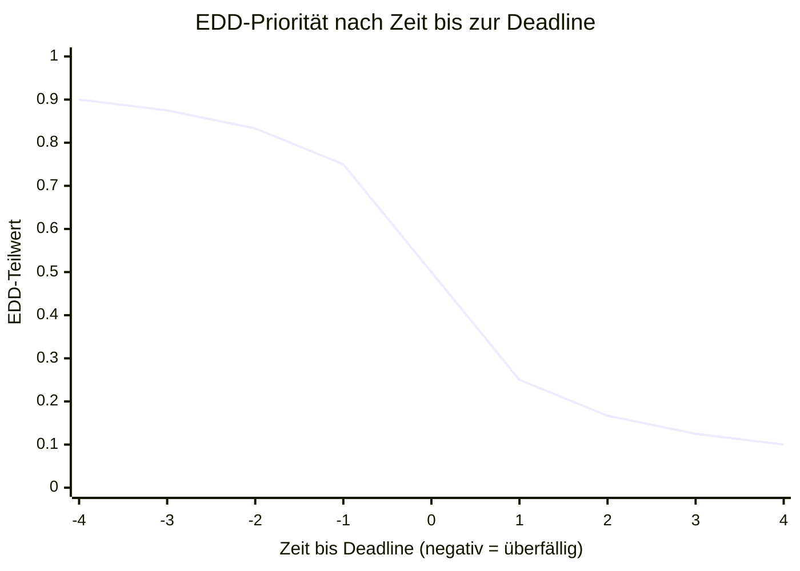

- **Verwendung:** [Freigabe](#freigabe-release_job),
  [Roboter-Pick](#roboter-pick-pick_main_robot-und-pick_corridor_arm_robot),
  [Maschinen-Pick](#maschinen-pick-pick_machine_job),
  [normales Warten](#normales-warten-wait_) und
  [Warten bei einem Defekt](#warten-bei-einem-defekt-wait_job).

#### 2. Verarbeitungs-, Transport- und Lagerzeiten: kürzere Zeiten bevorzugen

- **Bewertungsgröße:** Eine nichtnegative Zeit `x`.
- **Regel:** Eine kürzere Zeit soll einen höheren Teilwert ergeben.
- **Abbildung:** `inverse_scale(x) = 1 / (1 + x)`.
- **Beispiel:** Zeit `1 → 0.5`; Zeit `4 → 0.2`.

- **Grenzwerte:** Bei `x = 0` ergibt sich `1`; mit wachsendem `x` nähert
  sich der Teilwert `0`.

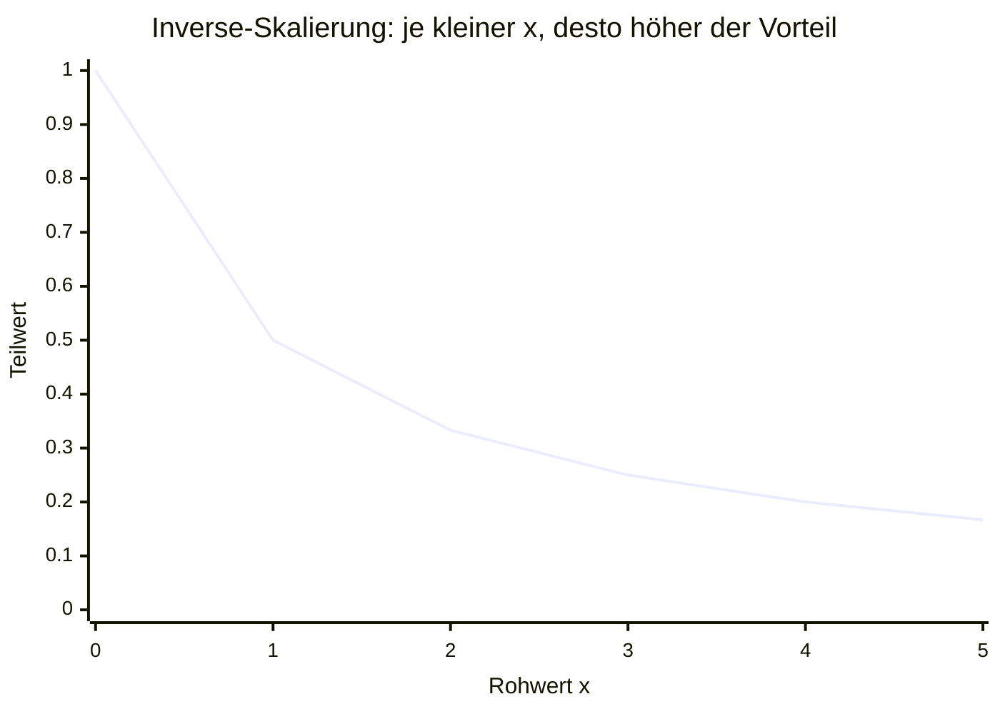

- **Verwendung:** [Freigabe](#freigabe-release_job),
  [Roboter-Pick](#roboter-pick-pick_main_robot-und-pick_corridor_arm_robot),
  [Maschinen-Pick](#maschinen-pick-pick_machine_job),
  [Ablegen](#ablegen-place_main_robot-und-place_corridor_arm_robot),
  [Nacharbeit auf der Defektmaschine](#nacharbeit-auf-der-defektmaschine-job_rework_on_defect_machine) und
  [Nacharbeit auf einer anderen Maschine](#nacharbeit-auf-einer-anderen-maschine-job_rework_on_alternative_machine).

#### 3. Maschinenwarteschlange: weniger wartende Jobs bevorzugen

- **Bewertungsgröße:** Anzahl `n` der Jobs im Eingangspuffer der Maschine.
- **Regel:** Eine kürzere Warteschlange soll einen höheren Teilwert ergeben.
- **Abbildung:** `inverse_scale(n) = 1 / (1 + n)`.
- **Beispiel:** Kein wartender Job ergibt `1`; drei wartende Jobs ergeben
  `0.25`.

- **Verwendung:** [Ablegen](#ablegen-place_main_robot-und-place_corridor_arm_robot),
  [Nacharbeit auf der Defektmaschine](#nacharbeit-auf-der-defektmaschine-job_rework_on_defect_machine) und
  [Nacharbeit auf einer anderen Maschine](#nacharbeit-auf-einer-anderen-maschine-job_rework_on_alternative_machine).

#### 4. Werkzeugpassung: ein bereits montiertes passendes Werkzeug bevorzugen

- **Bewertungsgröße:** Übereinstimmung zwischen benötigtem und montiertem
  Werkzeugtyp. Jede Operation hat einen festgelegten benötigten Werkzeugtyp.
- **Regel und Abbildung:** Gleicher Werkzeugtyp ergibt den Teilwert `1`,
  ein anderer Werkzeugtyp oder kein montiertes Werkzeug ergibt `0`.
  Das Kriterium geht bei Maschinen-Pick und Nacharbeit immer ein.
- **Beispiel:** Benötigt die Operation Fräser A und Fräser A ist montiert,
  ist der Teilwert `1`; bei montiertem Fräser B ist er `0`.

- **Verwendung:** [Maschinen-Pick](#maschinen-pick-pick_machine_job),
  [Nacharbeit auf der Defektmaschine](#nacharbeit-auf-der-defektmaschine-job_rework_on_defect_machine) und
  [Nacharbeit auf einer anderen Maschine](#nacharbeit-auf-einer-anderen-maschine-job_rework_on_alternative_machine).

#### 5. Werkzeugreserve: mehr Lebensdauer im Verhältnis zum Verbrauch bevorzugen

- **Bewertungsgröße:** Verhältnis
  `r = verbleibende Werkzeuglebensdauer / Verbrauch der geplanten Operation`.
- **Regel:** Eine größere Reserve im Verhältnis zum Verbrauch soll einen
  höheren Teilwert ergeben.
- **Abbildung:** Bei positivem Verbrauch gilt
  `Teilwert = direct_scale(r) = r / (1 + r)`. Bei Verbrauch `0` entfällt
  dieses Kriterium, da das Verhältnis sonst eine Division durch null wäre.
- **Beispiel:** Vier verbleibende und zwei benötigte Einheiten ergeben
  `r = 2` und den Teilwert `2 / 3 ≈ 0.667`.

- **Grenzwerte:** Bei `r = 0` ergibt sich `0`; mit wachsendem `r` nähert
  sich der Teilwert `1`.

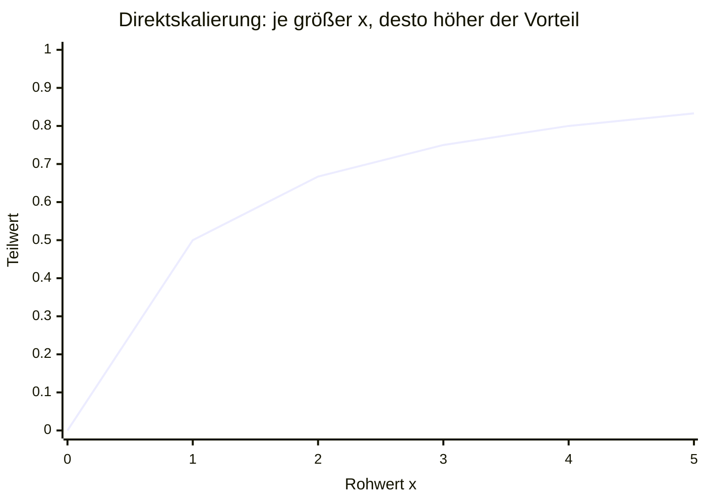

- **Verwendung:** [Maschinen-Pick](#maschinen-pick-pick_machine_job),
  [Nacharbeit auf der Defektmaschine](#nacharbeit-auf-der-defektmaschine-job_rework_on_defect_machine) und
  [Nacharbeit auf einer anderen Maschine](#nacharbeit-auf-einer-anderen-maschine-job_rework_on_alternative_machine).

#### 6. Freie Pufferkapazität: einen größeren freien Anteil bevorzugen

- **Bewertungsgröße:** Freie Plätze und Gesamtkapazität des Ziel-Stores.
- **Regel:** Je größer der freie Anteil, desto höher der Teilwert.
- **Abbildung mit `normalize_ratio()`:**
  `normalize_ratio(freie Plätze, Gesamtkapazität) = freie Plätze / Gesamtkapazität`.
- **Beispiel:** Zwei von zehn freien Plätzen ergeben `0.2`; acht von zehn
  ergeben `0.8`.

- **Wertebereich:** Bei positiver, endlicher Kapazität und gültiger Belegung
  liegt dieser Anteil zwischen `0` und `1`.
- **Verwendung:** [Ablegen](#ablegen-place_main_robot-und-place_corridor_arm_robot).

#### 7. Defektschwere: bei stärkerem Defekt die Herabstufung höher bewerten

- **Bewertungsgröße:** `defect_severity` des Jobs.
- **Regel:** Je höher der Defektschweregrad, desto stärker spricht dieses
  Kriterium für eine Herabstufung.
- **Abbildung in `evaluate_defect_action()`:**
  `Teilwert = float(current_state.get("defect_severity", 0.0))`.
- **Beispiel:** Schweregrad `0.2 → 0.2`; Schweregrad `0.5 → 0.5`.

- **Verwendung:** [Herabstufung](#herabstufung-downgrade_product).

#### 8. Warten: je höher der Termindruck, desto niedriger der Teilwert

- **Bedeutung:** Der Teilwert beschreibt den Vorteil der Aktion Warten,
  nicht ihre Dauer.

- **Bewertungsgröße:** Termindruck des Jobs, ausgedrückt durch seine
  EDD-Priorität. Eine höhere EDD-Priorität bedeutet einen dringenderen Job.
- **Regel:** Je höher die EDD-Priorität, desto niedriger der Teilwert für
  Warten. Warten wird dadurch für dringende Jobs weniger vorteilhaft bewertet.
- **Abbildung:** Für normales Warten in `evaluate_wait_action()` und für
  Warten eines defekten Jobs in `evaluate_defect_action()` gilt bei bekannter
  Deadline dieselbe Formel:
  `Teilwert = 1.0 - EDD`.
- **Ohne Job oder Deadline:** `evaluate_wait_action()` verwendet den festen
  Ersatzwert `DEFAULT_WAIT_SCORE = 0.01`.
- **Beispiel:** Bei `EDD = 0.75` ergibt sich in beiden Fällen
  `1.0 - 0.75 = 0.25`. Bei einem defekten Job kann anschließend noch ein
  Strafabzug hinzukommen.

- **Verwendung:** [Normales Warten](#normales-warten-wait_) und
  [Warten bei einem Defekt](#warten-bei-einem-defekt-wait_job).

### Verwendung der Bewertungsgrößen nach Aktionstyp

- **Zuordnung:** Die folgenden Abschnitte nennen pro Aktionstyp die
  Rohwerte, ihre Ermittlung und die verwendeten Gewichte.
- **Regeln nachlesen:** Die Kriterien verlinken auf die
  [allgemeinen Regeln](#allgemeine-heuristische-regeln) mit Formel und Beispiel.
- **Beiträge verbinden:** Die Ausdrücke zeigen jeweils `Teilwert × Gewicht`.
  Für den [Gesamtscore](#gewichte-und-gesamtscore) addiert
  `calculate_action_score()` die Beiträge und teilt durch ihre Gewichtssumme.
- **Optionale Kriterien:** Ein Kriterium zählt nur, wenn die benötigten
  Daten beziehungsweise Bedingungen vorhanden sind.
- **Unbekannter Aktionstyp:** `evaluate_action()` liefert für einen
  unbekannten `action_type` den Score `0`.

#### Freigabe: `release_job`

- **Bewertung:** `evaluate_release_action()` berücksichtigt zwei Kriterien:

1. **[Termindruck](#1-termindruck-dringendere-jobs-bevorzugen):** `EDD × release_edd_weight`.
2. **[Durchschnittliche Routenverarbeitungszeit](#2-verarbeitungs--transport--und-lagerzeiten-kürzere-zeiten-bevorzugen):**
   `inverse_scale(erwartete Verarbeitungszeit) × release_average_route_duration_weight`.

##### Ermittlung der Routenzeit

1. **Routen ermitteln:** `estimate_release_processing_time()` bestimmt die
   möglichen Operationsfolgen zum Zielprodukt.
2. **Dauern addieren:** Für jede Route werden die konfigurierten Dauern aller
   ihrer Operationen addiert.
3. **Mittelwert bilden:** Der Durchschnitt der Routenzeiten liefert den
   Rohwert für die Freigabebewertung.

Beispiel:

- Route A: Zwei Operationen mit Dauer `3` und `5` ergeben insgesamt `8`.
- Route B: Zwei Operationen mit Dauer `4` und `8` ergeben insgesamt `12`.
- Der Rohwert für die Freigabe ist `(8 + 12) / 2 = 10`.
- Daraus entsteht der Teilwert `inverse_scale(10) = 1 / 11 ≈ 0.091`.

- **Abgrenzung:** Der Mittelwert bewertet die Freigabe, wählt aber keine
  Route aus. Transport- und Wartezeiten sind nicht enthalten.

#### Roboter-Pick: `pick_main_robot` und `pick_corridor_arm_robot`

- **Aufgabe:** Der Roboter nimmt einen Job aus einem Quell-Store auf.
- **Bewertung:** `evaluate_robot_pick_action()` berücksichtigt:

1. **[EDD-/Queue-Priorität](#1-termindruck-dringendere-jobs-bevorzugen):** `EDD × queue_priority_weight`.
2. **[Entnahmezeit](#2-verarbeitungs--transport--und-lagerzeiten-kürzere-zeiten-bevorzugen):** `inverse_scale(storage_out_time) × pick_source_storage_time_weight`.
   Das Kriterium geht nur ein, wenn `storage_out_time` im Payload vorhanden ist.
3. **[Transportzeit](#2-verarbeitungs--transport--und-lagerzeiten-kürzere-zeiten-bevorzugen):** `inverse_scale(Transportzeit) × pick_short_transport_time_weight`.

##### Ermittlung der Transportzeit

- **Weg:** `transport_time_value()` schätzt den Weg von der aktuellen
  Roboterposition zum Quell-Store aus `target_store_id` im Payload.
- **Achsweise Bewegung:** Die Wege in X-, Y- und Z-Richtung werden addiert:

`Transportzeit = (|Δx| + |Δy| + |Δz|) / Grundgeschwindigkeit`

- **Beispiel:** Drei Wegeinheiten in X-Richtung und eine in Y-Richtung bei
  Grundgeschwindigkeit `2` Wegeinheiten pro Zeiteinheit ergeben den Rohwert
  `(3 + 1 + 0) / 2 = 2` Zeiteinheiten. Der Teilwert ist dann
  `inverse_scale(2) = 1 / 3 ≈ 0.333`.

##### Auslagerzeit am Quell-Store

- **Bedeutung:** Die Auslagerzeit beschreibt das Herausnehmen des Jobs,
  nicht die Fahrt zum Store.
- **Datenquelle:** `pick_source_storage_time_value()` liest
  `storage_out_time` aus dem Payload. Fehlt das Feld, entfällt der Teilwert.
- **Beispiel:** Eine Auslagerzeit von `2` ergibt
  `inverse_scale(2) = 1 / 3 ≈ 0.333`.
- **Getrennte Kriterien:** Transport- und Auslagerzeit gehen jeweils mit
  ihrem eigenen Gewicht in den Score ein.

#### Maschinen-Pick: `pick_machine_job`

- **Aufgabe:** Die Maschine nimmt einen Job aus ihrem Eingangspuffer auf.
- **Bewertung:** `evaluate_machine_pick_action()` berücksichtigt:

1. **[EDD-/Queue-Priorität](#1-termindruck-dringendere-jobs-bevorzugen):** `EDD × queue_priority_weight`.
2. **[Operationsdauer](#2-verarbeitungs--transport--und-lagerzeiten-kürzere-zeiten-bevorzugen):** `inverse_scale(operation.duration) × machine_pick_operation_duration_weight`.
   Hier zählt die konfigurierte Operationsdauer.
3. **[Werkzeugpassung](#4-werkzeugpassung-ein-bereits-montiertes-passendes-werkzeug-bevorzugen):** `Werkzeugpassung × machine_pick_tool_match_weight`.
   Dieses Kriterium geht immer ein.
4. **[Werkzeugreserve](#5-werkzeugreserve-mehr-lebensdauer-im-verhältnis-zum-verbrauch-bevorzugen):**
   `direct_scale(verbleibende Lebensdauer / geplanter Verbrauch) × machine_pick_tool_reserve_weight`.
   Berücksichtigt, wenn der Lebensdauerverbrauch der Operation positiv ist.

##### Verwendete Operationsdauer

- **Datenquelle:** Der Evaluator liest `selected_operation_id` aus dem Job
  und verwendet die konfigurierte Dauer `operation.duration` dieser Operation.
- **Umfang:** Es zählt nur die nächste Operation auf dieser Maschine, nicht
  die Summe aller noch benötigten Operationen bis zum Endprodukt.
- **Beispiel:** Eine Operationsdauer von `4` Zeiteinheiten ergibt
  `inverse_scale(4) = 1 / (1 + 4) = 0.2`. Eine andere mögliche Operation mit
  Dauer `1` erhält den höheren Teilwert `0.5`.

#### Verarbeitung: `process_machine_job`

- **Score:** `evaluate_process_action()` liefert `0`.
- **Auswahl:** Für eine geladene Maschine mit freiem Ausgangspuffer erzeugt
  der Generator nur diese Verarbeitungsaktion. Der Score `0` verhindert ihre
  Ausführung daher nicht.

#### Ablegen: `place_main_robot` und `place_corridor_arm_robot`

- **Aufgabe:** Der Roboter legt den getragenen Job in einem Ziel-Store ab,
  etwa im Eingangspuffer einer Maschine. Der Job wird dabei nicht verarbeitet.
- **Bewertung:** `evaluate_place_action()` berücksichtigt:

1. **[Freier Zielkapazität](#6-freie-pufferkapazität-einen-größeren-freien-anteil-bevorzugen):**
   `Anteil freier Plätze × target_store_free_capacity_weight`.
   `target_store_capacity_value()` ermittelt dafür den freien Kapazitätsanteil.
2. **[Transportzeit](#2-verarbeitungs--transport--und-lagerzeiten-kürzere-zeiten-bevorzugen):**
   `inverse_scale(Transportzeit) × place_short_transport_time_weight`.
3. **[Einlagerungszeit](#2-verarbeitungs--transport--und-lagerzeiten-kürzere-zeiten-bevorzugen):**
   `inverse_scale(storage_in_time) × place_target_storage_time_weight`,
   falls `storage_in_time` im Payload vorhanden ist.
4. **[Maschinenwarteschlange](#3-maschinenwarteschlange-weniger-wartende-jobs-bevorzugen):**
   `inverse_scale(Warteschlangenlänge) × place_machine_queue_length_weight`.
   `place_machine_queue_value()` liest die Anzahl der Jobs im Eingangspuffer,
   falls eine Zielmaschine angegeben ist.
5. **[Dauer der nächsten Operation](#2-verarbeitungs--transport--und-lagerzeiten-kürzere-zeiten-bevorzugen):**
   `inverse_scale(operation.duration) × place_operation_duration_weight`,
   falls der Payload eine nächste Operation enthält.

##### Verwendete Zeitwerte

- **Transportzeit:** `transport_time_value()` verwendet den Weg von der
  aktuellen Roboterposition zum Ziel-Store aus `target_store_id`:

`Transportzeit = (|Δx| + |Δy| + |Δz|) / Grundgeschwindigkeit`

- **Transport-Teilwert:** Der Rohwert wird mit `inverse_scale()` abgebildet.
- **Operationsdauer am Ziel:** Bei `selected_operation_id` im Payload liest
  `place_processing_time_value()` die konfigurierte `operation.duration`.
  Sie bewertet das Ziel und gehört nicht zur Ablagedauer des Roboters.
  Eine Operationsdauer von `4` ergibt `inverse_scale(4) = 0.2`.
  Ohne angegebene Operation entfällt das Kriterium.
- **Einlagerzeit:** `place_target_storage_time_value()` liest
  `storage_in_time` aus dem Payload. Diese Zeit beschreibt das Ablegen,
  nicht die Fahrt zum Store, und bildet einen eigenen Teilwert.
  Eine Einlagerzeit von `2` ergibt
  `inverse_scale(2) = 1 / 3 ≈ 0.333`. Fehlt das Feld, entfällt der Teilwert.

#### Normales Warten: `wait_*`

- **Geltungsbereich:** Dieser Fall gilt für `wait_job` eines nicht defekten
  Jobs und für Warteaktionen von Robotern und Maschinen.
- **Datenquelle:** `evaluate_wait_action()` verwendet die
  [EDD-Priorität](#1-termindruck-dringendere-jobs-bevorzugen) des wartenden
  beziehungsweise aktuell geladenen Jobs.
- **Beispielsituation:** Bei einer geladenen Maschine mit vollem
  Ausgangspuffer erzeugt der Generator nur `wait_machine`.
- **[Warteregel](#8-warten-je-höher-der-termindruck-desto-niedriger-der-teilwert):**

`Teilwert = 1.0 - EDD`

- **Ersatzwert:** Ohne Job oder dessen Deadline gilt
  `DEFAULT_WAIT_SCORE = 0.01`.
- **Beispiel:** `EDD = 0.75` ergibt den Teilwert `1.0 - 0.75 = 0.25`.
- **Gesamtscore:** `calculate_action_score()` erhält nur diesen Teilwert mit
  `wait_action_weight`. Das Gewicht kürzt sich heraus; der Score entspricht
  dem Teilwert.

#### Defektbehandlung

- **Zuständigkeiten:** Der Generator erzeugt technisch mögliche Aktionen
  für den defekten Job; `evaluate_defect_action()` bewertet sie.
- **Termindruck:** Für Nacharbeit, Warten und Herabstufung zählt die Restzeit
  bis zur Auftragsdeadline:

`remaining_time = latest_end_time − aktuelle Zeit`

- **Vor der Deadline (`remaining_time > 0`):** Bei Deadline `10` und
  aktueller Zeit `8` ist `remaining_time = 10 − 8 = 2`. Es bleiben zwei
  Zeiteinheiten:

- **Nacharbeit:** Der berechnete Score erhält keinen Deadline-Strafabzug.
- **Warten:** Der Score ergibt sich aus `1 − EDD`, ohne Deadline-Strafabzug.
  Die EDD-Priorität berücksichtigt den Termindruck bereits vor der Deadline.
- **Herabstufung:** Nur der Defektschweregrad geht als Teilwert ein. Der
  zusätzliche Deadline-Teilwert `1` wird noch nicht berücksichtigt.

- **Deadline erreicht oder überschritten (`remaining_time <= 0`):** Bei Zeit
  `10` ist die Restzeit `0`; bei Zeit `11` ist sie `−1`. Ab Restzeit `0`
  erhalten Nacharbeit und Warten einen Deadline-Strafabzug. Bei Herabstufung
  kommt der zusätzliche Teilwert `1` hinzu.

**Strafabzüge bei Nacharbeit und Warten**

- **Reihenfolge:** Die Deadline-Strafe wird erst nach dem gewichteten
  Durchschnitt abgezogen und gehört nicht zur Gewichtssumme im Nenner:

`Endscore = gewichteter Durchschnitt − Deadline-Strafe`

- **Ohne Strafabzug:** Der Endscore entspricht dem gewichteten Durchschnitt.
- **Negative Endscores:** Sie bleiben unverändert; höher ist weiterhin
  vorteilhafter, zum Beispiel `−0.1 > −0.4`.
- **Technische Zulässigkeit:** Ein negativer Score verbietet keine Aktion.
  Ob sie technisch möglich ist, prüft der Generator.

**Mathematische Begründung der Standardwerte**

- **Modellvorgaben:** Die folgenden Scoregrenzen sind bewusst gewählt.
  [HeuristicWeights.py](sources/SpineML/Control/HeuristicControl/HeuristicWeights.py)
  leitet daraus Standardstrafen und Herabstufungsgewichte ab.
- **Notation:** `s` bezeichnet den Defektschweregrad in `[0, 1]`:

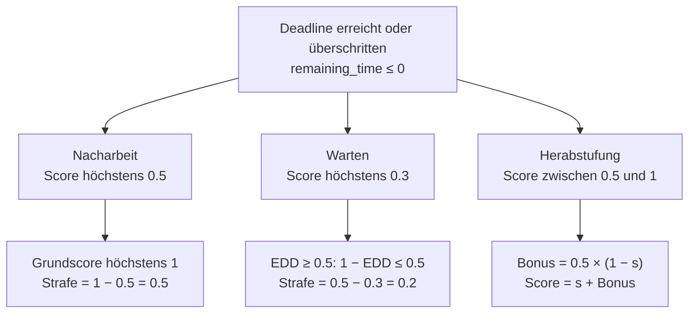

- **Untergrenze der Herabstufung:** Der Wert `0.5` orientiert sich am
  maximalen Nacharbeitsscore ab der Deadline. Die lineare Abbildung soll bei
  `s = 0` den Score `0.5` und bei `s = 1` den Score `1` ergeben:

`Score = 0.5 + (1 − 0.5) × s = s + 0.5 × (1 − s)`

- **Gewichtsverhältnis:** Mit dem zusätzlichen Deadline-Teilwert `1`
  entspricht die Abbildung dem normierten Verhältnis `0.5 : 0.5`.
  Defektschwere und Deadline-Teilwert erhalten jeweils das Gewicht `0.5`.
- **Bonus:** Er entspricht der Hälfte des verbleibenden Abstands zum Score
  `1`, nicht einem pauschalen Aufschlag von `0.5`.
- **Beabsichtigte Bevorzugung:** Bei positiver Defektschwere erhält
  Herabstufung ab der Deadline einen höheren Score als Nacharbeit und Warten.
- **Geltungsbereich:** Die Herleitung gilt für die Standardgewichte. Ein
  manuell geänderter oder optimierter Gewichtssatz kann die Scoregrenzen
  verändern. Die Zielgrenzen sind eine Modellierungsentscheidung, kein
  Nachweis optimaler Steuerung.
- **Kein Ausschluss:** Der Evaluator entfernt angebotene Nacharbeit bei
  erreichter Deadline nicht. Er berechnet ihren Score weiter und zieht eine
  Deadline-Strafe ab.
- **Beispiele:** Die folgenden Berechnungen verwenden die Standardgewichte
  aus `HeuristicWeights`. Nach der Deadline gelten die Deadline `10` und die
  aktuelle Zeit `11`.

##### Nacharbeit auf der Defektmaschine: `job_rework_on_defect_machine`

- **Aufgabe:** Die fehlerhafte Operation wird auf derselben Maschine
  wiederholt.
- **Bewertung:** `evaluate_defect_recovery_action()` verwendet die Zustände
  dieser Maschine und die Daten der zu wiederholenden Operation:

1. **[Maschinenwarteschlange](#3-maschinenwarteschlange-weniger-wartende-jobs-bevorzugen):**
   `inverse_scale(Maschinenwarteschlangenlänge) × defect_recovery_machine_queue_length_weight`.
2. **[Transportzeit](#2-verarbeitungs--transport--und-lagerzeiten-kürzere-zeiten-bevorzugen):**
   `inverse_scale(Transportzeit zur Defektmaschine) × defect_recovery_transport_time_weight`,
   wenn diese Zeit geschätzt werden kann.
3. **[Werkzeugpassung](#4-werkzeugpassung-ein-bereits-montiertes-passendes-werkzeug-bevorzugen):** `Werkzeugpassung × defect_recovery_tool_match_weight`.
   Dieses Kriterium geht immer ein.
4. **[Werkzeugreserve](#5-werkzeugreserve-mehr-lebensdauer-im-verhältnis-zum-verbrauch-bevorzugen):**
   `direct_scale(verbleibende Lebensdauer / geplanter Verbrauch) × defect_recovery_tool_reserve_weight`,
   falls der Lebensdauerverbrauch der Operation positiv ist.

- **Transportzeit auf derselben Maschine:** Ausgangs- und Eingangspuffer
  der Defektmaschine haben im aktuellen Layout dieselben Koordinaten. Liegt
  der Job im Ausgangspuffer, ermittelt `defect_recovery_transport_time_value()`:

`Transportzeit = 0` und `Transport-Teilwert = inverse_scale(0) = 1`.

- **Bedeutung des Transport-Teilwerts:** `1` bewertet nur die geschätzte
  Wegstrecke und bleibt mit seinem Gewicht enthalten. Es setzt nicht den
  gesamten Aktionsscore auf `1`. Zusätzliche Greif- und Hubbewegungen fehlen
  in dieser Wegschätzung.
- **Deadline:** Bei `remaining_time > 0` entfällt der Strafabzug. Bei
  `remaining_time <= 0` wird nach dem gewichteten Durchschnitt
  `rework_defect_machine_deadline_penalty_weight` abgezogen, standardmäßig `0.5`.
- **Rechenbeispiel:** Der Job liegt im Ausgangspuffer dieser Maschine.
  Mit den Standardgewichten ergeben sich:

- **Warteschlange:** Der Eingangspuffer ist leer. `inverse_scale(0) = 1`,
  Gewicht `0.3`.
- **Transportzeit:** Die Wegschätzung ergibt `0`. `inverse_scale(0) = 1`,
  Gewicht `0.2`.
- **Werkzeugpassung:** Das von der Operation benötigte Werkzeug ist montiert.
  Teilwert `1`, Gewicht `0.2`.
- **Werkzeugreserve:** Verbleibende Lebensdauer `5`, Verbrauch der Operation
  `5`. `direct_scale(5 / 5) = 0.5`, Gewicht `0.2`.

`Score vor Strafabzug = (1 × 0.3 + 1 × 0.2 + 1 × 0.2 + 0.5 × 0.2) / (0.3 + 0.2 + 0.2 + 0.2) = 8 / 9 ≈ 0.889`

- **Vor der Deadline:** Bei aktueller Zeit `8` liegt die Deadline `10` noch
  in der Zukunft. Ohne Strafabzug bleibt der Score `8 / 9 ≈ 0.889`.
- **Nach der Deadline:** Bei aktueller Zeit `11` zieht der Code `0.5` ab:

`Endscore = 8 / 9 − 0.5 = 7 / 18 ≈ 0.389`

##### Nacharbeit auf einer anderen Maschine: `job_rework_on_alternative_machine`

- **Aufgabe:** Die fehlerhafte Operation wird auf einer anderen geeigneten
  Maschine wiederholt. Der Job muss zu deren Eingangspuffer transportiert werden.
- **Bewertung:** `evaluate_defect_recovery_action()` verwendet die Zustände
  der ausgewählten Maschine und die Daten der zu wiederholenden Operation:

1. **[Maschinenwarteschlange](#3-maschinenwarteschlange-weniger-wartende-jobs-bevorzugen):**
   `inverse_scale(Maschinenwarteschlangenlänge) × defect_recovery_machine_queue_length_weight`.
2. **[Transportzeit](#2-verarbeitungs--transport--und-lagerzeiten-kürzere-zeiten-bevorzugen):**
   `inverse_scale(Transportzeit zur Nacharbeitsmaschine) × defect_recovery_transport_time_weight`,
   wenn diese Zeit geschätzt werden kann.
3. **[Werkzeugpassung](#4-werkzeugpassung-ein-bereits-montiertes-passendes-werkzeug-bevorzugen):**
   `Werkzeugpassung × defect_recovery_tool_match_weight`.
   Dieses Kriterium geht immer ein.
4. **[Werkzeugreserve](#5-werkzeugreserve-mehr-lebensdauer-im-verhältnis-zum-verbrauch-bevorzugen):**
   `direct_scale(verbleibende Lebensdauer / geplanter Verbrauch) × defect_recovery_tool_reserve_weight`,
   falls der Lebensdauerverbrauch der Operation positiv ist.

- **Transportzeit zur ausgewählten Maschine:**
  `defect_recovery_transport_time_value()` berechnet den Weg vom aktuellen
  Jobstandort zum Eingangspuffer dieser Maschine:

`Transportzeit = (|Δx| + |Δy| + |Δz|) / Grundgeschwindigkeit`

- **Transport-Teilwert:** `inverse_scale()` bewertet kürzere geschätzte
  Transportzeiten höher. Zusätzliche Greif- und Hubbewegungen sind in der
  Wegschätzung nicht enthalten.
- **Deadline:** Bei `remaining_time > 0` entfällt der Strafabzug. Bei
  `remaining_time <= 0` wird nach dem gewichteten Durchschnitt
  `rework_alternative_machine_deadline_penalty_weight` abgezogen,
  standardmäßig `0.5`.
- **Rechenbeispiel:** Der Job soll zum Eingangspuffer dieser Maschine
  transportiert werden. Mit den Standardgewichten ergeben sich:

- **Warteschlange:** Der Eingangspuffer ist leer. `inverse_scale(0) = 1`,
  Gewicht `0.3`.
- **Transportzeit:** Im Beispiel nehmen wir eine Wegstrecke von `1.5` und
  eine Grundgeschwindigkeit von `1.5` an. Daraus ergibt sich die geschätzte
  Transportzeit `1.5 / 1.5 = 1`. Das ist kein fester Wert im Code.
  `inverse_scale(1) = 0.5`, Gewicht `0.2`.
- **Werkzeugpassung:** Das von der Operation benötigte Werkzeug ist montiert.
  Teilwert `1`, Gewicht `0.2`.
- **Werkzeugreserve:** Verbleibende Lebensdauer `5`, Verbrauch der Operation
  `5`. `direct_scale(5 / 5) = 0.5`, Gewicht `0.2`.

`Score vor Strafabzug = (1 × 0.3 + 0.5 × 0.2 + 1 × 0.2 + 0.5 × 0.2) / (0.3 + 0.2 + 0.2 + 0.2) = 7 / 9 ≈ 0.778`

- **Vor der Deadline:** Bei aktueller Zeit `8` liegt die Deadline `10` noch
  in der Zukunft. Ohne Strafabzug bleibt der Score `7 / 9 ≈ 0.778`.
- **Nach der Deadline:** Bei aktueller Zeit `11` gilt der Deadline-Strafabzug:

`Endscore = 7 / 9 − 0.5 = 5 / 18 ≈ 0.278`

##### Herabstufung: `downgrade_product`

- **Bewertung:** `evaluate_defect_action()` unterscheidet zwei Fälle:

1. **Vor der Deadline (`remaining_time > 0`):** Nur die
   [Defektschwere](#7-defektschwere-bei-stärkerem-defekt-die-herabstufung-höher-bewerten)
   geht mit `product_downgrade_defect_severity_weight` ein. Da dies der
   einzige Teilwert ist, entspricht der Score dem Defektschweregrad.
2. **Deadline erreicht oder überschritten (`remaining_time <= 0`):**
   Zusätzlich geht der feste Teilwert `1` mit
   `deadline_reached_downgrade_bonus_weight` ein. `calculate_action_score()`
   bildet den gewichteten Durchschnitt aus Defektschwere und diesem
   zusätzlichen Teilwert.

- **Terminprüfung:** `is_deadline_reached()` liefert bei
  `remaining_time <= 0` den Wert `True` und prüft ausschließlich den Termin.
- **Beispiel vor der Deadline:** Bei Defektschweregrad `0.4`, aktueller
  Zeit `8` und Deadline `10` geht nur die Defektschwere mit Standardgewicht
  `0.5` ein:

`Score vor der Deadline = (0.4 × 0.5) / 0.5 = 0.4`

- **Beispiel ab der Deadline:** Der Teilwert `1` kommt mit
  `deadline_reached_downgrade_bonus_weight = 0.5` hinzu:

`Score = (0.4 × 0.5 + 1 × 0.5) / (0.5 + 0.5) = 0.7`

- **Bonus im Beispiel:** Die Anhebung beträgt `0.5 × (1 − 0.4) = 0.3`.
  Die Herabstufung erhält `0.4 + 0.3 = 0.7` statt `0.4`.

##### Warten bei einem Defekt: `wait_job`

- **Regel:** `evaluate_defect_action()` verwendet die
  [Warteregel](#8-warten-je-höher-der-termindruck-desto-niedriger-der-teilwert):
  Je dringender der Job, desto niedriger der Warte-Score.
- **Termindruck:** `calculate_edd_priority()` berechnet die
  [EDD-Priorität](#1-termindruck-dringendere-jobs-bevorzugen). Für Warten
  wird ihre Vorteilsrichtung umgekehrt:

`Teilwert = 1.0 - EDD`

- **Grundscore:** `calculate_action_score()` erhält nur diesen Teilwert mit
  `wait_defect_job_weight`. Der Durchschnitt eines einzelnen Teilwerts ist
  wieder dieser Teilwert; zunächst gilt `Score = 1.0 - EDD`.

- **Vor der Deadline** (`remaining_time > 0`) bleibt dieser Score unverändert.
- **Ab Erreichen der Deadline** (`remaining_time <= 0`) zieht der Code
  zusätzlich `deadline_missed_wait_penalty_weight` ab, standardmäßig `0.2`:
  `Score = (1.0 - EDD) - 0.2`.

Beispiele mit Deadline `10` und dem Standard-Strafabzug `0.2`:

- Bei aktueller Zeit `8` bleiben zwei Zeiteinheiten bis zur Deadline.
  `EDD = 0.5 × inverse_scale(2) ≈ 0.167`.
  Warten erhält `Score = 1 − 0.167 ≈ 0.833`; es gibt keinen Strafabzug.
- Bei aktueller Zeit `11` ist der Auftrag eine Zeiteinheit überfällig.
  `EDD = 0.5 + 0.5 × direct_scale(1) = 0.75`.
  Warten erhält `Score = (1 − 0.75) − 0.2 = 0.05`.

- **Auswahl:** Der `ActionSelector` vergleicht den Warte-Score mit den
  anderen Kandidaten. Ein niedrigerer Warte-Score macht Warten weniger
  vorteilhaft.

##### Ausschuss: `job_scrap`

- **Angebot:** Außerhalb des technisch nacharbeitbaren Defektschwerebereichs
  erzeugt der Generator ausschließlich Ausschuss.
- **Score:** `evaluate_defect_action()` liefert dafür konstant:

`Score = 1.0`

- **Auswahl:** EDD und Gewichte werden nicht verwendet. Da kein anderer
  Kandidat vorliegt, wird Ausschuss unabhängig vom Termindruck gewählt.

#### Abschluss: `complete_job`

- **Bewertung:** `evaluate_action()` verwendet den festen Teilwert `1` mit
  `complete_job_weight`.
- **Ergebnis:** Weil nur dieser eine Teilwert eingeht, ist der Score `1`.

#### Abgrenzung zur tatsächlich simulierten Dauer

- **Simulation:** Sie übernimmt die Rolle der realen Produktionsumgebung,
  führt gewählte Aktionen aus und bildet simulierte Ist-Dauern ab.
- **Steuerung:** Sie schätzt zukünftige Dauern aus Sollwerten wie
  konfigurierter Operationsdauer und Grundgeschwindigkeit.
- **Abweichungen:** Die simulierten Ist-Dauern können deshalb von den
  Schätzungen abweichen:

- **Maschine:** Die Steuerung verwendet die konfigurierte Operationsdauer
  `operation.duration`. `SimMachine` berechnet die Ist-Dauer zusätzlich
  abhängig von Produktgröße, Maschinengeschwindigkeit und einem Zufallsfaktor.
- **Roboter:** Die Steuerung schätzt die Transportzeit aus dem Weg und der
  konfigurierten Grundgeschwindigkeit. In der Simulation schwankt die
  Geschwindigkeit bei jeder Bewegung um bis zu fünf Prozent; entsprechend
  kann die Ist-Dauer von der Schätzung abweichen.

- **Aktueller Zustand:** Die Trennung betrifft nur zukünftige Dauern. Den
  aktuellen Ist-Zustand berücksichtigt die Steuerung weiterhin im Snapshot.

### Gewichte und Gesamtscore

- **Aufgabe:** `calculate_action_score()` verbindet die Teilwerte eines
  Aktionskandidaten zu einem Gesamtscore.
- **Eingabe:** Für jedes verwendete Kriterium wird ein Paar aus Teilwert
  und Gewicht übergeben. Die Teilwerte liegen bereits in `[0, 1]`;
  ein höherer Teilwert ist vorteilhafter.
- **Bedeutung der Gewichte:** Sie bestimmen die relative Wichtigkeit der
  Teilwerte derselben Aktion. `0.6` zählt beispielsweise doppelt so stark
  wie `0.3`.
- **Berechnung:** Die Funktion bildet den gewichteten Durchschnitt:

`Gesamtscore = Summe(Teilwert × Gewicht) / Summe(zugehörige Gewichte)`

- **Teilwert `0` berücksichtigen:** Er ist eine Bewertung, kein fehlender
  Wert. `0 × Gewicht = 0` geht in den Zähler ein; das Gewicht bleibt im
  Nenner enthalten.
- **Beispiel:** Zwei verwendete Kriterien haben die Teilwerte `1` und `0`
  mit jeweils dem Gewicht `1`:

`Gesamtscore = (1 × 1 + 0 × 1) / (1 + 1) = 0.5`

- **Nicht verwendetes Kriterium weglassen:** Die Funktion erhält dafür
  weder Teilwert noch Gewicht. Nur mit dem ersten Kriterium wäre der Score
  `(1 × 1) / 1 = 1`. Ein Teilwert von `0` darf deshalb nicht wie ein
  fehlendes Kriterium behandelt werden.
- **Beispiel für ein entfallendes Kriterium:** Die Werkzeugreserve wird
  nicht verwendet, wenn die Operation keine Werkzeuglebensdauer verbraucht.

#### Warum unterschiedliche Kriterien kombiniert werden können

Kombiniert werden die Teilwerte nach der Abbildung auf dieselbe
Vorteilsrichtung:

- **Transportzeit:** Kleiner ist besser. `inverse_scale()` bildet deshalb
  kurze Zeiten auf höhere Teilwerte ab. Zeit `1` ergibt `0.5`; Zeit `4`
  ergibt `0.2`.
- **Freie Kapazität:** Größer ist besser. `freie Plätze / Gesamtkapazität`
  liefert bei mehr freien Plätzen einen höheren Teilwert. Zwei von zehn
  freien Plätzen ergeben `2 / 10 = 0.2`; acht von zehn ergeben
  `8 / 10 = 0.8`.

- **Gemeinsame Bedeutung:** Für beide Kriterien ist ein höherer Teilwert
  vorteilhafter. Die dimensionslosen Werte zwischen `0` und `1` können
  deshalb gemeinsam in den Score eingehen.
- **Relative Wichtigkeit:** Die Gewichte bestimmen, wie stark kurze
  Transportzeiten gegenüber freier Kapazität zählen.

#### Warum durch die Gewichtssumme geteilt wird

- **Zähler:** Die gewichtete Summe allein ist noch kein Durchschnitt. Sie
  hängt auch von der Größe der verwendeten Gewichte ab.
- **Nenner:** Die Division durch die Gewichtssumme macht die relative
  Wichtigkeit der Teilwerte wirksam. Der Anteil eines Gewichts lautet:

`Relativer Gewichtsanteil = Gewicht / Summe(aller für diese Aktion verwendeten Gewichte)`

- **Anteile aufsummieren:** Alle beziehen sich auf dieselbe Aktion und
  dieselbe Gewichtssumme. Für alle verwendeten Kriterien zusammen gilt:

`Summe(relativer Gewichtsanteile) = Gewichtssumme / Gewichtssumme = 1`

- **Gewichte von Anteilen unterscheiden:** Die ursprünglichen Gewichte
  und die gewichtete Summe müssen nicht `1` ergeben.
- **Rundung beachten:** Drei Anteile von jeweils `1/3` ergeben exakt `1`.
  Gerundet können dagegen `0.33 + 0.33 + 0.33 = 0.99` angezeigt werden.
- **Beispiel:** Die Teilwerte `0.8` und `0.2` erhalten die Gewichte `1.0`
  und `0.5`. Der erste zählt doppelt so stark. Die Gewichtssumme ist
  `1.0 + 0.5 = 1.5`; die relativen Anteile sind `1.0 / 1.5 = 2/3` und
  `0.5 / 1.5 = 1/3`. Das Diagramm zeigt die vollständige Rechnung:

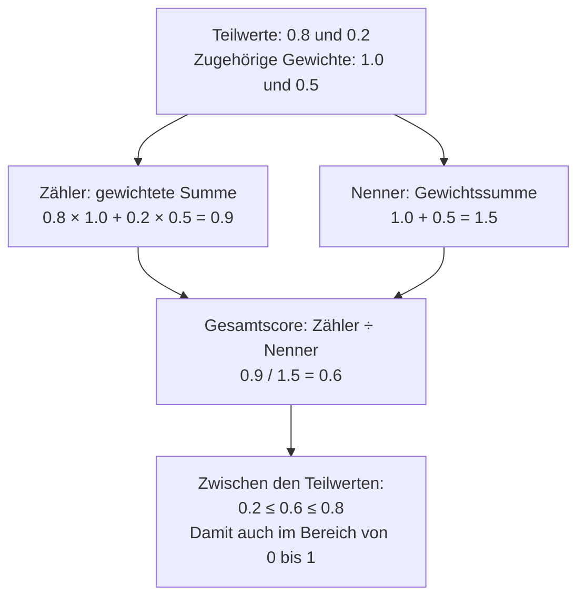

- **Ergebnis:** Der Score `0.6` liegt näher am stärker gewichteten Teilwert
  `0.8`. Die gewichtete Summe `0.9` ist noch nicht der Gesamtscore;
  erst die Division liefert den Durchschnitt.

#### Warum der Gesamtscore zwischen 0 und 1 liegt

- **Einzelnen Beitrag betrachten:** Für jeden Teilwert `xᵢ` in `[0, 1]`
  und sein positives Gewicht `wᵢ` gilt:

`0 ≤ xᵢ × wᵢ ≤ wᵢ`

- **Beiträge addieren:** Daraus folgt für Zähler und Nenner:

`0 ≤ Summe(Teilwert × Gewicht) ≤ Summe(zugehörige Gewichte)`

- **Durch die Gewichtssumme teilen:** Der Zähler ist weder negativ noch
  größer als der positive Nenner. Deshalb gilt:

`0 ≤ Gesamtscore ≤ 1`

- **Bereich entsteht durch die Rechnung:** `calculate_action_score()`
  berechnet diesen Durchschnitt ohne nachträgliche Begrenzung. Die Aussage
  gilt vor möglichen Strafabzügen.
- **Kurve lesen:** Sind alle Teilwerte `0`, ist der Score `0`; sind alle
  `1`, ist er `1`. Haben alle Teilwerte gemeinsam den Wert `x`, entspricht
  auch ihr gewichteter Durchschnitt `x`:

`Score(x) = Summe(x × Gewicht) / Summe(Gewichte) = x`

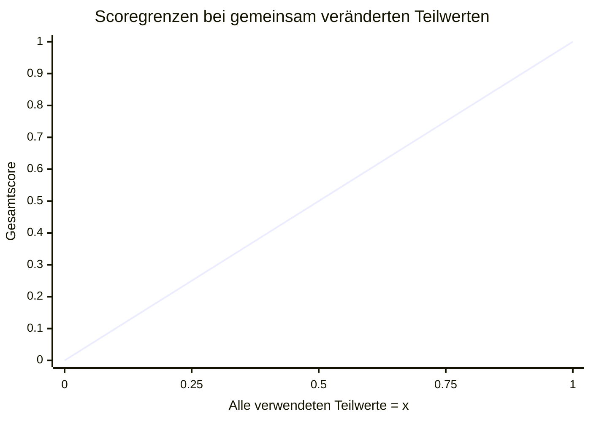

- **Sonderfall mit einem Teilwert:** Es gilt
  `(Teilwert × Gewicht) / Gewicht = Teilwert`. Das betrifft beispielsweise
  `complete_job` und normale Warteaktionen. Eine Änderung ihres einzigen
  Gewichts verändert den Score daher nicht.

#### HeuristicWeights

- **Parameter festlegen:**
  [HeuristicWeights.py](sources/SpineML/Control/HeuristicControl/HeuristicWeights.py)
  enthält die einstellbaren Parameter der lokalen Bewertung.
- **Werte prüfen:** Beim Erzeugen eines `HeuristicWeights`-Objekts werden
  dessen Gewichte auf `(0, 1]` geprüft. `calculate_action_score()` prüft oder
  begrenzt die übergebenen Werte nicht selbst.
- **Lokale und globale Ziele trennen:** Die Optimierung verändert die
  lokalen Parameter. Die globalen Gewichte bewerten dagegen vollständige
  Simulationsläufe.

### Rechenbeispiel: zwei Ablageziele

- **Ausgangszustand:** Der Main-Roboter trägt einen intakten, noch nicht
  fertigen Job. Die nächste Operation kann auf Maschine A oder B erfolgen.
- **Aktionstyp:** Der `ActionGenerator` erzeugt zwei Kandidaten vom Typ
  `place_main_robot`:

- **Kandidat A:** Den Job in Korridorpuffer A für den Weitertransport zu
  Maschine A ablegen.
- **Kandidat B:** Den Job in Korridorpuffer B für den Weitertransport zu
  Maschine B ablegen.

- **Annahmen:** Die folgenden Rohwerte dienen als Beispiel. Die Rechnung
  verwendet alle fünf Kriterien von `evaluate_place_action()` für diese
  Kandidaten und die Standardgewichte aus `HeuristicWeights`.

1. **Bewertungsgrößen:** Die Wege zu den Korridorpuffern betragen `8` und `2`
   Längeneinheiten. Bei konfigurierter Grundgeschwindigkeit `2` ergeben sich
   Transportzeitschätzungen von `4` und `1`. In Puffer A sind vier von zehn
   Plätzen frei, in Puffer B zwei von zehn. Im Eingangspuffer von Maschine A
   warten drei Jobs; der Eingangspuffer von Maschine B ist leer. Die
   konfigurierte Einlagerzeit beträgt jeweils `1`, die Dauer der nächsten
   Operation auf beiden Routen `4`.
2. **Abbildung auf Teilwerte:** `inverse_scale()` bildet Transportzeit,
   Einlagerzeit, Maschinenwarteschlangenlänge und Operationsdauer ab. Der freie
   Kapazitätsanteil ergibt sich aus `freie Plätze / Gesamtkapazität`. Für alle
   Teilwerte gilt damit dieselbe Vorteilsrichtung: Höher ist vorteilhafter.
3. **Gewichtssatz:** Die Tabelle zeigt die tatsächlich verwendeten
   Standardgewichte. Die Kapazität bezieht sich auf den **Korridorpuffer**, die
   Warteschlangenlänge dagegen auf den **Eingangspuffer der Zielmaschine**.
4. **Gesamtscore:** `calculate_action_score()` addiert die gewichteten
   Teilwerte und teilt durch die Gewichtssumme
   `0.2 + 0.25 + 0.15 + 0.25 + 0.15 = 1.0`:

| Bewertungsgröße | Standardgewicht | Kandidat A: Rohwert → Teilwert | Kandidat B: Rohwert → Teilwert |
|---|---|---|---|
| Freie Korridorpufferkapazität | `0.2` | `4 / 10 → 0.4` | `2 / 10 → 0.2` |
| Transportzeit | `0.25` | `4 → 0.2` | `1 → 0.5` |
| Einlagerzeit | `0.15` | `1 → 0.5` | `1 → 0.5` |
| Maschinenwarteschlangenlänge | `0.25` | `3 → 0.25` | `0 → 1` |
| Operationsdauer | `0.15` | `4 → 0.2` | `4 → 0.2` |
| **Gewichtete Summe** | — | `0.2975` | `0.52` |
| **Gesamtscore** | Gewichtssumme `1.0` | `0.2975 / 1.0 = 0.2975` | `0.52 / 1.0 = 0.52` |

Die gewichteten Summen lauten:

- **A:** `0.4 × 0.2 + 0.2 × 0.25 + 0.5 × 0.15 + 0.25 × 0.25 + 0.2 × 0.15 = 0.2975`.
- **B:** `0.2 × 0.2 + 0.5 × 0.25 + 0.5 × 0.15 + 1 × 0.25 + 0.2 × 0.15 = 0.52`.

Für den höheren Score von B sind die Unterschiede der gewichteten Beiträge
entscheidend:

- **Freie Pufferkapazität:** A erhält `0.4 × 0.2 = 0.08`, B nur
  `0.2 × 0.2 = 0.04`. Das ist ein Vorteil von `0.04` für A.
- **Transportzeit:** B erhält `0.5 × 0.25 = 0.125`, A nur
  `0.2 × 0.25 = 0.05`. Das ist ein Vorteil von `0.075` für B.
- **Maschinenwarteschlange:** B erhält `1 × 0.25 = 0.25`, A nur
  `0.25 × 0.25 = 0.0625`. Das ist ein Vorteil von `0.1875` für B.

- **Gleiche Beiträge:** Einlagerzeit und Operationsdauer ändern den Abstand
  nicht. Die übrigen Beiträge ergeben einen Vorteil von
  `0.075 + 0.1875 − 0.04 = 0.2225` für B. Bei der Gewichtssumme `1.0` ist
  dies auch der Scoreabstand: `0.52 − 0.2975 = 0.2225`.
- **Warten vergleichen:** Bei aktueller Zeit `11` und Deadline `10` gilt
  `EDD = 0.75`. Der zusätzliche Kandidat `wait_main_robot` erreicht
  `1 − 0.75 = 0.25`; B liegt auch darüber.
- **Nächste Beobachtung berücksichtigen:** Kandidaten und Scores werden
  erneut bestimmt. Ist Puffer B inzwischen voll, wird dafür keine
  Ablageaktion erzeugt. Die Bewertung vergleicht nur die vom Generator
  zugelassenen Möglichkeiten.

## Optimierungsvorgang

<a id="gesamtablauf-der-optimierung"></a>

### Ziel der Optimierung

Ziel ist ein lokaler Gewichtssatz, mit dem die heuristische Steuerung im
Mittel bessere Produktionsergebnisse erzielt.

- **Wirkung der Gewichte:** Sie bestimmen, wie stark die einzelnen
  Teilwerte im Aktionsscore zählen.
- **Beispiel für einen Zielkonflikt:** Ein naher Puffer kann wenig freien
  Platz haben, ein weiter entfernter dagegen mehr. Je nachdem, ob Transportzeit
  oder freie Kapazität stärker gewichtet wird, kann die Steuerung ein anderes
  Ablageziel bevorzugen.

#### Gesamter Optimierungsablauf

Das Diagramm zeigt die Vorbereitung, die Gewichtssuche und den
abschließenden Steuerungsvergleich.

- **Reihenfolge:** Die Abschnitte darunter erklären dieselben Schritte 0 bis 6.
- **Iteration:** Ein Durchlauf der Schritte 2 bis 5 bildet eine Iteration.

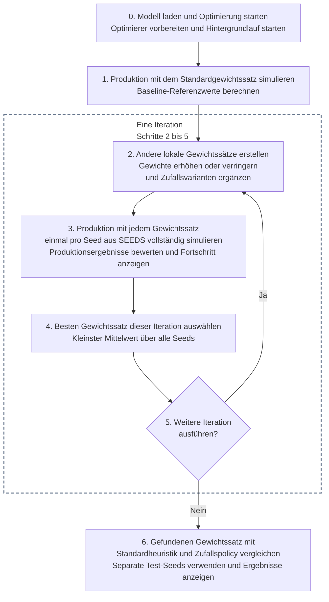

Direkt zu den Details:
[0. Modell laden und Optimierung starten](#0-modell-laden-und-optimierung-starten) ·
[1. Standardgewichtssatz simulieren](#1-produktion-mit-dem-standardgewichtssatz-simulieren) ·
[2. Gewichtssätze erstellen](#2-varianten-des-lokalen-gewichtssatzes-erstellen) ·
[3. Gewichtssätze simulieren und bewerten](#3-produktion-mit-jedem-gewichtssatz-einmal-pro-seed-simulieren-und-bewerten) ·
[4. Gewichtssatz auswählen](#4-gewichtssatz-anhand-der-mittleren-produktionsergebnisse-auswählen) ·
[5. Weitere Iteration ausführen?](#5-weitere-iteration-ausführen) ·
[6. Steuerungen vergleichen](#6-gefundenen-gewichtssatz-mit-standardheuristik-und-zufall-vergleichen).

### 0. Modell laden und Optimierung starten

**Ziel:** Das Produktionsbeispiel laden und über **Start optimization** die
Suche nach einem geeigneten Gewichtssatz starten.

<a id="optimierung-starten"></a>

#### Anwendung starten

Die Optimierung wird über das Streamlit-Webinterface gestartet.

1. In [sources/optimization.py](sources/optimization.py) ist das verbleibende
   Produktionsbeispiel bereits eingestellt:

   ```python
   EXAMPLE_FILE = "example-5.py"
   ```

2. Den Webserver aus dem Projektordner starten:

   ```console
   python -m streamlit run sources/optimization.py
   ```

3. Oben im Interface steht der geladene Dateiname, in diesem Fall
   `Example: example-5.py`. Auf **Start optimization** klicken.
   Danach startet die Optimierung.

#### Produktionsbeispiel für den Steuerungsvergleich

[example-5.py](sources/examples/normal/example-5.py) stellt das
Produktionsmodell für den Vergleich der Steuerungen bereit.

- **Umfang:** 24 Jobs aus acht Aufträgen, drei Endprodukte und zwölf
  Maschinen in drei Seitenkorridoren.
- **Bearbeitungswege:** Zwölf Operationstypen ermöglichen alternative Wege
  mit zwei oder drei Schritten.
- **Unterschiedliche Bedingungen:** Operationsdauer, Werkzeugverbrauch,
  Pufferkapazität, maschinenabhängige Defektwahrscheinlichkeit sowie
  Ein- und Auslagerzeiten sind nicht überall gleich. Die Aufträge haben
  unterschiedliche Startzeiten und Deadlines.
- **Entscheidungsspielraum:** Die Steuerungen können unterschiedliche Jobs,
  Maschinen und Bearbeitungswege auswählen. Ob der gefundene Gewichtssatz
  bessere Ergebnisse erzielt, zeigt der Vergleich auf den Test-Seeds.
- **Rechenaufwand:** Die größere Jobzahl erhöht die Rechenzeit pro Simulationslauf.

<a id="beteiligte-dateien"></a>
<a id="technische-einbindung-modellladen-worker-thread-und-fortschrittsanzeige"></a>

#### Modell und Hintergrundlauf vorbereiten

Beim Klick auf **Start optimization** wird zunächst der Optimierer vorbereitet.

- **Einstieg:** `_start_optimization()` ruft zuerst `create_optimizer()` auf.
- **Vorbereitung:** Die Funktion lädt das eingetragene Beispiel und erstellt
  einen neuen Optimierer mit Runner und globaler Bewertung. Dabei wird noch
  keine Produktion simuliert.
- **Diagramm lesen:** Das erste Diagramm zeigt diese Vorbereitung; seine
  Nummern entsprechen den Erklärungen darunter.

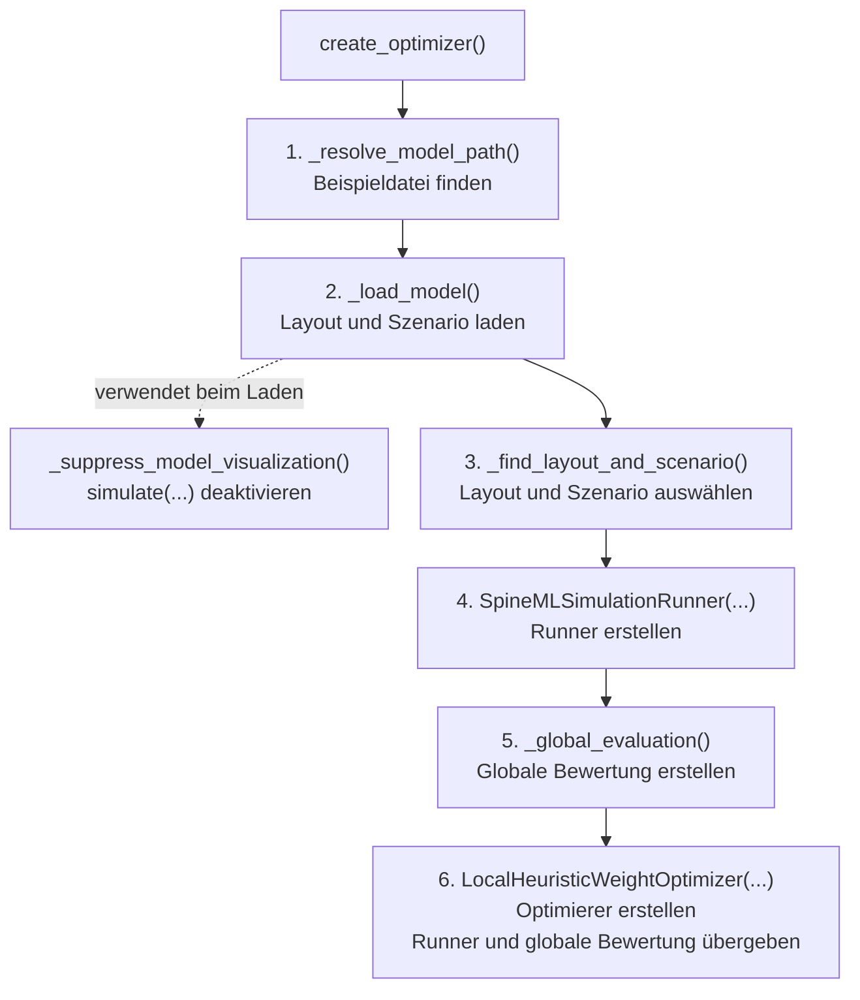

1. **`_resolve_model_path()` – Beispieldatei finden:** Sucht die bei
   `EXAMPLE_FILE` eingetragene Datei.
2. **`_load_model()` – Beispiel laden:** Lädt die Fabrikkonfiguration (Layout)
   und die Produktionsaufträge (Szenario) aus der Beispieldatei. Die Simulation
   startet dabei noch nicht.

   - **`_suppress_model_visualization()` – sofortigen Simulationsstart verhindern:**
     Verhindert innerhalb von `_load_model()`, dass `simulate(...)` in der
     Beispieldatei eine Simulation startet. Es wird nicht nur die Animation
     ausgeschaltet: Beim Laden wird kein Simulationslauf ausgeführt.

3. **`_find_layout_and_scenario()` – Layout und Szenario auswählen:** Bestimmt,
   welches **Layout** (räumlicher Aufbau der Fabrik) und welches **Szenario**
   (Produktionsaufträge) für die Optimierung verwendet werden.
4. **`SpineMLSimulationRunner(...)` – Runner erstellen:** Erstellt den
   [Runner](sources/SpineML/Control/HeuristicControl/SpineMLSimulationRunner.py).
   Der Runner ist nicht die Simulation selbst: Er startet einen Simulationslauf
   und führt ihn aus. Dafür verwendet er das ausgewählte Layout und Szenario
   sowie den beim Aufruf `runner(weights, seed)` übergebenen Gewichtssatz und
   [Seed](#baseline-technik). Nach dem Lauf gibt er die Produktionskennzahlen
   zurück. Das Erstellen des Runners startet noch keine Simulation.
5. **`_global_evaluation()` – globale Bewertung erstellen:** Erstellt die
   [GlobalSimulationEvaluation](sources/SpineML/Control/HeuristicControl/GlobalSimulationEvaluation.py).
   Sie berechnet aus den Produktionskennzahlen eines abgeschlossenen Laufs eine
   [globale Bewertungszahl](#globale-bewertungszahl). Je kleiner diese Zahl,
   desto besser wird das Produktionsergebnis bewertet.
6. **`LocalHeuristicWeightOptimizer(...)` – Optimierer erstellen:** Erstellt
   den [Optimierer](sources/SpineML/Control/HeuristicControl/LocalHeuristicWeightOptimizer.py)
   und übergibt ihm zwei Bestandteile:

   - **Den Runner zum Aufrufen:** Der Optimierer übergibt ihm bei jedem
     Aufruf einen Gewichtssatz und einen Seed. Der Runner simuliert die
     Produktion und liefert die Produktionskennzahlen zurück.
   - **Die globale Bewertung als Bewertungsregel:** Sie berechnet aus den
     Kennzahlen eines Laufs eine globale Bewertungszahl. Je kleiner diese
     Zahl, desto besser.

   - **Suche erst später starten:** Das Erstellen des Optimierers startet
     noch keine Gewichtssuche. Dafür enthält die Klasse
     `LocalHeuristicWeightOptimizer` die Methode
     [`optimize_iteratively()`](sources/SpineML/Control/HeuristicControl/LocalHeuristicWeightOptimizer.py).
     Erst `optimizer.optimize_iteratively(...)` startet die Suche aus den
     [Schritten 2 bis 5](#2-varianten-des-lokalen-gewichtssatzes-erstellen).

- **Hintergrundlauf starten:** Nach dem Erstellen des Optimierers startet
  `_start_optimization()` den Worker-Thread. Der Streamlit-Thread für die
  Oberfläche läuft bereits.
- **Phasen ausführen:** Der Worker berechnet zuerst die Baseline, startet
  danach die Gewichtssuche mit `optimizer.optimize_iteratively(...)` und
  führt anschließend den Abschlussvergleich aus.
- **Daten teilen:** Das zweite Diagramm zeigt diese Aufgabenteilung. Beide
  Threads verwenden dieselben Fortschritts- und Ergebnisdaten in `state`.

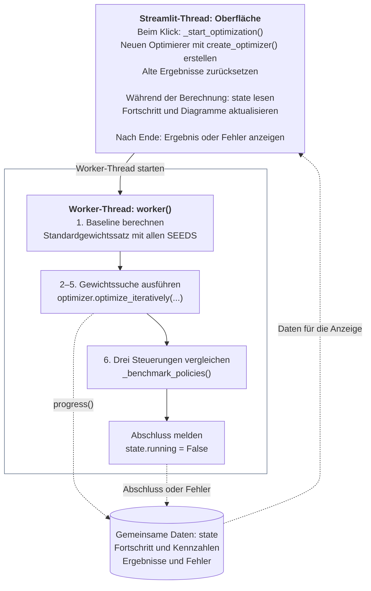

- **Gemeinsamer Speicher:** Der Worker schreibt Fortschritt und Ergebnisse
  in `state`. Die Oberfläche liest diese Daten und aktualisiert die Anzeige.

Der Ablauf im Detail:

1. **Alte Anzeigeergebnisse zurücksetzen:** Die Funktion entfernt die
   gespeicherten Ergebnisse und Diagrammdaten des vorherigen Optimierungslaufs.
   Die Fortschrittszähler beginnen wieder bei `0`.
2. **Berechnung im Hintergrund starten:** `_start_optimization()` startet
   einen zusätzlichen **Worker-Thread**. Ein Thread ist eine
   **Ausführungseinheit innerhalb eines Prozesses**. Streamlit-Thread und
   Worker-Thread gehören hier zum selben Python-Prozess und teilen sich die
   Daten in `state`. Die Arbeit ist aufgeteilt:

   - **Streamlit-Thread – Anzeige:** Aktualisiert die Oberfläche, die
     Fortschrittsanzeige und die Diagramme.
   - **Worker-Thread – Berechnung:** Führt die Funktion `worker()` aus.
     Diese berechnet die Baseline, führt die Gewichtssuche aus und startet
     den Abschlussvergleich.

   - **Fortschritt während der Berechnung:** Die Oberfläche kann ihn anzeigen,
     während der Worker rechnet; sie muss nicht auf das Ende der gesamten
     Optimierung warten.
3. **Die drei Phasen nacheinander ausführen:** `worker()` führt diese
   Aufgaben in genau dieser Reihenfolge aus:

   - **Baseline berechnen ([Schritt 1](#1-produktion-mit-dem-standardgewichtssatz-simulieren)):**
     Mit dem Standardgewichtssatz simulieren und daraus die Referenzwerte
     für die Bewertung berechnen.
   - **Gewichtssätze suchen und vergleichen ([Schritte 2 bis 5](#2-varianten-des-lokalen-gewichtssatzes-erstellen)):**
     Der Worker-Thread ruft `optimizer.optimize_iteratively(...)` auf.
     Damit startet er die Gewichtssuche des zuvor erstellten Optimierers:
     verschiedene Gewichtssätze testen und den Satz mit dem kleinsten
     Mittelwert auswählen.
   - **Steuerungen vergleichen ([Schritt 6](#6-gefundenen-gewichtssatz-mit-standardheuristik-und-zufall-vergleichen)):**
     `_benchmark_policies()` vergleicht die Zufallspolicy, die Standardheuristik
     und die Heuristik mit dem gefundenen Gewichtssatz auf separaten Test-Seeds.

   - **Keine parallelen Simulationsläufe:** Der Worker-Thread führt die
     einzelnen Läufe nacheinander aus.

4. **Fortschritt an die Oberfläche weitergeben:** Während der Gewichtssuche
   speichert `progress()` die aktuelle Iterationsnummer und die Nummer des
   geprüften Gewichtssatzes in `state`, dem gemeinsamen Speicher für
   Fortschritt und Ergebnisse. Nach der vollständigen Prüfung eines Satzes
   werden dort auch dessen mittlere globale Bewertungszahl und die
   Mittelwerte seiner Produktionskennzahlen ergänzt.
   Die Oberfläche liest diese Daten regelmäßig und aktualisiert daraus die
   [Fortschrittsanzeige und Diagramme](#fortschritt-und-ergebnisdiagramme).
   Der Startknopf bleibt während des laufenden Vorgangs deaktiviert.
5. **Abschluss anzeigen:** Wenn der Worker fertig ist, zeigt die Oberfläche
   den besten Gewichtssatz und den Vergleich der drei Steuerungen. Bricht
   die Berechnung wegen eines Fehlers ab, zeigt sie stattdessen die
   Fehlermeldung.

#### Suchparameter

Die Parameter stehen oben in [sources/optimization.py](sources/optimization.py):

| Parameter | Bedeutung |
| --- | --- |
| `SEEDS` | Gemeinsame [Seeds](#baseline-technik) (Startwerte für die Zufallszahlengeneratoren) für die [Baseline](#1-produktion-mit-dem-standardgewichtssatz-simulieren) und die Gewichtssuche. |
| `TEST_SEEDS` | Separate Test-Seeds für den [Abschlussvergleich](#6-gefundenen-gewichtssatz-mit-standardheuristik-und-zufall-vergleichen). |
| `ITERATIONS` | Maximale Anzahl der [Iterationen](#5-weitere-iteration-ausführen). |
| `INITIAL_WEIGHT_STEP` | Anfängliche Schrittweite für das [Erhöhen und Verringern einzelner Gewichte](#2-varianten-des-lokalen-gewichtssatzes-erstellen). |
| `EXPLORATION_CANDIDATES` | Anzahl zusätzlicher zufälliger Gewichtssätze je Iteration. |
| `RESTART_AFTER_NO_IMPROVEMENT` | Nach dieser Anzahl von Iterationen ohne besseren Gewichtssatz wird die Schrittweite zurückgesetzt ([Neustart in Schritt 5](#5-weitere-iteration-ausführen)). |
| `STOP_AFTER_NO_IMPROVEMENT` | Nach dieser Anzahl aufeinanderfolgender Iterationen ohne besseren Gewichtssatz endet die Suche. Ein Neustart unterbricht diese Zählung nicht ([Schritt 5](#5-weitere-iteration-ausführen)). |

- **Ergebnis der Vorbereitung:** Nach dem Klick beginnt im Hintergrund
  [Schritt 1: Produktion mit dem Standardgewichtssatz simulieren](#1-produktion-mit-dem-standardgewichtssatz-simulieren).

<a id="1-produktion-mit-standardgewichten-simulieren"></a>

### 1. Produktion mit dem Standardgewichtssatz simulieren

Ziel dieses Schritts sind feste Referenzwerte für die Bewertung aller
folgenden Produktionsläufe.

1. **Vergleichsläufe ausführen:** Die heuristische Steuerung wird mit dem
   Standardgewichtssatz `HeuristicWeights()` einmal pro Seed aus `SEEDS`
   simuliert, aktuell mit Seed `1` und Seed `2`. Diese Läufe bilden die
   Baseline (Vergleichsbasis).
2. **Referenzen berechnen:** Für jede [Zeitkennzahl](#produktionskennzahlen)
   wird der Mittelwert über die Baseline-Seeds berechnet und gespeichert.
   Er dient als Vergleichsgröße für dieselbe Zeitkennzahl in anderen Läufen.
3. **Gewichtssuche beginnen:** Erst nach der Berechnung der Referenzwerte
   startet `optimize_iteratively()`.

- **Rechenbeispiel:** Erreicht der Standardgewichtssatz eine Produktionsdauer
  ([`makespan`](#produktionskennzahlen)) von `9` Stunden mit Seed `1` und
  `11` Stunden mit Seed `2`, wird `(9 + 11) / 2 = 10` Stunden als Referenz
  gespeichert. Die Anwendung dieser Referenz zeigt das
  [Rechenbeispiel in Schritt 3](#globale-gewichte-in-optimizationpy).
- **Umsetzung im Code:** Der Hintergrundlauf ruft zuerst den Runner mit
  `HeuristicWeights()` und jedem Seed aus `SEEDS` auf. Anschließend berechnet
  `GlobalSimulationEvaluation.calculate_baseline_reference_values()` die
  Referenzen aus den gemessenen Zeitkennzahlen.
- **Ergebnis:** Die Baseline-Referenzwerte gelten für alle folgenden Läufe,
  einschließlich des
  [Abschlussvergleichs](#6-gefundenen-gewichtssatz-mit-standardheuristik-und-zufall-vergleichen).

<a id="baseline-technik"></a>

#### Technische Umsetzung: Seeds

Seeds machen die Zufallseinflüsse eines Simulationslaufs reproduzierbar.

- **Wiederholter Entscheidungsablauf:**

`Zustand → Policy entscheidet → Simulation führt Aktion aus → neuer Zustand`

- **Einfluss des Zufalls:** Der neue Zustand entsteht nicht allein durch
  die Entscheidung. Auch Schwankungen der Robotergeschwindigkeit oder ein
  Defekt können die Ausführung beeinflussen. Schematisch gilt:

`Neuer Zustand = bisheriger Zustand + Auswirkungen der gewählten Aktion + gegebenenfalls Zufallseinflüsse`

- **Startwert setzen:** Ein Seed ist ein Startwert für die
  Zufallszahlengeneratoren. Der Runner setzt ihn vor jedem neuen Lauf.
  Seed `1` und Seed `2` stehen damit für unterschiedliche, reproduzierbare
  Zufallsziehungen.
- **Gleiche Ausgangsziehungen:** Bei demselben Seed werden beispielsweise
  die anfänglichen Maschinengeschwindigkeiten für zwei Gewichtssätze gleich
  ausgelost. Der Zufall wird dadurch nicht entfernt.
- **Unterschiedliche Entscheidungen vergleichen:** Andere Gewichtssätze
  können andere Aktionen und damit andere Folgezustände erzeugen.
  Verglichen wird, welche Aktionsfolge insgesamt bessere
  [Produktionsergebnisse](#produktionskennzahlen) liefert, etwa eine kürzere
  Produktionsdauer oder weniger Verspätung.

<a id="2-varianten-der-lokalen-gewichte-erstellen"></a>

### 2. Varianten des lokalen Gewichtssatzes erstellen

Ziel dieses Schritts ist eine Liste von Gewichtssätzen für die nächste Prüfung.

- **Ausgangspunkt:** In der ersten Iteration ist das der Standardgewichtssatz
  [HeuristicWeights()](sources/SpineML/Control/HeuristicControl/HeuristicWeights.py).
- **Vollständige Sätze erstellen:** `optimize_iteratively()` erstellt daraus
  die zu prüfenden Gewichtssätze. Jeder Satz enthält alle lokalen Gewichte,
  auch wenn nur eines davon geändert wird.

Die Varianten entstehen auf zwei Arten:

1. **Einzelne Gewichte verändern: `neighboring_weights()`**

   Der Ausgangssatz bleibt als Vergleich enthalten. Zusätzlich
   werden für jedes Gewicht zwei Varianten erstellt: eine mit
   `Gewicht − Schrittweite` und eine mit `Gewicht + Schrittweite`.
   Alle anderen Gewichte werden unverändert übernommen. Die veränderten
   Werte bleiben zwischen `0.000001` und `1.0`.

   **Beispiel mit der anfänglichen Schrittweite `0.4`:** Die Tabelle zeigt
   das Transportzeitgewicht `pick_short_transport_time_weight` und das
   Kapazitätsgewicht `target_store_free_capacity_weight`. Die übrigen
   **23 Gewichte bleiben in diesen Beispielsätzen unverändert**.

   | Gewichtssatz | Transportzeitgewicht | Kapazitätsgewicht |
   |---|---|---|
   | Ausgangssatz | `0.3` | `0.2` |
   | Nur Transportzeitgewicht verringern | `0.000001` | `0.2` |
   | Nur Transportzeitgewicht erhöhen | `0.7` | `0.2` |
   | Nur Kapazitätsgewicht verringern | `0.3` | `0.000001` |
   | Nur Kapazitätsgewicht erhöhen | `0.3` | `0.6` |

   - **Untergrenze einhalten:** `0.3 − 0.4` und `0.2 − 0.4` liegen darunter.
     Deshalb verwendet der Code für diese beiden Varianten `0.000001`.
     Dasselbe Vorgehen gilt für die übrigen Gewichte.

2. **Weitere Gewichtssätze zufällig zusammenstellen: `random_local_weight_candidates()`**

   Für jeden zusätzlichen Gewichtssatz wird jeder einzelne Gewichtswert neu
   ausgelost. Anders als bei den Einzelvarianten können somit alle Gewichte
   gleichzeitig vom Ausgangssatz abweichen. Der Zufallsbereich reicht von
   `0.000001` bis `1.0`; nur für `wait_action_weight` verwendet diese Methode
   den kleineren Bereich von `0.000001` bis `0.1`.

   **Beispiel aus der ersten Iteration:** `EXPLORATION_CANDIDATES = 3`
   erzeugt drei zusätzliche Zufallssätze. Gezeigt sind drei ihrer jeweils
   25 Gewichte, auf vier Nachkommastellen gerundet. Auch die übrigen
   22 Gewichte werden für jeden Satz neu gezogen.

   | Zufallssatz | Transportzeitgewicht | Kapazitätsgewicht | `wait_action_weight` |
   |---|---|---|---|
   | 1 | `0.5113` | `0.4766` | `0.0758` |
   | 2 | `0.9666` | `0.8050` | `0.0434` |
   | 3 | `0.5079` | `0.7066` | `0.0448` |

**Wie viele Gewichtssätze entstehen insgesamt?**

- **Sätze erzeugen:** `HeuristicWeights` enthält aktuell 25 Gewichte.
  Pro Iteration entstehen zunächst:

`1 Ausgangssatz + 2 × 25 Einzelvarianten + 3 Zufallssätze = 54 erzeugte Gewichtssätze`

- **Identische Sätze entfernen:** Stimmen innerhalb einer Iteration alle
  Gewichte zweier Sätze überein, bleibt vor der Simulation nur der erste
  erhalten. Mit dem aktuellen Standardgewichtssatz bleiben in der ersten
  Iteration 53 unterschiedliche Gewichtssätze; jeder wird mit allen Seeds geprüft.
- **Gesamtumfang begrenzen:** Bei den aktuell zwei Iterationen sind höchstens
  107 Gewichtssatz-Prüfungen möglich: 53 in der ersten und höchstens 54 in der
  zweiten Iteration. Den Ausgangssatz für die nächste Iteration bestimmt
  [Schritt 5](#5-weitere-iteration-ausführen).
- **Fortschritt zählen:** Die Anzeige zählt nur die nach dem Entfernen
  identischer Sätze tatsächlich geprüften Gewichtssätze.
- **Ergebnis:** Die Liste wird anschließend
  [simuliert und bewertet](#3-produktion-mit-jedem-gewichtssatz-einmal-pro-seed-simulieren-und-bewerten).

<a id="3-produktion-mit-jedem-gewichtssatz-mehrfach-simulieren-und-bewerten"></a>

### 3. Produktion mit jedem Gewichtssatz einmal pro Seed simulieren und bewerten

Ziel dieses Schritts ist eine mittlere globale Bewertungszahl für jeden
Gewichtssatz aus [Schritt 2](#2-varianten-des-lokalen-gewichtssatzes-erstellen).

- **Reihenfolge:** Die Gewichtssätze werden einer nach dem anderen geprüft.
- **Seeds:** Mit der aktuellen Liste `SEEDS = [1, 2]` läuft die Prüfung eines
  Gewichtssatzes so ab:

1. **Lauf mit Seed `1`:** Die Produktion wird mit diesem Gewichtssatz
   vollständig simuliert. Aus den Ergebnissen dieses Laufs wird eine
   [globale Bewertungszahl](#globale-bewertungszahl) berechnet.
2. **Lauf mit Seed `2`:** Die Produktion wird mit **demselben Gewichtssatz**
   und Seed `2` erneut vollständig simuliert. Für diesen zweiten Lauf wird
   eine eigene globale Bewertungszahl berechnet.
3. **Ergebnis für diesen Gewichtssatz:** Aus **diesen beiden
   Bewertungszahlen** wird der [Mittelwert](#mittelwert-über-die-seeds)
   berechnet, also ihre Summe durch `2` geteilt.

- **Nächsten Satz prüfen:** Erst danach folgt der nächste Gewichtssatz,
  ebenfalls mit beiden Seeds und einem eigenen Mittelwert.

#### Gewichtssätze mit denselben Seeds vergleichen

Alle Gewichtssätze werden mit derselben Liste von [Seeds](#baseline-technik)
getestet.

- **Diagrammzeilen:** Jede Zeile zeigt einen anderen Gewichtssatz.
- **Zweige:** Jeder Zweig steht für einen vollständigen Produktionslauf und
  dessen [globale Bewertungszahl](#globale-bewertungszahl). Die Läufe werden
  nacheinander ausgeführt.
- **Zusammenfassung:** Der
  [Mittelwert dieser Bewertungszahlen](#mittelwert-über-die-seeds) fasst das
  Ergebnis eines Gewichtssatzes zusammen.

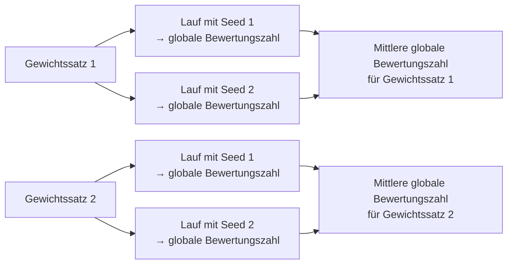

#### Simulationslauf und Produktionskennzahlen

Für jeden Gewichtssatz und Seed ruft der Optimierer `runner(weights, seed)`
auf. Dieser Aufruf führt drei Schritte aus:

1. **Steuerung erstellen:** Der Runner erstellt die heuristische Steuerung
   mit dem übergebenen Gewichtssatz.
2. **Produktion simulieren:** `run_policy()` setzt die Zufallszahlengeneratoren
   auf den Seed, baut die Simulation mit dem ausgewählten Layout und Szenario
   neu auf und führt sie aus. Die Steuerung entscheidet während dieses Laufs
   wiederholt über Aktionen. Der Gewichtssatz bleibt dabei unverändert.
3. **Produktionsergebnis erfassen:** `collect_global_metrics()` erfasst die
   Kennzahlen des gesamten Laufs. Der Runner gibt sie als
   `GlobalSimulationMetrics` an den Optimierer zurück. Sind beim Laufende
   noch Jobs unfertig, meldet der Runner stattdessen einen Fehler.

##### Produktionskennzahlen

Die Bewertung verwendet sieben Kennzahlen; die vier Zeitkennzahlen werden
in Stunden erfasst.

- **Produktionsdauer (`makespan`):** Zeit vom frühesten vorgesehenen
  Auftragsstart (`earliest_start_time`) bis zum letzten Jobabschluss.
  `mark_finished()` speichert die Jobabschlusszeit beim Einlagern ins Endlager.
- **Gesamtverspätung (`total_tardiness`):** Summe der positiven Verspätungen
  aller abgeschlossenen **Jobs**. Für jeden Job gilt
  `Jobverspätung = max(0, completed_time − Deadline des zugehörigen Auftrags)`.
  Mehrere verspätete Jobs desselben Auftrags zählen einzeln. Frühe Abschlüsse
  verringern die Summe nicht. Beispiel: Bei Deadline `10` und Jobabschlüssen
  `8`, `12` und `15` ist die Gesamtverspätung `0 + 2 + 5 = 7`.
  Im Interface heißt diese Kennzahl **Total job tardiness**.
- **Transportzeit (`total_transport_time`):** Summe der Bewegungszeiten für
  X, Y und Z aller Roboter. Ein- und Auslagerungswartezeiten zählen nicht mit.
- **Werkzeugwechselzeit (`tool_change_time`):** Summe der Zeiten aller
  Maschinen für Werkzeugmontage (`mounting`) und -demontage (`unmounting`).
- **Nacharbeitsquote (`rework_rate`):** Anteil der Jobs mit mindestens einer
  Nacharbeit. Der Zähler `rework_job_count` zählt jeden abgeschlossenen Job
  mit Nacharbeit einmal. Getrennt davon summiert `total_rework_count` alle
  gestarteten Nacharbeiten, auch mehrere beim selben Job.
- **Ausschussquote (`scrap_rate`):** Anteil der abgeschlossenen Jobs mit
  Endzustand `general_state == "scrap"`. Jeder dieser Jobs erhöht
  `scrap_job_count` um eins; sein interner Entscheidungszähler wird dafür nicht
  verwendet.
- **Herabstufungsquote (`downgrade_rate`):** Anteil der abgeschlossenen Jobs
  mit `general_state == "intact"` und `downgraded == True`.
  Ihr Zähler heißt `downgraded_job_count`. Diese Jobs zählen nicht zusätzlich
  unter `intact_jobs`; dort stehen nur intakte Jobs ohne Herabstufung.

- **Defektfälle getrennt zählen:** `total_defect_count` summiert alle
  `job.defect_count`: Drei Defekte bei einem Job und zwei bei einem anderen
  ergeben fünf Defektfälle. Diese Ereigniszahl ist keine zusätzliche
  Kennzahl der globalen Bewertung.
- **Bezugsgröße der Quoten:** `total_jobs` ist für alle drei Quoten die
  Gesamtzahl der Jobs. Ihre [Berechnung](#globale-bewertungszahl) folgt im
  nächsten Abschnitt.

#### Globale Bewertungszahl

`GlobalSimulationEvaluation` fasst die Produktionsergebnisse zu einer
globalen Bewertungszahl pro Lauf zusammen.

- **Zielkonflikte vergleichbar machen:** Ein Lauf kann beispielsweise eine
  kurze Produktionsdauer, aber viel Ausschuss haben. Die gemeinsame
  Bewertungszahl berücksichtigt beide Folgen.
- **Bewertungsrichtung:** Anders als beim Aktionsscore gilt hier: Je kleiner
  die Bewertungszahl, desto besser wird das Produktionsergebnis bewertet.
- **Eingangsgrößen:** Vier Zeitkennzahlen sowie Nacharbeits-, Ausschuss-
  und Herabstufungsquote erfassen Zeitaufwand und Entscheidungsfolgen.

Zuerst werden die Kennzahlen für die gemeinsame Berechnung umgerechnet:

- **Zeitkennzahlen:** Produktionsdauer (`makespan`), Gesamtverspätung der Jobs
  (`total_tardiness`), Transportzeit (`total_transport_time`) und
  Werkzeugwechselzeit (`tool_change_time`) werden jeweils durch ihren eigenen
  [Baseline-Referenzwert aus Schritt 1](#1-produktion-mit-dem-standardgewichtssatz-simulieren)
  geteilt. Beispielsweise ergeben `8` Stunden Produktionsdauer bei einer
  Referenz von `10` Stunden den Wert `8 / 10 = 0.8`. Der Wert `1` bedeutet
  gleich der Referenz, ein kleinerer Wert eine kürzere Zeit.

- **Quoten:** Die drei Quoten werden mit der Gesamtzahl der Jobs
  (`total_jobs`) als Bezugsgröße berechnet:

  - **Nacharbeitsquote (`rework_rate`):**
    `rework_job_count / total_jobs`. Jeder Job mit mindestens einer Nacharbeit
    zählt einmal.
  - **Ausschussquote (`scrap_rate`):**
    `scrap_job_count / total_jobs`.
  - **Herabstufungsquote (`downgrade_rate`):**
    `downgraded_job_count / total_jobs`.

  - **Beispiel:** `20` abgeschlossene Ausschussjobs bei `100` Jobs ergeben
    die Ausschussquote `20 / 100 = 0.2`.
  - **Abgrenzung:** Die Quoten werden nicht durch Baseline-Referenzwerte
    geteilt. Nacharbeit zählt als zusätzlicher Aufwand neben den Zeitkennzahlen.

- **Beiträge addieren:** Danach wird jeder Wert mit seinem
  [globalen Gewicht](#globale-gewichte-in-optimizationpy) multipliziert.
  Die Produkte werden addiert:

`Globale Bewertungszahl = Summe(umgerechneter Kennzahlwert × globales Gewicht)`

- **Keine weitere Division:** Es wird nicht durch die Gewichtssumme geteilt.
- **Einheitlicher Maßstab:** Alle Gewichtssätze werden mit denselben
  globalen Gewichten und Baseline-Referenzwerten beurteilt.

##### Globale Gewichte in `optimization.py`

Die Tabelle zeigt die globalen Gewichte aus dem Code und ihre Anwendung
auf einen beispielhaften Lauf mit Gewichtssatz A und Seed `1`.

- **Beispieldaten:** Laufdaten und Referenzwerte sind für das Rechenbeispiel
  gewählt, keine gemessenen Optimierungsergebnisse. Alle Zeitangaben sind in Stunden.
- **Jobergebnisse:** Von `100` abgeschlossenen Jobs wurden `10`
  nachgearbeitet, `20` als Ausschuss behandelt und `10` herabgestuft.

| Kennzahl | Umrechnung im Beispiel | Globales Gewicht | Beitrag zur Bewertungszahl |
| --- | --- | --- | --- |
| Produktionsdauer (`makespan`) | `8 / 10 = 0.8` | `5.0` | `4.0` |
| Gesamtverspätung | `2 / 4 = 0.5` | `4.0` | `2.0` |
| Transportzeit | `6 / 8 = 0.75` | `1.0` | `0.75` |
| Werkzeugwechselzeit | `1 / 2 = 0.5` | `1.0` | `0.5` |
| Nacharbeitsquote | `10 / 100 = 0.1` | `3.0` | `0.3` |
| Ausschussquote | `20 / 100 = 0.2` | `4.0` | `0.8` |
| Herabstufungsquote | `10 / 100 = 0.1` | `3.0` | `0.3` |

- **Bewertungszahl berechnen:** Die Beiträge der letzten Spalte werden addiert:

`4.0 + 2.0 + 0.75 + 0.5 + 0.3 + 0.8 + 0.3 = 8.65`

- **Wirkung eines globalen Gewichts:** Ein höherer Wert lässt die Kennzahl
  stärker in die Bewertung eingehen. Steigt beispielsweise die Ausschussrate
  um `0.1`, erhöht sich die Bewertungszahl bei Gewicht `4.0` um `0.4`, wenn
  die anderen Beiträge gleich bleiben.

#### Mittelwert über die Seeds

Der Mittelwert fasst alle Seed-Läufe eines Gewichtssatzes zu einem
Vergleichswert zusammen.

- **Einzelwerte sammeln:** Nach jedem Lauf liegt eine globale Bewertungszahl vor.
- **Mittelwert berechnen:** Sobald alle Seeds durchlaufen sind, berechnet
  `evaluate_local_weights_across_seeds()` daraus `mean_global_cost`:

`mean_global_cost = Summe(globale Bewertungszahl je Seed) / Anzahl der Seeds`

- **Beispiel fortsetzen:** Mit Seed `1` erreicht Gewichtssatz A die oben
  berechnete Bewertungszahl `8.65`. Angenommen, sein Lauf mit Seed `2`
  erreicht `9.55` und Gewichtssatz B erzielt `8.9` beziehungsweise `8.7`:

| Gewichtssatz | Bewertungszahl bei Seed `1` | Bewertungszahl bei Seed `2` | Mittelwert `mean_global_cost` |
| --- | --- | --- | --- |
| A | `8.65` | `9.55` | `(8.65 + 9.55) / 2 = 9.1` |
| B | `8.9` | `8.7` | `(8.9 + 8.7) / 2 = 8.8` |

- **Ergebnis des Beispiels:** A ist bei Seed `1` besser, B erreicht aber
  den kleineren Mittelwert. Deshalb wird B in
  [Schritt 4](#4-gewichtssatz-anhand-der-mittleren-produktionsergebnisse-auswählen)
  gegenüber A bevorzugt.

#### Fortschritt und Ergebnisdiagramme

Die Oberfläche zeigt den aktuellen Prüfstand und die Ergebnisse bereits
abgeschlossener Gewichtssatz-Prüfungen.

- **Fortschritt melden:** `progress` in `optimization.py` übermittelt die
  aktuelle Iteration und den gerade geprüften Gewichtssatz.
- **Anzeige lesen:** `Optimization: iteration 1, candidate 9/53` bedeutet:
  In Iteration `1` wird der neunte von `53` Gewichtssätzen geprüft. Die Anzeige
  bezieht sich auf die aktuelle Iteration, nicht auf die gesamte Optimierung.
- **Diagrammachsen unterscheiden:** Die drei folgenden Darstellungen
  verwenden die fortlaufende X-Achse `Candidate` (geprüfter Gewichtssatz).
  Sie nummeriert abgeschlossene Prüfungen über alle Iterationen hinweg.
- **Punkte und Linien lesen:** Ein Punkt erscheint nach der Auswertung
  aller Seeds eines Gewichtssatzes. Die Verbindungslinien zeigen nur die
  Prüfreihenfolge.

##### Bedeutung der Kostenkurve

**Mean global cost** zeigt die
[Gesamtbewertung](#mittelwert-über-die-seeds) jedes geprüften Gewichtssatzes.

- **Y-Achse:** Jeder Punkt ist der Mittelwert der globalen Bewertungszahlen
  über alle Seeds aus `SEEDS` für genau einen Gewichtssatz: `mean_global_cost`.
  Kleiner ist besser.
- **Begriff „Kosten“:** Gemeint ist die berechnete Bewertungszahl, kein Geldbetrag.
- **Kurvenverlauf:** Die Kurve zeigt alle geprüften Sätze, nicht nur
  Verbesserungen. Sie muss daher nicht stetig sinken; ein schlechterer
  Versuch ersetzt den bisher besten Satz nicht automatisch.

##### Einzelne Produktionskennzahlen

**Mean metrics per candidate** zeigt für jede der sieben
[bewerteten Produktionskennzahlen](#globale-bewertungszahl) ein eigenes Diagramm.

- **Y-Achse:** Dargestellt wird der Mittelwert über die Seeds, beispielsweise
  die mittlere Produktionsdauer oder Ausschussquote. Jedes Diagramm hat eine
  eigene Y-Skala.
- **Einheiten:** Die Zeitkennzahlen stehen in Stunden, die drei Quoten in Prozent.
- **Zielkonflikte erkennen:** Ein Gewichtssatz kann beispielsweise kürzere
  Produktionszeiten, aber eine höhere Ausschussquote erreichen. Wie diese
  Ziele gemeinsam bewertet werden, bestimmt die
  [globale Bewertungszahl](#globale-bewertungszahl).

##### Abweichung gegenüber dem ersten Gewichtssatz

**Metric deviation from candidate 1** zeigt die Änderung der einzelnen
Kennzahlmittelwerte gegenüber dem ersten geprüften Gewichtssatz.

- **Vergleichsbasis:** In der aktuellen Suche ist das der Standardgewichtssatz.
- **Abweichung berechnen:** Für einen Ausgangswert ungleich `0` gilt:

`Abweichung (%) = (Kennzahlmittelwert − Ausgangswert) / |Ausgangswert| × 100`

- **Rechenbeispiel:** Sinkt die mittlere Produktionsdauer von `10` auf `8`
  Stunden, ist die Abweichung `(8 − 10) / 10 × 100 = −20 %`.
- **Vorzeichen lesen:** Ein negativer Wert bedeutet eine Verringerung, ein
  positiver Wert eine Erhöhung.
- **Gesamtergebnis beurteilen:** Eine einzelne verringerte Kennzahl beweist
  noch keine Verbesserung: Weniger Nacharbeit kann mit mehr Ausschuss
  einhergehen. Entscheidend ist die
  [mittlere globale Bewertungszahl](#mittelwert-über-die-seeds).
- **Ausgangswert `0` beachten:** Eine prozentuale Abweichung ist dann nicht
  berechenbar. Das Diagramm zeigt durchgehend `0 %`, auch wenn andere Sätze
  einen Wert ungleich `0` erreichen. Die tatsächlichen Werte stehen im
  [Kennzahlendiagramm](#einzelne-produktionskennzahlen).
- **Ergebnis dieses Schritts:** Ein `mean_global_cost` pro geprüftem
  Gewichtssatz bildet die Grundlage für die
  [Auswahl eines Gewichtssatzes](#4-gewichtssatz-anhand-der-mittleren-produktionsergebnisse-auswählen).

### 4. Gewichtssatz anhand der mittleren Produktionsergebnisse auswählen

Ziel ist der beste Gewichtssatz der aktuellen Iteration.

- **Auswahlregel:** `select_best_local_weight_set_across_seeds()` wählt aus
  allen geprüften Sätzen den mit dem kleinsten
  [Mittelwert über die Seeds](#mittelwert-über-die-seeds).
- **Beispiel:** A erreicht `9.1`, B erreicht `8.8`. Deshalb wird B ausgewählt.
- **Nächste Entscheidung:** Ob B den bisher besten Satz ersetzt und die
  Suche weiterläuft, entscheidet [Schritt 5](#5-weitere-iteration-ausführen).

<a id="weitere-iterationen-neustart-vorzeitiges-ende-und-rückgabewerte-im-code"></a>

### 5. Weitere Iteration ausführen?

**Ziel:** Vom besten Gewichtssatz aus weitersuchen. Ohne Verbesserung werden
zunächst größere Änderungen ausprobiert; bleibt der Erfolg aus, endet die Suche.

- **Vergleich:** `optimize_iteratively()` vergleicht den besten Mittelwert
  dieser Iteration mit dem bisher gespeicherten besten Mittelwert. Nur ein
  kleinerer Wert ist eine Verbesserung; ein gleicher Wert zählt nicht.

- **Erste Iteration oder Verbesserung:** Den ausgewählten Satz und seinen
  Mittelwert speichern, die Schrittweite halbieren und Neustart-Zähler sowie
  Abbruch-Zähler auf `0` setzen.
- **Keine Verbesserung:** Den bisherigen besten Satz behalten. Beide Zähler
  steigen um `1`.

Die beiden Zähler steuern die Suche bei ausbleibender Verbesserung:

- **Neustart-Zähler (`iterations_without_improvement`):** Zählt Iterationen ohne
  Verbesserung seit der letzten Verbesserung oder dem letzten Neustart.
  Bei `2` (`RESTART_AFTER_NO_IMPROVEMENT`) wird ein Neustart ausgelöst:
  Schrittweite auf `INITIAL_WEIGHT_STEP = 0.4` zurücksetzen, diesen Zähler auf `0` setzen.
  Die nächste Iteration prüft größere Änderungen am bisherigen besten Satz.
- **Abbruch-Zähler (`total_iterations_without_improvement`):** Zählt die
  aufeinanderfolgenden Iterationen ohne Verbesserung. **Ein Neustart setzt
  ihn nicht zurück.** Bei `4` (`STOP_AFTER_NO_IMPROVEMENT`) endet die Suche;
  ein weiterer Neustart wird dann nicht mehr ausgeführt.

- **Weiterlaufen oder enden:** Eine weitere Iteration beginnt bei
  [Schritt 2](#2-varianten-des-lokalen-gewichtssatzes-erstellen), solange der
  Abbruch-Zähler unter `4` liegt und noch nicht `ITERATIONS` Iterationen
  ausgeführt wurden. Andernfalls folgt der
  [Abschlussvergleich in Schritt 6](#6-gefundenen-gewichtssatz-mit-standardheuristik-und-zufall-vergleichen).
- **Diagrammbeispiel:** Sieben Iterationen zeigen eine Verbesserung in
  Iteration 3, einen Neustart in Iteration 5 und den Abbruch in Iteration 7.
- **Aktuelle Begrenzung:** Mit `ITERATIONS = 2` endet die tatsächliche Suche
  nach zwei Iterationen, bevor Neustart oder Abbruch-Zähler greifen können.

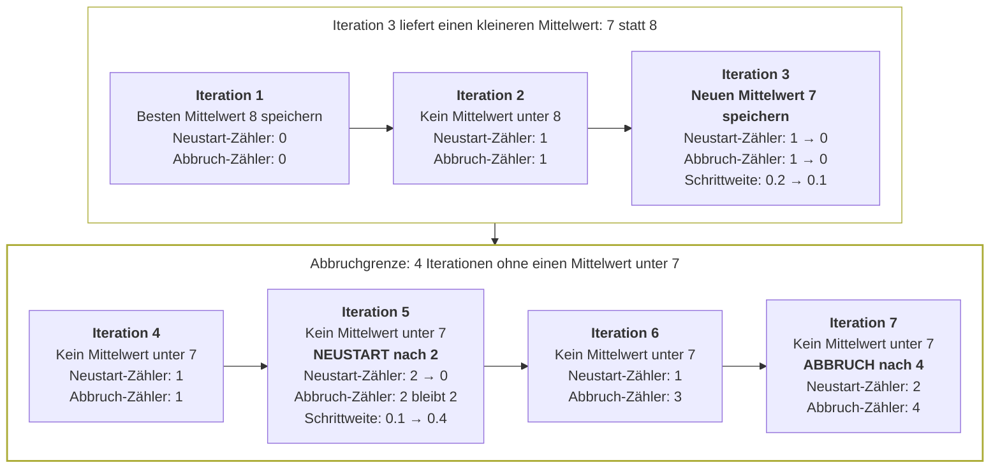

- **Ergebnis:** Zurückgegeben werden der beste gefundene Gewichtssatz
  (`best_weights`) und seine mittlere globale Bewertungszahl
  (`best_mean_global_cost`).

<a id="5-gefundenen-gewichtssatz-mit-standardheuristik-und-zufall-vergleichen"></a>

### 6. Gefundenen Gewichtssatz mit Standardheuristik und Zufall vergleichen

Ziel des Abschlussvergleichs ist die Prüfung des gefundenen Gewichtssatzes
auf separaten Test-Seeds.

- **Test-Seeds:** Verwendet werden `TEST_SEEDS = [101, 102, 103, 104, 105]`.
- **Steuerungen:** Jede der folgenden drei Steuerungen wird einmal pro
  Test-Seed simuliert:

| Anzeige im Interface | Verwendete Steuerung |
| --- | --- |
| `Random` | [Zufällige Nicht-Warteaktion](#randompolicy-zufällige-vergleichssteuerung); Warten nur als Fallback. |
| `Heuristic (default)` | Die heuristische Steuerung mit dem Standardgewichtssatz `HeuristicWeights()`. |
| `Heuristic (optimized)` | Dieselbe heuristische Steuerung mit dem besten Gewichtssatz aus der Suche. |

- **Gleiche Bedingungen:** Alle drei Steuerungen verwenden dasselbe Layout,
  dasselbe Szenario, dieselben Test-Seeds sowie dieselben globalen Gewichte
  und Baseline-Referenzwerte.
- **Umfang:** Es entstehen 15 Testläufe: fünf pro Steuerung. Der gefundene
  Gewichtssatz wird dabei nicht verändert.
- **Tabelle lesen:** Das Interface zeigt je Steuerung die Mittelwerte der
  sieben bewerteten Produktionskennzahlen und der globalen Bewertungszahl.
- **Diagramme lesen:** Sie zeigen die Ergebnisse für jeden einzelnen Test-Seed.
- **Ergebnis beurteilen:** Der kleinere Mittelwert der globalen
  Bewertungszahl ist besser. Ob `Heuristic (optimized)` die anderen
  Steuerungen tatsächlich übertrifft, zeigt erst dieser Vergleich.
