# SpineML

SpineML modelliert und simuliert Fabriken mit einem zentralen Transportkorridor
und Seitenkorridoren. Roboter transportieren Jobs zwischen Lagern, Puffern und
Maschinen. Diese README beschreibt den Zweig `Foroogh`.

- **Steuerung austauschen:** Die `SimulationBridge` verbindet den
  Salabim-Simulationskern mit einer Policy. Die Policy erhält Zustandsdaten und
  wählt Aktionen; die Simulation führt diese aus.
- **Steuerungen vergleichen:** Die heuristische Policy und die Zufallspolicy
  werden anhand derselben Produktionskennzahlen verglichen. Für RL gibt es
  bereits eine schrittweise Umgebung, aber noch kein trainiertes neuronales Netz.
- **Heuristik verbessern:** Die Gewichtssuche prüft verschiedene lokale
  Gewichtssätze in vollständigen Simulationsläufen. Unabhängige Läufe können
  in einem CPU-Prozesspool parallel ausgeführt werden.

## Inhalt

- [Projektstruktur und Zuständigkeiten](#projektstruktur-und-zuständigkeiten)
- [Installation und Start](#installation-und-start)
- [Fabrikkonfiguration](#fabrikkonfiguration)
- [Diskrete Simulation](#diskrete-simulation)
- [SimulationBridge](#simulationbridge)
- [Aktionserzeugung und Policies](#aktionserzeugung-und-policies)
- [HeuristicPolicy: lokale Aktionsbewertung](#heuristicpolicy-lokale-aktionsbewertung)
- [RLPolicy: erste RL-Umgebung](#rlpolicy-erste-rl-umgebung)
- [Optimierungsvorgang](#optimierungsvorgang)
- [Optimierung starten und Ergebnisse lesen](#optimierung-starten)
- [Parallele Optimierung und gemessene Beschleunigung](#parallele-optimierung-mit-mehreren-cpu-prozessen)

<a id="ausführung-bewertung-und-gewichtssuche"></a>

## Projektstruktur und Zuständigkeiten

Die Ordner trennen den Produktionsablauf, die Übergabe an eine Policy und
deren Auswahlverfahren. Allgemeine Ausführung und globale Bewertung gehören
nicht zu einer bestimmten Policy:

```text
sources/
├── apps/
│   └── heuristic_optimization_app.py
├── tools/
│   ├── compare_optimization_runtime.py
│   ├── measure_simulation_runtime.py
│   └── run_rl_episode.py
└── SpineML/
    ├── Configuration/
    ├── Simulation/
    ├── SimulationExecution/
    │   ├── ModelLoader.py
    │   ├── SimulationRunner.py
    │   └── ParallelSimulationRunner.py
    ├── SimulationInterface/
    │   ├── InterfaceTypes.py
    │   └── SimulationBridge.py
    ├── GlobalEvaluation/GlobalSimulationEvaluation.py
    └── Control/
        ├── ActionGeneration/
        │   └── ActionGenerator.py
        ├── HeuristicPolicy/
        │   ├── HeuristicPolicy.py
        │   ├── HeuristicActionSelector.py
        │   ├── HeuristicWeights.py
        │   ├── LocalHeuristicActionEvaluator.py
        │   ├── HeuristicPolicyFactory.py
        │   └── WeightOptimization/LocalHeuristicWeightOptimizer.py
        ├── RLPolicy/
        │   ├── SpineRLEnv.py
        │   ├── RLCandidatePolicy.py
        │   ├── RLObservationEncoder.py
        │   └── RLReward.py
        └── RandomPolicy/RandomPolicy.py
```

| Bereich | Verantwortung |
| --- | --- |
| [apps/heuristic_optimization_app.py](sources/apps/heuristic_optimization_app.py) | Streamlit-Oberfläche, Suchparameter, globale Zielgewichte und Koordination der heuristischen Optimierung. |
| [tools](sources/tools) | Headless-Werkzeuge zur RL-Episodenprüfung, zum Messen einzelner Laufstapel und zum Vergleich vollständiger Optimierungsworkflows. |
| [Configuration](sources/SpineML/Configuration) | Fabrik, Produkte, Operationen, Werkzeuge und Aufträge beschreiben. |
| [Simulation](sources/SpineML/Simulation) | Jobs, Roboter und Maschinen als Salabim-Prozesse ausführen und Laufzeitdaten ändern. |
| [SimulationInterface](sources/SpineML/SimulationInterface) | Beobachtungen und Entscheidungen definieren; die Bridge verbindet die Simulationskomponenten mit einer Policy. |
| [SimulationExecution](sources/SpineML/SimulationExecution) | Modelle laden sowie vollständige Läufe mit übergebenen Policies direkt oder im Prozesspool ausführen. |
| [GlobalEvaluation](sources/SpineML/GlobalEvaluation) | Produktionskennzahlen, globale Zielgewichte und die Kostenbewertung von Laufergebnissen bereitstellen. |
| [Control/ActionGeneration](sources/SpineML/Control/ActionGeneration) | Vollständige gemeinsame Aktionskandidaten einschließlich EDD-basierter Pick-Priorität erzeugen; keine gewichtete Aktionsauswahl. |
| [Control/HeuristicPolicy](sources/SpineML/Control/HeuristicPolicy) | Einzelne Kandidaten mit lokalen Gewichten bewerten und daraus heuristisch auswählen. |
| [Control/HeuristicPolicy/WeightOptimization](sources/SpineML/Control/HeuristicPolicy/WeightOptimization) | Lokale Heuristikgewichte durch wiederholte Simulationsläufe und deren globale Kosten vergleichen. |
| [Control/RLPolicy](sources/SpineML/Control/RLPolicy) | Kandidatenauswahl, numerische Beobachtung und Episodenreward an eine Gymnasium-Schnittstelle anbinden; noch kein NN-Training. |
| [Control/RandomPolicy](sources/SpineML/Control/RandomPolicy) | Ohne Aktionsscores zufällig unter den angebotenen Nicht-Warteaktionen wählen. |

[SimulationRunner.run_policy(policy, seed)](sources/SpineML/SimulationExecution/SimulationRunner.py)
erhält eine fertige Policy.
[ParallelSimulationRunner.run_many(...)](sources/SpineML/SimulationExecution/ParallelSimulationRunner.py)
erhält `SimulationRunRequest`-Aufträge mit einer Policy-Factory und einem Seed;
die Factory erzeugt pro Lauf eine frische Policy. Beide Ausführungswege kennen
keine bestimmten Heuristikgewichte oder RL-Lernverfahren.

Für die Heuristik erstellt
[HeuristicPolicyFactory(weights)(seed)](sources/SpineML/Control/HeuristicPolicy/HeuristicPolicyFactory.py)
eine solche Policy. Die lokalen `HeuristicWeights` steuern deren
Aktionsscores. Davon getrennt legen `GlobalSimulationWeights` fest, wie
Zeit- und Qualitätskennzahlen des gesamten Laufs in die globale Kostenbewertung
eingehen. Diese globale Bewertung wird auch vom RL-Reward verwendet.

Policy-Klassen werden aus ihrem zuständigen Unterpaket importiert, nicht aus
dem Sammelpaket `Control`.

## Installation und Start

### Installation

- **Voraussetzung:** Python ab Version `3.10`.
- **Installation:** Die folgenden Befehle legen eine virtuelle Umgebung an
  und installieren das Projekt. Beispiel für PowerShell:

```powershell
git clone --branch Foroogh --single-branch https://github.com/ghackenberg/SpineML.git
cd SpineML
python -m venv .venv
.\.venv\Scripts\Activate.ps1
python -m pip install -e .
```

- **Projekt und Abhängigkeiten installieren:** `pip install -e .` verwendet
  die [pyproject.toml](pyproject.toml). Der Punkt bezeichnet den aktuellen
  Projektordner. Eine zusätzliche Installation von
  [sources/requirements.txt](sources/requirements.txt) ist nicht erforderlich.
- **Interpreter auswählen:** In VS Code wird die Python-Umgebung `.venv`
  verwendet.
- **Ausführungsordner:** Die folgenden Startbefehle werden aus dem
  Projektordner ausgeführt, in dem `pyproject.toml` liegt.

### Normale Simulation

```powershell
python sources/examples/normal/example-5.py
```

- **Konfiguration laden:** Die Beispieldatei definiert Fabrik und Aufträge.
- **Simulation ausführen:** Sie startet `simulate(layout, scenario, ...)`.
  Bei aktivierter Animation wird der Ablauf mit Salabim dargestellt;
  danach werden Statistiken ausgegeben.

### Optimierung mit Webinterface

```powershell
python -m streamlit run sources/apps/heuristic_optimization_app.py
```

- **Optimierung ausführen:** Im Browser unter **Execution mode** die Option
  **Parallel (process pool)** auswählen und auf **Start optimization** klicken.
  Dadurch startet der Vergleich verschiedener Gewichtssätze.
- **Produktionsbeispiel:** Verwendet wird `example-5.py`.
- **Weitere Einstellungen und Ergebnisse:** Modellwahl und Diagramme sind
  unter [Optimierung starten](#optimierung-starten) erklärt.

### Rechenzeit und Parallelisierung vergleichen

Die Messbefehle, gemessenen Beschleunigungen und der Vergleich zwischen
sequenzieller und paralleler Ausführung stehen gesammelt unter
[Parallele Optimierung mit mehreren CPU-Prozessen](#parallele-optimierung-mit-mehreren-cpu-prozessen).

## Fabrikkonfiguration

Dieser Abschnitt beschreibt die eigenen Erweiterungen gegenüber dem
Professorenstand `origin/main`. Die Konfigurationsklassen liegen unter
[sources/SpineML/Configuration](sources/SpineML/Configuration).

### `Layout.py`

**Aufgabe:** Start- und Endlager des Layouts begrenzen.

- **Lagerkapazität ergänzen:** Das neue `storage_capacity` bestimmt, wie
  viele Jobs Start- und Endlager jeweils aufnehmen können.
- **Beispiel:** Bei `storage_capacity=10` haben beide Lager jeweils zehn
  Plätze, nicht zehn gemeinsam.

### `Machine.py`

**Aufgabe:** Eine konkrete Maschine mit Puffern, Werkzeugausstattung,
Geschwindigkeit und Qualitätsrisiko konfigurieren. Name, `MachineType`,
Korridor und Korridorseite waren bereits vorhanden; der Maschinentyp legt
die grundsätzlich möglichen Operationen fest.

#### Defektwahrscheinlichkeit

Die Defektwahrscheinlichkeit gehört jetzt zur konkreten Maschine.
In `origin/main` wurde sie nur an `OperationType` gespeichert; der
Simulationskern führte damit noch keine Qualitätsprüfung aus.

- **Direkt angeben:** Bei `defect_probability=0.05` wird nach jeder
  Bearbeitung mit fünf Prozent Wahrscheinlichkeit ein Defektschweregrad
  gezogen. Der Wert muss zwischen `0` und `1` liegen und bleibt unabhängig
  vom Seed gleich. Ob dieser Defekt als relevant gilt, beschreibt die
  [Defektprüfung](#defektprüfung-und-recovery).
- **Weglassen oder `None` angeben:** `Machine.resolve_defect_probability(seed)`
  erzeugt beim Aufbau der `SimMachine` einen gleichverteilten Zufallswert in
  `[0, 1)`. Derselbe Seed liefert für dieselbe Maschine denselben Wert.

Ohne direkte Angabe genügt beispielsweise:

```python
Machine("CNC automatisch", cnc_type, corridor, True, 10, 10)
```

- **Im Lauf verwenden:** `SimMachine` übernimmt den Wert als
  `self.defect_probability`. Er bleibt während des gesamten Laufs gleich
  und gilt für alle Bearbeitungen dieser Maschine.
- **Maschinen unterscheiden:** Auch Maschinen desselben `MachineType`
  können unterschiedliche Defektwahrscheinlichkeiten haben.
- **Seed berücksichtigen:** Ein anderer Seed kann einen anderen automatisch
  erzeugten Wert liefern. Ein ausdrücklich angegebener Wert bleibt gleich.
- **Konfiguration und Beobachtung unterscheiden:** `None` kennzeichnet in
  der Konfiguration die automatische Auswahl. Die Laufzeitbeobachtung
  enthält unter `defect_probability` den tatsächlich verwendeten Zahlenwert.
- **Operation konfigurieren:** Das frühere Argument `defect_probability`
  entfällt im Konstruktor von `OperationType`:

```python
OperationType("Fräsen", 4, 3, cnc_type, milling_tool, blank, finished)
```

#### Getrennte Maschinenpuffer

- **Eingangspuffer begrenzen:** `input_storage_capacity` legt seine
  maximale Anzahl aufnehmbarer Jobs fest.
- **Ausgangspuffer begrenzen:** `output_storage_capacity` legt dessen
  maximale Anzahl aufnehmbarer Jobs fest.
- **Unterschiedliche Werte erlauben:** Beide Kapazitäten werden getrennt
  angegeben und müssen nicht gleich sein.

#### Erlaubte Werkzeugtypen

- **Individuelle Ausstattung festlegen:** `tool_types` erlaubt eine eigene
  Werkzeugliste für jede konkrete Maschine.
- **Beispiel:** CNC A unterstützt nur ein Schruppwerkzeug, CNC B zusätzlich
  ein Fräswerkzeug. Beide können schruppen. CNC B kann zusätzlich fräsen,
  sofern die Fräsoperation ihrem Maschinentyp zugeordnet ist.
- **Bisherige Ableitung beibehalten:** Ohne explizite Liste bestimmt
  `MachineType.computeToolTypes()` die Werkzeuge weiterhin aus den
  Operationen des Maschinentyps.
- **Kompatibilität prüfen:** Für jede konkrete Operation müssen weiterhin
  der Maschinentyp und der benötigte Werkzeugtyp passen.

#### Verarbeitungsgeschwindigkeit

- **Geschwindigkeitsfaktor ergänzen:** `processing_speed_factor` beschreibt
  die relative Bearbeitungsgeschwindigkeit der Maschine. Der Anfangswert in
  `Machine` ist `1.0`.
- **Bearbeitungsdauer beeinflussen:** `SimMachine` verwendet den Faktor bei
  der [Berechnung der Bearbeitungsdauer](#verarbeitungsdauer).

#### Schutzwerkzeugzeiten

- **Anfangszustand abbilden:** Das Schutzwerkzeug (`dummy_tool`) ist zu
  Beginn montiert; ein Produktionswerkzeug ist noch nicht eingesetzt.
- **Erste Bearbeitung vorbereiten:** Das Schutzwerkzeug wird entfernt und
  das benötigte Produktionswerkzeug montiert.
- **Zeiten konfigurieren:** `dummy_tool_mount_time=1.0` und
  `dummy_tool_unmount_time=1.0` sind Attribute jeder `Machine`, keine
  Konstruktorargumente. Sie bestimmen Montage- und Demontagezeit.
- **Werkzeugabschluss getrennt ausführen:** `SimMachineShutdown` kann das
  Schutzwerkzeug wieder montieren. Die tatsächlichen Aufrufbedingungen
  stehen [bei dieser Komponente](#simmachineshutdown-in-simmachinepy).

## Diskrete Simulation

**Aufgabe:** Produktionsentscheidungen zeitlich ausführen und ihre Folgen
an Werkstücken, Maschinen und Robotern abbilden. Der Kern liegt unter
[sources/SpineML/Simulation](sources/SpineML/Simulation).

- **Vorhandene Grundlage:** Salabim bildet die zeitlichen Abläufe ab.
  Jobs, Maschinen und Roboter besitzen jeweils einen eigenen Simulationsprozess.
- **Erweiterter Austausch:** Die Komponenten melden Zustände an die
  `SimulationBridge` aus
  [SimulationInterface](sources/SpineML/SimulationInterface), empfangen die
  von der Policy ausgewählten Aktionen und führen sie aus. Die folgenden
  Erweiterungen beziehen sich ebenfalls auf `origin/main`.

### `SimLayout.py`

**Aufgabe:** Startlager, Endlager, Korridore und Main-Roboter aufbauen.
Dieser Aufbau war bereits vorhanden. Ein Store ist ein Salabim-Puffer
für Jobs.

**Erweiterungen:**

- **Start- und Endlager begrenzen:** Beide Stores verwenden jetzt
  `layout.storage_capacity` als maximale Anzahl aufnehmbarer Jobs.
- **Bezugsgrößen für die Bearbeitungsdauer bestimmen:** Ausgehend von den
  Zielprodukttypen der Aufträge werden über die erzeugenden Operationen
  auch alle vorgeschalteten Roh- und Zwischenprodukttypen gesammelt. Aus
  diesen Produkttypen werden das maximale Gewicht (`max_product_weight`)
  und Volumen (`max_product_volume`) ermittelt. Die Werte werden über die
  Korridore und Korridorarme an die Maschinen weitergegeben und dienen der
  [Berechnung der größenabhängigen Bearbeitungsdauer](#verarbeitungsdauer).
- **Nur relevante Produkttypen erfassen:** Nicht verbundene Produkttypen
  beeinflussen die Maxima nicht. Bereits erfasste Typen werden übersprungen,
  damit zyklische Produktbeziehungen die Sammlung nicht endlos wiederholen.
- **Bridge weitergeben:** Beim Erzeugen der `SimCorridor`-Komponenten und
  des `SimRobotMain` wird dieselbe `SimulationBridge` übergeben, damit diese
  Komponenten mit der Steuerung verbunden sind.

### `SimCorridor.py`

**Aufgabe:** Die drei Korridor-Stores sowie den linken und rechten
Korridorarm erzeugen. Dieser Aufbau war bereits vorhanden.

**Erweiterungen:**

- **Korridorlager begrenzen:** Die drei Stores verwenden jetzt jeweils
  das bereits vorhandene `corridor.storage_capacity` als maximale Anzahl
  aufnehmbarer Jobs.
- **Korridor und Stores registrieren:** `bridge.register_corridor()` meldet
  den Korridor zusammen mit seinen drei Stores bei der `SimulationBridge` an.
- **Bridge und Produktgrößen weitergeben:** Beide `SimCorridorArm`-Komponenten
  erhalten dieselbe Bridge sowie `max_product_weight` und
  `max_product_volume`. `SimCorridor` berechnet diese Größen nicht selbst.

### `SimCorridorArm.py`

**Aufgabe:** Die Maschinen und den Korridorroboter einer Korridorseite
erzeugen. Dieser Aufbau war bereits vorhanden; ein Roboter wird nur für
eine Seite mit mindestens einer Maschine erzeugt.

**Erweiterungen:**

- **Bridge weitergeben:** Die erzeugten `SimMachine`-Komponenten und der
  `SimRobotCorridorArm` erhalten die `SimulationBridge` für den Austausch mit
  der Steuerung.
- **Produktgrößen an die Maschinen weitergeben:** Jede `SimMachine` erhält
  `max_product_weight` und `max_product_volume` für die
  [Berechnung ihrer Bearbeitungsdauer](#verarbeitungsdauer).

### `SimOrder.py`

**Aufgabe:** Für jedes bestellte Produktstück eine eigene `SimOrderJob`-
Komponente erzeugen. Die Anzahl ergibt sich aus `order.quantity`; diese
Job-Erzeugung war bereits vorhanden.

**Erweiterung:**

- **Bridge an die Jobs weitergeben:** Jeder erzeugte Job erhält die
  `SimulationBridge`, damit er Aktionen von der Steuerung anfordern kann.

### `SimOrderJob.py`

**Aufgabe:** Den Zustand und die empfangenen Aktionen eines einzelnen
Werkstücks verwalten. In `origin/main` wurden seine
vollständige Operationsfolge und Maschinenroute bei der Erzeugung zufällig
ausgewählt. Der Job wurde anschließend direkt im Startlager abgelegt.

**Erweiterungen:**

- **Job bei der Bridge registrieren:** Jeder Job meldet sich selbst unter
  einer ID aus Auftragsname und Jobnummer an.
- **Aktionen von der Steuerung empfangen:** Der Job fordert über
  `bridge.request_action(self)` eine Aktion an und empfängt sie über
  `bridge.action(self)`. Er legt seine Route nicht mehr selbst zufällig fest.
- **Freigabe ausführen:** `release_job` übergibt den Startprodukttyp und die
  Freigabedaten. Der Job wartet gegebenenfalls bis zum übergebenen
  Freigabezeitpunkt und legt sich im angegebenen Startlager ab.
- **Nächste Verarbeitung speichern:** `selected_operation` und
  `selected_machine` enthalten die von der Steuerung ausgewählte nächste
  Operation und Maschine.
- **Zustände getrennt verwalten:** Produktzustand, Qualität und Terminstatus
  werden getrennt gespeichert. Zusätzlich werden Freigabe, Standort,
  Priorität und Abschlusszeit festgehalten.
- **Defektbehandlung ausführen:** Der Job übernimmt die gewählte Nacharbeit
  auf derselben oder einer alternativen Maschine, Herabstufung oder
  Ausschussentscheidung. Er speichert Defektdaten, Strategie und Zähler;
  die Strategieauswahl erfolgt in der Steuerung.
- **Warten und Abschluss ausführen:** `wait_job` lässt den Job eine
  Simulationszeiteinheit warten. Eine Abschlussaktion mit
  `finish_process=True` beendet seinen Prozess.

<a id="herkunft-und-aktualisierung-der-jobattribute"></a>

#### Wie Steuerung und Simulation die Jobdaten ändern

- **Die Steuerung entscheidet:** Welche Operation soll auf welcher Maschine
  ausgeführt werden? Soll ein defekter Job nachgearbeitet oder herabgestuft
  werden?
- **Die Simulation führt aus:** Roboter transportieren den Job, Maschinen
  bearbeiten ihn. Dabei werden seine gespeicherten Daten aktualisiert.
- **Der Job setzt eigene Aktionen um:** Er führt Freigabe, Warten,
  Defektstrategie und Abschluss aus. Die Auswahl dieser Aktionen trifft
  die Policy, nicht der Job.

**Beispiel aus `example-5.py`:** Die Steuerung wählt die Operation
`Rough blank A` (Schruppen) auf der Maschine `Near basic`. Aus dem Rohteil
`Blank A` wird bei erfolgreicher Bearbeitung ein `Base body` (Grundkörper).

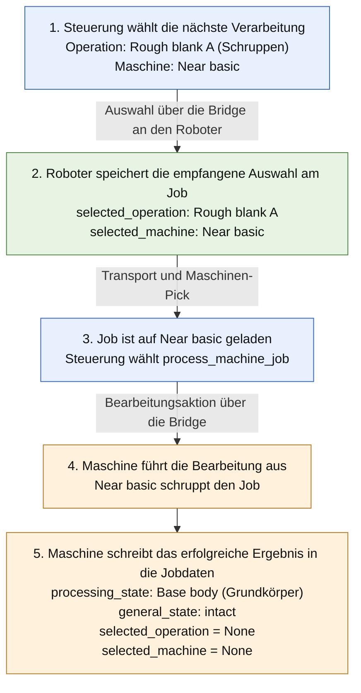

- **Warum wird die Auswahl gelöscht?** Diese Bearbeitung ist erledigt.
  `None` bedeutet, dass noch keine nächste Operation und Maschine gewählt
  sind. Die Steuerung kann nun die nächste Verarbeitung auswählen.
- **Was wird als Auswahl gespeichert?** `selected_operation` und
  `selected_machine` verweisen auf die gewählten Objekte. Im Diagramm
  stehen zur besseren Lesbarkeit ihre Namen.
- **Warum ändern beide Seiten Jobdaten?** Die Steuerung liefert zum Beispiel
  die Maschinenauswahl; die Simulation speichert diese Auswahl und setzt sie
  nach der Bearbeitung zurück. Das sind unterschiedliche Aufgaben.

#### Laufzeitstatus eines `SimOrderJob`

Die folgenden Tabellen enthalten alle 29 eigenen Attribute aus dem
Konstruktor. Sie erklären Bedeutung, Anfangswerte und Änderungen im
Produktionsablauf mit den vorhandenen Steuerungen.

- **Gespeicherte Werte:** `processing_state`, `general_state` und
  `due_state` sind Salabim-`State`-Objekte. In den Tabellen stehen die
  darin gespeicherten Werte, die über `.get()` gelesen werden.
- **Entscheidung und Eintragen unterscheiden:** Die Steuerung liefert ihre
  Auswahl über Aktionen. Die ausführende Simulationskomponente trägt diese
  Werte am Job ein. Ergebnisse wie Defekte entstehen in der Simulation.

##### Beim Erzeugen des Jobs

`SimOrder` übergibt diese sechs Werte an den Konstruktor von `SimOrderJob`:

| Attribut | Was wird beim Erzeugen gespeichert? |
| --- | --- |
| `layout` | Das Layout, in dem der Job produziert wird. |
| `scenario` | Das Szenario mit den Produktionsaufträgen. |
| `order` | Der Auftrag dieses Jobs. |
| `number` | Der Jobindex innerhalb des Auftrags: `0` bis `quantity - 1`. |
| `store_start` | Der Startlager-Store. |
| `bridge` | Die Verbindung zur Steuerung. |

##### Freigabe, Standort und Abschluss

| Attribut | Startwert | Bedeutung | Wer ändert den Wert und wann? |
| --- | --- | --- | --- |
| `released` | `False` | Eine Freigabeaktion wurde übernommen. | Der Job übernimmt `True` aus `release_job`, bevor er gegebenenfalls bis zur Freigabezeit wartet und sich im Startlager ablegt. `True` bedeutet daher nicht, dass die Ablage bereits erfolgt ist. |
| `queue_priority` | `0.0` | Termindruck-Teilwert für die heuristische Pick-Bewertung; zusätzlich Sortierwert des Jobs im Store. | Der gemeinsame [ActionGenerator](sources/SpineML/Control/ActionGeneration/ActionGenerator.py) trägt ihn aus Deadline und aktueller Zeit direkt in jeden Pick-Payload ein. Beim ausgewählten Pick speichern Roboter oder Maschine den Wert am Job. Die `RandomPolicy` ersetzt den Wert in ihrer ausgewählten Aktion durch `0.0`. |
| `location` | `"start_storage"` | Zuletzt am Job gespeicherte Ortskennung, keine laufend berechnete Roboterposition. | Der Job schreibt den Store-Namen nach seiner Ablage; Roboter und Maschine schreiben bei ihren vorgesehenen Pick- und Place-Schritten Lade- oder Store-Kennungen. Die aktuelle Einschränkung steht direkt unter der Tabelle. |
| `completed_time` | `None` | Gespeicherter Abschlusszeitpunkt für Terminbewertung und Makespan. | `SimRobotMain` ruft `job.mark_finished()` nach dem Absenken zum Endlager auf: vor der letzten Einlagerungszeit und vor `to_store()`. Der Wert ist deshalb nicht der Zeitpunkt der tatsächlichen Endlagerablage. |
| `due_state` | `None` | Abschließende Terminbewertung, keine laufende Anzeige des Termindrucks. | Sobald `completed_time` vorliegt, erzeugt die Steuerung `complete_job`: `"late"` bei `completed_time > latest_end_time`, sonst `"on-time"`. Der Job übernimmt diesen Wert; genau bei der Deadline gilt der Job als pünktlich. |
| `process_finished` | `False` | Der eigene Simulationsprozess dieses Jobs ist beendet. | Bei der Abschlussaktion mit `finish_process=True` setzt der Job das Flag auf `True` und verlässt seine Prozessschleife. Der `SimCompletionWatcher` prüft dieses Flag für alle Jobs. |

- **Pick-Auswahl:** Die Heuristik vergleicht vollständige Aktionsscores;
  `queue_priority` ist dabei nur ein Teilwert. RL- und Zufallspolicy wählen
  nach ihren eigenen Regeln. Die Simulation entnimmt immer genau den
  ausgewählten Job, nicht automatisch den ersten Job im Store.
- **Store-Sortierung:** Beim späteren Ablegen wird der gespeicherte Wert
  an `to_store(..., priority=job.queue_priority)` übergeben. Er beeinflusst
  die Position des Jobs im Store, nicht die zeitliche Reihenfolge der
  Ablageaktionen. Kleinere Prioritätswerte stehen im Store weiter vorn;
  zwischen Picks wird der Wert nicht automatisch neu berechnet.
- **Grenze von `location`:** Der Anfangswert `"start_storage"` wird schon
  vor der tatsächlichen Freigabe gesetzt. Außerdem aktualisiert
  `SimRobotCorridorArm` den Wert beim Pick aus einem Maschinenausgangspuffer
  derzeit nicht. Bis zur nächsten Ablage kann deshalb noch die vorherige
  Store-Kennung stehen. Das Attribut ist somit keine lückenlose Ortserfassung.

##### Produktzustand und nächste Verarbeitung

| Attribut | Startwert | Bedeutung | Wer ändert den Wert und wann? |
| --- | --- | --- | --- |
| `processing_state` | `"unconfigured"` | Name des aktuellen Produkttyps, etwa `"Blank A"` oder `"Base body"`. | Der Job übernimmt den Startprodukttyp aus `release_job`. Nach erfolgreicher Bearbeitung setzt `SimMachine` den Ausgangsprodukttyp der Operation. Bei einem Defekt bleibt der bisherige Produkttyp zunächst erhalten. |
| `selected_operation` | `None` | Das ausgewählte `OperationType`-Objekt für die nächste Bearbeitung, nicht nur dessen Name. | Die Steuerung wählt eine Aktion mit dieser Operation. Je nach Aktion übernehmen Job oder Roboter die Auswahl aus dem Payload. |
| `selected_machine` | `None` | Das ausgewählte konfigurierte `Machine`-Objekt als Bearbeitungs- und Transportziel. | Die Steuerung wählt eine Aktion mit dieser Maschine. Je nach Aktion übernehmen Job oder Roboter die Auswahl aus dem Payload. |

- **Auswahl zurücksetzen:** `SimMachine` setzt beide Auswahlfelder nach
  jeder Bearbeitung auf `None`, auch bei einem Defekt. Zusätzlich löschen
  Herabstufungs- und Ausschussaktionen die Auswahl; der Main-Roboter löscht
  sie ebenfalls beim Transport zum Endlager.
- **Produktzustand bei Defektaktionen:** Nacharbeit setzt
  `processing_state` auf `defect_product_state_before`. Herabstufung setzt
  ihn auf `defect_product_state_target`. Eine Ausschussaktion ändert den
  Produkttyp nicht.

##### Qualität und Herabstufung

| Attribut | Startwert | Bedeutung | Wer ändert den Wert und wann? |
| --- | --- | --- | --- |
| `general_state` | `"intact"` | Qualitätsstatus: `"intact"`, `"defect"` oder `"scrap"`. | Die Maschine setzt nach erfolgreicher Bearbeitung `"intact"`; `job.mark_defective()` setzt `"defect"`. Der Job übernimmt aus einer Herabstufungsaktion `"intact"` und aus einer Ausschussaktion `"scrap"`. |
| `downgraded` | `False` | Der Job wurde als qualitativ herabgestuft akzeptiert. Er erhält keine weitere normale Bearbeitung und wird zum Endlager gebracht. | Der Job übernimmt `True` aus der von der Steuerung gewählten Aktion `downgrade_product`. |
| `downgrade_product_type` | `None` | Das bei der Herabstufung übernommene `ProductType`-Objekt; es kann ein Zwischenprodukt sein. | Die Steuerung übergibt die Typ-ID des vorgesehenen Ergebnisses der fehlerhaften Operation. Die Bridge löst sie zum Objekt auf; der Job speichert es beim Ausführen von `downgrade_product`. |

- **Nacharbeit ist noch kein intaktes Ergebnis:** Bei ihrer Auswahl bleibt
  `general_state="defect"`. Erst eine erfolgreiche Nachbearbeitung setzt
  den Wert auf `"intact"`.
- **Beispiel:** Nach einer misslungenen Polieroperation kann die Steuerung
  herabstufen. Dann speichert der Job den vorgesehenen Produkttyp „poliert“,
  `general_state="intact"` und `downgraded=True`. Das zusätzliche Flag
  kennzeichnet die geringere Qualität.

##### Defektdaten und Nacharbeit

- **Defekt erkennen:** Nach der Bearbeitung prüft `SimMachine`, ob ein
  relevanter Defekt vorliegt. Ab Schweregrad `0.001` ruft sie
  `job.mark_defective()` auf und übergibt die Defektdaten.
- **Reaktion auswählen:** Der [ActionGenerator](#actiongenerator) erzeugt
  die möglichen Defektaktionen. Die Steuerung wählt eine davon; der Job
  führt sie aus.
- **Letzten Defekt speichern:** Die sechs `defect_...`-Angaben zu Zeitpunkt,
  Operation, Maschine, Produktzuständen und Schweregrad beschreiben den
  letzten erkannten Defekt. Ein neuer Defekt überschreibt sie. Eine
  erfolgreiche Nacharbeit, Herabstufung oder Ausschussaktion löscht sie nicht.

| Attribut | Startwert | Bedeutung | Wer ändert den Wert und wann? |
| --- | --- | --- | --- |
| `defect_detected_time` | `None` | Simulationszeit des letzten erkannten Defekts. | `job.mark_defective()` speichert beim Aufruf durch die Maschine `env.now()`. |
| `defect_operation` | `None` | Das `OperationType`-Objekt der fehlerhaften Operation. | Die Maschine übergibt es an `job.mark_defective()`. |
| `defect_machine` | `None` | Das konfigurierte `Machine`-Objekt, auf dem der Defekt entstand. | Die Maschine übergibt ihre Konfiguration an `job.mark_defective()`. |
| `defect_product_state_before` | `None` | Name des Eingangsprodukttyps der fehlerhaften Operation. | Die Maschine übergibt `operation.consumes_product_type.name`. Die Nacharbeitsaktion verwendet diesen Namen als Produktzustand. |
| `defect_product_state_target` | `None` | Name des vorgesehenen Ausgangsprodukttyps dieser Operation; nicht automatisch das Auftragsziel. | Die Maschine übergibt `operation.produces_product_type.name`. Die Herabstufungsaktion verwendet diesen Namen als Produktzustand. |
| `defect_severity` | `None` | Schweregrad des letzten erkannten Defekts. | Die Maschine erzeugt den Schweregrad bei ihrer Qualitätsprüfung und übergibt ihn ab `0.001` an `job.mark_defective()`. |
| `defect_recovery_strategy` | `None` | Gewählte Reaktion: Nacharbeit auf derselben oder einer anderen Maschine, Herabstufung oder Ausschuss. | Job oder Main-Roboter übernehmen die von der Steuerung gewählte Strategie. Ein neuer Defekt setzt sie auf `None`; eine erfolgreiche Bearbeitung entfernt eine gespeicherte Nacharbeitsstrategie. |
| `recovery_in_progress` | `False` | Eine gewählte Nacharbeit steht noch aus oder läuft. | Job oder Main-Roboter setzen `True`, wenn sie die Nacharbeit übernehmen. Nach der Maschinenoperation wird es wieder `False`, auch bei einem erneuten Defekt. |
| `defect_count` | `0` | Gesamtzahl der bei diesem Job erkannten Defekte. | Jeder Aufruf von `job.mark_defective()` erhöht den Zähler um `1`. Derselbe Job kann mehrere Defekte haben. |
| `rework_count` | `0` | Anzahl ausgewählter Nacharbeiten; keine Anzahl erfolgreich abgeschlossener Nachbearbeitungen. | Der Job zählt jede empfangene Nacharbeitsaktion. Der Main-Roboter zählt eine übernommene Nacharbeit nur, wenn zuvor noch keine Nacharbeitsstrategie gespeichert war. |
| `scrap_count` | `0` | Anzahl empfangener Ausschussaktionen für diesen Job. | Bei jeder Aktion `job_scrap` erhöht der Job den Zähler um `1`. |

- **Zufallsprüfung bei Nacharbeit:** `rework_count` geht in den Schlüssel
  für die Qualitätszufallszahlen ein. Eine weitere Nacharbeit erhält damit
  einen anderen Kontextschlüssel.
- **Aktionsdaten direkt übernehmen:** `SimOrderJob.process()` kann die im
  Code vorgesehenen Attributfelder auch direkt aus einem Aktions-Payload
  übernehmen. Die Tabellen beschreiben, welche Komponenten sie im Ablauf
  der vorhandenen Steuerungen liefern und aktualisieren.

#### UML-Zustandsdiagramm eines Jobs

- **Darstellung:** Das Diagramm zeigt den fachlichen Ablauf eines Werkstücks.
- **Abgrenzung zum Code:** `processing` und `completed` fassen mehrere
  Codefelder zusammen und sind keine zusätzlichen Werte von
  `processing_state`. Die Produktnamen hängen vom jeweiligen Modell ab.

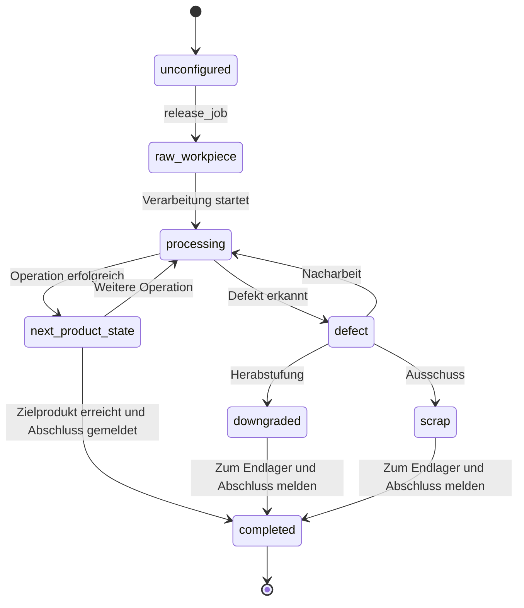

- **Herabstufung im Code:** Der Diagrammzustand `downgraded` entspricht der
  Markierung `downgraded=True` zusammen mit dem übernommenen Produktzustand.

### `SimRobot.py`

**Aufgabe:** Gemeinsame Bewegungen in X, Y und Z sowie die
Positionsdarstellung bereitstellen. Diese Grundlage war bereits vorhanden.

**Erweiterungen:**

- **Genau den ausgewählten Job aufnehmen:**
  `take_selected_job_from_store()` entnimmt den im Aktions-Payload angegebenen
  Job.
- **Geschwindigkeit schwanken lassen:** Jeder Aufruf von `move_x`, `move_y`
  oder `move_z` zieht einen neuen Faktor zwischen `0.95` und `1.05`.
  Die effektive Geschwindigkeit ist `Grundgeschwindigkeit × Zufallsfaktor`.
- **Aktuelle Geschwindigkeit speichern:** `effective_movement_speed()`
  speichert den Zufallsfaktor in `movement_speed_multiplier`. `move_x()`,
  `move_y()` und `move_z()` speichern die effektive Geschwindigkeit in
  `movement_speed`. Am Ende der Bewegung setzen sie diesen Wert auf `0.0`:
  Der Roboter steht; seine Grundgeschwindigkeit bleibt unverändert.

### `SimRobotMain.py`

**Aufgabe:** Jobs zwischen Startlager, Korridoren und Endlager
transportieren. Diese Transportaufgabe war bereits vorhanden.

**Erweiterungen:**

- **Bei der Bridge registrieren:** Der Roboter meldet sich selbst zusammen
  mit Start- und Endlager an.
- **Aktionen statt festem Transportablauf ausführen:** Er fordert Aktionen
  an und führt `pick_main_robot`, `place_main_robot` oder `wait_main_robot`
  aus. Job, Transportziel sowie Ein- und Auslagerzeiten kommen aus dem
  Aktions-Payload.
- **Auswahl und Beladung speichern:** `current_job` enthält den geladenen
  Job. Der Roboter übernimmt die von der Steuerung vorgegebene Priorität
  sowie gegebenenfalls die nächste Operation und Maschine.
- **Bewegungsgeschwindigkeit festlegen:** Die Grundgeschwindigkeit beträgt
  jetzt `2.0`; die Schwankung pro Achsenbewegung berechnet `SimRobot`.
- **Abschlusszeit erfassen:** Beim Transport zum Endlager ruft der Roboter
  `job.mark_finished()` auf. Das geschieht nach dem Absenken, aber vor der
  letzten Einlagerungszeit und dem tatsächlichen Ablegen im Endlager.
- **Ablage melden:** Nach dem Ablegen aktualisiert er die betroffenen Daten
  und benachrichtigt die Bridge mit `notify_state_change()`.

### `SimRobotCorridorArm.py`

**Aufgabe:** Jobs zwischen Korridor- und Maschinenpuffern transportieren.
Diese Transportaufgabe war bereits vorhanden.

**Erweiterungen:**

- **Bei der Bridge registrieren:** Jeder Roboter meldet sich selbst unter
  einer ID aus Korridorname und Korridorseite an.
- **Aktionen von der Steuerung ausführen:** Er fordert Aktionen an und führt
  `pick_corridor_arm_robot`, `place_corridor_arm_robot` oder
  `wait_corridor_arm_robot` aus. Job, Ziel und Lagerzeiten werden übergeben;
  der Roboter bestimmt keine eigene Route.
- **Auswahl und Beladung speichern:** Der Roboter verwaltet `current_job`
  und übernimmt die im Payload vorgegebenen Jobdaten, beispielsweise die
  Priorität und die ausgewählte Maschine.
- **Bewegungsgeschwindigkeit festlegen:** Die Grundgeschwindigkeit beträgt
  jetzt `1.5`; die Schwankung pro Achsenbewegung berechnet `SimRobot`.
- **Ablage melden:** Nach dem Ablegen aktualisiert er die betroffenen Daten
  und benachrichtigt die Bridge mit `notify_state_change()`.

### `SimMachine.py`

**Aufgabe:** Eine konfigurierte `Machine` mit Puffern, Werkzeugen und
Bearbeitungen simulieren. Maschinenpuffer, Werkzeugwechsel und
Werkzeuglebensdauer waren bereits vorhanden.
Die Bearbeitungsdauer entsprach dort unmittelbar `operation.duration`.

**Erweiterungen:**

- **Steuerung und Ausführung trennen:** Die Maschine fordert Aktionen über
  die Bridge an und führt getrennte Pick-, Verarbeitungs- und Warteaktionen
  aus. Sie wählt Job, Operation und Werkzeug nicht mehr selbst aus.
- **Kapazitäten und Ausstattung übernehmen:** Die Puffer verwenden die
  konfigurierten Kapazitäten; die Werkzeugliste stammt von der konkreten
  `Machine`. Neu ist auch der Zustand mit montiertem Schutzwerkzeug.
- **Bearbeitungsdauer erweitern:** Produktgröße, Maschinengeschwindigkeit
  und ein maschinenspezifischer Variationsfaktor beeinflussen die Dauer.
- **Qualität prüfen:** Nach jeder Bearbeitung wird mit der
  Defektwahrscheinlichkeit dieser Maschine geprüft, ob ein Defekt entsteht.
  Das Ergebnis wird am Job gespeichert; die Steuerung wählt die Reaktion.

#### Aufbau und Laufzeitdaten

- **Konfiguration:** `self.machine` verweist auf die konfigurierte Maschine.
- **Puffer:** `store_in` und `store_out` sind getrennte Eingangs- und
  Ausgangspuffer mit den konfigurierten Kapazitäten.
- **Registrierung bei der Bridge:** Jede `SimMachine` registriert sich selbst
  unter ihrer eigenen ID und meldet dabei auch `store_in` und `store_out` an.
- **Bezugsgrößen:** `max_product_weight` und `max_product_volume` sind das
  größte Gewicht und Volumen der Auftragsziele und aller Roh- und
  Zwischenprodukttypen auf deren definierten Herstellungswegen. Sie dienen
  der Größenanpassung der Bearbeitungsdauer.
- **Werkzeugausstattung:** `self.tool_types` ist eine eigene Kopie der
  Werkzeugliste der konkreten `Machine`.
- **Werkzeuglebensdauer:** Pro Werkzeugtyp werden vier Werte verwaltet:
  - `remaining_life_units`: aktueller Restwert.
  - `remaining_life_units_t`: Simulationszeitpunkt dieses Restwerts.
  - `remaining_life_units_next`: erwarteter Restwert nach der Operation.
  - `remaining_life_units_next_t`: erwarteter Abschlusszeitpunkt der Operation.
- **Anfangszustand:** `dummy_tool_mounted=True` bedeutet, dass das
  Schutzwerkzeug montiert ist. `tool_type=None` und `current_job=None`
  bedeuten, dass noch kein Produktionswerkzeug und kein Job geladen sind.
- **Maschinengeschwindigkeit:** Einmal beim Erzeugen der Maschine wird
  `machine.processing_speed_factor` mit einem Zufallsfaktor zwischen `0.45`
  und `2.0` multipliziert. Dieser Wert bleibt für den Lauf unverändert.
- **Dauervariation:** `processing_variation` wird einmal pro Maschine
  zwischen `0.90` und `1.10` gezogen und skaliert jede ihrer Bearbeitungsdauern.
- **Anlaufverzögerung:** `startup_delay` wird einmal zwischen `0` und `4`
  Zeiteinheiten gezogen. Sie wird nur vor der ersten Bearbeitung angewendet;
  `_startup_delay_applied` verhindert ihre Wiederholung.

#### Prozess und Aktionen

Der Prozess läuft wiederholt ab:

1. Ist der Ausgangspuffer voll, setzt die Maschine den Zustand `blocked`,
   sonst `waiting`.
2. Die Maschine meldet ihren Zustand mit `bridge.request_action(self)` und
   wartet auf die von der Steuerung gelieferte Aktion.
3. Bei `pick_machine_job` nimmt sie genau den im Payload genannten Job aus dem
   genannten Store. Sie aktualisiert dessen `location`, übernimmt die
   `queue_priority` und speichert den Job in `self.current_job`.
4. Bei `process_machine_job` führt sie genau die übergebene Operation mit dem
   übergebenen Werkzeug aus.
5. Bei `wait_machine` wartet sie eine Simulationszeiteinheit und fordert
   anschließend eine neue Aktion an.

- **Keine Ersatzwahl:** Fehlt der ausgewählte Job im angegebenen Store,
  wird die Pick-Aktion beendet, ohne einen anderen Job aufzunehmen.

#### Werkzeugwechsel und Lebensdauer

Der Aktions-Payload von `process_machine_job` liefert die auszuführende
Operation, das Werkzeug und die benötigten Ausführungsdaten:

- `operation` und `tool_type`: ausgewählte Operation und Werkzeugtyp.
- `total_life_units`: vollständige Lebensdauer des verwendeten Werkzeugs.
- `consumed_life_units`: Lebensdauer, die die aktuelle Operation verbraucht.
- `remaining_life_units_before_operation`: verbleibende Lebensdauer vor Beginn
  der Operation.
- `tool_setup_action`: Anweisung, ob das Werkzeug beibehalten, montiert,
  demontiert oder ersetzt wird.
- `target_store`: Ausgangspuffer, in den die Maschine den Job nach der
  Verarbeitung ablegt.

Je nach `tool_setup_action` führt die Maschine folgende Schritte aus:

- `keep_tool`: Das aktuelle Werkzeug bleibt montiert.
- `unmount_dummy_tool_and_mount_tool`: Das Schutzwerkzeug wird entfernt und
  das Produktionswerkzeug montiert.
- `unmount_and_mount_tool`: Das bisherige Produktionswerkzeug wird entfernt
  und das neue Werkzeug montiert.
- `replace_tool_same_type`: Das verbrauchte Werkzeug wird entfernt und durch
  ein Werkzeug desselben Typs ersetzt.

- **Werkzeug ersetzen:** Reicht die verbleibende Lebensdauer für die
  Operation nicht aus, wird beim Werkzeugwechsel ein neues Werkzeug mit
  `total_life_units` angenommen.
- **Verbrauch verbuchen:** Nach der Operation wird die Lebensdauer um
  `consumed_life_units` reduziert.
- **Anzeige aktualisieren:** Die Lebensdaueranzeige interpoliert während der
  geplanten Bearbeitungsdauer vom Anfangswert zum erwarteten Restwert.
  Nach dem Abschluss wird der tatsächliche Restwert gespeichert.

#### Verarbeitungsdauer

- **Verwendetes Produkt:** Die Größenberechnung verwendet den
  Eingangsprodukttyp der ausgeführten Operation
  (`operation.consumes_product_type`). Damit zählen Gewicht und Volumen
  des Werkstücks vor dieser Bearbeitung, nicht die des bestellten Endprodukts.
- **Berücksichtigte Produkttypen:** Die bestellten Endprodukte aller
  Aufträge im Szenario sowie alle Roh- und Zwischenprodukttypen auf ihren
  definierten Herstellungswegen.
- **`max_product_weight`:** Größtes Gewicht unter diesen Produkttypen.
  Das Gewicht des gerade bearbeiteten Werkstücks wird durch diesen Wert geteilt.
- **`max_product_volume`:** Größtes Volumen unter diesen Produkttypen.
  Das Volumen des gerade bearbeiteten Werkstücks wird durch diesen Wert geteilt.
- **Unabhängige Maxima:** Das größte Gewicht und das größte Volumen können
  zu unterschiedlichen Produkttypen gehören. `SimLayout` bestimmt beide
  Werte beim Aufbau des Simulationslayouts.
- **Größenfaktor berechnen:**

```python
product = operation.consumes_product_type
volume = product.length * product.width * product.depth
weight_ratio = float(product.weight) / self.max_product_weight
volume_ratio = float(volume) / self.max_product_volume
size_factor = 1.0 + 0.5 * weight_ratio + 0.5 * volume_ratio
```

- **Wirkung des Größenfaktors:** Bei positiven Produktgrößen liegen die
  Verhältnisse zwischen `0` und `1`. Der Faktor liegt damit zwischen `1.0`
  und `2.0` und verlängert die konfigurierte Operationsdauer.
- **Bearbeitungsdauer berechnen:**

```python
duration = operation.duration * size_factor / self.processing_speed_factor
duration *= self.processing_variation
```

- **Maschinengeschwindigkeit berücksichtigen:** Ein größerer
  `processing_speed_factor` verkürzt die Bearbeitungsdauer.
- **Dauervariation berücksichtigen:** Die berechnete Bearbeitungsdauer wird
  mit `processing_variation` multipliziert. Dieser Faktor wird einmal pro
  Maschine gezogen und bleibt während des Laufs gleich.

#### Defektprüfung und Recovery

- **Maschinenrisiko übernehmen:** `self.defect_probability` wird beim
  Erzeugen der `SimMachine` einmal bestimmt und gilt während des Laufs für
  alle Bearbeitungen dieser Maschine.
- **Nach jeder Bearbeitung prüfen:** Nach Ablauf der Bearbeitungsdauer wird
  `_sample_defect_severity(job, operation)` aufgerufen, auch nach einer
  Nacharbeit.
- **Zufallszahlen reproduzierbar erzeugen:** Seed, Szenario, Auftrag,
  Jobnummer, Operation und `rework_count` bilden den Schlüssel. Aus dessen
  SHA-256-Fingerabdruck wird der Startwert eines eigenen Zufallsgenerators
  abgeleitet. Derselbe Schlüssel liefert dieselbe Zufallszahlenfolge.
- **Defekt und Schweregrad bestimmen:** Die erste Zufallszahl wird mit der
  Defektwahrscheinlichkeit der Maschine verglichen. Nur wenn sie kleiner
  ist, wird eine zweite Zufallszahl als Schweregrad zurückgegeben:

```python
if quality_rng.random() < self.defect_probability:
    return quality_rng.random()
return None
```

- **Relevanten Defekt speichern:** Bei einem Schweregrad ab `0.001` ruft die
  Maschine `job.mark_defective()` auf. Operation, Maschine, Produktzustände
  und Schweregrad werden im Job gespeichert; sein bisheriger
  `processing_state` bleibt erhalten.
- **Intaktes Ergebnis speichern:** Bei `None` oder einem Schweregrad unter
  `0.001` erhält der Job den von der Operation erzeugten Produktzustand und
  `general_state="intact"`.
- **Nacharbeit abschließen:** Nach einer Nacharbeitsoperation wird
  `recovery_in_progress=False` gesetzt, auch wenn erneut ein Defekt entsteht.
  Eine erledigte Nacharbeitsstrategie wird bei intaktem Ergebnis entfernt;
  bei einem neuen Defekt löscht `mark_defective()` die bisherige Strategie.
- **Zuständigkeit abgrenzen:** Die Maschine erzeugt und speichert das
  Qualitätsergebnis. Welche Defektstrategie danach gewählt wird, entscheidet
  die Steuerung.

#### Abschluss der Verarbeitung und Zustände

- **Auswahl zurücksetzen:** Nach der Bearbeitung werden `selected_operation`
  und `selected_machine` des Jobs auf `None` gesetzt.
- **Job ablegen:** Die Maschine legt ihn mit seiner Priorität im übergebenen
  Zielstore ab und aktualisiert seine `location`.
- **Maschine freigeben:** `current_job` wird auf `None` gesetzt. Mit der
  nächsten `request_action()`-Anfrage wird wieder eine Aktion angefordert.

Die wichtigsten Maschinenzustände sind:

- `waiting`: Die Maschine wartet auf eine Aktion.
- `blocked`: Der Ausgangspuffer kann keinen fertigen Job aufnehmen.
- `unmounting`: Ein Schutz- oder Produktionswerkzeug wird entfernt.
- `mounting`: Ein Produktions- oder Schutzwerkzeug wird montiert.
- `working`: Die Operation wird ausgeführt.
- `returning`: Die Verarbeitung ist beendet und der Job wird abgelegt.

#### UML-Zustandsdiagramm von `SimMachine`

- **Darstellung:** Das Diagramm zeigt die Maschinenzustände während eines
  normalen Simulationslaufs.
- **Jobauswahl:** Die Steuerung bestimmt über die `SimulationBridge`,
  welcher Job geladen und verarbeitet wird.

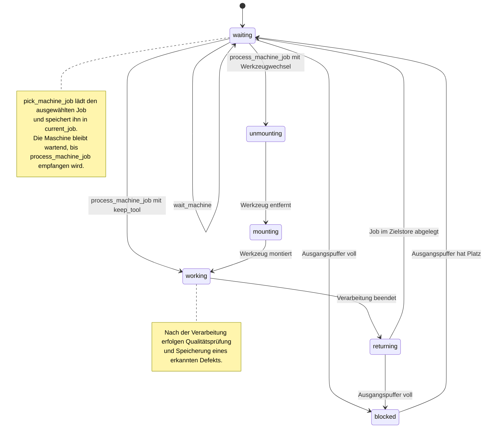

### `SimMachineShutdown` in `SimMachine.py`

**Aufgabe:** Einen einmaligen Werkzeugabschluss ausführen, getrennt von
der wiederholten Jobverarbeitung. Diese Salabim-Komponente ist neu gegenüber
`origin/main`.

- **Produktionswerkzeug entfernen:** Falls eines montiert ist, wird es unter
  Berücksichtigung seiner Demontagezeit entfernt.
- **Schutzwerkzeug montieren:** Anschließend wird das Schutzwerkzeug mit
  `dummy_tool_mount_time` montiert. Ist es bereits montiert, ist nichts zu tun.
- **Aufrufbedingungen:** Der allgemeine
  [SimulationRunner](sources/SpineML/SimulationExecution/SimulationRunner.py)
  startet diesen Prozess nicht. `simulate()` startet ihn nur bei
  `till == sim.inf`, wenn der erste Simulationslauf ohne Stopp durch den
  `SimCompletionWatcher` zurückkehrt. Er wird daher nicht automatisch nach
  jedem Produktionslauf ausgeführt.
- **Kennzahlen abgrenzen:** `tool_change_time` enthält nur tatsächlich
  ausgeführte Montage- und Demontagezeiten. Ein separat ausgeführter
  Werkzeugabschluss verändert die gespeicherten Jobabschlusszeiten und damit
  den daraus berechneten Makespan nicht.

### `SimScenario.py`

**Aufgabe:** Für jeden Auftrag eine `SimOrder`-Komponente erzeugen.
Dieser Aufbau war bereits vorhanden.

**Erweiterungen:**

- **Bridge weitergeben:** Jeder `SimOrder` erhält dieselbe
  `SimulationBridge` und reicht sie an seine Jobs weiter.
- **Produktionsende überwachen lassen:** Nach dem Erzeugen der Aufträge
  wird ein `SimCompletionWatcher` angelegt, der die Jobabschlüsse überwacht.

### `SimCompletionWatcher` in `SimScenario.py`

**Aufgabe:** Den Lauf beenden, sobald alle Jobprozesse abgeschlossen sind.
Der Watcher ist eine neue, eigenständige Salabim-Komponente.

#### Automatisches Simulationsende

1. **Jobs sammeln:** Der Konstruktor sammelt einmalig die Jobs aus den
   erzeugten Aufträgen.
2. **Abschlussflags prüfen:** Der eigene `process()`-Ablauf prüft in
   Abständen von einer Simulationszeiteinheit, ob alle Jobs
   `process_finished=True` besitzen. Dieses Flag setzt der Job beim Empfang
   einer Abschlussaktion mit `finish_process=True`.
3. **Simulation stoppen:** Ist die Jobliste nicht leer und sind alle
   Jobprozesse abgeschlossen, löst der Watcher `sim.SimulationStopped` aus.
   Der Stopp erfolgt bei der nächsten Prüfung der Flags.
4. **Ergebnisse auswerten:** Der Simulationsrunner fängt dieses Signal ab
   und sammelt anschließend die Produktionskennzahlen.

### Seed und Reproduzierbarkeit

**Ziel:** Produktionsläufe mit denselben Eingaben reproduzierbar machen.
Ein Seed ist der Startwert eines Zufallszahlengenerators. Die gemeinsame
Seed-Vorgabe übernimmt der allgemeine
[SimulationRunner](sources/SpineML/SimulationExecution/SimulationRunner.py).

- **Seed vor dem Lauf setzen:** Der Runner setzt `random.seed(seed)`,
  `sim.Environment(random_seed=seed)` und `SimMachine.QUALITY_SEED`.
- **Maschinenfaktoren wiederholen:** Geschwindigkeit, Dauervariation und
  Anlaufverzögerung werden einmal pro Maschine gezogen. Gleiche
  Konfiguration und gleicher Seed liefern dieselben Anfangswerte.
- **Bewegungsschwankungen wiederholen:** Für jede Achsenbewegung wird ein
  neuer Faktor gezogen. Bei gleichem Seed und gleichem Entscheidungsablauf
  ist die Folge dieser Ziehungen reproduzierbar.
- **Automatisches Maschinenrisiko bestimmen:**
  `Machine.resolve_defect_probability()` verwendet einen eigenen Generator
  aus Seed und Maschinenidentität. Ein ausdrücklich vorgegebener Wert wird
  nicht verändert.
- **Qualitätsprüfung wiederholen:** Derselbe Kontextschlüssel liefert
  dieselben Qualitätszufallszahlen. Der Vergleich mit dem Risiko der
  ausgewählten Maschine ist unter
  [Defektprüfung und Recovery](#defektprüfung-und-recovery) beschrieben.
- **Entscheidungsablauf unterscheiden:** Derselbe Seed garantiert nicht
  dieselben Produktionsergebnisse für unterschiedliche Policies oder
  Gewichtssätze. Andere Entscheidungen verändern Transport, Wartezeiten,
  Maschinenwahl und gegebenenfalls Nacharbeiten.
- **Normalen Start unterscheiden:** `simulate(...)` besitzt derzeit kein
  `seed`-Argument. Die hier beschriebene Seed-Vorgabe erfolgt über den Runner
  bei der Optimierung.

## SimulationBridge

Die [SimulationBridge](sources/SpineML/SimulationInterface/SimulationBridge.py)
verbindet die laufenden Salabim-Komponenten mit einer austauschbaren Policy.
Sie gehört zu `SpineML/SimulationInterface`, nicht zu einer bestimmten
Steuerung. Die zugehörigen Datentypen und abstrakten Schnittstellen stehen in
[InterfaceTypes.py](sources/SpineML/SimulationInterface/InterfaceTypes.py).

| Seite | Aufgabe |
| --- | --- |
| Simulationskomponenten | Zustände ändern, Aktionen anfordern und empfangene Aktionen ausführen. |
| Policy | Aus einer `PolicyObservation` eine `PolicyDecision` mit den ausgewählten Aktionen erzeugen. |
| Bridge | Beobachtungen zusammenstellen, die Policy aufrufen, IDs auflösen und Aktionen zustellen. |

Die Bridge erzeugt keine Produktionsrouten und berechnet keine Aktionsscores.
Auch die Auswahlstrategie und die Vermeidung konkurrierender Picks sind
Aufgaben der Policy. Ohne übergebene Policy erzeugt die Bridge eine
`HeuristicPolicy`; dieser Standard wird erst bei Bedarf geladen.

### Registrierung und Aktions-Stores

- `register()` meldet Jobs, Maschinen, Main-Roboter und Korridorarm-Roboter
  mit ihrer Policy-ID an. Jede dieser Komponenten erhält einen eigenen
  Aktions-Store; ihre Zustände erscheinen im Snapshot.
- `register_corridor()` macht Korridore und ihre Stores für die ID-Auflösung
  bekannt, erzeugt aber keinen Aktions-Store für den Korridor.
- `register_store()` ordnet einen Store-Namen dem tatsächlichen Salabim-Store
  zu. Stores sind keine selbst entscheidenden Policy-Objekte.
- Aufbauklassen wie `SimLayout`, `SimCorridorArm`, `SimOrder`, `SimScenario`
  und `SimCompletionWatcher` erhalten ebenfalls keinen eigenen Aktions-Store.

### Warum die Policy IDs verwendet

Beobachtungen enthalten Zustandsdaten und IDs statt Referenzen auf die
laufenden Salabim-Komponenten. Die Policy benennt damit einen Job, eine
Operation, eine Maschine oder einen Store, ohne das Laufzeitobjekt selbst
zu verändern. Erst die Bridge übersetzt die ausgewählte Aktion zurück in
Objektreferenzen für die Simulation.

**Beispiel: Die Policy wählt die Maschine `Near basic`.**

1. **Policy gibt die ID zurück:** Im Aktions-Payload steht
   `selected_machine_id: "Near basic"`.
2. **Bridge sucht das Objekt:** Ihre Nachschlagetabelle
   `machines_by_id` ordnet dieser ID das konfigurierte `Machine`-Objekt zu.
3. **Bridge übergibt das Objekt an die Simulation:** In der ausführbaren
   Aktion steht anschließend `selected_machine` mit diesem Objekt anstelle
   von `selected_machine_id`. Der ausführende Roboter kann die gewählte
   Maschine damit am Job speichern.

`policy_payload_id_mappings()` legt die Zuordnung von ID-Feldern zu
Objektfeldern und Registern fest. `create_simulation_actions()` kopiert den
Payload und ersetzt diese ID-Felder durch die aufgelösten Objekte.
Beispielsweise wird aus `selected_machine_id` das Feld `selected_machine`;
ein ausdrücklich übergebenes `None` bleibt dabei `None`.

**Maschinenauswahl, Aktionsempfänger und Puffer unterscheiden:**

| ID-Angabe | Was bezeichnet sie? |
| --- | --- |
| `selected_machine_id: "Near basic"` | Die konfigurierte Maschine, die für die Bearbeitung ausgewählt wurde. |
| `target_id: "SimMachine:Near basic:left"` | Die ausführende Maschinenkomponente, wenn eine Aktion an diese Maschine geschickt wird. |
| `target_store_id: "Near basic in"` | Den Eingangspuffer, in dem ein Job abgelegt oder aus dem er aufgenommen werden soll. |

### Zustände melden und Aktionen empfangen

Eine aktionsfähige Komponente durchläuft wiederholt diese Schritte:

1. `yield bridge.request_action(self)` markiert die Komponente als wartend und meldet eine
   Zustandsänderung.
2. `action = yield bridge.action(self)` entnimmt die ausgewählte Aktion aus
   ihrem Aktions-Store.
3. Die Komponente führt die Aktion aus und aktualisiert ihre Daten.
4. Für ihre nächste Entscheidung fordert sie erneut eine Aktion an.

`request_action()` trägt die Komponente in die Menge der wartenden Objekte
ein und ruft `notify_state_change()` auf. Diese Meldung erhöht die
Zustandsversion und legt einen `PolicyTrigger` im zentralen Store ab. Der
Trigger enthält Ereignis-ID, Sender-ID, Version und Simulationszeit.

`notify_state_change()` ist auch ohne neue Aktionsanforderung möglich.
Eine solche Meldung veranlasst eine neue Beobachtung, markiert ihren Sender
aber nicht automatisch als wartend. Die mitgelieferten Policies entscheiden
anhand von `is_waiting_for_action`, welche Objekte eine Aktion erhalten.

### Snapshot und Aktualitätsprüfung

Die Bridge entnimmt einen Trigger, gibt mit `hold(0)` anderen gleichzeitigen
Ereignissen Gelegenheit zur Ausführung und sammelt danach bereits vorliegende
Trigger derselben Simulationszeit. Für diese Gruppe erzeugt sie eine
`PolicyObservation` mit folgendem Snapshot:

| Feld | Inhalt |
| --- | --- |
| `time`, `state_version` | Aktuelle Simulationszeit und Version der gemeldeten Zustandsänderungen. |
| `simulation_object_states_by_id` | Zustände aller registrierten aktionsfähigen Komponenten, einschließlich ihrer Store-/Jobdaten und `is_waiting_for_action`. |
| `configuration_model` | ID-basierte Konfiguration von Layouts, Korridoren, Maschinen, Operationen, Produkt- und Werkzeugtypen. |
| `policy_trigger_event_ids`, `policy_trigger_sender_ids` | IDs der auslösenden Triggergruppe und ihrer Sender, wenn diese Gruppe übergeben wurde. |

Das Konfigurationsmodell wird beim ersten Snapshot erstellt und anschließend
wiederverwendet. Die Laufzeitzustände werden für jeden Snapshot neu beobachtet.

Nach `policy.make_decision()` vergleicht die Bridge die Snapshot-Version mit
der aktuellen Zustandsversion. Bei einer inzwischen gemeldeten Änderung
erstellt sie Beobachtung und Entscheidung erneut. Nur eine aktuelle
Entscheidung wird in `SimulationAction`-Objekte übersetzt und verteilt.
Diese Prüfung ersetzt weder die technischen Prüfungen des Aktionsgenerators
noch eine fachliche Validierung beliebiger benutzerdefinierter Aktionen.

### Ablauf zwischen Simulation und Policy

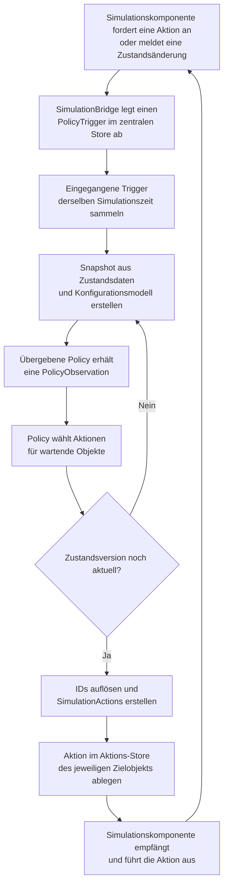

### UML-Sequenzdiagramm eines Simulationszyklus

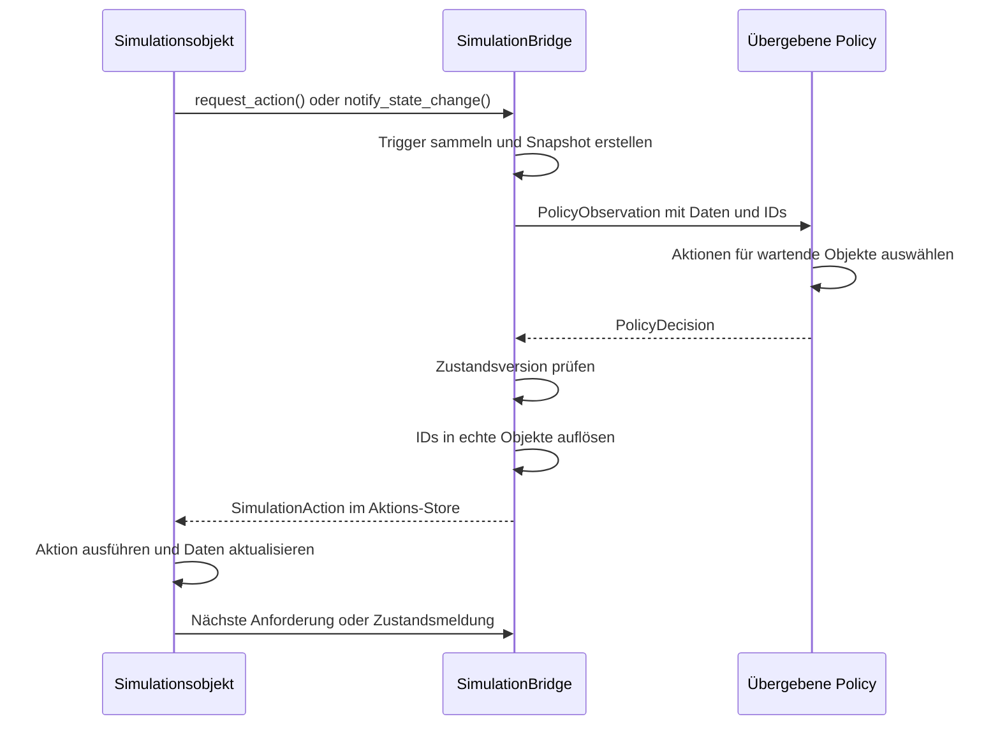

Eine `PolicyDecision` kann Aktionen für mehrere wartende Objekte enthalten.
Erst nach der Rückgabe dieser gesamten Entscheidung beginnt die Bridge mit
der Zustellung an die einzelnen Aktions-Stores. Die Komponenten führen ihre
empfangenen Aktionen selbst aus; die Bridge führt keine Produktionsaktion aus.

<a id="generalcontrol"></a>

## Aktionserzeugung und Policies

Die drei mitgelieferten Policies verwenden denselben konkreten
`SpineActionGenerator` aus
[Control/ActionGeneration](sources/SpineML/Control/ActionGeneration).
Er beschreibt die angebotenen Produktionsaktionen; die Entscheidung zwischen
diesen Kandidaten gehört zur jeweiligen Policy.

| Baustein | Verhalten |
| --- | --- |
| `SpineActionGenerator` | Erzeugt vollständige objektspezifische Kandidaten anhand von Zustand, Routen und technischen Prüfungen; Pick-Payloads enthalten bereits `queue_priority`. |
| `HeuristicPolicy` | Übergibt die erzeugten Kandidaten dem Selector, der sie direkt vom Evaluator bewerten lässt. |
| `RandomPolicy` | Wählt ohne Scores zufällig unter Nicht-Warteaktionen; verwendet bei Picks die Priorität `0.0`. |
| `RLCandidatePolicy` | Lässt einen externen Callback einen erzeugten Kandidatenindex wählen; keine zusätzliche Payload-Vorbereitung oder Aktionsscores. |

`Policy`, `ActionGenerator`, `ActionEvaluator` und `ActionSelector` sind
abstrakte Schnittstellen in
[SimulationInterface/InterfaceTypes.py](sources/SpineML/SimulationInterface/InterfaceTypes.py).
Eine andere Policy muss nicht zwingend einen Evaluator oder Selector verwenden.
Die konkreten Steuerungen liegen getrennt in `Control/HeuristicPolicy`,
`Control/RandomPolicy` und [Control/RLPolicy](#rlpolicy-erste-rl-umgebung).

### ActionGenerator

Die konkrete Klasse heißt `SpineActionGenerator`; sie steht in
[ActionGeneration/ActionGenerator.py](sources/SpineML/Control/ActionGeneration/ActionGenerator.py).
`generate_actions(observation)` liefert eine Liste aus Dictionaries mit
`action_type` und `payload` für genau ein Objekt. Dessen ID steht in
`observation.current_object_id`. Die Payloads sind vollständig; bei Picks
ist die EDD-basierte `queue_priority` bereits enthalten.

Zuerst erzeugt `_generate_actions()` die Kandidaten anhand von Objekttyp und
Zustand. Danach entfernt `generate_actions()` identische Einträge unter
Beibehaltung ihres ersten Auftretens. Der Generator berechnet keine Scores,
wählt keinen Kandidaten aus und verändert keine Simulationskomponente.

#### Einfache Zustandsregeln

`_generate_actions()` prüft zuerst den Typ und den aktuellen Zustand des
Objekts. Die folgenden Regeln gelten jeweils für das betrachtete Objekt.

##### Job

Die Jobbedingungen werden in dieser Reihenfolge geprüft. Abschluss und
Defektbehandlung haben Vorrang vor der normalen Freigabe-/Warteauswahl.

1. **Abschlusszeit vorhanden, Terminstatus noch offen:** Bei
   `completed_time is not None` und `due_state is None` wird `complete_job`
   erzeugt. Die Aktion übergibt `finish_process=True` und den Terminstatus:
   `"late"` bei `completed_time > latest_end_time`, sonst `"on-time"`.
2. **Job ist defekt:** Bei `general_state == "defect"` ruft der Generator
   `create_defect_actions_for_job()` auf. Diese Methode prüft nacheinander:

   - **Nacharbeit wurde bereits gewählt:** Bei
     `recovery_in_progress == True` wird für den Job nur `wait_job`
     erzeugt. Transport und Bearbeitung der gewählten Nacharbeit werden
     durch Roboter- und Maschinenaktionen ausgeführt; der Job soll keine
     zweite Defektstrategie erhalten.
   - **Sonst: Defekt ist nicht nacharbeitbar:** Liegt der Schweregrad
     außerhalb von `0.001 <= defect_severity < 0.6`, wird nur `job_scrap`
     erzeugt.
   - **Sonst: Defekt ist nacharbeitbar:** Folgende Kandidaten werden
     gemeinsam zur Auswahl angeboten:

     - `job_rework_on_alternative_machine`: Nacharbeit auf einer anderen
       Maschine, je gefundener Alternativroute.
     - `job_rework_on_defect_machine`: Nacharbeit auf derselben Maschine,
       sofern die Defektmaschine verfügbar ist.
     - `downgrade_product`: Den Job herabstufen.
     - `wait_job`: Die Entscheidung zunächst aufschieben.

3. **Job ist noch nicht freigegeben:** Bei `released == False` werden
   `release_job` und `wait_job` angeboten. Die Freigabeaktion enthält
   `release_time = max(aktuelle Zeit, earliest_start_time)`. Der Job wartet
   bei ihrer Ausführung gegebenenfalls bis zu diesem Zeitpunkt und legt sich
   anschließend im Startlager ab. Als `processing_state` wird der verbrauchte
   Produkttyp der ersten Operation der ersten gefundenen Herstellungsfolge
   gesetzt. Gibt es keine solche Folge, wird der Zielprodukttyp verwendet.
4. **Keiner der vorherigen Fälle trifft zu:** Es wird nur `wait_job`
   angeboten.

- **Herabgestufte Jobs:** Nach der Herabstufung erhält der Job zunächst
  `wait_job`, bis seine Abschlussaktion ansteht. Für den Transport erzeugt
  der Generator Roboteraktionen zum Endlager. `downgraded=True` verhindert
  dabei eine weitere normale Bearbeitungsroute.

##### Main-Roboter

- **Kein Job geladen (`current_job_id is None`):** Für jeden Job im
  Startlager und in den Main-Stores der Korridore wird ein
  `pick_main_robot`-Kandidat erzeugt. Zusätzlich gibt es `wait_main_robot`.
- **Job geladen (`current_job_id is not None`):** Der Generator erzeugt
  passende `place_main_robot`-Kandidaten und zusätzlich `wait_main_robot`.
  Bei normaler Weiterbearbeitung ist das Ziel der Arm-Eingangspuffer für
  die nächste Maschine. Fertige, herabgestufte oder als Ausschuss markierte
  Jobs erhalten einen Transportkandidaten zum Endlager, sofern dort Platz ist.

##### Korridorroboter

- **Kein Job geladen (`current_job_id is None`):** Für jeden Job im
  eigenen Arm-Eingangspuffer und in den Ausgangspuffern seiner Maschinen
  wird ein `pick_corridor_arm_robot`-Kandidat erzeugt. Zusätzlich gibt es
  `wait_corridor_arm_robot`.
- **Job geladen (`current_job_id is not None`):** Der Generator erzeugt
  passende `place_corridor_arm_robot`-Kandidaten und zusätzlich
  `wait_corridor_arm_robot`. Das Ziel ergibt sich aus der nächsten Maschine:
  eigener Maschineneingang, Eingangspuffer des anderen Arms oder Main-Store
  des aktuellen Korridors. Fertige, herabgestufte oder als Ausschuss markierte
  Jobs werden zum Main-Store für den Weitertransport zum Endlager geführt.

##### Maschine

- **Kein Job geladen (`current_job_id is None`):** Für jeden Job im
  Eingangspuffer wird ein `pick_machine_job`-Kandidat erzeugt. Zusätzlich
  gibt es `wait_machine`.
- **Job geladen und Ausgangspuffer hat Platz:** Es wird nur
  `process_machine_job` erzeugt, keine zusätzliche Wartealternative.
- **Job geladen und Ausgangspuffer voll:** Es wird nur `wait_machine`
  erzeugt.
- **Bearbeitungsdaten übernehmen:** Die Verarbeitungsaktion verwendet die
  am geladenen Job gespeicherte Operation und Maschine. Die Werkzeugdaten
  und eine nötige Werkzeugvorbereitung werden aus dem Snapshot übernommen
  beziehungsweise daraus abgeleitet. Hier wird keine neue Route berechnet.

#### Technische Prüfungen des ActionGenerators

Diese Prüfungen gehören zu unterschiedlichen Erzeugungsmethoden, nicht zu
den Zustandsregeln einer einzelnen Maschine:

- **Maschinen zu einer Route zuordnen:**
  `calculate_machine_sequences_from_operation_sequence()` prüft den
  Maschinentyp, die Zugehörigkeit zum ausgewählten Layout und die erlaubten
  Werkzeugtypen. Diese Zuordnung sagt noch nicht, ob eine Maschine gerade
  frei ist.
- **Unmittelbares Transportziel prüfen:** Die Place-Methoden bestimmen aus
  dem nächsten Bearbeitungsschritt den Zielstore und erzeugen die Ablageaktion
  nur bei freier Zielkapazität. Sie prüfen nicht pauschal alle Puffer des
  weiteren Herstellungswegs.
- **Nacharbeit auf der Defektmaschine anbieten:**
  `machine_available_for_rework()` prüft für
  `job_rework_on_defect_machine` alle vier Bedingungen:

  - Kein Job auf der Maschine geladen.
  - Maschinenzustand ist `"waiting"`.
  - Freie Kapazität im Eingangspuffer (`available_capacity > 0`).
  - Freie Kapazität im Ausgangspuffer (`available_capacity > 0`).

- **Alternative Nacharbeitsroute bestimmen:**
  `find_alternative_rework_routes()` sucht Routen, auf denen dieselbe
  fehlerhafte Operation zuerst auf einer anderen Maschine wiederholt wird.
  Dabei werden weder die aktuelle Belegung noch die Pufferkapazitäten
  dieser alternativen Maschine geprüft. Beim späteren Transport wird
  jeweils die Kapazität des unmittelbar nächsten Zielstores geprüft.
- **Werkzeugvorbereitung festlegen:** Bei `process_machine_job` steht im
  Payload, ob das Werkzeug beibehalten, gewechselt oder wegen verbrauchter
  Lebensdauer ersetzt werden soll. Dafür werden keine separaten
  Werkzeugwechsel-Kandidaten erzeugt.

Diese Prüfungen beziehen sich auf den beobachteten Zustand und den jeweiligen
nächsten Schritt. Sie reservieren nicht vorab alle Maschinen und Puffer einer
vollständigen Route. Insbesondere ist eine passende Maschine nicht automatisch
eine gerade freie Maschine.

#### Mehrere Kandidaten pro wartendem Objekt

- **Möglichkeiten sammeln:** Lässt die Zustandsregel mehrere Aktionen zu,
  erzeugt der Generator sie gemeinsam als Kandidatenliste.
- **Auswahl der Policy überlassen:** Die Heuristik bewertet die Liste;
  `RandomPolicy` wählt zufällig und `RLCandidatePolicy` fragt einen externen
  Agenten. Der Generator führt keinen Kandidaten selbst aus.
- **Payload-Beispiele lesen:** Die folgenden Beispiele zeigen jeweils
  einen Aktionskandidaten. Die Namen sind
  schematisch; bei einem echten Lauf müssen die IDs zur Konfiguration passen.

**Beispiel: Herabstufung eines defekten Jobs**

- **Verfügbare Defektaktionen:** Ihre Erzeugung ist unter
  [Job](#job) beschrieben. Die Herabstufung ist im Nacharbeitsbereich eine
  Alternative zur Nacharbeit und zum Warten.
- **Keine Nacharbeitskandidaten:** Gibt es im nacharbeitbaren Bereich
  weder eine alternative Route noch eine verfügbare Defektmaschine,
  bleiben `downgrade_product` und `wait_job`. Die Policy wählt zwischen
  diesen Kandidaten; die Herabstufung erfolgt nicht automatisch.
- **Herabstufungsprodukt bestimmen:** Verwendet wird der vorgesehene
  Produkttyp der fehlerhaften Operation. Er kann ein Zwischenprodukt sein
  und muss nicht dem Auftragsziel entsprechen.
- **Herabstufung kennzeichnen:** Der Payload setzt diesen Produkttyp als
  `processing_state`, dazu `general_state="intact"` und `downgraded=True`.
  Die Qualitätsabweichung bleibt durch das zusätzliche Flag erkennbar.

Beispiel für eine Herabstufungsaktion:

```json
{
  "action_type": "downgrade_product",
  "payload": {
    "selected_operation_id": null,
    "selected_machine_id": null,
    "processing_state": "produkt_b",
    "general_state": "intact",
    "downgraded": true,
    "downgrade_product_type_id": "produkt_b",
    "defect_recovery_strategy": "downgrade"
  }
}
```

**Beispiel: Pick eines Roboters**

1. Eine eigene `pick_*`-Aktion für jeden auswählbaren Job im Store (Beispiel:
   zwei Jobs erzeugen zwei Pick-Kandidaten).
2. Zusätzlich eine `wait_*`-Aktion.

Beispiel für eine Pick-Aktion des Main-Roboters:

```json
{
  "action_type": "pick_main_robot",
  "payload": {
    "target_type": "start_storage",
    "target_store_id": "start",
    "selected_job_id": "auftrag_1:1",
    "storage_out_time": 1.0
  }
}
```

**Beispiel: Place eines Roboters**

1. Eine Route legt die nächste Operation und Maschine fest. Daraus ergibt
   sich der nächste Zielstore des Roboters.
2. Hat dieser Store Platz, wird ein `place_*`-Kandidat erzeugt. Zwei
   unterschiedliche nächste Schritte können so zwei Place-Kandidaten ergeben.
3. Zusätzlich gibt es eine `wait_*`-Aktion. Identische Kandidaten werden
   anschließend entfernt.

Beispiel für eine Place-Aktion des Main-Roboters:

```json
{
  "action_type": "place_main_robot",
  "payload": {
    "target_type": "sim_corridor_store_arm_input",
    "selected_operation_id": "operation_1",
    "selected_machine_id": "machine_1",
    "sim_corridor_id": "corridor_1",
    "target_store_id": "corridor_1 left",
    "storage_in_time": 1.0
  }
}
```

**Beispiel: Verarbeitung auf einer Maschine**

- **Voraussetzung:** Ein Job ist geladen und der Ausgangspuffer hat Platz.
- **Payload:** Er enthält die auszuführende Operation, das Werkzeug, dessen
  Lebensdauerwerte, die Werkzeugvorbereitung und den Ausgangsstore.

Beispiel für eine Verarbeitungsaktion:

```json
{
  "action_type": "process_machine_job",
  "payload": {
    "operation_id": "operation_1",
    "planned_machine_id": "machine_1",
    "tool_type_id": "tool_1",
    "total_life_units": 100,
    "consumed_life_units": 5,
    "remaining_life_units_before_operation": 80,
    "tool_setup_action": "keep_tool",
    "target_store_id": "machine_1 out"
  }
}
```

#### Identische Kandidaten entfernen

- **Identische Kandidaten erkennen:** Nur gleicher `action_type` und
  gleicher Payload gelten als Duplikat. Verschiedene vollständige Routen
  können denselben nächsten Schritt und damit eine identische Aktion ergeben.
- **Unterschiedliche Kandidaten behalten:** Aktionen mit unterschiedlichen
  Payloads bleiben erhalten und stehen der Policy zur Auswahl.
- **Nur die Liste dieses Objekts bereinigen:** Der Generator entfernt hier
  keine konkurrierenden Picks verschiedener Roboter. Diese zusätzliche
  Prüfung übernimmt die jeweilige Policy: Die [Heuristik](#heuristicpolicy)
  verwirft später ausgewählte doppelte Picks; Random- und RL-Policy filtern
  bereits vergebene Jobs vor ihrer nächsten Auswahl.

#### Berechnung von Operations- und Maschinenrouten

- **Operationsfolgen bestimmen:** `calculate_operation_sequences_between()`
  ermittelt die Folgen vom aktuellen Produkttyp bis zum Auftragsziel.
- **Maschinen zuordnen:**
  `calculate_machine_sequences_from_operation_sequence()` ermittelt die
  passenden Maschinenfolgen. Jede Kombination aus Operations- und
  Maschinenfolge bildet eine Route.
- **Routen eines Jobs bereitstellen:** `selectable_routes_for_job()`
  liefert für normale, intakte und noch nicht fertige Jobs diese Routen.
  Defekte, als Ausschuss markierte, herabgestufte oder noch nicht konfigurierte
  Jobs erhalten keine normale Produktionsroute. Bei bereits gewählter
  Nacharbeit mit konkreter Operation und Maschine liefert die Methode nur
  den festgelegten Nacharbeitsschritt.
- **Alternative Nacharbeit vorbereiten:**
  `find_rework_routes_with_alternative_machine()` liest die nötigen IDs aus
  der Beobachtung. `find_alternative_rework_routes()` berechnet den weiteren
  Weg ab dem vorgesehenen Ergebnis der fehlerhaften Operation.
- **Fehlerhafte Operation wiederholen:** Die Operation wird vor jede
  Restfolge gesetzt; dazu werden Maschinenfolgen berechnet. Routen mit der
  Defektmaschine als erster Maschine werden ausgeschlossen. Für spätere
  Operationen darf diese Maschine wieder vorkommen.
- **Defekttransport beim Main-Roboter:** Ist für den geladenen defekten Job
  eine Operation und Maschine gespeichert, wird diese Auswahl verwendet.
  Fehlt sie, erzeugt die Main-Place-Methode eigene Transportkandidaten zur
  Defektmaschine und zu gefundenen Alternativen. Das ist von den oben
  beschriebenen Job-Defektaktionen zu unterscheiden: Es handelt sich um
  `place_main_robot`-Kandidaten mit einer Nacharbeitsstrategie im Payload,
  nicht um weitere `job_rework_*`-Aktionen.
- **Defekttransport beim Korridorroboter:** Er übernimmt eine vorhandene
  Operations- und Maschinenauswahl. Ohne solche Auswahl berechnet er für
  einen defekten Job keine Ersatzroute aus den Defektdaten.

### Pick-Priorität im ActionGenerator

[SpineActionGenerator.generate_actions()](sources/SpineML/Control/ActionGeneration/ActionGenerator.py)
liefert Pick-Kandidaten bereits mit `queue_priority` im Payload.
`SpineActionGenerator.calculate_edd_priority()` berechnet diesen Wert aus
der Deadline des ausgewählten Jobs und der aktuellen Simulationszeit.
Eine zusätzliche Vorbereitung durch Evaluator, Selector oder RL-Policy entfällt.

Für `r = latest_end_time - current_time` gilt:

| Situation | `queue_priority` |
| --- | --- |
| Vor oder genau an der Deadline (`r >= 0`) | `0.5 / (1 + r)` |
| Nach der Deadline (`r < 0`, Überfälligkeit `u = -r`) | `0.5 + 0.5 * u / (1 + u)` |

Die Priorität ist ein Payload-Wert für die spätere Store-Einordnung, kein
fertiger Aktionsscore. Der Generator schreibt sie nicht direkt in den Job.
`LocalHeuristicActionEvaluator` liest sie für die Pick-Bewertung aus dem Payload;
`RLCandidatePolicy` verwendet die erzeugten Kandidaten ohne weitere Vorbereitung.
`RandomPolicy` verwendet die EDD-Priorität nicht zur Auswahl und setzt im
ausgewählten Pick-Payload ausdrücklich `queue_priority = 0.0`.

<a id="generatorselectorpolicy"></a>

### HeuristicPolicy

[HeuristicPolicy.py](sources/SpineML/Control/HeuristicPolicy/HeuristicPolicy.py)
koordiniert die heuristische Auswahl. Standardmäßig verbindet die Klasse
`SpineActionGenerator`, `LocalHeuristicActionEvaluator(HeuristicWeights())`
und `HeuristicActionSelector`. Generator, Evaluator und Selector können beim
Erzeugen der Policy ausgetauscht werden. Der Evaluator berechnet Scores aus
den bereits vollständig erzeugten Kandidaten.

#### Ablauf von `make_decision()`

1. Die Policy durchläuft die Snapshot-Objekte in ihrer Einfügereihenfolge und
   berücksichtigt diejenigen mit `is_waiting_for_action=True`.
2. Für jedes Objekt erstellt sie eine `PolicyObservation` mit dessen
   `current_object_id` und demselben Snapshot.
3. Der Generator erzeugt die Kandidaten. Der Selector lässt sie durch den
   Evaluator direkt bewerten und wählt eine Aktion.
4. Die Policy sammelt die `SelectedObjectAction`-Objekte. Bei mehreren Picks
   desselben Jobs bleibt der zuerst ausgewählte Pick erhalten; spätere werden
   verworfen. Für diese Objekte wird in diesem Aufruf keine Ersatzaktion gewählt.
5. Die verbleibenden Aktionen gehen zusammen als `PolicyDecision` an die Bridge.

<a id="ablauf-der-generalcontrol"></a>

#### Ablauf der heuristischen Policy

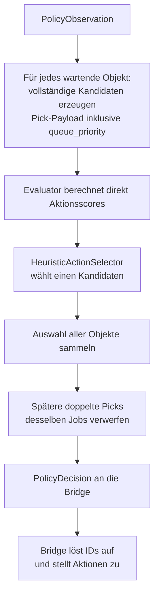

Die [lokale Aktionsbewertung](#heuristicpolicy-lokale-aktionsbewertung)
beschreibt die Score-Berechnung. Die Gewichtssuche verändert deren
`HeuristicWeights`, nicht die technischen Regeln des gemeinsamen Generators.

<a id="actionselector"></a>

### HeuristicActionSelector

[HeuristicActionSelector.py](sources/SpineML/Control/HeuristicPolicy/HeuristicActionSelector.py)
ist der konkrete Selector der Heuristik. Er erhält die Kandidatenliste eines
Objekts, einen Evaluator, die Beobachtung und die Ziel-ID. Er erzeugt keine
neuen Produktionsaktionen und wird weder von `RandomPolicy` noch von
`RLCandidatePolicy` für deren reguläre Auswahl benötigt.

Der Standard-`HeuristicActionSelector` arbeitet in folgenden Schritten:

1. Gibt es für das wartende Objekt keine Aktion, gibt er eine leere
   `PolicyDecision` zurück.
2. Der Selector lässt jeden erzeugten Kandidaten unmittelbar durch
   `LocalHeuristicActionEvaluator.evaluate_action()` bewerten. Er ruft keine
   zusätzliche Payload-Vorbereitung auf und übernimmt den Kandidaten unverändert.
3. Der höchste Score wird gesucht. Alle Aktionen mit genau diesem Score gelten
   als beste Aktionen.
4. Zusätzlich gelten Aktionen als fast gleich gut, wenn ihr Score höchstens
   `0.05` unter dem höchsten Score liegt. Bei einem Höchstwert von `0.80`
   werden zum Beispiel auch Aktionen ab `0.75` als fast gleich gut gesammelt.
5. **Exploration:** Mit `EXPLORATION_EPSILON = 0.10` wird mit einer
   Wahrscheinlichkeit von `10 %` eine fast gleich gute, aber nicht exakt
   beste Alternative ausprobiert. Nicht-Warteaktionen werden unter diesen
   Alternativen bevorzugt. Gibt es keine solche Alternative, bleibt eine
   exakt beste Aktion die Auswahl.
6. **Keine Exploration:** In den übrigen Fällen wählt der Selector zufällig
   eine der exakt besten Aktionen. Diese Zufallsauswahl löst nur Gleichstände
   auf.

- **Ergebnis zurückgeben:** Die gewählte Aktion geht als `PolicyDecision`
  für das Zielobjekt an die `HeuristicPolicy`.
- **Ziel der Exploration:** Auch fast gleich gute Produktionsentscheidungen
  ausprobieren, ohne deutlich schlechter bewertete Aktionen zu verwenden.
- **Auswirkung auf die Produktion:** Andere Aktionen können den weiteren
  Simulationsverlauf und die globalen Kennzahlen verändern. Gemeinsame Seeds
  und die Mittelung mehrerer Läufe beziehen diesen Einfluss in den Vergleich
  ein.
- **Abgrenzung zur Gewichtssuche:** Die Exploration verändert weder Scores
  noch lokale Gewichtssätze. Der Vergleich von Defektstrategien wie
  `job_rework_on_defect_machine` und `job_rework_on_alternative_machine`
  beruht weiterhin auf der normalen Score-Berechnung.
- **Zufallsquelle:** `HeuristicPolicyFactory(weights)(seed)` erzeugt für
  jeden Lauf einen frischen Selector mit eigenem `random.Random(seed)`.
  Ein direkt ohne `rng` erzeugter Selector verwendet dagegen das gemeinsame
  Python-`random`-Modul.

### RandomPolicy: zufällige Vergleichssteuerung

[`RandomPolicy`](sources/SpineML/Control/RandomPolicy/RandomPolicy.py) ist die
zufällige Vergleichssteuerung. Sie implementiert dieselbe `Policy`-Schnittstelle
wie die Heuristik, benötigt aber keinen Evaluator oder Selector.

- **Gemeinsame technische Grundlage:** Sie verwendet denselben
  `SpineActionGenerator` und dieselbe `SimulationBridge` wie die Heuristik.
- **Keine heuristische Bewertung:** Sie verwendet keine Aktionsscores,
  lokalen Gewichte oder EDD-Priorität zur Auswahl. Die vom Generator gelieferte
  Pick-Priorität ersetzt sie in ihrer ausgewählten Aktion durch `0.0`.

`make_decision()` wählt für jedes wartende Objekt:

1. Der Generator liefert die technisch möglichen Aktionskandidaten.
2. Picks für einen in dieser Entscheidung bereits ausgewählten Job werden
   ausgeschlossen, damit derselbe Job nicht gleichzeitig zweimal gepickt wird.
3. Gibt es Nicht-Warteaktionen, wird **gleichverteilt unter diesen Kandidaten**
   gewählt. Jeder verbleibende Kandidat hat die Wahrscheinlichkeit `1 / n`.
4. Nur wenn keine Nicht-Warteaktion verfügbar ist, wird eine angebotene
   `wait_*`-Aktion gewählt. Ohne Kandidaten wird keine Aktion zurückgegeben.

- **Nicht-Warteaktionen:** Dazu zählen Freigabe, Pick, Ablegen, Verarbeitung
  und technisch mögliche Defektbehandlungen. Sie heißen im Code „produktiv“.
- **Pro Kandidat auswählen:** Drei verschiedene Routenkandidaten sind drei
  Auswahlmöglichkeiten, auch wenn sie dieselbe Aktionsart haben.
- **Keine Deadline-Priorität setzen:** Bei Picks gilt `queue_priority = 0.0`.
  Die vorhandene Store-Reihenfolge bei gleicher Priorität bleibt bestehen.
- **Technische Zulässigkeit beibehalten:** Der Generator prüft weiterhin,
  welche Aktionen möglich sind. Zufällig ist nur die Auswahl unter diesen
  Kandidaten; Warten bleibt der Fallback.
- **Als Alternative einsetzen:** Die Heuristik bleibt die Standardsteuerung.

Ein Headless-Lauf mit dieser Policy:

```python
from SpineML.Control.RandomPolicy.RandomPolicy import RandomPolicy
from SpineML.SimulationExecution.ModelLoader import load_layout_and_scenario
from SpineML.SimulationExecution.SimulationRunner import SimulationRunner

layout, scenario = load_layout_and_scenario("example-5")
runner = SimulationRunner(layout, scenario)
metrics = runner.run_policy(RandomPolicy(seed=101), seed=101)
```

Für einen weiteren unabhängigen Lauf wird eine neue `RandomPolicy` erzeugt.
Ihr eigener `random.Random(seed)` steuert die Auswahl; der Runner setzt
getrennt davon den Simulations-Seed. Die Zufallsauswahl dieser Policy
verbraucht damit keine Werte des globalen Zufallszahlengenerators des
Simulationskerns.


<a id="heuristiccontrol"></a>

## HeuristicPolicy: lokale Aktionsbewertung

### Ziel und Grundidee

Die Heuristik vergleicht **für jedes wartende Objekt dessen technisch mögliche
Aktionen**. Der lokale Evaluator berechnet ihre Scores; der
[HeuristicActionSelector](#actionselector) wählt daraus eine Aktion.
Ein höherer Score ist vorteilhafter.

- **Lokale Regeln:** Kurze Transportwege, dringende Jobs oder ein bereits
  passendes Werkzeug erhalten vorteilhafte Teilwerte. Der lokale Gewichtssatz
  bestimmt, wie stark diese Kriterien im Score zählen.
- **Kein vollständiger Produktionsplan:** Die Policy bewertet die aktuell
  angebotenen Aktionen. Sie spielt deren gesamte zukünftige Folgen nicht vorab
  durch. Bei einer neuen Beobachtung entscheidet sie erneut. Der Selector wählt
  überwiegend eine bestbewertete Aktion und erkundet gelegentlich eine fast
  gleich gute Alternative.
- **Lokale und globale Bewertung:** Ein hoher Aktionsscore bedeutet nicht
  automatisch ein besseres Produktionsergebnis. Die
  [Gewichtssuche](#optimierungsvorgang) vergleicht deshalb vollständige
  Simulationsläufe anhand ihrer globalen Bewertungszahlen.

### Ablauf der Bewertung

- **Umsetzung:** Der Bewertungsteil der Policy steht in
  [LocalHeuristicActionEvaluator.py](sources/SpineML/Control/HeuristicPolicy/LocalHeuristicActionEvaluator.py).

1. **Vollständige Kandidaten übernehmen:** Der Generator hat die Payloads
   bereits erzeugt und bei Picks die aktuelle `queue_priority` eingetragen.
   Der Evaluator verwendet diesen Wert direkt; er bereitet den Kandidaten
   nicht nochmals vor.
2. **Rohwerte ermitteln:** `evaluate_action()` ruft je nach `action_type`
   die passende Bewertungsmethode auf, etwa `evaluate_machine_pick_action()`.
   Diese liest die **Bewertungsgrößen** (Rohwerte der Kriterien, zum Beispiel
   eine Transportzeit von vier Zeiteinheiten) aus dem Simulationszustand,
   der Konfiguration und den Aktionsdaten.
3. **Rohwerte abbilden:** Die heuristischen Regeln bestimmen, wie daraus
   **Teilwerte** (auf den Bereich `0` bis `1` abgebildete Werte) entstehen.
   Zum Beispiel liefert `inverse_scale(4)` den Teilwert `0.2`.
4. **Score berechnen:** `calculate_action_score()` verbindet die Teilwerte
   mit ihren Gewichten zu einem gewichteten Durchschnitt.
   Bei bestimmten Defektaktionen wird anschließend eine Deadline-Strafe
   abgezogen. Der Endscore kann dadurch negativ werden und wird nicht
   nachträglich begrenzt.
5. **Aktion auswählen:** Der `HeuristicActionSelector` wählt mit den fertigen
   Scores eine bestbewertete Aktion oder erkundet gelegentlich eine fast
   gleich gute Alternative. Erst der Simulationskern führt sie aus.

### Bewertungsgrößen und heuristische Regeln

- **Bewertungsgröße:** Der aus dem Snapshot oder der Konfiguration gelesene
  Rohwert, beispielsweise eine Transportzeit von `4` Zeiteinheiten.
- **Heuristische Regel:** Legt fest, welche Eigenschaft bevorzugt wird,
  beispielsweise eine kürzere Transportzeit.
- **Teilwert:** Die Formel setzt diese Regel in eine Zahl um:
  `inverse_scale(4) = 0.2`. Die folgenden Regeln verwenden dieselbe
  Vorteilsrichtung: Ein höherer Teilwert ist vorteilhafter.

### Allgemeine heuristische Regeln

#### 1. Termindruck: dringendere Jobs bevorzugen

- **Bewertungsgröße:** Restzeit `t = latest_end_time − aktuelle Zeit`.
  `latest_end_time` ist die Deadline des Auftrags, zu dem der Job gehört.
- **Regel:** Je näher die Deadline liegt oder je weiter sie überschritten
  ist, desto höher ist die EDD-Priorität (`Earliest Due Date`).
- **Abbildung in [`SpineActionGenerator.calculate_edd_priority()`](sources/SpineML/Control/ActionGeneration/ActionGenerator.py):**
  - Bei `t >= 0`: `Teilwert = 0.5 × inverse_scale(t)`.
  - Bei `t < 0`: `Teilwert = 0.5 + 0.5 × direct_scale(-t)`.
- **Beispiel:** Zwei Zeiteinheiten vor der Deadline ergibt sich etwa
  `0.167`, genau bei der Deadline `0.5` und zwei Zeiteinheiten danach etwa
  `0.833`. Negative Restzeit wird also als Überfälligkeit behandelt.
- **Verwendung:** Bei Picks steht der Wert bereits im Payload. Für Freigabe
  und Warten delegiert der Evaluator seine EDD-Berechnung an dieselbe
  Generator-Methode. Die allgemeinen Skalierer `inverse_scale()` und
  `direct_scale()` sind im Evaluator definiert.

- **Wertebereich:** Vor der Deadline liegt die Priorität unter `0.5`, genau
  bei der Deadline beträgt sie `0.5`, danach liegt sie darüber. Bei sehr
  großer Restzeit nähert sie sich `0`, bei sehr großer Überfälligkeit `1`.

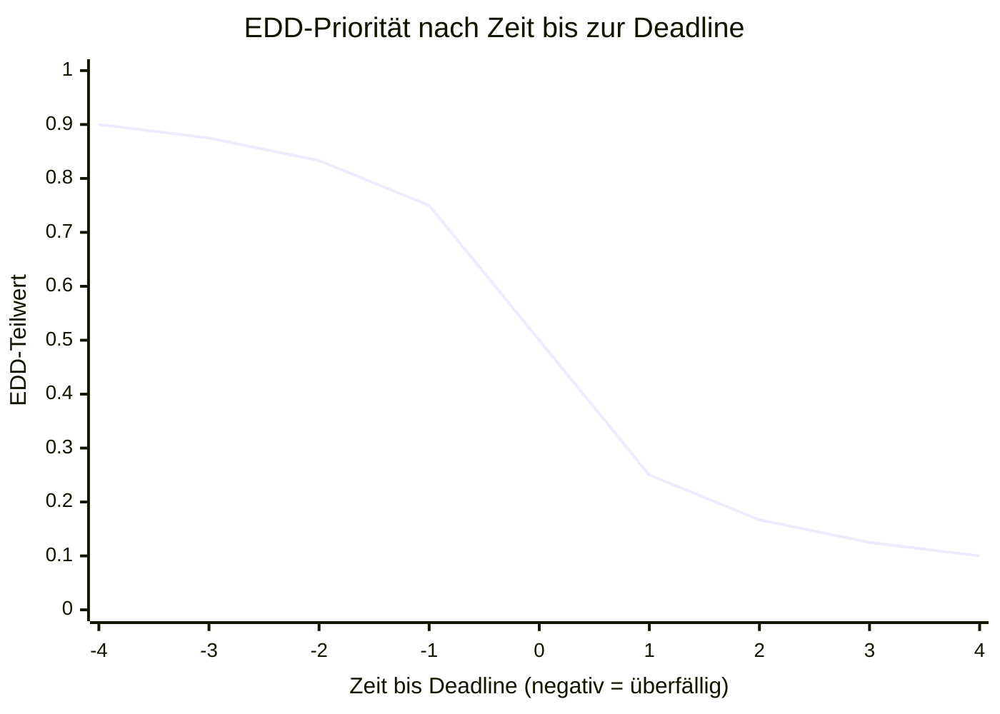

- **Verwendung:** [Freigabe](#freigabe-release_job),
  [Roboter-Pick](#roboter-pick-pick_main_robot-und-pick_corridor_arm_robot),
  [Maschinen-Pick](#maschinen-pick-pick_machine_job),
  [normales Warten](#normales-warten-wait_) und
  [Warten bei einem Defekt](#warten-bei-einem-defekt-wait_job).

#### 2. Verarbeitungs-, Transport- und Lagerzeiten: kürzere Zeiten bevorzugen

- **Bewertungsgröße:** Eine nichtnegative Zeit `x`.
- **Regel:** Eine kürzere Zeit soll einen höheren Teilwert ergeben.
- **Abbildung:** `inverse_scale(x) = 1 / (1 + x)`.
- **Beispiel:** Zeit `1 → 0.5`; Zeit `4 → 0.2`.

- **Grenzwerte:** Bei `x = 0` ergibt sich `1`; mit wachsendem `x` nähert
  sich der Teilwert `0`.

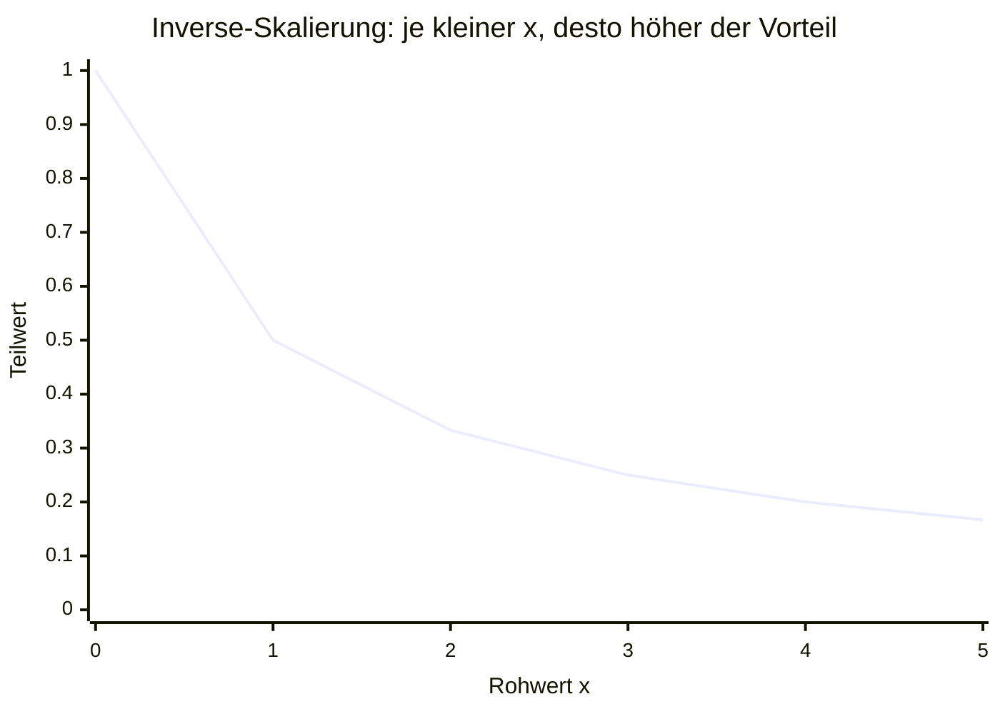

- **Verwendung:** [Freigabe](#freigabe-release_job),
  [Roboter-Pick](#roboter-pick-pick_main_robot-und-pick_corridor_arm_robot),
  [Maschinen-Pick](#maschinen-pick-pick_machine_job),
  [Ablegen](#ablegen-place_main_robot-und-place_corridor_arm_robot),
  [Nacharbeit auf der Defektmaschine](#nacharbeit-auf-der-defektmaschine-job_rework_on_defect_machine) und
  [Nacharbeit auf einer anderen Maschine](#nacharbeit-auf-einer-anderen-maschine-job_rework_on_alternative_machine).

#### 3. Maschinenwarteschlange: weniger wartende Jobs bevorzugen

- **Bewertungsgröße:** Anzahl `n` der Jobs im Eingangspuffer der Maschine.
- **Regel:** Eine kürzere Warteschlange soll einen höheren Teilwert ergeben.
- **Abbildung:** `inverse_scale(n) = 1 / (1 + n)`.
- **Beispiel:** Kein wartender Job ergibt `1`; drei wartende Jobs ergeben
  `0.25`.

- **Verwendung:** [Ablegen](#ablegen-place_main_robot-und-place_corridor_arm_robot),
  [Nacharbeit auf der Defektmaschine](#nacharbeit-auf-der-defektmaschine-job_rework_on_defect_machine) und
  [Nacharbeit auf einer anderen Maschine](#nacharbeit-auf-einer-anderen-maschine-job_rework_on_alternative_machine).

#### 4. Werkzeugpassung: ein bereits montiertes passendes Werkzeug bevorzugen

- **Bewertungsgröße:** Übereinstimmung zwischen benötigtem und montiertem
  Werkzeugtyp. Jede Operation hat einen festgelegten benötigten Werkzeugtyp.
- **Regel und Abbildung:** Gleicher Werkzeugtyp ergibt den Teilwert `1`,
  ein anderer Werkzeugtyp oder kein montiertes Werkzeug ergibt `0`.
  Das Kriterium geht bei Maschinen-Pick und Nacharbeit immer ein.
- **Beispiel:** Benötigt die Operation Fräser A und Fräser A ist montiert,
  ist der Teilwert `1`; bei montiertem Fräser B ist er `0`.

- **Verwendung:** [Maschinen-Pick](#maschinen-pick-pick_machine_job),
  [Nacharbeit auf der Defektmaschine](#nacharbeit-auf-der-defektmaschine-job_rework_on_defect_machine) und
  [Nacharbeit auf einer anderen Maschine](#nacharbeit-auf-einer-anderen-maschine-job_rework_on_alternative_machine).

#### 5. Werkzeugreserve: mehr Lebensdauer im Verhältnis zum Verbrauch bevorzugen

- **Bewertungsgröße:** Verhältnis
  `r = verbleibende Werkzeuglebensdauer / Verbrauch der geplanten Operation`.
- **Regel:** Eine größere Reserve im Verhältnis zum Verbrauch soll einen
  höheren Teilwert ergeben.
- **Abbildung:** Bei positivem Verbrauch gilt
  `Teilwert = direct_scale(r) = r / (1 + r)`. Bei Verbrauch `0` entfällt
  dieses Kriterium, da das Verhältnis sonst eine Division durch null wäre.
- **Beispiel:** Vier verbleibende und zwei benötigte Einheiten ergeben
  `r = 2` und den Teilwert `2 / 3 ≈ 0.667`.

- **Grenzwerte:** Bei `r = 0` ergibt sich `0`; mit wachsendem `r` nähert
  sich der Teilwert `1`.

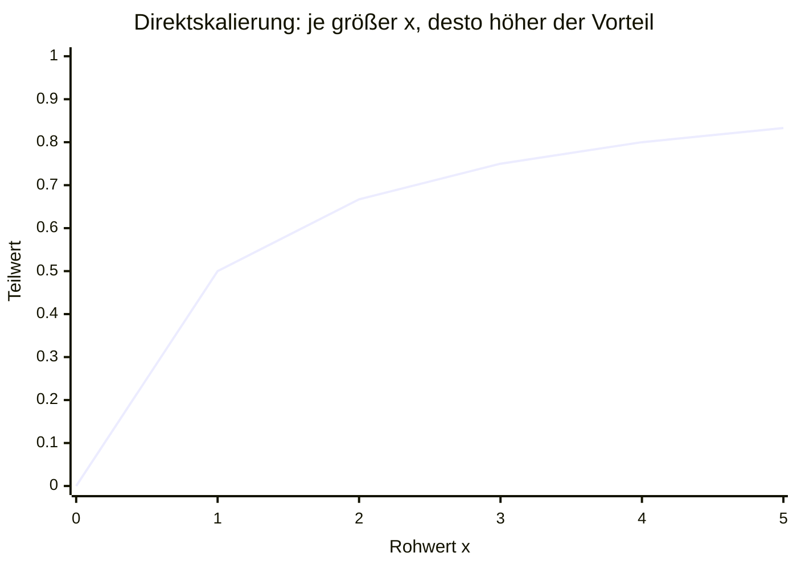

- **Verwendung:** [Maschinen-Pick](#maschinen-pick-pick_machine_job),
  [Nacharbeit auf der Defektmaschine](#nacharbeit-auf-der-defektmaschine-job_rework_on_defect_machine) und
  [Nacharbeit auf einer anderen Maschine](#nacharbeit-auf-einer-anderen-maschine-job_rework_on_alternative_machine).

#### 6. Freie Pufferkapazität: einen größeren freien Anteil bevorzugen

- **Bewertungsgröße:** Freie Plätze und Gesamtkapazität des Ziel-Stores.
- **Regel:** Je größer der freie Anteil, desto höher der Teilwert.
- **Abbildung mit `normalize_ratio()`:**
  `normalize_ratio(freie Plätze, Gesamtkapazität) = freie Plätze / Gesamtkapazität`.
- **Beispiel:** Zwei von zehn freien Plätzen ergeben `0.2`; acht von zehn
  ergeben `0.8`.

- **Wertebereich:** Bei positiver, endlicher Kapazität und gültiger Belegung
  liegt dieser Anteil zwischen `0` und `1`.
- **Verwendung:** [Ablegen](#ablegen-place_main_robot-und-place_corridor_arm_robot).

#### 7. Defektschwere: bei stärkerem Defekt die Herabstufung höher bewerten

- **Bewertungsgröße:** `defect_severity` des Jobs.
- **Regel:** Je höher der Defektschweregrad, desto stärker spricht dieses
  Kriterium für eine Herabstufung.
- **Abbildung in `evaluate_defect_action()`:**
  `Teilwert = defect_severity`. Der bereits zwischen `0` und `1` liegende
  Schweregrad wird unverändert übernommen.
- **Beispiel:** Schweregrad `0.2 → 0.2`; Schweregrad `0.5 → 0.5`.

- **Verwendung:** [Herabstufung](#herabstufung-downgrade_product).

#### 8. Warten: je höher der Termindruck, desto niedriger der Teilwert

- **Bewertungsgröße:** Termindruck des Jobs, ausgedrückt durch seine
  EDD-Priorität. Eine höhere EDD-Priorität bedeutet einen dringenderen Job.
- **Regel:** Je höher die EDD-Priorität, desto niedriger der Teilwert für
  Warten. Warten wird dadurch für dringende Jobs weniger vorteilhaft bewertet.
- **Abbildung:** Für normales Warten in `evaluate_wait_action()` und für
  Warten eines defekten Jobs in `evaluate_defect_action()` gilt bei bekannter
  Deadline dieselbe Formel:
  `Teilwert = 1.0 - EDD`.
- **Ohne Job oder Deadline:** `evaluate_wait_action()` verwendet den festen
  Ersatzwert `DEFAULT_WAIT_SCORE = 0.01`.
- **Beispiel:** Bei `EDD = 0.75` ergibt sich in beiden Fällen
  `1.0 - 0.75 = 0.25`. Bei einem defekten Job kann anschließend noch ein
  Strafabzug hinzukommen.

- **Verwendung:** [Normales Warten](#normales-warten-wait_) und
  [Warten bei einem Defekt](#warten-bei-einem-defekt-wait_job).

### Verwendung der Bewertungsgrößen nach Aktionstyp

- **Zuordnung:** Die folgenden Abschnitte nennen pro Aktionstyp die
  Rohwerte, ihre Ermittlung und die verwendeten Gewichte.
- **Regeln nachlesen:** Die Kriterien verlinken auf die
  [allgemeinen Regeln](#allgemeine-heuristische-regeln) mit Formel und Beispiel.
- **Beiträge verbinden:** Die Ausdrücke zeigen jeweils `Teilwert × Gewicht`.
  Für den [Gesamtscore](#gewichte-und-gesamtscore) addiert
  `calculate_action_score()` die Beiträge und teilt durch ihre Gewichtssumme.
- **Optionale Kriterien:** Jeder Aktionstyp nennt ausdrücklich, wann ein
  Kriterium entfällt. Ein vorhandener Teilwert von `0` entfällt nicht.
- **Fallback:** Greift keine der Dispatchregeln in `evaluate_action()`,
  liefert die Methode den Score `0`.

#### Freigabe: `release_job`

- **Bewertung:** `evaluate_release_action()` berücksichtigt zwei Kriterien:

1. **[Termindruck](#1-termindruck-dringendere-jobs-bevorzugen):** `EDD × release_edd_weight`.
2. **[Durchschnittliche Routenverarbeitungszeit](#2-verarbeitungs--transport--und-lagerzeiten-kürzere-zeiten-bevorzugen):**
   `inverse_scale(erwartete Verarbeitungszeit) × release_average_route_duration_weight`.

##### Ermittlung der Routenzeit

1. **Routen ermitteln:** `estimate_release_processing_time()` bestimmt die
   möglichen Operationsfolgen zum Zielprodukt.
2. **Dauern addieren:** Für jede Route werden die konfigurierten Dauern aller
   ihrer Operationen addiert.
3. **Mittelwert bilden:** Der Durchschnitt der Routenzeiten liefert den
   Rohwert für die Freigabebewertung.

Beispiel:

- Route A: Zwei Operationen mit Dauer `3` und `5` ergeben insgesamt `8`.
- Route B: Zwei Operationen mit Dauer `4` und `8` ergeben insgesamt `12`.
- Der Rohwert für die Freigabe ist `(8 + 12) / 2 = 10`.
- Daraus entsteht der Teilwert `inverse_scale(10) = 1 / 11 ≈ 0.091`.

- **Abgrenzung:** Der Mittelwert bewertet die Freigabe, wählt aber keine
  Route aus. Transport- und Wartezeiten sind nicht enthalten.

#### Roboter-Pick: `pick_main_robot` und `pick_corridor_arm_robot`

- **Aufgabe:** Der Roboter nimmt einen Job aus einem Quell-Store auf.
- **Bewertung:** `evaluate_robot_pick_action()` berücksichtigt:

1. **[EDD-/Queue-Priorität](#1-termindruck-dringendere-jobs-bevorzugen):** `EDD × queue_priority_weight`.
2. **[Entnahmezeit](#2-verarbeitungs--transport--und-lagerzeiten-kürzere-zeiten-bevorzugen):** `inverse_scale(storage_out_time) × pick_source_storage_time_weight`.
   Das Kriterium geht nur ein, wenn `storage_out_time` im Payload vorhanden ist.
3. **[Transportzeit](#2-verarbeitungs--transport--und-lagerzeiten-kürzere-zeiten-bevorzugen):** `inverse_scale(Transportzeit) × pick_short_transport_time_weight`.

##### Ermittlung der Transportzeit

- **Weg:** `transport_time_value()` schätzt den Weg von der aktuellen
  Roboterposition zum Quell-Store aus `target_store_id` im Payload.
- **Achsweise Bewegung:** Die Wege in X-, Y- und Z-Richtung werden addiert:

`Transportzeit = (|Δx| + |Δy| + |Δz|) / Grundgeschwindigkeit`

- **Beispiel:** Drei Wegeinheiten in X-Richtung und eine in Y-Richtung bei
  Grundgeschwindigkeit `2` Wegeinheiten pro Zeiteinheit ergeben den Rohwert
  `(3 + 1 + 0) / 2 = 2` Zeiteinheiten. Der Teilwert ist dann
  `inverse_scale(2) = 1 / 3 ≈ 0.333`.

##### Auslagerzeit am Quell-Store

- **Bedeutung:** Die Auslagerzeit beschreibt das Herausnehmen des Jobs,
  nicht die Fahrt zum Store.
- **Datenquelle:** `pick_source_storage_time_value()` liest
  `storage_out_time` aus dem Payload. Fehlt das Feld, entfällt der Teilwert.
- **Beispiel:** Eine Auslagerzeit von `2` ergibt
  `inverse_scale(2) = 1 / 3 ≈ 0.333`.
- **Getrennte Kriterien:** Transport- und Auslagerzeit gehen jeweils mit
  ihrem eigenen Gewicht in den Score ein.

#### Maschinen-Pick: `pick_machine_job`

- **Aufgabe:** Die Maschine nimmt einen Job aus ihrem Eingangspuffer auf.
- **Bewertung:** `evaluate_machine_pick_action()` berücksichtigt:

1. **[EDD-/Queue-Priorität](#1-termindruck-dringendere-jobs-bevorzugen):** `EDD × queue_priority_weight`.
2. **[Operationsdauer](#2-verarbeitungs--transport--und-lagerzeiten-kürzere-zeiten-bevorzugen):** `inverse_scale(operation.duration) × machine_pick_operation_duration_weight`.
   Hier zählt die konfigurierte Operationsdauer.
3. **[Werkzeugpassung](#4-werkzeugpassung-ein-bereits-montiertes-passendes-werkzeug-bevorzugen):** `Werkzeugpassung × machine_pick_tool_match_weight`.
   Dieses Kriterium geht immer ein.
4. **[Werkzeugreserve](#5-werkzeugreserve-mehr-lebensdauer-im-verhältnis-zum-verbrauch-bevorzugen):**
   `direct_scale(verbleibende Lebensdauer / geplanter Verbrauch) × machine_pick_tool_reserve_weight`.
   Berücksichtigt, wenn der Lebensdauerverbrauch der Operation positiv ist.

##### Verwendete Operationsdauer

- **Datenquelle:** Der Evaluator liest `selected_operation_id` aus dem Job
  und verwendet die konfigurierte Dauer `operation.duration` dieser Operation.
- **Umfang:** Es zählt nur die nächste Operation auf dieser Maschine, nicht
  die Summe aller noch benötigten Operationen bis zum Endprodukt.
- **Beispiel:** Eine Operationsdauer von `4` Zeiteinheiten ergibt
  `inverse_scale(4) = 1 / (1 + 4) = 0.2`. Eine andere mögliche Operation mit
  Dauer `1` erhält den höheren Teilwert `0.5`.

#### Verarbeitung: `process_machine_job`

- **Score:** `evaluate_process_action()` liefert `0`.
- **Auswahl:** Für eine geladene Maschine mit freiem Ausgangspuffer erzeugt
  der Generator nur diese Verarbeitungsaktion. Der Score `0` verhindert ihre
  Ausführung daher nicht.

#### Ablegen: `place_main_robot` und `place_corridor_arm_robot`

- **Aufgabe:** Der Roboter legt den getragenen Job in einem Ziel-Store ab,
  etwa im Eingangspuffer einer Maschine. Der Job wird dabei nicht verarbeitet.
- **Bewertung:** `evaluate_place_action()` berücksichtigt:

1. **[Freie Zielkapazität](#6-freie-pufferkapazität-einen-größeren-freien-anteil-bevorzugen):**
   `Anteil freier Plätze × target_store_free_capacity_weight`.
   `target_store_capacity_value()` ermittelt dafür den freien Kapazitätsanteil.
2. **[Transportzeit](#2-verarbeitungs--transport--und-lagerzeiten-kürzere-zeiten-bevorzugen):**
   `inverse_scale(Transportzeit) × place_short_transport_time_weight`.
3. **[Einlagerungszeit](#2-verarbeitungs--transport--und-lagerzeiten-kürzere-zeiten-bevorzugen):**
   `inverse_scale(storage_in_time) × place_target_storage_time_weight`,
   falls `storage_in_time` im Payload vorhanden ist.
4. **[Maschinenwarteschlange](#3-maschinenwarteschlange-weniger-wartende-jobs-bevorzugen):**
   `inverse_scale(Warteschlangenlänge) × place_machine_queue_length_weight`.
   `place_machine_queue_value()` liest die Anzahl der Jobs im Eingangspuffer,
   falls eine Zielmaschine angegeben ist.
5. **[Dauer der nächsten Operation](#2-verarbeitungs--transport--und-lagerzeiten-kürzere-zeiten-bevorzugen):**
   `inverse_scale(operation.duration) × place_operation_duration_weight`,
   falls der Payload eine nächste Operation enthält.

##### Verwendete Zeitwerte

- **Transportzeit:** `transport_time_value()` verwendet den Weg von der
  aktuellen Roboterposition zum Ziel-Store aus `target_store_id`:

`Transportzeit = (|Δx| + |Δy| + |Δz|) / Grundgeschwindigkeit`

- **Transport-Teilwert:** Der Rohwert wird mit `inverse_scale()` abgebildet.
- **Operationsdauer am Ziel:** Bei `selected_operation_id` im Payload liest
  `place_processing_time_value()` die konfigurierte `operation.duration`.
  Sie bewertet das Ziel und gehört nicht zur Ablagedauer des Roboters.
  Eine Operationsdauer von `4` ergibt `inverse_scale(4) = 0.2`.
  Ohne angegebene Operation entfällt das Kriterium.
- **Einlagerzeit:** `place_target_storage_time_value()` liest
  `storage_in_time` aus dem Payload. Diese Zeit beschreibt das Ablegen,
  nicht die Fahrt zum Store, und bildet einen eigenen Teilwert.
  Eine Einlagerzeit von `2` ergibt
  `inverse_scale(2) = 1 / 3 ≈ 0.333`. Fehlt das Feld, entfällt der Teilwert.

#### Normales Warten: `wait_*`

- **Geltungsbereich:** Dieser Fall gilt für `wait_job` eines nicht defekten
  Jobs und für Warteaktionen von Robotern und Maschinen.
- **Datenquelle:** `evaluate_wait_action()` verwendet die
  [EDD-Priorität](#1-termindruck-dringendere-jobs-bevorzugen) des wartenden
  beziehungsweise aktuell geladenen Jobs.
- **Beispielsituation:** Bei einer geladenen Maschine mit vollem
  Ausgangspuffer erzeugt der Generator nur `wait_machine`.
- **[Warteregel](#8-warten-je-höher-der-termindruck-desto-niedriger-der-teilwert):**

`Teilwert = 1.0 - EDD`

- **Ersatzwert:** Ohne Job oder dessen Deadline gilt
  `DEFAULT_WAIT_SCORE = 0.01`.
- **Beispiel:** `EDD = 0.75` ergibt den Teilwert `1.0 - 0.75 = 0.25`.
- **Gesamtscore:** `calculate_action_score()` erhält nur diesen Teilwert mit
  `wait_action_weight`. Das Gewicht kürzt sich heraus; der Score entspricht
  dem Teilwert.

#### Defektbehandlung

- **Aktionen erzeugen:** Der [ActionGenerator](#job) bestimmt, welche
  Defektaktionen für den Job angeboten werden.
- **Aktionen bewerten:**
  [`evaluate_defect_action()`](sources/SpineML/Control/HeuristicPolicy/LocalHeuristicActionEvaluator.py)
  berechnet für jeden dieser Kandidaten einen Score. Die beiden
  Nacharbeitsarten werden dafür an `evaluate_defect_recovery_action()`
  weitergegeben.
- **Aktion auswählen:** Der [ActionSelector](#actionselector) verwendet
  diese Scores für seine Auswahl. Ein höherer Score ist vorteilhafter.
- **Nacharbeitsarten vergleichen:** Beide Nacharbeitsarten verwenden dieselben
  Kriterien und Kriteriengewichte. Ihre Deadline-Strafen sind dagegen separat
  einstellbar; im Standardgewichtssatz betragen beide `0.5`.

**Welche Rolle spielt die Deadline?**

`remaining_time = latest_end_time − aktuelle Zeit`

- **Vor der Deadline (`remaining_time > 0`):** Nacharbeit und Warten
  erhalten keinen Deadline-Strafabzug. Herabstufung erhält keinen
  Deadline-Bonus.
- **Ab der Deadline (`remaining_time <= 0`):** Vom Nacharbeits- und
  Warte-Score wird eine Strafe abgezogen. Bei Herabstufung geht ein
  zusätzlicher Teilwert in den gewichteten Durchschnitt ein.
- **Beispiel:** Bei Deadline `10` liegt Zeit `8` noch davor
  (`remaining_time = 2`). Genau bei Zeit `10` gilt bereits die zweite
  Regel (`remaining_time = 0`), ebenso bei Zeit `11` (`remaining_time = −1`).
- **Bewertung statt Verbot:** Eine angebotene Nacharbeit bleibt auch
  ab der Deadline zur Auswahl. Der Evaluator prüft nicht, ob sie noch
  rechtzeitig abgeschlossen werden kann.

Die folgenden Beispiele verwenden den [Standardgewichtssatz](#heuristicweights).
Die [Begründung der Deadline-Werte](#warum-diese-deadline-strafen-und-dieser-bonus)
folgt nach den einzelnen Defektaktionen.

##### Nacharbeit auf der Defektmaschine: `job_rework_on_defect_machine`

- **Zweck:** Die fehlerhafte Operation auf derselben Maschine wiederholen.
  Mit „Defektmaschine“ ist die Maschine gemeint, auf der der Produktdefekt
  entstanden ist.
- **Bewertete Maschine:** Alle Maschinen- und Werkzeugdaten beziehen sich
  auf diese Maschine.

**Bewertungsgrößen und Teilwerte:**

| Bewertungsgröße | Berechnung des Teilwerts | Gewichtsparameter (Standard) |
| --- | --- | --- |
| [Maschinenwarteschlange](#3-maschinenwarteschlange-weniger-wartende-jobs-bevorzugen) | `inverse_scale(Anzahl Jobs im Eingangspuffer)` | `defect_recovery_machine_queue_length_weight` (`0.3`) |
| [Transportzeit](#2-verarbeitungs--transport--und-lagerzeiten-kürzere-zeiten-bevorzugen) | `inverse_scale(geschätzte Transportzeit)` | `defect_recovery_transport_time_weight` (`0.2`) |
| [Werkzeugpassung](#4-werkzeugpassung-ein-bereits-montiertes-passendes-werkzeug-bevorzugen) | Benötigter Werkzeugtyp montiert: `1`, sonst `0` | `defect_recovery_tool_match_weight` (`0.2`) |
| [Werkzeugreserve](#5-werkzeugreserve-mehr-lebensdauer-im-verhältnis-zum-verbrauch-bevorzugen) | `direct_scale(verbleibende Lebensdauer / Verbrauch der Operation)` | `defect_recovery_tool_reserve_weight` (`0.2`) |

- **Optionale Kriterien:** Transportzeit geht nur ein, wenn sie geschätzt
  werden kann; Werkzeugreserve nur bei positivem Werkzeugverbrauch.
  Entfällt ein Kriterium, entfällt auch sein Gewicht aus dem Durchschnitt.
- **Transport zur selben Maschine:** Liegt der Job in ihrem Ausgangspuffer,
  ergibt die direkte Wegschätzung zum Eingangspuffer `0`, weil beide
  Puffer dieselben Modellkoordinaten haben. Der Transport-Teilwert ist
  dann `inverse_scale(0) = 1`. Das bedeutet nicht, dass Aufnahme und Ablage
  in der Simulation keine Zeit benötigen.
- **Score vor der Deadline:** `calculate_action_score()` bildet den
  [gewichteten Durchschnitt](#gewichte-und-gesamtscore) der verwendeten Teilwerte.
- **Score ab der Deadline:** Von diesem Durchschnitt wird
  `rework_defect_machine_deadline_penalty_weight` abgezogen,
  standardmäßig `0.5`.

**Rechenbeispiel:** Der Eingangspuffer ist leer, der Job liegt im
Ausgangspuffer, und das benötigte Werkzeug ist montiert. Es hat noch
`5` Lebensdauereinheiten; die Wiederholung verbraucht `5` Einheiten.
Die Teilwerte sind damit `1` für die Warteschlange, `1` für die
Transportzeit, `1` für die Werkzeugpassung und `direct_scale(5 / 5) = 0.5`
für die Werkzeugreserve:

`Nacharbeitsscore = (1 × 0.3 + 1 × 0.2 + 1 × 0.2 + 0.5 × 0.2) / (0.3 + 0.2 + 0.2 + 0.2) = 8 / 9 ≈ 0.889`

| Deadline | Aktuelle Zeit | Endscore |
| --- | --- | --- |
| `10` | `8` – vor der Deadline | `8 / 9 ≈ 0.889`, kein Abzug |
| `10` | `11` – Deadline überschritten | `8 / 9 − 0.5 = 7 / 18 ≈ 0.389` |

##### Nacharbeit auf einer anderen Maschine: `job_rework_on_alternative_machine`

- **Zweck:** Dieselbe fehlerhafte Operation auf einer anderen geeigneten
  Maschine wiederholen.
- **Bewertete Maschine:** Warteschlange, montiertes Werkzeug und
  Werkzeuglebensdauer werden von der ausgewählten anderen Maschine gelesen.

**Bewertungsgrößen und Teilwerte:**

| Bewertungsgröße | Berechnung des Teilwerts | Gewichtsparameter (Standard) |
| --- | --- | --- |
| [Maschinenwarteschlange](#3-maschinenwarteschlange-weniger-wartende-jobs-bevorzugen) | `inverse_scale(Anzahl Jobs im Eingangspuffer)` | `defect_recovery_machine_queue_length_weight` (`0.3`) |
| [Transportzeit](#2-verarbeitungs--transport--und-lagerzeiten-kürzere-zeiten-bevorzugen) | `inverse_scale(geschätzte Transportzeit zur ausgewählten Maschine)` | `defect_recovery_transport_time_weight` (`0.2`) |
| [Werkzeugpassung](#4-werkzeugpassung-ein-bereits-montiertes-passendes-werkzeug-bevorzugen) | Benötigter Werkzeugtyp montiert: `1`, sonst `0` | `defect_recovery_tool_match_weight` (`0.2`) |
| [Werkzeugreserve](#5-werkzeugreserve-mehr-lebensdauer-im-verhältnis-zum-verbrauch-bevorzugen) | `direct_scale(verbleibende Lebensdauer / Verbrauch der Operation)` | `defect_recovery_tool_reserve_weight` (`0.2`) |

- **Optionale Kriterien:** Transportzeit geht nur bei möglicher Schätzung
  ein, Werkzeugreserve nur bei positivem Werkzeugverbrauch. Nicht
  verwendete Kriterien gehen auch nicht in die Gewichtssumme ein.
- **Transportzeit schätzen:** `defect_recovery_transport_time_value()`
  verwendet den direkten Abstand vom gespeicherten Jobstandort zum
  Eingangspuffer der ausgewählten Maschine:

`geschätzte Transportzeit = (|Δx| + |Δy| + |Δz|) / Grundgeschwindigkeit`

- **Verwendete Geschwindigkeit:** Die Schätzung nutzt die konfigurierte
  Grundgeschwindigkeit eines Korridorarms im Zielkorridor; ersatzweise die
  eines Main-Roboters. Sie enthält keine vollständige Transportfolge mit
  Zwischenpuffern, Aufnahme, Ablage oder Wartezeiten.
- **Score vor der Deadline:** `calculate_action_score()` bildet den
  [gewichteten Durchschnitt](#gewichte-und-gesamtscore) der verwendeten Teilwerte.
- **Score ab der Deadline:** Von diesem Durchschnitt wird
  `rework_alternative_machine_deadline_penalty_weight` abgezogen,
  standardmäßig `0.5`.

**Rechenbeispiel:** Der Eingangspuffer der ausgewählten Maschine ist leer.
Das benötigte Werkzeug ist montiert, mit Restlebensdauer `5` und Verbrauch
`5`. Für dieses Beispiel beträgt der direkte Abstand `1.5` und die
Grundgeschwindigkeit `1.5`; die geschätzte Transportzeit ist also
`1.5 / 1.5 = 1`. Die Teilwerte sind `1`, `inverse_scale(1) = 0.5`, `1`
und `direct_scale(5 / 5) = 0.5`:

`Nacharbeitsscore = (1 × 0.3 + 0.5 × 0.2 + 1 × 0.2 + 0.5 × 0.2) / (0.3 + 0.2 + 0.2 + 0.2) = 7 / 9 ≈ 0.778`

| Deadline | Aktuelle Zeit | Endscore |
| --- | --- | --- |
| `10` | `8` – vor der Deadline | `7 / 9 ≈ 0.778`, kein Abzug |
| `10` | `11` – Deadline überschritten | `7 / 9 − 0.5 = 5 / 18 ≈ 0.278` |

##### Herabstufung: `downgrade_product`

- **Zweck:** Den Job als herabgestuft übernehmen, statt ihn nachzuarbeiten.
  Der verwendete Produkttyp ist das vorgesehene Ergebnis der fehlerhaften
  Operation; das kann auch ein Zwischenprodukt sein. Weitere reguläre
  Bearbeitungsschritte entfallen.
- **Bewertungsgröße:** Die
  [Defektschwere](#7-defektschwere-bei-stärkerem-defekt-die-herabstufung-höher-bewerten)
  wird direkt als Teilwert verwendet. Je größer sie ist, desto höher
  wird Herabstufung bewertet.
- **Score vor der Deadline:** Nur dieser Teilwert geht mit
  `product_downgrade_defect_severity_weight` ein. Deshalb entspricht
  der Score dem Defektschweregrad.
- **Score ab der Deadline:** Zusätzlich geht der feste Teilwert `1` mit
  `deadline_reached_downgrade_bonus_weight` ein. Beide Beiträge werden
  zu einem gewichteten Durchschnitt verbunden:

`Score = (Defektschwere × product_downgrade_defect_severity_weight + 1 × deadline_reached_downgrade_bonus_weight) / (product_downgrade_defect_severity_weight + deadline_reached_downgrade_bonus_weight)`

**Rechenbeispiel:** Der Defektschweregrad beträgt `0.4`.
Beide Gewichte haben im Standardgewichtssatz den Wert `0.5`:

| Deadline | Aktuelle Zeit | Endscore |
| --- | --- | --- |
| `10` | `8` – vor der Deadline | `(0.4 × 0.5) / 0.5 = 0.4` |
| `10` | `11` – Deadline überschritten | `(0.4 × 0.5 + 1 × 0.5) / (0.5 + 0.5) = 0.7` |

- **Bedeutung des Bonus:** Im Beispiel steigt der Score von `0.4` auf
  `0.7`, also um `0.3`. Es wird nicht pauschal `0.5` zum Score addiert.

##### Warten bei einem Defekt: `wait_job`

- **Zweck:** Der defekte Job wartet zunächst, statt eine neue Nacharbeit
  oder Herabstufung einzuleiten. Warten behebt den Defekt nicht.
- **Bewertungsgröße:** Die gemeinsame
  [`calculate_edd_priority()`](sources/SpineML/Control/ActionGeneration/ActionGenerator.py)
  berechnet den
  [Termindruck als EDD-Priorität](#1-termindruck-dringendere-jobs-bevorzugen).
  Die [Warteregel](#8-warten-je-höher-der-termindruck-desto-niedriger-der-teilwert)
  bildet daraus den Teilwert `1.0 - EDD`: Je dringender der Job ist,
  desto niedriger wird Warten bewertet.
- **Score vor der Deadline:** Es geht nur dieser Teilwert mit
  `wait_defect_job_weight` ein. Der gewichtete Durchschnitt ist daher
  ebenfalls `1.0 - EDD`.
- **Score ab der Deadline:** Davon wird
  `deadline_missed_wait_penalty_weight` abgezogen, standardmäßig `0.2`:

`Score = (1.0 - EDD) - deadline_missed_wait_penalty_weight`

**Rechenbeispiel mit Deadline `10` und Standardstrafe `0.2`:**

| Aktuelle Zeit | Berechnung der EDD-Priorität | Endscore für Warten |
| --- | --- | --- |
| `8` – vor der Deadline | `0.5 × inverse_scale(2) = 1 / 6 ≈ 0.167` | `1 − 1 / 6 = 5 / 6 ≈ 0.833` |
| `10` – Deadline erreicht | `0.5 × inverse_scale(0) = 0.5` | `1 − 0.5 − 0.2 = 0.3` |
| `11` – Deadline überschritten | `0.5 + 0.5 × direct_scale(1) = 0.75` | `1 − 0.75 − 0.2 = 0.05` |

##### Ausschuss: `job_scrap`

- **Zweck:** Den Job als Ausschuss markieren.
- **Angebot:** Wenn keine Nacharbeit bereits läuft und der Schweregrad
  außerhalb von `0.001 <= defect_severity < 0.6` liegt, erzeugt der
  [ActionGenerator](#job) ausschließlich `job_scrap`.
- **Bewertungsgrößen:** Keine. `evaluate_defect_action()` liefert
  konstant `Score = 1.0`, unabhängig von Deadline und Gewichten.
- **Auswahl:** In diesem Fall gibt es keine andere Defektaktion zur
  Auswahl; Ausschuss konkurriert nicht mit Nacharbeit oder Herabstufung.

##### Warum diese Deadline-Strafen und dieser Bonus?

- **Ziel:** Ab der Deadline soll weiteres Warten weniger vorteilhaft
  sein als zuvor. Auch Nacharbeit soll niedriger bewertet werden;
  Herabstufung soll dagegen einen höheren Score erhalten.
- **Festgelegte Grenzen:** Für den Standardgewichtssatz wurden
  Nacharbeit höchstens `0.5`, Warten höchstens `0.3` und Herabstufung
  mindestens `0.5` gewählt. Die Werte werden in
  [HeuristicWeights.py](sources/SpineML/Control/HeuristicPolicy/HeuristicWeights.py)
  daraus abgeleitet:

| Aktion | Mathematische Begründung des Standardwerts ab der Deadline |
| --- | --- |
| Nacharbeit auf [derselben](#nacharbeit-auf-der-defektmaschine-job_rework_on_defect_machine) oder [einer anderen Maschine](#nacharbeit-auf-einer-anderen-maschine-job_rework_on_alternative_machine) | Der gewichtete Durchschnitt ist höchstens `1`. Damit der Endscore höchstens `0.5` ist, wird `1 − 0.5 = 0.5` abgezogen. |
| [Warten](#warten-bei-einem-defekt-wait_job) | Ab der Deadline gilt `EDD >= 0.5`, also `1 − EDD <= 0.5`. Für einen Endscore von höchstens `0.3` wird `0.5 − 0.3 = 0.2` abgezogen. |
| [Herabstufung](#herabstufung-downgrade_product) | Bei Defektschwere `0` soll der Score `0.5` betragen, bei Defektschwere `1` soll er `1` betragen. Das ergibt `Score = 0.5 + 0.5 × Defektschwere`, umgesetzt mit den beiden Gewichten `0.5` und `0.5`. |

- **Herabstufungsbonus:** Die Anhebung beträgt damit
  `0.5 × (1 − Defektschwere)`. Bei positiver Defektschwere liegt der
  Herabstufungsscore ab der Deadline über dem maximalen Nacharbeitsscore
  und dem maximalen Warte-Score.
- **Geltungsbereich:** Diese Grenzen gelten für den Standardgewichtssatz.
  Ein manuell geänderter oder optimierter Gewichtssatz kann andere
  Grenzen ergeben. Die Grenzwerte sind bewusst gewählte Steuerungsziele,
  keine mathematisch nachgewiesenen Optimalwerte.

#### Abschluss: `complete_job`

- **Bewertung:** `evaluate_action()` verwendet den festen Teilwert `1` mit
  `complete_job_weight`.
- **Ergebnis:** Weil nur dieser eine Teilwert eingeht, ist der Score `1`.

#### Abgrenzung zur tatsächlich simulierten Dauer

Die Simulation übernimmt die Rolle der Produktionsumgebung und liefert deren
**simulierte Ist-Zustände**. Für noch nicht ausgeführte Aktionen verwendet die
Heuristik dagegen **Schätzungen aus Sollwerten**:

| Zeitwert | Schätzung der Heuristik | Ausführung in der Simulation |
| --- | --- | --- |
| Bearbeitung | Konfigurierte Dauer `operation.duration`; bei Freigabe Summe je Route und anschließend Routenmittelwert. | `SimMachine` berücksichtigt zusätzlich die Größe des Eingangsprodukts, den maschinenspezifischen Geschwindigkeitsfaktor und `processing_variation`. |
| Roboterbewegung | Achsweise Wegstrecke geteilt durch die konfigurierte Grundgeschwindigkeit. | `SimRobot` verändert die Geschwindigkeit für jede Achsbewegung zufällig um bis zu fünf Prozent. |
| Nacharbeitstransport | Direkter achsweiser Weg vom Jobstandort zum Eingangspuffer der Zielmaschine. | Der tatsächliche Transport kann mehrere Roboter, Zwischenpuffer sowie Aufnahme-, Ablage- und Wartezeiten umfassen. |

Die Policy berücksichtigt somit den beobachteten aktuellen Zustand, kennt aber
die zukünftige tatsächliche Ausführungsdauer nicht vollständig.

### Gewichte und Gesamtscore

- **Aufgabe:** `calculate_action_score()` verbindet die Teilwerte eines
  Aktionskandidaten zu einem Gesamtscore.
- **Eingabe:** Für jedes verwendete Kriterium wird ein Paar aus Teilwert
  und Gewicht übergeben. Die beschriebenen Regeln bilden gültige Rohwerte auf
  Teilwerte in `[0, 1]` ab; ein höherer Teilwert ist vorteilhafter.
- **Bedeutung der Gewichte:** Sie bestimmen die relative Wichtigkeit der
  Teilwerte derselben Aktion. `0.6` zählt beispielsweise doppelt so stark
  wie `0.3`.
- **Berechnung:** Die Funktion bildet den gewichteten Durchschnitt:

`Gesamtscore = Summe(Teilwert × Gewicht) / Summe(zugehörige Gewichte)`

- **Teilwert `0` berücksichtigen:** Er ist eine Bewertung, kein fehlender
  Wert. `0 × Gewicht = 0` geht in den Zähler ein; das Gewicht bleibt im
  Nenner enthalten.
- **Beispiel:** Zwei verwendete Kriterien haben die Teilwerte `1` und `0`
  mit jeweils dem Gewicht `1`:

`Gesamtscore = (1 × 1 + 0 × 1) / (1 + 1) = 0.5`

- **Nicht verwendetes Kriterium weglassen:** Die Funktion erhält dafür
  weder Teilwert noch Gewicht. Nur mit dem ersten Kriterium wäre der Score
  `(1 × 1) / 1 = 1`. Ein Teilwert von `0` darf deshalb nicht wie ein
  fehlendes Kriterium behandelt werden.
- **Beispiel für ein entfallendes Kriterium:** Die Werkzeugreserve wird
  nicht verwendet, wenn die Operation keine Werkzeuglebensdauer verbraucht.

#### Warum unterschiedliche Kriterien kombiniert werden können

Kombiniert werden die Teilwerte nach der Abbildung auf dieselbe
Vorteilsrichtung:

- **Transportzeit:** Kleiner ist besser. `inverse_scale()` bildet deshalb
  kurze Zeiten auf höhere Teilwerte ab. Zeit `1` ergibt `0.5`; Zeit `4`
  ergibt `0.2`.
- **Freie Kapazität:** Größer ist besser. `freie Plätze / Gesamtkapazität`
  liefert bei mehr freien Plätzen einen höheren Teilwert. Zwei von zehn
  freien Plätzen ergeben `2 / 10 = 0.2`; acht von zehn ergeben
  `8 / 10 = 0.8`.

- **Gemeinsame Bedeutung:** Für beide Kriterien ist ein höherer Teilwert
  vorteilhafter. Die dimensionslosen Werte zwischen `0` und `1` können
  deshalb gemeinsam in den Score eingehen.
- **Relative Wichtigkeit:** Die Gewichte bestimmen, wie stark kurze
  Transportzeiten gegenüber freier Kapazität zählen.

#### Warum durch die Gewichtssumme geteilt wird

- **Zähler:** Die gewichtete Summe allein ist noch kein Durchschnitt. Sie
  hängt auch von der Größe der verwendeten Gewichte ab.
- **Nenner:** Die Division durch die Gewichtssumme macht die relative
  Wichtigkeit der Teilwerte wirksam. Der Anteil eines Gewichts lautet:

`Relativer Gewichtsanteil = Gewicht / Summe(aller für diese Aktion verwendeten Gewichte)`

- **Anteile aufsummieren:** Alle beziehen sich auf dieselbe Aktion und
  dieselbe Gewichtssumme. Für alle verwendeten Kriterien zusammen gilt:

`Summe(relativer Gewichtsanteile) = Gewichtssumme / Gewichtssumme = 1`

- **Gewichte von Anteilen unterscheiden:** Die ursprünglichen Gewichte
  und die gewichtete Summe müssen nicht `1` ergeben.
- **Rundung beachten:** Drei Anteile von jeweils `1/3` ergeben exakt `1`.
  Gerundet können dagegen `0.33 + 0.33 + 0.33 = 0.99` angezeigt werden.
- **Beispiel:** Die Teilwerte `0.8` und `0.2` erhalten die Gewichte `1.0`
  und `0.5`. Der erste zählt doppelt so stark. Die Gewichtssumme ist
  `1.0 + 0.5 = 1.5`; die relativen Anteile sind `1.0 / 1.5 = 2/3` und
  `0.5 / 1.5 = 1/3`. Das Diagramm zeigt die vollständige Rechnung:

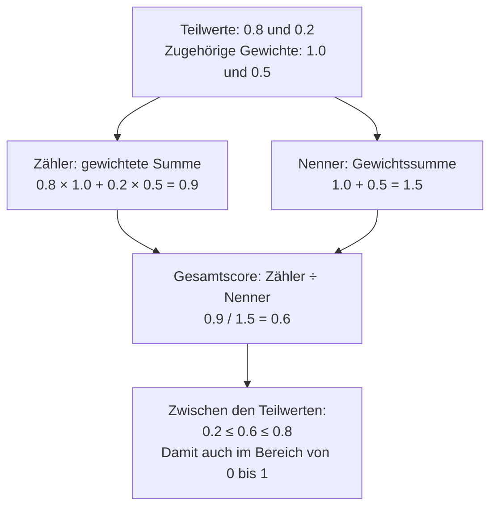

- **Ergebnis:** Der Score `0.6` liegt näher am stärker gewichteten Teilwert
  `0.8`. Die gewichtete Summe `0.9` ist noch nicht der Gesamtscore;
  erst die Division liefert den Durchschnitt.

<a id="warum-der-gesamtscore-zwischen-0-und-1-liegt"></a>

#### Wertebereich vor Deadline-Strafen

- **Einzelnen Beitrag betrachten:** Für jeden Teilwert `xᵢ` in `[0, 1]`
  und sein positives Gewicht `wᵢ` gilt:

`0 ≤ xᵢ × wᵢ ≤ wᵢ`

- **Beiträge addieren:** Daraus folgt für Zähler und Nenner:

`0 ≤ Summe(Teilwert × Gewicht) ≤ Summe(zugehörige Gewichte)`

- **Durch die Gewichtssumme teilen:** Der Zähler ist weder negativ noch
  größer als der positive Nenner. Deshalb gilt:

`0 ≤ Gesamtscore ≤ 1`

- **Bereich entsteht durch die Rechnung:** `calculate_action_score()`
  berechnet diesen Durchschnitt ohne nachträgliche Begrenzung. Die Aussage
  gilt vor möglichen Strafabzügen.
- **Kurve lesen:** Sind alle Teilwerte `0`, ist der Score `0`; sind alle
  `1`, ist er `1`. Haben alle Teilwerte gemeinsam den Wert `x`, entspricht
  auch ihr gewichteter Durchschnitt `x`:

`Score(x) = Summe(x × Gewicht) / Summe(Gewichte) = x`

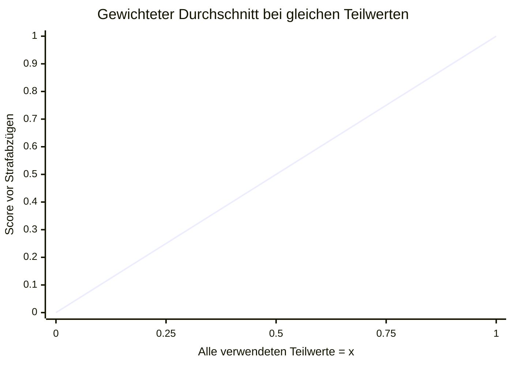

- **Sonderfall mit einem Teilwert:** Es gilt
  `(Teilwert × Gewicht) / Gewicht = Teilwert`. Das betrifft beispielsweise
  `complete_job` und normale Warteaktionen. Eine Änderung ihres einzigen
  Gewichts verändert den Score daher nicht.

#### HeuristicWeights

- **Parameter festlegen:**
  [HeuristicWeights.py](sources/SpineML/Control/HeuristicPolicy/HeuristicWeights.py)
  enthält die einstellbaren Parameter der lokalen Bewertung.
- **Werte prüfen:** Beim Erzeugen eines `HeuristicWeights`-Objekts werden
  dessen Gewichte auf `(0, 1]` geprüft. `calculate_action_score()` prüft oder
  begrenzt die übergebenen Werte nicht selbst.
- **Lokale und globale Ziele trennen:**
  [WeightOptimization](sources/SpineML/Control/HeuristicPolicy/WeightOptimization)
  verändert diese lokalen Parameter. Die
  [globalen Gewichte](#globale-gewichte-in-optimizationpy) legen dagegen fest,
  wie vollständige Produktionsläufe beurteilt werden.

### Rechenbeispiel: zwei Ablageziele

- **Ausgangszustand:** Der Main-Roboter trägt einen intakten, noch nicht
  fertigen Job. Die nächste Operation kann auf Maschine A oder B erfolgen.
- **Aktionstyp:** Der `ActionGenerator` erzeugt zwei Kandidaten vom Typ
  `place_main_robot`:

- **Kandidat A:** Den Job in Korridorpuffer A für den Weitertransport zu
  Maschine A ablegen.
- **Kandidat B:** Den Job in Korridorpuffer B für den Weitertransport zu
  Maschine B ablegen.

- **Annahmen:** Die folgenden Rohwerte dienen als Beispiel. Die Rechnung
  verwendet alle fünf Kriterien von `evaluate_place_action()` für diese
  Kandidaten und die Standardgewichte aus `HeuristicWeights`.

1. **Bewertungsgrößen:** Die Wege zu den Korridorpuffern betragen `8` und `2`
   Längeneinheiten. Bei konfigurierter Grundgeschwindigkeit `2` ergeben sich
   Transportzeitschätzungen von `4` und `1`. In Puffer A sind vier von zehn
   Plätzen frei, in Puffer B zwei von zehn. Im Eingangspuffer von Maschine A
   warten drei Jobs; der Eingangspuffer von Maschine B ist leer. Die
   konfigurierte Einlagerzeit beträgt jeweils `1`, die Dauer der nächsten
   Operation auf beiden Routen `4`.
2. **Abbildung auf Teilwerte:** `inverse_scale()` bildet Transportzeit,
   Einlagerzeit, Maschinenwarteschlangenlänge und Operationsdauer ab. Der freie
   Kapazitätsanteil ergibt sich aus `freie Plätze / Gesamtkapazität`. Für alle
   Teilwerte gilt damit dieselbe Vorteilsrichtung: Höher ist vorteilhafter.
3. **Gewichtssatz:** Die Tabelle zeigt die tatsächlich verwendeten
   Standardgewichte. Die Kapazität bezieht sich auf den **Korridorpuffer**, die
   Warteschlangenlänge dagegen auf den **Eingangspuffer der Zielmaschine**.
4. **Gesamtscore:** `calculate_action_score()` addiert die gewichteten
   Teilwerte und teilt durch die Gewichtssumme
   `0.2 + 0.25 + 0.15 + 0.25 + 0.15 = 1.0`:

| Bewertungsgröße | Standardgewicht | Kandidat A: Rohwert → Teilwert | Kandidat B: Rohwert → Teilwert |
|---|---|---|---|
| Freie Korridorpufferkapazität | `0.2` | `4 / 10 → 0.4` | `2 / 10 → 0.2` |
| Transportzeit | `0.25` | `4 → 0.2` | `1 → 0.5` |
| Einlagerzeit | `0.15` | `1 → 0.5` | `1 → 0.5` |
| Maschinenwarteschlangenlänge | `0.25` | `3 → 0.25` | `0 → 1` |
| Operationsdauer | `0.15` | `4 → 0.2` | `4 → 0.2` |
| **Gewichtete Summe** | — | `0.2975` | `0.52` |
| **Gesamtscore** | Gewichtssumme `1.0` | `0.2975 / 1.0 = 0.2975` | `0.52 / 1.0 = 0.52` |

Die gewichteten Summen lauten:

- **A:** `0.4 × 0.2 + 0.2 × 0.25 + 0.5 × 0.15 + 0.25 × 0.25 + 0.2 × 0.15 = 0.2975`.
- **B:** `0.2 × 0.2 + 0.5 × 0.25 + 0.5 × 0.15 + 1 × 0.25 + 0.2 × 0.15 = 0.52`.

Für den höheren Score von B sind die Unterschiede der gewichteten Beiträge
entscheidend:

- **Freie Pufferkapazität:** A erhält `0.4 × 0.2 = 0.08`, B nur
  `0.2 × 0.2 = 0.04`. Das ist ein Vorteil von `0.04` für A.
- **Transportzeit:** B erhält `0.5 × 0.25 = 0.125`, A nur
  `0.2 × 0.25 = 0.05`. Das ist ein Vorteil von `0.075` für B.
- **Maschinenwarteschlange:** B erhält `1 × 0.25 = 0.25`, A nur
  `0.25 × 0.25 = 0.0625`. Das ist ein Vorteil von `0.1875` für B.

- **Gleiche Beiträge:** Einlagerzeit und Operationsdauer ändern den Abstand
  nicht. Die übrigen Beiträge ergeben einen Vorteil von
  `0.075 + 0.1875 − 0.04 = 0.2225` für B. Bei der Gewichtssumme `1.0` ist
  dies auch der Scoreabstand: `0.52 − 0.2975 = 0.2225`.
- **Warten vergleichen:** Bei aktueller Zeit `11` und Deadline `10` gilt
  `EDD = 0.75`. Der zusätzliche Kandidat `wait_main_robot` erreicht
  `1 − 0.75 = 0.25`; B liegt auch darüber.
- **Nächste Beobachtung berücksichtigen:** Kandidaten und Scores werden
  erneut bestimmt. Ist Puffer B inzwischen voll, wird dafür keine
  Ablageaktion erzeugt. Die Bewertung vergleicht nur die vom Generator
  zugelassenen Möglichkeiten.

<a id="rlcontrol-erste-rl-umgebung"></a>

## RLPolicy: erste RL-Umgebung

`Control/RLPolicy` stellt eine schrittweise Gymnasium-Schnittstelle vor
dieselbe Produktion und Bridge. Vorhanden sind die Umgebung, die
Kandidatenschnittstelle, eine numerische Beobachtung und ein Episodenreward.
Ein neuronales Netz, ein Lernalgorithmus und ein Trainingslauf sind noch
nicht implementiert.

| Klasse | Aufgabe |
| --- | --- |
| [SpineRLEnv](sources/SpineML/Control/RLPolicy/SpineRLEnv.py) | Episoden starten, zwischen Kandidatenentscheidungen anhalten und `reset()`/`step()` anbieten. |
| [RLCandidatePolicy](sources/SpineML/Control/RLPolicy/RLCandidatePolicy.py) | Vollständige Kandidaten vom gemeinsamen Generator anfordern und eine externe Auswahl in eine `PolicyDecision` übersetzen. |
| [RLObservationEncoder](sources/SpineML/Control/RLPolicy/RLObservationEncoder.py) | ID-basierte Beobachtungen in feste, gepaddete numerische Arrays und Masken umwandeln. |
| [RLReward](sources/SpineML/Control/RLPolicy/RLReward.py) | Die gemeinsamen globalen Produktionskosten am Episodenende in einen Reward umrechnen. |

Die Umgebung verwendet weder den heuristischen Evaluator noch dessen
Aktionsscores. Die bestehende Heuristik und `RandomPolicy` bleiben daneben
eigenständige, direkt ausführbare Policies.

### Optionale Installation und CLI-Test

```console
.\.venv\Scripts\python.exe -m pip install -e ".[rl]"
.\.venv\Scripts\python.exe sources/tools/run_rl_episode.py --seed 1 --output rl_environment_result.json
```

- **Kalibrierung vor der Episode:** [run_rl_episode.py](sources/tools/run_rl_episode.py) übernimmt globale Zielgewichte und
  `SEEDS` aus `heuristic_optimization_app.py`. Es führt zuerst je Seed einen vollständigen
  Standardheuristik-Lauf aus und berechnet feste positive Zeitreferenzen für
  den Reward. Diese Baseline ist kein Training; ihre Rechenzeit wird separat
  ausgewiesen.
- **Auswahl zum Testen:** `--policy random` wählt zufällig eine gültige
  Nicht-Warteaktion, mit Warten als Fallback. `--policy heuristic` verwendet
  den vorhandenen `LocalHeuristicActionEvaluator` und `HeuristicActionSelector`
  zur Auswahl aus den RL-Kandidaten. Beide Optionen testen die Schnittstelle,
  nicht ein neuronales Netz.
- **Modell und Grenzen:** `--model` wählt die Konfiguration; ohne Angabe gilt
  `EXAMPLE_FILE` aus `heuristic_optimization_app.py`. `--seed` ist nichtnegativ.
  `--max-decisions` begrenzt externe Auswahlentscheidungen, nicht alle intern
  ausgeführten Einzelaktionen. `--max-simulation-time` begrenzt die simulierte
  Zeit. Ungültige CLI-Werte werden vor der Baseline abgewiesen.
- **Bericht:** Ausgabe und optionaler JSON-Bericht enthalten Status, Reward,
  globale Kosten, Produktionskennzahlen sowie getrennte Baseline- und
  Episodenzeiten. Das Modell wird durch Dateiname und SHA-256 identifiziert.
  `--help` startet keinen Lauf und benötigt Gymnasium nicht.

Die CLI-Auswahl `random` ist nicht das Einsetzen der Klasse `RandomPolicy`:
Sie arbeitet innerhalb des RL-Adapters mit den erzeugten Kandidaten
und übersprungenen Einzelaktionen. Insbesondere bleibt dort die vom Generator
eingetragene EDD-Priorität erhalten. Deshalb ist der CLI-Test kein zugesicherter
identischer Ersatz für einen direkten Lauf der jeweiligen Vergleichspolicy.

### Vom Bridge-Aufruf zur Kandidatenentscheidung

1. Die Bridge ruft `RLCandidatePolicy.make_decision()` mit einem Snapshot auf.
   Die Policy betrachtet wartende Objekte in der Einfügereihenfolge des
   Snapshots.
2. Für jedes Objekt erzeugt `SpineActionGenerator` die Kandidaten. Picks für
   einen in diesem Bridge-Aufruf bereits ausgewählten Job werden vor der
   nächsten Auswahl ausgeschlossen.
3. Die erzeugten Pick-Payloads enthalten bereits die EDD-basierte
   `queue_priority`. Die RL-Policy verwendet diese Kandidaten direkt;
   eine zusätzliche Vorbereitung oder gewichtete Score-Berechnung entfällt.
4. Ein einzelner verbleibender Kandidat wird ohne externen Schritt ausgewählt.
   Bei mindestens zwei Kandidaten erhält der Callback einen `DecisionRequest`
   mit Beobachtung, Kandidaten und bereits vorgemerkten Aktionen. Die Daten
   werden kopiert; der Callback verändert nicht die private auszuführende Aktion.
5. `SpineRLEnv` gibt die numerische Beobachtung an den Aufrufer zurück und
   wartet auf dessen Kandidatenindex. Dieser Index bezeichnet ausschließlich
   eine Zeile der gerade angebotenen Kandidatenliste.
6. Nach der Wahl werden gegebenenfalls die weiteren wartenden Objekte
   desselben Snapshots betrachtet. Erst wenn die gesamte `PolicyDecision`
   zurückgegeben wurde, beginnt die Bridge mit der Zustellung der Aktionen.

Innerhalb dieser Auswahlgruppe verstreicht keine Simulationszeit. Ein
`step()` bedeutet daher nicht zwingend, dass die zuletzt gewählte Aktion
bereits ausgeführt wurde. Mehrere Schritte können dieselbe Zeit besitzen;
die vorgemerkten Aktionen und Pick-Reservierungen sind in der Beobachtung
beziehungsweise in `info["pending_actions"]` erkennbar.

Nur bei direkter Verwendung der `RLCandidatePolicy` kann
`expose_forced_actions=True` auch die erzwungenen Einzelentscheidungen im
Callback sichtbar machen. `SpineRLEnv` verwendet den schnellen Standard ohne
diese zusätzlichen Schritte.

### Numerische Beobachtung und Aktionsmaske

Für `A = max_actions` und `E = max_entities` enthält die Beobachtung:

| Feld | Form | Bedeutung |
| --- | --- | --- |
| `context` | `(24,)` | Zeit, aktuelles Objekt und zusammengefasste Job-/Entscheidungsdaten. |
| `entities` | `(E, 49)` | Merkmale der Jobs, Roboter und Maschinen, einschließlich bereits vorgemerkter Aktionen und Pick-Reservierungen. |
| `entity_mask` | `(E,)` | `1` für eine reale Objektzeile, `0` für Padding. |
| `candidates` | `(A, 58)` | Aktionsart, beteiligte IDs sowie Job-, Routen-, Maschinen-, Werkzeug- und Puffermerkmale je angebotenem Kandidaten. |
| `action_mask` | `(A,)` | `1` für einen aktuell angebotenen Kandidaten, `0` für Padding. |

Standardmäßig sind `A = E = 256`. Die Merkmalsarrays sind `float32` mit Werten
in `[-1, 1]`; die Masken sind `int8` mit `0` oder `1`.
`action_masks()` liefert eine boolesche Kopie der Aktionsmaske.
Ein Agent darf nur einen gültigen Kandidatenindex auswählen; die Maske ist
keine zusätzliche unabhängige Routenprüfung.

Die Merkmalsnamen sind im Encoder als `CONTEXT_FEATURE_NAMES`,
`ENTITY_FEATURE_NAMES` und `CANDIDATE_FEATURE_NAMES` festgelegt. Dazu gehören
beispielsweise Termindruck, Produktdaten, Basisdauer einer Operation,
Maschinenbelegung, aufgelöste Defektwahrscheinlichkeit und Werkzeugzustand.
Objektzeilen werden nach ID sortiert, Kandidaten behalten ihre angebotene
Reihenfolge. ID-Kataloge werden aus dem ersten vollständigen Snapshot
deterministisch gebildet und bei Resets desselben Schemas beibehalten.
Fehlende Werte sind von realen IDs getrennt; es werden keine IDs gehasht.

Überschreitet eine Beobachtung die konfigurierten Zeilenlimits oder ändert
sich das ID-Schema, wird ein Fehler ausgelöst statt Kandidaten abzuschneiden
oder ihre Bedeutung still zu ändern. Ein anderes Modell-/Objektschema
benötigt eine neue Umgebung beziehungsweise einen neuen Encoder.

Diese kompakte Merkmalsauswahl enthält nicht sämtliche internen Simulations-
und Qualitätszustände. Sie ist eine **Teilbeobachtung**, kein nachgewiesener
vollständiger Markov-Zustand und noch keine fertige NN-Architektur.
Die Python-Dictionaries in `info`, etwa `candidates` und
`policy_observation`, dienen zur Diagnose; sie sind nicht die numerische
Netzeingabe.

### Gymnasium-API und Reward

`SpineRLEnv(model_file, global_evaluation, ...)` benötigt eine
`GlobalSimulationEvaluation` mit bereits festgelegten positiven Referenzen
für Makespan, Verspätungs-, Transport- und Werkzeugwechselzeit. Der Reward
übernimmt eigene Kopien dieser Referenzen und der nichtnegativen globalen
Zielgewichte; sie ändern sich nicht während einer Episode.

- `reset(seed=...)` startet eine frische Simulationsumgebung und liefert
  `(observation, info)` am ersten Auswahlpunkt.
- `step(index)` akzeptiert einen gültigen ganzzahligen Kandidatenindex und
  liefert `(observation, reward, terminated, truncated, info)` am nächsten
  Auswahlpunkt oder am Episodenende.
- Während einer Auswahl enthält `info` unter anderem `candidates`,
  `current_object_id`, `simulation_time`, `policy_observation` und
  `pending_actions`. Am Episodenende kommen `metrics`, `global_cost` und
  `reward_reason` hinzu.

#### Reward und Episodenende

Der Reward ist derzeit sparse: Zwischenschritte erhalten `0`. Bei regulärem
Abschluss gilt `reward = 1 / (1 + global_cost)`. Kleinere globale Kosten ergeben
damit eine höhere positive Belohnung, ohne die Rangfolge der globalen
Produktionsbewertung zu ändern. Ein Limitabbruch erhält `-1`.

| Ende | Rückgabe und Beobachtung |
| --- | --- |
| Alle Jobprozesse beendet | `terminated=True`, `truncated=False`; sämtliche Beobachtungsarrays und Masken sind null. |
| Ein weiterer Auswahlpunkt nach `max_decisions` beantworteten Entscheidungen | `truncated=True`; die Beobachtung dieses noch nicht beantworteten Auswahlpunkts bleibt erhalten. Der offene Bridge-Batch wird verworfen (`pending_batch_discarded=True`). |
| `max_simulation_time` erreicht, Jobs noch nicht fertig | `truncated=True`; die realen globalen Zustandsmerkmale bleiben erhalten, aber ohne aktuellen Akteur oder angebotene Aktionen. Kandidatenarray und Aktionsmaske sind null. |

Eine Trunkierungsbeobachtung ist für späteres Value-Bootstrapping vorgesehen,
nicht zur Fortsetzung der beendeten Episode. Auch wenn sie an der
Entscheidungsgrenze noch gültige Kandidatenmarkierungen enthält, ist dort
kein weiterer `step()` erlaubt. Ein Timeout oder ein Simulationsfehler wird
als Exception gemeldet, nicht als regulärer Limitabbruch verschleiert.

#### Ressourcen und Parallelität

`close()` muss auch bei Fehlern aufgerufen werden; es bricht eine noch aktive
Episode ab und wartet auf ihren Workerthread. Pro Prozess darf nur eine
RL-Umgebung gleichzeitig aktiv sein. Wegen Salabim- und Python-Random-Zuständen
darf daneben auch kein anderer direkter Simulationslauf im selben Prozess
ausgeführt werden. Mehrere parallele Umgebungen benötigen getrennte Prozesse;
ein entsprechender NN-Trainer ist noch nicht Bestandteil dieser Grundlage.

## Optimierungsvorgang

<a id="gesamtablauf-der-optimierung"></a>

### Ziel der Optimierung

Gesucht wird ein lokaler Gewichtssatz, mit dem die heuristische Policy im
Mittel bessere Produktionsergebnisse erzielt.
Verglichen wird der Mittelwert seiner globalen Bewertungszahlen über dieselben Seeds.

#### Gesamter Optimierungsablauf

Die Schritte 0 bis 6 im Diagramm entsprechen den folgenden Abschnitten.
Eine **Iteration** umfasst genau die Schritte 2 bis 5: Kandidaten erzeugen,
alle prüfen, den besten auswählen und über das Weitersuchen entscheiden.

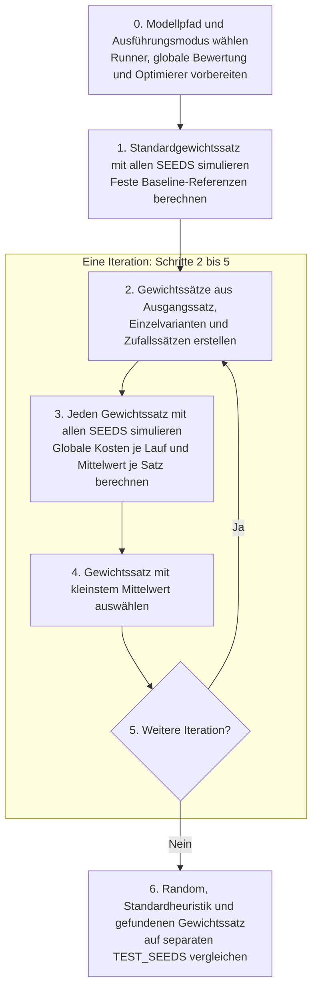

- **Abhängigkeiten:** Erst die Baseline, dann die Gewichtssuche, dann der
  Testvergleich. Die nächste Iteration benötigt die Auswahl der vorherigen.
- **Ausführungsmodus:** `sequential` führt die Läufe direkt nacheinander aus;
  `parallel` verteilt unabhängige Läufe derselben Phase auf einen Prozesspool.
  Suchregeln, Seeds, Bewertungsformeln und Ergebnisreihenfolge bleiben gleich.
  Die [CPU-Erklärung und Messungen](#parallele-optimierung-mit-mehreren-cpu-prozessen)
  stehen am Ende.

### 0. Modell laden und Optimierung starten

<a id="optimierung-starten"></a>

#### Anwendung starten

```console
.\.venv\Scripts\python.exe -m streamlit run sources/apps/heuristic_optimization_app.py
```

1. **Modell prüfen:** Standard ist `EXAMPLE_FILE = "example-5.py"` in
   [heuristic_optimization_app.py](sources/apps/heuristic_optimization_app.py). Die Oberfläche zeigt den Dateinamen.
2. **Ausführung wählen:** Unter **Execution mode** entweder
   **Sequential (previous execution)** ohne Prozesspool oder
   **Parallel (process pool)** wählen; voreingestellt ist der parallele Modus.
3. **Starten:** **Start optimization** startet einen vollständigen Durchlauf.
   Währenddessen sind Startknopf und Moduswahl gesperrt. Es wird keine
   3D-Animation gestartet. Modell und Code dürfen während des Laufs nicht geändert werden.

#### Produktionsbeispiel für den Steuerungsvergleich

[example-5.py](sources/examples/normal/example-5.py) enthält 24 Jobs aus acht
Aufträgen, drei Endprodukte, zwölf Operationstypen und zwölf Maschinen in drei
Seitenkorridoren. Alternative Bearbeitungswege, Werkzeuge, Puffer, Defektrisiken,
Startzeiten und Deadlines erzeugen unterschiedliche Entscheidungsmöglichkeiten.
Ob der gefundene Gewichtssatz hilft, zeigt erst der Testvergleich in Schritt 6.

<a id="beteiligte-dateien"></a>
<a id="technische-einbindung-modellladen-worker-thread-und-fortschrittsanzeige"></a>

#### Modell und Hintergrundlauf vorbereiten

Streamlit-Thread und Hintergrundthread sind Ausführungseinheiten im selben
Python-Prozess. Die Worker des Prozesspools sind dagegen eigene Prozesse.

- **Oberfläche:** Der Streamlit-Thread startet den Hintergrundthread und liest
  dessen Fortschritts- und Ergebnisdaten aus `state`.
- **Koordination:** Der Hintergrundthread erstellt den Optimierer und führt
  Baseline, Suche und Testvergleich aus. Globale Bewertung und Mittelwertbildung
  bleiben in diesem Elternprozess, nicht in den Poolprozessen.
- **Direkter Modus:** Layout und Szenario werden über
  [ModelLoader.py](sources/SpineML/SimulationExecution/ModelLoader.py) geladen.
  Anschließend führt `SimulationRunner` die übergebenen Policies nacheinander aus.
- **Paralleler Modus:** `ParallelSimulationRunner` erhält zunächst nur den
  Modellpfad. Beim ersten Batch startet sein persistenter Spawn-Pool.
  Jeder Worker lädt das Modell einmal und verwendet es für weitere Aufträge.
  Pro Auftrag entstehen eine frische Policy, Bridge und Salabim-Umgebung.
- **Abschluss:** Der Hintergrundthread schließt den Pool auch im Fehlerfall.
  Erst danach meldet er den Lauf als beendet; Fehler werden in der Oberfläche angezeigt.

Die zugehörigen Aufrufe im Code:

| Aufruf | Aufgabe im Ablauf |
| --- | --- |
| `_start_optimization()` | Setzt alte Anzeigeergebnisse zurück und startet den Hintergrundthread. |
| `worker()` | Koordiniert Vorbereitung, Baseline, Gewichtssuche, Testvergleich und Abschluss. |
| `create_optimizer()` | Erstellt den gewählten Runner, die globale Bewertung und den Gewichtssatz-Optimierer; startet noch keine Produktionssimulation. |
| `load_layout_and_scenario()` | Lädt die Fabrikkonfiguration ohne direkten `simulate(...)`-Start und wählt Layout und Szenario. Im direkten Modus geschieht das bei der Vorbereitung, im Pool einmal je Worker bei dessen Start. |
| `optimizer.optimize_iteratively(...)` | Führt nach der Baseline die Schritte 2 bis 5 aus. Die Methode gehört zu `LocalHeuristicWeightOptimizer`. |
| `_benchmark_policies()` | Führt nach der Suche den Steuerungsvergleich aus Schritt 6 aus. |

Die Zuständigkeiten sind unter
[Projektstruktur und Zuständigkeiten](#projektstruktur-und-zuständigkeiten)
zusammengefasst. Die Suche selbst steht in
[LocalHeuristicWeightOptimizer.py](sources/SpineML/Control/HeuristicPolicy/WeightOptimization/LocalHeuristicWeightOptimizer.py).

#### Suchparameter

Aktuelle Einstellungen in [heuristic_optimization_app.py](sources/apps/heuristic_optimization_app.py):

| Parameter | Aktueller Wert | Bedeutung |
| --- | --- | --- |
| `SEEDS` | `[1, 2]` | Gemeinsame Simulations-Seeds für Baseline und jeden Gewichtssatz. |
| `TEST_SEEDS` | `[101, 102, 103, 104, 105]` | Separate Seeds nur für den abschließenden Steuerungsvergleich. |
| `ITERATIONS` | `2` | Höchstens zwei Suchiterationen. |
| `INITIAL_WEIGHT_STEP` | `0.40` | Anfangs addierter beziehungsweise abgezogener Betrag, keine prozentuale Änderung. |
| `EXPLORATION_CANDIDATES` | `3` | Zusätzliche zufällige Gewichtssätze pro Iteration. |
| `RESTART_AFTER_NO_IMPROVEMENT` | `2` | Nach zwei erfolglosen Iterationen die Schrittweite zurücksetzen. |
| `STOP_AFTER_NO_IMPROVEMENT` | `4` | Nach vier aufeinanderfolgenden erfolglosen Iterationen stoppen. |
| `MAX_WORKERS` | `min(os.cpu_count() or 1, 20)` | Obergrenze gleichzeitiger Prozesse im parallelen Modus. |

<a id="1-produktion-mit-standardgewichten-simulieren"></a>

### 1. Produktion mit dem Standardgewichtssatz simulieren

Ziel dieses Schritts sind feste Referenzwerte für die Bewertung aller
folgenden Produktionsläufe.

1. **Vergleichsläufe ausführen:** Die heuristische Steuerung wird mit dem
   Standardgewichtssatz `HeuristicWeights()` einmal pro Seed aus `SEEDS`
   simuliert, aktuell mit Seed `1` und Seed `2`. Der gewählte Modus bestimmt
   nur, ob sie nacheinander oder parallel laufen. Sie bilden die
   Baseline (Vergleichsbasis).
2. **Referenzen berechnen:** Für jede [Zeitkennzahl](#produktionskennzahlen)
   wird der Mittelwert über die Baseline-Seeds berechnet und gespeichert.
   Er dient als Vergleichsgröße für dieselbe Zeitkennzahl in anderen Läufen.
   Ein Referenzwert von `0` führt zu einem Fehler; er wird nicht künstlich ersetzt.
3. **Gewichtssuche beginnen:** Erst nach der Berechnung der Referenzwerte
   startet `optimize_iteratively()`.

- **Rechenbeispiel:** Erreicht der Standardgewichtssatz eine Produktionsdauer
  ([`makespan`](#produktionskennzahlen)) von `9` Stunden mit Seed `1` und
  `11` Stunden mit Seed `2`, wird `(9 + 11) / 2 = 10` Stunden als Referenz
  gespeichert. Die Anwendung dieser Referenz zeigt das
  [Rechenbeispiel in Schritt 3](#globale-gewichte-in-optimizationpy).
- **Ergebnis:** Diese einmal berechneten Baseline-Referenzwerte gelten für alle folgenden Läufe,
  einschließlich des
  [Abschlussvergleichs](#6-gefundenen-gewichtssatz-mit-standardheuristik-und-zufall-vergleichen).

<a id="baseline-technik"></a>

#### Technische Umsetzung: Seeds

Seeds machen die Zufallseinflüsse eines Simulationslaufs reproduzierbar.

- **Wiederholter Entscheidungsablauf:**

`Zustand → Policy entscheidet → Simulation führt Aktion aus → neuer Zustand`

- **Einfluss des Zufalls:** Der neue Zustand entsteht nicht allein durch
  die Entscheidung. Auch Schwankungen der Robotergeschwindigkeit oder ein
  Defekt können die Ausführung beeinflussen. Schematisch gilt:

`Neuer Zustand = bisheriger Zustand + Auswirkungen der gewählten Aktion + gegebenenfalls Zufallseinflüsse`

- **Startwert setzen:** Ein Seed ist ein Startwert für die
  Zufallszahlengeneratoren. Der Runner setzt ihn vor jedem neuen Lauf.
  Seed `1` und Seed `2` stehen damit für unterschiedliche, reproduzierbare
  Zufallsziehungen.
- **Gleiche Ausgangsziehungen:** Bei demselben Seed werden beispielsweise
  die anfänglichen Maschinengeschwindigkeiten für zwei Gewichtssätze gleich
  ausgelost. Der Zufall wird dadurch nicht entfernt.
- **Unterschiedliche Entscheidungen vergleichen:** Andere Gewichtssätze
  können andere Aktionen und damit andere Folgezustände erzeugen.
  Verglichen wird, welche Aktionsfolge insgesamt bessere
  [Produktionsergebnisse](#produktionskennzahlen) liefert, etwa eine kürzere
  Produktionsdauer oder weniger Verspätung.

<a id="2-varianten-der-lokalen-gewichte-erstellen"></a>

### 2. Varianten des lokalen Gewichtssatzes erstellen

Ziel dieses Schritts ist eine Liste von Gewichtssätzen für die nächste Prüfung.

- **Ausgangspunkt:** In der ersten Iteration ist das der Standardgewichtssatz
  [HeuristicWeights()](sources/SpineML/Control/HeuristicPolicy/HeuristicWeights.py).
- **Vollständige Sätze erstellen:** `optimize_iteratively()` erstellt daraus
  die zu prüfenden Gewichtssätze. Jeder Satz enthält alle lokalen Gewichte,
  auch wenn nur eines davon geändert wird.

Die Varianten entstehen auf zwei Arten:

1. **Einzelne Gewichte verändern: `neighboring_weights()`**

   Der Ausgangssatz bleibt als Vergleich enthalten. Zusätzlich
   werden für jedes Gewicht zwei Varianten erstellt: eine mit
   `Gewicht − Schrittweite` und eine mit `Gewicht + Schrittweite`.
   Alle anderen Gewichte werden unverändert übernommen. Die veränderten
   Werte bleiben zwischen `0.000001` und `1.0`.

   **Beispiel mit der anfänglichen Schrittweite `0.4`:** Die Tabelle zeigt
   das Transportzeitgewicht `pick_short_transport_time_weight` und das
   Kapazitätsgewicht `target_store_free_capacity_weight`. Die übrigen
   **23 Gewichte bleiben in diesen Beispielsätzen unverändert**.

   | Gewichtssatz | Transportzeitgewicht | Kapazitätsgewicht |
   |---|---|---|
   | Ausgangssatz | `0.3` | `0.2` |
   | Nur Transportzeitgewicht verringern | `0.000001` | `0.2` |
   | Nur Transportzeitgewicht erhöhen | `0.7` | `0.2` |
   | Nur Kapazitätsgewicht verringern | `0.3` | `0.000001` |
   | Nur Kapazitätsgewicht erhöhen | `0.3` | `0.6` |

   - **Untergrenze einhalten:** `0.3 − 0.4` und `0.2 − 0.4` liegen darunter.
     Deshalb verwendet der Code für diese beiden Varianten `0.000001`.
     Dasselbe Vorgehen gilt für die übrigen Gewichte.

2. **Weitere Gewichtssätze zufällig zusammenstellen: `random_local_weight_candidates()`**

   Für jeden zusätzlichen Gewichtssatz wird jeder einzelne Gewichtswert neu
   ausgelost. Anders als bei den Einzelvarianten können somit alle Gewichte
   gleichzeitig vom Ausgangssatz abweichen. Der Zufallsbereich reicht von
   `0.000001` bis `1.0`; nur für `wait_action_weight` verwendet diese Methode
   den kleineren Bereich von `0.000001` bis `0.1`.

   **Beispiel aus der ersten Iteration:** `EXPLORATION_CANDIDATES = 3`
   erzeugt drei zusätzliche Zufallssätze. Gezeigt sind drei ihrer jeweils
   25 Gewichte, auf vier Nachkommastellen gerundet. Auch die übrigen
   22 Gewichte werden für jeden Satz neu gezogen.

   | Zufallssatz | Transportzeitgewicht | Kapazitätsgewicht | `wait_action_weight` |
   |---|---|---|---|
   | 1 | `0.5113` | `0.4766` | `0.0758` |
   | 2 | `0.9666` | `0.8050` | `0.0434` |
   | 3 | `0.5079` | `0.7066` | `0.0448` |

**Wie viele Gewichtssätze entstehen insgesamt?**

- **Sätze erzeugen:** `HeuristicWeights` enthält aktuell 25 Gewichte.
  Pro Iteration entstehen zunächst:

`1 Ausgangssatz + 2 × 25 Einzelvarianten + 3 Zufallssätze = 54 erzeugte Gewichtssätze`

- **Identische Sätze entfernen:** Stimmen innerhalb einer Iteration alle
  Gewichte zweier Sätze überein, bleibt vor der Simulation nur der erste
  erhalten. Mit dem aktuellen Standardgewichtssatz bleiben in der ersten
  Iteration 53 unterschiedliche Gewichtssätze; jeder wird mit allen Seeds geprüft.
- **Gesamtumfang begrenzen:** Bei den aktuell zwei Iterationen sind höchstens
  107 Gewichtssatz-Prüfungen möglich: 53 in der ersten und höchstens 54 in der
  zweiten Iteration. Den Ausgangssatz für die nächste Iteration bestimmt
  [Schritt 5](#5-weitere-iteration-ausführen).
  Einschließlich Baseline und Testvergleich sind das höchstens
  `2 + 107 × 2 + 15 = 231` Produktionssimulationen. Die tatsächliche Zahl
  hängt von identischen Kandidaten ab und steht im Laufbericht.
- **Fortschritt zählen:** Die Anzeige zählt nur die nach dem Entfernen
  identischer Sätze tatsächlich geprüften Gewichtssätze.
- **Ergebnis:** Die Liste wird anschließend
  [simuliert und bewertet](#3-produktion-mit-jedem-gewichtssatz-einmal-pro-seed-simulieren-und-bewerten).

<a id="3-produktion-mit-jedem-gewichtssatz-mehrfach-simulieren-und-bewerten"></a>

### 3. Produktion mit jedem Gewichtssatz einmal pro Seed simulieren und bewerten

Ziel dieses Schritts ist eine mittlere globale Bewertungszahl für jeden
Gewichtssatz aus [Schritt 2](#2-varianten-des-lokalen-gewichtssatzes-erstellen).

- **Unabhängige Läufe:** Jeder unterschiedliche Gewichtssatz wird mit jedem
  Seed aus `SEEDS` vollständig simuliert. Im direkten Modus geschieht dies
  nacheinander; im parallelen Modus bilden alle Paare einer Iteration einen Batch.
- **Seeds:** Mit `SEEDS = [1, 2]` entstehen pro Gewichtssatz zwei Jobs.
  Die fachliche Auswertung eines Satzes umfasst:

1. **Lauf mit Seed `1`:** Die Produktion wird mit diesem Gewichtssatz
   vollständig simuliert. Aus den Ergebnissen dieses Laufs wird eine
   [globale Bewertungszahl](#globale-bewertungszahl) berechnet.
2. **Lauf mit Seed `2`:** Die Produktion wird mit **demselben Gewichtssatz**
   und Seed `2` unabhängig vollständig simuliert. Für diesen Lauf wird
   eine eigene globale Bewertungszahl berechnet.
3. **Ergebnis für diesen Gewichtssatz:** Aus **diesen beiden
   Bewertungszahlen** wird der [Mittelwert](#mittelwert-über-die-seeds)
   berechnet, also ihre Summe durch `2` geteilt.

- **Ergebnisse zuordnen:** Unterschiedliche Sätze und Seeds dürfen in anderer
  Reihenfolge fertig werden. Erst wenn alle Seeds eines Satzes vorliegen,
  berechnet der Elternprozess dessen globale Bewertungszahlen und Mittelwerte.
- **Iteration abschließen:** Erst nach allen Kandidaten wird der beste Satz
  bestimmt und daraus die nächste Iteration vorbereitet.

#### Gewichtssätze mit denselben Seeds vergleichen

Alle Gewichtssätze werden mit derselben Liste von [Seeds](#baseline-technik)
getestet.

- **Diagrammzeilen:** Jede Zeile zeigt einen anderen Gewichtssatz.
- **Zweige:** Jeder Zweig steht für einen vollständigen Produktionslauf und
  dessen [globale Bewertungszahl](#globale-bewertungszahl). Im parallelen Modus
  können diese Zweige gleichzeitig laufen; im direkten Modus laufen sie nacheinander.
- **Zusammenfassung:** Der
  [Mittelwert dieser Bewertungszahlen](#mittelwert-über-die-seeds) fasst das
  Ergebnis eines Gewichtssatzes zusammen.

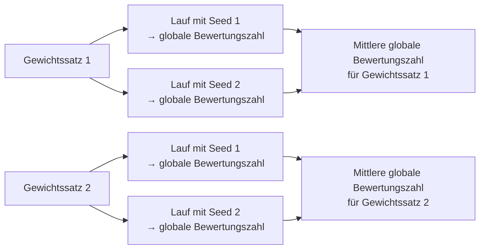

#### Simulationslauf und Produktionskennzahlen

Für jeden Lauf erstellt `HeuristicPolicyFactory` eine frische Policy aus
Gewichtssatz und Seed. `SimulationRunner` führt sie direkt oder innerhalb eines
Poolprozesses aus:

1. **Steuerung erstellen:** Die Factory erstellt für den übergebenen Seed
   die heuristische Policy mit ihrem Gewichtssatz.
2. **Produktion simulieren:** `run_policy()` setzt die Zufallszahlengeneratoren
   auf den Seed, baut die Simulation mit dem ausgewählten Layout und Szenario
   neu auf und führt sie aus. Die Steuerung entscheidet während dieses Laufs
   wiederholt über Aktionen. Der Gewichtssatz bleibt dabei unverändert.
3. **Produktionsergebnis erfassen:** `collect_global_metrics()` erfasst die
   Kennzahlen des gesamten Laufs. Der Runner gibt sie als
   `GlobalSimulationMetrics` an den Optimierer zurück, im parallelen Modus über
   den Prozesspool. Sind beim Laufende noch Jobs unfertig, meldet der Runner
   stattdessen einen Fehler.

##### Produktionskennzahlen

Die Bewertung verwendet sieben Kennzahlen; die vier Zeitkennzahlen werden
in Stunden erfasst.

- **Produktionsdauer (`makespan`):** Zeit vom frühesten vorgesehenen
  Auftragsstart (`earliest_start_time`) bis zum letzten Jobabschluss.
  Der gespeicherte Abschlusszeitpunkt liegt nach dem Absenken am Endlager,
  aber vor der letzten Einlagerungszeit und der tatsächlichen Ablage.
- **Gesamtverspätung (`total_tardiness`):** Summe der positiven Verspätungen
  aller abgeschlossenen **Jobs**. Für jeden Job gilt
  `Jobverspätung = max(0, completed_time − Deadline des zugehörigen Auftrags)`.
  Mehrere verspätete Jobs desselben Auftrags zählen einzeln. Frühe Abschlüsse
  verringern die Summe nicht. Beispiel: Bei Deadline `10` und Jobabschlüssen
  `8`, `12` und `15` ist die Gesamtverspätung `0 + 2 + 5 = 7`.
  Im Interface heißt diese Kennzahl **Total job tardiness**.
- **Transportzeit (`total_transport_time`):** Summe der Bewegungszeiten für
  X, Y und Z aller Roboter. Ein- und Auslagerungswartezeiten zählen nicht mit.
- **Werkzeugwechselzeit (`tool_change_time`):** Summe der Zeiten aller
  Maschinen für Werkzeugmontage (`mounting`) und -demontage (`unmounting`).
- **Nacharbeitsquote (`rework_rate`):** Zahl der abgeschlossenen Jobs mit
  `rework_count > 0`, bezogen auf alle Jobs. Der Zähler `rework_job_count` zählt jeden solchen Job
  einmal. Getrennt davon summiert `total_rework_count` alle ausgewählten
  Nacharbeiten, auch mehrere beim selben Job.
- **Ausschussquote (`scrap_rate`):** Anteil der abgeschlossenen Jobs mit
  Endzustand `general_state == "scrap"`. Jeder dieser Jobs erhöht
  `scrap_job_count` um eins; sein interner Entscheidungszähler wird dafür nicht
  verwendet.
- **Herabstufungsquote (`downgrade_rate`):** Anteil der abgeschlossenen Jobs
  mit `general_state == "intact"` und `downgraded == True`.
  Ihr Zähler heißt `downgraded_job_count`. Diese Jobs zählen nicht zusätzlich
  unter `intact_jobs`; dort stehen nur intakte Jobs ohne Herabstufung.

- **Defektfälle getrennt zählen:** `total_defect_count` summiert alle
  `job.defect_count`: Drei Defekte bei einem Job und zwei bei einem anderen
  ergeben fünf Defektfälle. Diese Ereigniszahl ist keine zusätzliche
  Kennzahl der globalen Bewertung.
- **Bezugsgröße der Quoten:** `total_jobs` ist für alle drei Quoten die
  Gesamtzahl der Jobs. Ihre [Berechnung](#globale-bewertungszahl) folgt im
  nächsten Abschnitt.

#### Globale Bewertungszahl

`GlobalSimulationEvaluation` fasst die Produktionsergebnisse zu einer
globalen Bewertungszahl pro Lauf zusammen.

- **Zielkonflikte vergleichbar machen:** Ein Lauf kann beispielsweise eine
  kurze Produktionsdauer, aber viel Ausschuss haben. Die gemeinsame
  Bewertungszahl berücksichtigt beide Folgen.
- **Bewertungsrichtung:** Anders als beim Aktionsscore gilt hier: Je kleiner
  die Bewertungszahl, desto besser wird das Produktionsergebnis bewertet.
- **Eingangsgrößen:** Vier Zeitkennzahlen sowie Nacharbeits-, Ausschuss-
  und Herabstufungsquote erfassen Zeitaufwand und Entscheidungsfolgen.

Zuerst werden die Kennzahlen für die gemeinsame Berechnung umgerechnet:

- **Zeitkennzahlen:** Produktionsdauer (`makespan`), Gesamtverspätung der Jobs
  (`total_tardiness`), Transportzeit (`total_transport_time`) und
  Werkzeugwechselzeit (`tool_change_time`) werden jeweils durch ihren eigenen
  [Baseline-Referenzwert aus Schritt 1](#1-produktion-mit-dem-standardgewichtssatz-simulieren)
  geteilt. Beispielsweise ergeben `8` Stunden Produktionsdauer bei einer
  Referenz von `10` Stunden den Wert `8 / 10 = 0.8`. Der Wert `1` bedeutet
  gleich der Referenz, ein kleinerer Wert eine kürzere Zeit.

- **Quoten:** Die drei Quoten werden mit der Gesamtzahl der Jobs
  (`total_jobs`) als Bezugsgröße berechnet:

  - **Nacharbeitsquote (`rework_rate`):**
    `rework_job_count / total_jobs`. Jeder Job mit mindestens einer Nacharbeit
    zählt einmal.
  - **Ausschussquote (`scrap_rate`):**
    `scrap_job_count / total_jobs`.
  - **Herabstufungsquote (`downgrade_rate`):**
    `downgraded_job_count / total_jobs`.

  - **Beispiel:** `20` abgeschlossene Ausschussjobs bei `100` Jobs ergeben
    die Ausschussquote `20 / 100 = 0.2`.
  - **Abgrenzung:** Die Quoten werden nicht durch Baseline-Referenzwerte
    geteilt. Nacharbeit zählt als zusätzlicher Aufwand neben den Zeitkennzahlen.

- **Beiträge addieren:** Danach wird jeder Wert mit seinem
  [globalen Gewicht](#globale-gewichte-in-optimizationpy) multipliziert.
  Die Produkte werden addiert:

`Globale Bewertungszahl = Summe(umgerechneter Kennzahlwert × globales Gewicht)`

- **Keine weitere Division:** Es wird nicht durch die Gewichtssumme geteilt.
- **Einheitlicher Maßstab:** Alle Gewichtssätze werden mit denselben
  globalen Gewichten und Baseline-Referenzwerten beurteilt.

<a id="globale-gewichte-in-optimizationpy"></a>

##### Globale Gewichte in `heuristic_optimization_app.py`

Die Tabelle zeigt die globalen Gewichte aus dem Code und ihre Anwendung
auf einen beispielhaften Lauf mit Gewichtssatz A und Seed `1`.

- **Beispieldaten:** Laufdaten und Referenzwerte sind für das Rechenbeispiel
  gewählt, keine gemessenen Optimierungsergebnisse. Alle Zeitangaben sind in Stunden.
- **Jobergebnisse:** Von `100` abgeschlossenen Jobs wurden `10`
  nachgearbeitet, `20` als Ausschuss behandelt und `10` herabgestuft.

| Kennzahl | Umrechnung im Beispiel | Globales Gewicht | Beitrag zur Bewertungszahl |
| --- | --- | --- | --- |
| Produktionsdauer (`makespan`) | `8 / 10 = 0.8` | `5.0` | `4.0` |
| Gesamtverspätung | `2 / 4 = 0.5` | `4.0` | `2.0` |
| Transportzeit | `6 / 8 = 0.75` | `1.0` | `0.75` |
| Werkzeugwechselzeit | `1 / 2 = 0.5` | `1.0` | `0.5` |
| Nacharbeitsquote | `10 / 100 = 0.1` | `3.0` | `0.3` |
| Ausschussquote | `20 / 100 = 0.2` | `4.0` | `0.8` |
| Herabstufungsquote | `10 / 100 = 0.1` | `3.0` | `0.3` |

- **Bewertungszahl berechnen:** Die Beiträge der letzten Spalte werden addiert:

`4.0 + 2.0 + 0.75 + 0.5 + 0.3 + 0.8 + 0.3 = 8.65`

- **Wirkung eines globalen Gewichts:** Ein höherer Wert lässt die Kennzahl
  stärker in die Bewertung eingehen. Steigt beispielsweise die Ausschussrate
  um `0.1`, erhöht sich die Bewertungszahl bei Gewicht `4.0` um `0.4`, wenn
  die anderen Beiträge gleich bleiben.

#### Mittelwert über die Seeds

Der Mittelwert fasst alle Seed-Läufe eines Gewichtssatzes zu einem
Vergleichswert zusammen.

- **Einzelwerte sammeln:** Nach jedem Lauf liegt eine globale Bewertungszahl vor.
- **Mittelwert berechnen:** Sobald alle Seeds eines Gewichtssatzes vorliegen,
  berechnet der Optimierer im Elternprozess daraus `mean_global_cost`:

`mean_global_cost = Summe(globale Bewertungszahl je Seed) / Anzahl der Seeds`

- **Beispiel fortsetzen:** Mit Seed `1` erreicht Gewichtssatz A die oben
  berechnete Bewertungszahl `8.65`. Angenommen, sein Lauf mit Seed `2`
  erreicht `9.55` und Gewichtssatz B erzielt `8.9` beziehungsweise `8.7`:

| Gewichtssatz | Bewertungszahl bei Seed `1` | Bewertungszahl bei Seed `2` | Mittelwert `mean_global_cost` |
| --- | --- | --- | --- |
| A | `8.65` | `9.55` | `(8.65 + 9.55) / 2 = 9.1` |
| B | `8.9` | `8.7` | `(8.9 + 8.7) / 2 = 8.8` |

- **Ergebnis des Beispiels:** A ist bei Seed `1` besser, B erreicht aber
  den kleineren Mittelwert. Deshalb wird B in
  [Schritt 4](#4-gewichtssatz-anhand-der-mittleren-produktionsergebnisse-auswählen)
  gegenüber A bevorzugt.

#### Fortschritt und Ergebnisdiagramme

Die Oberfläche zeigt den aktuellen Prüfstand und die Ergebnisse bereits
abgeschlossener Gewichtssatz-Prüfungen.

- **Fortschritt melden:** `progress` in `heuristic_optimization_app.py` erhält die
  Iteration und den ursprünglichen Index eines vollständig geprüften
  Gewichtssatzes. Die Oberfläche zählt fertige Sätze separat.
- **Anzeige lesen:** `Optimization: iteration 1, 9/53 candidates completed` bedeutet:
  In Iteration `1` sind neun von `53` Gewichtssätzen vollständig geprüft. Die Anzeige
  bezieht sich auf die aktuelle Iteration, nicht auf die gesamte Optimierung.
- **Diagrammachsen unterscheiden:** Die drei folgenden Ergebnisbereiche
  verwenden die fortlaufende X-Achse `Candidate` (geprüfter Gewichtssatz).
  Sie nummeriert Kandidaten in ihrer ursprünglichen Eingabereihenfolge über
  alle Iterationen hinweg, nicht nach Fertigstellungszeit.
- **Punkte und Linien lesen:** Ein Punkt erscheint nach der Auswertung
  aller Seeds eines Gewichtssatzes. Bereits fertige spätere Kandidaten werden
  bis zu ihren Vorgängern gepuffert. Verbindungslinien zeigen die
  Eingabereihenfolge; Kandidat `1` bleibt die ursprüngliche Vergleichsbasis.

##### Bedeutung der Kostenkurve

**Mean global cost** zeigt die
[Gesamtbewertung](#mittelwert-über-die-seeds) jedes geprüften Gewichtssatzes.

- **Y-Achse:** Jeder Punkt ist der Mittelwert der globalen Bewertungszahlen
  über alle Seeds aus `SEEDS` für genau einen Gewichtssatz: `mean_global_cost`.
  Kleiner ist besser.
- **Begriff „Kosten“:** Gemeint ist die berechnete Bewertungszahl, kein Geldbetrag.
- **Kurvenverlauf:** Die Kurve zeigt alle geprüften Sätze, nicht nur
  Verbesserungen. Sie muss daher nicht stetig sinken; ein schlechterer
  Versuch ersetzt den bisher besten Satz nicht automatisch.

##### Einzelne Produktionskennzahlen

**Mean metrics per candidate** zeigt für jede der sieben
[bewerteten Produktionskennzahlen](#globale-bewertungszahl) ein eigenes Diagramm.

- **Y-Achse:** Dargestellt wird der Mittelwert über die Seeds, beispielsweise
  die mittlere Produktionsdauer oder Ausschussquote. Jedes Diagramm hat eine
  eigene Y-Skala.
- **Einheiten:** Die Zeitkennzahlen stehen in Stunden, die drei Quoten in Prozent.
- **Zielkonflikte erkennen:** Ein Gewichtssatz kann beispielsweise kürzere
  Produktionszeiten, aber eine höhere Ausschussquote erreichen. Wie diese
  Ziele gemeinsam bewertet werden, bestimmt die
  [globale Bewertungszahl](#globale-bewertungszahl).

##### Abweichung gegenüber dem ersten Gewichtssatz

**Metric deviation from candidate 1** zeigt die Änderung der einzelnen
Kennzahlmittelwerte in zwei getrennten Diagrammen: Zeitkennzahlen in relativen
Prozent und Nacharbeits-, Ausschuss- sowie Herabstufungsquoten in Prozentpunkten.

- **Vergleichsbasis:** Kandidat `1` ist der erste Gewichtssatz der ursprünglichen
  Eingabereihenfolge der gesamten Optimierung, aktuell der Standardgewichtssatz.
  Er ist weder der zuerst fertiggestellte Kandidat noch ein neuer Ausgangspunkt
  pro Iteration.
- **Zeitkennzahlen:** Für einen Ausgangswert ungleich `0` gilt:

`Abweichung (%) = (Kennzahlmittelwert − Ausgangswert) / |Ausgangswert| × 100`

- **Zeitbeispiel:** Sinkt die mittlere Produktionsdauer von `10` auf `8`
  Stunden, ist die Abweichung `(8 − 10) / 10 × 100 = −20 %`.
- **Quoten:** Die bereits in Prozent dargestellten Mittelwerte werden direkt
  voneinander abgezogen. Von `0 %` auf `5 %` ergibt `+5` Prozentpunkte;
  von `10 %` auf `20 %` ergibt `+10` Prozentpunkte, nicht `+100` Prozentpunkte.
- **Zeit-Ausgangswert `0`:** Die relative Abweichung ist nicht definiert.
  Für diese Zeitkennzahl wird keine Kurve gezeichnet; ein Hinweis im
  Diagrammtitel erklärt den fehlenden Vergleich. Es wird kein künstlicher
  Wert von `0 %` eingesetzt. Quoten mit Ausgangswert `0 %` bleiben dagegen
  als Prozentpunktdifferenz darstellbar.
- **Vorzeichen lesen:** Ein negativer Wert bedeutet eine Verringerung, ein
  positiver Wert eine Erhöhung.
- **Gesamtergebnis beurteilen:** Eine einzelne verringerte Kennzahl beweist
  noch keine Verbesserung: Weniger Nacharbeit kann mit mehr Ausschuss
  einhergehen. Entscheidend ist die
  [mittlere globale Bewertungszahl](#mittelwert-über-die-seeds).
- **Unveränderte Rohwerte:** Die tatsächlichen Kennzahlmittelwerte und die
  Berechnung der Jobquoten bleiben unverändert. Sie stehen weiterhin im
  [Kennzahlendiagramm](#einzelne-produktionskennzahlen).
- **Ergebnis dieses Schritts:** Ein `mean_global_cost` pro geprüftem
  Gewichtssatz bildet die Grundlage für die
  [Auswahl eines Gewichtssatzes](#4-gewichtssatz-anhand-der-mittleren-produktionsergebnisse-auswählen).

### 4. Gewichtssatz anhand der mittleren Produktionsergebnisse auswählen

Ziel ist der beste Gewichtssatz der aktuellen Iteration.

- **Auswahlregel:** `select_best_local_weight_set_across_seeds()` wählt aus
  allen geprüften Sätzen den mit dem kleinsten
  [Mittelwert über die Seeds](#mittelwert-über-die-seeds).
- **Gleichstand:** Bei gleichem Mittelwert bleibt der erste Satz in der
  ursprünglichen Kandidatenreihenfolge ausgewählt, nicht der zuerst fertiggestellte.
- **Beispiel:** A erreicht `9.1`, B erreicht `8.8`. Deshalb wird B ausgewählt.
- **Nächste Entscheidung:** Ob B den bisher besten Satz ersetzt und die
  Suche weiterläuft, entscheidet [Schritt 5](#5-weitere-iteration-ausführen).

<a id="weitere-iterationen-neustart-vorzeitiges-ende-und-rückgabewerte-im-code"></a>

### 5. Weitere Iteration ausführen?

**Ziel:** Vom besten Gewichtssatz aus weitersuchen. Ohne Verbesserung werden
zunächst größere Änderungen ausprobiert; bleibt der Erfolg aus, endet die Suche.

- **Vergleich:** `optimize_iteratively()` vergleicht den besten Mittelwert
  dieser Iteration mit dem bisher gespeicherten besten Mittelwert. Nur ein
  kleinerer Wert ist eine Verbesserung; ein gleicher Wert zählt nicht.

- **Erste Iteration oder Verbesserung:** Den ausgewählten Satz und seinen
  Mittelwert speichern, die Schrittweite halbieren und Neustart-Zähler sowie
  Abbruch-Zähler auf `0` setzen.
- **Keine Verbesserung:** Den bisherigen besten Satz behalten. Beide Zähler
  steigen um `1`.

Die beiden Zähler steuern die Suche bei ausbleibender Verbesserung:

- **Neustart-Zähler (`iterations_without_improvement`):** Zählt Iterationen ohne
  Verbesserung seit der letzten Verbesserung oder dem letzten Neustart.
  Bei `2` (`RESTART_AFTER_NO_IMPROVEMENT`) wird ein Neustart ausgelöst:
  Schrittweite auf `INITIAL_WEIGHT_STEP = 0.4` zurücksetzen, diesen Zähler auf `0` setzen.
  Die nächste Iteration prüft größere Änderungen am bisherigen besten Satz.
- **Abbruch-Zähler (`total_iterations_without_improvement`):** Zählt die
  aufeinanderfolgenden Iterationen ohne Verbesserung. **Ein Neustart setzt
  ihn nicht zurück.** Bei `4` (`STOP_AFTER_NO_IMPROVEMENT`) endet die Suche;
  ein weiterer Neustart wird dann nicht mehr ausgeführt.

- **Weiterlaufen oder enden:** Eine weitere Iteration beginnt bei
  [Schritt 2](#2-varianten-des-lokalen-gewichtssatzes-erstellen), solange der
  Abbruch-Zähler unter `4` liegt und noch nicht `ITERATIONS` Iterationen
  ausgeführt wurden. Andernfalls folgt der
  [Abschlussvergleich in Schritt 6](#6-gefundenen-gewichtssatz-mit-standardheuristik-und-zufall-vergleichen).
- **Diagrammbeispiel:** Sieben Iterationen zeigen eine Verbesserung in
  Iteration 3, einen Neustart in Iteration 5 und den Abbruch in Iteration 7.
- **Aktuelle Begrenzung:** Mit `ITERATIONS = 2` endet die tatsächliche Suche
  nach zwei Iterationen, bevor Neustart oder Abbruch-Zähler greifen können.

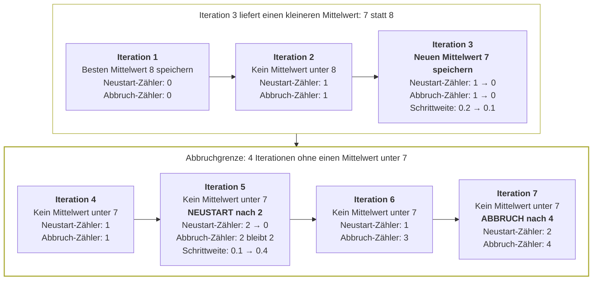

- **Ergebnis:** Zurückgegeben werden der beste gefundene Gewichtssatz
  (`best_weights`) und seine mittlere globale Bewertungszahl
  (`best_mean_global_cost`).
- **Ergebnisverlauf unterscheiden:** `optimize_iteratively().evaluations`
  enthält die erste beste Bewertung und spätere Verbesserungen. Die Oberfläche
  zeigt dagegen alle geprüften Kandidaten, nicht nur diese gespeicherten Verbesserungen.

<a id="5-gefundenen-gewichtssatz-mit-standardheuristik-und-zufall-vergleichen"></a>

### 6. Gefundenen Gewichtssatz mit Standardheuristik und Zufall vergleichen

Ziel des Abschlussvergleichs ist die Prüfung des gefundenen Gewichtssatzes
auf separaten Test-Seeds.

- **Test-Seeds:** Verwendet werden `TEST_SEEDS = [101, 102, 103, 104, 105]`.
- **Steuerungen:** Jede der folgenden drei Steuerungen wird einmal pro
  Test-Seed simuliert:

| Anzeige im Interface | Verwendete Steuerung |
| --- | --- |
| `Random` | [Zufällige Nicht-Warteaktion](#randompolicy-zufällige-vergleichssteuerung); Warten nur als Fallback. |
| `Heuristic (default)` | Die heuristische Steuerung mit dem Standardgewichtssatz `HeuristicWeights()`. |
| `Heuristic (optimized)` | Dieselbe heuristische Steuerung mit dem besten Gewichtssatz aus der Suche. |

- **Gleiche Bedingungen:** Alle drei Steuerungen verwenden dasselbe Layout,
  dasselbe Szenario, dieselben Test-Seeds sowie dieselben globalen Gewichte
  und Baseline-Referenzwerte.
- **Umfang:** Es entstehen 15 Testläufe, fünf pro Steuerung. Im parallelen
  Modus gehen alle gemeinsam an denselben Prozesspool; im direkten Modus
  laufen sie nacheinander. Der gefundene Gewichtssatz bleibt unverändert.
- **Auswertung:** Der Elternprozess ordnet die Ergebnisse Steuerung und Seed
  zu und berechnet globale Bewertungszahlen sowie Mittelwerte. Diagramme
  behalten die festgelegte Eingabereihenfolge, nicht die Fertigstellungsreihenfolge.
- **Tabelle lesen:** Das Interface zeigt je Steuerung die Mittelwerte der
  sieben bewerteten Produktionskennzahlen und der globalen Bewertungszahl.
- **Diagramme lesen:** Sie zeigen die Ergebnisse für jeden einzelnen Test-Seed.
- **Ergebnis beurteilen:** Der kleinere Mittelwert der globalen
  Bewertungszahl ist besser. Ob `Heuristic (optimized)` die anderen
  Steuerungen tatsächlich übertrifft, zeigt erst dieser Vergleich.
- **Aussagegrenze:** Die fünf Test-Seeds prüfen denselben Modellaufbau.
  Ein besserer Testmittelwert ist kein Nachweis eines globalen Optimums
  oder eines Vorteils auf beliebigen anderen Produktionsszenarien.

### Parallele Optimierung mit mehreren CPU-Prozessen

`SimulationRunner` führt einen Lauf in einem Prozess aus.
[ParallelSimulationRunner](sources/SpineML/SimulationExecution/ParallelSimulationRunner.py)
verteilt viele unabhängige Läufe auf wiederverwendete Spawn-Prozesse.
**Beschleunigt wird die Bearbeitung eines Stapels, nicht die einzelne Simulation.**

- **Prozessgrenze:** `MAX_WORKERS = min(os.cpu_count() or 1, 20)` begrenzt
  gleichzeitig arbeitende Worker. Der verwendete Intel Core i7-13700H hat
  14 physische Kerne und 20 logische Prozessoren. Windows verteilt die Prozesse;
  eine feste Bindung an einzelne Kerne wird nicht vorgenommen.
- **Wiederverwendung:** Jeder Worker lädt das Modell einmal. Für jeden
  Auftrag erstellt dessen Policy-Factory eine neue Policy; der Runner baut
  Bridge und Salabim-Umgebung neu auf.
- **Mehr Aufträge als Worker:** 53 Gewichtssätze mit zwei Seeds ergeben
  106 Laufaufträge. Ein freier Worker übernimmt den nächsten. Der Pool bleibt
  über Baseline, Suchiterationen und Testvergleich bestehen.
- **Abhängigkeiten:** Die Baseline muss vor der Suche fertig sein, jede
  Iteration vor der nächsten und die Suche vor dem Testvergleich.
  Globale Kosten, Mittelwerte und Auswahl berechnet der Elternprozess.
- **Zeitbegriffe trennen:** Simulierte Produktionszeiten stehen in Stunden;
  die reale Rechenzeit wird in Sekunden gemessen. Die Summe paralleler
  Einzelzeiten ist nicht die verstrichene Gesamtzeit. Unter hoher Last kann
  ein einzelner Lauf sogar länger dauern.

<a id="rechenzeit-eines-simulationslaufs-messen"></a>

#### Laufstapel mit verschiedenen Workerzahlen messen

[measure_simulation_runtime.py](sources/tools/measure_simulation_runtime.py) vergleicht
denselben Stapel vollständiger Standardheuristik-Läufe, keine Gewichtssuche:

```console
.\.venv\Scripts\python.exe sources/tools/measure_simulation_runtime.py --seeds 1 2 3 4 5 6 7 8 9 10 11 12 13 14 15 16 17 18 19 20 --workers 1 14 20 --output simulation_times.json
```

- **Messumfang:** Gesamtzeit je Batch einschließlich Poolstart, Modellladen,
  aller Läufe und Shutdown. Auch `--workers 1` verwendet einen Spawn-Pool;
  das ist nicht der frühere direkte sequenzielle Modus.
- **Gleiche Aufgaben:** Nur angeforderte Workerzahlen werden gemessen.
  Standard ohne Optionen sind fünf Seeds und ein Worker. `--repeats 2`
  wiederholt den Seed-Stapel zweimal innerhalb jedes Batches.
- **Ergebnisse prüfen:** Jede Produktionskennzahl jedes Inputs muss exakt
  mit der Referenz übereinstimmen: ein Worker, falls angefordert, sonst die
  erste angeforderte Workerzahl. Erst danach wird der Zeitvergleich ausgegeben.
- **Bericht:** `--output` speichert Kennzahlen, Einzelzeiten, PIDs, Batchzeiten,
  Speedups und den schnellsten gemessenen Modus als JSON. `--profile` ergänzt
  einen separaten direkten Profiling-Lauf außerhalb aller Batch-Timer.

<a id="gemessener-vergleich-für-example-5"></a>

#### Gemessener Vergleich für Example 5: 20 Läufe

Für denselben Stapel mit Seeds `1` bis `20` und Standardgewichtssatz wurden
auf diesem Rechner folgende historische Batchzeiten aufgezeichnet:

| Poolprozesse | Gesamtzeit inklusive Poolstart und -ende | Verhältnis gegenüber einem Poolprozess |
| --- | ---: | ---: |
| `1` | `211.6 s` | `1.00×` |
| `14` | `42.4 s` | `4.99×` |
| `20` | `39.2 s` | `5.40×` |

Beim damaligen Messlauf wurden die Produktionskennzahlen jedes Seed-Laufs
exakt verglichen und waren gleich. Der lokale Rohbericht wird nicht
mitveröffentlicht; die Tabelle dokumentiert die aufgezeichneten Messwerte.
Neue Ergebnisse lassen sich mit dem obigen Messbefehl erzeugen und prüfen.
In diesem historischen Stapel waren 20 Prozesse am schnellsten.
**Die `39.2 s` sind keine Zeit für die vollständige Optimierung.**

<a id="vollständige-optimierung-vorher-und-jetzt-vergleichen"></a>

#### Vollständige Optimierung: vorher und jetzt vergleichen

[compare_optimization_runtime.py](sources/tools/compare_optimization_runtime.py) führt
beide vollständigen Workflows in frischen Python-Koordinatorprozessen
nacheinander aus, standardmäßig zuerst sequenziell:

```console
.\.venv\Scripts\python.exe sources/tools/compare_optimization_runtime.py
```

- **Identische Einstellungen:** Beide Modi übernehmen das Modell und alle
  Parameter aus `heuristic_optimization_app.py`: Baseline, gesamte Gewichtssuche und den
  Testvergleich dreier Steuerungen. `sequential` nutzt den direkten Runner,
  `parallel` den Prozesspool.
- **Gesamtzeit:** Der Workflow-Timer beginnt beim Start des Hintergrundlaufs
  und endet nach dem Shutdown. Er enthält Vorbereitung, Modellladen, Baseline,
  alle Suchiterationen, Testvergleich und Poolbeendigung. Einzelne Laufzeiten
  dürfen damit nicht verwechselt werden.
- **Vergleich freigeben:** `optimization_timing_comparison.json` speichert
  vollständige Berichte und prüft Konfiguration, Quellstand, Ergebnisse und
  Laufzahl auf exakte Gleichheit. Nur bei Übereinstimmung wird ein Speedup
  ausgewiesen; fertige Teilberichte bleiben bei einem späteren Fehler erhalten.
- **Im Webinterface:** Einen Modus auswählen und **Start optimization** drücken,
  danach den anderen Modus mit unveränderten Einstellungen ausführen.
  Die Historientabelle zeigt Phasen- und Gesamtzeiten; der JSON-Download
  enthält die Berichte. Die Laufzeithistorie bleibt innerhalb der Streamlit-Sitzung erhalten.
- **Messbedingungen:** Keine weiteren Simulationen oder Optimierungen
  gleichzeitig starten. Zwei vollständige Workflows dauern länger als einer.
  Mit `--order parallel-first` lässt sich die CLI-Reihenfolge umkehren.

<a id="gemessene-gesamtzeit-der-vollständigen-optimierung"></a>

#### Gemeldete Gesamtzeit der vollständigen Optimierung

Für `example-5.py` wurden folgende Gesamtzeiten im Webinterface abgelesen
und vom Nutzer gemeldet. Sie betreffen den vollständigen Ablauf mit Baseline,
Gewichtssuche, Steuerungsvergleich und Shutdown, nicht den 20-Läufe-Test:

| Ausführungsart | Gesamtzeit | Ungefähr in Minuten |
| --- | ---: | ---: |
| `Sequential (previous execution)` – ohne Prozesspool | `4291.7 s` | `71.5 min` |
| `Parallel (process pool)` – bis zu 20 Prozesse | `1399.5 s` | `23.3 min` |

Das Verhältnis der abgelesenen Zeiten ist
`4291.7 / 1399.5 ≈ 3.07`. Die Differenz beträgt `2892.2 s`, etwa
`48.2 Minuten` beziehungsweise `67.4 %`.

Für diese beiden gemeldeten Läufe liegt kein exportierter Rohbericht vor.
Ihre identischen Aufgaben und Ergebnisse wurden daher nicht zusätzlich
anhand der Rohdaten geprüft. Neue Läufe können mit dem obigen Vergleich
reproduzierbar dokumentiert und auf Gleichheit geprüft werden.

**Aussagegrenze beider Tabellen:** Die Werte sind keine allgemeine
Beschleunigungsgarantie oder statistische Untersuchung mit ausgewiesener
Messstreuung. Hardwarelast, Modell, Steuerung und Arbeitsumfang beeinflussen
die Rechenzeit. Der Zeitvorteil des 20-Läufe-Stapels darf nicht auf eine
vollständige Optimierung hochgerechnet werden.
