# SpineML

SpineML simuliert eine Fabrik mit Aufträgen, Werkstücken, Maschinen,
Werkzeugen, Lagern und Robotern. Salabim bildet die zeitlichen Abläufe ab.
Eine Policy (Steuerung) entscheidet, welche der aktuell möglichen Aktionen
ausgeführt werden. Die Optimierung sucht anhand vollständiger Simulationsläufe
nach geeigneten Gewichten für die heuristische Aktionsbewertung.

Diese README beschreibt den Stand des Zweigs `Foroogh`. Konfiguration und
Simulationskern sind nach den zugehörigen Klassen gegliedert. Danach folgen
Bridge, Steuerung, Bewertung und Optimierung.

## Inhalt

- [Installation und Start](#installation-und-start)
- [Fabrikkonfiguration](#fabrikkonfiguration)
- [Diskrete Simulation](#diskrete-simulation)
- [SimulationBridge](#simulationbridge)
- [GeneralControl](#generalcontrol)
- [HeuristicControl](#heuristiccontrol)
- [Optimierungsvorgang](#optimierungsvorgang)
- [Optimierung starten und Ergebnisse lesen](#optimierung-starten)

## Installation und Start

### Installation

Voraussetzung ist Python ab Version `3.10`. Das Projekt wird im Ordner
installiert, in dem `pyproject.toml` liegt. Beispiel für PowerShell:

```powershell
git clone --branch Foroogh --single-branch https://github.com/ghackenberg/SpineML.git
cd SpineML
python -m venv .venv
.\.venv\Scripts\Activate.ps1
python -m pip install -e .
```

`pip install -e .` installiert das Projekt und die in
[pyproject.toml](pyproject.toml) angegebenen Abhängigkeiten. Das
abschließende `.` bezeichnet den aktuellen Projektordner. Eine zusätzliche
Installation von [sources/requirements.txt](sources/requirements.txt) ist für
diesen Weg nicht erforderlich.

In VS Code wird die Python-Umgebung `.venv` als Interpreter ausgewählt.
Die folgenden Befehle werden aus dem Projektordner ausgeführt.

### Normale Simulation

```powershell
python sources/examples/normal/example-0.py
```

Die Beispieldatei definiert Fabrik und Aufträge und startet
`simulate(layout, scenario, ...)`. Bei aktivierter Animation wird die
Simulation mit Salabim dargestellt; danach werden Statistiken ausgegeben.

### Optimierung mit Webinterface

```powershell
python -m streamlit run sources/optimization.py
```

Im Browser startet **Start optimization** den Vergleich verschiedener
Gewichtssätze. Ohne andere Modellvorgabe wird `example-1.py` verwendet.
Die Modellwahl und die Ergebnisdiagramme sind unter
[Optimierung starten](#optimierung-starten) erklärt.

## Fabrikkonfiguration

Die Konfiguration beschreibt, welche Produkttypen, Operationen, Werkzeuge,
Maschinen und Aufträge zur Fabrik gehören. Die Klassen liegen unter
[sources/SpineML/Configuration](sources/SpineML/Configuration).

### `Layout.py`

`Layout` beschreibt die Fabrik und enthält ihre Korridore. Die Werte
`storage_out_time` und `storage_in_time` legen die Aus- und Einlagerungszeiten
am Start- beziehungsweise Endlager fest. `storage_capacity` bestimmt, wie viele
Jobs (einzelne Werkstücke) jedes dieser Lager aufnehmen kann. Bei
`storage_capacity=10` haben Start- und Endlager jeweils zehn Plätze.

### `Machine.py`

`Machine` beschreibt eine konkrete Maschine mit Namen, `MachineType`,
Korridor und Position auf der linken oder rechten Korridorseite. Der
`MachineType` fasst die möglichen Operationen einer Maschinenklasse zusammen.

#### Getrennte Maschinenpuffer

`input_storage_capacity` und `output_storage_capacity` legen die Kapazität
des Eingangs- beziehungsweise Ausgangspuffers fest. Die beiden Puffer können
unterschiedlich viele Jobs aufnehmen.

#### Erlaubte Werkzeugtypen

`tool_types` legt fest, welche Werkzeugtypen die konkrete Maschine verwenden
darf. Zwei Maschinen desselben `MachineType` können dadurch unterschiedlich
ausgestattet sein. Beispiel mit bereits definierten Typen und einem Korridor:

```python
Machine(
    "CNC A", cnc_type, corridor, True, 10, 10,
    tool_types=[turning_tool, milling_tool],
)
Machine(
    "CNC B", cnc_type, corridor, False, 10, 10,
    tool_types=[milling_tool],
)
```

Wird `tool_types` nicht angegeben, ermittelt
`MachineType.computeToolTypes()` die Werkzeugtypen aus den Operationen des
Maschinentyps. Eine explizite Liste erlaubt dagegen eine Ausstattung pro
Maschine. Eine Operation kann nur zugeordnet werden, wenn Maschinentyp und
benötigter Werkzeugtyp passen. Deshalb muss eine Maschine nicht automatisch
alle Operationen ihres Maschinentyps ausführen können.

Die Liste beschreibt erlaubte Werkzeugtypen, keine Stückzahlen einzelner
Werkzeuge oder Anzahl freier Magazinplätze. Jede `OperationType` benötigt
weiterhin den in ihr festgelegten Werkzeugtyp.

#### Verarbeitungsgeschwindigkeit

`processing_speed_factor` beschreibt die Verarbeitungsgeschwindigkeit der
Maschine und beeinflusst die Verarbeitungsdauer des Jobs bei der Ausführung
seiner Operation. In `Machine` wird das Attribut mit `1.0` initialisiert.

#### Schutzwerkzeugzeiten

Das Schutzwerkzeug (`dummy_tool`) beschreibt einen eigenen Werkzeugzustand der
Maschine. Zu Beginn ist es montiert, während noch kein Produktionswerkzeug
eingesetzt ist. Für die erste werkzeugpflichtige Verarbeitung wird es entfernt
und das Produktionswerkzeug montiert.

Jede `Machine` besitzt die Attribute `dummy_tool_mount_time=1.0` und
`dummy_tool_unmount_time=1.0`. Sie legen die Montage- und Demontagezeit des
Schutzwerkzeugs fest und sind keine Argumente des Konstruktors.

Der getrennte Abschlussprozess `SimMachineShutdown` kann später wieder das
Schutzwerkzeug montieren. Wann er tatsächlich ausgeführt wird, ist im
[Abschnitt zum Simulationskern](#diskrete-simulation) beschrieben.

### Szenarien und Aufträge

Ein `Scenario` enthält mehrere `Order`-Objekte (Aufträge). Ein Auftrag legt
einen Zielprodukttyp, die Menge und seine Zeitvorgaben fest:

- `quantity`: Anzahl der zu erzeugenden Jobs.
- `product_type`: Zielprodukttyp für alle Jobs dieses Auftrags.
- `earliest_start_time`: frühester Freigabezeitpunkt.
- `latest_end_time`: Deadline dieses Auftrags; sie gilt für alle zugehörigen
  Jobs und nicht für das gesamte Szenario.

Ein Auftrag bestellt einen Produkttyp in einer bestimmten Menge. Mehrere
Aufträge können denselben Produkttyp bestellen und unterschiedliche Deadlines
haben.

## Diskrete Simulation

Der Simulationskern unter [sources/SpineML/Simulation](sources/SpineML/Simulation)
bildet die zeitlichen Abläufe mit Salabim ab. Jobs, Maschinen und Roboter sind
Simulationskomponenten (Objekte mit einem eigenen zeitlichen Prozess). Sie
melden Zustände an die `SimulationBridge`, empfangen ausgewählte Aktionen und
führen sie aus.

### `SimLayout.py`

`SimLayout` bildet ein konfiguriertes `Layout` als Simulationslayout ab. Ein
Store ist dabei ein Salabim-Puffer, der Jobs aufnimmt. Beim Aufbau gilt:

- Start- und Endlager verwenden `layout.storage_capacity`.
- Jeder Korridor erhält drei Stores mit `corridor.storage_capacity`.
- Das maximale Produktgewicht und -volumen werden aus den Aufträgen ermittelt
  und an die Maschinen für die Laufzeitberechnung weitergegeben.
- `SimLayout` reicht die `SimulationBridge` an die Laufzeitkomponenten weiter.
  Die jeweiligen Komponenten registrieren sich beim Erzeugen selbst: Der
  Main-Roboter, jeder Korridorroboter, jede Maschine und jeder Job registrieren
  ihre eigene ID. Komponenten registrieren außerdem – soweit vorhanden – die
  Stores, die sie selbst besitzen oder verwalten.

### `SimCorridor.py` und `SimCorridorArm.py`

`SimCorridor` erzeugt die drei Korridor-Stores, registriert den Korridor
zusammen mit diesen Stores bei der `SimulationBridge` und erzeugt den linken
und rechten Korridorarm. `SimCorridorArm` erzeugt die zugehörigen
`SimMachine`-Komponenten und den Korridorroboter. Die Werte
`max_product_weight` und `max_product_volume` werden von `SimLayout` aus dem
Szenario ermittelt und an jede Maschine weitergegeben.

Maschinen und Roboter registrieren sich selbst bei der `SimulationBridge`.
Jede Maschine registriert dabei auch ihren Eingangs- und Ausgangspuffer.

### `SimOrder.py` und `SimOrderJob.py`

`SimOrder` erzeugt für jedes einzelne bestellte Produktstück eine eigene
`SimOrderJob`-Komponente. Ein `SimOrderJob` beschreibt deshalb genau ein
Werkstück.

Die Steuerung entscheidet über die `SimulationBridge`, welche Operation auf
welcher Maschine ausgeführt wird. Der Job speichert diese Auswahl und seinen
aktuellen Zustand.

Über Aktionen kann die Steuerung den Job freigeben oder warten lassen,
Nacharbeit auf einer Maschine oder einer alternativen Maschine anfordern, den
Job herabstufen, ihn als Ausschuss markieren oder ihn abschließen. Dafür werden
unter anderem die Aktionen `release_job`, `wait_job`,
`job_rework_on_defect_machine`, `job_rework_on_alternative_machine`,
`downgrade_product`, `job_scrap` und `complete_job` verwendet.

### Laufzeitstatus eines `SimOrderJob`

`SimOrderJob` speichert den Zustand eines einzelnen Werkstücks. Die
Steuerung liefert Entscheidungen im Aktions-Payload (den zusätzlichen Daten
einer Aktion); Maschinen und Roboter aktualisieren die Ergebnisse ihrer
Ausführung direkt am Job.

#### Freigabe, Standort und Abschluss

- `released`: Freigabe für die Produktion, anfangs `False`. Die Aktion
  `release_job` übergibt den Wert und legt den Job im Startlager ab.
- `queue_priority`: Prioritätswert, den der Evaluator vor einem Pick aus der
  aktuellen Deadline berechnet. Roboter und Maschine übernehmen ihn aus dem
  Payload und verwenden ihn beim Ablegen in Stores. Welcher Job gepickt wird,
  entscheidet die Policy anhand der Kandidatenscores.
- `location`: Standort des Jobs, zum Beispiel Store oder beladener Roboter.
  Die ausführende Komponente aktualisiert ihn nach dem Transport.
- `completed_time`: Zeitpunkt, den `SimRobotMain` mit `mark_finished()` auf
  dem Weg ins Endlager speichert. Im aktuellen Code erfolgt dies vor der
  abschließenden Einlagerungszeit und dem eigentlichen Ablegen im Endlager.
  Dieser Zeitpunkt wird für Terminstatus und Makespan verwendet.
- `due_state`: Terminstatus `"on-time"` oder `"late"`; anfangs `None`.
  `create_completion_actions_for_job()` vergleicht `completed_time` mit der
  `latest_end_time` des Auftrags und übergibt den Status mit `complete_job`.
- `process_finished`: Wird durch `finish_process=True` auf `True` gesetzt.
  Der Job beendet seine Prozessschleife; der `SimCompletionWatcher` verwendet
  dieses Flag zur Erkennung des Simulationsendes.

#### Produktzustand und nächste Verarbeitung

- `processing_state`: Aktueller Produktzustand als Name eines Produkttyps.
  Anfangs steht hier `"unconfigured"`. Bei der Freigabe setzt die Steuerung
  den Startprodukttyp; nach erfolgreicher Verarbeitung setzt `SimMachine`
  den von der Operation erzeugten Produkttyp.
- `selected_operation`: Von der Steuerung ausgewählte nächste Operation.
- `selected_machine`: Für diese Operation ausgewählte konkrete `Machine`.
  Diese Auswahl bestimmt auch das Transportziel. Nach der Verarbeitung setzt
  `SimMachine` beide Auswahlfelder auf `None`.

#### Qualität und Herabstufung

- `general_state`: Qualitätsstatus `"intact"`, `"defect"` oder `"scrap"`.
  `mark_defective()` setzt ihn auf `"defect"`. Ein intaktes
  Verarbeitungsergebnis setzt ihn auf `"intact"`; eine Ausschussaktion
  setzt ihn auf `"scrap"`.
- `downgraded`: Zusätzliche Qualitätsmarkierung, anfangs `False`. Bei
  `downgrade_product` wird sie auf `True` gesetzt. Der Job erhält keine
  weitere normale Produktionsroute und wird zum Endlager transportiert.
- `downgrade_product_type`: Produkttyp für den herabgestuften Job. Verwendet
  wird der Produkttyp, den die letzte fehlerhafte Operation erzeugen sollte.
  Das kann ein Zwischenprodukt sein und muss nicht das Auftragsziel sein.

Beispiel: Eine Polieroperation liefert ein qualitativ unzureichendes Ergebnis.
Bei Herabstufung wird der Job als „poliert“ gespeichert und zusätzlich mit
`downgraded=True` markiert. Sein `general_state` lautet danach `"intact"`;
die geringere Qualität bleibt durch `downgraded` erkennbar.

#### Defektdaten und Nacharbeit

Bei einem relevanten Defekt ruft `SimMachine` die Methode
`job.mark_defective()` auf. Diese speichert:

- `defect_detected_time`: Simulationszeit der Defekterkennung.
- `defect_operation` und `defect_machine`: verursachende Operation und Maschine.
- `defect_product_state_before`: Produkttyp vor der fehlerhaften Operation.
- `defect_product_state_target`: Produkttyp, den diese Operation erzeugen
  sollte; nicht automatisch das endgültige Auftragsziel.
- `defect_severity`: Schweregrad des Defekts. Ab `0.001` wird ein Defekt
  erfasst; im Bereich `0.001 <= defect_severity < 0.6` kann die Steuerung
  Nacharbeit oder Herabstufung anbieten. Ab `0.6` erzeugt sie nur Ausschuss.

Im Defektfall bleibt `processing_state` zunächst beim Zustand vor der
Operation. Eine Nacharbeitsaktion setzt ihn auf
`defect_product_state_before`; eine Herabstufungsaktion setzt ihn auf
`defect_product_state_target`.

Weitere Felder steuern die Defektbehandlung:

- `defect_recovery_strategy`: Gewählte Strategie, etwa
  `"rework_on_defect_machine"`, `"rework_on_alternative_machine"`,
  `"downgrade"` oder `"scrap"`. Bei einem neuen Defekt wird die alte
  Strategie gelöscht.
- `recovery_in_progress`: Während Transport und Ausführung einer gewählten
  Nacharbeit `True`. `SimMachine` setzt es nach dieser Operation auf
  `False`, auch wenn erneut ein Defekt entsteht.
- `defect_count`: Anzahl der bei diesem Job erkannten Defekte.
- `rework_count`: Anzahl gestarteter Nacharbeiten. Der Wert geht auch in den
  Schlüssel für reproduzierbare Qualitätsentscheidungen ein.
- `scrap_count`: Anzahl der Ausschussentscheidungen; im regulären Ablauf
  höchstens eine pro Job.

#### UML-Zustandsdiagramm eines Jobs

Das Diagramm zeigt den fachlichen Ablauf eines Werkstücks. Bezeichnungen wie
`processing` und `completed` fassen mehrere Codefelder zusammen und sind
keine zusätzlichen Werte von `processing_state`. Die Produktnamen hängen vom
jeweiligen Modell ab.

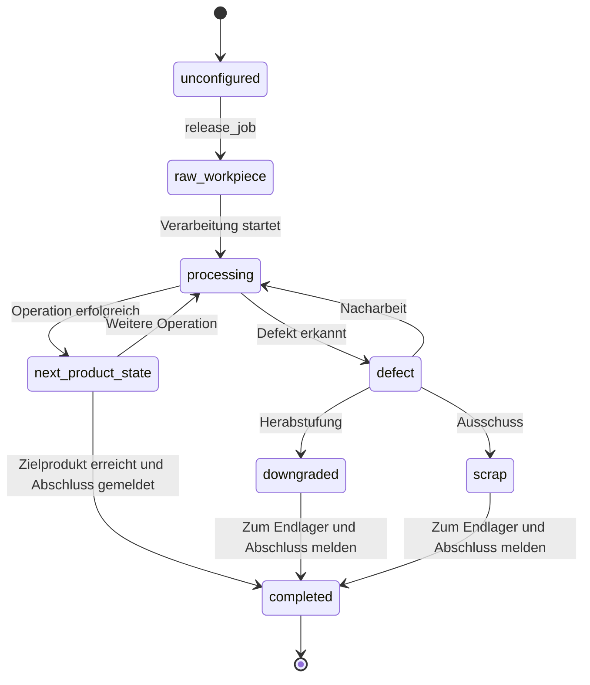

`downgraded` ist als eigener Ablaufzustand sichtbar. Im Code wird die
Herabstufung durch `downgraded=True` und den übernommenen Produktzustand
gespeichert.

### `SimRobot.py`, `SimRobotMain.py` und `SimRobotCorridorArm.py`

`SimRobot` stellt die gemeinsame Bewegungslogik für X, Y und Z bereit. Die
Unterklassen `SimRobotMain` und `SimRobotCorridorArm` führen die von der
Steuerung ausgewählten Pick- und Place-Aktionen aus (Job aufnehmen und
ablegen) und melden ihre Lade- und Bewegungszustände.

#### Aktionen und Bewegung

- **Aktionen der Steuerung:**
  - Main-Roboter: `pick_main_robot`, `place_main_robot`, `wait_main_robot`.
  - Korridorarm: `pick_corridor_arm_robot`, `place_corridor_arm_robot`,
    `wait_corridor_arm_robot`.
- **Simulationskern:** Führt den Transport des im Payload ausgewählten Jobs
  aus. Die Roboter wählen keinen Ersatzjob und keine neue Route. Die feste
  Grundgeschwindigkeit wird in `SimRobotMain.py` auf `2.0` und in
  `SimRobotCorridorArm.py` auf `1.5` gesetzt.
- **Seed/Reproduzierbarkeit:** `SimRobot.py` erzeugt bei jedem Aufruf von
  `move_x`, `move_y` oder `move_z` einen neuen Faktor zwischen `0.95` und
  `1.05`. Die effektive Geschwindigkeit berechnet sich als
  `Grundgeschwindigkeit × Zufallsfaktor`. Dadurch sind die
  Geschwindigkeitsschwankungen und die Bewegungsdauer für X, Y und Z bei
  gleicher Konfiguration und gleichem Seed im `SpineMLSimulationRunner`
  reproduzierbar.
- **Zustandsmeldung:** Nach Pick und Place werden Jobstandort, Beladung und
  Roboterzustand über die Bridge gemeldet. Beim Ablegen im Endlager wird
  außerdem `completed_time` gesetzt.

### `SimMachine.py`

`SimMachine` simuliert genau eine konfigurierte `Machine`. Die Steuerung
bestimmt Job, Operation, Maschine und Werkzeug; `SimMachine` führt die
ausgewählte Aktion aus. Dabei berücksichtigt sie Pufferkapazitäten,
Werkzeugwechsel, Werkzeuglebensdauer, Verarbeitungsdauer und Qualität.

#### Aufbau und Laufzeitdaten

- `self.machine` verweist auf die Fabrikkonfiguration der Maschine.
- `store_in` und `store_out` sind getrennte Eingangs- und Ausgangspuffer mit
  den konfigurierten Kapazitäten.
- `max_product_weight` und `max_product_volume` sind die größten Werte aller
  Produkte im Szenario. Sie werden für die Größenanpassung der
  Verarbeitungsdauer verwendet.
- `self.tool_types` ist eine eigene Kopie der Werkzeugliste der konkreten
  `Machine`. Dadurch kann die Simulation ihre Laufzeitliste unabhängig von der
  Fabrikkonfiguration verwalten. Für jeden Werkzeugtyp verwaltet
  `SimMachine` vier Werte:
  `remaining_life_units` ist der aktuelle Restwert,
  `remaining_life_units_t` dessen gültiger Simulationszeitpunkt,
  `remaining_life_units_next` der erwartete Restwert nach der laufenden
  Operation und `remaining_life_units_next_t` der Zeitpunkt, an dem dieser
  erwartete Wert erreicht wird.
- Zu Beginn gilt `self.dummy_tool_mounted = True`, während
  `self.tool_type = None` und `self.current_job = None` sind. Das bedeutet:
  Das Schutzwerkzeug ist montiert, aber noch kein Produktionswerkzeug und kein
  Job geladen.
- `self.processing_speed_factor` entsteht aus dem Basiswert `1.0` und einem
  einmaligen Zufallsfaktor zwischen `0.45` und `2.0`. `self.processing_variation`
  wird einmalig zufällig zwischen `0.90` und `1.10` erzeugt und multipliziert
  später die Verarbeitungsdauer. `self.startup_delay` wird einmalig zwischen
  `0` und `4` Zeiteinheiten erzeugt und nur vor der ersten Verarbeitung
  angewendet; `_startup_delay_applied` verhindert eine Wiederholung bei
  weiteren Jobs.

#### Prozess und Aktionen

Der Prozess läuft wiederholt ab:

1. Ist der Ausgangspuffer voll, setzt die Maschine den Zustand `blocked`,
   sonst `waiting`.
2. Die Maschine meldet ihren Zustand mit `bridge.request_action(self)` und
   wartet auf die von der Steuerung gelieferte Aktion.
3. Bei `pick_machine_job` nimmt sie genau den im Payload genannten Job aus dem
   genannten Store. Sie aktualisiert dessen `location`, übernimmt die
   `queue_priority` und speichert den Job in `self.current_job`.
4. Bei `process_machine_job` führt sie genau die übergebene Operation mit dem
   übergebenen Werkzeug aus.
5. Bei `wait_machine` wartet sie eine Simulationszeiteinheit und fordert
   anschließend eine neue Aktion an.

Die Maschine wählt weder selbst einen Job noch eine Operation oder ein
Werkzeug. Fehlt der ausgewählte Job im angegebenen Store, wird die Pick-Aktion
ohne Verarbeitung beendet.

#### Werkzeugwechsel und Lebensdauer

Die `process_machine_job`-Payload enthält unter anderem `operation`,
`tool_type`, `total_life_units`, `consumed_life_units`,
`remaining_life_units_before_operation`, `tool_setup_action` und
`target_store`.

Die Lebensdauer- und Zielwerte bedeuten:

- `total_life_units`: vollständige Lebensdauer des verwendeten Werkzeugs.
- `consumed_life_units`: Lebensdauer, die die aktuelle Operation verbraucht.
- `remaining_life_units_before_operation`: verbleibende Lebensdauer vor Beginn
  der Operation.
- `tool_setup_action`: Anweisung, ob das Werkzeug beibehalten, montiert,
  demontiert oder ersetzt wird.
- `target_store`: Ausgangspuffer, in den die Maschine den Job nach der
  Verarbeitung ablegt.

Je nach `tool_setup_action` führt die Maschine folgende Schritte aus:

- `keep_tool`: Das aktuelle Werkzeug bleibt montiert.
- `unmount_dummy_tool_and_mount_tool`: Das Schutzwerkzeug wird entfernt und
  das Produktionswerkzeug montiert.
- `unmount_and_mount_tool`: Das bisherige Produktionswerkzeug wird entfernt
  und das neue Werkzeug montiert.
- `replace_tool_same_type`: Das verbrauchte Werkzeug wird entfernt und durch
  ein Werkzeug desselben Typs ersetzt.

Wenn die verbleibende Lebensdauer für den Verbrauch der Operation nicht
ausreicht, wird beim Werkzeugwechsel ein neues Werkzeug mit
`total_life_units` angenommen. Nach der Operation wird die Lebensdauer um
`consumed_life_units` reduziert. Während der Verarbeitung wird der erwartete
Restwert anhand der geplanten Dauer geführt. Nach dem Abschluss wird er auf den
tatsächlichen Restwert gesetzt.

#### Verarbeitungsdauer

Die Größenberechnung verwendet den Zielprodukttyp des Auftrags
(`job.order.product_type`). `SimLayout` ermittelt die maximalen Gewichte und
Volumina aus diesen Produkttypen aller Aufträge. Das größte Gewicht und das
größte Volumen können zu unterschiedlichen Produkttypen gehören.

Zuerst werden relative Größenwerte gebildet:

```python
weight_ratio = product.weight / max_product_weight
volume_ratio = product_volume / max_product_volume
size_factor = 1.0 + 0.5 * weight_ratio + 0.5 * volume_ratio
```

Bei positiven Produktgrößen liegen die Verhältnisse zwischen `0` und `1`;
damit liegt `size_factor` zwischen `1.0` und `2.0`.
Die endgültige Dauer wird danach so berechnet:

```python
duration = operation.duration * size_factor / processing_speed_factor
duration *= processing_variation
```

Damit beeinflussen die Operationsdauer, die Produktgröße, die
Maschinengeschwindigkeit und eine kleine zufällige Laufzeitabweichung die
Verarbeitungsdauer.

#### Defektprüfung und Recovery

Nach Ablauf der Verarbeitungsdauer erzeugt die Maschine einen deterministischen
Qualitätszufallszahlengenerator. Sein Schlüssel enthält den Simulations-Seed,
das Szenario, den Auftrag, den Job, die Operation und den `rework_count`.
Die erste Zufallszahl wird mit `operation.defect_probability` verglichen. Nur
bei einem Defekt wird eine zweite Zufallszahl als `defect_severity` erzeugt.

```python
defect = quality_rng.random() < operation.defect_probability
defect_severity = quality_rng.random() if defect else None
```

Bei gleichem Seed und gleichem Kontext entstehen dadurch dieselbe
Defektentscheidung und derselbe Schweregrad. Ein relevanter Defekt ab
`0.001` wird mit `job.mark_defective()` gespeichert. Dabei werden Operation,
Maschine, Produktzustand vor der Operation, Zielzustand und Schweregrad im Job
festgehalten. Der bisherige `processing_state` bleibt im Defektfall erhalten.
Ohne relevanten Defekt setzt die Maschine `processing_state` auf den von der
Operation erzeugten Produkttyp und `general_state` auf `"intact"`.

Nach abgeschlossener Nacharbeit wird
`recovery_in_progress` zurückgesetzt. Die alte Auswahl von Operation und
Maschine wird gelöscht, damit die Steuerung die nächste Aktion neu bestimmen
kann. Die Auswahl der Recovery-Strategie selbst kommt aus der Steuerung; die
Simulation speichert sie nur und entfernt eine erledigte Rework-Strategie.

#### Seed und Reproduzierbarkeit

Ein Seed ist der Startwert eines Zufallszahlengenerators. Der
`SpineMLSimulationRunner` setzt vor jedem Lauf `random.seed(seed)`,
`sim.Environment(random_seed=seed)` und `SimMachine.QUALITY_SEED`.

Bei gleicher Konfiguration, gleichem Seed und demselben Entscheidungsablauf
sind dadurch folgende Zufallswerte reproduzierbar:

- `SimMachine.processing_speed_factor`: Basiswert der `Machine` multipliziert
  mit einem einmaligen Zufallsfaktor aus `0.45` bis `2.0`.
- `SimMachine.processing_variation`: Einmaliger Faktor aus `0.90` bis
  `1.10`, der die Verarbeitungsdauer multipliziert.
- `SimMachine.startup_delay`: Einmalige Anlaufverzögerung aus `0` bis `4`
  Zeiteinheiten.
- `SimRobot.movement_speed_multiplier`: Neuer Faktor für jede Achsenbewegung.
- Zufallsauswahl und Exploration des `BaselineActionSelector`.

Die Qualitätsprüfung verwendet einen eigenen `quality_rng`, dessen Startwert
aus `QUALITY_SEED`, Szenario, Auftrag, Jobnummer, Operation und
`rework_count` abgeleitet wird. Bei gleichem Schlüssel bleiben Defektentscheidung
und `defect_severity` gleich, auch wenn der Job auf einer anderen Maschine
verarbeitet wird. Eine andere Operation oder Nacharbeitsrunde ändert den
Schlüssel.

Der normale Aufruf `simulate(...)` besitzt derzeit kein `seed`-Argument.
Die hier beschriebene gemeinsame Seed-Vorgabe übernimmt der Runner für die
Optimierung.

#### Abschluss der Verarbeitung und Zustände

Nach der Verarbeitung wird der Job mit seiner Priorität in den im Payload
genannten Zielstore gelegt und seine `location` wird aktualisiert. Danach wird
`current_job` auf `None` gesetzt; die Maschine ist wieder frei und meldet ihren
neuen Zustand mit der nächsten `request_action()`-Anfrage.

Die wichtigsten Maschinenzustände sind:

- `waiting`: Die Maschine wartet auf eine Aktion.
- `blocked`: Der Ausgangspuffer kann keinen fertigen Job aufnehmen.
- `unmounting`: Ein Schutz- oder Produktionswerkzeug wird entfernt.
- `mounting`: Ein Produktions- oder Schutzwerkzeug wird montiert.
- `working`: Die Operation wird ausgeführt.
- `returning`: Die Verarbeitung ist beendet und der Job wird abgelegt.

`SimMachineShutdown` kann als eigene, einmalige Salabim-Komponente das
Produktionswerkzeug entfernen und wieder das Schutzwerkzeug montieren. Die
eigene Komponente trennt diesen einmaligen Ablauf von der wiederholten
Jobverarbeitung in der `while`-Schleife von `SimMachine`.

Im aktuellen `SpineMLSimulationRunner` wird der Abschlussprozess nicht
gestartet. Auch `simulate()` überspringt ihn, wenn der
`SimCompletionWatcher` den Lauf beendet hat. Die Klasse allein bewirkt daher
keinen automatischen Werkzeugwechsel am Ende jedes Laufs.

Die globale Kennzahl `tool_change_time` addiert tatsächlich ausgeführte
Montage- und Demontagezeiten. Der Makespan verwendet die gespeicherten
Jobabschlusszeiten; ein separat ausgeführter Werkzeugabschluss verlängert
diese nicht.

#### UML-Zustandsdiagramm von `SimMachine`

Das Diagramm zeigt die Zustände der Maschine während eines normalen
Simulationslaufs. Die Jobauswahl erfolgt weiterhin durch die Steuerung über
die `SimulationBridge`.

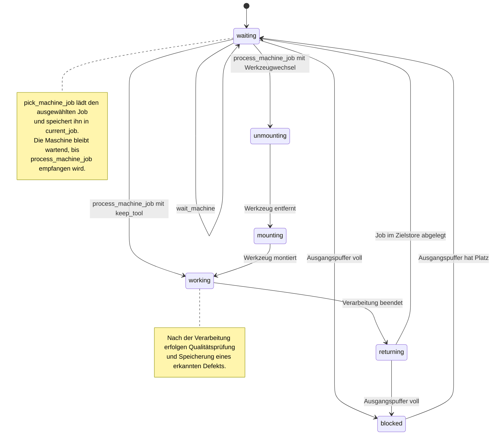

### `SimScenario.py` und `SimCompletionWatcher`

`SimScenario` erzeugt für jeden Auftrag eine `SimOrder`-Komponente.
`SimOrder` erzeugt die einzelnen `SimOrderJob`-Komponenten und reicht die
`SimulationBridge` an sie weiter. Die Jobs registrieren sich selbst bei der
Bridge; `SimOrder` benötigt keine eigenen Steuerungsaktionen.

Zusätzlich erzeugt `SimScenario` den unabhängigen `SimCompletionWatcher`,
der das Ende der Jobprozesse überwacht.

#### Automatisches Simulationsende

`SimScenario` erstellt beim Aufbau des Szenarios den
`SimCompletionWatcher`. Der Watcher ist eine Salabim-`sim.Component`; seine
`process()`-Methode läuft als Simulationsprozess. Sie sammelt einmalig alle
Jobs aus den erzeugten Aufträgen und prüft regelmäßig, ob jeder Job das Flag
`process_finished=True` besitzt. Das Flag wird durch eine Abschlussaktion mit
`finish_process=True` gesetzt. Sobald alle Jobs abgeschlossen sind, löst der
Watcher `sim.SimulationStopped` aus. Der Simulationsrunner fängt dieses Signal
ab und sammelt anschließend die globalen Kennzahlen.

## SimulationBridge

Die `SimulationBridge` verbindet den Simulationskern mit der Policy. Die
Simulation verwendet echte Python- und Salabim-Objekte; die Policy erhält
deren Daten und IDs (eindeutige Bezeichnungen innerhalb des jeweiligen
Registers).

### Registrierung und Aktions-Stores

Jobs, Maschinen, Main-Roboter und Korridorarm-Roboter registrieren sich mit
`register()`. Die Bridge speichert ihre IDs und erzeugt für jedes dieser
Objekte einen eigenen Aktions-Store (Warteschlange für ausgewählte Aktionen).

Korridore werden mit `register_corridor()` und ihre Stores mit
`register_store()` für die ID-Auflösung registriert. Sie erhalten keine
eigenen Steuerungsaktionen. `SimLayout`, `SimCorridorArm`, `SimOrder`,
`SimScenario` und `SimCompletionWatcher` benötigen ebenfalls keinen eigenen
Aktions-Store.

### Warum die Policy IDs verwendet

Eine ID beschreibt, auf welches Objekt sich eine Aktion bezieht, ohne das
Objekt selbst an die Policy zu übergeben. Dadurch bleibt die Policy von den
Salabim-Komponenten getrennt und ihre Daten lassen sich einfacher speichern
oder übertragen.

Konfigurations- und Simulationsobjekte werden dabei getrennt aufgelöst:

- `selected_machine_id: "CNC A"` wird im Maschinenregister zur konfigurierten
  `Machine` mit dem Namen `"CNC A"`.
- Die Ziel-ID `"SimMachine:CNC A:left"` bezeichnet dagegen die ausführende
  `SimMachine`-Komponente.
- `target_store_id: "CNC A in"` bezeichnet den echten Salabim-Eingangspuffer
  dieser Maschine.

Die Zuordnungen stehen in `policy_payload_id_mappings()` in
`InterfaceTypes.py`. `create_simulation_actions()` ersetzt die ID-Felder
des Policy-Payloads durch die zugehörigen Objektfelder, zum Beispiel
`selected_machine_id` durch `selected_machine`.

### Zustände melden und Aktionen empfangen

Ein aktionsfähiges Objekt durchläuft wiederholt diese Schritte:

1. `yield bridge.request_action(self)` markiert es als wartend und meldet eine
   Zustandsänderung.
2. `action = yield bridge.action(self)` entnimmt die ausgewählte Aktion aus
   seinem Aktions-Store.
3. Das Objekt führt die Aktion aus und aktualisiert seine Daten.
4. Für seine nächste Entscheidung fordert es erneut eine Aktion an.

`request_action()` ruft intern `notify_state_change()` auf. Diese Methode
erhöht die gemeldete Zustandsversion und legt einen `PolicyTrigger` mit
Sender-ID, Ereignis-ID, Simulationszeit und Versionsnummer in den zentralen
`policy_trigger_store`. Andere Komponenten können auch nur eine
Zustandsänderung melden, ohne gleichzeitig eine neue Aktion anzufordern.

Bei `SimMachine` übernimmt nach dem Ablegen des Jobs die nächste
`request_action()`-Anfrage die Meldung. Roboter und Jobs verwenden zusätzlich
`notify_state_change()` an den im Code vorgesehenen Übergängen.

### Snapshot und Aktualitätsprüfung

Die Bridge sammelt bereits eingegangene Trigger derselben Simulationszeit,
damit sie diese gemeinsam in einer Entscheidung berücksichtigen kann.
`create_policy_observation()` erstellt dafür einen Snapshot (Datenabbild
des aktuellen Zustands) mit:

- `time` und `state_version`: Simulationszeit und gemeldete Zustandsversion.
- `simulation_object_states_by_id`: Zustände der registrierten Jobs,
  Maschinen und Roboter. Dazu gehören auch Daten ihrer Stores und enthaltenen
  Jobs sowie die Markierung `is_waiting_for_action`.
- `configuration_model`: ID-basierte Daten zu Layouts, Korridoren, Maschinen,
  Operationen, Produkt- und Werkzeugtypen. Dieses Modell wird beim ersten
  Snapshot aufgebaut und danach wiederverwendet.
- Trigger- und Sender-IDs als Metadaten, wenn eine Triggergruppe vorliegt.

Die Bridge übergibt die `PolicyObservation` an `policy.make_decision()`.
Die Triggerobjekte selbst werden nicht an die Policy weitergereicht.

Vor der Verwendung der Entscheidung vergleicht die Bridge die
`state_version` des Snapshots mit ihrer aktuellen Versionsnummer. Wurde
inzwischen eine weitere Zustandsänderung gemeldet, erstellt sie Snapshot und
Entscheidung erneut. Eine Entscheidung wird erst bei übereinstimmenden
Versionsnummern in `SimulationAction`-Objekte übersetzt und verteilt.

### Ablauf zwischen Simulation und Policy

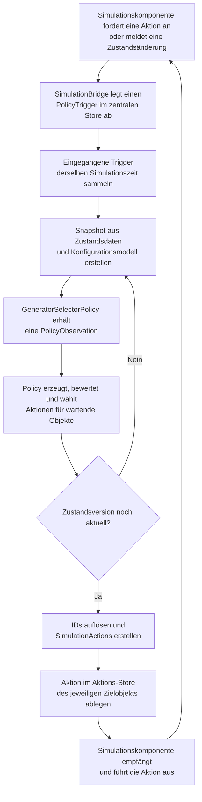

### UML-Sequenzdiagramm eines Simulationszyklus

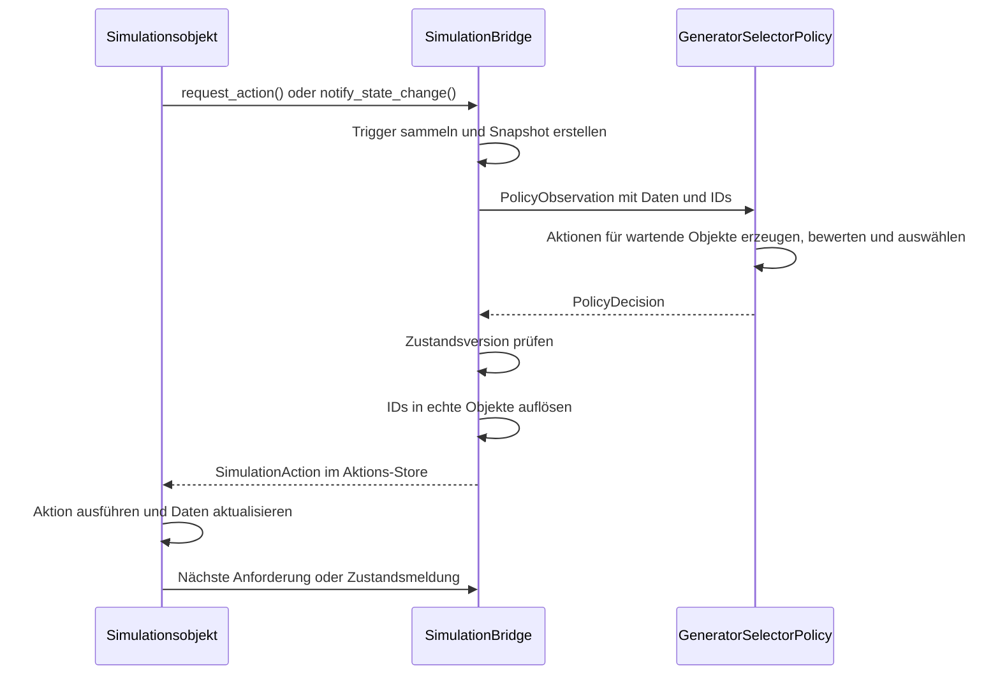

Eine `PolicyDecision` kann Aktionen für mehrere wartende Objekte enthalten.
Jede Komponente erhält nur die für sie ausgewählte Aktion.

## GeneralControl

Die Klassen unter [Control/GeneralControl](sources/SpineML/Control/GeneralControl)
verbinden Aktionsgenerierung, Bewertung und Auswahl. Dieser Ablauf wird bei
normaler Simulation und Optimierung verwendet; bei der Optimierung ändern
sich die Gewichte der Bewertung.

### Ablauf der GeneralControl

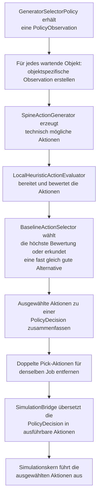

### GeneratorSelectorPolicy

Aus Sicht der Simulation ist `GeneratorSelectorPolicy` die Policy. Sie ist
für die Koordination zuständig und verbindet drei austauschbare Bausteine:

- `ActionGenerator` erzeugt aus der Beobachtung die technisch möglichen
  Aktionen für das aktuell betrachtete wartende Simulationsobjekt.
- `ActionEvaluator` bewertet diese Aktionen anhand gewichteter
  Dispatching-Regeln, zum Beispiel EDD-Termindruck, Queue-Priorität,
  Transportzeit, Verarbeitungszeit, Werkzeugzustand und Defekt-Recovery.
- `ActionSelector` wählt normalerweise die Aktion mit dem höchsten Score aus.
  Der `BaselineActionSelector` kann gelegentlich auch eine fast gleich gute
  Alternative zur Exploration auswählen.

Die Policy prüft im Snapshot, welche Simulationskomponenten auf eine Aktion
warten. Für jedes wartende Objekt erstellt sie eine objektspezifische
`PolicyObservation`, lässt mögliche Aktionen erzeugen, bewerten und auswählen
und sammelt die Ergebnisse in einer `PolicyDecision`. Doppelte Pick-Aktionen
für denselben Job werden anschließend entfernt.

Beim normalen Simulationsstart verwendet die Policy
`SpineActionGenerator`, `BaselineActionSelector` und
`LocalHeuristicActionEvaluator` mit einem festen `HeuristicWeights`-Satz.

#### Ablauf von `make_decision()`

1. Die Policy liest aus dem Snapshot alle Simulationskomponenten, die auf eine
   Aktion warten.
2. Für jedes wartende Objekt wird eine eigene `PolicyObservation` mit seiner
   `current_object_id` erstellt.
3. `ActionGenerator` erzeugt die technisch möglichen Aktionen dieses Objekts.
4. `ActionSelector` lässt diese Kandidaten durch den `ActionEvaluator` bewerten
   und wählt normalerweise die Aktion mit dem höchsten Score aus.
5. Die ausgewählten `SelectedObjectAction`-Objekte werden zu einer
   `PolicyDecision` zusammengefasst und an die Bridge zurückgegeben.
6. Ein Job darf nicht gleichzeitig von mehreren Pick-Aktionen ausgewählt
   werden; solche doppelten Picks entfernt die Policy vor der Rückgabe.

### ActionGenerator

`SpineActionGenerator.generate_actions()` erzeugt für ein einzelnes wartendes
Simulationsobjekt eine Liste technisch möglicher Aktionen. Zuerst
bestimmt `_generate_actions()` anhand von Objekttyp und Zustand, welche
Kandidaten benötigt werden. `generate_actions()` entfernt anschließend
identische Duplikate.

#### Einfache Zustandsregeln

`_generate_actions()` prüft zuerst den Typ und den aktuellen Zustand des
Objekts. Die Verzweigung für einen Job entspricht dabei dieser Reihenfolge:

**Job:**

- `completed_time` vorhanden und `due_state` noch nicht gesetzt
  - `complete_job` setzt den Terminstatus und übergibt `finish_process=True`.
- `general_state == "defect"` → `create_defect_actions_for_job()`:
  - Laufende Nacharbeit (`recovery_in_progress == True`) → nur `wait_job`.
  - Schweregrad außerhalb von `0.001 <= defect_severity < 0.6`
    → nur `job_scrap`.
  - Schweregrad im Nacharbeitsbereich → mögliche Nacharbeitsaktionen,
    `downgrade_product` und `wait_job`.
- `released == False`
  - `release_job` und zusätzlich `wait_job`.
- Alle anderen Jobzustände
  - `wait_job`.

Ein bereits herabgestufter Job erhält selbst zunächst `wait_job`, bis seine
Abschlussaktion ansteht. Seine Markierung `downgraded=True` wird bei der
Routen- und Transportgenerierung berücksichtigt: Die Roboter bringen ihn
zum Endlager, statt ihn einer weiteren normalen Operation zuzuführen.

Für Roboter und Maschinen gelten folgende Zustandsregeln:

**Main-Roboter oder Korridorarm:**

- `current_job_id == None` → Pick-Kandidaten und Warteaktion.
- `current_job_id != None` → Place-Kandidaten und Warteaktion.

**Maschine:**

- `current_job_id == None` → Pick-Kandidaten und Warteaktion.
- `current_job_id != None` und Ausgangspuffer hat Kapazität →
  `process_machine_job`.
- `current_job_id != None` und Ausgangspuffer ist voll → `wait_machine`.

Die Routenberechnung prüft Maschinentyp, Layout und erlaubte Werkzeuge.
Beim Erzeugen einer konkreten Transportaktion werden unter anderem die
Zielkapazitäten geprüft. Ob eine Maschine für Nacharbeit momentan frei ist,
wird zusätzlich anhand ihres Zustands und ihrer Puffer beurteilt.

#### Mehrere Kandidaten pro wartendem Objekt

Wenn die Zustandsregel mehrere Möglichkeiten zulässt, erzeugt der Generator
alle diese Kandidaten gleichzeitig in einer Liste. „Gleichzeitig“ bedeutet
hier dieselbe Auswahlrunde, nicht parallele Ausführung in der Simulation. Der
`ActionSelector` lässt die Kandidaten vom `ActionEvaluator` bewerten und
wählt eine Aktion für dieses Objekt aus.
Die folgenden Payloads zeigen jeweils nur ein Beispiel aus dieser Liste; die
Kandidaten werden gemeinsam erzeugt, aber nicht gemeinsam ausgeführt.

**Defekter Job mit technisch möglicher Nacharbeit:**

1. `job_rework_on_defect_machine` (wenn die Defektmaschine verfügbar
   ist).
2. `job_rework_on_alternative_machine` (für jede gefundene
   Alternativroute).
3. `downgrade_product`.
4. `wait_job`.

Liegt der Schweregrad außerhalb des technisch nacharbeitbaren Bereichs,
wird stattdessen ausschließlich `job_scrap` erzeugt.

Liegt er im nacharbeitbaren Bereich, aber ist weder eine alternative Route
vorhanden noch die Defektmaschine verfügbar, bleiben `downgrade_product` und
`wait_job` als Kandidaten. Die Herabstufung erfolgt dann nicht automatisch;
die Policy wählt eine dieser beiden Aktionen.

Eine Herabstufung kann nach jeder fehlerhaften Operation erfolgen. Der dabei
verwendete Produkttyp ist der vorgesehene Produkttyp dieser Operation und kann
deshalb auch ein Zwischenprodukt sein; er muss nicht dem endgültigen
Auftragsziel entsprechen. Dieser Produkttyp wird bei der Herabstufung
als aktueller `processing_state` übernommen und mit `downgraded=True`
als qualitativ herabgestuft markiert. Für die Herabstufung setzt der Payload
außerdem `general_state="intact"`; die Qualitätsabweichung bleibt am
separaten Flag erkennbar.

Beispiel für eine Herabstufungsaktion:

```json
{
  "action_type": "downgrade_product",
  "payload": {
    "selected_operation_id": null,
    "selected_machine_id": null,
    "processing_state": "produkt_b",
    "general_state": "intact",
    "downgraded": true,
    "downgrade_product_type_id": "produkt_b",
    "defect_recovery_strategy": "downgrade"
  }
}
```

**Pick:**

1. Eine eigene `pick_*`-Aktion für jeden auswählbaren Job im Store (Beispiel:
   zwei Jobs erzeugen zwei Pick-Kandidaten).
2. Zusätzlich eine `wait_*`-Aktion.

Beispiel für eine Pick-Aktion des Main-Roboters:

```json
{
  "action_type": "pick_main_robot",
  "payload": {
    "target_type": "start_storage",
    "target_store_id": "start",
    "selected_job_id": "auftrag_1:1",
    "storage_out_time": 1.0
  }
}
```

**Place:**

1. Eine eigene `place_*`-Aktion für jede technisch mögliche Route und jeden
   freien Zielstore (Beispiel: zwei freie Zielrouten erzeugen zwei
   Place-Kandidaten).
2. Zusätzlich eine `wait_*`-Aktion.

Beispiel für eine Place-Aktion des Main-Roboters:

```json
{
  "action_type": "place_main_robot",
  "payload": {
    "target_type": "sim_corridor_store_arm_input",
    "selected_operation_id": "operation_1",
    "selected_machine_id": "machine_1",
    "sim_corridor_id": "corridor_1",
    "target_store_id": "corridor_1 left",
    "storage_in_time": 1.0
  }
}
```

**Maschine:**

1. Eine eigene `pick_machine_job`-Aktion für jeden auswählbaren Job im
   Eingangspuffer.
2. Für einen geladenen Job `process_machine_job` bei freiem Ausgangspuffer;
   bei fehlender Kapazität `wait_machine` (Beispiel: voller Ausgangspuffer).

Beispiel für eine Verarbeitungsaktion:

```json
{
  "action_type": "process_machine_job",
  "payload": {
    "operation_id": "operation_1",
    "planned_machine_id": "machine_1",
    "tool_type_id": "tool_1",
    "total_life_units": 100,
    "consumed_life_units": 5,
    "remaining_life_units_before_operation": 80,
    "tool_setup_action": "keep_tool",
    "target_store_id": "machine_1 out"
  }
}
```

Die Hilfsmethoden lesen dafür den aktuellen Snapshot, das ID-basierte
Konfigurationsmodell, Store-Kapazitäten und mögliche Operations- und
Maschinenrouten. `generate_actions()` entfernt danach nur exakt doppelte
Kandidaten. Damit ist gemeint: gleicher `action_type` und gleicher Payload.
Kandidaten mit unterschiedlichen Payloads bleiben erhalten. Verschiedene
vollständige Routen können dagegen denselben nächsten Schritt haben und
dadurch eine identische Aktion ergeben. Der Selector lässt die verbleibenden
Kandidaten bewerten und wählt eine davon aus.

#### Berechnung von Operations- und Maschinenrouten

`calculate_operation_sequences_between()` ermittelt die Operationsfolgen vom
aktuellen Produkttyp bis zum Auftragsziel. Für jede Operationsfolge berechnet
`calculate_machine_sequences_from_operation_sequence()` die passenden
Maschinenfolgen. Jede Kombination bildet eine Route.

`selectable_routes_for_job()` gibt für einen normalen Job diese Routen
zurück. Wurde bereits Nacharbeit mit einer konkreten Operation und Maschine
gewählt, liefert die Methode nur diesen festgelegten Nacharbeitsschritt.

Für alternative Nacharbeit liest
`find_rework_routes_with_alternative_machine()` die benötigten IDs aus der
Beobachtung. `find_alternative_rework_routes()` berechnet den weiteren Weg
ab dem Produkttyp, den die fehlerhafte Operation erzeugen sollte. Sie setzt
die fehlerhafte Operation vor jede Restfolge und berechnet dazu die
Maschinenfolgen. Routen, deren erste Maschine die Defektmaschine ist, werden
übersprungen. Die Defektmaschine ist damit nur für die wiederholte Operation
ausgeschlossen; spätere Operationen können sie wieder verwenden.

### ActionSelector

Der `ActionSelector` erhält die gesamte Kandidatenliste eines wartenden
Objekts. Er erzeugt keine neuen Aktionen, sondern lässt jeden Kandidaten vom
`ActionEvaluator` vorbereiten und bewerten. Der Standard-
`BaselineActionSelector` arbeitet dabei in folgenden Schritten:

1. Gibt es für das wartende Objekt keine Aktion, gibt er eine leere
   `PolicyDecision` zurück.
2. Für jede vorhandene Aktion ergänzt der `ActionEvaluator` zunächst die
   benötigten Payload-Werte und berechnet danach ihren Score.
3. Der höchste Score wird gesucht. Alle Aktionen mit genau diesem Score gelten
   als beste Aktionen.
4. Zusätzlich gelten Aktionen als fast gleich gut, wenn ihr Score höchstens
   `0.05` unter dem höchsten Score liegt. Bei einem Höchstwert von `0.80`
   werden zum Beispiel auch Aktionen ab `0.75` als fast gleich gut gesammelt.
5. **Exploration:** Exploration bedeutet, gelegentlich bewusst nicht die
   aktuell beste Aktion zu verwenden, sondern eine fast gleich gute Alternative
   auszuprobieren. Mit `EXPLORATION_EPSILON = 0.10` geschieht das mit einer
   Wahrscheinlichkeit von `10 %`. Wenn möglich, wird dabei eine ausführbare
   Aktion statt einer reinen Warteaktion verwendet. So können andere
   Produktionswege getestet werden, ohne deutlich schlechtere Aktionen zu
   wählen.
   Diese Exploration betrifft nur die Aktionsauswahl während eines
   Simulationslaufs. Sie verändert keine lokalen Gewichtssätze, kann aber den
   weiteren Simulationsverlauf und dadurch die globalen Kennzahlen beeinflussen.
   Das ist bei der Optimierung nützlich, weil dadurch auch fast gleich gute
   Produktionsentscheidungen ausprobiert werden und sich die Simulation nicht
   dauerhaft auf eine möglicherweise ungünstige lokale Aktionswahl festlegt.
   Die Verwendung derselben
   Seeds und die Mittelung über mehrere Seeds halten diesen Einfluss
   reproduzierbar und vergleichbar.
   Die Exploration verändert dabei keine Scores und keine Gewichte. Ob zum
   Beispiel `job_rework_on_defect_machine` gegenüber
   `job_rework_on_alternative_machine` bevorzugt wird, entscheidet die
   normale Score-Berechnung aus den lokalen Teilwertgewichten.
6. **Keine Exploration:** In den übrigen Fällen wählt der Selector zufällig
   eine der exakt besten Aktionen. Diese Zufallsauswahl löst nur Gleichstände
   auf und bleibt mit demselben Simulations-Seed reproduzierbar.

Die ausgewählte Aktion wird anschließend als `PolicyDecision` für das
Zielobjekt an die `GeneratorSelectorPolicy` zurückgegeben.

## HeuristicControl

### Ziel und Grundidee

**Ziel:** `HeuristicControl` berechnet für alle vom `ActionGenerator`
erzeugten **Aktionskandidaten** (technisch mögliche Aktionen) der aktuellen
Entscheidungsrunde einen **Score** (numerischen Bewertungswert). Der
`ActionSelector` vergleicht diese Scores und wählt eine Aktion aus.
`HeuristicControl` erzeugt keine Aktionen und führt sie nicht selbst in der
Simulation aus.

**„Heuristisch“** bedeutet, dass vereinfachte Entscheidungsregeln verwendet
werden, zum Beispiel „Bevorzuge einen dringenden Job“ oder „Bevorzuge einen
kurzen Transport“. Mehrere solcher Regeln werden gewichtet miteinander
verbunden. Das ermöglicht eine schnelle Auswahl, garantiert aber keine
insgesamt optimale Produktionsplanung.

Eine solche lokale Prioritätsregel wird auch **Dispatching-Regel** genannt:
Sie legt fest, was bei der aktuellen Auswahl bevorzugt wird, ohne einen
vollständigen Plan für alle zukünftigen Zustände zu berechnen.

**Dynamische Produktionsplanung:** Der Simulationszustand ändert sich laufend,
zum Beispiel wenn eine Maschine frei wird oder ein Defekt auftritt. Deshalb
werden die erzeugten Kandidaten bei jeder neuen Beobachtung anhand des dann
aktuellen Zustands erneut bewertet.

### Ablauf der Bewertung

Die konkrete Umsetzung des `ActionEvaluator` (Bewertungsteil der Policy)
steht in
[LocalHeuristicActionEvaluator.py](sources/SpineML/Control/HeuristicControl/LocalHeuristicActionEvaluator.py).

1. **Kandidaten vorbereiten:** `prepare_action_candidate()` kopiert den
   Kandidaten. Bei Pick-Aktionen ergänzt es die aktuelle Termindruckpriorität
   des ausgewählten Jobs als `queue_priority` im Payload.
2. **Rohwerte ermitteln:** `evaluate_action()` ruft je nach `action_type`
   die passende Bewertungsmethode auf, etwa `evaluate_machine_pick_action()`.
   Diese liest die **Bewertungsgrößen** (Rohwerte der Kriterien, zum Beispiel
   eine Transportzeit von vier Zeiteinheiten) aus dem Simulationszustand,
   der Konfiguration und den Aktionsdaten.
3. **Rohwerte abbilden:** Die heuristischen Regeln bestimmen, wie daraus
   **Teilwerte** (auf den Bereich `0` bis `1` abgebildete Werte) entstehen.
   Zum Beispiel liefert `inverse_scale(4)` den Teilwert `0.2`.
4. **Score berechnen:** `calculate_action_score()` verbindet die Teilwerte
   mit ihren Gewichten (relativer Wichtigkeit) zu einem Gesamtscore.
   Bei bestimmten Defektaktionen wird anschließend eine Deadline-Strafe
   abgezogen.

Der `BaselineActionSelector` verwendet die fertigen Scores zur Auswahl.
Er wählt eine bestbewertete Aktion oder erkundet gelegentlich eine fast
gleich gute Alternative. Erst der Simulationskern führt die ausgewählte
Aktion aus.

### Bewertungsgrößen und heuristische Regeln

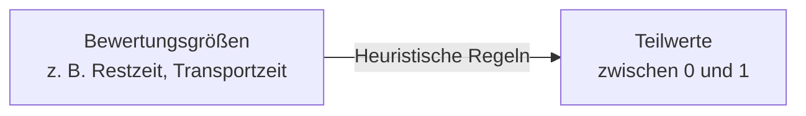

Die **heuristische Regel** legt fest, was bevorzugt wird, etwa ein kurzer
Transport. Die zugehörige Formel bildet den Rohwert auf einen Teilwert ab.
So setzt `inverse_scale(4) = 0.2` die Regel „Kürzere Transportzeiten
bevorzugen“ rechnerisch um.

Die Teilwerte sind dimensionslos, obwohl ihre Rohwerte unterschiedliche
Einheiten haben. Für alle gilt: **Ein höherer Teilwert bedeutet einen
größeren Vorteil für die betrachtete Aktion.**

Die Verwendung der Bewertungsgrößen wird in einem eigenen Kapitel
[je Aktionstyp](#verwendung-der-bewertungsgrößen-nach-aktionstyp) erklärt.
Die folgenden Regeln erklären jeweils Rohwert, Abbildung und Beispiel.

### Allgemeine heuristische Regeln

#### 1. Termindruck: dringendere Jobs bevorzugen

- **Bewertungsgröße:** Restzeit `t = latest_end_time − aktuelle Zeit`.
  `latest_end_time` ist die Deadline des Auftrags, zu dem der Job gehört.
- **Regel:** Je näher die Deadline liegt oder je weiter sie überschritten
  ist, desto höher ist die EDD-Priorität (`Earliest Due Date`).
- **Abbildung in `calculate_edd_priority()`:**
  - Bei `t >= 0`: `Teilwert = 0.5 × inverse_scale(t)`.
  - Bei `t < 0`: `Teilwert = 0.5 + 0.5 × direct_scale(-t)`.
- **Beispiel:** Zwei Zeiteinheiten vor der Deadline ergibt sich etwa
  `0.167`, genau bei der Deadline `0.5` und zwei Zeiteinheiten danach etwa
  `0.833`. Negative Restzeit wird also als Überfälligkeit behandelt.

Vor der Deadline liegt die Priorität unter `0.5`, genau bei der Deadline
beträgt sie `0.5`, danach liegt sie darüber. Sie nähert sich bei sehr großer
Restzeit `0` und bei sehr großer Überfälligkeit `1`.

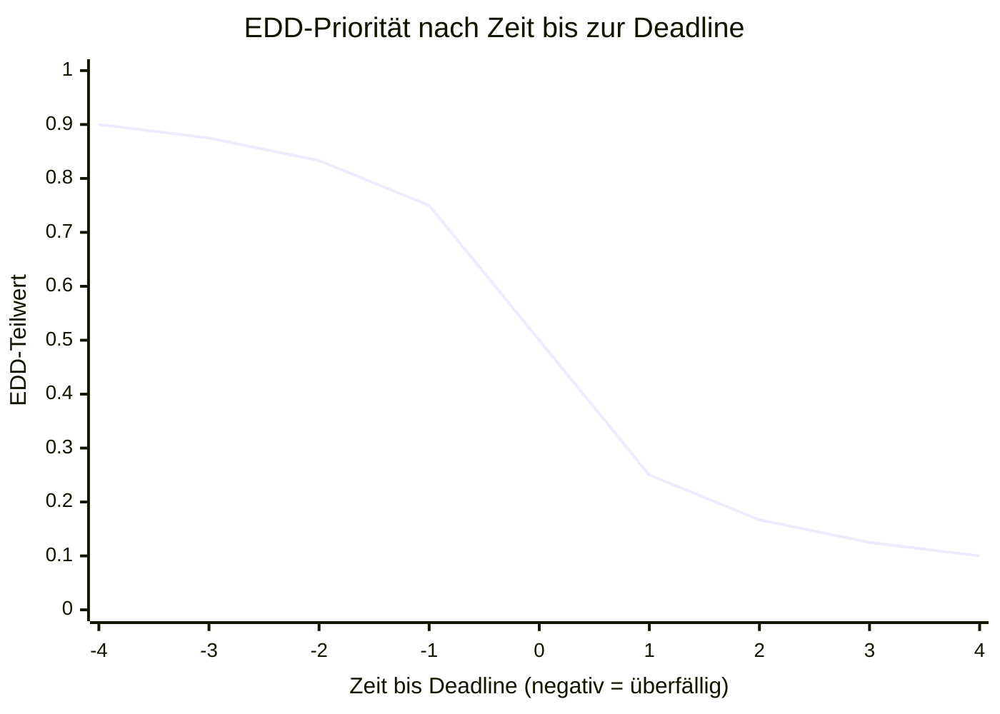

#### 2. Verarbeitungs-, Transport- und Lagerzeiten: kürzere Zeiten bevorzugen

- **Bewertungsgröße:** Eine nichtnegative Zeit `x`.
- **Regel:** Eine kürzere Zeit soll einen höheren Teilwert ergeben.
- **Abbildung:** `inverse_scale(x) = 1 / (1 + x)`.
- **Beispiel:** Zeit `1 → 0.5`; Zeit `4 → 0.2`.

Für endliche, nichtnegative Eingaben liegt `inverse_scale(x)` in `(0, 1]`.
Bei `x = 0` ergibt sich `1`; mit wachsendem `x` sinkt der Teilwert
gegen `0`.

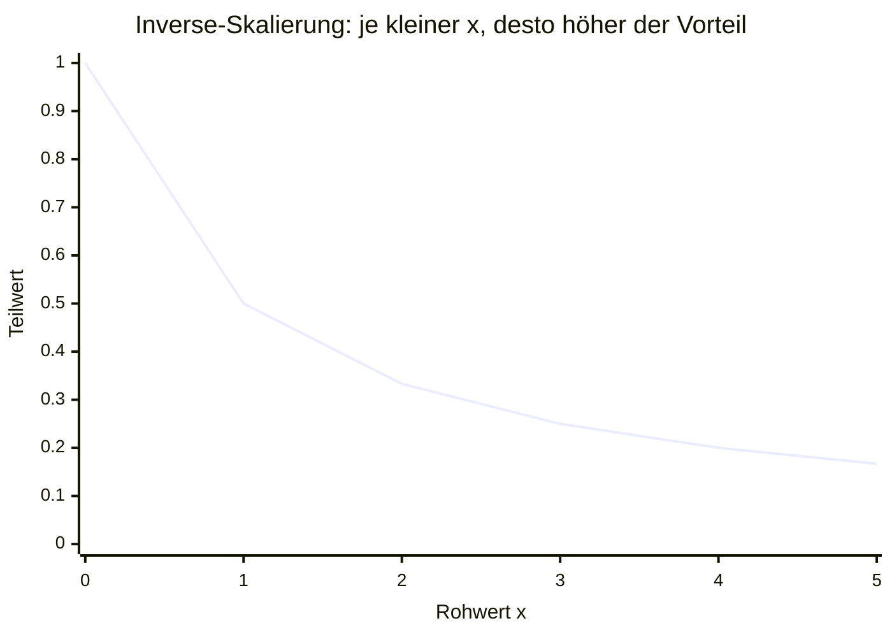

#### 3. Maschinenwarteschlange: weniger wartende Jobs bevorzugen

- **Bewertungsgröße:** Anzahl `n` der Jobs im Eingangspuffer der Maschine.
- **Regel:** Eine kürzere Warteschlange soll einen höheren Teilwert ergeben.
- **Abbildung:** `inverse_scale(n) = 1 / (1 + n)`.
- **Beispiel:** Kein wartender Job ergibt `1`; drei wartende Jobs ergeben
  `0.25`.

#### 4. Werkzeugpassung: ein bereits montiertes passendes Werkzeug bevorzugen

- **Bewertungsgröße:** Übereinstimmung zwischen benötigtem und montiertem
  Werkzeugtyp.
- **Regel und Abbildung:** Gleicher Werkzeugtyp ergibt den Teilwert `1`,
  ein anderer Werkzeugtyp oder kein montiertes Werkzeug ergibt `0`.
- **Beispiel:** Benötigt die Operation Fräser A und Fräser A ist montiert,
  ist der Teilwert `1`; bei montiertem Fräser B ist er `0`.

#### 5. Werkzeugreserve: mehr Lebensdauer im Verhältnis zum Verbrauch bevorzugen

- **Bewertungsgröße:** Verhältnis
  `r = verbleibende Werkzeuglebensdauer / Verbrauch der geplanten Operation`.
- **Regel:** Eine größere Reserve im Verhältnis zum Verbrauch soll einen
  höheren Teilwert ergeben.
- **Vorgesehene Abbildung:** `direct_scale(r) = r / (1 + r)`.
- **Beispiel:** Vier verbleibende und zwei benötigte Einheiten ergeben
  `r = 2` und den Teilwert `2 / 3 ≈ 0.667`.

Für endliche, nichtnegative Eingaben liegt `direct_scale(x)` in `[0, 1)`.
Bei `x = 0` ergibt sich `0`; mit wachsendem `x` steigt der Teilwert
gegen `1`. Dabei gilt: `direct_scale(x) = 1 − inverse_scale(x)`.

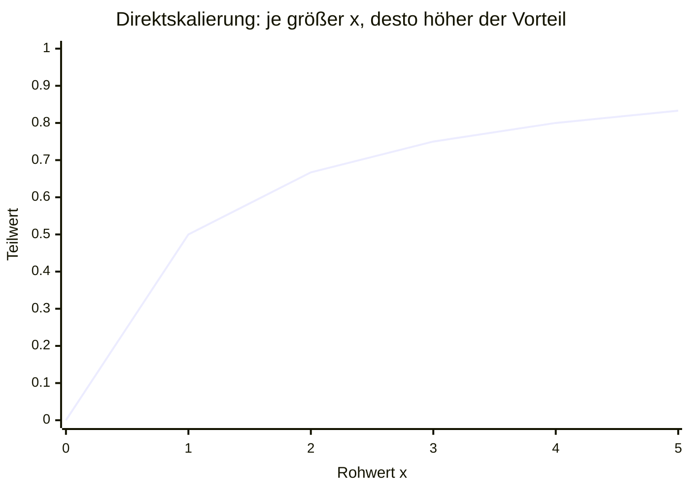

Beide Skalierungen benötigen keine beobachteten Minimal- und Maximalwerte.
Sie erwarten nichtnegative Eingaben und begrenzen diese nicht nachträglich.
Eine negative Deadline-Restzeit wird bereits in
`calculate_edd_priority()` getrennt als Überfälligkeit behandelt.

#### 6. Freie Pufferkapazität: einen größeren freien Anteil bevorzugen

- **Bewertungsgröße:** Freie Plätze und Gesamtkapazität des Ziel-Stores.
- **Regel:** Je größer der freie Anteil, desto höher der Teilwert.
- **Abbildung mit `normalize_ratio()`:**
  `normalize_ratio(freie Plätze, Gesamtkapazität) = freie Plätze / Gesamtkapazität`.
- **Beispiel:** Zwei von zehn freien Plätzen ergeben `0.2`; acht von zehn
  ergeben `0.8`.

Bei positiver, endlicher Kapazität und gültiger Belegung liegt dieser Anteil
in `[0, 1]`. `normalize_ratio()` selbst begrenzt ihn nicht.

#### 7. Defektschwere: bei stärkerem Defekt die Herabstufung höher bewerten

- **Bewertungsgröße:** `defect_severity` des Jobs.
- **Regel:** Bei einer Herabstufung soll ein höherer Schweregrad einen
  höheren Teilwert ergeben.
- **Abbildung in `evaluate_defect_action()`:** Der Schweregrad wird auf
  `[0, 1]` begrenzt und dann direkt als Teilwert übernommen, **nicht** mit
  `direct_scale()` umgerechnet.
- **Beispiel:** Schweregrad `0.2 → 0.2`; Schweregrad `0.5 → 0.5`.

#### 8. Warten: bei höherem Termindruck einen kleineren Wartewert verwenden

- **Bewertungsgröße:** EDD-Priorität des wartenden beziehungsweise geladenen
  Jobs.
- **Regel:** Je dringender der Job, desto weniger vorteilhaft ist Warten.
- **Abbildung für normales Warten in `evaluate_wait_action()`:**
  `Teilwert = 0.01 + 0.98 × (1 − EDD)`.
  Ohne zugehörigen Job oder ohne dessen Deadline ist der Teilwert `0.01`.
- **Abbildung für einen defekten Job in `evaluate_defect_action()`:**
  `Teilwert = 1 − EDD`.
- **Beispiel:** Bei `EDD = 0.75` ergibt normales Warten `0.255` und Warten
  bei einem Defekt zunächst `0.25`, noch vor einem möglichen Strafabzug.

Der normale Wartewert liegt zwischen `0.01` und `0.99`.

### Gewichte und Gesamtscore

Ein **Gewicht** legt fest, wie wichtig ein Teilwert gegenüber den anderen
Teilwerten derselben Aktion ist. Der **Gesamtscore** verbindet die
verwendeten Teilwerte zu einer numerischen Gesamtbewertung der Aktion.

`calculate_action_score()` berechnet den gewichteten Durchschnitt:

`Aktionsscore = Summe(Teilwert × Gewicht) / Summe(aktive Gewichte)`

„Aktiv“ bedeutet hier, dass das Kriterium bei dieser konkreten Aktion
berücksichtigt wird. Beispielsweise geht Werkzeugpassung nur ein, wenn die
Operation ein Werkzeug benötigt. Nur die Gewichte dieser berücksichtigten
Teilwerte stehen im Nenner.

#### Warum unterschiedliche Kriterien kombiniert werden können

Kombiniert werden die **Teilwerte**, die vorher in dieselbe Vorteilsrichtung
abgebildet wurden:

- **Transportzeit:** Kleiner ist besser. `inverse_scale()` bildet deshalb
  kurze Zeiten auf höhere Teilwerte ab. Zeit `1` ergibt `0.5`; Zeit `4`
  ergibt `0.2`.
- **Freie Kapazität:** Größer ist besser. `freie Plätze / Gesamtkapazität`
  liefert bei mehr freien Plätzen einen höheren Teilwert. Zwei von zehn
  freien Plätzen ergeben `2 / 10 = 0.2`; acht von zehn ergeben
  `8 / 10 = 0.8`.

Danach gilt für beide: **Ein höherer Teilwert ist vorteilhafter.**

Deshalb können die dimensionslosen Teilwerte im Bereich `0` bis `1` sinnvoll
zu einem Gesamtscore kombiniert werden. Die Gewichte bestimmen dabei, wie
stark kurze Transportzeiten gegenüber freier Kapazität zählen.

#### Warum durch die Gewichtssumme geteilt wird

Durch die Division entsteht aus jedem Gewicht ein relativer Anteil
`αᵢ = wᵢ / Summe(w)`. Die Summe dieser Anteile ist `1`; der Score lautet
damit auch `Summe(xᵢ × αᵢ)`. Ein Gewicht von `0.6` zählt doppelt so stark
wie ein Gewicht von `0.3`.

Werden alle berücksichtigten Gewichte mit demselben positiven Faktor
multipliziert, bleibt der gewichtete Durchschnitt gleich. Die relativen
Wichtigkeiten ändern sich dadurch nicht. Ohne die Division würde allein die
größere Gewichtssumme den Score erhöhen.

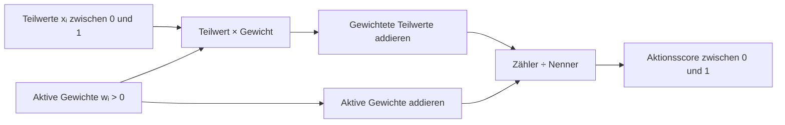

#### Mathematischer Verlauf des Gesamtscores

Die Teilwerte `0.8` und `0.2` mit Gewichten `1.0` und `0.5` ergeben:

`(0.8 × 1.0 + 0.2 × 0.5) / (1.0 + 0.5) = 0.6`

Die relativen Anteile sind `2/3` und `1/3`. Deshalb liegt der Score näher
am stärker gewichteten Teilwert `0.8`.

Die folgende Kurve variiert nur den ersten Teilwert `x₁`. Der zweite
Teilwert bleibt `0.2`, die Gewichte bleiben `1.0` und `0.5`:

`Score(x₁) = (x₁ × 1.0 + 0.2 × 0.5) / 1.5`

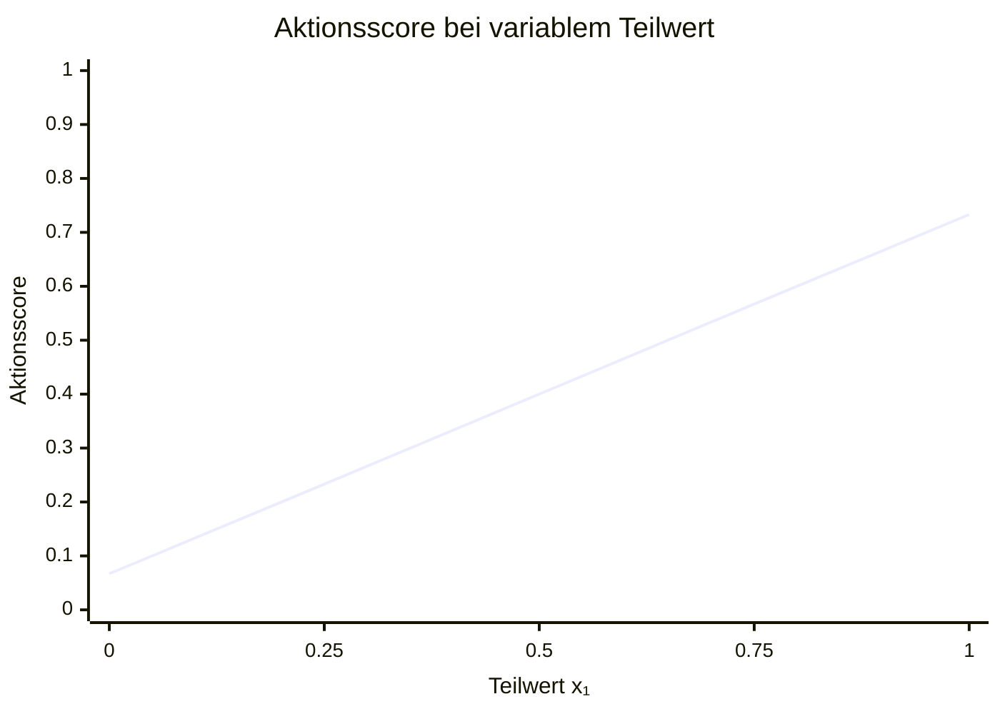

Bei Teilwerten in `[0, 1]` und positiven Gewichten liegt der gewichtete
Durchschnitt zwischen dem kleinsten und dem größten Teilwert und damit
ebenfalls in `[0, 1]`. `calculate_action_score()` führt selbst keine
Begrenzung oder Gewichtsprüfung durch. Die gültigen Gewichte werden von
`HeuristicWeights` geprüft.

Bei genau einem Teilwert kürzt sich dessen Gewicht heraus:
`(Teilwert × Gewicht) / Gewicht = Teilwert`. Das betrifft beispielsweise
`complete_job` und normale Warteaktionen. Eine Änderung ihres einzigen
Gewichts verändert den Score daher nicht.

#### HeuristicWeights

[HeuristicWeights.py](sources/SpineML/Control/HeuristicControl/HeuristicWeights.py)
definiert die lokalen Gewichte für Teilwerte und Deadline-Strafen. Alle Werte
müssen in `(0, 1]` liegen; diese Prüfung erfolgt beim Erzeugen eines
`HeuristicWeights`-Objekts.

Innerhalb eines gewichteten Durchschnitts bestimmt ein Gewicht die relative
Wichtigkeit gegenüber den anderen berücksichtigten Kriterien. Die
Strafgewichte werden dagegen direkt nach der Mittelwertbildung abgezogen.
Bei der Optimierung werden diese lokalen Gewichte verändert. Sie sind von
den globalen Gewichten zur Bewertung eines gesamten Simulationslaufs getrennt.

### Rechenbeispiel: zwei Ablageziele

Der `ActionGenerator` erzeugt beispielsweise zwei Kandidaten: „Job in
Puffer A ablegen“ und „Job in Puffer B ablegen“. Das vereinfachte Beispiel
verwendet nur Transportzeit und freie Pufferkapazität. Im vollständigen Code
kommen je nach Aktion weitere Kriterien hinzu.

1. **Bewertungsgrößen:** Zum Beispiel benötigt der Transport zu A vier
   Zeiteinheiten; dort sind vier von zehn Plätzen frei. Zu B dauert er eine
   Zeiteinheit; dort sind zwei von zehn Plätzen frei.
2. **Abbildung auf Teilwerte:** Die Transportzeit wird mit
   `inverse_scale()` abgebildet, die freie Kapazität als
   `freie Plätze / Gesamtkapazität`. Beide Teilwerte zeigen damit in
   dieselbe Vorteilsrichtung.
3. **Gewichtung:** Nur für dieses Rechenbeispiel erhält die Transportzeit
   das Gewicht `0.75` und die freie Kapazität `0.25`. Die Transportzeit
   zählt damit dreimal so stark. Dies sind keine Standardgewichte aus
   `HeuristicWeights`.
4. **Gesamtscore:** `calculate_action_score()` addiert die gewichteten
   Teilwerte und teilt durch die Gewichtssumme `0.75 + 0.25 = 1.0`:

| Aktionskandidat | Transportzeit → Teilwert | Freie Plätze → Teilwert | Gewichtete Summe | Gesamtscore |
|---|---|---|---|---|
| Job in Puffer A ablegen | `4 → 0.2` | `4 von 10 → 0.4` | `0.2 × 0.75 + 0.4 × 0.25 = 0.25` | `0.25 / 1.0 = 0.25` |
| Job in Puffer B ablegen | `1 → 0.5` | `2 von 10 → 0.2` | `0.5 × 0.75 + 0.2 × 0.25 = 0.425` | `0.425 / 1.0 = 0.425` |

B hat unter diesen beiden Kandidaten den höheren Gesamtscore: Der Vorteil
des kürzeren Transports zählt bei diesen Gewichten stärker als die
zusätzliche freie Kapazität von A. Der Selector verwendet die berechneten
Scores für seine Auswahl.

Bei der nächsten Beobachtung werden Kandidaten und Scores erneut bestimmt.
Ist Puffer B inzwischen voll, erzeugt der Generator keine Ablageaktion für
dieses Ziel. Die Bewertung entscheidet also nicht über die technische
Zulässigkeit, sondern vergleicht die vom Generator zugelassenen Möglichkeiten.

### Verwendung der Bewertungsgrößen nach Aktionstyp

Die allgemeinen Regeln legen fest, wie Rohwerte auf Teilwerte abgebildet
werden. Dieses Kapitel erklärt getrennt davon, **welche Rohwerte bei welchem
Aktionstyp verwendet werden, wie sie ermittelt werden und welche Gewichte
in den Score eingehen**.

Die Ausdrücke zeigen jeweils `Teilwert × Gewicht`.
`calculate_action_score()` addiert diese Beiträge und teilt durch die
Summe ihrer Gewichte. Optionale Kriterien werden nur berücksichtigt, wenn
die dafür benötigten Daten beziehungsweise Bedingungen vorhanden sind.

#### Freigabe: `release_job`

`evaluate_release_action()` berücksichtigt zwei Kriterien:

1. **Termindruck:** `EDD × release_edd_weight`.
2. **Durchschnittliche Routenverarbeitungszeit:**
   `inverse_scale(erwartete Verarbeitungszeit) × release_average_route_duration_weight`.

##### Ermittlung der Routenzeit

Bei der Freigabe wird die Verarbeitungszeit **über alle Operationen
einer Route** betrachtet. `estimate_release_processing_time()` ermittelt
die möglichen Operationsfolgen zum Zielprodukt. Für jede Folge addiert es
die konfigurierten Operationsdauern und bildet danach den Mittelwert über
die Routenzeiten.

Zum Beispiel:

- Route A: Zwei Operationen mit Dauer `3` und `5` ergeben insgesamt `8`.
- Route B: Zwei Operationen mit Dauer `4` und `8` ergeben insgesamt `12`.
- Der Rohwert für die Freigabe ist `(8 + 12) / 2 = 10`.
- Daraus entsteht der Teilwert `inverse_scale(10) = 1 / 11 ≈ 0.091`.

Dabei wird keine Route ausgewählt. Der Mittelwert dient nur dazu, die
Freigabe dieses Jobs anhand seiner geschätzten Verarbeitungszeit zu bewerten.
Transport- und Wartezeiten sind in dieser Summe nicht enthalten.

#### Roboter-Pick: `pick_main_robot` und `pick_corridor_arm_robot`

`evaluate_robot_pick_action()` bewertet den ausgewählten Job anhand von:

1. **EDD-/Queue-Priorität:** `EDD × queue_priority_weight`.
2. **Entnahmezeit:** `inverse_scale(storage_out_time) × pick_source_storage_time_weight`.
   Das Kriterium geht nur ein, wenn `storage_out_time` im Payload vorhanden ist.
3. **Transportzeit:** `inverse_scale(Transportzeit) × pick_short_transport_time_weight`.

##### Ermittlung der Transportzeit

Bei Roboter-Pick- und Place-Aktionen berechnet `transport_time_value()`
den Weg von der aktuellen Roboterposition zum Store der Aktion. Weil sich
der Roboter achsenweise bewegt, werden die Wege in X-, Y- und Z-Richtung
addiert:

`Transportzeit = (|Δx| + |Δy| + |Δz|) / Grundgeschwindigkeit`

Zum Beispiel ergeben drei Wegeinheiten in X-Richtung und eine in Y-Richtung
bei Grundgeschwindigkeit `2` Wegeinheiten pro Zeiteinheit den Rohwert
`(3 + 1 + 0) / 2 = 2` Zeiteinheiten.
Der Teilwert ist dann `inverse_scale(2) = 1 / 3 ≈ 0.333`.

##### Auslagerzeit am Quell-Store

Die Auslagerzeit ist die Zeit für das Herausnehmen des Jobs aus dem Store,
nicht die Fahrt dorthin. `pick_source_storage_time_value()` liest dafür
`storage_out_time` aus dem Aktions-Payload. Ist das Feld nicht vorhanden,
entfällt dieser Teilwert.

Eine Auslagerzeit von `2` ergibt zum Beispiel
`inverse_scale(2) = 1 / 3 ≈ 0.333`. Transportzeit und Auslagerzeit gehen
als getrennte Teilwerte mit ihren jeweiligen Gewichten in den Score ein.

#### Maschinen-Pick: `pick_machine_job`

`evaluate_machine_pick_action()` berücksichtigt:

1. **EDD-/Queue-Priorität:** `EDD × queue_priority_weight`.
2. **Operationsdauer:** `inverse_scale(operation.duration) × machine_pick_operation_duration_weight`.
   Hier zählt die konfigurierte Operationsdauer.
3. **Werkzeugpassung:** `Werkzeugpassung × machine_pick_tool_match_weight`,
   nur wenn die Operation ein Werkzeug benötigt.
4. **Werkzeugreserve:**
   `direct_scale(verbleibende Lebensdauer / geplanter Verbrauch) × machine_pick_tool_reserve_weight`.
   Vorgesehen bei positivem Lebensdauerverbrauch, derzeit aber nicht aktiv;
   siehe [Codehinweis zur Werkzeugreserve](#codehinweis-zur-werkzeugreserve).

##### Verwendete Operationsdauer

Beim Maschinen-Pick verwendet der Evaluator die konfigurierte Dauer
`operation.duration` der nächsten Operation des Jobs. Dasselbe gilt beim
Ablegen, wenn der Kandidat eine nächste Operation angibt. Es zählt **nur
diese eine Operation**, nicht der gesamte weitere Weg bis zum Endprodukt.

Zum Beispiel ergibt eine Operationsdauer von `4` Zeiteinheiten den Teilwert
`inverse_scale(4) = 1 / (1 + 4) = 0.2`. Eine andere mögliche Operation mit
Dauer `1` erhält bei diesem Kriterium den höheren Teilwert `0.5`.

#### Verarbeitung: `process_machine_job`

`evaluate_process_action()` liefert den Score `0`. Für eine geladene
Maschine mit freiem Ausgangspuffer erzeugt der Generator ohnehin nur diese
Verarbeitungsaktion. Ein Score von `0` verhindert ihre Ausführung daher nicht.
Bei einem vollen Ausgangspuffer wird stattdessen nur `wait_machine` erzeugt.

#### Ablegen: `place_main_robot` und `place_corridor_arm_robot`

`evaluate_place_action()` bewertet die möglichen Transportziele anhand von:

1. **Freier Zielkapazität:**
   `Anteil freier Plätze × target_store_free_capacity_weight`.
   `target_store_capacity_value()` ermittelt dafür den freien Kapazitätsanteil.
2. **Transportzeit:**
   `inverse_scale(Transportzeit) × place_short_transport_time_weight`.
3. **Einlagerungszeit:**
   `inverse_scale(storage_in_time) × place_target_storage_time_weight`,
   falls `storage_in_time` im Payload vorhanden ist.
4. **Maschinenwarteschlange:**
   `inverse_scale(Warteschlangenlänge) × place_machine_queue_length_weight`.
   `place_machine_queue_value()` liest die Anzahl der Jobs im Eingangspuffer,
   falls eine Zielmaschine angegeben ist.
5. **Dauer der nächsten Operation:**
   `inverse_scale(operation.duration) × place_operation_duration_weight`,
   falls der Payload eine nächste Operation enthält.

##### Verwendete Zeitwerte

Die Transportzeit wird wie beim Roboter-Pick aus Wegstrecke und
Grundgeschwindigkeit berechnet. Enthält der Kandidat eine nächste Operation,
zählt deren konfigurierte Dauer, wie beim Maschinen-Pick beschrieben.

Zusätzlich verwendet `place_target_storage_time_value()` die Einlagerzeit
`storage_in_time` des Ziel-Stores. Sie beschreibt das Ablegen des Jobs,
nicht die Fahrt zum Store, und wird getrennt von der Transportzeit auf
einen Teilwert abgebildet. Eine Einlagerzeit von `2` ergibt beispielsweise
`inverse_scale(2) = 1 / 3 ≈ 0.333`. Fehlt das Feld im Payload, entfällt
dieser Teilwert.

#### Normales Warten: `wait_*`

`evaluate_wait_action()` betrachtet den wartenden Job oder den aktuell
geladenen Job einer Maschine beziehungsweise eines Roboters.

Es verwendet den normalen Wartewert aus Regel 8 als einzigen Teilwert mit
`wait_action_weight`. Das Gewicht kürzt sich bei der Mittelwertbildung
heraus. Für defekte Jobs gilt stattdessen die gesonderte Bewertung unter
[Defektbehandlung](#defektbehandlung).

#### Defektbehandlung

Der Generator bestimmt die technisch verfügbaren Defektaktionen.
`evaluate_defect_action()` bewertet diese Kandidaten anhand ihrer
jeweiligen Kriterien und der Restzeit
`remaining_time = latest_end_time − aktuelle Zeit`.

Bei `remaining_time <= 0` ist die Deadline erreicht oder überschritten.
Dann kann ein Bonus-Teilwert hinzukommen oder eine Strafe **nach** der
Mittelwertbildung abgezogen werden. Diese beiden Mechanismen sind
unterschiedlich und werden unten getrennt angegeben.

`is_rework_allowed()` prüft im Evaluator nur, ob diese Restzeit positiv ist.
Es prüft nicht, ob eine komplette Nacharbeit noch vor der Deadline fertig
werden kann. Auch nach der Deadline können technisch erzeugte
Nacharbeitskandidaten vorhanden sein; sie erhalten dann eine Score-Strafe.

##### Nacharbeit auf der Defektmaschine: `job_rework_on_defect_machine`

`evaluate_defect_recovery_action()` berücksichtigt:

1. `inverse_scale(Maschinenwarteschlangenlänge) × defect_recovery_machine_queue_length_weight`.
2. `Werkzeugpassung × defect_recovery_tool_match_weight`, falls ein Werkzeug
   benötigt wird.
3. `direct_scale(verbleibende Lebensdauer / geplanter Verbrauch) × defect_recovery_tool_reserve_weight`,
   vorgesehen bei positivem Lebensdauerverbrauch, derzeit aber nicht aktiv
   (siehe [Codehinweis zur Werkzeugreserve](#codehinweis-zur-werkzeugreserve)).

Bei `remaining_time <= 0` wird nach der Mittelwertbildung
`rework_defect_machine_deadline_penalty_weight` abgezogen, standardmäßig `0.5`.

##### Nacharbeit auf einer anderen Maschine: `job_rework_on_alternative_machine`

Es gelten dieselben drei Kriterien. Zusätzlich geht
`inverse_scale(Transportzeit zur Nacharbeitsmaschine) × defect_recovery_transport_time_weight`
ein, wenn diese Zeit geschätzt werden kann. Bei `remaining_time <= 0`
wird `rework_alternative_machine_deadline_penalty_weight` abgezogen,
standardmäßig `0.5`.

`defect_recovery_transport_time_value()` schätzt die Transportzeit ebenfalls
als Wegstrecke geteilt durch Grundgeschwindigkeit. Hier wird der Weg vom
aktuellen Jobstandort zum Eingangspuffer der ausgewählten Nacharbeitsmaschine
betrachtet.

Bei beiden Nacharbeitsaktionen wird ein nach dem Abzug negativer Score
auf `0` gesetzt.

##### Herabstufung: `downgrade_product`

1. `defect_severity × product_downgrade_defect_severity_weight`.
2. Ist die Deadline bereits erreicht oder überschritten, kommt der
   Bonus-Teilwert `1 × rework_not_allowed_downgrade_bonus_weight` hinzu.

Diese Beiträge werden zu einem gewichteten Durchschnitt verbunden. Der Bonus
ist ein zusätzlicher Teilwert innerhalb dieser Berechnung.

##### Warten bei einem Defekt: `wait_job`

Der Defekt-Wartewert aus Regel 8 (`1 − EDD`) wird mit
`wait_defect_job_weight` als einzigem Teilwert übergeben. Bei
`remaining_time <= 0` wird anschließend
`deadline_missed_wait_penalty_weight` abgezogen, standardmäßig `0.2`.
Ein negatives Ergebnis wird auf `0` gesetzt.

##### Ausschuss: `job_scrap`

Diese Aktion wird ausschließlich erzeugt, wenn der Defektschweregrad außerhalb
des technisch nacharbeitbaren Bereichs liegt. Dann ist sie der einzige
Kandidat. Ihre Bewertung verwendet:

1. `1 × job_scrap_weight`.
2. `EDD × deadline_pressure_scrap_bonus_weight`.

#### Abschluss: `complete_job`

`evaluate_action()` verwendet den festen Teilwert `1` mit
`complete_job_weight`. Weil nur dieser eine Teilwert eingeht, ist der
resultierende Score `1`.

Ein unbekannter `action_type` erhält in `evaluate_action()` den Score `0`.

#### Codehinweis zur Werkzeugreserve

**Aktueller Codezustand:** Dieser Teilwert wird bei den regulären Snapshots
derzeit nicht hinzugefügt. `ConfigurationObjectObserver` liefert den Verbrauch
im Konfigurationsmodell unter `consumed_life_units`,
die Reservelogik in `evaluate_machine_pick_action()` und
`evaluate_defect_recovery_action()` liest aber `consumes_life_units` und
erhält dadurch `0`. Die vorgesehene Berechnung setzt einen positiven
Verbrauch voraus. Der tatsächliche Werkzeugverbrauch in `SimMachine` ist
davon unabhängig.

#### Abgrenzung zur tatsächlich simulierten Dauer

Die genannten Zeitwerte dienen dem **Vergleich der Aktionskandidaten**.
Sie bilden die tatsächliche Ausführungsdauer nicht vollständig nach:

- **Maschine:** `SimMachine` berücksichtigt zusätzlich Produktgröße,
  Maschinengeschwindigkeit und einen Zufallsfaktor. Diese Einflüsse fehlen
  im Verarbeitungszeit-Kriterium. Für dieselbe Operation liefert dieses
  Kriterium daher denselben Teilwert, auch wenn zwei Maschinen
  unterschiedlich schnell verarbeiten.
- **Roboter:** Die Schätzung verwendet die konfigurierte Grundgeschwindigkeit.
  In der Simulation schwankt die Geschwindigkeit bei jeder Bewegung um bis
  zu fünf Prozent. Dadurch kann die tatsächliche Bewegungsdauer von der
  geschätzten Zeit abweichen.

## Optimierungsvorgang

### Ziel und Überblick

Die Optimierung bildet einen äußeren Rückkopplungszyklus. Der
`LocalHeuristicWeightOptimizer` testet verschiedene lokale
`HeuristicWeights`-Sätze und prüft die Auswirkungen jeweils in einem
vollständigen Simulationslauf. Die lokalen Gewichte bestimmen, wie stark die
einzelnen Teilwerte in den Aktionsscores zählen und wie hoch die
Deadline-Strafen ausfallen. Der `ActionSelector` vergleicht mit diesen
Scores die technisch möglichen Aktionen. Ein geänderter
Gewichtssatz kann dadurch über viele Entscheidungen hinweg andere
Place-Routen oder Defektstrategien bevorzugen.

Ob daraus insgesamt eine Verbesserung entsteht, wird nicht an einer einzelnen
Aktion, sondern an den globalen Simulationskennzahlen und der daraus
berechneten globalen Bewertungszahl beurteilt. Jeder lokale Gewichtssatz wird
dazu mit denselben Seeds simuliert; die Ergebnisse dieser Läufe werden
zusammengefasst. Ein Seed ist kein einzelner Simulationszustand, sondern ein
fester Startwert für die Zufallszahlen. Er legt damit den Zufallsverlauf des
Laufs fest und macht die daraus entstehenden Zustandsverläufe reproduzierbar.
Mehrere Seeds beziehen unterschiedliche Zufallsverläufe in den Vergleich ein.
Die Bewertung beruht damit auf mehreren Läufen statt auf einem einzigen.
Ein Gewichtssatz wird nach dem Mittelwert über diese Läufe beurteilt.

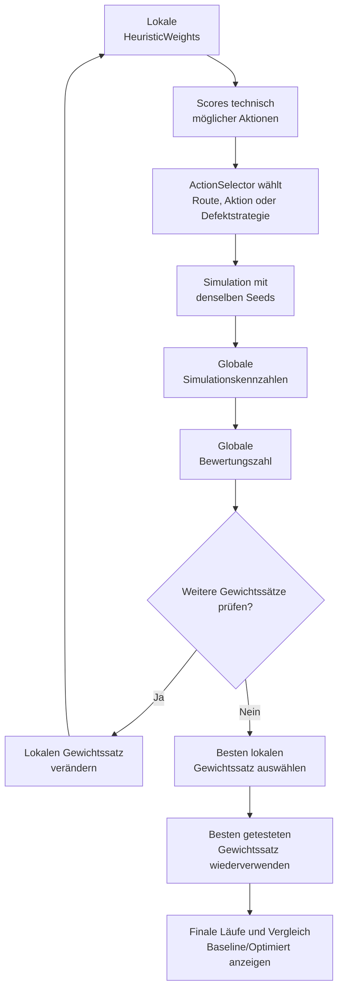

#### UML-Sequenzdiagramm des Optimierungsablaufs

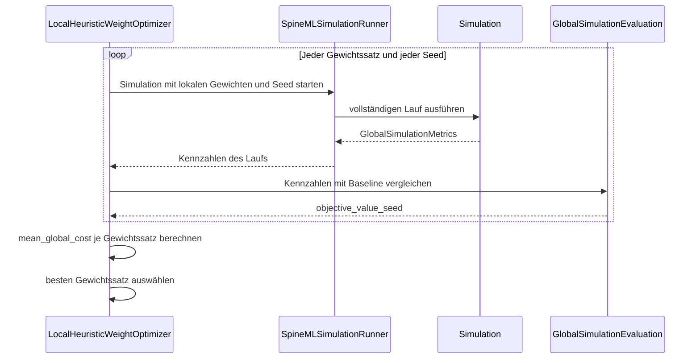

### Detaillierter Ablauf

Das folgende Diagramm zeigt, was optimiert wird: Der
`LocalHeuristicWeightOptimizer` verändert lokale `HeuristicWeights`. Für jeden
lokalen Gewichtssatz werden vollständige Simulationsläufe mit denselben Seeds
ausgeführt. Die globalen Simulationskennzahlen werden anschließend zu einer
Vergleichszahl zusammengeführt; der lokale Gewichtssatz mit dem niedrigsten
Wert wird ausgewählt.

```mermaid
flowchart TD
    A[Streamlit-Webserver] --> B[Beispielmodell laden]
    B --> C[Direkten simulate-Aufruf beim Laden unterdrücken]
    C --> D[Layout und Szenario aus simulate auswählen]
    D --> E[Baseline mit lokalen HeuristicWeights für alle Seeds]
    E --> F[Baseline-Referenzwerte berechnen]
    F --> G["Nächste Optimierungsrunde<br/>im laufenden Worker-Thread"]
    G -. parallel: progress-Callback .-> V[Streamlit-Interface zeigt live<br/>Status, Fortschrittsbalken und Zwischen-Diagramme]
    G --> H[Lokale Gewichtssätze als<br/>Kandidaten dieser Runde erzeugen]
    H --> I["Lokalen Gewichtssatz auswählen<br/>(Kandidat x von y)"]
    I --> J[Seed für diesen Gewichtssatz auswählen]
    J --> K["SpineMLSimulationRunner(local_weights, seed)"]
    K --> K1[ActionEvaluator berechnet Scores]
    K1 --> K2[ActionSelector wählt eine zulässige Aktion]
    K2 --> L["Globale Kennzahlen dieses Laufs<br/>(GlobalSimulationMetrics)"]
    L --> M["Baseline-Referenzwerte und globale Gewichte<br/>(GlobalSimulationEvaluation)"]
    M --> N["Globale Bewertungszahl für diesen Seed<br/>(objective_value_seed)"]
    N --> O{Weitere Seeds für diesen Gewichtssatz?}
    O -- Ja --> J
    O -- Nein --> P[mean_global_cost für diesen<br/>Gewichtssatz über mehrere Seeds bilden]
    P --> Q{Weitere lokale Gewichtssätze?}
    Q -- Ja --> I
    Q -- Nein --> R[Lokalen Gewichtssatz mit dem<br/>kleinsten mean_global_cost auswählen]
    R --> S{Weitere Optimierungsrunde?}
    S -- Ja --> G
    S -- Nein --> T[Suche abgeschlossen]
    T --> U[Besten lokalen Gewichtssatz mit allen Seeds<br/>für den Abschlussvergleich erneut ausführen]
    U --> W[Baseline- und Optimiert-Ergebnisse speichern]
    W --> X[Interface zeigt den abschließenden<br/>Baseline/Optimiert-Vergleich]
```

#### Ablauf und beteiligte Dateien

Der Optimierungsvorgang ist auf mehrere Python-Dateien verteilt. Zuerst werden
die beteiligten Dateien genannt; anschließend folgt die ausführliche Erklärung
zu jeder Datei.

1. `optimization.py` startet den
   Streamlit-Webserver und steuert Modellladen, Baseline, Optimierung und
   Ergebnisanzeige.
2. `SpineMLSimulationRunner` führt für einen
   lokalen Gewichtssatz und einen Seed einen vollständigen Simulationslauf aus.
3. `LocalHeuristicWeightOptimizer` erzeugt,
   simuliert, bewertet und vergleicht lokale Gewichtssätze.
4. `GlobalSimulationEvaluation` berechnet aus
   den globalen Simulationskennzahlen und den festen globalen Gewichten die
   globale Bewertungszahl.
5. `HeuristicWeights` definiert und prüft die lokalen
   Teilwertgewichte.

#### optimization.py – Streamlit-Webserver

1. Die Datei startet den Streamlit-Webserver und lädt über
   `SPINEML_MODEL_FILE` das ausgewählte Beispielmodell.
2. Das Modell kann mehrere Layouts und Szenarien enthalten. Beim Einlesen
   unterdrückt `_suppress_model_visualization()` den direkten
   `simulate(...)`-Aufruf. Danach wählt `_find_layout_and_scenario()` das im
   Aufruf angegebene Layout-Szenario-Paar aus.
3. `create_optimizer()` erstellt den
   `SpineMLSimulationRunner` und verbindet ihn über die Funktion
   `run_simulation(weights, seed)` mit dem
   `LocalHeuristicWeightOptimizer`. Zusätzlich wird die
   `GlobalSimulationEvaluation` mit dem
   `LocalHeuristicWeightOptimizer` verbunden, damit die Ergebnisse jedes
   Simulationslaufs global bewertet werden können.
4. Beim Klick auf den Optimierungsbutton setzt `_start_optimization()` den
   Streamlit-Zustand zurück und startet die Optimierung in einem Worker-Thread.
   Dadurch bleibt das Streamlit-Interface während der laufenden Simulation
   bedienbar.
5. Zuerst wird mit den unveränderten lokalen `HeuristicWeights` die Baseline
   für alle Seeds berechnet. Die gemittelten globalen Kennzahlen dienen als
   Referenz für die später getesteten lokalen Gewichtssätze.
6. Danach startet `LocalHeuristicWeightOptimizer` die Suche nach einem besseren
   lokalen `HeuristicWeights`-Satz in einem Worker-Thread. Während der Worker
   die Gewichtssätze simuliert, bleibt das Streamlit-Interface aktiv. Der
   `progress`-Callback schreibt nach jeder Bewertung die aktuelle
   Optimierungsiteration (Runde), die Nummer des getesteten lokalen
   Gewichtssatzes innerhalb dieser Runde (`Kandidat x/y`), Status,
   Fortschrittsbalken und Zwischen-Diagramme in den gemeinsamen Zustand; das
   Interface liest diesen Zustand parallel aus. „Kandidat“ bezeichnet hier
   jeweils einen lokal getesteten Gewichtssatz.
7. Erst wenn die Gewichtssuche beendet ist, wird der beste lokale
   `HeuristicWeights`-Satz noch einmal vollständig mit jedem Seed ausgeführt.
   Dieser zusätzliche Lauf dient nur dem abschließenden Vergleich mit der
   Baseline. Danach werden die finalen globalen Kennzahlen als `Baseline` und
   `Optimiert` im Streamlit-Interface angezeigt.

#### SpineMLSimulationRunner

1. Der Runner erhält genau einen vollständigen `HeuristicWeights`-Satz und
   einen Seed.
2. Er setzt Python-Zufall und `SimMachine.QUALITY_SEED`, damit der Lauf mit
   gleicher Konfiguration und gleichem Seed reproduzierbar bleibt.
3. Für den lokalen Gewichtssatz wird eine neue Salabim-Umgebung erstellt.
   Anschließend werden Evaluator, `GeneratorSelectorPolicy`, `SimulationBridge`, Layout,
   Maschinen, Roboter, Stores und Jobs aufgebaut.
4. `env.run(...)` führt die diskrete Simulation aus. Die Bridge verbindet die
   Simulationszustände mit der Policy. Der Evaluator bewertet die Kandidaten
   mit dem getesteten lokalen Gewichtssatz; die Bridge verteilt die
   ausgewählten Aktionen an die Simulationskomponenten.
5. Erkennt `SimCompletionWatcher`, dass alle vorhandenen Jobs beendet sind,
   kann der Lauf kontrolliert vor der maximalen Endzeit beendet werden.
6. `collect_global_metrics()` sammelt danach die globalen Kennzahlen.
   Enthält der Lauf noch unfertige Jobs, bricht der Runner mit einer
   Fehlermeldung ab und liefert kein gültiges Optimierungsergebnis.

Die wichtigsten Kennzahlen sind:

- `makespan`: Letzte gespeicherte Jobabschlusszeit minus frühester
  `earliest_start_time` der Aufträge. Maßgeblich ist `mark_finished()`,
  nicht der spätere Zeitpunkt, zu dem der Watcher die Simulation stoppt.
- `total_tardiness`: Summe der positiven Verspätungen vollständig
  abgeschlossener Aufträge. Jeder Auftrag zählt einmal mit seinem letzten
  Jobabschluss relativ zu seiner eigenen `latest_end_time`.
- `total_transport_time`: Summe der Bewegungszeiten für X, Y und Z aller
  Roboter. Ein- und Auslagerungswartezeiten werden hier nicht als Bewegung
  gezählt.
- `tool_change_time`: Summe der Maschinenzustände `mounting` und
  `unmounting` im tatsächlich ausgeführten Lauf.
- `blocking_time`: Summe der Maschinenzeiten im Zustand `blocked`.
- `total_jobs`, `completed_jobs` und `unfinished_jobs`: Gesamtzahl,
  abgeschlossene und noch nicht abgeschlossene Jobs.
- `rework_job_count`: Zahl abgeschlossener Jobs mit mindestens einer
  Nacharbeit; mehrere Nacharbeiten desselben Jobs erhöhen diesen Wert nicht
  mehrfach.
- `scrap_job_count`: Summe der Ausschussentscheidungen abgeschlossener Jobs.
- `defect_jobs`: Zahl der Jobs, bei denen mindestens ein Defekt erkannt
  wurde, auch wenn sie später erfolgreich nachgearbeitet wurden.
- `intact_jobs`: Zahl abgeschlossener Jobs mit `general_state="intact"`.
  Dazu können auch herabgestufte Jobs gehören, weil deren geringere Qualität
  getrennt durch `downgraded=True` markiert wird.
- `downgraded_job_count`: Zahl herabgestufter Jobs.

Die zugehörigen Raten entstehen jeweils durch Division durch
`total_jobs`. Ein Job kann beispielsweise sowohl zur historischen
Defektquote als auch zur abschließenden Intaktquote zählen.

#### LocalHeuristicWeightOptimizer

`LocalHeuristicWeightOptimizer` führt mit seiner Methode
`optimize_iteratively()` die Suche nach einem guten lokalen Gewichtssatz
durch. Der Ablauf ist:

1. **Startpunkt festlegen:** In der ersten Optimierungsrunde übernimmt die
   Methode den initialen lokalen `HeuristicWeights`-Satz und die für alle
   lokalen Gewichtssätze verwendeten Seeds. Für jede folgende Runde verwendet
   sie den besten bisher gefundenen lokalen Gewichtssatz als neuen
   Ausgangspunkt. Das ist normalerweise der beste Gewichtssatz der vorherigen
   Runde; ohne Verbesserung bleibt der zuletzt verbesserte Satz erhalten.
2. **Lokale Gewichtssätze für eine Optimierungsrunde erzeugen:**
   `neighboring_weights()` erzeugt den unveränderten Satz sowie für jedes
   Gewicht eine Variante mit `Gewicht − Schrittweite` und eine mit
   `Gewicht + Schrittweite`. Die Werte bleiben dabei im erlaubten Bereich.
   `random_local_weight_candidates()` ergänzt reproduzierbare Zufallssätze
   über den Gewichtsbereich; das Wartegewicht wird dabei höchstens `0.1`.
   Diese zufälligen Gewichtssätze sind die Exploration des
   `LocalHeuristicWeightOptimizer` und sind von der
   Aktions-Exploration des `ActionSelector` getrennt.
   Dadurch wird keine einzelne Aktion direkt verbessert. Es werden lokale
   Teilwertgewichte getestet, die für bestimmte Aktionsarten gelten. Führt ein
   Gewichtssatz zum Beispiel dazu, dass Nacharbeit auf der Defektmaschine
   gegenüber der Nacharbeit auf einer Alternativmaschine häufiger zu besseren
   globalen Ergebnissen führt, kann dieser Gewichtssatz ausgewählt werden.
3. **Jeden lokalen Gewichtssatz über alle Seeds ausführen:**
   `select_best_local_weight_set_across_seeds()` ruft für jeden lokalen
   Gewichtssatz `evaluate_local_weights_across_seeds()` auf. Diese Methode
   übergibt denselben lokalen Gewichtssatz nacheinander mit jedem Seed an den
   `SpineMLSimulationRunner`. Nach jedem Lauf gibt der Runner die globalen
   Simulationskennzahlen dieses Laufs zurück. Diese Kennzahlen werden als ein
   `GlobalSimulationMetrics`-Objekt pro Seed in `metrics_by_seed` gespeichert.
   Dieses Objekt enthält die globalen Kennzahlen eines vollständigen Laufs für
   einen lokalen Gewichtssatz und genau diesen Seed. Darin stehen unter anderem
   Makespan, Gesamtverspätung, Transportzeit, Werkzeugwechselzeit, Blockierzeit
   sowie Nacharbeit, Ausschuss, fertige, unfertige, intakte, defekte und
   herabgestufte Jobs. Anschließend übergibt
   `evaluate_local_weights_across_seeds()` diese Werte an die
   `GlobalSimulationEvaluation`.
4. **Globale Bewertung mit `GlobalSimulationEvaluation`:** Diese Klasse nimmt
   die Kennzahlen eines Laufs und berechnet daraus eine Bewertungszahl für
   genau diesen Seed:

   1. Die Zeitkennzahlen des Laufs werden durch die festen
      Baseline-Referenzwerte geteilt. Diese stammen aus den Mittelwerten der
      Baseline-Läufe; der Sonderfall eines Referenzwerts von null ist bei
      `GlobalSimulationEvaluation` weiter unten beschrieben. Dadurch entstehen
      dimensionslose Verhältniswerte, die unabhängig von der ursprünglichen
      Zeiteinheit verglichen werden können. Bei diesen zu minimierenden
      Zeitkennzahlen bedeutet `1` gleich der Baseline, ein Wert kleiner als `1`
      besser und ein Wert größer als `1` schlechter. Beispiel: Beträgt der
      Baseline-Makespan `10` Stunden und der Lauf mit dem lokalen Gewichtssatz
      benötigt `8` Stunden, ergibt sich `8 / 10 = 0.8`. Bei `12` Stunden ergibt
      sich `12 / 10 = 1.2`.
   2. Qualitäts- und Fertigstellungsraten werden direkt übernommen. Beispiel:
      Eine Ausschussrate von `0.10` bleibt `0.10`; sie wird nicht noch einmal
      durch einen Baseline-Wert geteilt. Eine geringere Ausschussrate von `0.05`
      erhält dadurch direkt den kleineren Strafwert.
   3. Jeder Teilwert wird mit seinem globalen Gewicht multipliziert.
   4. Alle gewichteten Teilwerte werden addiert. Das Ergebnis ist die globale
      Bewertungszahl für diesen Seed.
   5. **Globale Bewertungszahl speichern:** Der Code ruft dafür
      `GlobalSimulationEvaluation.calculate_weighted_sum_of_metrics_relative_to_baseline()`
      auf. Die Methode liefert die globale Bewertungszahl für diesen Seed.
      Diese Bewertungszahl wird in `objective_values` und die Rohkennzahlen in
      `metrics_by_seed` gespeichert.
   6. **Mittelwert für den lokalen Gewichtssatz bilden:** Für einen lokalen
      Gewichtssatz werden anschließend alle Werte aus `objective_values`
      gemittelt. Dieser Mittelwert wird als `mean_global_cost` im
      `WeightEvaluation`-Objekt abgelegt und ist die eine Vergleichszahl dieses
      lokalen Gewichtssatzes:

   ```text
   mean_global_cost =
       (objective_value_seed_1 + objective_value_seed_2 + ... + objective_value_seed_n)
       / Anzahl_der_Seeds
   ```
5. **Besten lokalen Gewichtssatz der aktuellen Optimierungsrunde bestimmen:**
   `select_best_local_weight_set_across_seeds()` vergleicht die Vergleichszahlen
   beziehungsweise `mean_global_cost` aller lokalen Gewichtssätze und gibt den
   lokalen Gewichtssatz mit dem niedrigsten Mittelwert zurück.
6. **Nächste Runde festlegen:** Verbessert der beste Satz dieser Runde das
   bisherige Ergebnis, wird er zum neuen Ausgangspunkt und die Schrittweite
   wird halbiert. Die erste Runde legt erstmals ein bestes Ergebnis fest.
   Ohne Verbesserung werden die erfolglosen Runden gezählt.
7. **Neustart oder Ende:** Nach der konfigurierten Zahl erfolgloser Runden
   startet die Suche am letzten verbesserten Gewichtssatz erneut und setzt
   die Schrittweite auf den Anfangswert zurück. Die Suche endet spätestens
   nach `iterations` Runden oder nach `stop_after_no_improvement`
   erfolglosen Runden seit der letzten Verbesserung.

Das Ergebnis enthält `best_weights`, `best_mean_global_cost` und
`best_evaluation`. In `evaluations` speichert
`optimize_iteratively()` die jeweils verbesserten Lösungen. Die
Streamlit-Kostenkurve verwendet dagegen die Fortschrittsmeldungen zu allen
geprüften Kandidaten.

#### GlobalSimulationEvaluation

[GlobalSimulationEvaluation.py](sources/SpineML/Control/HeuristicControl/GlobalSimulationEvaluation.py)
berechnet aus den Kennzahlen eines Simulationslaufs eine globale
Bewertungszahl. Eine kleinere Zahl ist besser. Der Ablauf unterscheidet sich
von der lokalen Aktionsbewertung: Hier werden ganze Läufe verglichen.

##### Baseline als Referenz

Die Baseline besteht aus Läufen mit den ursprünglichen `HeuristicWeights`
und denselben Seeds wie die späteren Kandidaten.
`calculate_baseline_reference_values()` berechnet daraus Referenzwerte
für Makespan, Gesamtverspätung, Transport-, Werkzeugwechsel- und Blockierzeit.

Für jede Zeitkennzahl wird der Mittelwert über die Baseline-Seeds verwendet.
Der Makespan-Referenzwert ist mindestens `1.0`. Hat eine andere Zeitkennzahl
den Baseline-Mittelwert `0`, verwendet der Code dafür den
Makespan-Referenzwert. So bleibt die spätere Division definiert.

`metrics_relative_to_baseline()` teilt die Zeitkennzahlen eines
Kandidatenlaufs durch diese festen Referenzwerte. Bei einer positiven
Baseline-Zeit bedeutet `1` gleich der Baseline, ein kleinerer Wert eine
kürzere Zeit und ein größerer Wert eine längere Zeit.

Beispiel: Bei einem Referenz-Makespan von zehn Stunden ergibt ein Lauf mit
acht Stunden den Verhältniswert `0.8`; zwölf Stunden ergeben `1.2`.

Qualitäts- und Fertigstellungsraten gehen direkt ein:
`rework_rate`, `scrap_rate`, `defect_rate`, `unfinished_rate`,
`downgrade_rate` und `1 − intact_rate` als `non_intact_rate`.
Sie werden nicht noch einmal durch eine Baseline-Rate geteilt.

##### Globale Bewertungszahl

`calculate_weighted_sum_of_metrics_relative_to_baseline()` multipliziert
die relativen Zeitwerte und die Raten mit ihren festen globalen Gewichten
und addiert die Beiträge:

`Globale Bewertungszahl = Summe(Kennzahlbeitrag × globales Gewicht)`

Hier wird nicht durch die Gewichtssumme geteilt. Die Optimierung verwendet
für alle Kandidaten dieselben globalen Gewichte und Referenzwerte.
`evaluate_local_weights_across_seeds()` bildet anschließend aus den
Bewertungszahlen aller Seeds den Mittelwert `mean_global_cost`.

##### Globale Gewichte in `optimization.py`

- **Unfertige Jobs:** `unfinished_jobs=20.0`. Der Runner weist einen
  unvollständigen Lauf bereits als Fehler zurück; in regulär
  zurückgegebenen Optimierungsläufen ist die Unfertigquote daher `0`.
- **Makespan:** `makespan=5.0`.
- **Gesamtverspätung und Ausschussquote:**
  `total_tardiness=4.0` und `scrap_job_penalty=4.0`.
- **Nacharbeit, historische Defekte, nicht intakte Jobs und Herabstufungen:**
  `rework_job_penalty`, `defect_job_penalty`, `non_intact_penalty`
  und `downgrade_job_penalty` jeweils `3.0`.
- **Transport-, Werkzeugwechsel- und Blockierzeit:**
  `total_transport_time`, `tool_change_time` und `blocking_time`
  jeweils `1.0`.

Ein höheres globales Gewicht erhöht den Einfluss des zugehörigen Beitrags
auf die globale Bewertungszahl. Die tatsächliche Wirkung hängt auch von der
Größe des relativen Zeitwerts oder der Rate ab. Die Gewichte bilden keine
feste Rangfolge und keine Garantie, dass ein Ziel immer Vorrang hat.

Die Optimierung verändert die lokalen `HeuristicWeights`, während diese
globalen Gewichte festlegen, woran ein guter Simulationslauf gemessen wird.

## Optimierung starten

Die Optimierung wird über das Streamlit-Webinterface gestartet.

1. Den Webserver aus dem Projektordner starten:

   ```powershell
   python -m streamlit run sources/optimization.py
   ```

2. Ohne gesetzte Umgebungsvariable `SPINEML_MODEL_FILE` verwendet die
   Anwendung `example-1.py`. Oben im Interface steht der tatsächlich geladene
   Dateiname, zum Beispiel `Example: example-1.py`.
3. Auf **Start optimization** klicken. Zuerst wird die Baseline mit den
   unveränderten lokalen `HeuristicWeights` für alle Seeds berechnet.
4. Danach werden die lokalen Gewichtssätze iterativ geprüft. Währenddessen
   zeigt das Interface live die aktuelle Runde, den getesteten Gewichtssatz
   (`Kandidat x/y`), den Fortschrittsbalken und die Diagramme an.
5. Nach dem Ende der Suche wird der beste lokale Gewichtssatz nochmals mit
   allen Seeds ausgeführt. Anschließend zeigt das Interface den abschließenden
   Vergleich zwischen `Baseline` und `Optimized`.

Ein anderes Beispiel kann vor dem Start in PowerShell gewählt werden:

```powershell
$env:SPINEML_MODEL_FILE = "example-0.py"
python -m streamlit run sources/optimization.py
```

Alternativ startet ein vorbereiteter Einstieg ein bestimmtes Beispiel:

```powershell
python sources/examples/optimization/example-0-optimize.py
```

Die Suchparameter stehen oben in `sources/optimization.py`:
`SEEDS`, `ITERATIONS`, `INITIAL_WEIGHT_STEP`,
`EXPLORATION_CANDIDATES`, `RESTART_AFTER_NO_IMPROVEMENT` und
`STOP_AFTER_NO_IMPROVEMENT`. Sie steuern die simulierten Seeds, die maximale
Rundenzahl, die Änderungsschrittweite, zusätzliche Zufallskandidaten sowie
Neustart und Abbruch bei ausbleibender Verbesserung.

### Bedeutung der Kostenkurve

Die Kurve **Mean global cost** (mittlere globale Bewertungszahl) zeigt die
Bewertung der bisher geprüften lokalen Gewichtssätze. „Kosten“ bezeichnet
hier die berechnete Vergleichszahl, keinen Geldbetrag.

- Die **X-Achse** (`Candidate`) gibt die Reihenfolge der geprüften lokalen
  Gewichtssätze an. Die Nummerierung läuft über die bisher bewerteten Sätze und
  wird nicht bei jeder Runde zurückgesetzt.
- Die **Y-Achse** (`Mean global cost`) zeigt den jeweiligen
  `mean_global_cost`. Dieser Wert ist der Mittelwert der globalen
  Bewertungszahlen über alle Seeds für genau diesen lokalen Gewichtssatz.
- Jeder Punkt entsteht erst, nachdem dieser lokale Gewichtssatz mit allen
  Seeds simuliert und bewertet wurde.
- Ein niedriger Punkt ist besser, weil die globale Bewertungszahl minimiert
  wird. Ein hoher Punkt bedeutet, dass dieser lokale Gewichtssatz im Mittel
  schlechtere globale Simulationsergebnisse liefert.
- Die Linie verbindet die Punkte nur in ihrer Prüf-Reihenfolge. Sie stellt
  keine zusätzliche Berechnung zwischen den Gewichtssätzen dar.

Die aktuelle Runde und der Fortschritt innerhalb dieser Runde stehen zusätzlich
oberhalb der Diagramme, zum Beispiel
`Optimization: round 1, candidate 9/58`.
