# SpineML

SpineML simuliert eine Fabrik mit Aufträgen, Werkstücken, Maschinen,
Werkzeugen, Lagern und Robotern. Salabim bildet die zeitlichen Abläufe ab.
Eine Policy (Steuerung) entscheidet, welche der aktuell möglichen Aktionen
ausgeführt werden. Die Optimierung sucht anhand vollständiger Simulationsläufe
nach geeigneten Gewichten für die heuristische Aktionsbewertung.

Diese README beschreibt den Stand des Zweigs `Foroogh`. Konfiguration und
Simulationskern sind nach den zugehörigen Klassen gegliedert. Danach folgen
Bridge, Steuerung, Bewertung und Optimierung.

## Inhalt

- [Installation und Start](#installation-und-start)
- [Fabrikkonfiguration](#fabrikkonfiguration)
- [Diskrete Simulation](#diskrete-simulation)
- [SimulationBridge](#simulationbridge)
- [GeneralControl](#generalcontrol)
- [HeuristicControl](#heuristiccontrol)
- [Optimierungsvorgang](#optimierungsvorgang)
- [Optimierung starten und Ergebnisse lesen](#optimierung-starten)

## Installation und Start

### Installation

Voraussetzung ist Python ab Version `3.10`. Das Projekt wird im Ordner
installiert, in dem `pyproject.toml` liegt. Beispiel für PowerShell:

```powershell
git clone --branch Foroogh --single-branch https://github.com/ghackenberg/SpineML.git
cd SpineML
python -m venv .venv
.\.venv\Scripts\Activate.ps1
python -m pip install -e .
```

`pip install -e .` installiert das Projekt und die in
[pyproject.toml](pyproject.toml) angegebenen Abhängigkeiten. Das
abschließende `.` bezeichnet den aktuellen Projektordner. Eine zusätzliche
Installation von [sources/requirements.txt](sources/requirements.txt) ist für
diesen Weg nicht erforderlich.

In VS Code wird die Python-Umgebung `.venv` als Interpreter ausgewählt.
Die folgenden Befehle werden aus dem Projektordner ausgeführt.

### Normale Simulation

```powershell
python sources/examples/normal/example-0.py
```

Die Beispieldatei definiert Fabrik und Aufträge und startet
`simulate(layout, scenario, ...)`. Bei aktivierter Animation wird die
Simulation mit Salabim dargestellt; danach werden Statistiken ausgegeben.

### Optimierung mit Webinterface

```powershell
python -m streamlit run sources/optimization.py
```

Im Browser startet **Start optimization** den Vergleich verschiedener
Gewichtssätze. Ohne andere Modellvorgabe wird `example-1.py` verwendet.
Die Modellwahl und die Ergebnisdiagramme sind unter
[Optimierung starten](#optimierung-starten) erklärt.

## Fabrikkonfiguration

Die Konfiguration beschreibt, welche Produkttypen, Operationen, Werkzeuge,
Maschinen und Aufträge zur Fabrik gehören. Die Klassen liegen unter
[sources/SpineML/Configuration](sources/SpineML/Configuration).

### `Layout.py`

`Layout` beschreibt die Fabrik und enthält ihre Korridore. Die Werte
`storage_out_time` und `storage_in_time` legen die Aus- und Einlagerungszeiten
am Start- beziehungsweise Endlager fest. `storage_capacity` bestimmt, wie viele
Jobs (einzelne Werkstücke) jedes dieser Lager aufnehmen kann. Bei
`storage_capacity=10` haben Start- und Endlager jeweils zehn Plätze.

### `Machine.py`

`Machine` beschreibt eine konkrete Maschine mit Namen, `MachineType`,
Korridor und Position auf der linken oder rechten Korridorseite. Der
`MachineType` fasst die möglichen Operationen einer Maschinenklasse zusammen.

#### Getrennte Maschinenpuffer

`input_storage_capacity` und `output_storage_capacity` legen die Kapazität
des Eingangs- beziehungsweise Ausgangspuffers fest. Die beiden Puffer können
unterschiedlich viele Jobs aufnehmen.

#### Erlaubte Werkzeugtypen

`tool_types` legt fest, welche Werkzeugtypen die konkrete Maschine verwenden
darf. Zwei Maschinen desselben `MachineType` können dadurch unterschiedlich
ausgestattet sein. Beispiel mit bereits definierten Typen und einem Korridor:

```python
Machine(
    "CNC A", cnc_type, corridor, True, 10, 10,
    tool_types=[turning_tool, milling_tool],
)
Machine(
    "CNC B", cnc_type, corridor, False, 10, 10,
    tool_types=[milling_tool],
)
```

Wird `tool_types` nicht angegeben, ermittelt
`MachineType.computeToolTypes()` die Werkzeugtypen aus den Operationen des
Maschinentyps. Eine explizite Liste erlaubt dagegen eine Ausstattung pro
Maschine. Eine Operation kann nur zugeordnet werden, wenn Maschinentyp und
benötigter Werkzeugtyp passen. Deshalb muss eine Maschine nicht automatisch
alle Operationen ihres Maschinentyps ausführen können.

Die Liste beschreibt erlaubte Werkzeugtypen, keine Stückzahlen einzelner
Werkzeuge oder Anzahl freier Magazinplätze. Jede `OperationType` benötigt
weiterhin den in ihr festgelegten Werkzeugtyp.

#### Verarbeitungsgeschwindigkeit

`processing_speed_factor` beschreibt die Verarbeitungsgeschwindigkeit der
Maschine und beeinflusst die Verarbeitungsdauer des Jobs bei der Ausführung
seiner Operation. In `Machine` wird das Attribut mit `1.0` initialisiert.

#### Schutzwerkzeugzeiten

Das Schutzwerkzeug (`dummy_tool`) beschreibt einen eigenen Werkzeugzustand der
Maschine. Zu Beginn ist es montiert, während noch kein Produktionswerkzeug
eingesetzt ist. Für die erste werkzeugpflichtige Verarbeitung wird es entfernt
und das Produktionswerkzeug montiert.

Jede `Machine` besitzt die Attribute `dummy_tool_mount_time=1.0` und
`dummy_tool_unmount_time=1.0`. Sie legen die Montage- und Demontagezeit des
Schutzwerkzeugs fest und sind keine Argumente des Konstruktors.

Der getrennte Abschlussprozess `SimMachineShutdown` kann später wieder das
Schutzwerkzeug montieren. Wann er tatsächlich ausgeführt wird, ist im
[Abschnitt zum Simulationskern](#diskrete-simulation) beschrieben.

### Szenarien und Aufträge

Ein `Scenario` enthält mehrere `Order`-Objekte (Aufträge). Ein Auftrag legt
einen Zielprodukttyp, die Menge und seine Zeitvorgaben fest:

- `quantity`: Anzahl der zu erzeugenden Jobs.
- `product_type`: Zielprodukttyp für alle Jobs dieses Auftrags.
- `earliest_start_time`: frühester Freigabezeitpunkt.
- `latest_end_time`: Deadline dieses Auftrags; sie gilt für alle zugehörigen
  Jobs und nicht für das gesamte Szenario.

Ein Auftrag bestellt einen Produkttyp in einer bestimmten Menge. Mehrere
Aufträge können denselben Produkttyp bestellen und unterschiedliche Deadlines
haben.

## Diskrete Simulation

Der Simulationskern unter [sources/SpineML/Simulation](sources/SpineML/Simulation)
bildet die zeitlichen Abläufe mit Salabim ab. Jobs, Maschinen und Roboter sind
Simulationskomponenten (Objekte mit einem eigenen zeitlichen Prozess). Sie
melden Zustände an die `SimulationBridge`, empfangen ausgewählte Aktionen und
führen sie aus.

### `SimLayout.py`

`SimLayout` bildet ein konfiguriertes `Layout` als Simulationslayout ab. Ein
Store ist dabei ein Salabim-Puffer, der Jobs aufnimmt. Beim Aufbau gilt:

- Start- und Endlager verwenden `layout.storage_capacity`.
- Jeder Korridor erhält drei Stores mit `corridor.storage_capacity`.
- Das maximale Produktgewicht und -volumen werden aus den Aufträgen ermittelt
  und an die Maschinen für die Laufzeitberechnung weitergegeben.
- `SimLayout` reicht die `SimulationBridge` an die Laufzeitkomponenten weiter.
  Die jeweiligen Komponenten registrieren sich beim Erzeugen selbst: Der
  Main-Roboter, jeder Korridorroboter, jede Maschine und jeder Job registrieren
  ihre eigene ID. Komponenten registrieren außerdem – soweit vorhanden – die
  Stores, die sie selbst besitzen oder verwalten.

### `SimCorridor.py` und `SimCorridorArm.py`

`SimCorridor` erzeugt die drei Korridor-Stores, registriert den Korridor
zusammen mit diesen Stores bei der `SimulationBridge` und erzeugt den linken
und rechten Korridorarm. `SimCorridorArm` erzeugt die zugehörigen
`SimMachine`-Komponenten und den Korridorroboter. Die Werte
`max_product_weight` und `max_product_volume` werden von `SimLayout` aus dem
Szenario ermittelt und an jede Maschine weitergegeben.

Maschinen und Roboter registrieren sich selbst bei der `SimulationBridge`.
Jede Maschine registriert dabei auch ihren Eingangs- und Ausgangspuffer.

### `SimOrder.py` und `SimOrderJob.py`

`SimOrder` erzeugt für jedes einzelne bestellte Produktstück eine eigene
`SimOrderJob`-Komponente. Ein `SimOrderJob` beschreibt deshalb genau ein
Werkstück.

Die Steuerung entscheidet über die `SimulationBridge`, welche Operation auf
welcher Maschine ausgeführt wird. Der Job speichert diese Auswahl und seinen
aktuellen Zustand.

Über Aktionen kann die Steuerung den Job freigeben oder warten lassen,
Nacharbeit auf einer Maschine oder einer alternativen Maschine anfordern, den
Job herabstufen, ihn als Ausschuss markieren oder ihn abschließen. Dafür werden
unter anderem die Aktionen `release_job`, `wait_job`,
`job_rework_on_defect_machine`, `job_rework_on_alternative_machine`,
`downgrade_product`, `job_scrap` und `complete_job` verwendet.

### Laufzeitstatus eines `SimOrderJob`

`SimOrderJob` speichert den Zustand eines einzelnen Werkstücks. Die
Steuerung liefert Entscheidungen im Aktions-Payload (den zusätzlichen Daten
einer Aktion); Maschinen und Roboter aktualisieren die Ergebnisse ihrer
Ausführung direkt am Job.

#### Freigabe, Standort und Abschluss

- `released`: Freigabe für die Produktion, anfangs `False`. Die Aktion
  `release_job` übergibt den Wert und legt den Job im Startlager ab.
- `queue_priority`: Prioritätswert, den der Evaluator vor einem Pick aus der
  aktuellen Deadline berechnet. Roboter und Maschine übernehmen ihn aus dem
  Payload und verwenden ihn beim Ablegen in Stores. Welcher Job gepickt wird,
  entscheidet die Policy anhand der Kandidatenscores.
- `location`: Standort des Jobs, zum Beispiel Store oder beladener Roboter.
  Die ausführende Komponente aktualisiert ihn nach dem Transport.
- `completed_time`: Zeitpunkt, den `SimRobotMain` mit `mark_finished()` auf
  dem Weg ins Endlager speichert. Im aktuellen Code erfolgt dies vor der
  abschließenden Einlagerungszeit und dem eigentlichen Ablegen im Endlager.
  Dieser Zeitpunkt wird für Terminstatus und Makespan verwendet.
- `due_state`: Terminstatus `"on-time"` oder `"late"`; anfangs `None`.
  `create_completion_actions_for_job()` vergleicht `completed_time` mit der
  `latest_end_time` des Auftrags und übergibt den Status mit `complete_job`.
- `process_finished`: Wird durch `finish_process=True` auf `True` gesetzt.
  Der Job beendet seine Prozessschleife; der `SimCompletionWatcher` verwendet
  dieses Flag zur Erkennung des Simulationsendes.

#### Produktzustand und nächste Verarbeitung

- `processing_state`: Aktueller Produktzustand als Name eines Produkttyps.
  Anfangs steht hier `"unconfigured"`. Bei der Freigabe setzt die Steuerung
  den Startprodukttyp; nach erfolgreicher Verarbeitung setzt `SimMachine`
  den von der Operation erzeugten Produkttyp.
- `selected_operation`: Von der Steuerung ausgewählte nächste Operation.
- `selected_machine`: Für diese Operation ausgewählte konkrete `Machine`.
  Diese Auswahl bestimmt auch das Transportziel. Nach der Verarbeitung setzt
  `SimMachine` beide Auswahlfelder auf `None`.

#### Qualität und Herabstufung

- `general_state`: Qualitätsstatus `"intact"`, `"defect"` oder `"scrap"`.
  `mark_defective()` setzt ihn auf `"defect"`. Ein intaktes
  Verarbeitungsergebnis setzt ihn auf `"intact"`; eine Ausschussaktion
  setzt ihn auf `"scrap"`.
- `downgraded`: Zusätzliche Qualitätsmarkierung, anfangs `False`. Bei
  `downgrade_product` wird sie auf `True` gesetzt. Der Job erhält keine
  weitere normale Produktionsroute und wird zum Endlager transportiert.
- `downgrade_product_type`: Produkttyp für den herabgestuften Job. Verwendet
  wird der Produkttyp, den die letzte fehlerhafte Operation erzeugen sollte.
  Das kann ein Zwischenprodukt sein und muss nicht das Auftragsziel sein.

Beispiel: Eine Polieroperation liefert ein qualitativ unzureichendes Ergebnis.
Bei Herabstufung wird der Job als „poliert“ gespeichert und zusätzlich mit
`downgraded=True` markiert. Sein `general_state` lautet danach `"intact"`;
die geringere Qualität bleibt durch `downgraded` erkennbar.

#### Defektdaten und Nacharbeit

Bei einem relevanten Defekt ruft `SimMachine` die Methode
`job.mark_defective()` auf. Diese speichert:

- `defect_detected_time`: Simulationszeit der Defekterkennung.
- `defect_operation` und `defect_machine`: verursachende Operation und Maschine.
- `defect_product_state_before`: Produkttyp vor der fehlerhaften Operation.
- `defect_product_state_target`: Produkttyp, den diese Operation erzeugen
  sollte; nicht automatisch das endgültige Auftragsziel.
- `defect_severity`: Schweregrad des Defekts. Ab `0.001` wird ein Defekt
  erfasst; im Bereich `0.001 <= defect_severity < 0.6` kann die Steuerung
  Nacharbeit oder Herabstufung anbieten. Ab `0.6` erzeugt sie nur Ausschuss.

Im Defektfall bleibt `processing_state` zunächst beim Zustand vor der
Operation. Eine Nacharbeitsaktion setzt ihn auf
`defect_product_state_before`; eine Herabstufungsaktion setzt ihn auf
`defect_product_state_target`.

Weitere Felder steuern die Defektbehandlung:

- `defect_recovery_strategy`: Gewählte Strategie, etwa
  `"rework_on_defect_machine"`, `"rework_on_alternative_machine"`,
  `"downgrade"` oder `"scrap"`. Bei einem neuen Defekt wird die alte
  Strategie gelöscht.
- `recovery_in_progress`: Während Transport und Ausführung einer gewählten
  Nacharbeit `True`. `SimMachine` setzt es nach dieser Operation auf
  `False`, auch wenn erneut ein Defekt entsteht.
- `defect_count`: Anzahl der bei diesem Job erkannten Defekte.
- `rework_count`: Anzahl gestarteter Nacharbeiten. Der Wert geht auch in den
  Schlüssel für reproduzierbare Qualitätsentscheidungen ein.
- `scrap_count`: Anzahl der Ausschussentscheidungen; im regulären Ablauf
  höchstens eine pro Job.

#### UML-Zustandsdiagramm eines Jobs

Das Diagramm zeigt den fachlichen Ablauf eines Werkstücks. Bezeichnungen wie
`processing` und `completed` fassen mehrere Codefelder zusammen und sind
keine zusätzlichen Werte von `processing_state`. Die Produktnamen hängen vom
jeweiligen Modell ab.

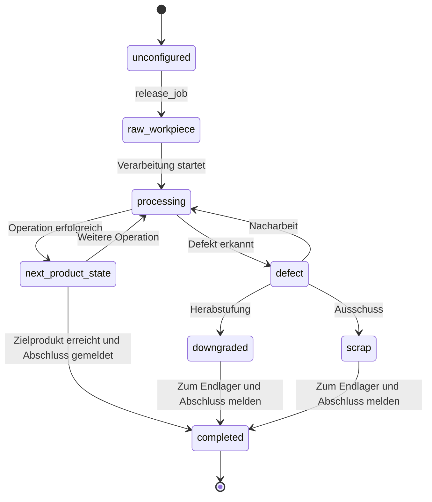

`downgraded` ist als eigener Ablaufzustand sichtbar. Im Code wird die
Herabstufung durch `downgraded=True` und den übernommenen Produktzustand
gespeichert.

### `SimRobot.py`, `SimRobotMain.py` und `SimRobotCorridorArm.py`

`SimRobot` stellt die gemeinsame Bewegungslogik für X, Y und Z bereit. Die
Unterklassen `SimRobotMain` und `SimRobotCorridorArm` führen die von der
Steuerung ausgewählten Pick- und Place-Aktionen aus (Job aufnehmen und
ablegen) und melden ihre Lade- und Bewegungszustände.

#### Aktionen und Bewegung

- **Aktionen der Steuerung:**
  - Main-Roboter: `pick_main_robot`, `place_main_robot`, `wait_main_robot`.
  - Korridorarm: `pick_corridor_arm_robot`, `place_corridor_arm_robot`,
    `wait_corridor_arm_robot`.
- **Simulationskern:** Führt den Transport des im Payload ausgewählten Jobs
  aus. Die Roboter wählen keinen Ersatzjob und keine neue Route. Die feste
  Grundgeschwindigkeit wird in `SimRobotMain.py` auf `2.0` und in
  `SimRobotCorridorArm.py` auf `1.5` gesetzt.
- **Seed/Reproduzierbarkeit:** `SimRobot.py` erzeugt bei jedem Aufruf von
  `move_x`, `move_y` oder `move_z` einen neuen Faktor zwischen `0.95` und
  `1.05`. Die effektive Geschwindigkeit berechnet sich als
  `Grundgeschwindigkeit × Zufallsfaktor`. Dadurch sind die
  Geschwindigkeitsschwankungen und die Bewegungsdauer für X, Y und Z bei
  gleicher Konfiguration und gleichem Seed im `SpineMLSimulationRunner`
  reproduzierbar.
- **Zustandsmeldung:** Nach Pick und Place werden Jobstandort, Beladung und
  Roboterzustand über die Bridge gemeldet. Beim Ablegen im Endlager wird
  außerdem `completed_time` gesetzt.

### `SimMachine.py`

`SimMachine` simuliert genau eine konfigurierte `Machine`. Die Steuerung
bestimmt Job, Operation, Maschine und Werkzeug; `SimMachine` führt die
ausgewählte Aktion aus. Dabei berücksichtigt sie Pufferkapazitäten,
Werkzeugwechsel, Werkzeuglebensdauer, Verarbeitungsdauer und Qualität.

#### Aufbau und Laufzeitdaten

- `self.machine` verweist auf die Fabrikkonfiguration der Maschine.
- `store_in` und `store_out` sind getrennte Eingangs- und Ausgangspuffer mit
  den konfigurierten Kapazitäten.
- `max_product_weight` und `max_product_volume` sind die größten Werte aller
  Produkte im Szenario. Sie werden für die Größenanpassung der
  Verarbeitungsdauer verwendet.
- `self.tool_types` ist eine eigene Kopie der Werkzeugliste der konkreten
  `Machine`. Dadurch kann die Simulation ihre Laufzeitliste unabhängig von der
  Fabrikkonfiguration verwalten. Für jeden Werkzeugtyp verwaltet
  `SimMachine` vier Werte:
  `remaining_life_units` ist der aktuelle Restwert,
  `remaining_life_units_t` dessen gültiger Simulationszeitpunkt,
  `remaining_life_units_next` der erwartete Restwert nach der laufenden
  Operation und `remaining_life_units_next_t` der Zeitpunkt, an dem dieser
  erwartete Wert erreicht wird.
- Zu Beginn gilt `self.dummy_tool_mounted = True`, während
  `self.tool_type = None` und `self.current_job = None` sind. Das bedeutet:
  Das Schutzwerkzeug ist montiert, aber noch kein Produktionswerkzeug und kein
  Job geladen.
- `self.processing_speed_factor` entsteht aus dem Basiswert `1.0` und einem
  einmaligen Zufallsfaktor zwischen `0.45` und `2.0`. `self.processing_variation`
  wird einmalig zufällig zwischen `0.90` und `1.10` erzeugt und multipliziert
  später die Verarbeitungsdauer. `self.startup_delay` wird einmalig zwischen
  `0` und `4` Zeiteinheiten erzeugt und nur vor der ersten Verarbeitung
  angewendet; `_startup_delay_applied` verhindert eine Wiederholung bei
  weiteren Jobs.

#### Prozess und Aktionen

Der Prozess läuft wiederholt ab:

1. Ist der Ausgangspuffer voll, setzt die Maschine den Zustand `blocked`,
   sonst `waiting`.
2. Die Maschine meldet ihren Zustand mit `bridge.request_action(self)` und
   wartet auf die von der Steuerung gelieferte Aktion.
3. Bei `pick_machine_job` nimmt sie genau den im Payload genannten Job aus dem
   genannten Store. Sie aktualisiert dessen `location`, übernimmt die
   `queue_priority` und speichert den Job in `self.current_job`.
4. Bei `process_machine_job` führt sie genau die übergebene Operation mit dem
   übergebenen Werkzeug aus.
5. Bei `wait_machine` wartet sie eine Simulationszeiteinheit und fordert
   anschließend eine neue Aktion an.

Die Maschine wählt weder selbst einen Job noch eine Operation oder ein
Werkzeug. Fehlt der ausgewählte Job im angegebenen Store, wird die Pick-Aktion
ohne Verarbeitung beendet.

#### Werkzeugwechsel und Lebensdauer

Die `process_machine_job`-Payload enthält unter anderem `operation`,
`tool_type`, `total_life_units`, `consumed_life_units`,
`remaining_life_units_before_operation`, `tool_setup_action` und
`target_store`.

Die Lebensdauer- und Zielwerte bedeuten:

- `total_life_units`: vollständige Lebensdauer des verwendeten Werkzeugs.
- `consumed_life_units`: Lebensdauer, die die aktuelle Operation verbraucht.
- `remaining_life_units_before_operation`: verbleibende Lebensdauer vor Beginn
  der Operation.
- `tool_setup_action`: Anweisung, ob das Werkzeug beibehalten, montiert,
  demontiert oder ersetzt wird.
- `target_store`: Ausgangspuffer, in den die Maschine den Job nach der
  Verarbeitung ablegt.

Je nach `tool_setup_action` führt die Maschine folgende Schritte aus:

- `keep_tool`: Das aktuelle Werkzeug bleibt montiert.
- `unmount_dummy_tool_and_mount_tool`: Das Schutzwerkzeug wird entfernt und
  das Produktionswerkzeug montiert.
- `unmount_and_mount_tool`: Das bisherige Produktionswerkzeug wird entfernt
  und das neue Werkzeug montiert.
- `replace_tool_same_type`: Das verbrauchte Werkzeug wird entfernt und durch
  ein Werkzeug desselben Typs ersetzt.

Wenn die verbleibende Lebensdauer für den Verbrauch der Operation nicht
ausreicht, wird beim Werkzeugwechsel ein neues Werkzeug mit
`total_life_units` angenommen. Nach der Operation wird die Lebensdauer um
`consumed_life_units` reduziert. Während der Verarbeitung wird der erwartete
Restwert anhand der geplanten Dauer geführt. Nach dem Abschluss wird er auf den
tatsächlichen Restwert gesetzt.

#### Verarbeitungsdauer

Die Größenberechnung verwendet den Zielprodukttyp des Auftrags
(`job.order.product_type`). `SimLayout` ermittelt die maximalen Gewichte und
Volumina aus diesen Produkttypen aller Aufträge. Das größte Gewicht und das
größte Volumen können zu unterschiedlichen Produkttypen gehören.

Zuerst werden relative Größenwerte gebildet:

```python
weight_ratio = product.weight / max_product_weight
volume_ratio = product_volume / max_product_volume
size_factor = 1.0 + 0.5 * weight_ratio + 0.5 * volume_ratio
```

Bei positiven Produktgrößen liegen die Verhältnisse zwischen `0` und `1`;
damit liegt `size_factor` zwischen `1.0` und `2.0`.
Die endgültige Dauer wird danach so berechnet:

```python
duration = operation.duration * size_factor / processing_speed_factor
duration *= processing_variation
```

Damit beeinflussen die Operationsdauer, die Produktgröße, die
Maschinengeschwindigkeit und eine kleine zufällige Laufzeitabweichung die
Verarbeitungsdauer.

#### Defektprüfung und Recovery

Nach Ablauf der Verarbeitungsdauer erzeugt die Maschine einen deterministischen
Qualitätszufallszahlengenerator. Sein Schlüssel enthält den Simulations-Seed,
das Szenario, den Auftrag, den Job, die Operation und den `rework_count`.
Die erste Zufallszahl wird mit `operation.defect_probability` verglichen. Nur
bei einem Defekt wird eine zweite Zufallszahl als `defect_severity` erzeugt.

```python
defect = quality_rng.random() < operation.defect_probability
defect_severity = quality_rng.random() if defect else None
```

Bei gleichem Seed und gleichem Kontext entstehen dadurch dieselbe
Defektentscheidung und derselbe Schweregrad. Ein relevanter Defekt ab
`0.001` wird mit `job.mark_defective()` gespeichert. Dabei werden Operation,
Maschine, Produktzustand vor der Operation, Zielzustand und Schweregrad im Job
festgehalten. Der bisherige `processing_state` bleibt im Defektfall erhalten.
Ohne relevanten Defekt setzt die Maschine `processing_state` auf den von der
Operation erzeugten Produkttyp und `general_state` auf `"intact"`.

Nach abgeschlossener Nacharbeit wird
`recovery_in_progress` zurückgesetzt. Die alte Auswahl von Operation und
Maschine wird gelöscht, damit die Steuerung die nächste Aktion neu bestimmen
kann. Die Auswahl der Recovery-Strategie selbst kommt aus der Steuerung; die
Simulation speichert sie nur und entfernt eine erledigte Rework-Strategie.

#### Seed und Reproduzierbarkeit

Ein Seed ist der Startwert eines Zufallszahlengenerators. Der
`SpineMLSimulationRunner` setzt vor jedem Lauf `random.seed(seed)`,
`sim.Environment(random_seed=seed)` und `SimMachine.QUALITY_SEED`.

Bei gleicher Konfiguration, gleichem Seed und demselben Entscheidungsablauf
sind dadurch folgende Zufallswerte reproduzierbar:

- `SimMachine.processing_speed_factor`: Basiswert der `Machine` multipliziert
  mit einem einmaligen Zufallsfaktor aus `0.45` bis `2.0`.
- `SimMachine.processing_variation`: Einmaliger Faktor aus `0.90` bis
  `1.10`, der die Verarbeitungsdauer multipliziert.
- `SimMachine.startup_delay`: Einmalige Anlaufverzögerung aus `0` bis `4`
  Zeiteinheiten.
- `SimRobot.movement_speed_multiplier`: Neuer Faktor für jede Achsenbewegung.
- Zufallsauswahl und Exploration des `BaselineActionSelector`.

Die Qualitätsprüfung verwendet einen eigenen `quality_rng`, dessen Startwert
aus `QUALITY_SEED`, Szenario, Auftrag, Jobnummer, Operation und
`rework_count` abgeleitet wird. Bei gleichem Schlüssel bleiben Defektentscheidung
und `defect_severity` gleich, auch wenn der Job auf einer anderen Maschine
verarbeitet wird. Eine andere Operation oder Nacharbeitsrunde ändert den
Schlüssel.

Der normale Aufruf `simulate(...)` besitzt derzeit kein `seed`-Argument.
Die hier beschriebene gemeinsame Seed-Vorgabe übernimmt der Runner für die
Optimierung.

#### Abschluss der Verarbeitung und Zustände

Nach der Verarbeitung wird der Job mit seiner Priorität in den im Payload
genannten Zielstore gelegt und seine `location` wird aktualisiert. Danach wird
`current_job` auf `None` gesetzt; die Maschine ist wieder frei und meldet ihren
neuen Zustand mit der nächsten `request_action()`-Anfrage.

Die wichtigsten Maschinenzustände sind:

- `waiting`: Die Maschine wartet auf eine Aktion.
- `blocked`: Der Ausgangspuffer kann keinen fertigen Job aufnehmen.
- `unmounting`: Ein Schutz- oder Produktionswerkzeug wird entfernt.
- `mounting`: Ein Produktions- oder Schutzwerkzeug wird montiert.
- `working`: Die Operation wird ausgeführt.
- `returning`: Die Verarbeitung ist beendet und der Job wird abgelegt.

`SimMachineShutdown` kann als eigene, einmalige Salabim-Komponente das
Produktionswerkzeug entfernen und wieder das Schutzwerkzeug montieren. Die
eigene Komponente trennt diesen einmaligen Ablauf von der wiederholten
Jobverarbeitung in der `while`-Schleife von `SimMachine`.

Im aktuellen `SpineMLSimulationRunner` wird der Abschlussprozess nicht
gestartet. Auch `simulate()` überspringt ihn, wenn der
`SimCompletionWatcher` den Lauf beendet hat. Die Klasse allein bewirkt daher
keinen automatischen Werkzeugwechsel am Ende jedes Laufs.

Die globale Kennzahl `tool_change_time` addiert tatsächlich ausgeführte
Montage- und Demontagezeiten. Der Makespan verwendet die gespeicherten
Jobabschlusszeiten; ein separat ausgeführter Werkzeugabschluss verlängert
diese nicht.

#### UML-Zustandsdiagramm von `SimMachine`

Das Diagramm zeigt die Zustände der Maschine während eines normalen
Simulationslaufs. Die Jobauswahl erfolgt weiterhin durch die Steuerung über
die `SimulationBridge`.

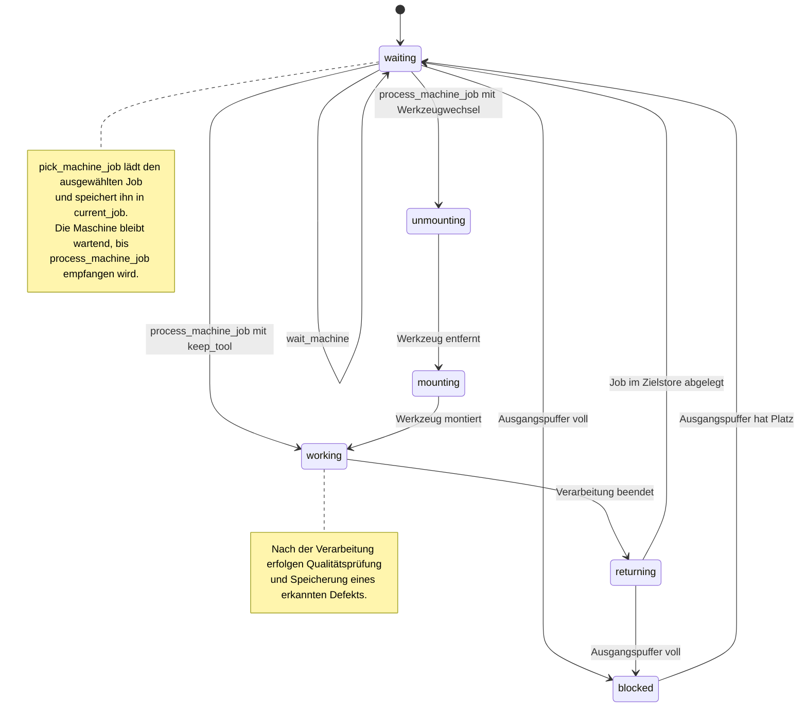

### `SimScenario.py` und `SimCompletionWatcher`

`SimScenario` erzeugt für jeden Auftrag eine `SimOrder`-Komponente.
`SimOrder` erzeugt die einzelnen `SimOrderJob`-Komponenten und reicht die
`SimulationBridge` an sie weiter. Die Jobs registrieren sich selbst bei der
Bridge; `SimOrder` benötigt keine eigenen Steuerungsaktionen.

Zusätzlich erzeugt `SimScenario` den unabhängigen `SimCompletionWatcher`,
der das Ende der Jobprozesse überwacht.

#### Automatisches Simulationsende

`SimScenario` erstellt beim Aufbau des Szenarios den
`SimCompletionWatcher`. Der Watcher ist eine Salabim-`sim.Component`; seine
`process()`-Methode läuft als Simulationsprozess. Sie sammelt einmalig alle
Jobs aus den erzeugten Aufträgen und prüft regelmäßig, ob jeder Job das Flag
`process_finished=True` besitzt. Das Flag wird durch eine Abschlussaktion mit
`finish_process=True` gesetzt. Sobald alle Jobs abgeschlossen sind, löst der
Watcher `sim.SimulationStopped` aus. Der Simulationsrunner fängt dieses Signal
ab und sammelt anschließend die globalen Kennzahlen.

## SimulationBridge

Die `SimulationBridge` verbindet den Simulationskern mit der Policy. Die
Simulation verwendet echte Python- und Salabim-Objekte; die Policy erhält
deren Daten und IDs (eindeutige Bezeichnungen innerhalb des jeweiligen
Registers).

### Registrierung und Aktions-Stores

Jobs, Maschinen, Main-Roboter und Korridorarm-Roboter registrieren sich mit
`register()`. Die Bridge speichert ihre IDs und erzeugt für jedes dieser
Objekte einen eigenen Aktions-Store (Warteschlange für ausgewählte Aktionen).

Korridore werden mit `register_corridor()` und ihre Stores mit
`register_store()` für die ID-Auflösung registriert. Sie erhalten keine
eigenen Steuerungsaktionen. `SimLayout`, `SimCorridorArm`, `SimOrder`,
`SimScenario` und `SimCompletionWatcher` benötigen ebenfalls keinen eigenen
Aktions-Store.

### Warum die Policy IDs verwendet

Eine ID beschreibt, auf welches Objekt sich eine Aktion bezieht, ohne das
Objekt selbst an die Policy zu übergeben. Dadurch bleibt die Policy von den
Salabim-Komponenten getrennt und ihre Daten lassen sich einfacher speichern
oder übertragen.

Konfigurations- und Simulationsobjekte werden dabei getrennt aufgelöst:

- `selected_machine_id: "CNC A"` wird im Maschinenregister zur konfigurierten
  `Machine` mit dem Namen `"CNC A"`.
- Die Ziel-ID `"SimMachine:CNC A:left"` bezeichnet dagegen die ausführende
  `SimMachine`-Komponente.
- `target_store_id: "CNC A in"` bezeichnet den echten Salabim-Eingangspuffer
  dieser Maschine.

Die Zuordnungen stehen in `policy_payload_id_mappings()` in
`InterfaceTypes.py`. `create_simulation_actions()` ersetzt die ID-Felder
des Policy-Payloads durch die zugehörigen Objektfelder, zum Beispiel
`selected_machine_id` durch `selected_machine`.

### Zustände melden und Aktionen empfangen

Ein aktionsfähiges Objekt durchläuft wiederholt diese Schritte:

1. `yield bridge.request_action(self)` markiert es als wartend und meldet eine
   Zustandsänderung.
2. `action = yield bridge.action(self)` entnimmt die ausgewählte Aktion aus
   seinem Aktions-Store.
3. Das Objekt führt die Aktion aus und aktualisiert seine Daten.
4. Für seine nächste Entscheidung fordert es erneut eine Aktion an.

`request_action()` ruft intern `notify_state_change()` auf. Diese Methode
erhöht die gemeldete Zustandsversion und legt einen `PolicyTrigger` mit
Sender-ID, Ereignis-ID, Simulationszeit und Versionsnummer in den zentralen
`policy_trigger_store`. Andere Komponenten können auch nur eine
Zustandsänderung melden, ohne gleichzeitig eine neue Aktion anzufordern.

Bei `SimMachine` übernimmt nach dem Ablegen des Jobs die nächste
`request_action()`-Anfrage die Meldung. Roboter und Jobs verwenden zusätzlich
`notify_state_change()` an den im Code vorgesehenen Übergängen.

### Snapshot und Aktualitätsprüfung

Die Bridge sammelt bereits eingegangene Trigger derselben Simulationszeit,
damit sie diese gemeinsam in einer Entscheidung berücksichtigen kann.
`create_policy_observation()` erstellt dafür einen Snapshot (Datenabbild
des aktuellen Zustands) mit:

- `time` und `state_version`: Simulationszeit und gemeldete Zustandsversion.
- `simulation_object_states_by_id`: Zustände der registrierten Jobs,
  Maschinen und Roboter. Dazu gehören auch Daten ihrer Stores und enthaltenen
  Jobs sowie die Markierung `is_waiting_for_action`.
- `configuration_model`: ID-basierte Daten zu Layouts, Korridoren, Maschinen,
  Operationen, Produkt- und Werkzeugtypen. Dieses Modell wird beim ersten
  Snapshot aufgebaut und danach wiederverwendet.
- Trigger- und Sender-IDs als Metadaten, wenn eine Triggergruppe vorliegt.

Die Bridge übergibt die `PolicyObservation` an `policy.make_decision()`.
Die Triggerobjekte selbst werden nicht an die Policy weitergereicht.

Vor der Verwendung der Entscheidung vergleicht die Bridge die
`state_version` des Snapshots mit ihrer aktuellen Versionsnummer. Wurde
inzwischen eine weitere Zustandsänderung gemeldet, erstellt sie Snapshot und
Entscheidung erneut. Eine Entscheidung wird erst bei übereinstimmenden
Versionsnummern in `SimulationAction`-Objekte übersetzt und verteilt.

### Ablauf zwischen Simulation und Policy

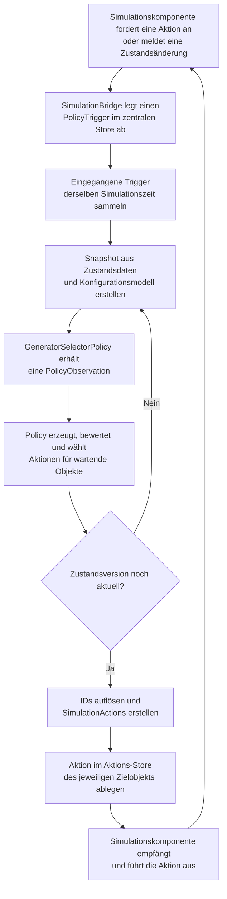

### UML-Sequenzdiagramm eines Simulationszyklus

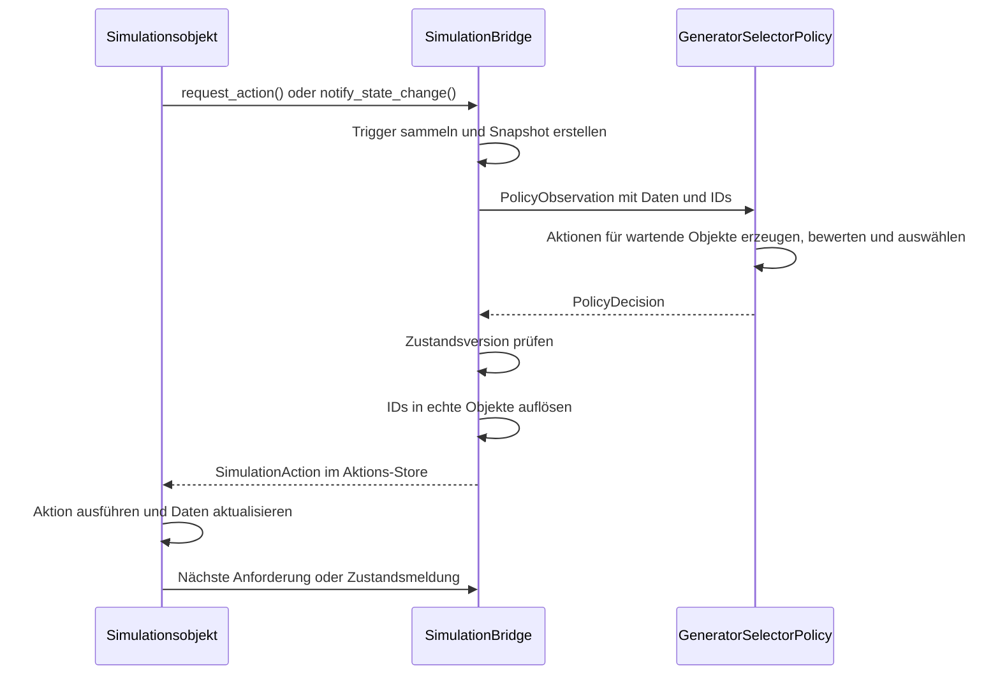

Eine `PolicyDecision` kann Aktionen für mehrere wartende Objekte enthalten.
Jede Komponente erhält nur die für sie ausgewählte Aktion.

## GeneralControl

Die Klassen unter [Control/GeneralControl](sources/SpineML/Control/GeneralControl)
verbinden Aktionsgenerierung, Bewertung und Auswahl. Standardmäßig wird die
heuristische `GeneratorSelectorPolicy` verwendet; bei der Optimierung ändern
sich ihre Bewertungsgewichte. Als einfache Vergleichssteuerung steht außerdem
die [RandomPolicy](#randompolicy-zufällige-vergleichssteuerung) ohne heuristische
Bewertung zur Verfügung.

### Ablauf der GeneralControl

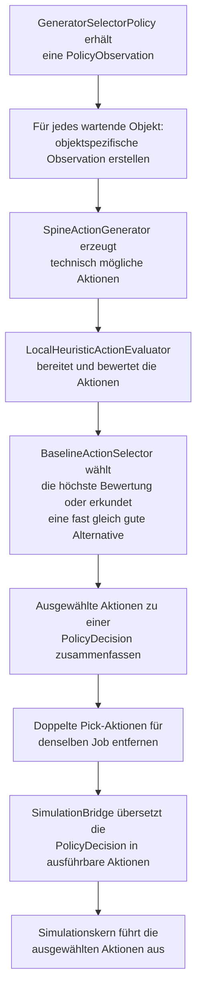

### GeneratorSelectorPolicy

Aus Sicht der Simulation ist `GeneratorSelectorPolicy` die Policy. Sie ist
für die Koordination zuständig und verbindet drei austauschbare Bausteine:

- `ActionGenerator` erzeugt aus der Beobachtung die technisch möglichen
  Aktionen für das aktuell betrachtete wartende Simulationsobjekt.
- `ActionEvaluator` bewertet diese Aktionen anhand gewichteter
  Dispatching-Regeln, zum Beispiel EDD-Termindruck, Queue-Priorität,
  Transportzeit, Verarbeitungszeit, Werkzeugzustand und Defekt-Recovery.
- `ActionSelector` wählt normalerweise die Aktion mit dem höchsten Score aus.
  Der `BaselineActionSelector` kann gelegentlich auch eine fast gleich gute
  Alternative zur Exploration auswählen.

Die Policy prüft im Snapshot, welche Simulationskomponenten auf eine Aktion
warten. Für jedes wartende Objekt erstellt sie eine objektspezifische
`PolicyObservation`, lässt mögliche Aktionen erzeugen, bewerten und auswählen
und sammelt die Ergebnisse in einer `PolicyDecision`. Doppelte Pick-Aktionen
für denselben Job werden anschließend entfernt.

Beim normalen Simulationsstart verwendet die Policy
`SpineActionGenerator`, `BaselineActionSelector` und
`LocalHeuristicActionEvaluator` mit einem festen `HeuristicWeights`-Satz.

#### Ablauf von `make_decision()`

1. Die Policy liest aus dem Snapshot alle Simulationskomponenten, die auf eine
   Aktion warten.
2. Für jedes wartende Objekt wird eine eigene `PolicyObservation` mit seiner
   `current_object_id` erstellt.
3. `ActionGenerator` erzeugt die technisch möglichen Aktionen dieses Objekts.
4. `ActionSelector` lässt diese Kandidaten durch den `ActionEvaluator` bewerten
   und wählt normalerweise die Aktion mit dem höchsten Score aus.
5. Die ausgewählten `SelectedObjectAction`-Objekte werden zu einer
   `PolicyDecision` zusammengefasst und an die Bridge zurückgegeben.
6. Ein Job darf nicht gleichzeitig von mehreren Pick-Aktionen ausgewählt
   werden; solche doppelten Picks entfernt die Policy vor der Rückgabe.

### ActionGenerator

`SpineActionGenerator.generate_actions()` erzeugt für ein einzelnes wartendes
Simulationsobjekt eine Liste technisch möglicher Aktionen. Zuerst
bestimmt `_generate_actions()` anhand von Objekttyp und Zustand, welche
Kandidaten benötigt werden. `generate_actions()` entfernt anschließend
identische Duplikate.

#### Einfache Zustandsregeln

`_generate_actions()` prüft zuerst den Typ und den aktuellen Zustand des
Objekts. Die Verzweigung für einen Job entspricht dabei dieser Reihenfolge:

**Job:**

- `completed_time` vorhanden und `due_state` noch nicht gesetzt
  - `complete_job` setzt den Terminstatus und übergibt `finish_process=True`.
- `general_state == "defect"` → `create_defect_actions_for_job()`:
  - Laufende Nacharbeit (`recovery_in_progress == True`) → nur `wait_job`.
  - Schweregrad außerhalb von `0.001 <= defect_severity < 0.6`
    → nur `job_scrap`.
  - Schweregrad im Nacharbeitsbereich → mögliche Nacharbeitsaktionen,
    `downgrade_product` und `wait_job`.
- `released == False`
  - `release_job` und zusätzlich `wait_job`.
- Alle anderen Jobzustände
  - `wait_job`.

Ein bereits herabgestufter Job erhält selbst zunächst `wait_job`, bis seine
Abschlussaktion ansteht. Seine Markierung `downgraded=True` wird bei der
Routen- und Transportgenerierung berücksichtigt: Die Roboter bringen ihn
zum Endlager, statt ihn einer weiteren normalen Operation zuzuführen.

Für Roboter und Maschinen gelten folgende Zustandsregeln:

**Main-Roboter oder Korridorarm:**

- `current_job_id == None` → Pick-Kandidaten und Warteaktion.
- `current_job_id != None` → Place-Kandidaten und Warteaktion.

**Maschine:**

- `current_job_id == None` → Pick-Kandidaten und Warteaktion.
- `current_job_id != None` und Ausgangspuffer hat Kapazität →
  `process_machine_job`.
- `current_job_id != None` und Ausgangspuffer ist voll → `wait_machine`.

Die Routenberechnung prüft Maschinentyp, Layout und erlaubte Werkzeuge.
Beim Erzeugen einer konkreten Transportaktion werden unter anderem die
Zielkapazitäten geprüft. Ob eine Maschine für Nacharbeit momentan frei ist,
wird zusätzlich anhand ihres Zustands und ihrer Puffer beurteilt.

#### Mehrere Kandidaten pro wartendem Objekt

Wenn die Zustandsregel mehrere Möglichkeiten zulässt, erzeugt der Generator
alle diese Kandidaten gleichzeitig in einer Liste. „Gleichzeitig“ bedeutet
hier dieselbe Auswahlrunde, nicht parallele Ausführung in der Simulation. Der
`ActionSelector` lässt die Kandidaten vom `ActionEvaluator` bewerten und
wählt eine Aktion für dieses Objekt aus.
Die folgenden Payloads zeigen jeweils nur ein Beispiel aus dieser Liste; die
Kandidaten werden gemeinsam erzeugt, aber nicht gemeinsam ausgeführt.

**Defekter Job mit technisch möglicher Nacharbeit:**

1. `job_rework_on_defect_machine` (wenn die Defektmaschine verfügbar
   ist).
2. `job_rework_on_alternative_machine` (für jede gefundene
   Alternativroute).
3. `downgrade_product`.
4. `wait_job`.

Liegt der Schweregrad außerhalb des technisch nacharbeitbaren Bereichs,
wird stattdessen ausschließlich `job_scrap` erzeugt.

Liegt er im nacharbeitbaren Bereich, aber ist weder eine alternative Route
vorhanden noch die Defektmaschine verfügbar, bleiben `downgrade_product` und
`wait_job` als Kandidaten. Die Herabstufung erfolgt dann nicht automatisch;
die Policy wählt eine dieser beiden Aktionen.

Eine Herabstufung kann nach jeder fehlerhaften Operation erfolgen. Der dabei
verwendete Produkttyp ist der vorgesehene Produkttyp dieser Operation und kann
deshalb auch ein Zwischenprodukt sein; er muss nicht dem endgültigen
Auftragsziel entsprechen. Dieser Produkttyp wird bei der Herabstufung
als aktueller `processing_state` übernommen und mit `downgraded=True`
als qualitativ herabgestuft markiert. Für die Herabstufung setzt der Payload
außerdem `general_state="intact"`; die Qualitätsabweichung bleibt am
separaten Flag erkennbar.

Beispiel für eine Herabstufungsaktion:

```json
{
  "action_type": "downgrade_product",
  "payload": {
    "selected_operation_id": null,
    "selected_machine_id": null,
    "processing_state": "produkt_b",
    "general_state": "intact",
    "downgraded": true,
    "downgrade_product_type_id": "produkt_b",
    "defect_recovery_strategy": "downgrade"
  }
}
```

**Pick:**

1. Eine eigene `pick_*`-Aktion für jeden auswählbaren Job im Store (Beispiel:
   zwei Jobs erzeugen zwei Pick-Kandidaten).
2. Zusätzlich eine `wait_*`-Aktion.

Beispiel für eine Pick-Aktion des Main-Roboters:

```json
{
  "action_type": "pick_main_robot",
  "payload": {
    "target_type": "start_storage",
    "target_store_id": "start",
    "selected_job_id": "auftrag_1:1",
    "storage_out_time": 1.0
  }
}
```

**Place:**

1. Eine eigene `place_*`-Aktion für jede technisch mögliche Route und jeden
   freien Zielstore (Beispiel: zwei freie Zielrouten erzeugen zwei
   Place-Kandidaten).
2. Zusätzlich eine `wait_*`-Aktion.

Beispiel für eine Place-Aktion des Main-Roboters:

```json
{
  "action_type": "place_main_robot",
  "payload": {
    "target_type": "sim_corridor_store_arm_input",
    "selected_operation_id": "operation_1",
    "selected_machine_id": "machine_1",
    "sim_corridor_id": "corridor_1",
    "target_store_id": "corridor_1 left",
    "storage_in_time": 1.0
  }
}
```

**Maschine:**

1. Eine eigene `pick_machine_job`-Aktion für jeden auswählbaren Job im
   Eingangspuffer.
2. Für einen geladenen Job `process_machine_job` bei freiem Ausgangspuffer;
   bei fehlender Kapazität `wait_machine` (Beispiel: voller Ausgangspuffer).

Beispiel für eine Verarbeitungsaktion:

```json
{
  "action_type": "process_machine_job",
  "payload": {
    "operation_id": "operation_1",
    "planned_machine_id": "machine_1",
    "tool_type_id": "tool_1",
    "total_life_units": 100,
    "consumed_life_units": 5,
    "remaining_life_units_before_operation": 80,
    "tool_setup_action": "keep_tool",
    "target_store_id": "machine_1 out"
  }
}
```

Die Hilfsmethoden lesen dafür den aktuellen Snapshot, das ID-basierte
Konfigurationsmodell, Store-Kapazitäten und mögliche Operations- und
Maschinenrouten. `generate_actions()` entfernt danach nur exakt doppelte
Kandidaten. Damit ist gemeint: gleicher `action_type` und gleicher Payload.
Kandidaten mit unterschiedlichen Payloads bleiben erhalten. Verschiedene
vollständige Routen können dagegen denselben nächsten Schritt haben und
dadurch eine identische Aktion ergeben. Der Selector lässt die verbleibenden
Kandidaten bewerten und wählt eine davon aus.

#### Berechnung von Operations- und Maschinenrouten

`calculate_operation_sequences_between()` ermittelt die Operationsfolgen vom
aktuellen Produkttyp bis zum Auftragsziel. Für jede Operationsfolge berechnet
`calculate_machine_sequences_from_operation_sequence()` die passenden
Maschinenfolgen. Jede Kombination bildet eine Route.

`selectable_routes_for_job()` gibt für einen normalen Job diese Routen
zurück. Wurde bereits Nacharbeit mit einer konkreten Operation und Maschine
gewählt, liefert die Methode nur diesen festgelegten Nacharbeitsschritt.

Für alternative Nacharbeit liest
`find_rework_routes_with_alternative_machine()` die benötigten IDs aus der
Beobachtung. `find_alternative_rework_routes()` berechnet den weiteren Weg
ab dem Produkttyp, den die fehlerhafte Operation erzeugen sollte. Sie setzt
die fehlerhafte Operation vor jede Restfolge und berechnet dazu die
Maschinenfolgen. Routen, deren erste Maschine die Defektmaschine ist, werden
übersprungen. Die Defektmaschine ist damit nur für die wiederholte Operation
ausgeschlossen; spätere Operationen können sie wieder verwenden.

### ActionSelector

Der `ActionSelector` erhält die gesamte Kandidatenliste eines wartenden
Objekts. Er erzeugt keine neuen Aktionen, sondern lässt jeden Kandidaten vom
`ActionEvaluator` vorbereiten und bewerten. Der Standard-
`BaselineActionSelector` arbeitet dabei in folgenden Schritten:

1. Gibt es für das wartende Objekt keine Aktion, gibt er eine leere
   `PolicyDecision` zurück.
2. Für jede vorhandene Aktion ergänzt der `ActionEvaluator` zunächst die
   benötigten Payload-Werte und berechnet danach ihren Score.
3. Der höchste Score wird gesucht. Alle Aktionen mit genau diesem Score gelten
   als beste Aktionen.
4. Zusätzlich gelten Aktionen als fast gleich gut, wenn ihr Score höchstens
   `0.05` unter dem höchsten Score liegt. Bei einem Höchstwert von `0.80`
   werden zum Beispiel auch Aktionen ab `0.75` als fast gleich gut gesammelt.
5. **Exploration:** Exploration bedeutet, gelegentlich bewusst nicht die
   aktuell beste Aktion zu verwenden, sondern eine fast gleich gute Alternative
   auszuprobieren. Mit `EXPLORATION_EPSILON = 0.10` geschieht das mit einer
   Wahrscheinlichkeit von `10 %`. Wenn möglich, wird dabei eine ausführbare
   Aktion statt einer reinen Warteaktion verwendet. So können andere
   Produktionswege getestet werden, ohne deutlich schlechtere Aktionen zu
   wählen.
   Diese Exploration betrifft nur die Aktionsauswahl während eines
   Simulationslaufs. Sie verändert keine lokalen Gewichtssätze, kann aber den
   weiteren Simulationsverlauf und dadurch die globalen Kennzahlen beeinflussen.
   Das ist bei der Optimierung nützlich, weil dadurch auch fast gleich gute
   Produktionsentscheidungen ausprobiert werden und sich die Simulation nicht
   dauerhaft auf eine möglicherweise ungünstige lokale Aktionswahl festlegt.
   Die Verwendung derselben
   Seeds und die Mittelung über mehrere Seeds halten diesen Einfluss
   reproduzierbar und vergleichbar.
   Die Exploration verändert dabei keine Scores und keine Gewichte. Ob zum
   Beispiel `job_rework_on_defect_machine` gegenüber
   `job_rework_on_alternative_machine` bevorzugt wird, entscheidet die
   normale Score-Berechnung aus den lokalen Teilwertgewichten.
6. **Keine Exploration:** In den übrigen Fällen wählt der Selector zufällig
   eine der exakt besten Aktionen. Diese Zufallsauswahl löst nur Gleichstände
   auf und bleibt mit demselben Simulations-Seed reproduzierbar.

Die ausgewählte Aktion wird anschließend als `PolicyDecision` für das
Zielobjekt an die `GeneratorSelectorPolicy` zurückgegeben.

### RandomPolicy: zufällige Vergleichssteuerung

[`RandomPolicy`](sources/SpineML/Control/GeneralControl/RandomPolicy.py) verwendet
denselben `SpineActionGenerator` und dieselbe `SimulationBridge` wie die
heuristische Steuerung. Sie nutzt jedoch keinen Evaluator, keine Scores,
keine Gewichte und keine EDD-Priorität.

`make_decision()` wählt für jedes wartende Objekt:

1. Der Generator liefert die technisch möglichen Aktionskandidaten.
2. Picks für einen in dieser Entscheidung bereits ausgewählten Job werden
   ausgeschlossen, damit derselbe Job nicht gleichzeitig zweimal gepickt wird.
3. Gibt es Nicht-Warteaktionen, wird **gleichverteilt unter diesen Kandidaten**
   gewählt. Jeder verbleibende Kandidat hat die Wahrscheinlichkeit `1 / n`.
4. Nur wenn keine Nicht-Warteaktion verfügbar ist, wird eine angebotene
   `wait_*`-Aktion gewählt. Ohne Kandidaten wird keine Aktion zurückgegeben.

„Produktiv“ bedeutet hier Nicht-Warteaktion, also beispielsweise Freigabe,
Pick, Ablegen, Verarbeitung oder eine technisch mögliche Defektbehandlung.
Die Auswahl erfolgt pro Kandidat, nicht pro Aktionsart: Drei verschiedene
Routenkandidaten sind drei Auswahlmöglichkeiten. Bei Picks setzt die Policy
`queue_priority = 0.0`; sie priorisiert Jobs also nicht nach ihrer Deadline.
Die vorhandene Store-Reihenfolge bei gleicher Priorität bleibt bestehen.

Damit ist sie eine **Zufallsreferenz mit Warten als Fallback**, keine Steuerung
ohne technische Regeln. Der Generator prüft weiterhin die technische
Zulässigkeit. Die Heuristik bleibt die Standardsteuerung; die Zufallspolicy
wird als Alternative eingesetzt.

Ein Headless-Lauf mit dieser Policy:

```python
from SpineML.Control.GeneralControl import RandomPolicy
from SpineML.Control.HeuristicControl import SpineMLSimulationRunner

runner = SpineMLSimulationRunner(layout, scenario)
metrics = runner.run_policy(RandomPolicy(seed=101), seed=101)
```

Für jeden Lauf wird eine neue Policy erzeugt. Ihr eigener Zufallszahlengenerator
steuert nur die Aktionsauswahl; der Runner setzt zusätzlich den Simulations-Seed.
Im Headless-Runner verwendet auch der heuristische Selector einen eigenen
Zufallszahlengenerator. Dadurch verbrauchen Policy-Entscheidungen keine
Zufallszahlen des Simulationskerns.

## HeuristicControl

### Ziel und Grundidee

**Ziel:** `HeuristicControl` berechnet für alle vom `ActionGenerator`
erzeugten **Aktionskandidaten** (technisch mögliche Aktionen) der aktuellen
Entscheidungsrunde einen **Score** (numerischen Bewertungswert). Der
`ActionSelector` vergleicht diese Scores und wählt eine Aktion aus.
`HeuristicControl` erzeugt keine Aktionen und führt sie nicht selbst in der
Simulation aus.

**„Heuristisch“** bedeutet, dass vereinfachte Entscheidungsregeln verwendet
werden, zum Beispiel „Bevorzuge einen dringenden Job“ oder „Bevorzuge einen
kurzen Transport“. Mehrere solcher Regeln werden gewichtet miteinander
verbunden. Das ermöglicht eine schnelle Auswahl, garantiert aber keine
insgesamt optimale Produktionsplanung.

Eine solche lokale Prioritätsregel wird auch **Dispatching-Regel** genannt:
Sie legt fest, was bei der aktuellen Auswahl bevorzugt wird, ohne einen
vollständigen Plan für alle zukünftigen Zustände zu berechnen.

**Dynamische Produktionsplanung:** Der Simulationszustand ändert sich laufend,
zum Beispiel wenn eine Maschine frei wird oder ein Defekt auftritt. Deshalb
werden die erzeugten Kandidaten bei jeder neuen Beobachtung anhand des dann
aktuellen Zustands erneut bewertet.

### Ablauf der Bewertung

Die konkrete Umsetzung des `ActionEvaluator` (Bewertungsteil der Policy)
steht in
[LocalHeuristicActionEvaluator.py](sources/SpineML/Control/HeuristicControl/LocalHeuristicActionEvaluator.py).

1. **Kandidaten vorbereiten:** `prepare_action_candidate()` kopiert den
   Kandidaten. Bei Pick-Aktionen ergänzt es die aktuelle Termindruckpriorität
   des ausgewählten Jobs als `queue_priority` im Payload.
2. **Rohwerte ermitteln:** `evaluate_action()` ruft je nach `action_type`
   die passende Bewertungsmethode auf, etwa `evaluate_machine_pick_action()`.
   Diese liest die **Bewertungsgrößen** (Rohwerte der Kriterien, zum Beispiel
   eine Transportzeit von vier Zeiteinheiten) aus dem Simulationszustand,
   der Konfiguration und den Aktionsdaten.
3. **Rohwerte abbilden:** Die heuristischen Regeln bestimmen, wie daraus
   **Teilwerte** (auf den Bereich `0` bis `1` abgebildete Werte) entstehen.
   Zum Beispiel liefert `inverse_scale(4)` den Teilwert `0.2`.
4. **Score berechnen:** `calculate_action_score()` verbindet die Teilwerte
   mit ihren Gewichten (relativer Wichtigkeit) zu einem Gesamtscore.
   Bei bestimmten Defektaktionen wird anschließend eine Deadline-Strafe
   abgezogen. Der Endscore kann dadurch negativ werden und wird nicht
   nachträglich begrenzt.

Der `BaselineActionSelector` verwendet die fertigen Scores zur Auswahl.
Er wählt eine bestbewertete Aktion oder erkundet gelegentlich eine fast
gleich gute Alternative. Erst der Simulationskern führt die ausgewählte
Aktion aus.

### Bewertungsgrößen und heuristische Regeln

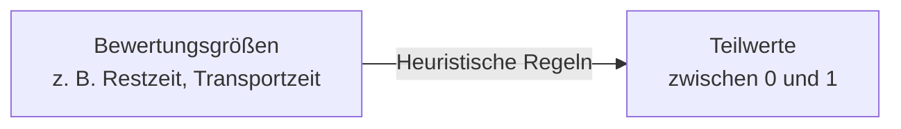

Die **heuristische Regel** legt fest, was bevorzugt wird, etwa ein kurzer
Transport. Die zugehörige Formel bildet den Rohwert auf einen Teilwert ab.
So setzt `inverse_scale(4) = 0.2` die Regel „Kürzere Transportzeiten
bevorzugen“ rechnerisch um.

Die Teilwerte sind dimensionslos, obwohl ihre Rohwerte unterschiedliche
Einheiten haben. Für alle gilt: **Ein höherer Teilwert bedeutet einen
größeren Vorteil für die betrachtete Aktion.**

Regeln und [Aktionstypen](#verwendung-der-bewertungsgrößen-nach-aktionstyp)
sind über ihre Kriterien gegenseitig verlinkt.
Die folgenden Regeln erklären jeweils Rohwert, Abbildung und Beispiel.

### Allgemeine heuristische Regeln

#### 1. Termindruck: dringendere Jobs bevorzugen

- **Bewertungsgröße:** Restzeit `t = latest_end_time − aktuelle Zeit`.
  `latest_end_time` ist die Deadline des Auftrags, zu dem der Job gehört.
- **Regel:** Je näher die Deadline liegt oder je weiter sie überschritten
  ist, desto höher ist die EDD-Priorität (`Earliest Due Date`).
- **Abbildung in `calculate_edd_priority()`:**
  - Bei `t >= 0`: `Teilwert = 0.5 × inverse_scale(t)`.
  - Bei `t < 0`: `Teilwert = 0.5 + 0.5 × direct_scale(-t)`.
- **Beispiel:** Zwei Zeiteinheiten vor der Deadline ergibt sich etwa
  `0.167`, genau bei der Deadline `0.5` und zwei Zeiteinheiten danach etwa
  `0.833`. Negative Restzeit wird also als Überfälligkeit behandelt.

Vor der Deadline liegt die Priorität unter `0.5`, genau bei der Deadline
beträgt sie `0.5`, danach liegt sie darüber. Sie nähert sich bei sehr großer
Restzeit `0` und bei sehr großer Überfälligkeit `1`.

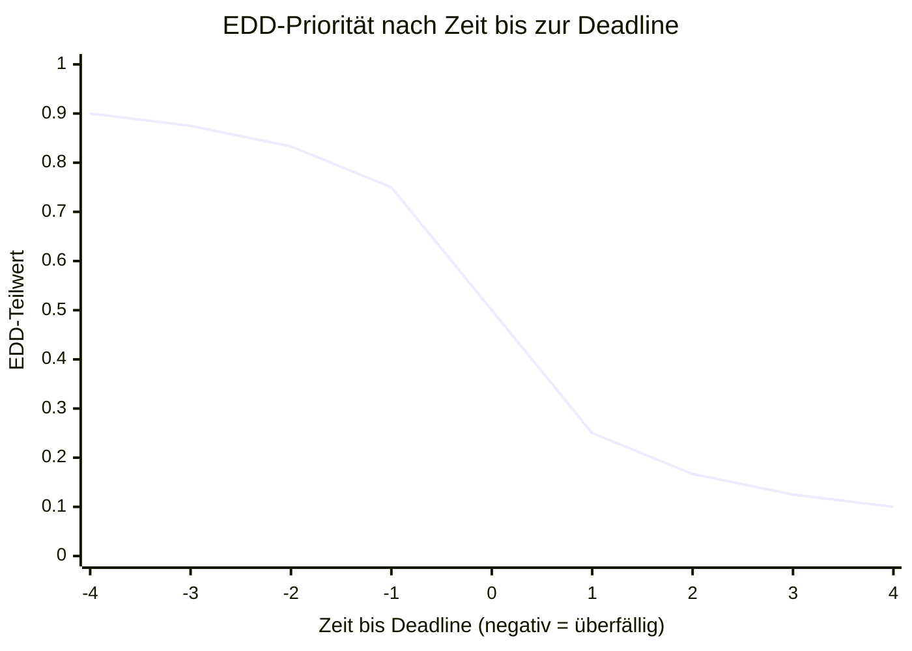

**Verwendung:** [Freigabe](#freigabe-release_job),
[Roboter-Pick](#roboter-pick-pick_main_robot-und-pick_corridor_arm_robot),
[Maschinen-Pick](#maschinen-pick-pick_machine_job),
[normales Warten](#normales-warten-wait_) und
[Warten bei einem Defekt](#warten-bei-einem-defekt-wait_job).

#### 2. Verarbeitungs-, Transport- und Lagerzeiten: kürzere Zeiten bevorzugen

- **Bewertungsgröße:** Eine nichtnegative Zeit `x`.
- **Regel:** Eine kürzere Zeit soll einen höheren Teilwert ergeben.
- **Abbildung:** `inverse_scale(x) = 1 / (1 + x)`.
- **Beispiel:** Zeit `1 → 0.5`; Zeit `4 → 0.2`.

Bei `x = 0` ergibt sich `1`; mit wachsendem `x` nähert sich der Teilwert `0`.

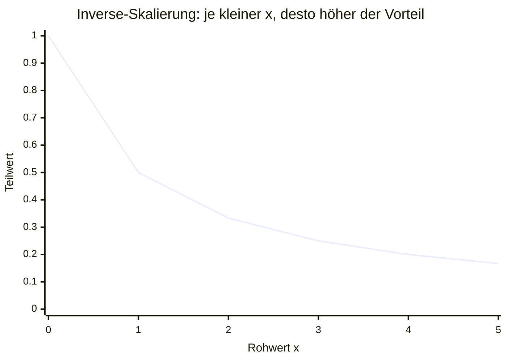

**Verwendung:** [Freigabe](#freigabe-release_job),
[Roboter-Pick](#roboter-pick-pick_main_robot-und-pick_corridor_arm_robot),
[Maschinen-Pick](#maschinen-pick-pick_machine_job),
[Ablegen](#ablegen-place_main_robot-und-place_corridor_arm_robot),
[Nacharbeit auf der Defektmaschine](#nacharbeit-auf-der-defektmaschine-job_rework_on_defect_machine) und
[Nacharbeit auf einer anderen Maschine](#nacharbeit-auf-einer-anderen-maschine-job_rework_on_alternative_machine).

#### 3. Maschinenwarteschlange: weniger wartende Jobs bevorzugen

- **Bewertungsgröße:** Anzahl `n` der Jobs im Eingangspuffer der Maschine.
- **Regel:** Eine kürzere Warteschlange soll einen höheren Teilwert ergeben.
- **Abbildung:** `inverse_scale(n) = 1 / (1 + n)`.
- **Beispiel:** Kein wartender Job ergibt `1`; drei wartende Jobs ergeben
  `0.25`.

**Verwendung:** [Ablegen](#ablegen-place_main_robot-und-place_corridor_arm_robot),
[Nacharbeit auf der Defektmaschine](#nacharbeit-auf-der-defektmaschine-job_rework_on_defect_machine) und
[Nacharbeit auf einer anderen Maschine](#nacharbeit-auf-einer-anderen-maschine-job_rework_on_alternative_machine).

#### 4. Werkzeugpassung: ein bereits montiertes passendes Werkzeug bevorzugen

- **Bewertungsgröße:** Übereinstimmung zwischen benötigtem und montiertem
  Werkzeugtyp. Jede Operation hat einen festgelegten benötigten Werkzeugtyp.
- **Regel und Abbildung:** Gleicher Werkzeugtyp ergibt den Teilwert `1`,
  ein anderer Werkzeugtyp oder kein montiertes Werkzeug ergibt `0`.
  Das Kriterium geht bei Maschinen-Pick und Nacharbeit immer ein.
- **Beispiel:** Benötigt die Operation Fräser A und Fräser A ist montiert,
  ist der Teilwert `1`; bei montiertem Fräser B ist er `0`.

**Verwendung:** [Maschinen-Pick](#maschinen-pick-pick_machine_job),
[Nacharbeit auf der Defektmaschine](#nacharbeit-auf-der-defektmaschine-job_rework_on_defect_machine) und
[Nacharbeit auf einer anderen Maschine](#nacharbeit-auf-einer-anderen-maschine-job_rework_on_alternative_machine).

#### 5. Werkzeugreserve: mehr Lebensdauer im Verhältnis zum Verbrauch bevorzugen

- **Bewertungsgröße:** Verhältnis
  `r = verbleibende Werkzeuglebensdauer / Verbrauch der geplanten Operation`.
- **Regel:** Eine größere Reserve im Verhältnis zum Verbrauch soll einen
  höheren Teilwert ergeben.
- **Abbildung:** Bei positivem Verbrauch gilt
  `Teilwert = direct_scale(r) = r / (1 + r)`. Bei Verbrauch `0` entfällt
  dieses Kriterium, da das Verhältnis sonst eine Division durch null wäre.
- **Beispiel:** Vier verbleibende und zwei benötigte Einheiten ergeben
  `r = 2` und den Teilwert `2 / 3 ≈ 0.667`.

Bei `r = 0` ergibt sich `0`; mit wachsendem `r` nähert sich der Teilwert `1`.

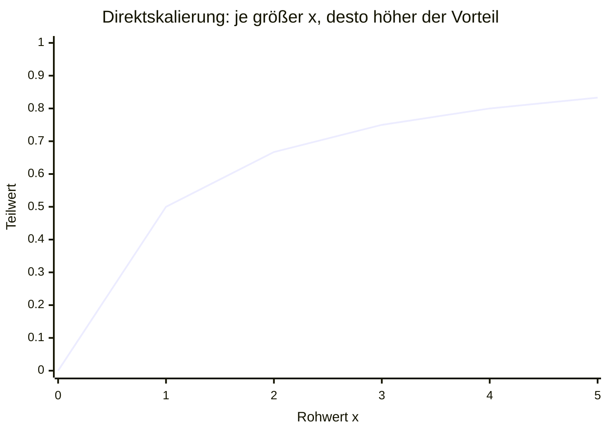

**Verwendung:** [Maschinen-Pick](#maschinen-pick-pick_machine_job),
[Nacharbeit auf der Defektmaschine](#nacharbeit-auf-der-defektmaschine-job_rework_on_defect_machine) und
[Nacharbeit auf einer anderen Maschine](#nacharbeit-auf-einer-anderen-maschine-job_rework_on_alternative_machine).

#### 6. Freie Pufferkapazität: einen größeren freien Anteil bevorzugen

- **Bewertungsgröße:** Freie Plätze und Gesamtkapazität des Ziel-Stores.
- **Regel:** Je größer der freie Anteil, desto höher der Teilwert.
- **Abbildung mit `normalize_ratio()`:**
  `normalize_ratio(freie Plätze, Gesamtkapazität) = freie Plätze / Gesamtkapazität`.
- **Beispiel:** Zwei von zehn freien Plätzen ergeben `0.2`; acht von zehn
  ergeben `0.8`.

Bei positiver, endlicher Kapazität und gültiger Belegung liegt dieser Anteil
zwischen `0` und `1`.

**Verwendung:** [Ablegen](#ablegen-place_main_robot-und-place_corridor_arm_robot).

#### 7. Defektschwere: bei stärkerem Defekt die Herabstufung höher bewerten

- **Bewertungsgröße:** `defect_severity` des Jobs.
- **Regel:** Je höher der Defektschweregrad, desto stärker spricht dieses
  Kriterium für eine Herabstufung.
- **Abbildung in `evaluate_defect_action()`:**
  `Teilwert = float(current_state.get("defect_severity", 0.0))`.
- **Beispiel:** Schweregrad `0.2 → 0.2`; Schweregrad `0.5 → 0.5`.

**Verwendung:** [Herabstufung](#herabstufung-downgrade_product).

#### 8. Warten: je höher der Termindruck, desto niedriger der Teilwert

Der Teilwert beschreibt, wie vorteilhaft die Aktion **Warten** ist, nicht
wie lange der Job wartet.

- **Bewertungsgröße:** Termindruck des Jobs, ausgedrückt durch seine
  EDD-Priorität. Eine höhere EDD-Priorität bedeutet einen dringenderen Job.
- **Regel:** Je höher die EDD-Priorität, desto niedriger der Teilwert für
  Warten. Warten wird dadurch für dringende Jobs weniger vorteilhaft bewertet.
- **Abbildung:** Für normales Warten in `evaluate_wait_action()` und für
  Warten eines defekten Jobs in `evaluate_defect_action()` gilt bei bekannter
  Deadline dieselbe Formel:
  `Teilwert = 1.0 - EDD`.
- **Ohne Job oder Deadline:** `evaluate_wait_action()` verwendet den festen
  Ersatzwert `DEFAULT_WAIT_SCORE = 0.01`.
- **Beispiel:** Bei `EDD = 0.75` ergibt sich in beiden Fällen
  `1.0 - 0.75 = 0.25`. Bei einem defekten Job kann anschließend noch ein
  Strafabzug hinzukommen.

**Verwendung:** [Normales Warten](#normales-warten-wait_) und
[Warten bei einem Defekt](#warten-bei-einem-defekt-wait_job).

### Verwendung der Bewertungsgrößen nach Aktionstyp

Die [allgemeinen Regeln](#allgemeine-heuristische-regeln) legen fest, wie
Rohwerte auf Teilwerte abgebildet werden. Dieses Kapitel erklärt getrennt
davon, **welche Rohwerte bei welchem
Aktionstyp verwendet werden, wie sie ermittelt werden und welche Gewichte
in den Score eingehen**. Die verlinkten Kriterien führen direkt zurück
zur jeweiligen Regel mit ihrer Formel und ihrem Beispiel.

Die Ausdrücke zeigen jeweils `Teilwert × Gewicht`.
Für den [Gesamtscore](#gewichte-und-gesamtscore) addiert
`calculate_action_score()` diese Beiträge und teilt durch die
Summe ihrer Gewichte. Optionale Kriterien werden nur berücksichtigt, wenn
die dafür benötigten Daten beziehungsweise Bedingungen vorhanden sind.

Ein unbekannter `action_type` erhält in `evaluate_action()` den Score `0`.

#### Freigabe: `release_job`

`evaluate_release_action()` berücksichtigt zwei Kriterien:

1. **[Termindruck](#1-termindruck-dringendere-jobs-bevorzugen):** `EDD × release_edd_weight`.
2. **[Durchschnittliche Routenverarbeitungszeit](#2-verarbeitungs--transport--und-lagerzeiten-kürzere-zeiten-bevorzugen):**
   `inverse_scale(erwartete Verarbeitungszeit) × release_average_route_duration_weight`.

##### Ermittlung der Routenzeit

Bei der Freigabe wird die Verarbeitungszeit **über alle Operationen
einer Route** betrachtet. `estimate_release_processing_time()` ermittelt
die möglichen Operationsfolgen zum Zielprodukt. Für jede Folge addiert es
die konfigurierten Operationsdauern und bildet danach den Mittelwert über
die Routenzeiten.

Zum Beispiel:

- Route A: Zwei Operationen mit Dauer `3` und `5` ergeben insgesamt `8`.
- Route B: Zwei Operationen mit Dauer `4` und `8` ergeben insgesamt `12`.
- Der Rohwert für die Freigabe ist `(8 + 12) / 2 = 10`.
- Daraus entsteht der Teilwert `inverse_scale(10) = 1 / 11 ≈ 0.091`.

Dabei wird keine Route ausgewählt. Der Mittelwert dient nur dazu, die
Freigabe dieses Jobs anhand seiner geschätzten Verarbeitungszeit zu bewerten.
Transport- und Wartezeiten sind in dieser Summe nicht enthalten.

#### Roboter-Pick: `pick_main_robot` und `pick_corridor_arm_robot`

Bei dieser Aktion nimmt der Roboter einen Job aus einem Quell-Store auf.
`evaluate_robot_pick_action()` bewertet den ausgewählten Job anhand von:

1. **[EDD-/Queue-Priorität](#1-termindruck-dringendere-jobs-bevorzugen):** `EDD × queue_priority_weight`.
2. **[Entnahmezeit](#2-verarbeitungs--transport--und-lagerzeiten-kürzere-zeiten-bevorzugen):** `inverse_scale(storage_out_time) × pick_source_storage_time_weight`.
   Das Kriterium geht nur ein, wenn `storage_out_time` im Payload vorhanden ist.
3. **[Transportzeit](#2-verarbeitungs--transport--und-lagerzeiten-kürzere-zeiten-bevorzugen):** `inverse_scale(Transportzeit) × pick_short_transport_time_weight`.

##### Ermittlung der Transportzeit

Für den Roboter-Pick berechnet `transport_time_value()` den Weg von der
aktuellen Roboterposition zum Quell-Store, aus dem der Job aufgenommen werden
soll. Dieser Store steht im Payload unter `target_store_id`. Weil sich der
Roboter achsenweise bewegt, werden die Wege in X-, Y- und Z-Richtung addiert:

`Transportzeit = (|Δx| + |Δy| + |Δz|) / Grundgeschwindigkeit`

Zum Beispiel ergeben drei Wegeinheiten in X-Richtung und eine in Y-Richtung
bei Grundgeschwindigkeit `2` Wegeinheiten pro Zeiteinheit den Rohwert
`(3 + 1 + 0) / 2 = 2` Zeiteinheiten.
Der Teilwert ist dann `inverse_scale(2) = 1 / 3 ≈ 0.333`.

##### Auslagerzeit am Quell-Store

Die Auslagerzeit ist die Zeit für das Herausnehmen des Jobs aus dem Store,
nicht die Fahrt dorthin. `pick_source_storage_time_value()` liest dafür
`storage_out_time` aus dem Aktions-Payload. Ist das Feld nicht vorhanden,
entfällt dieser Teilwert.

Eine Auslagerzeit von `2` ergibt zum Beispiel
`inverse_scale(2) = 1 / 3 ≈ 0.333`. Transportzeit und Auslagerzeit gehen
als getrennte Teilwerte mit ihren jeweiligen Gewichten in den Score ein.

#### Maschinen-Pick: `pick_machine_job`

Bei dieser Aktion nimmt die Maschine einen Job aus ihrem Eingangspuffer auf.
`evaluate_machine_pick_action()` berücksichtigt:

1. **[EDD-/Queue-Priorität](#1-termindruck-dringendere-jobs-bevorzugen):** `EDD × queue_priority_weight`.
2. **[Operationsdauer](#2-verarbeitungs--transport--und-lagerzeiten-kürzere-zeiten-bevorzugen):** `inverse_scale(operation.duration) × machine_pick_operation_duration_weight`.
   Hier zählt die konfigurierte Operationsdauer.
3. **[Werkzeugpassung](#4-werkzeugpassung-ein-bereits-montiertes-passendes-werkzeug-bevorzugen):** `Werkzeugpassung × machine_pick_tool_match_weight`.
   Dieses Kriterium geht immer ein.
4. **[Werkzeugreserve](#5-werkzeugreserve-mehr-lebensdauer-im-verhältnis-zum-verbrauch-bevorzugen):**
   `direct_scale(verbleibende Lebensdauer / geplanter Verbrauch) × machine_pick_tool_reserve_weight`.
   Berücksichtigt, wenn der Lebensdauerverbrauch der Operation positiv ist.

##### Verwendete Operationsdauer

Der Evaluator liest `selected_operation_id` aus dem ausgewählten Job und
verwendet die konfigurierte Dauer `operation.duration` dieser Operation.
Es zählt **nur die Operation, die die Maschine für diesen Job ausführen
soll**, nicht die Summe aller noch benötigten Operationen bis zum Endprodukt.

Zum Beispiel ergibt eine Operationsdauer von `4` Zeiteinheiten den Teilwert
`inverse_scale(4) = 1 / (1 + 4) = 0.2`. Eine andere mögliche Operation mit
Dauer `1` erhält bei diesem Kriterium den höheren Teilwert `0.5`.

#### Verarbeitung: `process_machine_job`

`evaluate_process_action()` liefert den Score `0`. Für eine geladene
Maschine mit freiem Ausgangspuffer erzeugt der Generator ohnehin nur diese
Verarbeitungsaktion. Ein Score von `0` verhindert ihre Ausführung daher nicht.

#### Ablegen: `place_main_robot` und `place_corridor_arm_robot`

Bei dieser Aktion legt der Roboter den getragenen Job in einem Ziel-Store ab,
zum Beispiel im Eingangspuffer einer Maschine. Dabei wird der Job nicht
verarbeitet.
`evaluate_place_action()` bewertet die möglichen Transportziele anhand von:

1. **[Freier Zielkapazität](#6-freie-pufferkapazität-einen-größeren-freien-anteil-bevorzugen):**
   `Anteil freier Plätze × target_store_free_capacity_weight`.
   `target_store_capacity_value()` ermittelt dafür den freien Kapazitätsanteil.
2. **[Transportzeit](#2-verarbeitungs--transport--und-lagerzeiten-kürzere-zeiten-bevorzugen):**
   `inverse_scale(Transportzeit) × place_short_transport_time_weight`.
3. **[Einlagerungszeit](#2-verarbeitungs--transport--und-lagerzeiten-kürzere-zeiten-bevorzugen):**
   `inverse_scale(storage_in_time) × place_target_storage_time_weight`,
   falls `storage_in_time` im Payload vorhanden ist.
4. **[Maschinenwarteschlange](#3-maschinenwarteschlange-weniger-wartende-jobs-bevorzugen):**
   `inverse_scale(Warteschlangenlänge) × place_machine_queue_length_weight`.
   `place_machine_queue_value()` liest die Anzahl der Jobs im Eingangspuffer,
   falls eine Zielmaschine angegeben ist.
5. **[Dauer der nächsten Operation](#2-verarbeitungs--transport--und-lagerzeiten-kürzere-zeiten-bevorzugen):**
   `inverse_scale(operation.duration) × place_operation_duration_weight`,
   falls der Payload eine nächste Operation enthält.

##### Verwendete Zeitwerte

**Transportzeit:** `transport_time_value()` verwendet den Weg von der
aktuellen Roboterposition zum Ziel-Store aus `target_store_id`:

`Transportzeit = (|Δx| + |Δy| + |Δz|) / Grundgeschwindigkeit`

Der Rohwert wird mit `inverse_scale()` auf einen Teilwert abgebildet.

**Operationsdauer am Ziel:** Enthält der Payload `selected_operation_id`,
liest `place_processing_time_value()` die konfigurierte Dauer
`operation.duration` dieser Operation. Diese Dauer dient zur Bewertung des
Ziels; sie ist kein Teil der Ablagedauer des Roboters. Eine Operationsdauer
von `4` ergibt beispielsweise `inverse_scale(4) = 0.2`. Ohne angegebene
Operation entfällt dieses Kriterium.

**Einlagerzeit:** `place_target_storage_time_value()` verwendet
`storage_in_time` des Ziel-Stores aus dem Payload. Diese Zeit beschreibt das
Ablegen des Jobs, nicht die Fahrt zum Store, und wird getrennt von der
Transportzeit auf einen Teilwert abgebildet. Eine Einlagerzeit von `2` ergibt
beispielsweise
`inverse_scale(2) = 1 / 3 ≈ 0.333`. Fehlt das Feld im Payload, entfällt
dieser Teilwert.

#### Normales Warten: `wait_*`

Dieser Bewertungsfall gilt für `wait_job` eines nicht defekten Jobs und für
die Warteaktionen von Robotern und Maschinen. `evaluate_wait_action()`
verwendet die [EDD-Priorität](#1-termindruck-dringendere-jobs-bevorzugen)
des wartenden Jobs beziehungsweise des aktuell geladenen Jobs.

Bei einer geladenen Maschine mit vollem Ausgangspuffer erzeugt der Generator
beispielsweise nur `wait_machine`.

Die [Warteregel](#8-warten-je-höher-der-termindruck-desto-niedriger-der-teilwert)
wird hier so umgesetzt:

`Teilwert = 1.0 - EDD`

Ohne zugehörigen Job oder ohne dessen Deadline wird der feste Ersatzwert
`DEFAULT_WAIT_SCORE = 0.01` verwendet.

Zum Beispiel ergibt `EDD = 0.75` den Teilwert
`1.0 - 0.75 = 0.25`.

Dieser Teilwert wird mit `wait_action_weight` als einzigem Gewicht an
`calculate_action_score()` übergeben. Das Gewicht kürzt sich heraus,
deshalb entspricht der Score dem Teilwert.

#### Defektbehandlung

Der Generator erzeugt die technisch möglichen Aktionen für einen defekten
Job. `evaluate_defect_action()` bewertet diese Aktionen. Für Nacharbeit,
Warten und Herabstufung berücksichtigt die Methode die Restzeit bis zur
Deadline des Auftrags:

`remaining_time = latest_end_time − aktuelle Zeit`

**Vor der Deadline (`remaining_time > 0`):** Bei Deadline `10` und aktueller
Zeit `8` ist `remaining_time = 10 − 8 = 2`. Es bleiben zwei Zeiteinheiten:

- **Nacharbeit:** Der berechnete Score erhält keinen Deadline-Strafabzug.
- **Warten:** Der Score ergibt sich aus `1 − EDD`, ohne Deadline-Strafabzug.
  Die EDD-Priorität berücksichtigt den Termindruck bereits vor der Deadline.
- **Herabstufung:** Nur der Defektschweregrad geht als Teilwert ein. Der
  zusätzliche Deadline-Teilwert `1` wird noch nicht berücksichtigt.

**Deadline erreicht oder überschritten (`remaining_time <= 0`):** Bei Zeit
`10` ist die Restzeit `0`; bei Zeit `11` ist sie `−1`. Ab Restzeit `0`
erhalten Nacharbeit und Warten einen Deadline-Strafabzug. Bei Herabstufung
kommt der zusätzliche Teilwert `1` hinzu.

**Strafabzüge bei Nacharbeit und Warten**

Die Deadline-Strafe wird erst nach der Berechnung des gewichteten
Durchschnitts abgezogen. Sie gehört nicht zur Gewichtssumme im Nenner:

`Endscore = gewichteter Durchschnitt − Deadline-Strafe`

Ohne Strafabzug entspricht der Endscore dem gewichteten Durchschnitt.
Negative Endscores bleiben unverändert. Auch für sie gilt: Ein höherer
Score ist vorteilhafter, zum Beispiel `−0.1 > −0.4`. Ein negativer Score
verbietet die Aktion nicht; die technische Zulässigkeit prüft der Generator.

**Mathematische Begründung der Standardwerte**

Die folgenden Scoregrenzen sind bewusst gewählte Steuerungsvorgaben.
[HeuristicWeights.py](sources/SpineML/Control/HeuristicControl/HeuristicWeights.py)
leitet daraus die Standardstrafen und die
Herabstufungsgewichte ab. `s` bezeichnet den Defektschweregrad in `[0, 1]`:

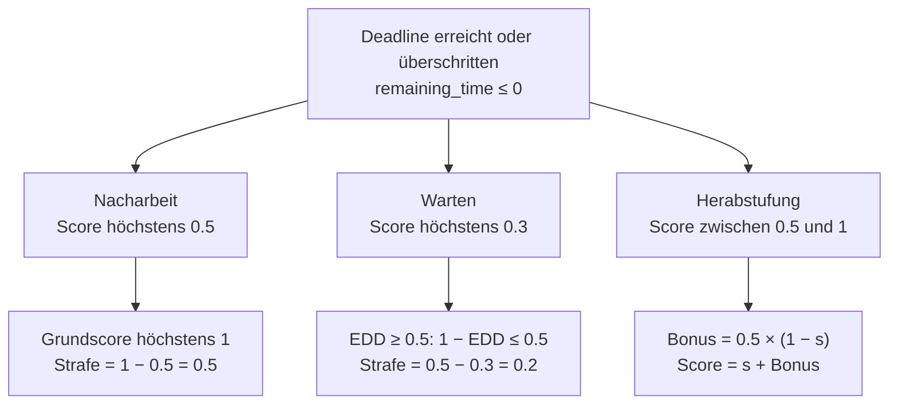

Bei der **Herabstufung** wird die Untergrenze `0.5` an den maximalen
Nacharbeitsscore ab der Deadline angelehnt. Die lineare Abbildung soll am
unteren Rand `s = 0` den Score `0.5` und am oberen Rand `s = 1` den Score `1`
ergeben. Daraus folgt:

`Score = 0.5 + (1 − 0.5) × s = s + 0.5 × (1 − s)`

Im gewichteten Durchschnitt mit dem zusätzlichen Deadline-Teilwert `1`
entspricht das dem normierten Gewichtsverhältnis `0.5 : 0.5`: Defektschwere
und Deadline-Teilwert erhalten jeweils das Gewicht `0.5`. Der Bonus ist also
**die Hälfte des noch verbleibenden Abstands zum Score `1`**, kein pauschaler
Aufschlag von `0.5`.

Damit erhält Herabstufung bei positiver Defektschwere ab der Deadline einen
höheren Score als Nacharbeit und Warten. Diese Bevorzugung ist beabsichtigt.
Die Herleitung gilt für die **Standardgewichte**; bei manuell geänderten oder
optimierten Gewichten können sich die Scoregrenzen ändern. Die Zielgrenzen
sind eine Modellierungsentscheidung, kein Nachweis einer optimalen Steuerung.

**Der Evaluator entfernt eine angebotene Nacharbeit nicht aus der Auswahl,
wenn die Deadline erreicht ist.** Er berechnet weiterhin ihren Score und
zieht davon eine Deadline-Strafe ab. Die folgenden Aktionsabschnitte zeigen
die jeweilige Berechnung mit den Standardgewichten aus `HeuristicWeights`.
Für die Beispiele nach der Deadline gelten die Deadline `10` und die
aktuelle Zeit `11`.

##### Nacharbeit auf der Defektmaschine: `job_rework_on_defect_machine`

Diese Aktion legt fest, dass die Operation, bei der der Produktdefekt
entstanden ist, auf derselben Maschine wiederholt wird.

**Bewertungskriterien:** `evaluate_defect_recovery_action()` verwendet die
Zustände dieser Maschine und die Daten der zu wiederholenden Operation:

1. **[Maschinenwarteschlange](#3-maschinenwarteschlange-weniger-wartende-jobs-bevorzugen):**
   `inverse_scale(Maschinenwarteschlangenlänge) × defect_recovery_machine_queue_length_weight`.
2. **[Transportzeit](#2-verarbeitungs--transport--und-lagerzeiten-kürzere-zeiten-bevorzugen):**
   `inverse_scale(Transportzeit zur Defektmaschine) × defect_recovery_transport_time_weight`,
   wenn diese Zeit geschätzt werden kann.
3. **[Werkzeugpassung](#4-werkzeugpassung-ein-bereits-montiertes-passendes-werkzeug-bevorzugen):** `Werkzeugpassung × defect_recovery_tool_match_weight`.
   Dieses Kriterium geht immer ein.
4. **[Werkzeugreserve](#5-werkzeugreserve-mehr-lebensdauer-im-verhältnis-zum-verbrauch-bevorzugen):**
   `direct_scale(verbleibende Lebensdauer / geplanter Verbrauch) × defect_recovery_tool_reserve_weight`,
   falls der Lebensdauerverbrauch der Operation positiv ist.

**Transportzeit auf derselben Maschine:** Liegt der Job im Ausgangspuffer
der Defektmaschine, haben sein Standort und der Eingangspuffer im aktuellen
Layout dieselben Koordinaten. `defect_recovery_transport_time_value()`
ermittelt deshalb für diesen Weg:

`Transportzeit = 0` und `Transport-Teilwert = inverse_scale(0) = 1`.

Der Teilwert `1` bedeutet hier: Für die geschätzte Wegstrecke fällt keine
Transportzeit an. Er bleibt mit seinem Gewicht in der Bewertung enthalten;
er macht nicht den gesamten Aktionsscore zu `1`. Zusätzliche Greif- und
Hubbewegungen des Roboters sind in dieser Wegschätzung nicht enthalten.

**Deadline:** Bei `remaining_time > 0` gibt es keinen Deadline-Strafabzug.
Bei `remaining_time <= 0` wird nach der Berechnung des gewichteten Durchschnitts
`rework_defect_machine_deadline_penalty_weight` abgezogen, standardmäßig `0.5`.

**Rechenbeispiel:** Der Job liegt im Ausgangspuffer dieser Maschine. Mit den
Standardgewichten ergeben sich:

- **Warteschlange:** Der Eingangspuffer ist leer. `inverse_scale(0) = 1`,
  Gewicht `0.3`.
- **Transportzeit:** Die Wegschätzung ergibt `0`. `inverse_scale(0) = 1`,
  Gewicht `0.2`.
- **Werkzeugpassung:** Das von der Operation benötigte Werkzeug ist montiert.
  Teilwert `1`, Gewicht `0.2`.
- **Werkzeugreserve:** Verbleibende Lebensdauer `5`, Verbrauch der Operation
  `5`. `direct_scale(5 / 5) = 0.5`, Gewicht `0.2`.

`Score vor Strafabzug = (1 × 0.3 + 1 × 0.2 + 1 × 0.2 + 0.5 × 0.2) / (0.3 + 0.2 + 0.2 + 0.2) = 8 / 9 ≈ 0.889`

Bei aktueller Zeit `8` liegt die Deadline `10` noch in der Zukunft. Es gibt
keinen Strafabzug; der Score bleibt `8 / 9 ≈ 0.889`.

Bei aktueller Zeit `11` ist die Deadline überschritten. Der Code zieht
anschließend `0.5` ab:

`Endscore = 8 / 9 − 0.5 = 7 / 18 ≈ 0.389`

##### Nacharbeit auf einer anderen Maschine: `job_rework_on_alternative_machine`

Diese Aktion legt fest, dass die Operation, bei der der Produktdefekt
entstanden ist, auf einer anderen geeigneten Maschine wiederholt wird.
Der Job muss zum Eingangspuffer dieser ausgewählten Maschine gelangen.

**Bewertungskriterien:** `evaluate_defect_recovery_action()` verwendet die
Zustände der ausgewählten Maschine und die Daten der zu wiederholenden
Operation:

1. **[Maschinenwarteschlange](#3-maschinenwarteschlange-weniger-wartende-jobs-bevorzugen):**
   `inverse_scale(Maschinenwarteschlangenlänge) × defect_recovery_machine_queue_length_weight`.
2. **[Transportzeit](#2-verarbeitungs--transport--und-lagerzeiten-kürzere-zeiten-bevorzugen):**
   `inverse_scale(Transportzeit zur Nacharbeitsmaschine) × defect_recovery_transport_time_weight`,
   wenn diese Zeit geschätzt werden kann.
3. **[Werkzeugpassung](#4-werkzeugpassung-ein-bereits-montiertes-passendes-werkzeug-bevorzugen):**
   `Werkzeugpassung × defect_recovery_tool_match_weight`.
   Dieses Kriterium geht immer ein.
4. **[Werkzeugreserve](#5-werkzeugreserve-mehr-lebensdauer-im-verhältnis-zum-verbrauch-bevorzugen):**
   `direct_scale(verbleibende Lebensdauer / geplanter Verbrauch) × defect_recovery_tool_reserve_weight`,
   falls der Lebensdauerverbrauch der Operation positiv ist.

**Transportzeit zur ausgewählten Maschine:**
`defect_recovery_transport_time_value()` berechnet den Weg vom aktuellen
Jobstandort zum Eingangspuffer dieser Maschine:

`Transportzeit = (|Δx| + |Δy| + |Δz|) / Grundgeschwindigkeit`

Die Zeit wird mit `inverse_scale()` auf einen Teilwert abgebildet. Eine
kürzere geschätzte Transportzeit ergibt einen höheren Teilwert. Zusätzliche
Greif- und Hubbewegungen des Roboters sind in dieser Wegschätzung nicht
enthalten.

**Deadline:** Bei `remaining_time > 0` gibt es keinen Deadline-Strafabzug.
Bei `remaining_time <= 0` wird nach der Berechnung des gewichteten Durchschnitts
`rework_alternative_machine_deadline_penalty_weight` abgezogen, standardmäßig
`0.5`.

**Rechenbeispiel:** Der Job soll zum Eingangspuffer dieser Maschine
transportiert werden. Mit den Standardgewichten ergeben sich:

- **Warteschlange:** Der Eingangspuffer ist leer. `inverse_scale(0) = 1`,
  Gewicht `0.3`.
- **Transportzeit:** Im Beispiel nehmen wir eine Wegstrecke von `1.5` und
  eine Grundgeschwindigkeit von `1.5` an. Daraus ergibt sich die geschätzte
  Transportzeit `1.5 / 1.5 = 1`. Das ist kein fester Wert im Code.
  `inverse_scale(1) = 0.5`, Gewicht `0.2`.
- **Werkzeugpassung:** Das von der Operation benötigte Werkzeug ist montiert.
  Teilwert `1`, Gewicht `0.2`.
- **Werkzeugreserve:** Verbleibende Lebensdauer `5`, Verbrauch der Operation
  `5`. `direct_scale(5 / 5) = 0.5`, Gewicht `0.2`.

`Score vor Strafabzug = (1 × 0.3 + 0.5 × 0.2 + 1 × 0.2 + 0.5 × 0.2) / (0.3 + 0.2 + 0.2 + 0.2) = 7 / 9 ≈ 0.778`

Bei aktueller Zeit `8` liegt die Deadline `10` noch in der Zukunft. Es gibt
keinen Strafabzug; der Score bleibt `7 / 9 ≈ 0.778`.

Bei aktueller Zeit `11` wird der Deadline-Strafabzug angewendet:

`Endscore = 7 / 9 − 0.5 = 5 / 18 ≈ 0.278`

##### Herabstufung: `downgrade_product`

`evaluate_defect_action()` unterscheidet zwei Fälle:

1. **Vor der Deadline (`remaining_time > 0`):** Nur die
   [Defektschwere](#7-defektschwere-bei-stärkerem-defekt-die-herabstufung-höher-bewerten)
   geht mit `product_downgrade_defect_severity_weight` ein. Da dies der
   einzige Teilwert ist, entspricht der Score dem Defektschweregrad.
2. **Deadline erreicht oder überschritten (`remaining_time <= 0`):**
   Zusätzlich geht der feste Teilwert `1` mit
   `deadline_reached_downgrade_bonus_weight` ein. `calculate_action_score()`
   bildet den gewichteten Durchschnitt aus Defektschwere und diesem
   zusätzlichen Teilwert.

Die Prüfung heißt `is_deadline_reached()` und liefert bei
`remaining_time <= 0` den Wert `True`. Sie prüft ausschließlich den Termin.

**Beispiel:** Der Job hat den Defektschweregrad `0.4`. Bei aktueller Zeit `8`
liegt die Deadline `10` noch in der Zukunft. Nur der Defektschweregrad geht
als Teilwert mit dem Standardgewicht `0.5` ein:

`Score vor der Deadline = (0.4 × 0.5) / 0.5 = 0.4`

Bei erreichter oder überschrittener Deadline kommt der Teilwert `1` mit
`deadline_reached_downgrade_bonus_weight = 0.5` hinzu:

`Score = (0.4 × 0.5 + 1 × 0.5) / (0.5 + 0.5) = 0.7`

Die Anhebung entspricht dem Bonus `0.5 × (1 − 0.4) = 0.3`:
Die Herabstufung erhält den Score `0.4 + 0.3 = 0.7` statt `0.4`.

##### Warten bei einem Defekt: `wait_job`

`evaluate_defect_action()` bewertet das Warten eines defekten Jobs nach der
[Warteregel](#8-warten-je-höher-der-termindruck-desto-niedriger-der-teilwert):
**Je dringender der Job, desto niedriger ist der Warte-Score.**

`calculate_edd_priority()` berechnet dafür die
[EDD-Priorität](#1-termindruck-dringendere-jobs-bevorzugen) des Jobs. Eine
höhere EDD-Priorität bedeutet höheren Termindruck. Für Warten wird diese
Richtung umgekehrt:

`Teilwert = 1.0 - EDD`

`calculate_action_score()` erhält nur diesen Teilwert mit
`wait_defect_job_weight`. Weil der gewichtete Durchschnitt eines einzelnen
Teilwerts wieder dieser Teilwert ist, ergibt sich zunächst `Score = 1.0 - EDD`.

- **Vor der Deadline** (`remaining_time > 0`) bleibt dieser Score unverändert.
- **Ab Erreichen der Deadline** (`remaining_time <= 0`) zieht der Code
  zusätzlich `deadline_missed_wait_penalty_weight` ab, standardmäßig `0.2`:
  `Score = (1.0 - EDD) - 0.2`.

**Beispiele mit Deadline `10` und dem Standard-Strafabzug `0.2`:**

- Bei aktueller Zeit `8` bleiben zwei Zeiteinheiten bis zur Deadline.
  `EDD = 0.5 × inverse_scale(2) ≈ 0.167`.
  Warten erhält `Score = 1 − 0.167 ≈ 0.833`; es gibt keinen Strafabzug.
- Bei aktueller Zeit `11` ist der Auftrag eine Zeiteinheit überfällig.
  `EDD = 0.5 + 0.5 × direct_scale(1) = 0.75`.
  Warten erhält `Score = (1 − 0.75) − 0.2 = 0.05`.

Der `ActionSelector` vergleicht den Warte-Score mit den Scores der anderen
erzeugten Kandidaten. Ein niedrigerer Warte-Score macht Warten dabei weniger
vorteilhaft.

##### Ausschuss: `job_scrap`

Diese Aktion wird ausschließlich erzeugt, wenn der Defektschweregrad außerhalb
des technisch nacharbeitbaren Bereichs liegt. Dann ist sie der einzige
Kandidat. `evaluate_defect_action()` gibt dafür einen konstanten Score zurück:

`Score = 1.0`

EDD und Gewichte werden für diese Aktion nicht verwendet. Da keine andere
Aktion zur Auswahl steht, wird Ausschuss unabhängig vom Termindruck gewählt.

#### Abschluss: `complete_job`

`evaluate_action()` verwendet den festen Teilwert `1` mit
`complete_job_weight`. Weil nur dieser eine Teilwert eingeht, ist der
resultierende Score `1`.

#### Abgrenzung zur tatsächlich simulierten Dauer

Die Simulation übernimmt die Rolle einer **realen Produktionsumgebung**:
Sie führt die gewählten Aktionen aus und bildet dabei die **Ist-Werte** ab
(zum Beispiel die tatsächlich simulierten Verarbeitungs- und Transportdauern).
Die Steuerung geht für ihre Zeitschätzungen dagegen von **Sollwerten** aus
(der konfigurierten Operationsdauer und Grundgeschwindigkeit). Deshalb können
die in der Simulation entstehenden Ist-Dauern von den Zeitschätzungen der
Steuerung abweichen:

- **Maschine:** Die Steuerung verwendet die konfigurierte Operationsdauer
  `operation.duration`. `SimMachine` berechnet die Ist-Dauer zusätzlich
  abhängig von Produktgröße, Maschinengeschwindigkeit und einem Zufallsfaktor.
- **Roboter:** Die Steuerung schätzt die Transportzeit aus dem Weg und der
  konfigurierten Grundgeschwindigkeit. In der Simulation schwankt die
  Geschwindigkeit bei jeder Bewegung um bis zu fünf Prozent; entsprechend
  kann die Ist-Dauer von der Schätzung abweichen.

Diese Trennung betrifft die Schätzung zukünftiger Dauern. Den **aktuellen
Ist-Zustand** der Produktion berücksichtigt die Steuerung weiterhin über den
Snapshot.

### Gewichte und Gesamtscore

`calculate_action_score()` verbindet die Teilwerte eines Aktionskandidaten
zu einem **Gesamtscore**. Dazu erhält die Funktion für jedes verwendete
Kriterium ein Paar aus Teilwert und Gewicht. Die Teilwerte sind bereits
auf `[0, 1]` abgebildet; ein höherer Teilwert ist vorteilhafter.

Das **Gewicht** bestimmt, wie stark ein Teilwert gegenüber den anderen
Teilwerten derselben Aktion zählt. Ein Gewicht von `0.6` zählt beispielsweise
doppelt so stark wie `0.3`. Die Funktion bildet daraus einen gewichteten
Durchschnitt:

`Gesamtscore = Summe(Teilwert × Gewicht) / Summe(zugehörige Gewichte)`

In beide Summen gehen **dieselben verwendeten Kriterien** ein. Ein Teilwert
von `0` trägt im Zähler zwar `0` bei, sein Gewicht bleibt aber im Nenner
enthalten. Wird ein Kriterium bei dieser Aktion nicht verwendet, gehen weder
sein Teilwert noch sein Gewicht ein. Das betrifft beispielsweise die
Werkzeugreserve, wenn die Operation keine Werkzeuglebensdauer verbraucht.

#### Warum unterschiedliche Kriterien kombiniert werden können

Kombiniert werden die **Teilwerte**, die vorher in dieselbe Vorteilsrichtung
abgebildet wurden:

- **Transportzeit:** Kleiner ist besser. `inverse_scale()` bildet deshalb
  kurze Zeiten auf höhere Teilwerte ab. Zeit `1` ergibt `0.5`; Zeit `4`
  ergibt `0.2`.
- **Freie Kapazität:** Größer ist besser. `freie Plätze / Gesamtkapazität`
  liefert bei mehr freien Plätzen einen höheren Teilwert. Zwei von zehn
  freien Plätzen ergeben `2 / 10 = 0.2`; acht von zehn ergeben
  `8 / 10 = 0.8`.

Danach gilt für beide: **Ein höherer Teilwert ist vorteilhafter.**

Deshalb können die dimensionslosen Teilwerte im Bereich `0` bis `1` sinnvoll
zu einem Gesamtscore kombiniert werden. Die Gewichte bestimmen dabei, wie
stark kurze Transportzeiten gegenüber freier Kapazität zählen.

#### Warum durch die Gewichtssumme geteilt wird

Die **gewichtete Summe im Zähler** allein ist noch kein Durchschnitt.
Sie hängt auch davon ab, wie groß die Gewichte insgesamt sind. Die Division
durch die **Gewichtssumme im Nenner** macht deshalb nur die relative
Wichtigkeit der Teilwerte wirksam:

`Relativer Gewichtsanteil = Gewicht / Summe(zugehörige Gewichte)`

Diese Anteile ergeben zusammen `1`. Die Gewichte selbst müssen sich dagegen
**nicht zu `1` addieren**.

Werden alle berücksichtigten Gewichte mit demselben positiven Faktor
multipliziert, bleibt der gewichtete Durchschnitt gleich. Die relativen
Wichtigkeiten ändern sich dadurch nicht. Ohne die Division würde allein die
größere Gewichtssumme den Score erhöhen.

**Beispiel:** Die Teilwerte `0.8` und `0.2` erhalten die Gewichte `1.0` und
`0.5`. Der erste Teilwert zählt damit doppelt so stark wie der zweite.
Sein relativer Anteil ist `1.0 / 1.5 = 2/3`, der des zweiten Teilwerts `1/3`:

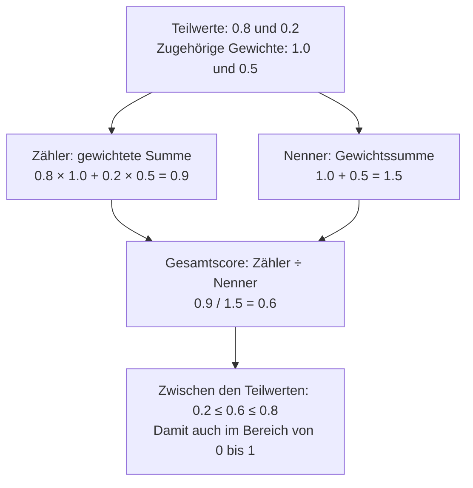

Der Score `0.6` liegt näher am stärker gewichteten Teilwert `0.8`. Die
gewichtete Summe `0.9` und der Gesamtscore `0.6` sind also unterschiedliche
Größen; erst die Division liefert den Durchschnitt.

#### Warum der Gesamtscore zwischen 0 und 1 liegt

Für jeden Teilwert `xᵢ` in `[0, 1]` und sein positives Gewicht `wᵢ` gilt:

`0 ≤ xᵢ × wᵢ ≤ wᵢ`

Nach dem Addieren gilt deshalb auch für Zähler und Nenner:

`0 ≤ Summe(Teilwert × Gewicht) ≤ Summe(zugehörige Gewichte)`

Der Zähler ist somit weder negativ noch größer als der positive Nenner.
Durch die Division folgt unmittelbar:

`0 ≤ Gesamtscore ≤ 1`

Dieser Bereich entsteht **durch die Mittelwertbildung**, nicht durch eine
nachträgliche Begrenzung. Die Aussage bezieht sich auf den Rückgabewert von
`calculate_action_score()`.

**Die Kurve veranschaulicht die Randwerte:** Sind alle verwendeten Teilwerte
`0`, ergibt sich der Score `0`; sind alle `1`, ergibt sich `1`. Wenn alle
Teilwerte gemeinsam den Wert `x` annehmen, entspricht auch ihr gewichteter
Durchschnitt `x` – unabhängig von ihren positiven Gewichten:

`Score(x) = Summe(x × Gewicht) / Summe(Gewichte) = x`

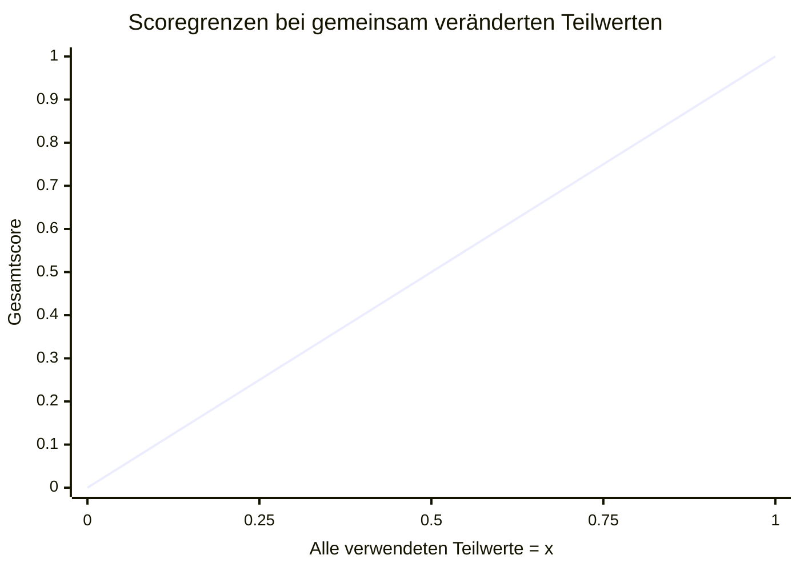

Bei genau einem Teilwert kürzt sich dessen Gewicht heraus:
`(Teilwert × Gewicht) / Gewicht = Teilwert`. Das betrifft beispielsweise
`complete_job` und normale Warteaktionen. Eine Änderung ihres einzigen
Gewichts verändert den Score daher nicht.

#### HeuristicWeights

[HeuristicWeights.py](sources/SpineML/Control/HeuristicControl/HeuristicWeights.py)
enthält die einstellbaren Parameter der lokalen Bewertung. Beim Erzeugen
eines `HeuristicWeights`-Objekts werden dessen Gewichte auf den Bereich
`(0, 1]` geprüft. `calculate_action_score()` prüft oder begrenzt die
übergebenen Werte dagegen nicht selbst.

Bei der Optimierung werden diese lokalen Parameter verändert. Sie sind von
den globalen Gewichten zur Bewertung eines gesamten Simulationslaufs getrennt.

### Rechenbeispiel: zwei Ablageziele

Der Main-Roboter trägt einen intakten, noch nicht fertigen Job. Die nächste
Operation kann auf Maschine A oder Maschine B ausgeführt werden. Der
`ActionGenerator` erzeugt dafür zwei Kandidaten des echten Aktionstyps
**`place_main_robot`**:

- **Kandidat A:** Den Job in Korridorpuffer A für den Weitertransport zu
  Maschine A ablegen.
- **Kandidat B:** Den Job in Korridorpuffer B für den Weitertransport zu
  Maschine B ablegen.

Die folgenden Werte sind **Beispielannahmen**; die Berechnung verwendet alle
fünf Kriterien, die `evaluate_place_action()` für diese Kandidaten einbezieht,
und die Standardgewichte aus `HeuristicWeights`.

1. **Bewertungsgrößen:** Die Wege zu den Korridorpuffern betragen `8` und `2`
   Längeneinheiten. Bei konfigurierter Grundgeschwindigkeit `2` ergeben sich
   Transportzeitschätzungen von `4` und `1`. In Puffer A sind vier von zehn
   Plätzen frei, in Puffer B zwei von zehn. Im Eingangspuffer von Maschine A
   warten drei Jobs; der Eingangspuffer von Maschine B ist leer. Die
   konfigurierte Einlagerzeit beträgt jeweils `1`, die Dauer der nächsten
   Operation auf beiden Routen `4`.
2. **Abbildung auf Teilwerte:** `inverse_scale()` bildet Transportzeit,
   Einlagerzeit, Maschinenwarteschlangenlänge und Operationsdauer ab. Der freie
   Kapazitätsanteil ergibt sich aus `freie Plätze / Gesamtkapazität`. Für alle
   Teilwerte gilt damit dieselbe Vorteilsrichtung: Höher ist vorteilhafter.
3. **Gewichtssatz:** Die Tabelle zeigt die tatsächlich verwendeten
   Standardgewichte. Die Kapazität bezieht sich auf den **Korridorpuffer**, die
   Warteschlangenlänge dagegen auf den **Eingangspuffer der Zielmaschine**.
4. **Gesamtscore:** `calculate_action_score()` addiert die gewichteten
   Teilwerte und teilt durch die Gewichtssumme
   `0.2 + 0.25 + 0.15 + 0.25 + 0.15 = 1.0`:

| Bewertungsgröße | Standardgewicht | Kandidat A: Rohwert → Teilwert | Kandidat B: Rohwert → Teilwert |
|---|---|---|---|
| Freie Korridorpufferkapazität | `0.2` | `4 / 10 → 0.4` | `2 / 10 → 0.2` |
| Transportzeit | `0.25` | `4 → 0.2` | `1 → 0.5` |
| Einlagerzeit | `0.15` | `1 → 0.5` | `1 → 0.5` |
| Maschinenwarteschlangenlänge | `0.25` | `3 → 0.25` | `0 → 1` |
| Operationsdauer | `0.15` | `4 → 0.2` | `4 → 0.2` |
| **Gewichtete Summe** | — | `0.2975` | `0.52` |
| **Gesamtscore** | Gewichtssumme `1.0` | `0.2975 / 1.0 = 0.2975` | `0.52 / 1.0 = 0.52` |

Die gewichteten Summen werden vollständig so berechnet:

- **A:** `0.4 × 0.2 + 0.2 × 0.25 + 0.5 × 0.15 + 0.25 × 0.25 + 0.2 × 0.15 = 0.2975`.
- **B:** `0.2 × 0.2 + 0.5 × 0.25 + 0.5 × 0.15 + 1 × 0.25 + 0.2 × 0.15 = 0.52`.

Warum erhält B den höheren Score? Entscheidend sind die Unterschiede der
**gewichteten Beiträge**:

- **Freie Pufferkapazität:** A erhält `0.4 × 0.2 = 0.08`, B nur
  `0.2 × 0.2 = 0.04`. Das ist ein Vorteil von `0.04` für A.
- **Transportzeit:** B erhält `0.5 × 0.25 = 0.125`, A nur
  `0.2 × 0.25 = 0.05`. Das ist ein Vorteil von `0.075` für B.
- **Maschinenwarteschlange:** B erhält `1 × 0.25 = 0.25`, A nur
  `0.25 × 0.25 = 0.0625`. Das ist ein Vorteil von `0.1875` für B.

Einlagerzeit und Operationsdauer liefern für beide Kandidaten dieselben
Beiträge und ändern daher ihren Abstand nicht. Die Vorteile von B überwiegen
den Kapazitätsvorteil von A um `0.075 + 0.1875 − 0.04 = 0.2225`. Weil die
Gewichtssumme hier `1.0` beträgt, ist dies zugleich der Unterschied der
Gesamtscores: `0.52 − 0.2975 = 0.2225`.

Der Generator bietet außerdem `wait_main_robot` an. Für die vollständige
Auswahl sei die aktuelle Zeit `11` und die Auftragsdeadline `10`: Dann ist
`EDD = 0.75` und der Warte-Score `1 − 0.75 = 0.25`. Damit liegt Kandidat B
auch über Warten.

Bei der nächsten Beobachtung werden Kandidaten und Scores erneut bestimmt.
Ist Puffer B inzwischen voll, erzeugt der Generator keine Ablageaktion für
dieses Ziel. Die Bewertung entscheidet also nicht über die technische
Zulässigkeit, sondern vergleicht die vom Generator zugelassenen Möglichkeiten.

## Optimierungsvorgang

### Gesamtablauf der Optimierung

Die lokalen Gewichte bestimmen, wie stark die einzelnen Teilwerte im
Aktionsscore zählen. Ein naher Puffer kann beispielsweise wenig freien
Platz haben, ein weiter entfernter dagegen mehr. Je nachdem, ob Transportzeit
oder freie Kapazität stärker gewichtet wird, kann die Steuerung ein anderes
Ablageziel bevorzugen.

**Ziel der Optimierung ist es, die lokalen Gewichte so zu wählen, dass die
heuristische Steuerung im Mittel bessere Produktionsergebnisse erzielt.**

#### Gewichtssätze mit denselben Seeds vergleichen

Für jeden Gewichtssatz wird die Produktion einmal pro [Seed](#baseline-technik)
vollständig simuliert. **Alle Gewichtssätze werden mit derselben Seed-Liste
getestet.** Aus den Ergebnissen jedes Laufs wird anhand derselben
[Produktionsziele](#globale-gewichte-in-optimizationpy) eine
[globale Bewertungszahl](#globale-bewertungszahl) berechnet. Anschließend
wird für jeden Gewichtssatz der [Mittelwert dieser Bewertungszahlen](#mittelwert-über-die-seeds)
gebildet.

Das folgende Beispiel zeigt zwei Gewichtssätze und zwei Seeds. Jeder Zweig
steht für einen eigenen vollständigen Simulationslauf:

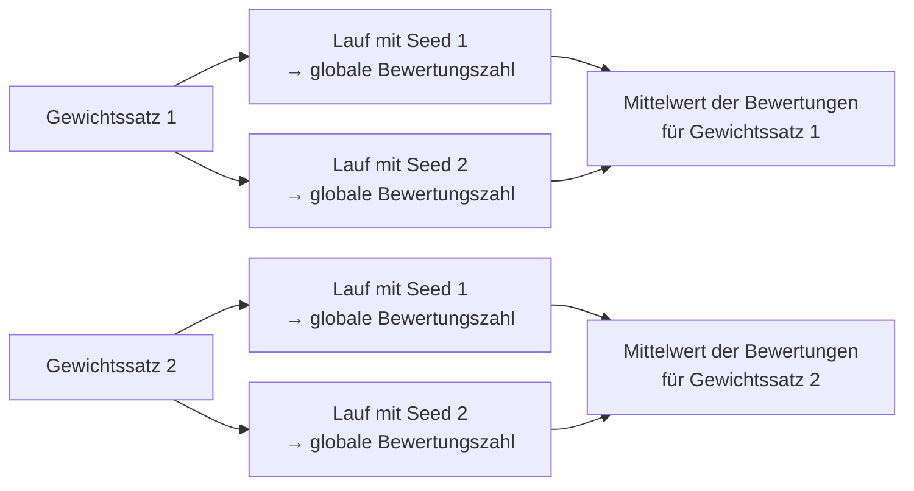

**Der Gewichtssatz mit dem kleineren Mittelwert wird bevorzugt.** Verglichen
werden die Bewertungen vollständiger Produktionsläufe, nicht die Scores
einzelner Aktionen.

#### Gesamter Optimierungsablauf

Das folgende Diagramm zeigt die gesamte Gewichtssuche. Die anschließenden Abschnitte
erklären alle Schritte **in derselben Reihenfolge**.

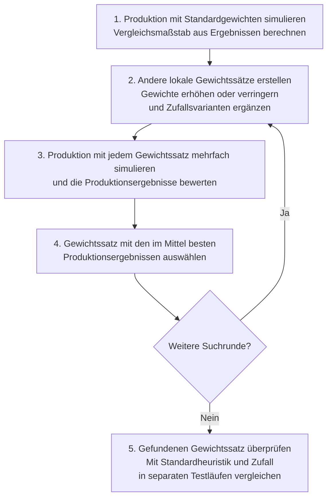

Direkt zu den Details:
[1. Standardgewichte simulieren](#1-produktion-mit-standardgewichten-simulieren) ·
[2. Gewichte variieren](#2-varianten-der-lokalen-gewichte-erstellen) ·
[3. Varianten simulieren und bewerten](#3-produktion-mit-jedem-gewichtssatz-mehrfach-simulieren-und-bewerten) ·
[4. Gewichtssatz auswählen](#4-gewichtssatz-anhand-der-mittleren-produktionsergebnisse-auswählen) ·
[5. Steuerungen vergleichen](#5-gefundenen-gewichtssatz-mit-standardheuristik-und-zufall-vergleichen).

### 1. Produktion mit Standardgewichten simulieren

Zuerst wird gemessen, **wie die Produktion mit den bisherigen
Standardgewichten `HeuristicWeights()` läuft**. Dazu wird die heuristische
Steuerung einmal pro [Seed aus `SEEDS`](#baseline-technik) vollständig
simuliert: aktuell einmal mit Seed `1` und einmal mit Seed `2`, jeweils mit
den Standardgewichten. **Dieselbe Seed-Liste wird anschließend für jeden
anderen Gewichtssatz verwendet.** Diese Läufe mit Standardgewichten bilden
die **Baseline (Vergleichsbasis)**.

Für jede [Zeitkennzahl](#produktionskennzahlen) wird anschließend der
**Mittelwert (Durchschnitt) über die Baseline-Läufe mit allen Seeds** berechnet.
Daraus werden feste Referenzwerte für den Vergleich mit anderen
Gewichtssätzen bestimmt.

**Beispiel:** Mit Standardgewichten beträgt die Produktionsdauer ([`makespan`](#produktionskennzahlen))
im Durchschnitt **10 Stunden**. Diese `10` werden als Referenz gespeichert.
Ein späterer Lauf mit anderen Gewichten benötigt:

- **8 Stunden:** `8 / 10 = 0.8` → kürzere Produktionsdauer als die
  durchschnittliche Baseline-Dauer.
- **12 Stunden:** `12 / 10 = 1.2` → längere Produktionsdauer als die
  durchschnittliche Baseline-Dauer.

**Ergebnis dieses Schritts:** feste Vergleichsmaßstäbe für die Zeitkennzahlen
aller folgenden Läufe, einschließlich des
[Abschlussvergleichs](#5-gefundenen-gewichtssatz-mit-standardheuristik-und-zufall-vergleichen).

<a id="baseline-technik"></a>

#### Technische Umsetzung: Seeds, Referenzberechnung und Nullfälle

##### Rolle des Seeds im Simulationsablauf

Während eines Simulationslaufs wiederholt sich dieser Ablauf:

`Zustand → Policy entscheidet → Simulation führt Aktion aus → neuer Zustand`

Der neue Zustand entsteht nicht allein durch die Entscheidung. Auch
Zufallseinflüsse können die Ausführung beeinflussen, etwa Schwankungen der
Robotergeschwindigkeit oder das Auftreten eines Defekts. Schematisch gilt:

`Neuer Zustand = bisheriger Zustand + Auswirkungen der gewählten Aktion + gegebenenfalls Zufallseinflüsse`

Ein **Seed (Startwert für die Zufallszahlengeneratoren)** macht die
Zufallsziehungen reproduzierbar. `SpineMLSimulationRunner` setzt ihn beim
Aufbau jedes vollständigen Simulationslaufs.

**Der Zufall wird dadurch nicht entfernt.** Bei demselben Seed werden
beispielsweise die anfänglichen Maschinengeschwindigkeiten für zwei
Gewichtssätze gleich ausgelost. Unterschiedliche Gewichtssätze können
anschließend andere Aktionen bevorzugen und dadurch andere Aktionsfolgen
und Folgezustände erzeugen. Verglichen wird, welche dieser Aktionsfolgen
insgesamt bessere [Produktionsergebnisse](#produktionskennzahlen) liefert,
etwa eine kürzere Produktionsdauer oder weniger Verspätung.

##### Referenzberechnung und Nullfälle

`GlobalSimulationEvaluation.calculate_baseline_reference_values()` berechnet
für jede Zeitkennzahl den Mittelwert über die Baseline-Läufe und speichert
daraus die Referenzwerte. Die Baseline verwendet die Standardheuristik,
nicht die Zufallspolicy.

Für jede Zeitkennzahl wird ausschließlich ihr eigener Baseline-Mittelwert
unverändert als Referenz verwendet.
Ist einer dieser Mittelwerte `0`, löst die Methode einen `ValueError` mit
dem Namen der betroffenen Kennzahl aus. Die Optimierung bricht dann ab,
weil diese Referenz bei der [späteren Bewertung](#globale-bewertungszahl)
nicht als Divisor verwendet werden kann.

Das gilt auch bei gültigen Produktionsergebnissen ohne Verspätung,
Werkzeugwechsel oder Blockierung, wenn die entsprechende Baseline-Zeit `0` ist.

### 2. Varianten der lokalen Gewichte erstellen

Die Suche startet in `optimization.py` mit dem Standardgewichtssatz
`HeuristicWeights()`. In jeder Suchrunde stellt
`LocalHeuristicWeightOptimizer.optimize_iteratively()` die zu prüfenden
Gewichtssätze auf zwei Arten zusammen. **Jeder Gewichtssatz enthält alle
lokalen Gewichte**, auch wenn nur eines davon geändert wird.

1. **Einzelne Gewichte verändern: `neighboring_weights()`**

   Der aktuelle Gewichtssatz bleibt als Vergleich enthalten. Zusätzlich
   werden für jedes Gewicht zwei Varianten erstellt: eine mit
   `Gewicht − Schrittweite` und eine mit `Gewicht + Schrittweite`.
   Alle anderen Gewichte werden unverändert übernommen. Die veränderten
   Werte bleiben zwischen `0.000001` und `1.0`.

   **Beispiel mit der anfänglichen Schrittweite `0.4`:** Die Tabelle zeigt
   das Transportzeitgewicht `pick_short_transport_time_weight` und das
   Kapazitätsgewicht `target_store_free_capacity_weight`. Die übrigen
   **23 Gewichte bleiben in diesen Beispielsätzen unverändert**.

   | Gewichtssatz | Transportzeitgewicht | Kapazitätsgewicht |
   |---|---|---|
   | Ausgangssatz | `0.3` | `0.2` |
   | Nur Transportzeitgewicht verringern | `0.000001` | `0.2` |
   | Nur Transportzeitgewicht erhöhen | `0.7` | `0.2` |
   | Nur Kapazitätsgewicht verringern | `0.3` | `0.000001` |
   | Nur Kapazitätsgewicht erhöhen | `0.3` | `0.6` |

   `0.3 − 0.4` und `0.2 − 0.4` liegen unter der Untergrenze. Deshalb
   verwendet der Code für diese beiden Varianten `0.000001`.
   Dasselbe Vorgehen wird auch für die übrigen Gewichte durchgeführt.

2. **Weitere Gewichtssätze zufällig zusammenstellen: `random_local_weight_candidates()`**

   Hier erhält jedes Gewicht einen neu gezogenen Zufallswert. So entstehen
   zusätzliche Gewichtssätze, bei denen mehrere Gewichte gleichzeitig
   vom Ausgangssatz abweichen können. Der Zufallsbereich reicht von
   `0.000001` bis `1.0`; nur für `wait_action_weight` verwendet diese Methode
   den kleineren Bereich von `0.000001` bis `0.1`.

   **Beispiel aus der ersten Suchrunde:** `EXPLORATION_CANDIDATES = 3`
   erzeugt drei zusätzliche Zufallssätze. Gezeigt sind drei ihrer jeweils
   25 Gewichte, auf vier Nachkommastellen gerundet. Auch die übrigen
   22 Gewichte werden für jeden Satz neu gezogen.

   | Zufallssatz | Transportzeitgewicht | Kapazitätsgewicht | `wait_action_weight` |
   |---|---|---|---|
   | 1 | `0.5113` | `0.4766` | `0.0758` |
   | 2 | `0.9666` | `0.8050` | `0.0434` |
   | 3 | `0.5079` | `0.7066` | `0.0448` |

**Wie viele Gewichtssätze entstehen insgesamt?**

`HeuristicWeights` enthält aktuell **25 Gewichte**. Pro Suchrunde ergibt sich:

`1 Ausgangssatz + 2 × 25 Einzelvarianten + 3 Zufallssätze = 54 Gewichtssätze`

Bei `ITERATIONS = 2` sind damit bis zu **108 Gewichtssatz-Prüfungen** vorgesehen.
Gleiche Sätze werden nicht aussortiert: Die 54 Sätze der ersten Suchrunde
enthalten mit den aktuellen Standardgewichten 53 unterschiedliche Sätze.
Das liegt daran, dass `complete_job_weight` bereits `1.0` ist; seine nach
oben begrenzte Plus-Variante ist identisch zum Ausgangssatz.

**Ergebnis dieses Schritts:** eine Liste von Gewichtssätzen, die anschließend
[simuliert und bewertet](#3-produktion-mit-jedem-gewichtssatz-mehrfach-simulieren-und-bewerten) werden.

### 3. Produktion mit jedem Gewichtssatz mehrfach simulieren und bewerten

`select_best_local_weight_set_across_seeds()` lässt jeden Kandidaten durch
`evaluate_local_weights_across_seeds()` prüfen. Für **einen Gewichtssatz**
werden nacheinander alle [Seeds aus `SEEDS`](#baseline-technik) verwendet.

Pro Seed wird ein vollständiger Simulationslauf ausgeführt und
[global bewertet](#globale-bewertungszahl). Erst nach allen Seeds wird der
[Mittelwert für diesen Gewichtssatz](#mittelwert-über-die-seeds) gebildet.
Anschließend wird der nächste Gewichtssatz genauso geprüft.

#### Simulationslauf und Produktionskennzahlen

`runner(weights, seed)` ruft `SpineMLSimulationRunner.__call__()` auf.
Für jeden Lauf entstehen eine neue Salabim-Umgebung, die heuristische Policy,
die `SimulationBridge`, Layout, Maschinen, Roboter, Stores und Jobs. Der
Runner setzt den Seed für Python-Zufall, Salabim und `SimMachine.QUALITY_SEED`.

Während dieses Laufs bleibt der Gewichtssatz fest. Bei neuen Beobachtungen
bewertet der Evaluator die erzeugten Aktionskandidaten; der Selector bevorzugt
einen hohen Aktionsscore. Die Bridge übergibt die ausgewählten Aktionen an die
Simulationskomponenten.

`env.run()` führt die Simulation aus. Erkennt `SimCompletionWatcher`, dass
alle Jobs beendet sind, kann der Lauf vor der maximalen Endzeit stoppen.
Anschließend sammelt `collect_global_metrics()` die Produktionsergebnisse
in einem [`GlobalSimulationMetrics`-Objekt](#produktionskennzahlen). Ein Lauf mit unfertigen Jobs wird
vom Runner als Fehler zurückgewiesen und nicht als gültiges
Optimierungsergebnis verwendet.

<a id="produktionskennzahlen"></a>

<details>
<summary>Welche Produktionskennzahlen werden erfasst?</summary>

- `makespan`: Letzte gespeicherte Jobabschlusszeit minus frühester
  `earliest_start_time` der Aufträge. Maßgeblich ist `mark_finished()`,
  nicht der spätere Zeitpunkt, zu dem der Watcher die Simulation stoppt.
- `total_tardiness`: Summe der positiven Verspätungen vollständig
  abgeschlossener Aufträge. Jeder Auftrag zählt einmal mit seinem letzten
  Jobabschluss relativ zu seiner eigenen `latest_end_time`.
- `total_transport_time`: Summe der Bewegungszeiten für X, Y und Z aller
  Roboter. Ein- und Auslagerungswartezeiten zählen nicht als Bewegung.
- `tool_change_time`: Summe der Maschinenzeiten in den Zuständen
  `mounting` und `unmounting`.
- `blocking_time`: Summe der Maschinenzeiten im Zustand `blocked`.
- `total_jobs`, `completed_jobs` und `unfinished_jobs`: Gesamtzahl,
  abgeschlossene und noch nicht abgeschlossene Jobs.
- `rework_job_count`: Zahl abgeschlossener Jobs mit mindestens einer
  Nacharbeit; mehrere Nacharbeiten desselben Jobs erhöhen diesen Wert nicht
  mehrfach.
- `scrap_job_count`: Summe der Ausschussentscheidungen abgeschlossener Jobs.
- `defect_jobs`: Zahl der Jobs, bei denen mindestens ein Defekt erkannt
  wurde, auch wenn sie später erfolgreich nachgearbeitet wurden.
- `intact_jobs`: Zahl abgeschlossener Jobs mit `general_state="intact"`.
  Dazu können auch herabgestufte Jobs gehören, weil deren geringere Qualität
  getrennt durch `downgraded=True` markiert wird.
- `downgraded_job_count`: Zahl herabgestufter Jobs.

Die zugehörigen Raten entstehen durch Division durch `total_jobs`.
Ein Job kann beispielsweise sowohl zur historischen Defektquote als auch
zur abschließenden Intaktquote zählen.

</details>

#### Globale Bewertungszahl

`GlobalSimulationEvaluation` macht aus den Kennzahlen eines vollständigen
Laufs eine globale Bewertungszahl. **Hier ist ein niedriger Wert besser**,
anders als beim Aktionsscore.

Die Berechnung erfolgt in zwei Schritten:

1. `metrics_relative_to_baseline()` teilt die Zeitkennzahlen durch die
   festen Referenzwerte aus [Schritt 1](#1-produktion-mit-standardgewichten-simulieren).
   So entstehen dimensionslose Verhältniswerte. Bei einer positiven
   Baseline-Zeit bedeutet `1` gleich der Baseline, ein kleinerer Wert
   eine kürzere Zeit und ein größerer Wert eine längere Zeit.
   Das [10-Stunden-Beispiel aus Schritt 1](#1-produktion-mit-standardgewichten-simulieren)
   zeigt diese Umrechnung.
   Qualitäts- und Fertigstellungsraten gehen dagegen direkt ein:
   `rework_rate`, `scrap_rate`, `defect_rate`, `unfinished_rate`,
   `downgrade_rate` und `1 − intact_rate` als `non_intact_rate`.
   Beispielsweise bleibt eine Ausschussrate von `0.10` gleich `0.10`;
   sie wird nicht durch eine Baseline-Rate geteilt. Eine Rate von `0.05`
   erhält entsprechend den kleineren Strafwert.
2. `calculate_weighted_sum_of_metrics_relative_to_baseline()`
   multipliziert diese Beiträge mit den festen [globalen Gewichten](#globale-gewichte-in-optimizationpy) und
   addiert sie:

`Globale Bewertungszahl = Summe(Kennzahlbeitrag × globales Gewicht)`

Hier wird **nicht durch die Gewichtssumme geteilt**. Alle Kandidaten werden
mit denselben globalen Gewichten und Referenzwerten beurteilt.

##### Globale Gewichte in `optimization.py`

- **Makespan:** `makespan=5.0`.
- **Gesamtverspätung und Ausschussquote:**
  `total_tardiness=4.0` und `scrap_job_penalty=4.0`.
- **Nacharbeit, historische Defekte, nicht intakte Jobs und Herabstufungen:**
  `rework_job_penalty`, `defect_job_penalty`, `non_intact_penalty`
  und `downgrade_job_penalty` jeweils `3.0`.
- **Transport-, Werkzeugwechsel- und Blockierzeit:**
  `total_transport_time`, `tool_change_time` und `blocking_time`
  jeweils `1.0`.
- **Unfertige Jobs:** `unfinished_jobs=20.0`. Der Runner weist unvollständige
  Läufe bereits als Fehler zurück; in regulär zurückgegebenen Läufen ist
  die Unfertigquote daher `0`.

Ein höheres globales Gewicht erhöht den Einfluss des zugehörigen Beitrags.
Die tatsächliche Wirkung hängt aber auch von dessen Größe ab. Die Gewichte
legen keine garantierte Rangfolge der Produktionsziele fest.

#### Mittelwert über die Seeds

Die globalen Bewertungszahlen eines Gewichtssatzes werden in
`objective_values` gespeichert, die Rohkennzahlen in `metrics_by_seed`.
`evaluate_local_weights_across_seeds()` bildet aus den Bewertungszahlen
den Mittelwert `mean_global_cost`:

`mean_global_cost = Summe(globale Bewertungszahl je Seed) / Anzahl der Seeds`

**Beispiel:** Gewichtssatz A erreicht bei zwei Seeds die globalen
Bewertungszahlen `10` und `14`, Gewichtssatz B die Werte `11` und `11`.
Dann ist `mean_global_cost(A) = 12` und `mean_global_cost(B) = 11`.
B wird bevorzugt, obwohl A bei einem Seed besser war. Dies sind Bewertungen
vollständiger Produktionsläufe, keine einzelnen Aktionsscores.

Das `WeightEvaluation`-Objekt bündelt den Gewichtssatz, seine Kennzahlen
und seine Bewertung.

**Ergebnis dieses Schritts:** ein `mean_global_cost` pro geprüftem
Gewichtssatz als Grundlage für die
[Auswahl eines Gewichtssatzes](#4-gewichtssatz-anhand-der-mittleren-produktionsergebnisse-auswählen).

<details>
<summary>Technischer Detailablauf zu Schritt 3 (Sequenzdiagramm)</summary>

Dieses Diagramm zeigt ausschließlich die Prüfung **eines festen
Gewichtssatzes** aus Schritt 3 des Gesamtablaufs: ein Lauf pro Seed,
eine globale Bewertungszahl pro Lauf und anschließend der Mittelwert.
Es zeigt keine zusätzliche Optimierung.

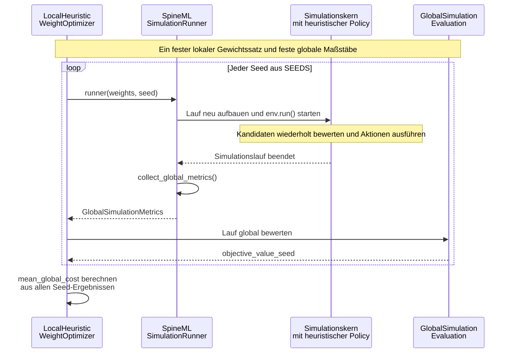

</details>

### 4. Gewichtssatz anhand der mittleren Produktionsergebnisse auswählen

`select_best_local_weight_set_across_seeds()` vergleicht die
[`mean_global_cost`-Werte](#mittelwert-über-die-seeds) aller Gewichtssätze der Runde und wählt den
kleinsten. `optimize_iteratively()` legt anschließend fest, wie es weitergeht:

- **Verbesserung:** Ist dies der bisher beste Satz, wird er gespeichert und
  zum Ausgangspunkt der nächsten Runde. Die Schrittweite wird halbiert.
  Die erste Runde legt erstmals einen besten Satz fest.
- **Keine Verbesserung:** Der zuletzt verbesserte Satz bleibt Ausgangspunkt;
  die erfolglosen Runden werden gezählt.
- **Neustart:** Nach `restart_after_no_improvement` erfolglosen Runden
  beginnt die Suche erneut am zuletzt verbesserten Satz. Die Schrittweite
  wird auf ihren Anfangswert zurückgesetzt.
- **Ende:** Die Suche endet spätestens nach `iterations` Runden oder nach
  `stop_after_no_improvement` erfolglosen Runden seit der letzten
  Verbesserung. Ein Neustart setzt diesen Abbruchzähler nicht zurück.

Bei einer weiteren Runde geht der Ablauf zu [Schritt 2](#2-varianten-der-lokalen-gewichte-erstellen)
zurück. Nach dem Ende liefert `WeightOptimizationResult` unter anderem
`best_weights`, `best_mean_global_cost` und `best_evaluation`.
In `evaluations` speichert `optimize_iteratively()` die jeweils
verbesserten Lösungen, nicht jeden getesteten Kandidaten.

### 5. Gefundenen Gewichtssatz mit Standardheuristik und Zufall vergleichen

Erst nach der Gewichtssuche vergleicht `_benchmark_policies()` drei
Steuerungen auf denselben separaten `BENCHMARK_SEEDS`:

- **`Random`:** Die [Zufallspolicy](#randompolicy-zufällige-vergleichssteuerung)
  wählt gleichverteilt unter Nicht-Warteaktionen und wartet nur als Fallback.
  Sie verwendet keine heuristischen Scores.
- **`Heuristic (default)`:** Die Heuristik verwendet die unveränderten
  Standardgewichte.
- **`Heuristic (optimized)`:** Dieselbe Heuristik verwendet den besten
  während der Suche gefundenen Gewichtssatz.

Diese Test-Seeds gehen nicht in die Gewichtsauswahl ein. Alle drei
Steuerungen verwenden dasselbe Layout, dasselbe Szenario und dieselben
globalen Gewichte und Referenzwerte. Für die Zufallspolicy führt der Runner
`run_policy(RandomPolicy(seed), seed)` aus; für die Heuristiken
`runner(weights, seed)`. Simulationskern und Kennzahlenerfassung sind gleich.

Das Interface zeigt die Kennzahlen je Test-Seed und ihre Mittelwerte.
Damit werden zwei Fragen geprüft: Ist die Heuristik besser als die
Zufallsreferenz, und verbessert die Gewichtssuche die Standardheuristik?

„Optimized“ bezeichnet den ausgewählten Gewichtssatz, **keinen garantierten
Vorteil auf neuen Seeds und kein nachgewiesenes globales Optimum**.
Die aktuell fünf Test-Seeds (`101` bis `105`) sind ein Einstieg.
Für belastbare Aussagen sollten mehr Seeds sowie unterschiedliche Layouts
und Szenarien verglichen werden.

### Beteiligte Dateien

- [optimization.py](sources/optimization.py): koordiniert die fünf Schritte
  und zeigt Fortschritt und Ergebnisse im Streamlit-Interface.
- [HeuristicWeights.py](sources/SpineML/Control/HeuristicControl/HeuristicWeights.py):
  definiert und prüft die veränderbaren lokalen Gewichte.
- [LocalHeuristicWeightOptimizer.py](sources/SpineML/Control/HeuristicControl/LocalHeuristicWeightOptimizer.py):
  erzeugt und vergleicht Gewichtssätze und steuert die Suchrunden.
- [SpineMLSimulationRunner.py](sources/SpineML/Control/HeuristicControl/SpineMLSimulationRunner.py):
  führt die einzelnen Simulationen aus und erfasst ihre Kennzahlen.
- [GlobalSimulationEvaluation.py](sources/SpineML/Control/HeuristicControl/GlobalSimulationEvaluation.py):
  berechnet Referenzwerte und die globale Bewertungszahl eines Laufs.

<details>
<summary>Technische Einbindung: Modellladen, Worker-Thread und Fortschrittsanzeige</summary>

`optimization.py` liest das über `SPINEML_MODEL_FILE` ausgewählte Modell.
`_suppress_model_visualization()` unterdrückt dabei dessen direkten
`simulate(...)`-Aufruf. `_find_layout_and_scenario()` wählt das dort
angegebene Layout-Szenario-Paar aus, auch wenn das Modell mehrere enthält.

`create_optimizer()` erstellt den Runner und übergibt ihn als aufrufbares
Objekt (`runner(weights, seed)`) an den Optimierer. Außerdem wird die
globale Bewertung mit dem Optimierer verbunden.

Beim Klick auf **Start optimization** setzt `_start_optimization()`
den vorherigen Ergebniszustand zurück und startet einen Worker-Thread.
Dieser führt Referenzläufe, Gewichtssuche und Abschlussvergleich aus.

Der `progress`-Callback meldet die aktuelle Runde, den geprüften
Gewichtssatz (`Kandidat x/y`) und dessen fertige Bewertung. Das
Streamlit-Interface liest diesen Zustand und aktualisiert Status,
Fortschrittsbalken und Zwischen-Diagramme. Die
[Kostenkurve](#bedeutung-der-kostenkurve) verwendet die
Bewertungen **aller** geprüften Kandidaten, nicht nur die im
Optimierungsergebnis gespeicherten Verbesserungen.

</details>

## Optimierung starten

Die Optimierung wird über das Streamlit-Webinterface gestartet.

1. Den Webserver aus dem Projektordner starten:

   ```powershell
   python -m streamlit run sources/optimization.py
   ```

2. Ohne gesetzte Umgebungsvariable `SPINEML_MODEL_FILE` verwendet die
   Anwendung `example-1.py`. Oben im Interface steht der tatsächlich geladene
   Dateiname, zum Beispiel `Example: example-1.py`.
3. Auf **Start optimization** klicken. Zuerst wird die Baseline mit den
   unveränderten lokalen `HeuristicWeights` für alle Seeds berechnet.
4. Danach werden die lokalen Gewichtssätze iterativ geprüft. Währenddessen
   zeigt das Interface live die aktuelle Runde, den getesteten Gewichtssatz
   (`Kandidat x/y`), den Fortschrittsbalken und die Diagramme an.
5. Nach der Suche werden Zufallspolicy, Standardheuristik und optimierte
   Heuristik auf denselben separaten Test-Seeds ausgeführt. Anschließend zeigt
   das Interface den Vergleich `Random` / `Heuristic (default)` /
   `Heuristic (optimized)`.

Ein anderes Beispiel kann vor dem Start in PowerShell gewählt werden:

```powershell
$env:SPINEML_MODEL_FILE = "example-0.py"
python -m streamlit run sources/optimization.py
```

Alternativ startet ein vorbereiteter Einstieg ein bestimmtes Beispiel:

```powershell
python sources/examples/optimization/example-0-optimize.py
```

Die Suchparameter stehen oben in `sources/optimization.py`:
`SEEDS`, `BENCHMARK_SEEDS`, `ITERATIONS`, `INITIAL_WEIGHT_STEP`,
`EXPLORATION_CANDIDATES`, `RESTART_AFTER_NO_IMPROVEMENT` und
`STOP_AFTER_NO_IMPROVEMENT`. `SEEDS` dient der Gewichtssuche;
`BENCHMARK_SEEDS` enthält davon getrennte Test-Seeds für den Abschlussvergleich.
Die übrigen Parameter steuern die maximale
Rundenzahl, die Änderungsschrittweite, zusätzliche Zufallskandidaten sowie
Neustart und Abbruch bei ausbleibender Verbesserung.

### Bedeutung der Kostenkurve

Die Kurve **Mean global cost** (mittlere globale Bewertungszahl) zeigt die
Bewertung der bisher geprüften lokalen Gewichtssätze. „Kosten“ bezeichnet
hier die berechnete Vergleichszahl, keinen Geldbetrag.

- Die **X-Achse** (`Candidate`) gibt die Reihenfolge der geprüften lokalen
  Gewichtssätze an. Die Nummerierung läuft über die bisher bewerteten Sätze und
  wird nicht bei jeder Runde zurückgesetzt.
- Die **Y-Achse** (`Mean global cost`) zeigt den jeweiligen
  `mean_global_cost`. Dieser Wert ist der Mittelwert der globalen
  Bewertungszahlen über alle Seeds für genau diesen lokalen Gewichtssatz.
- Jeder Punkt entsteht erst, nachdem dieser lokale Gewichtssatz mit allen
  Seeds simuliert und bewertet wurde.
- Ein niedriger Punkt ist besser, weil die globale Bewertungszahl minimiert
  wird. Ein hoher Punkt bedeutet, dass dieser lokale Gewichtssatz im Mittel
  schlechtere globale Simulationsergebnisse liefert.
- Die Linie verbindet die Punkte nur in ihrer Prüf-Reihenfolge. Sie stellt
  keine zusätzliche Berechnung zwischen den Gewichtssätzen dar.

Die aktuelle Runde und der Fortschritt innerhalb dieser Runde stehen zusätzlich
oberhalb der Diagramme, zum Beispiel
`Optimization: round 1, candidate 9/58`.
