# SpineML

SpineML modelliert und simuliert Fabriken mit einem zentralen Transportkorridor
und Seitenkorridoren. Roboter transportieren Jobs zwischen Lagern, Puffern und
Maschinen. Diese README beschreibt den Zweig `Foroogh`.

- **Steuerung austauschen:** Die `SimulationBridge` verbindet den
  Salabim-Simulationskern mit einer Policy. Die Policy erhält Zustandsdaten und
  wählt Aktionen; die Simulation führt diese aus.
- **Steuerungen vergleichen:** Die heuristische Policy und die Zufallspolicy
  werden anhand derselben Produktionskennzahlen verglichen. Optional lässt
  sich eine neuronale Kandidatenauswahl mit DQN oder Monte Carlo trainieren und auf
  getrennten Test-Seeds mit diesen Steuerungen vergleichen.
- **Heuristik verbessern:** Die Gewichtssuche prüft verschiedene lokale
  Gewichtssätze in vollständigen Simulationsläufen. Unabhängige Läufe können
  in einem CPU-Prozesspool parallel ausgeführt werden.

## Inhalt

- [Projektstruktur und Zuständigkeiten](#projektstruktur-und-zuständigkeiten)
- [Installation und Start](#installation-und-start)
- [Fabrikkonfiguration](#fabrikkonfiguration)
- [Diskrete Simulation](#diskrete-simulation)
- [SimulationBridge](#simulationbridge)
- [ActionGenerator](#actiongenerator)
- [RandomPolicy: zufällige Vergleichssteuerung](#randompolicy-zufällige-vergleichssteuerung)
- [HeuristicPolicy](#heuristicpolicy)

  - [Aktionsauswahl](#ablauf-der-heuristischen-policy)
  - [Lokale Aktionsbewertung](#lokale-aktionsbewertung)
  - [Optimierungsvorgang](#optimierungsvorgang)

- [SimulationExecution: Simulationsläufe ausführen](#simulationexecution-simulationsläufe-ausführen)

  - [Parallele Ausführung und Rechenzeit](#parallele-optimierung-mit-mehreren-cpu-prozessen)

- [RLPolicy: neuronale Kandidatenauswahl und Training](#rlpolicy-neuronale-kandidatenauswahl-und-training)

<a id="ausführung-bewertung-und-gewichtssuche"></a>

## Projektstruktur und Zuständigkeiten

Die Simulation führt Aktionen aus, die Policy wählt sie aus. Ausführung,
Bewertung und Gewichtssuche liegen in getrennten Ordnern:

```text
sources/
├── apps/
│   └── heuristic_optimization_app.py
├── tools/
│   ├── compare_optimization_runtime.py
│   ├── measure_simulation_runtime.py
│   ├── run_rl_episode.py
│   ├── train_rl_policy.py
│   └── evaluate_rl_policy.py
└── SpineML/
    ├── Configuration/
    ├── Simulation/
    ├── SimulationExecution/
    │   ├── ModelLoader.py
    │   ├── SimulationRunner.py
    │   └── ParallelSimulationRunner.py
    ├── SimulationInterface/
    │   ├── InterfaceTypes.py
    │   └── SimulationBridge.py
    ├── GlobalEvaluation/GlobalSimulationEvaluation.py
    └── Control/
        ├── ActionGeneration/
        │   └── ActionGenerator.py
        ├── RandomPolicy/RandomPolicy.py
        ├── HeuristicPolicy/
        │   ├── HeuristicPolicy.py
        │   ├── HeuristicActionSelector.py
        │   ├── HeuristicWeights.py
        │   ├── LocalHeuristicActionEvaluator.py
        │   ├── HeuristicPolicyFactory.py
        │   └── WeightOptimization/LocalHeuristicWeightOptimizer.py
        └── RLPolicy/
            ├── DQN/
            │   ├── CandidateDQN.py
            │   └── CandidateDQNPolicy.py
            ├── MonteCarlo/
            │   ├── CandidateMonteCarlo.py
            │   ├── AsyncEpisodeRunner.py
            │   └── EpisodeReplayBuffer.py
            └── Shared/
                ├── CandidateQNetwork.py
                ├── RLCandidatePolicy.py
                ├── RLObservationEncoder.py
                ├── RLReward.py
                ├── SpineRLEnv.py
                ├── TrainingSupport.py
                └── TrainedPolicy.py
```

| Bereich | Verantwortung |
| --- | --- |
| [apps/heuristic_optimization_app.py](sources/apps/heuristic_optimization_app.py) | Webinterface und Einstellungen der heuristischen Optimierung. |
| [tools](sources/tools) | Befehle für Laufzeitmessung, RL-Prüfung, Training und Steuerungsvergleich. |
| [Configuration](sources/SpineML/Configuration) | Fabrik, Produkte, Operationen, Werkzeuge und Aufträge beschreiben. |
| [Simulation](sources/SpineML/Simulation) | Jobs, Roboter und Maschinen als Salabim-Prozesse ausführen und Laufzeitdaten ändern. |
| [SimulationInterface](sources/SpineML/SimulationInterface) | Zustandsdaten und Entscheidungen zwischen Simulation und Policy austauschen. |
| [GlobalEvaluation](sources/SpineML/GlobalEvaluation) | Produktionskennzahlen zu einer globalen Bewertungszahl zusammenfassen. |
| [Control/ActionGeneration](sources/SpineML/Control/ActionGeneration) | Technisch mögliche Aktionen einschließlich Pick-Priorität erzeugen. |
| [Control/RandomPolicy](sources/SpineML/Control/RandomPolicy) | Ohne Aktionsscores zufällig unter den angebotenen Nicht-Warteaktionen wählen. |
| [Control/HeuristicPolicy](sources/SpineML/Control/HeuristicPolicy) | Einzelne Kandidaten mit lokalen Gewichten bewerten und daraus heuristisch auswählen. |
| [Control/HeuristicPolicy/WeightOptimization](sources/SpineML/Control/HeuristicPolicy/WeightOptimization) | Lokale Gewichtssätze durch Simulationsläufe vergleichen und verbessern. |
| [SimulationExecution](sources/SpineML/SimulationExecution) | Modelle laden und Simulationen einzeln oder parallel ausführen. |
| [Control/RLPolicy](sources/SpineML/Control/RLPolicy) | Neuronale Aktionsauswahl, RL-Umgebung und gespeicherte Modelle bereitstellen. |

- **Ein Lauf:** `SimulationRunner.run_policy(policy, seed)` startet eine
  Simulation mit einer fertigen Policy.
- **Mehrere Läufe:** `ParallelSimulationRunner.run_many(...)` erhält Aufträge
  mit einer Policy-Factory und einem Seed. Die Factory erstellt pro Lauf eine
  neue Policy; für die Heuristik ist das `HeuristicPolicyFactory(weights)`.
- **Zwei Arten von Gewichten:** `HeuristicWeights` bestimmen lokale
  Aktionsscores. `GlobalSimulationWeights` bestimmen die Bewertung eines
  ganzen Produktionslaufs. Diese globale Bewertung wird auch für RL verwendet.

Policy-Klassen werden aus ihrem jeweiligen Unterpaket importiert.

## Installation und Start

### Installation

Python ab Version `3.10` installieren. Danach im Terminal, hier PowerShell:

```powershell
git clone --branch Foroogh --single-branch https://github.com/ghackenberg/SpineML.git
cd SpineML
python -m venv .venv
.\.venv\Scripts\Activate.ps1
python -m pip install -e .
```

`pip install -e .` installiert das Projekt samt Abhängigkeiten aus
[pyproject.toml](pyproject.toml). `requirements.txt` muss nicht zusätzlich
installiert werden. In VS Code die Umgebung `.venv` auswählen.

Alle folgenden Befehle im Projektordner ausführen.

### Normale Simulation

```powershell
python sources/examples/normal/example-5.py
```

Die Beispieldatei definiert Fabrik und Aufträge und startet
`simulate(layout, scenario, ...)`. Bei aktivierter Animation wird die
Produktion dargestellt; anschließend werden Statistiken ausgegeben.

### Optimierung mit Webinterface

```powershell
python -m streamlit run sources/apps/heuristic_optimization_app.py
```

Im Browser **Parallel (process pool)** wählen und auf **Start optimization**
klicken. Die Anwendung vergleicht Gewichtssätze für `example-5.py`.
Modellwahl und Ergebnisse stehen unter
[Optimierung starten](#optimierung-starten).

### Rechenzeit und Parallelisierung vergleichen

Messbefehle und Ergebnisse stehen unter
[Parallele Optimierung mit mehreren CPU-Prozessen](#parallele-optimierung-mit-mehreren-cpu-prozessen).

## Fabrikkonfiguration

Dieser Abschnitt beschreibt die eigenen Erweiterungen gegenüber dem
Professorenstand `origin/main`. Die Konfigurationsklassen liegen unter
[sources/SpineML/Configuration](sources/SpineML/Configuration).

### `Layout.py`

**Aufgabe:** Start- und Endlager des Layouts begrenzen.

- **Lagerkapazität ergänzen:** Das neue `storage_capacity` bestimmt, wie
  viele Jobs Start- und Endlager jeweils aufnehmen können.
- **Beispiel:** Bei `storage_capacity=10` haben beide Lager jeweils zehn
  Plätze, nicht zehn gemeinsam.

### `Machine.py`

**Aufgabe:** Puffer, Werkzeuge, Geschwindigkeit und Qualitätsrisiko einer
Maschine konfigurieren. Name, `MachineType`, Korridor und Korridorseite
waren bereits vorhanden.

#### Defektwahrscheinlichkeit

Die Defektwahrscheinlichkeit gehört jetzt zur konkreten Maschine.
In `origin/main` wurde sie nur an `OperationType` gespeichert; der
Simulationskern führte damit noch keine Qualitätsprüfung aus.

- **Direkt angeben:** `defect_probability=0.05` bedeutet: Nach jeder
  Bearbeitung wird mit fünf Prozent Wahrscheinlichkeit ein Schweregrad
  gezogen. Der vorgegebene Wert liegt zwischen `0` und `1` und ist unabhängig
  vom Seed. Welche Defekte gespeichert werden, erklärt die
  [Defektprüfung](#defektprüfung-und-recovery).
- **Automatisch erzeugen:** Ohne Angabe oder bei `None` erzeugt
  `Machine.resolve_defect_probability(seed)` einen Zufallswert in `[0, 1)`.
  Derselbe Seed liefert für dieselbe Maschine denselben Wert.

Ohne direkte Angabe genügt beispielsweise:

```python
Machine("CNC automatisch", cnc_type, corridor, True, 10, 10)
```

`SimMachine` verwendet diesen Wert für alle Bearbeitungen des Laufs. Auch
Maschinen desselben Typs können unterschiedliche Werte haben. Die Policy
sieht im Lauf den verwendeten Zahlenwert, nicht die Vorgabe `None`.

Bei `OperationType` entfällt das frühere Argument `defect_probability`:

```python
OperationType("Fräsen", 4, 3, cnc_type, milling_tool, blank, finished)
```

#### Getrennte Maschinenpuffer

- `input_storage_capacity`: maximale Jobzahl im Eingangspuffer.
- `output_storage_capacity`: maximale Jobzahl im Ausgangspuffer.

Beide Kapazitäten werden unabhängig voneinander angegeben.

#### Erlaubte Werkzeugtypen

- **Individuelle Ausstattung festlegen:** `tool_types` erlaubt eine eigene
  Werkzeugliste für jede konkrete Maschine.
- **Beispiel:** CNC A unterstützt nur ein Schruppwerkzeug, CNC B zusätzlich
  ein Fräswerkzeug. Beide können schruppen. CNC B kann zusätzlich fräsen,
  sofern die Fräsoperation ihrem Maschinentyp zugeordnet ist.
- **Bisherige Ableitung beibehalten:** Ohne explizite Liste bestimmt
  `MachineType.computeToolTypes()` die Werkzeuge weiterhin aus den
  Operationen des Maschinentyps.
- **Kompatibilität prüfen:** Für jede konkrete Operation müssen weiterhin
  der Maschinentyp und der benötigte Werkzeugtyp passen.

#### Verarbeitungsgeschwindigkeit

- **Geschwindigkeitsfaktor ergänzen:** `processing_speed_factor` beschreibt
  die relative Bearbeitungsgeschwindigkeit der Maschine. Der Anfangswert in
  `Machine` ist `1.0`.
- **Bearbeitungsdauer beeinflussen:** `SimMachine` verwendet den Faktor bei
  der [Berechnung der Bearbeitungsdauer](#verarbeitungsdauer).

#### Schutzwerkzeugzeiten

- **Anfangszustand abbilden:** Das Schutzwerkzeug (`dummy_tool`) ist zu
  Beginn montiert; ein Produktionswerkzeug ist noch nicht eingesetzt.
- **Erste Bearbeitung vorbereiten:** Das Schutzwerkzeug wird entfernt und
  das benötigte Produktionswerkzeug montiert.
- **Zeiten konfigurieren:** `dummy_tool_mount_time=1.0` und
  `dummy_tool_unmount_time=1.0` sind Attribute jeder `Machine`, keine
  Konstruktorargumente. Sie bestimmen Montage- und Demontagezeit.
- **Werkzeugabschluss getrennt ausführen:** `SimMachineShutdown` kann das
  Schutzwerkzeug wieder montieren. Die tatsächlichen Aufrufbedingungen
  stehen [bei dieser Komponente](#simmachineshutdown-in-simmachinepy).

## Diskrete Simulation

**Aufgabe:** Gewählte Aktionen ausführen und ihre Folgen an Jobs, Maschinen
und Robotern abbilden. Der Kern liegt unter
[sources/SpineML/Simulation](sources/SpineML/Simulation).

- **Grundlage:** Jobs, Maschinen und Roboter haben eigene Salabim-Prozesse.
- **Erweiterung gegenüber `origin/main`:** Sie melden Zustände an die
  [SimulationBridge](#simulationbridge), empfangen die gewählten Aktionen
  und führen sie aus.

### `SimLayout.py`

**Aufgabe:** Startlager, Endlager, Korridore und Main-Roboter aufbauen.
Ein Store ist ein Salabim-Puffer für Jobs.

**Erweiterungen:**

- **Lager begrenzen:** Start- und Endlager verwenden jeweils
  `layout.storage_capacity`.
- **Produktgrößen ermitteln:** Für die Auftragsziele und alle vorgeschalteten
  Roh- und Zwischenprodukte werden das größte Gewicht (`max_product_weight`)
  und Volumen (`max_product_volume`) bestimmt. Die Maschinen erhalten diese
  Werte für die
  [Berechnung der größenabhängigen Bearbeitungsdauer](#verarbeitungsdauer).
- **Doppelte Produkttypen überspringen:** Das verhindert Endlosschleifen
  bei zyklischen Herstellungswegen. Nicht verbundene Produkttypen zählen nicht.
- **Bridge weitergeben:** Korridore und Main-Roboter erhalten dieselbe Bridge.

### `SimCorridor.py`

**Aufgabe:** Drei Korridor-Stores und beide Korridorarme erzeugen.

**Erweiterungen:**

- **Kapazitäten setzen:** Jeder der drei Stores verwendet
  `corridor.storage_capacity`.
- **Registrieren:** `bridge.register_corridor()` meldet Korridor und Stores an.
- **Daten weitergeben:** Beide Arme erhalten Bridge, `max_product_weight`
  und `max_product_volume`. Der Korridor berechnet diese Größen nicht selbst.

### `SimCorridorArm.py`

**Aufgabe:** Maschinen und Roboter einer Korridorseite erzeugen.
Ohne Maschine wird auf dieser Seite kein Roboter erzeugt.

**Erweiterungen:**

- **Bridge weitergeben:** Maschinen und Roboter erhalten dieselbe Bridge.
- **Produktgrößen weitergeben:** Jede Maschine erhält `max_product_weight`
  und `max_product_volume` für die
  [Berechnung ihrer Bearbeitungsdauer](#verarbeitungsdauer).

### `SimOrder.py`

**Aufgabe:** `order.quantity` einzelne `SimOrderJob`-Komponenten erzeugen.

**Erweiterung:**

- **Bridge weitergeben:** Jeder Job erhält die Verbindung zur Steuerung.

### `SimOrderJob.py`

**Aufgabe:** Die Daten eines Werkstücks speichern und seine Aktionen ausführen.
In `origin/main` wurden Route und Operationen bei der Erzeugung zufällig
festgelegt und der Job direkt ins Startlager gelegt. Jetzt entscheidet die Policy.

**Erweiterungen:**

- **Registrieren:** Die ID besteht aus Auftragsname und Jobnummer.
- **Aktionen empfangen:** `bridge.request_action(self)` fordert eine Aktion
  an; `bridge.action(self)` empfängt sie.
- **Freigeben:** `release_job` liefert Startprodukttyp, Startlager und
  Freigabezeit. Der Job wartet bis zu dieser Zeit und legt sich dort ab.
- **Auswahl speichern:** `selected_operation` und `selected_machine`
  enthalten die nächste von der Steuerung gewählte Bearbeitung.
- **Zustände speichern:** Produktzustand, Qualität, Terminstatus, Freigabe,
  Standort, Priorität und Abschlusszeit werden getrennt verwaltet.
- **Defektstrategie ausführen:** Nacharbeit, Herabstufung oder Ausschuss
  übernehmen und Defektdaten sowie Zähler speichern.
- **Warten oder abschließen:** `wait_job` wartet eine Simulationszeiteinheit;
  `finish_process=True` beendet den Jobprozess.

<a id="herkunft-und-aktualisierung-der-jobattribute"></a>

#### Wie Steuerung und Simulation die Jobdaten ändern

- **Steuerung:** Wählt Operation, Maschine und Defektstrategie.
- **Simulation:** Führt Transport und Bearbeitung aus und aktualisiert Jobdaten.
- **Jobprozess:** Führt Freigabe, Warten, Defektstrategie und Abschluss aus.
  Er trifft keine eigenen Steuerungsentscheidungen.

**Beispiel aus `example-5.py`:** Die Steuerung wählt die Operation
`Rough blank A` (Schruppen) auf der Maschine `Near basic`. Aus dem Rohteil
`Blank A` wird bei erfolgreicher Bearbeitung ein `Base body` (Grundkörper).

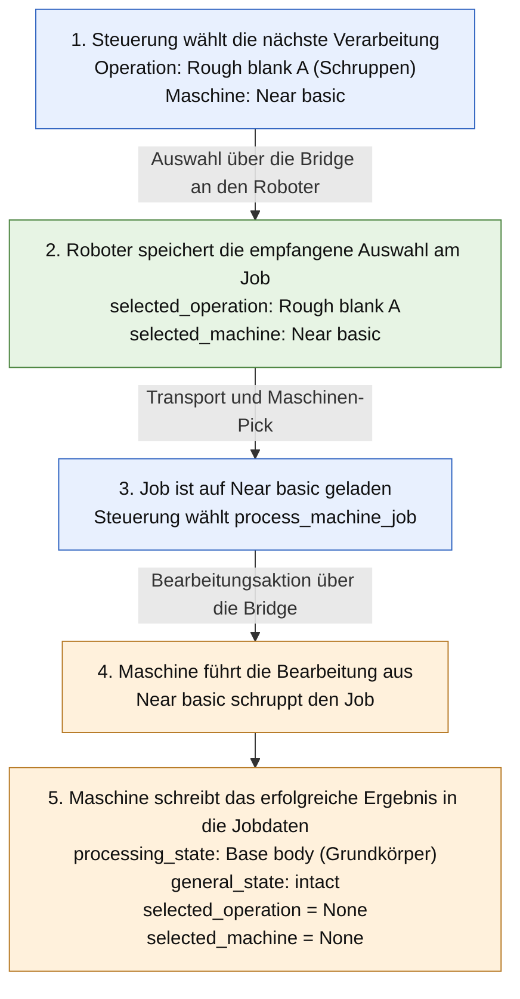

- **Auswahl zurücksetzen:** Nach der Bearbeitung bedeuten die beiden
  `None`-Werte: Die nächste Operation und Maschine sind noch nicht gewählt.
- **Objekte speichern:** `selected_operation` und `selected_machine`
  enthalten Objekte. Das Diagramm zeigt deren Namen.

#### Laufzeitstatus eines `SimOrderJob`

Die Tabellen zeigen alle 29 eigenen Konstruktorattribute mit Startwerten
und Änderungen. Bei `processing_state`, `general_state` und `due_state`
ist der Inhalt des Salabim-`State`-Objekts angegeben; `.get()` liest ihn.

##### Beim Erzeugen des Jobs

`SimOrder` übergibt diese sechs Werte an den Konstruktor von `SimOrderJob`:

| Attribut | Was wird beim Erzeugen gespeichert? |
| --- | --- |
| `layout` | Das Layout, in dem der Job produziert wird. |
| `scenario` | Das Szenario mit den Produktionsaufträgen. |
| `order` | Der Auftrag dieses Jobs. |
| `number` | Der Jobindex innerhalb des Auftrags: `0` bis `quantity - 1`. |
| `store_start` | Der Startlager-Store. |
| `bridge` | Die Verbindung zur Steuerung. |

##### Freigabe, Standort und Abschluss

| Attribut | Startwert | Bedeutung | Wer ändert den Wert und wann? |
| --- | --- | --- | --- |
| `released` | `False` | Freigabeaktion übernommen. | `release_job` setzt `True`, bevor der Job bis zur Freigabezeit wartet und ins Startlager gelangt. |
| `queue_priority` | `0.0` | Pick-Teilwert und Sortierwert im Store. | Der [Generator](#berechnung-der-pick-priorität) berechnet den Wert für jeden Pick. Roboter oder Maschine speichern ihn bei der Ausführung. Die Zufallspolicy setzt ihn auf `0.0`. |
| `location` | `"start_storage"` | Zuletzt gespeicherte Ortskennung. | Job, Roboter und Maschine aktualisieren sie bei vorgesehenen Ablage- und Aufnahmeschritten; Einschränkungen siehe unten. |
| `completed_time` | `None` | Abschlusszeit für Terminbewertung und Makespan. | `SimRobotMain` ruft `mark_finished()` nach dem Absenken zum Endlager auf, noch vor der letzten Einlagerungszeit und `to_store()`. |
| `due_state` | `None` | Abschließender Terminstatus. | `complete_job` liefert `"late"` bei `completed_time > latest_end_time`, sonst `"on-time"`. Genau an der Deadline gilt der Job als pünktlich. |
| `process_finished` | `False` | Jobprozess beendet. | Eine Abschlussaktion mit `finish_process=True` setzt das Flag. Der `SimCompletionWatcher` prüft es. |

- **Pick-Auswahl:** Entnommen wird genau der von der Policy ausgewählte Job.
  Die Heuristik verwendet `queue_priority` als einen ihrer Teilwerte.
- **Store-Sortierung:** `to_store(..., priority=job.queue_priority)` ordnet
  kleinere Werte weiter vorn ein. Das bestimmt nicht die Reihenfolge der
  Ablageaktionen. Zwischen Picks wird der gespeicherte Wert nicht neu berechnet.
- **Grenze von `location`:** Der Anfangswert gilt schon vor der Freigabe.
  Beim Pick aus dem Maschinenausgang aktualisiert `SimRobotCorridorArm`
  ihn nicht; bis zur nächsten Ablage kann die vorige Store-Kennung stehen.

##### Produktzustand und nächste Verarbeitung

| Attribut | Startwert | Bedeutung | Wer ändert den Wert und wann? |
| --- | --- | --- | --- |
| `processing_state` | `"unconfigured"` | Aktueller Produkttyp, etwa `"Blank A"`. | `release_job` setzt den Startprodukttyp. Nach Erfolg setzt die Maschine den Ausgangsprodukttyp der Operation; bei Defekt bleibt der bisherige Typ erhalten. |
| `selected_operation` | `None` | Gewähltes `OperationType`-Objekt. | Job oder Roboter übernehmen die Auswahl aus der Aktion der Steuerung. |
| `selected_machine` | `None` | Gewähltes `Machine`-Objekt als Bearbeitungsziel. | Job oder Roboter übernehmen die Auswahl aus der Aktion der Steuerung. |

- **Auswahl zurücksetzen:** Nach jeder Bearbeitung setzt die Maschine beide
  Auswahlfelder auf `None`. Herabstufung, Ausschuss und der Transport zum
  Endlager löschen die Auswahl ebenfalls.
- **Produktzustand bei Defektaktionen:** Nacharbeit setzt
  `processing_state` auf `defect_product_state_before`. Herabstufung setzt
  ihn auf `defect_product_state_target`. Eine Ausschussaktion ändert den
  Produkttyp nicht.

##### Qualität und Herabstufung

| Attribut | Startwert | Bedeutung | Wer ändert den Wert und wann? |
| --- | --- | --- | --- |
| `general_state` | `"intact"` | Qualität: `"intact"`, `"defect"` oder `"scrap"`. | Erfolg oder Herabstufung setzen `"intact"`, `mark_defective()` setzt `"defect"`, Ausschuss setzt `"scrap"`. |
| `downgraded` | `False` | Herabgestuft statt normal weiterbearbeitet. | `downgrade_product` setzt `True`. Danach wird der Job zum Endlager transportiert. |
| `downgrade_product_type` | `None` | Übernommenes `ProductType`-Objekt, gegebenenfalls ein Zwischenprodukt. | Die Aktion liefert die Typ-ID des vorgesehenen Operationsergebnisses. Die Bridge löst sie auf; der Job speichert das Objekt. |

- **Nacharbeit ist noch kein intaktes Ergebnis:** Bei ihrer Auswahl bleibt
  `general_state="defect"`. Erst eine erfolgreiche Nachbearbeitung setzt
  den Wert auf `"intact"`.
- **Beispiel:** Nach einer misslungenen Polieroperation kann die Steuerung
  herabstufen. Dann speichert der Job den vorgesehenen Produkttyp „poliert“,
  `general_state="intact"` und `downgraded=True`. Das zusätzliche Flag
  kennzeichnet die geringere Qualität.

##### Defektdaten und Nacharbeit

- **Defekt erkennen:** Ab Schweregrad `0.001` speichert
  `job.mark_defective()` die von der Maschine übergebenen Defektdaten.
- **Reaktion auswählen:** Der [Generator](#actiongenerator) erzeugt die
  Kandidaten, die Policy wählt und der Job führt die gewählte Strategie aus.
- **Letzten Defekt behalten:** Neue Defekte überschreiben die sechs Angaben
  zu Zeitpunkt, Operation, Maschine, Produktzuständen und Schweregrad.
  Nacharbeit, Herabstufung und Ausschuss löschen sie nicht.

| Attribut | Startwert | Bedeutung | Wer ändert den Wert und wann? |
| --- | --- | --- | --- |
| `defect_detected_time` | `None` | Zeitpunkt des letzten Defekts. | `mark_defective()` speichert `env.now()`. |
| `defect_operation` | `None` | Fehlerhafte Operation als Objekt. | Die Maschine übergibt sie an `mark_defective()`. |
| `defect_machine` | `None` | Verursachende konfigurierte Maschine. | Die Maschine übergibt sie an `mark_defective()`. |
| `defect_product_state_before` | `None` | Eingangsprodukttyp der fehlerhaften Operation. | Die Maschine übergibt `operation.consumes_product_type.name`; Nacharbeit setzt diesen Produktzustand. |
| `defect_product_state_target` | `None` | Vorgesehener Ausgangsprodukttyp der Operation. | Die Maschine übergibt `operation.produces_product_type.name`; Herabstufung setzt diesen Produktzustand. |
| `defect_severity` | `None` | Schweregrad des letzten Defekts. | Die Maschine übergibt den gezogenen Wert ab `0.001`. |
| `defect_recovery_strategy` | `None` | Nacharbeit, Herabstufung oder Ausschuss. | Job oder Main-Roboter speichern die gewählte Strategie. Ein neuer Defekt löscht sie; eine erfolgreiche Bearbeitung löscht eine Nacharbeitsstrategie. |
| `recovery_in_progress` | `False` | Nacharbeit gewählt oder laufend. | Job oder Main-Roboter setzen `True`. Nach der Bearbeitung wird es wieder `False`, auch bei erneutem Defekt. |
| `defect_count` | `0` | Anzahl erkannter Defekte dieses Jobs. | Jeder Aufruf von `mark_defective()` erhöht den Wert um `1`. |
| `rework_count` | `0` | Anzahl gewählter, nicht zwingend erfolgreicher Nacharbeiten. | Der Job zählt jede Nacharbeitsaktion; der Main-Roboter zählt die Übernahme nur ohne bereits gespeicherte Nacharbeitsstrategie. |
| `scrap_count` | `0` | Anzahl empfangener Ausschussaktionen. | Jede Aktion `job_scrap` erhöht den Wert um `1`. |

`rework_count` gehört zum Schlüssel der Qualitätszufallszahlen. Eine weitere
Nacharbeit erhält dadurch einen anderen Schlüssel. `SimOrderJob.process()`
übernimmt die vorgesehenen Attributfelder aus dem Aktions-Payload.

#### UML-Zustandsdiagramm eines Jobs

- **Darstellung:** Das Diagramm zeigt den fachlichen Ablauf eines Werkstücks.
- **Abgrenzung zum Code:** `processing` und `completed` fassen mehrere
  Codefelder zusammen und sind keine zusätzlichen Werte von
  `processing_state`. Die Produktnamen hängen vom jeweiligen Modell ab.

```mermaid
stateDiagram-v2
    [*] --> unconfigured
    unconfigured --> raw_workpiece: release_job
    raw_workpiece --> processing: Verarbeitung startet
    processing --> next_product_state: Operation erfolgreich
    next_product_state --> processing: Weitere Operation
    processing --> defect: Defekt erkannt
    defect --> processing: Nacharbeit
    defect --> scrap: Ausschuss
    defect --> downgraded: Herabstufung
    next_product_state --> completed: Zielprodukt erreicht und Abschluss gemeldet
    downgraded --> completed: Zum Endlager und Abschluss melden
    scrap --> completed: Zum Endlager und Abschluss melden
    completed --> [*]
```

- **Herabstufung im Code:** Der Diagrammzustand `downgraded` entspricht der
  Markierung `downgraded=True` zusammen mit dem übernommenen Produktzustand.

### `SimRobot.py`

**Aufgabe:** Gemeinsame Bewegungen in X, Y und Z bereitstellen.

**Erweiterungen:**

- **Job aufnehmen:** `take_selected_job_from_store()` entnimmt genau den
  ausgewählten Job.
- **Geschwindigkeit variieren:** Jede Achsenbewegung zieht einen Faktor von
  `0.95` bis `1.05`: `Geschwindigkeit = Grundgeschwindigkeit × Faktor`.
- **Bewegungsdaten speichern:** `movement_speed_multiplier` enthält den
  Faktor, `movement_speed` die effektive Geschwindigkeit. Nach der Bewegung
  wird diese auf `0.0` gesetzt; die Grundgeschwindigkeit bleibt gleich.

### `SimRobotMain.py`

**Aufgabe:** Jobs zwischen Startlager, Korridoren und Endlager transportieren.

**Erweiterungen:**

- **Registrieren:** Roboter, Start- und Endlager bei der Bridge anmelden.
- **Aktionen ausführen:** `pick_main_robot`, `place_main_robot` und
  `wait_main_robot` mit Job, Ziel und Lagerzeiten aus dem Payload ausführen.
- **Beladung speichern:** `current_job` sowie die übergebene Priorität,
  nächste Operation und Maschine übernehmen.
- **Bewegen:** Grundgeschwindigkeit `2.0`; Schwankungen kommen aus `SimRobot`.
- **Abschluss melden:** Beim Endlagertransport `job.mark_finished()` nach
  dem Absenken, aber vor der letzten Einlagerungszeit und Ablage aufrufen.
- **Bridge benachrichtigen:** Nach der Ablage `notify_state_change()` aufrufen.

### `SimRobotCorridorArm.py`

**Aufgabe:** Jobs zwischen Korridor- und Maschinenpuffern transportieren.

**Erweiterungen:**

- **Registrieren:** Die ID enthält Korridorname und Korridorseite.
- **Aktionen ausführen:** `pick_corridor_arm_robot`,
  `place_corridor_arm_robot` und `wait_corridor_arm_robot` mit den
  übergebenen Jobs, Zielen und Lagerzeiten ausführen.
- **Beladung speichern:** `current_job` und die vorgegebenen Jobdaten übernehmen.
- **Bewegen:** Grundgeschwindigkeit `1.5`; Schwankungen kommen aus `SimRobot`.
- **Bridge benachrichtigen:** Nach der Ablage `notify_state_change()` aufrufen.

### `SimMachine.py`

**Aufgabe:** Eine konfigurierte Maschine mit Puffern, Werkzeugen und
Bearbeitungen simulieren. Zuvor war die Bearbeitungsdauer direkt
`operation.duration`; Puffer, Werkzeugwechsel und Lebensdauer waren vorhanden.

**Erweiterungen:**

- **Aktionen empfangen:** Die Steuerung wählt Job, Operation und Werkzeug.
  Die Maschine führt Pick, Verarbeitung oder Warten aus.
- **Ausstattung übernehmen:** Konfigurierte Pufferkapazitäten, erlaubte
  Werkzeuge und das anfangs montierte Schutzwerkzeug berücksichtigen.
- **Dauer berechnen:** Produktgröße, Geschwindigkeit und Dauervariation einbeziehen.
- **Qualität prüfen:** Defekte mit dem Maschinenrisiko erzeugen und am Job
  speichern. Die Steuerung wählt die Reaktion.

#### Aufbau und Laufzeitdaten

- **Konfiguration:** `self.machine` ist die konfigurierte Maschine;
  `self.tool_types` ist eine Kopie ihrer Werkzeugliste.
- **Puffer und Registrierung:** Die Maschine meldet ihre ID sowie
  `store_in` und `store_out` mit den konfigurierten Kapazitäten bei der Bridge an.
- **Produktgrößen:** Die von `SimLayout` bestimmten Maxima dienen der
  [Berechnung der Bearbeitungsdauer](#verarbeitungsdauer).
- **Werkzeuglebensdauer:** Pro Werkzeugtyp werden vier Werte verwaltet:
  - `remaining_life_units`: aktueller Restwert.
  - `remaining_life_units_t`: Simulationszeitpunkt dieses Restwerts.
  - `remaining_life_units_next`: erwarteter Restwert nach der Operation.
  - `remaining_life_units_next_t`: erwarteter Abschlusszeitpunkt der Operation.
- **Anfangszustand:** Schutzwerkzeug montiert (`dummy_tool_mounted=True`),
  kein Produktionswerkzeug (`tool_type=None`), kein Job (`current_job=None`).
- **Geschwindigkeit:** `machine.processing_speed_factor` wird einmal mit
  einem Zufallswert von `0.45` bis `2.0` multipliziert.
- **Dauervariation:** `processing_variation` wird einmal von `0.90` bis `1.10` gezogen.
- **Anlaufverzögerung:** `startup_delay` beträgt zufällig `0` bis `4`
  Zeiteinheiten und gilt nur vor der ersten Bearbeitung.

Die drei gezogenen Maschinenwerte bleiben während des Laufs gleich.

#### Prozess und Aktionen

Der Prozess läuft wiederholt ab:

1. Zustand setzen: `blocked` bei vollem Ausgangspuffer, sonst `waiting`.
2. Mit `bridge.request_action(self)` eine Aktion anfordern und empfangen.
3. `pick_machine_job`: Ausgewählten Job aufnehmen, `location` und
   `queue_priority` aktualisieren und in `current_job` speichern.
4. `process_machine_job`: Übergebene Operation mit dem übergebenen Werkzeug ausführen.
5. `wait_machine`: Eine Simulationszeiteinheit warten und erneut anfragen.

Ein fehlender ausgewählter Job wird nicht durch einen anderen ersetzt.

#### Werkzeugwechsel und Lebensdauer

`process_machine_job` übergibt folgende Daten:

- `operation` und `tool_type`: ausgewählte Operation und Werkzeugtyp.
- `total_life_units`: vollständige Lebensdauer des verwendeten Werkzeugs.
- `consumed_life_units`: Lebensdauer, die die aktuelle Operation verbraucht.
- `remaining_life_units_before_operation`: verbleibende Lebensdauer vor Beginn
  der Operation.
- `tool_setup_action`: Anweisung, ob das Werkzeug beibehalten, montiert,
  demontiert oder ersetzt wird.
- `target_store`: Ausgangspuffer, in den die Maschine den Job nach der
  Verarbeitung ablegt.

Je nach `tool_setup_action` führt die Maschine folgende Schritte aus:

- `keep_tool`: Das aktuelle Werkzeug bleibt montiert.
- `unmount_dummy_tool_and_mount_tool`: Das Schutzwerkzeug wird entfernt und
  das Produktionswerkzeug montiert.
- `unmount_and_mount_tool`: Das bisherige Produktionswerkzeug wird entfernt
  und das neue Werkzeug montiert.
- `replace_tool_same_type`: Das verbrauchte Werkzeug wird entfernt und durch
  ein Werkzeug desselben Typs ersetzt.

Reicht die Lebensdauer nicht, wird ein neues Werkzeug mit `total_life_units`
eingesetzt. Nach der Bearbeitung werden `consumed_life_units` abgezogen.
Währenddessen zeigt die Anzeige den Übergang zum erwarteten Restwert;
anschließend wird der tatsächliche Restwert gespeichert.

#### Verarbeitungsdauer

- **Werkstück:** Es zählt der Eingangsprodukttyp der Operation
  (`operation.consumes_product_type`), nicht das bestellte Endprodukt.
- **Bezugsgrößen:** `SimLayout` ermittelt Gewicht und Volumen aller
  Auftragsziele sowie ihrer Roh- und Zwischenprodukte. `max_product_weight`
  und `max_product_volume` sind die jeweiligen Maxima; sie können zu
  unterschiedlichen Produkten gehören.
- **Größenfaktor berechnen:**

```python
product = operation.consumes_product_type
volume = product.length * product.width * product.depth
weight_ratio = float(product.weight) / self.max_product_weight
volume_ratio = float(volume) / self.max_product_volume
size_factor = 1.0 + 0.5 * weight_ratio + 0.5 * volume_ratio
```

- **Größenfaktor:** Die Größenverhältnisse liegen bei positiven Produktgrößen
  zwischen `0` und `1`, der Faktor damit zwischen `1.0` und `2.0`.
- **Bearbeitungsdauer berechnen:**

```python
duration = operation.duration * size_factor / self.processing_speed_factor
duration *= self.processing_variation
```

Ein größerer `processing_speed_factor` verkürzt die Dauer.
`processing_variation` skaliert sie mit dem festen Variationswert der Maschine.

#### Defektprüfung und Recovery

- **Risiko:** `self.defect_probability` bleibt für alle Bearbeitungen des Laufs gleich.
- **Zeitpunkt:** Nach jeder Bearbeitung, auch Nacharbeit, wird
  `_sample_defect_severity(job, operation)` aufgerufen.
- **Zufallszahlen:** Seed, Szenario, Auftrag, Jobnummer, Operation und
  `rework_count` bilden einen Schlüssel. Dessen SHA-256-Fingerabdruck liefert
  den Startwert eines eigenen Zufallsgenerators.
- **Qualitätsergebnis:** Ist die erste Zufallszahl kleiner als das
  Maschinenrisiko, liefert eine zweite den Schweregrad:

```python
if quality_rng.random() < self.defect_probability:
    return quality_rng.random()
return None
```

- **Defekt ab `0.001`:** `job.mark_defective()` speichert die Defektdaten;
  der bisherige `processing_state` bleibt erhalten.
- **Kein relevanter Defekt:** Bei `None` oder Schweregrad unter `0.001`
  werden Ausgangsprodukttyp und `general_state="intact"` gesetzt.
- **Nacharbeit beenden:** Nach der Bearbeitung wird `recovery_in_progress=False`.
  Erfolg entfernt die Nacharbeitsstrategie; ein neuer Defekt setzt sie zurück.

Die Maschine erzeugt das Ergebnis. Die Steuerung entscheidet über die Reaktion.

#### Abschluss der Verarbeitung und Zustände

- **Auswahl löschen:** `selected_operation` und `selected_machine` auf `None` setzen.
- **Ablegen:** Job mit seiner Priorität in den Zielstore legen und `location` setzen.
- **Freigeben:** `current_job=None` setzen und eine neue Aktion anfordern.

Die wichtigsten Maschinenzustände sind:

- `waiting`: Die Maschine wartet auf eine Aktion.
- `blocked`: Der Ausgangspuffer kann keinen fertigen Job aufnehmen.
- `unmounting`: Ein Schutz- oder Produktionswerkzeug wird entfernt.
- `mounting`: Ein Produktions- oder Schutzwerkzeug wird montiert.
- `working`: Die Operation wird ausgeführt.
- `returning`: Die Verarbeitung ist beendet und der Job wird abgelegt.

#### UML-Zustandsdiagramm von `SimMachine`

Die Steuerung wählt über die Bridge den Job und die Bearbeitung.
Das Diagramm zeigt die dabei durchlaufenen Maschinenzustände.

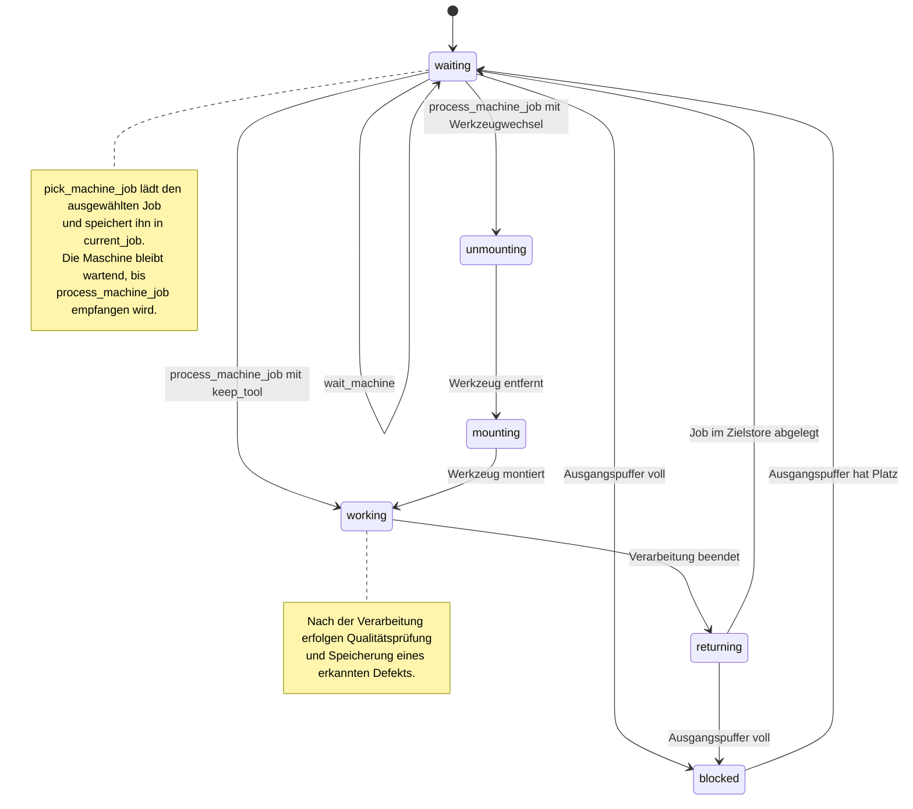

### `SimMachineShutdown` in `SimMachine.py`

**Aufgabe:** Einen einmaligen Werkzeugabschluss ausführen. Diese Komponente
ist neu gegenüber `origin/main`.

- **Werkzeug wechseln:** Produktionswerkzeug demontieren und Schutzwerkzeug
  mit `dummy_tool_mount_time` montieren. Ist es bereits montiert, entfällt der Wechsel.
- **Starten:** Der [SimulationRunner](sources/SpineML/SimulationExecution/SimulationRunner.py)
  startet diesen Prozess nicht. `simulate()` tut dies nur bei `till == sim.inf`,
  wenn der erste Lauf nicht durch den CompletionWatcher gestoppt wurde.
- **Kennzahlen:** Tatsächlich ausgeführte Wechsel zählen zu `tool_change_time`.
  Gespeicherte Jobabschlusszeiten und Makespan ändern sich dadurch nicht.

### `SimScenario.py`

**Aufgabe:** Für jeden Auftrag eine `SimOrder`-Komponente erzeugen.

**Erweiterungen:**

- **Bridge weitergeben:** Jeder Auftrag reicht sie an seine Jobs weiter.
- **Produktionsende überwachen:** Einen `SimCompletionWatcher` für alle Jobs erzeugen.

### `SimCompletionWatcher` in `SimScenario.py`

**Aufgabe:** Den Lauf beenden, sobald alle Jobprozesse abgeschlossen sind.
Diese Salabim-Komponente ist neu.

#### Automatisches Simulationsende

1. Alle erzeugten Jobs einmalig sammeln.
2. Jede Simulationszeiteinheit prüfen, ob alle `process_finished=True` haben.
   Dieses Flag setzt die Abschlussaktion mit `finish_process=True`.
3. Bei nicht leerer Jobliste und vollständigem Abschluss `sim.SimulationStopped`
   auslösen. Der Runner fängt das Signal ab und sammelt die Kennzahlen.

### Seed und Reproduzierbarkeit

Ein **Seed** ist der Startwert eines Zufallszahlengenerators. Der
[Runner](sources/SpineML/SimulationExecution/SimulationRunner.py) setzt vor
jedem Lauf `random.seed(seed)`, `sim.Environment(random_seed=seed)` und
`SimMachine.QUALITY_SEED`.

- **Pro Maschine:** Geschwindigkeit, Dauervariation und Anlaufverzögerung
  werden einmal gezogen. Automatische Defektwahrscheinlichkeiten verwenden
  Seed und Maschinenidentität; ausdrücklich gesetzte Werte bleiben gleich.
- **Pro Bewegung:** Jede Achsenbewegung zieht einen Geschwindigkeitsfaktor.
- **Pro Bearbeitung:** Der Kontextschlüssel bestimmt die Zufallszahlen der
  [Qualitätsprüfung](#defektprüfung-und-recovery).

Bei gleichen Eingaben und Entscheidungen wird der Zufallsablauf wiederholt.
Andere Policies oder Gewichtssätze können trotz gleichem Seed andere
Produktionsabläufe erzeugen. `simulate(...)` selbst hat kein `seed`-Argument;
die beschriebene Vorgabe erfolgt über den Runner.

## SimulationBridge

Die [SimulationBridge](sources/SpineML/SimulationInterface/SimulationBridge.py)
verbindet die laufenden Salabim-Komponenten mit einer austauschbaren Policy.
Sie ist unabhängig von der Steuerung. Datentypen und Schnittstellen stehen in
[InterfaceTypes.py](sources/SpineML/SimulationInterface/InterfaceTypes.py).

| Seite | Aufgabe |
| --- | --- |
| Simulationskomponenten | Zustände ändern, Aktionen anfordern und empfangene Aktionen ausführen. |
| Policy | Aus einer `PolicyObservation` eine `PolicyDecision` mit den ausgewählten Aktionen erzeugen. |
| Bridge | Beobachtungen zusammenstellen, die Policy aufrufen, IDs auflösen und Aktionen zustellen. |

Routen, Scores, Auswahl und die Vermeidung konkurrierender Picks gehören zur
Policy. Ohne übergebene Policy lädt die Bridge bei Bedarf eine `HeuristicPolicy`.

### Registrierung und Aktions-Stores

- `register()` meldet Jobs, Maschinen und Roboter mit ihrer Policy-ID an.
  Sie erhalten eigene Aktions-Stores und erscheinen im Snapshot.
- `register_corridor()` registriert Korridore und ihre Stores nur für die
  ID-Auflösung, ohne eigenen Aktions-Store.
- `register_store()` ordnet Store-Namen den Salabim-Stores zu.
- Stores sowie `SimLayout`, `SimCorridorArm`, `SimOrder`, `SimScenario`
  und `SimCompletionWatcher` entscheiden nicht selbst und erhalten keinen Aktions-Store.

### Warum die Policy IDs verwendet

Beobachtungen enthalten Zustandsdaten und IDs statt Laufzeitobjekten.
Die Policy benennt Jobs, Operationen, Maschinen und Stores, ohne sie direkt
zu verändern. Erst die Bridge ersetzt IDs durch Objektreferenzen.

**Beispiel: Die Policy wählt die Maschine `Near basic`.**

1. Die Policy gibt `selected_machine_id: "Near basic"` im Payload zurück.
2. Die Bridge findet das konfigurierte `Machine`-Objekt in `machines_by_id`.
3. Sie ersetzt `selected_machine_id` durch `selected_machine` mit diesem
   Objekt. Der Roboter kann die Auswahl damit am Job speichern.

`policy_payload_id_mappings()` ordnet ID-Felder den Objektfeldern und Registern
zu. `create_simulation_actions()` kopiert den Payload und löst die IDs auf.
Ein ausdrücklich übergebenes `None` bleibt `None`.

**Maschinenauswahl, Aktionsempfänger und Puffer unterscheiden:**

| ID-Angabe | Was bezeichnet sie? |
| --- | --- |
| `selected_machine_id: "Near basic"` | Die konfigurierte Maschine, die für die Bearbeitung ausgewählt wurde. |
| `target_id: "SimMachine:Near basic:left"` | Die ausführende Maschinenkomponente, wenn eine Aktion an diese Maschine geschickt wird. |
| `target_store_id: "Near basic in"` | Den Eingangspuffer, in dem ein Job abgelegt oder aus dem er aufgenommen werden soll. |

### Zustände melden und Aktionen empfangen

Eine aktionsfähige Komponente wiederholt diese Schritte:

1. `yield bridge.request_action(self)` markiert sie als wartend und meldet
   eine Zustandsänderung.
2. `action = yield bridge.action(self)` entnimmt die ausgewählte Aktion aus
   ihrem Aktions-Store.
3. Sie führt die Aktion aus und aktualisiert ihre Daten.

`request_action()` ruft `notify_state_change()` auf. Diese Methode erhöht die
Zustandsversion und legt einen `PolicyTrigger` mit Ereignis-ID, Sender-ID,
Version und Simulationszeit im zentralen Store ab.

`notify_state_change()` allein löst eine neue Beobachtung aus, markiert den
Sender aber nicht als wartend. Die mitgelieferten Policies berücksichtigen
nur Objekte mit `is_waiting_for_action=True`.

### Snapshot und Aktualitätsprüfung

Die Bridge entnimmt einen Trigger und lässt mit `hold(0)` gleichzeitige
Ereignisse ausführen. Danach sammelt sie vorliegende Trigger derselben
Simulationszeit und erzeugt eine `PolicyObservation` mit diesem Snapshot:

| Feld | Inhalt |
| --- | --- |
| `time`, `state_version` | Aktuelle Simulationszeit und Version der gemeldeten Zustandsänderungen. |
| `simulation_object_states_by_id` | Zustände aller registrierten aktionsfähigen Komponenten, einschließlich ihrer Store-/Jobdaten und `is_waiting_for_action`. |
| `configuration_model` | ID-basierte Konfiguration von Layouts, Korridoren, Maschinen, Operationen, Produkt- und Werkzeugtypen. |
| `policy_trigger_event_ids`, `policy_trigger_sender_ids` | IDs der auslösenden Triggergruppe und ihrer Sender, wenn diese Gruppe übergeben wurde. |

Das Konfigurationsmodell wird einmal erstellt, die Laufzeitzustände bei jedem
Snapshot neu beobachtet.

Nach `policy.make_decision()` prüft die Bridge die Snapshot-Version. Wurde eine
Zustandsänderung gemeldet, wiederholt sie Beobachtung und Entscheidung. Nur eine
aktuelle Entscheidung wird in `SimulationAction`-Objekte übersetzt und verteilt.
Das ersetzt weder Generatorprüfungen noch die fachliche Prüfung eigener Aktionen.

### Ablauf zwischen Simulation und Policy

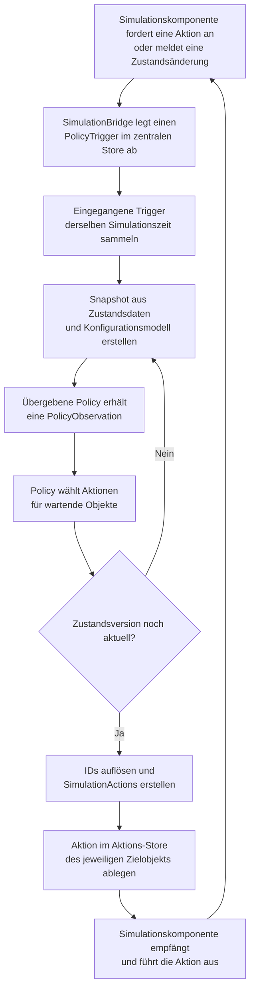

### UML-Sequenzdiagramm eines Simulationszyklus

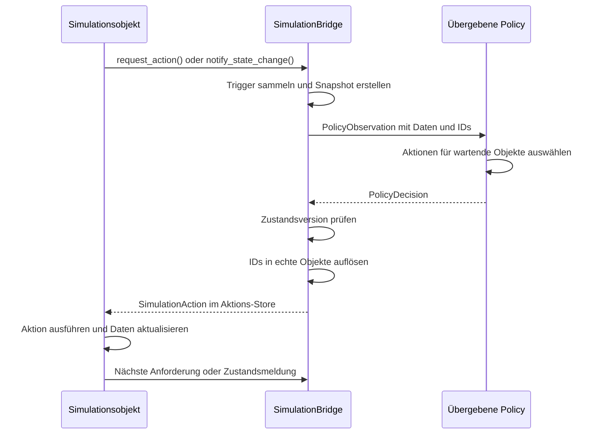

Eine `PolicyDecision` kann mehrere wartende Objekte bedienen. Erst nach ihrer
Rückgabe stellt die Bridge die Aktionen zu; die Komponenten führen sie aus.

<a id="schnittstellen-der-steuerung"></a>

### Wie Generator, Policy und Bridge zusammenarbeiten

Die Bridge ruft `policy.make_decision(observation)` auf. Die Policy holt
Kandidaten vom Generator und gibt ihre Auswahl als `PolicyDecision` zurück.
Diese Schnittstelle ist in
[InterfaceTypes.py](sources/SpineML/SimulationInterface/InterfaceTypes.py)
definiert.

Alle drei Policies nutzen standardmäßig den
[`SpineActionGenerator`](#actiongenerator), wählen aber unterschiedlich aus:

| Konkrete Policy | Aktionsauswahl |
| --- | --- |
| [`HeuristicPolicy`](sources/SpineML/Control/HeuristicPolicy/HeuristicPolicy.py) | `LocalHeuristicActionEvaluator` berechnet die Scores; `HeuristicActionSelector` wählt anhand dieser Scores aus. |
| [`RandomPolicy`](sources/SpineML/Control/RandomPolicy/RandomPolicy.py) | Wählt gleichverteilt zufällig unter Nicht-Warteaktionen. Warten ist nur der Fallback; ausgewählte Picks erhalten die neutrale Priorität `0.0`. |
| [`RLCandidatePolicy`](sources/SpineML/Control/RLPolicy/Shared/RLCandidatePolicy.py) | Eine übergebene Entscheidungsfunktion wählt den Index eines Kandidaten. Gibt es nur einen Kandidaten, wird er standardmäßig direkt übernommen. |

**Nur die HeuristicPolicy benötigt Selector und Evaluator.**

Das Diagramm zeigt den Datenfluss. **Nur der Zweig der eingesetzten Policy
wird verwendet:**

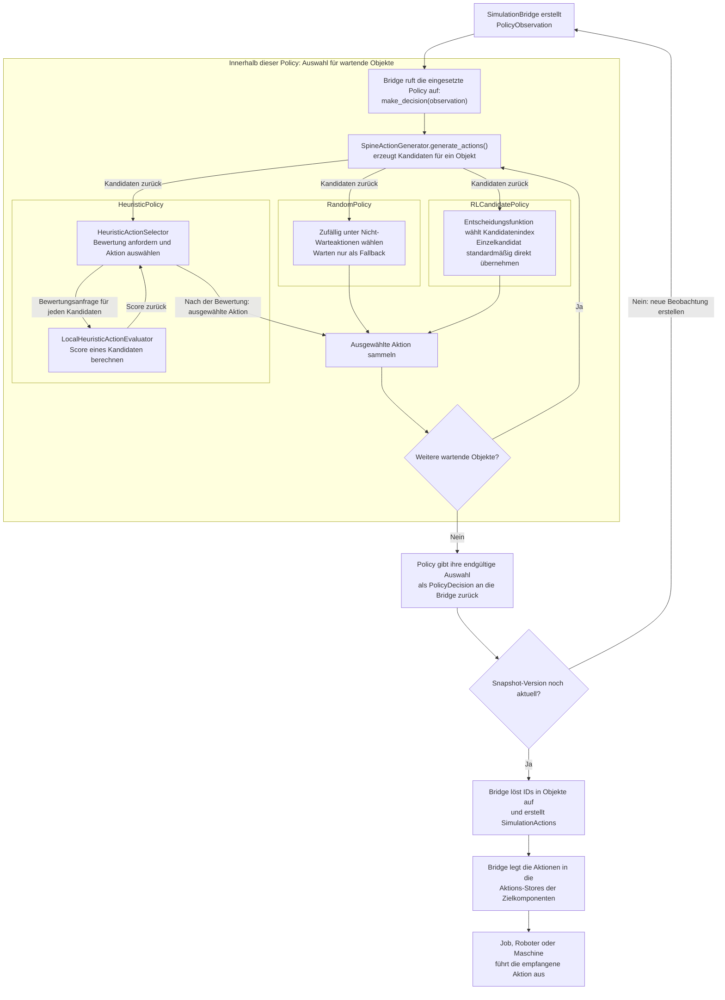

**Der Generator wählt nicht aus und ruft die Bridge nicht auf.** Er gibt
Kandidaten an die Policy zurück; erst ihre vollständige Entscheidung geht
an die Bridge.

<a id="generalcontrol"></a>
<a id="aktionserzeugung-und-policies"></a>

## ActionGenerator

`SpineActionGenerator` steht in
[ActionGeneration/ActionGenerator.py](sources/SpineML/Control/ActionGeneration/ActionGenerator.py).
`generate_actions(observation)` liefert Dictionaries mit `action_type` und
vollständigem `payload` für `observation.current_object_id`. Pick-Payloads
enthalten bereits die EDD-basierte `queue_priority`.

`_generate_actions()` erzeugt Kandidaten nach Objekttyp und Zustand.
`generate_actions()` entfernt Duplikate und behält jeweils den ersten Eintrag.
Er berechnet keine Scores, wählt nichts aus und verändert keine Komponente.

<a id="pick-priorität-im-actiongenerator"></a>

### Berechnung der Pick-Priorität

`calculate_edd_priority()` berechnet `queue_priority` aus Jobdeadline und
Simulationszeit. `create_pick_actions_for_store()` und
`create_machine_pick_actions()` tragen sie direkt in Roboter- und
Maschinen-Pick-Payloads ein.

Für `r = latest_end_time - current_time` gilt:

| Situation | `queue_priority` |
| --- | --- |
| Vor oder genau an der Deadline (`r >= 0`) | `0.5 / (1 + r)` |
| Nach der Deadline (`r < 0`, Überfälligkeit `u = -r`) | `0.5 + 0.5 * u / (1 + u)` |

**Beispiel mit Deadline `10`:**

| Aktuelle Zeit | Restzeit `r` | Berechnung | `queue_priority` |
| --- | --- | --- | --- |
| `8` | `2` | `0.5 / (1 + 2)` | `1 / 6 ≈ 0.167` |
| `10` | `0` | `0.5 / (1 + 0)` | `0.5` |
| `11` | `−1` | `0.5 + 0.5 × 1 / (1 + 1)` | `0.75` |

Mit näherer oder stärker überschrittener Deadline steigt die EDD-Priorität.
Sie dient der späteren Store-Einordnung, ist aber kein Aktionsscore und wählt
keinen Job aus. Der Generator schreibt sie nicht direkt in den Job.
Die Heuristik liest sie zur Bewertung; die RL-Policy übernimmt die Kandidaten
unverändert. `RandomPolicy` ignoriert sie bei der Auswahl und setzt im
gewählten Pick-Payload `queue_priority = 0.0`.

### Welche Aktionen werden für welches Objekt erzeugt?

`_generate_actions()` ruft je nach Objekttyp die passende Erzeugungsmethode auf.

#### Job

Die erste zutreffende Zeile bestimmt die Aktionen:

| Bedingung | Erzeugte Aktionen |
| --- | --- |
| `completed_time is not None` und `due_state is None` | `complete_job` |
| `general_state == "defect"` und `recovery_in_progress == True` | `wait_job` |
| Job defekt, keine laufende Nacharbeit und Defektschwere unter `0.001` oder ab `0.6` | `job_scrap` |
| Job defekt, keine laufende Nacharbeit und `0.001 <= defect_severity < 0.6` | `job_rework_on_alternative_machine` für gefundene Alternativmaschinen;<br/>`job_rework_on_defect_machine`, wenn die [Verfügbarkeitsprüfung](#nacharbeitskandidaten) erfolgreich ist;<br/>`downgrade_product` und `wait_job` |
| `released == False` | `release_job` und `wait_job` |
| Sonst | `wait_job` |

#### Main-Roboter

- **Kein Job geladen:** `create_main_robot_pick_actions()` erzeugt für jeden
  Job im Startlager und in den Main-Stores der Korridore einen
  `pick_main_robot`-Kandidaten. Dazu kommt `wait_main_robot`.
- **Job geladen:** `create_main_robot_place_actions()` prüft die folgenden
  Fälle in dieser Reihenfolge:

| Zustand des geladenen Jobs | Ziel der `place_main_robot`-Kandidaten |
| --- | --- |
| Defekt; nächste Operation und Maschine bereits gespeichert | Arm-Eingangspuffer der gespeicherten Maschine. |
| Defekt; keine solche Auswahl, aber Defektoperation und Defektmaschine bekannt | Arm-Eingangspuffer der Defektmaschine sowie der gefundenen Alternativmaschinen. |
| Defekt; weder diese Auswahl noch beide Defekt-IDs vorhanden | Kein Place-Kandidat. |
| Nicht defekt; als Ausschuss markiert, herabgestuft oder Zielprodukttyp erreicht | Endlager. |
| Sonst | Arm-Eingangspuffer der jeweils nächsten Maschine aus `selectable_routes_for_job()`. |

**Kapazität:** Place-Kandidaten benötigen `has_capacity == True` am Zielstore.
`wait_main_robot` wird immer angeboten; ohne Ablageziel bleibt nur Warten.

**Defekte Jobs:** Hier entstehen nur Transportaktionen (`place_main_robot`),
keine `job_rework_*`-Aktionen. Geprüft werden Zielmaschine, Korridorzugehörigkeit
zum Layout und Arm-Pufferkapazität, nicht erneut die
[Verfügbarkeit der Defektmaschine](#nacharbeitskandidaten).

#### Korridorroboter

- **Kein Job geladen:** `create_corridor_arm_robot_pick_actions()` erzeugt
  für jeden Job im eigenen Arm-Eingangspuffer und in den Ausgangspuffern
  seiner Maschinen einen `pick_corridor_arm_robot`-Kandidaten. Dazu kommt
  `wait_corridor_arm_robot`.
- **Job geladen und als Ausschuss markiert, herabgestuft oder
  Zielprodukttyp erreicht:** `create_corridor_arm_robot_place_actions()`
  bietet das Ablegen im Main-Store des aktuellen Korridors an.
- **Anderer geladener Job:** Sind nächste Operation und Maschine bereits
  gespeichert, verwendet die Methode diese Auswahl. Andernfalls fragt sie
  `selectable_routes_for_job()` ab. Für jede nächste Maschine ergibt sich
  das Ablageziel so:

| Lage der nächsten Maschine | Ziel der `place_corridor_arm_robot`-Aktion |
| --- | --- |
| Vom eigenen Roboter bedient | Eingangspuffer dieser Maschine. |
| Im selben Korridor, am anderen Arm | Eingangspuffer des anderen Korridorarms. |
| In einem anderen Korridor | Main-Store des aktuellen Korridors. |

**Kapazität:** Place-Kandidaten benötigen `has_capacity == True` am Zielstore.
`wait_corridor_arm_robot` wird immer angeboten. Für defekte Jobs ohne
gespeicherte Nacharbeitsauswahl entsteht hier keine Ersatzroute aus Defektdaten.

#### Maschine

| Zustand | Erzeugte Aktionen |
| --- | --- |
| Kein Job geladen | `create_machine_pick_actions()`: je ein `pick_machine_job` pro Job im Eingangspuffer sowie `wait_machine`. |
| Job geladen und Ausgangspuffer hat Platz (`has_capacity == True`) | `create_machine_process_actions()`: nur `process_machine_job`. |
| Job geladen und Ausgangspuffer voll | `create_machine_process_actions()`: nur `wait_machine`. |

**Werkzeugvorbereitung:** Der Payload übernimmt die gewählte Operation und
Maschine und enthält `tool_setup_action`:

| Prüfung in dieser Reihenfolge | `tool_setup_action` |
| --- | --- |
| Werkzeugwechsel nötig, kein Werkzeug montiert | `unmount_dummy_tool_and_mount_tool` |
| Werkzeugwechsel nötig, anderes Werkzeug montiert | `unmount_and_mount_tool` |
| Kein Werkzeugwechsel nötig, Restlebensdauer reicht nicht aus | `replace_tool_same_type` |
| Sonst | `keep_tool` |

Werkzeugvorbereitung gehört zu `process_machine_job`, nicht zu eigenen Kandidaten.

### Mehrere Kandidaten pro wartendem Objekt

Alle erlaubten Möglichkeiten bilden eine Kandidatenliste. Die Policy wählt
daraus; der Generator führt nichts aus. Die folgenden Payloads sind Beispiele
mit schematischen IDs. In echten Läufen müssen diese zur Konfiguration passen.

**Beispiel: Herabstufung eines defekten Jobs**

- Im [Nacharbeitsbereich](#job) konkurriert Herabstufung mit Nacharbeit und
  Warten. Gibt es weder alternative Route noch verfügbare Defektmaschine, bleiben
  `downgrade_product` und `wait_job`; Herabstufung erfolgt nicht automatisch.
- Verwendet wird das vorgesehene Ergebnis der fehlerhaften Operation,
  gegebenenfalls ein Zwischenprodukt statt des Auftragsziels.
- Der Payload setzt diesen Produkttyp als `processing_state`, dazu
  `general_state="intact"` und das Qualitätskennzeichen `downgraded=True`.

Beispiel für eine Herabstufungsaktion:

```json
{
  "action_type": "downgrade_product",
  "payload": {
    "selected_operation_id": null,
    "selected_machine_id": null,
    "processing_state": "produkt_b",
    "general_state": "intact",
    "downgraded": true,
    "downgrade_product_type_id": "produkt_b",
    "defect_recovery_strategy": "downgrade"
  }
}
```

**Beispiel: Pick eines Roboters**

Für jeden auswählbaren Job entsteht eine `pick_*`-Aktion, dazu `wait_*`.
Zwei Jobs ergeben also zwei Pick-Kandidaten und eine Warteaktion.

Beispiel für eine Pick-Aktion des Main-Roboters bei Deadline `10` und
aktueller Zeit `9`: `queue_priority = 0.5 / (1 + 1) = 0.25`.

```json
{
  "action_type": "pick_main_robot",
  "payload": {
    "target_type": "start_storage",
    "target_store_id": "start",
    "selected_job_id": "auftrag_1:1",
    "queue_priority": 0.25,
    "storage_out_time": 1.0
  }
}
```

**Beispiel: Place eines Roboters**

Eine Route bestimmt die nächste Operation, Maschine und damit den Zielstore.
Hat dieser Platz, entsteht ein `place_*`-Kandidat. Verschiedene nächste
Schritte können mehrere Kandidaten ergeben. Dazu kommt `wait_*`;
Duplikate werden anschließend entfernt.

Beispiel für eine Place-Aktion des Main-Roboters:

```json
{
  "action_type": "place_main_robot",
  "payload": {
    "target_type": "sim_corridor_store_arm_input",
    "selected_operation_id": "operation_1",
    "selected_machine_id": "machine_1",
    "sim_corridor_id": "corridor_1",
    "target_store_id": "corridor_1 left",
    "storage_in_time": 1.0
  }
}
```

**Beispiel: Verarbeitung auf einer Maschine**

Ein Job ist geladen und der Ausgangspuffer hat Platz. Der Payload enthält
Operation, Werkzeug, Lebensdauerwerte, Werkzeugvorbereitung und Ausgangsstore.

Beispiel für eine Verarbeitungsaktion:

```json
{
  "action_type": "process_machine_job",
  "payload": {
    "operation_id": "operation_1",
    "planned_machine_id": "machine_1",
    "tool_type_id": "tool_1",
    "total_life_units": 100,
    "consumed_life_units": 5,
    "remaining_life_units_before_operation": 80,
    "tool_setup_action": "keep_tool",
    "target_store_id": "machine_1 out"
  }
}
```

### Identische Kandidaten entfernen

Gleicher `action_type` und gleicher Payload gelten als Duplikat. Das kann
vorkommen, wenn verschiedene vollständige Routen denselben nächsten Schritt
haben. Unterschiedliche Payloads bleiben erhalten.

Diese Bereinigung betrifft nur ein Objekt. Konkurrierende Picks verschiedener
Roboter verhindert die Policy: Die [Heuristik](#heuristicpolicy) verwirft
spätere doppelte Picks; Random- und RL-Policy filtern bereits vergebene Jobs
vor ihrer nächsten Auswahl.

### Berechnung von Operations- und Maschinenrouten

Eine **Route** verbindet Operations- und Maschinenfolge. Ein Aktionskandidat
enthält nur die **nächste Operation und Maschine**; er reserviert nicht die
gesamte Route.

1. **Operationsfolgen finden:**
   `calculate_operation_sequences_between()` sucht vom aktuellen zum
   Zielprodukttyp. Bei der Freigabe nutzt `create_release_job_action()`
   stattdessen `calculate_operation_sequences()`, das vom Zielprodukt
   rückwärts sucht.

2. **Passende Maschinen zuordnen:**
   `calculate_machine_sequences_from_operation_sequence()` prüft für jede
   Operation:

   - Stimmt der Maschinentyp mit dem benötigten Typ überein?
   - Gehört die Maschine zum ausgewählten Layout?
   - Falls `tool_type_ids` angegeben ist: Enthält diese Liste den benötigten
     Werkzeugtyp?

   Jede passende Kombination wird aufgenommen. **Aktuelle Belegung und
   Pufferkapazität werden dabei nicht geprüft.**

3. **Routen für einen Job liefern:**
   `selectable_routes_for_job()` liefert bei gespeicherter Nacharbeitsstrategie
   nur die festgelegte Operation und Maschine. Sonst erhalten defekte,
   ausgeschusterte, herabgestufte, unkonfigurierte und bereits fertige Jobs
   keine normale Route. Für die übrigen Jobs werden Operations- und
   Maschinenfolgen kombiniert.

<a id="nacharbeitskandidaten"></a>

### Nacharbeitskandidaten

Die [Nacharbeitsaktionen](#job) haben unterschiedliche Voraussetzungen:

- **`job_rework_on_defect_machine`:**
  `machine_available_for_rework()` muss alle vier Bedingungen bestätigen:

  - Auf der Defektmaschine ist kein Job geladen (`current_job_id is None`).
  - Ihr Zustand ist `"waiting"`.
  - Ihr Eingangspuffer hat freie Kapazität (`available_capacity > 0`).
  - Ihr Ausgangspuffer hat freie Kapazität (`available_capacity > 0`).

- **`job_rework_on_alternative_machine`:**
  `find_rework_routes_with_alternative_machine()` liest die Defektdaten und
  das Zielprodukt. `find_alternative_rework_routes()` sucht Routen, die zuerst
  **dieselbe fehlerhafte Operation auf einer anderen Maschine wiederholen**
  und danach zum Zielprodukt führen. Geprüft werden Maschinentyp, Layout und
  Werkzeug. Die Defektmaschine ist nur als erste Maschine ausgeschlossen.

  **Belegung und Puffer der Alternativmaschine werden hier nicht geprüft.**
  Die Kapazitätsprüfung des nächsten Ablageziels
  erfolgt beim [Main-Roboter](#main-roboter) beziehungsweise beim
  [Korridorroboter](#korridorroboter).

Gleiche nächste Nacharbeitsschritte entfernt `generate_actions()` als Duplikate.

## RandomPolicy: zufällige Vergleichssteuerung

[`RandomPolicy`](sources/SpineML/Control/RandomPolicy/RandomPolicy.py) nutzt
dieselbe Schnittstelle, Bridge und denselben Generator wie die Heuristik.
Sie benötigt weder Evaluator noch Selector und verwendet keine Scores,
lokalen Gewichte oder EDD-Priorität zur Auswahl.

`make_decision()` wählt für jedes wartende Objekt:

1. Der Generator liefert die technisch möglichen Aktionskandidaten.
2. Picks für einen in dieser Entscheidung bereits ausgewählten Job werden
   ausgeschlossen, damit derselbe Job nicht gleichzeitig zweimal gepickt wird.
3. Gibt es Nicht-Warteaktionen, wird **gleichverteilt unter diesen Kandidaten**
   gewählt. Jeder verbleibende Kandidat hat die Wahrscheinlichkeit `1 / n`.
4. Nur wenn keine Nicht-Warteaktion verfügbar ist, wird eine angebotene
   `wait_*`-Aktion gewählt. Ohne Kandidaten wird keine Aktion zurückgegeben.

- **Nicht-Warteaktionen:** Freigabe, Pick, Ablegen, Verarbeitung und mögliche
  Defektbehandlungen heißen im Code „produktiv“.
- **Auswahl pro Kandidat:** Drei Routen sind drei Auswahlmöglichkeiten,
  auch bei gleicher Aktionsart.
- **Neutrale Picks:** `queue_priority = 0.0` erhält die Store-Reihenfolge bei
  gleicher Priorität.
- Zufällig ist nur die Auswahl unter technisch möglichen Kandidaten.
  Die Heuristik bleibt Standardsteuerung.

Ein Headless-Lauf mit dieser Policy:

```python
from SpineML.Control.RandomPolicy.RandomPolicy import RandomPolicy
from SpineML.SimulationExecution.ModelLoader import load_layout_and_scenario
from SpineML.SimulationExecution.SimulationRunner import SimulationRunner

layout, scenario = load_layout_and_scenario("example-5.py")
runner = SimulationRunner(layout, scenario)
metrics = runner.run_policy(RandomPolicy(seed=101), seed=101)
```

Jeder unabhängige Lauf erhält eine neue `RandomPolicy` mit eigenem
`random.Random(seed)`. Der Runner setzt den Simulations-Seed getrennt davon;
Policy-Auswahl und globaler Simulationszufall bleiben unabhängig.

<a id="generatorselectorpolicy"></a>

## HeuristicPolicy

[HeuristicPolicy.py](sources/SpineML/Control/HeuristicPolicy/HeuristicPolicy.py)
verbindet standardmäßig
`SpineActionGenerator`, `LocalHeuristicActionEvaluator(HeuristicWeights())`
und `HeuristicActionSelector`. Alle drei Bausteine sind austauschbar.
Der Evaluator bewertet die vollständigen Generatorkandidaten.

### Ablauf von `make_decision()`

1. Snapshot-Objekte in Einfügereihenfolge durchlaufen; nur
   `is_waiting_for_action=True` berücksichtigen.
2. Je Objekt eine `PolicyObservation` mit seiner `current_object_id` und
   demselben Snapshot erstellen.
3. Kandidaten erzeugen, durch den Evaluator bewerten und vom Selector auswählen lassen.
4. Ausgewählte `SelectedObjectAction`-Objekte sammeln. Bei doppelten Picks
   desselben Jobs nur den ersten behalten, ohne Ersatzaktion für die übrigen.
5. Alle verbleibenden Aktionen als `PolicyDecision` an die Bridge geben.

<a id="ablauf-der-generalcontrol"></a>

### Ablauf der heuristischen Policy

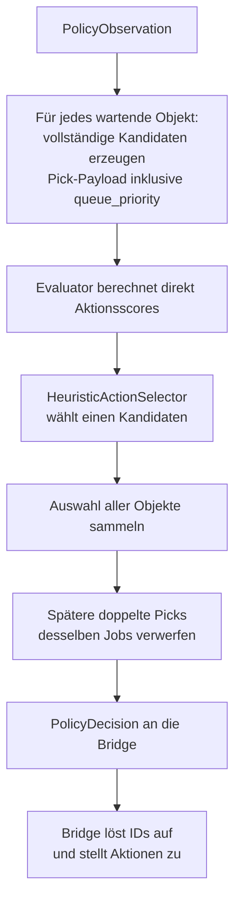

Die Gewichtssuche verändert die `HeuristicWeights` der
[lokalen Bewertung](#heuristicpolicy-lokale-aktionsbewertung), nicht die Generatorregeln.

<a id="actionselector"></a>

### HeuristicActionSelector

[HeuristicActionSelector.py](sources/SpineML/Control/HeuristicPolicy/HeuristicActionSelector.py)
erhält Kandidatenliste, Evaluator, Beobachtung und Ziel-ID eines Objekts.
Er erzeugt keine Aktionen. Random- und RL-Policy verwenden ihn nicht.

Der Standard-Selector arbeitet so:

1. Ohne Kandidaten eine leere `PolicyDecision` zurückgeben.
2. Jeden Kandidaten unverändert mit
   `LocalHeuristicActionEvaluator.evaluate_action()` bewerten, ohne zusätzliche
   Payload-Vorbereitung.
3. Alle Aktionen mit dem höchsten Score als beste Aktionen sammeln.
4. Aktionen bis `0.05` darunter als fast gleich gut sammeln, beispielsweise
   ab `0.75` bei einem Höchstscore von `0.80`.
5. **Exploration:** Mit `EXPLORATION_EPSILON = 0.10` eine fast gleich gute,
   aber nicht exakt beste Alternative ausprobieren. Dabei Nicht-Warteaktionen
   bevorzugen. Ohne solche Alternative eine exakt beste Aktion wählen.
6. **Sonst:** Zufällig eine exakt beste Aktion wählen, also nur Gleichstände auflösen.

Die gewählte Aktion geht als `PolicyDecision` an die `HeuristicPolicy`.
Exploration erprobt nahe Alternativen, verändert aber weder Scores noch
Gewichtssätze. Auch Defektstrategien werden weiterhin regulär bewertet.
Andere Entscheidungen können globale Kennzahlen ändern; gemeinsame Seeds
und Mittelwerte mehrerer Läufe berücksichtigen diesen Einfluss.

`HeuristicPolicyFactory(weights)(seed)` erzeugt je Lauf einen frischen Selector
mit eigenem `random.Random(seed)`. Ohne `rng` nutzt ein direkt erzeugter
Selector dagegen das gemeinsame Python-`random`-Modul.

<a id="heuristiccontrol"></a>

<a id="heuristicpolicy-lokale-aktionsbewertung"></a>

### Lokale Aktionsbewertung

#### Ziel und Grundidee

Die Heuristik vergleicht **die technisch möglichen Aktionen jedes wartenden
Objekts**. Der Evaluator berechnet Scores; der
[HeuristicActionSelector](#actionselector) wählt daraus eine Aktion.
Höher ist vorteilhafter.

- **Lokale Regeln:** Kurze Wege, dringende Jobs und passende Werkzeuge
  erhalten hohe Teilwerte. Der Gewichtssatz bestimmt ihre Bedeutung im Score.
- **Kein Gesamtplan:** Die Policy berechnet nicht alle zukünftigen Folgen.
  Sie entscheidet bei jeder Beobachtung neu, meist für eine beste Aktion,
  gelegentlich für eine fast gleich gute Alternative.
- **Lokale und globale Bewertung:** Hohe Aktionsscores garantieren kein
  besseres Produktionsergebnis. Die [Gewichtssuche](#optimierungsvorgang)
  vergleicht deshalb globale Bewertungszahlen vollständiger Läufe.

#### Ablauf der Bewertung

Umgesetzt in
[LocalHeuristicActionEvaluator.py](sources/SpineML/Control/HeuristicPolicy/LocalHeuristicActionEvaluator.py):

1. **Kandidaten übernehmen:** Vollständige Payloads einschließlich
   `queue_priority` direkt verwenden, ohne erneute Vorbereitung.
2. **Rohwerte lesen:** `evaluate_action()` ruft nach `action_type` die passende
   Methode auf, etwa `evaluate_machine_pick_action()`. Sie liest Kriterien
   aus Zustand, Konfiguration und Payload.
3. **Teilwerte bilden:** Heuristische Regeln bilden gültige Rohwerte auf
   `[0, 1]` ab, etwa `inverse_scale(4) = 0.2`.
4. **Score berechnen:** `calculate_action_score()` bildet den gewichteten
   Durchschnitt. Bei bestimmten Defektaktionen folgt ein Deadline-Strafabzug.
   Der Endscore darf negativ sein und wird nicht begrenzt.
5. **Auswählen:** Der Selector wählt anhand der Scores; erst der
   Simulationskern führt die Aktion aus.

#### Bewertungsgrößen und heuristische Regeln

- **Bewertungsgröße:** Rohwert, etwa Transportzeit `4`.
- **Heuristische Regel:** Bevorzugte Eigenschaft, etwa kürzere Transportzeit.
- **Teilwert:** Zahlenwert der Regel, etwa `inverse_scale(4) = 0.2`.
  Bei allen folgenden Regeln ist höher vorteilhafter.

#### Allgemeine heuristische Regeln

##### 1. Termindruck: dringendere Jobs bevorzugen

- **Bewertungsgröße:** Restzeit `t = latest_end_time − aktuelle Zeit`.
  `latest_end_time` ist die Auftragsdeadline.
- **Regel:** Mit näherer oder stärker überschrittener Deadline steigt die
  EDD-Priorität (`Earliest Due Date`).
- **Abbildung in [`SpineActionGenerator.calculate_edd_priority()`](sources/SpineML/Control/ActionGeneration/ActionGenerator.py):**
  - Bei `t >= 0`: `Teilwert = 0.5 × inverse_scale(t)`.
  - Bei `t < 0`: `Teilwert = 0.5 + 0.5 × direct_scale(-t)`.
- **Beispiel:** Zwei Zeiteinheiten vor der Deadline ergibt sich etwa
  `0.167`, genau bei der Deadline `0.5` und zwei Zeiteinheiten danach etwa
  `0.833`.
- **Berechnung:** Picks enthalten den Wert im Payload. Für Freigabe und
  Warten nutzt der Evaluator dieselbe Generator-Methode. Die allgemeinen
  Skalierer `inverse_scale()` und `direct_scale()` stehen im Evaluator.

- **Wertebereich:** Vor der Deadline unter `0.5`, genau dort `0.5`, danach
  darüber. Bei großer Restzeit nähert sie sich `0`, bei großer Überfälligkeit `1`.

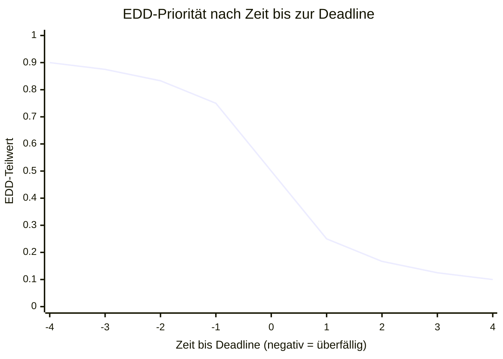

- **Verwendung:** [Freigabe](#freigabe-release_job),
  [Roboter-Pick](#roboter-pick-pick_main_robot-und-pick_corridor_arm_robot),
  [Maschinen-Pick](#maschinen-pick-pick_machine_job),
  [normales Warten](#normales-warten-wait_) und
  [Warten bei einem Defekt](#warten-bei-einem-defekt-wait_job).

##### 2. Verarbeitungs-, Transport- und Lagerzeiten: kürzere Zeiten bevorzugen

- **Bewertungsgröße:** Eine nichtnegative Zeit `x`.
- **Regel:** Kürzere Zeiten erhalten höhere Teilwerte.
- **Abbildung:** `inverse_scale(x) = 1 / (1 + x)`.
- **Beispiel:** Zeit `1 → 0.5`; Zeit `4 → 0.2`.

- **Grenzwerte:** `x = 0` ergibt `1`; für wachsendes `x` nähert sich der Wert `0`.

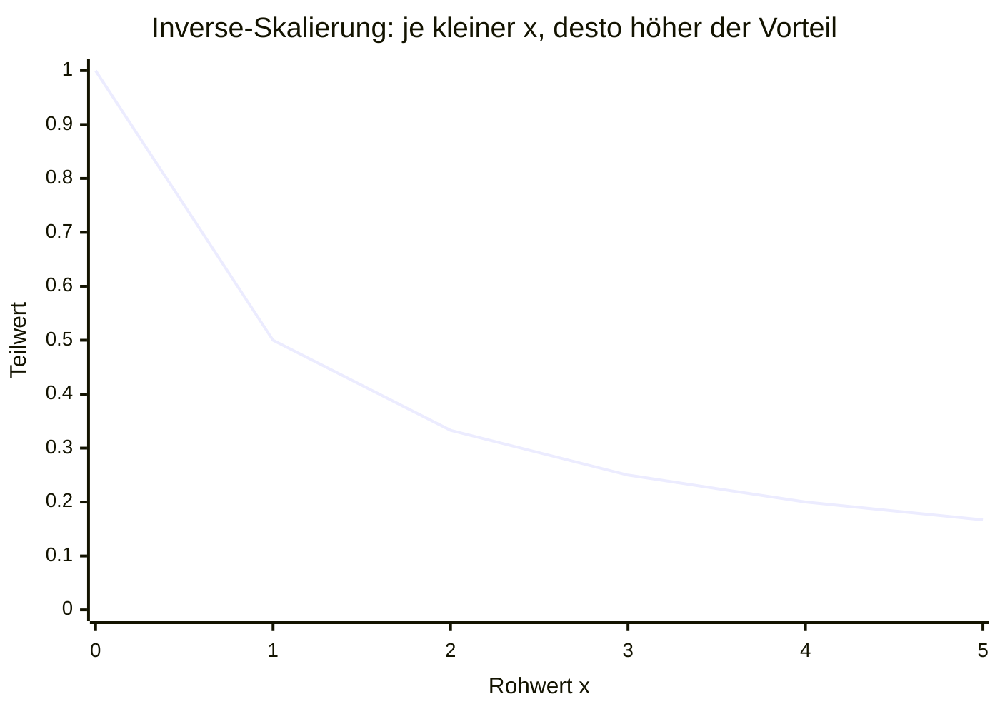

- **Verwendung:** [Freigabe](#freigabe-release_job),
  [Roboter-Pick](#roboter-pick-pick_main_robot-und-pick_corridor_arm_robot),
  [Maschinen-Pick](#maschinen-pick-pick_machine_job),
  [Ablegen](#ablegen-place_main_robot-und-place_corridor_arm_robot),
  [Nacharbeit auf der Defektmaschine](#nacharbeit-auf-der-defektmaschine-job_rework_on_defect_machine) und
  [Nacharbeit auf einer anderen Maschine](#nacharbeit-auf-einer-anderen-maschine-job_rework_on_alternative_machine).

##### 3. Maschinenwarteschlange: weniger wartende Jobs bevorzugen

- **Bewertungsgröße:** Anzahl `n` der Jobs im Eingangspuffer der Maschine.
- **Regel:** Kürzere Warteschlangen erhalten höhere Teilwerte.
- **Abbildung:** `inverse_scale(n) = 1 / (1 + n)`.
- **Beispiel:** Null Jobs ergeben `1`; drei Jobs `0.25`.

- **Verwendung:** [Ablegen](#ablegen-place_main_robot-und-place_corridor_arm_robot),
  [Nacharbeit auf der Defektmaschine](#nacharbeit-auf-der-defektmaschine-job_rework_on_defect_machine) und
  [Nacharbeit auf einer anderen Maschine](#nacharbeit-auf-einer-anderen-maschine-job_rework_on_alternative_machine).

##### 4. Werkzeugpassung: ein bereits montiertes passendes Werkzeug bevorzugen

- **Bewertungsgröße:** Benötigter und montierter Werkzeugtyp.
- **Regel und Abbildung:** Passender Typ ergibt `1`, anderer oder fehlender
  Typ `0`. Das Kriterium zählt bei Maschinen-Pick und Nacharbeit immer.
- **Beispiel:** Fräser A benötigt und montiert: `1`; Fräser B montiert: `0`.

- **Verwendung:** [Maschinen-Pick](#maschinen-pick-pick_machine_job),
  [Nacharbeit auf der Defektmaschine](#nacharbeit-auf-der-defektmaschine-job_rework_on_defect_machine) und
  [Nacharbeit auf einer anderen Maschine](#nacharbeit-auf-einer-anderen-maschine-job_rework_on_alternative_machine).

##### 5. Werkzeugreserve: mehr Lebensdauer im Verhältnis zum Verbrauch bevorzugen

- **Bewertungsgröße:** Verhältnis
  `r = verbleibende Werkzeuglebensdauer / Verbrauch der geplanten Operation`.
- **Regel:** Größere relative Reserve erhält einen höheren Teilwert.
- **Abbildung:** Bei positivem Verbrauch gilt
  `Teilwert = direct_scale(r) = r / (1 + r)`. Bei Verbrauch `0` entfällt
  das Kriterium wegen Division durch null.
- **Beispiel:** Vier verbleibende und zwei benötigte Einheiten ergeben
  `r = 2` und den Teilwert `2 / 3 ≈ 0.667`.

- **Grenzwerte:** `r = 0` ergibt `0`; für wachsendes `r` nähert sich der Wert `1`.

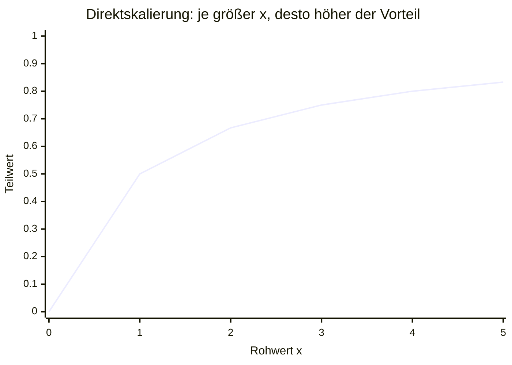

- **Verwendung:** [Maschinen-Pick](#maschinen-pick-pick_machine_job),
  [Nacharbeit auf der Defektmaschine](#nacharbeit-auf-der-defektmaschine-job_rework_on_defect_machine) und
  [Nacharbeit auf einer anderen Maschine](#nacharbeit-auf-einer-anderen-maschine-job_rework_on_alternative_machine).

##### 6. Freie Pufferkapazität: einen größeren freien Anteil bevorzugen

- **Bewertungsgröße:** Freie Plätze und Gesamtkapazität des Ziel-Stores.
- **Regel:** Ein größerer freier Anteil ist vorteilhafter.
- **Abbildung mit `normalize_ratio()`:**
  `normalize_ratio(freie Plätze, Gesamtkapazität) = freie Plätze / Gesamtkapazität`.
- **Beispiel:** Zwei von zehn Plätzen frei: `0.2`; acht von zehn: `0.8`.

- **Wertebereich:** `[0, 1]` bei positiver, endlicher Kapazität und gültiger Belegung.
- **Verwendung:** [Ablegen](#ablegen-place_main_robot-und-place_corridor_arm_robot).

##### 7. Defektschwere: bei stärkerem Defekt die Herabstufung höher bewerten

- **Bewertungsgröße:** `defect_severity` des Jobs.
- **Regel:** Höhere Defektschwere spricht stärker für Herabstufung.
- **Abbildung in `evaluate_defect_action()`:**
  `Teilwert = defect_severity`, unverändert im Bereich `[0, 1]`.
- **Beispiel:** Schweregrad `0.2 → 0.2`; Schweregrad `0.5 → 0.5`.

- **Verwendung:** [Herabstufung](#herabstufung-downgrade_product).

##### 8. Warten: je höher der Termindruck, desto niedriger der Teilwert

- **Bewertungsgröße:** EDD-Priorität des Jobs.
- **Regel:** Höhere Dringlichkeit macht Warten weniger vorteilhaft.
- **Abbildung:** Bei bekannter Deadline verwenden `evaluate_wait_action()`
  und `evaluate_defect_action()` dieselbe Formel:
  `Teilwert = 1.0 - EDD`.
- **Ohne Job oder Deadline:** `evaluate_wait_action()` verwendet den festen
  Ersatzwert `DEFAULT_WAIT_SCORE = 0.01`.
- **Beispiel:** `EDD = 0.75` ergibt `0.25`. Bei Defekt kann ein Strafabzug folgen.

- **Verwendung:** [Normales Warten](#normales-warten-wait_) und
  [Warten bei einem Defekt](#warten-bei-einem-defekt-wait_job).

#### Verwendung der Bewertungsgrößen nach Aktionstyp

Die folgenden Abschnitte nennen Rohwerte, Ermittlung und Gewichte je Aktion.
Die Kriterien verlinken auf [Regeln mit Formeln und Beispielen](#allgemeine-heuristische-regeln).
`Teilwert × Gewicht` bezeichnet einen Beitrag; der
[Gesamtscore](#gewichte-und-gesamtscore) teilt ihre Summe durch die Gewichtssumme.
Optionale Kriterien entfallen nur unter den genannten Bedingungen, nicht bei
Teilwert `0`. Ohne passende Dispatchregel liefert `evaluate_action()` den Score `0`.

##### Freigabe: `release_job`

`evaluate_release_action()` berücksichtigt:

1. **[Termindruck](#1-termindruck-dringendere-jobs-bevorzugen):** `EDD × release_edd_weight`.
2. **[Durchschnittliche Routenverarbeitungszeit](#2-verarbeitungs--transport--und-lagerzeiten-kürzere-zeiten-bevorzugen):**
   `inverse_scale(erwartete Verarbeitungszeit) × release_average_route_duration_weight`.

###### Ermittlung der Routenzeit

`estimate_release_processing_time()` ermittelt Operationsfolgen zum Zielprodukt,
addiert je Route die konfigurierten Operationsdauern und mittelt die Routenzeiten.

Beispiel:

- Route A: Zwei Operationen mit Dauer `3` und `5` ergeben insgesamt `8`.
- Route B: Zwei Operationen mit Dauer `4` und `8` ergeben insgesamt `12`.
- Der Rohwert für die Freigabe ist `(8 + 12) / 2 = 10`.
- Daraus entsteht der Teilwert `inverse_scale(10) = 1 / 11 ≈ 0.091`.

Der Mittelwert bewertet die Freigabe, wählt keine Route aus und enthält keine
Transport- oder Wartezeiten.

##### Roboter-Pick: `pick_main_robot` und `pick_corridor_arm_robot`

Der Roboter nimmt einen Job aus einem Quell-Store auf.
`evaluate_robot_pick_action()` berücksichtigt:

1. **[EDD-/Queue-Priorität](#1-termindruck-dringendere-jobs-bevorzugen):** `EDD × queue_priority_weight`.
2. **[Entnahmezeit](#2-verarbeitungs--transport--und-lagerzeiten-kürzere-zeiten-bevorzugen):** `inverse_scale(storage_out_time) × pick_source_storage_time_weight`.
   Das Kriterium geht nur ein, wenn `storage_out_time` im Payload vorhanden ist.
3. **[Transportzeit](#2-verarbeitungs--transport--und-lagerzeiten-kürzere-zeiten-bevorzugen):** `inverse_scale(Transportzeit) × pick_short_transport_time_weight`.

###### Ermittlung der Transportzeit

`transport_time_value()` schätzt die achsweise Fahrt von der Roboterposition
zum Quell-Store (`target_store_id`):

`Transportzeit = (|Δx| + |Δy| + |Δz|) / Grundgeschwindigkeit`

Beispiel: X-Weg `3`, Y-Weg `1` und Grundgeschwindigkeit `2` ergeben
`(3 + 1 + 0) / 2 = 2` Zeiteinheiten und `inverse_scale(2) ≈ 0.333`.

###### Auslagerzeit am Quell-Store

`pick_source_storage_time_value()` liest `storage_out_time` aus dem Payload.
Das ist die Entnahmezeit, nicht die Fahrtzeit. Fehlt das Feld, entfällt das
Kriterium. Zeit `2` ergibt `inverse_scale(2) ≈ 0.333`. Transport und Entnahme
haben getrennte Gewichte.

##### Maschinen-Pick: `pick_machine_job`

Die Maschine nimmt einen Job aus ihrem Eingangspuffer auf.
`evaluate_machine_pick_action()` berücksichtigt:

1. **[EDD-/Queue-Priorität](#1-termindruck-dringendere-jobs-bevorzugen):** `EDD × queue_priority_weight`.
2. **[Operationsdauer](#2-verarbeitungs--transport--und-lagerzeiten-kürzere-zeiten-bevorzugen):** `inverse_scale(operation.duration) × machine_pick_operation_duration_weight`.
   Hier zählt die konfigurierte Operationsdauer.
3. **[Werkzeugpassung](#4-werkzeugpassung-ein-bereits-montiertes-passendes-werkzeug-bevorzugen):** `Werkzeugpassung × machine_pick_tool_match_weight`.
   Dieses Kriterium geht immer ein.
4. **[Werkzeugreserve](#5-werkzeugreserve-mehr-lebensdauer-im-verhältnis-zum-verbrauch-bevorzugen):**
   `direct_scale(verbleibende Lebensdauer / geplanter Verbrauch) × machine_pick_tool_reserve_weight`.
   Berücksichtigt, wenn der Lebensdauerverbrauch der Operation positiv ist.

###### Verwendete Operationsdauer

Der Evaluator liest `selected_operation_id` aus dem Job und verwendet deren
`operation.duration`. Es zählt nur die nächste Operation, nicht die restliche
Route. Dauer `4` ergibt `inverse_scale(4) = 0.2`; Dauer `1` ergibt `0.5`.

##### Verarbeitung: `process_machine_job`

`evaluate_process_action()` liefert `0`. Bei geladener Maschine und freiem
Ausgangspuffer ist dies der einzige Kandidat; Score `0` verhindert die Ausführung nicht.

##### Ablegen: `place_main_robot` und `place_corridor_arm_robot`

Der Roboter legt den Job in einem Ziel-Store ab, ohne ihn zu verarbeiten.
`evaluate_place_action()` berücksichtigt:

1. **[Freie Zielkapazität](#6-freie-pufferkapazität-einen-größeren-freien-anteil-bevorzugen):**
   `Anteil freier Plätze × target_store_free_capacity_weight`.
   `target_store_capacity_value()` ermittelt dafür den freien Kapazitätsanteil.
2. **[Transportzeit](#2-verarbeitungs--transport--und-lagerzeiten-kürzere-zeiten-bevorzugen):**
   `inverse_scale(Transportzeit) × place_short_transport_time_weight`.
3. **[Einlagerungszeit](#2-verarbeitungs--transport--und-lagerzeiten-kürzere-zeiten-bevorzugen):**
   `inverse_scale(storage_in_time) × place_target_storage_time_weight`,
   falls `storage_in_time` im Payload vorhanden ist.
4. **[Maschinenwarteschlange](#3-maschinenwarteschlange-weniger-wartende-jobs-bevorzugen):**
   `inverse_scale(Warteschlangenlänge) × place_machine_queue_length_weight`.
   `place_machine_queue_value()` liest die Anzahl der Jobs im Eingangspuffer,
   falls eine Zielmaschine angegeben ist.
5. **[Dauer der nächsten Operation](#2-verarbeitungs--transport--und-lagerzeiten-kürzere-zeiten-bevorzugen):**
   `inverse_scale(operation.duration) × place_operation_duration_weight`,
   falls der Payload eine nächste Operation enthält.

###### Verwendete Zeitwerte

- **Transportzeit:** `transport_time_value()` verwendet den Weg von der
  Roboterposition zum Ziel-Store (`target_store_id`):

`Transportzeit = (|Δx| + |Δy| + |Δz|) / Grundgeschwindigkeit`

- **Transport-Teilwert:** `inverse_scale(Transportzeit)`.
- **Operationsdauer am Ziel:** `place_processing_time_value()` liest bei
  `selected_operation_id` im Payload die `operation.duration`.
  Sie bewertet das Ziel, nicht die Ablagedauer: Dauer `4` ergibt `0.2`.
  Ohne Operation entfällt das Kriterium.
- **Einlagerzeit:** `place_target_storage_time_value()` liest `storage_in_time`.
  Dies ist die Ablagezeit, nicht die Fahrtzeit, mit eigenem Teilwert.
  Zeit `2` ergibt `inverse_scale(2) ≈ 0.333`; ohne Feld entfällt das Kriterium.

##### Normales Warten: `wait_*`

- **Geltungsbereich:** Nicht defekte Jobs sowie Roboter und Maschinen.
- **Datenquelle:** `evaluate_wait_action()` nutzt die
  [EDD-Priorität](#1-termindruck-dringendere-jobs-bevorzugen) des wartenden
  beziehungsweise aktuell geladenen Jobs.
- **Beispielsituation:** Bei einer geladenen Maschine mit vollem
  Ausgangspuffer erzeugt der Generator nur `wait_machine`.
- **[Warteregel](#8-warten-je-höher-der-termindruck-desto-niedriger-der-teilwert):**

`Teilwert = 1.0 - EDD`

- **Ersatzwert:** Ohne Job oder dessen Deadline gilt
  `DEFAULT_WAIT_SCORE = 0.01`.
- **Beispiel:** `EDD = 0.75` ergibt den Teilwert `1.0 - 0.75 = 0.25`.
- **Gesamtscore:** Nur dieser Teilwert mit `wait_action_weight` geht ein.
  Das Gewicht kürzt sich heraus; Score und Teilwert sind gleich.

##### Defektbehandlung

Der [ActionGenerator](#job) bestimmt die angebotenen Defektaktionen.
[`evaluate_defect_action()`](sources/SpineML/Control/HeuristicPolicy/LocalHeuristicActionEvaluator.py)
bewertet sie; Nacharbeit delegiert sie an `evaluate_defect_recovery_action()`.
Der [Selector](#actionselector) wählt anhand der Scores.

Beide Nacharbeitsarten verwenden dieselben Kriterien und Gewichte.
Ihre Deadline-Strafen sind getrennt einstellbar, standardmäßig beide `0.5`.

**Welche Rolle spielt die Deadline?**

`remaining_time = latest_end_time − aktuelle Zeit`

- **Davor (`remaining_time > 0`):** Keine Deadline-Strafen oder -Boni.
- **Ab dann (`remaining_time <= 0`):** Strafabzug bei Nacharbeit und Warten;
  zusätzlicher Teilwert im Durchschnitt bei Herabstufung.
- **Beispiel:** Deadline `10`, Zeit `8`: Restzeit `2`, erste Regel.
  Zeit `10` oder `11`: Restzeit `0` oder `−1`, zweite Regel.
- **Kein Verbot:** Nacharbeit bleibt wählbar. Der Evaluator prüft nicht,
  ob sie rechtzeitig fertig werden kann.

Die folgenden Beispiele verwenden den [Standardgewichtssatz](#heuristicweights).
Die [Begründung der Deadline-Werte](#warum-diese-deadline-strafen-und-dieser-bonus)
folgt nach den einzelnen Defektaktionen.

###### Nacharbeit auf der Defektmaschine: `job_rework_on_defect_machine`

Die fehlerhafte Operation wird auf derselben Maschine wiederholt, auf der
der Produktdefekt entstand. Alle Maschinen- und Werkzeugdaten beziehen sich
auf diese „Defektmaschine“.

**Bewertungsgrößen und Teilwerte:**

| Bewertungsgröße | Berechnung des Teilwerts | Gewichtsparameter (Standard) |
| --- | --- | --- |
| [Maschinenwarteschlange](#3-maschinenwarteschlange-weniger-wartende-jobs-bevorzugen) | `inverse_scale(Anzahl Jobs im Eingangspuffer)` | `defect_recovery_machine_queue_length_weight` (`0.3`) |
| [Transportzeit](#2-verarbeitungs--transport--und-lagerzeiten-kürzere-zeiten-bevorzugen) | `inverse_scale(geschätzte Transportzeit)` | `defect_recovery_transport_time_weight` (`0.2`) |
| [Werkzeugpassung](#4-werkzeugpassung-ein-bereits-montiertes-passendes-werkzeug-bevorzugen) | Benötigter Werkzeugtyp montiert: `1`, sonst `0` | `defect_recovery_tool_match_weight` (`0.2`) |
| [Werkzeugreserve](#5-werkzeugreserve-mehr-lebensdauer-im-verhältnis-zum-verbrauch-bevorzugen) | `direct_scale(verbleibende Lebensdauer / Verbrauch der Operation)` | `defect_recovery_tool_reserve_weight` (`0.2`) |

- **Optional:** Transportzeit nur bei möglicher Schätzung, Werkzeugreserve
  nur bei positivem Verbrauch. Sonst entfällt jeweils auch das Gewicht.
- **Transport zur selben Maschine:** Ein- und Ausgangspuffer haben dieselben
  Modellkoordinaten. Vom Ausgangs- zum Eingangspuffer beträgt die Wegschätzung
  daher `0`, der Teilwert `inverse_scale(0) = 1`. Aufnahme und Ablage kosten
  in der Simulation trotzdem Zeit.
- **Score:** [Gewichteter Durchschnitt](#gewichte-und-gesamtscore), ab der
  Deadline abzüglich `rework_defect_machine_deadline_penalty_weight`
  (Standard: `0.5`).

**Rechenbeispiel:** Eingangspuffer leer, Job im Ausgangspuffer, passendes
Werkzeug montiert. Restlebensdauer und Verbrauch sind jeweils `5`.
Teilwerte: Warteschlange `1`, Transport `1`, Werkzeugpassung `1`, Reserve
`direct_scale(5 / 5) = 0.5`:

`Nacharbeitsscore = (1 × 0.3 + 1 × 0.2 + 1 × 0.2 + 0.5 × 0.2) / (0.3 + 0.2 + 0.2 + 0.2) = 8 / 9 ≈ 0.889`

| Deadline | Aktuelle Zeit | Endscore |
| --- | --- | --- |
| `10` | `8` – vor der Deadline | `8 / 9 ≈ 0.889`, kein Abzug |
| `10` | `11` – Deadline überschritten | `8 / 9 − 0.5 = 7 / 18 ≈ 0.389` |

###### Nacharbeit auf einer anderen Maschine: `job_rework_on_alternative_machine`

Dieselbe fehlerhafte Operation wird auf einer anderen geeigneten Maschine
wiederholt. Bewertet werden deren Warteschlange, Werkzeug und Werkzeuglebensdauer.

**Bewertungsgrößen und Teilwerte:**

| Bewertungsgröße | Berechnung des Teilwerts | Gewichtsparameter (Standard) |
| --- | --- | --- |
| [Maschinenwarteschlange](#3-maschinenwarteschlange-weniger-wartende-jobs-bevorzugen) | `inverse_scale(Anzahl Jobs im Eingangspuffer)` | `defect_recovery_machine_queue_length_weight` (`0.3`) |
| [Transportzeit](#2-verarbeitungs--transport--und-lagerzeiten-kürzere-zeiten-bevorzugen) | `inverse_scale(geschätzte Transportzeit zur ausgewählten Maschine)` | `defect_recovery_transport_time_weight` (`0.2`) |
| [Werkzeugpassung](#4-werkzeugpassung-ein-bereits-montiertes-passendes-werkzeug-bevorzugen) | Benötigter Werkzeugtyp montiert: `1`, sonst `0` | `defect_recovery_tool_match_weight` (`0.2`) |
| [Werkzeugreserve](#5-werkzeugreserve-mehr-lebensdauer-im-verhältnis-zum-verbrauch-bevorzugen) | `direct_scale(verbleibende Lebensdauer / Verbrauch der Operation)` | `defect_recovery_tool_reserve_weight` (`0.2`) |

- **Optional:** Transportzeit nur bei möglicher Schätzung, Werkzeugreserve
  nur bei positivem Verbrauch; sonst entfällt auch das jeweilige Gewicht.
- **Transport:** `defect_recovery_transport_time_value()` nutzt den direkten
  Abstand vom Jobstandort zum Eingangspuffer der gewählten Maschine:

`geschätzte Transportzeit = (|Δx| + |Δy| + |Δz|) / Grundgeschwindigkeit`

- **Geschwindigkeit:** Konfigurierte Grundgeschwindigkeit eines Korridorarms
  im Zielkorridor, ersatzweise eines Main-Roboters. Zwischenpuffer, Aufnahme,
  Ablage und Wartezeiten fehlen in dieser Schätzung.
- **Score:** [Gewichteter Durchschnitt](#gewichte-und-gesamtscore), ab der
  Deadline abzüglich `rework_alternative_machine_deadline_penalty_weight`
  (Standard: `0.5`).

**Rechenbeispiel:** Eingangspuffer leer, passendes Werkzeug montiert,
Restlebensdauer und Verbrauch jeweils `5`. Abstand und Grundgeschwindigkeit
betragen jeweils `1.5`, also Transportzeit `1.5 / 1.5 = 1`.
Teilwerte: `1`, `inverse_scale(1) = 0.5`, `1`, `direct_scale(5 / 5) = 0.5`:

`Nacharbeitsscore = (1 × 0.3 + 0.5 × 0.2 + 1 × 0.2 + 0.5 × 0.2) / (0.3 + 0.2 + 0.2 + 0.2) = 7 / 9 ≈ 0.778`

| Deadline | Aktuelle Zeit | Endscore |
| --- | --- | --- |
| `10` | `8` – vor der Deadline | `7 / 9 ≈ 0.778`, kein Abzug |
| `10` | `11` – Deadline überschritten | `7 / 9 − 0.5 = 5 / 18 ≈ 0.278` |

###### Herabstufung: `downgrade_product`

- **Zweck:** Statt Nacharbeit das vorgesehene Ergebnis der fehlerhaften
  Operation als herabgestuft übernehmen, gegebenenfalls ein Zwischenprodukt.
  Weitere reguläre Bearbeitung entfällt.
- **Bewertungsgröße:** Die
  [Defektschwere](#7-defektschwere-bei-stärkerem-defekt-die-herabstufung-höher-bewerten)
  wird unverändert als Teilwert verwendet.
- **Score davor:** Nur Defektschwere mit `product_downgrade_defect_severity_weight`;
  der Score entspricht daher der Defektschwere.
- **Score ab der Deadline:** Zusätzlich Teilwert `1` mit
  `deadline_reached_downgrade_bonus_weight`, als gewichteter Durchschnitt:

`Score = (Defektschwere × product_downgrade_defect_severity_weight + 1 × deadline_reached_downgrade_bonus_weight) / (product_downgrade_defect_severity_weight + deadline_reached_downgrade_bonus_weight)`

**Rechenbeispiel:** Der Defektschweregrad beträgt `0.4`.
Beide Gewichte haben im Standardgewichtssatz den Wert `0.5`:

| Deadline | Aktuelle Zeit | Endscore |
| --- | --- | --- |
| `10` | `8` – vor der Deadline | `(0.4 × 0.5) / 0.5 = 0.4` |
| `10` | `11` – Deadline überschritten | `(0.4 × 0.5 + 1 × 0.5) / (0.5 + 0.5) = 0.7` |

Der Bonus erhöht den Score hier von `0.4` auf `0.7`, also um `0.3`,
nicht pauschal um `0.5`.

###### Warten bei einem Defekt: `wait_job`

- **Zweck:** Warten statt neuer Nacharbeit oder Herabstufung; der Defekt bleibt.
- **Bewertungsgröße:**
  [`calculate_edd_priority()`](sources/SpineML/Control/ActionGeneration/ActionGenerator.py)
  berechnet den
  [Termindruck als EDD-Priorität](#1-termindruck-dringendere-jobs-bevorzugen).
  Die [Warteregel](#8-warten-je-höher-der-termindruck-desto-niedriger-der-teilwert)
  liefert `1.0 - EDD`: Je dringender der Job, desto niedriger der Teilwert.
- **Score davor:** Nur dieser Teilwert mit `wait_defect_job_weight`, also
  ebenfalls `1.0 - EDD`.
- **Score ab der Deadline:** Abzüglich `deadline_missed_wait_penalty_weight`
  (Standard: `0.2`):

`Score = (1.0 - EDD) - deadline_missed_wait_penalty_weight`

**Rechenbeispiel mit Deadline `10` und Standardstrafe `0.2`:**

| Aktuelle Zeit | Berechnung der EDD-Priorität | Endscore für Warten |
| --- | --- | --- |
| `8` – vor der Deadline | `0.5 × inverse_scale(2) = 1 / 6 ≈ 0.167` | `1 − 1 / 6 = 5 / 6 ≈ 0.833` |
| `10` – Deadline erreicht | `0.5 × inverse_scale(0) = 0.5` | `1 − 0.5 − 0.2 = 0.3` |
| `11` – Deadline überschritten | `0.5 + 0.5 × direct_scale(1) = 0.75` | `1 − 0.75 − 0.2 = 0.05` |

###### Ausschuss: `job_scrap`

- **Zweck:** Den Job als Ausschuss markieren.
- **Angebot:** Ohne laufende Nacharbeit und außerhalb von
  `0.001 <= defect_severity < 0.6` erzeugt der [Generator](#job) nur `job_scrap`.
- **Score:** Konstant `1.0`, unabhängig von Deadline und Gewichten.
  Ausschuss konkurriert hier nicht mit anderen Defektaktionen.

###### Warum diese Deadline-Strafen und dieser Bonus?

Ab der Deadline sollen Nacharbeit und Warten niedriger, Herabstufung höher
bewertet werden. Gewählte Standardgrenzen sind: Nacharbeit höchstens `0.5`,
Warten höchstens `0.3`, Herabstufung mindestens `0.5`.
[HeuristicWeights.py](sources/SpineML/Control/HeuristicPolicy/HeuristicWeights.py)
leitet daraus die Parameter ab:

| Aktion | Mathematische Begründung des Standardwerts ab der Deadline |
| --- | --- |
| Nacharbeit auf [derselben](#nacharbeit-auf-der-defektmaschine-job_rework_on_defect_machine) oder [einer anderen Maschine](#nacharbeit-auf-einer-anderen-maschine-job_rework_on_alternative_machine) | Der gewichtete Durchschnitt ist höchstens `1`. Damit der Endscore höchstens `0.5` ist, wird `1 − 0.5 = 0.5` abgezogen. |
| [Warten](#warten-bei-einem-defekt-wait_job) | Ab der Deadline gilt `EDD >= 0.5`, also `1 − EDD <= 0.5`. Für einen Endscore von höchstens `0.3` wird `0.5 − 0.3 = 0.2` abgezogen. |
| [Herabstufung](#herabstufung-downgrade_product) | Bei Defektschwere `0` soll der Score `0.5` betragen, bei Defektschwere `1` soll er `1` betragen. Das ergibt `Score = 0.5 + 0.5 × Defektschwere`, umgesetzt mit den beiden Gewichten `0.5` und `0.5`. |

- **Bonus:** `0.5 × (1 − Defektschwere)`. Bei positiver Defektschwere liegt
  Herabstufung ab der Deadline über dem maximalen Nacharbeits- und Warte-Score.
- **Grenzen:** Sie gelten nur für den Standardgewichtssatz. Andere
  Gewichtssätze können sie verändern. Es sind gewählte Steuerungsziele,
  keine nachgewiesenen Optimalwerte.

##### Abschluss: `complete_job`

`evaluate_action()` verwendet Teilwert `1` mit `complete_job_weight`.
Da nur ein Teilwert eingeht, ist der Score `1`.

##### Abgrenzung zur tatsächlich simulierten Dauer

Die Simulation liefert **simulierte Ist-Zustände**. Noch nicht ausgeführte
Aktionen bewertet die Heuristik dagegen mit **Schätzungen aus Sollwerten**:

| Zeitwert | Schätzung der Heuristik | Ausführung in der Simulation |
| --- | --- | --- |
| Bearbeitung | Konfigurierte Dauer `operation.duration`; bei Freigabe Summe je Route und anschließend Routenmittelwert. | `SimMachine` berücksichtigt zusätzlich die Größe des Eingangsprodukts, den maschinenspezifischen Geschwindigkeitsfaktor und `processing_variation`. |
| Roboterbewegung | Achsweise Wegstrecke geteilt durch die konfigurierte Grundgeschwindigkeit. | `SimRobot` verändert die Geschwindigkeit für jede Achsbewegung zufällig um bis zu fünf Prozent. |
| Nacharbeitstransport | Direkter achsweiser Weg vom Jobstandort zum Eingangspuffer der Zielmaschine. | Der tatsächliche Transport kann mehrere Roboter, Zwischenpuffer sowie Aufnahme-, Ablage- und Wartezeiten umfassen. |

Die zukünftige tatsächliche Ausführungsdauer kennt die Policy nicht vollständig.

#### Gewichte und Gesamtscore

`calculate_action_score()` erhält je Kriterium ein Paar aus Teilwert und Gewicht.
Die Teilwerte liegen bei gültigen Rohwerten in `[0, 1]`; höher ist besser.
Gewichte bestimmen ihre relative Bedeutung innerhalb derselben Aktion:
`0.6` zählt doppelt so stark wie `0.3`. Die Funktion bildet den gewichteten
Durchschnitt:

`Gesamtscore = Summe(Teilwert × Gewicht) / Summe(zugehörige Gewichte)`

- **Teilwert `0`:** Gültige Bewertung, kein fehlender Wert. Sein Beitrag im
  Zähler ist `0`, sein Gewicht bleibt im Nenner.
- **Beispiel:** Teilwerte `1` und `0`, beide mit Gewicht `1`:

`Gesamtscore = (1 × 1 + 0 × 1) / (1 + 1) = 0.5`

- **Entfallendes Kriterium:** Weder Teilwert noch Gewicht werden übergeben.
  Nur mit dem ersten Kriterium wäre der Score `(1 × 1) / 1 = 1`.
  Deshalb darf Teilwert `0` nicht wie ein fehlendes Kriterium behandelt werden.
- **Beispiel:** Ohne Lebensdauerverbrauch entfällt die Werkzeugreserve.

##### Warum unterschiedliche Kriterien kombiniert werden können

Die Abbildung gibt allen Teilwerten dieselbe Vorteilsrichtung:

- **Transportzeit:** Kleiner ist besser. `inverse_scale(1) = 0.5`,
  `inverse_scale(4) = 0.2`.
- **Freie Kapazität:** Größer ist besser. `freie Plätze / Gesamtkapazität`
  ergibt bei zwei von zehn freien Plätzen `0.2`, bei acht von zehn `0.8`.

Beide dimensionslosen Teilwerte liegen in `[0, 1]`, und höher ist besser.
Ihre Gewichte legen fest, wie stark kurze Fahrten gegenüber freier Kapazität zählen.

##### Warum durch die Gewichtssumme geteilt wird

Die gewichtete Summe hängt von der Größe der Gewichte ab und ist noch kein
Durchschnitt. Die Division durch die Gewichtssumme ergibt relative Anteile:

`Relativer Gewichtsanteil = Gewicht / Summe(aller für diese Aktion verwendeten Gewichte)`

Für alle verwendeten Kriterien derselben Aktion gilt:

`Summe(relativer Gewichtsanteile) = Gewichtssumme / Gewichtssumme = 1`

- Die ursprünglichen Gewichte und die gewichtete Summe müssen nicht `1` ergeben.
- Rundung kann abweichen: Drei Anteile `1/3` ergeben exakt `1`, angezeigt
  werden möglicherweise `0.33 + 0.33 + 0.33 = 0.99`.
- **Beispiel:** Teilwerte `0.8` und `0.2`, Gewichte `1.0` und `0.5`.
  Gewichtssumme `1.5`, relative Anteile `2/3` und `1/3`: Der erste Teilwert
  zählt doppelt. Das Diagramm zeigt die Rechnung:

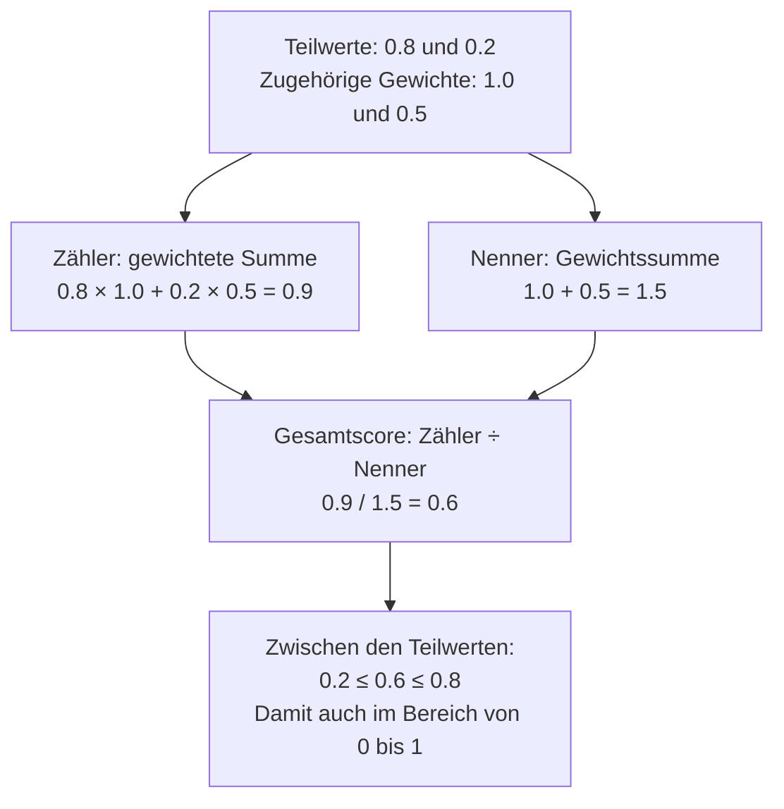

Score `0.6` liegt näher am stärker gewichteten Teilwert `0.8`.
Die gewichtete Summe `0.9` allein ist noch kein Gesamtscore.

<a id="warum-der-gesamtscore-zwischen-0-und-1-liegt"></a>

##### Wertebereich vor Deadline-Strafen

Für Teilwert `xᵢ` in `[0, 1]` und positives Gewicht `wᵢ` gilt:

`0 ≤ xᵢ × wᵢ ≤ wᵢ`

Addition aller Beiträge ergibt:

`0 ≤ Summe(Teilwert × Gewicht) ≤ Summe(zugehörige Gewichte)`

Der Zähler liegt zwischen null und dem positiven Nenner. Nach Division gilt:

`0 ≤ Gesamtscore ≤ 1`

Der Bereich entsteht rechnerisch, ohne nachträgliche Begrenzung, und gilt
**vor Strafabzügen**. Gleiche Teilwerte `x` ergeben auch den Durchschnitt `x`,
insbesondere `0` für lauter Nullen und `1` für lauter Einsen:

`Score(x) = Summe(x × Gewicht) / Summe(Gewichte) = x`

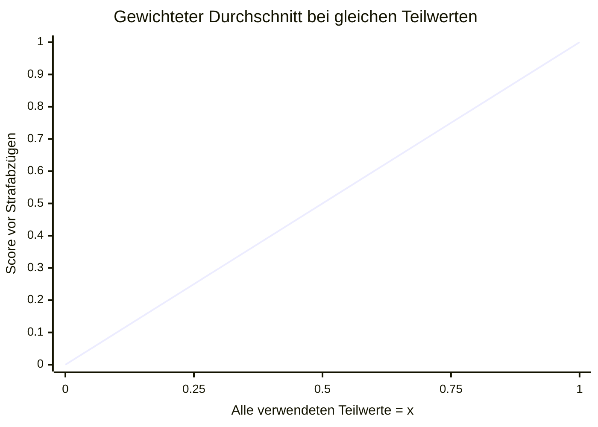

Bei nur einem Teilwert gilt `(Teilwert × Gewicht) / Gewicht = Teilwert`.
Deshalb verändert das einzige Gewicht von `complete_job` oder normalen
Warteaktionen deren Score nicht.

##### HeuristicWeights

[HeuristicWeights.py](sources/SpineML/Control/HeuristicPolicy/HeuristicWeights.py)
enthält die lokalen Parameter und prüft sie beim Erzeugen auf `(0, 1]`.
`calculate_action_score()` prüft oder begrenzt sie nicht selbst.

[WeightOptimization](sources/SpineML/Control/HeuristicPolicy/WeightOptimization)
verändert diese lokalen Parameter. Die
[globalen Gewichte](#globale-gewichte-in-optimizationpy) bewerten dagegen ganze Produktionsläufe.

#### Rechenbeispiel: zwei Ablageziele

Der Main-Roboter trägt einen intakten, unfertigen Job. Die nächste Operation
kann auf Maschine A oder B erfolgen. Der Generator erzeugt zwei
`place_main_robot`-Kandidaten:

- **Kandidat A:** Den Job in Korridorpuffer A für den Weitertransport zu
  Maschine A ablegen.
- **Kandidat B:** Den Job in Korridorpuffer B für den Weitertransport zu
  Maschine B ablegen.

Das Beispiel verwendet alle fünf Kriterien von `evaluate_place_action()`
und die Standardgewichte aus `HeuristicWeights`.

1. **Rohwerte:** Wege `8` und `2`, Grundgeschwindigkeit `2`: Transportzeiten
   `4` und `1`. In Korridorpuffer A sind vier von zehn Plätzen frei, in B zwei
   von zehn. Vor Maschine A warten drei Jobs, vor B keiner. Einlagerzeit
   jeweils `1`, nächste Operationsdauer jeweils `4`.
2. **Teilwerte:** `inverse_scale()` für Zeiten und Warteschlangenlänge,
   `freie Plätze / Gesamtkapazität` für Kapazität. Höher ist immer besser.
3. **Gewichtssatz:** Standardgewichte laut Tabelle. Kapazität meint den
   **Korridorpuffer**, Warteschlangenlänge den **Eingangspuffer der Zielmaschine**.
4. **Score:** Gewichtete Teilwerte addieren und durch
   `0.2 + 0.25 + 0.15 + 0.25 + 0.15 = 1.0` teilen:

| Bewertungsgröße | Standardgewicht | Kandidat A: Rohwert → Teilwert | Kandidat B: Rohwert → Teilwert |
|---|---|---|---|
| Freie Korridorpufferkapazität | `0.2` | `4 / 10 → 0.4` | `2 / 10 → 0.2` |
| Transportzeit | `0.25` | `4 → 0.2` | `1 → 0.5` |
| Einlagerzeit | `0.15` | `1 → 0.5` | `1 → 0.5` |
| Maschinenwarteschlangenlänge | `0.25` | `3 → 0.25` | `0 → 1` |
| Operationsdauer | `0.15` | `4 → 0.2` | `4 → 0.2` |
| **Gewichtete Summe** | — | `0.2975` | `0.52` |
| **Gesamtscore** | Gewichtssumme `1.0` | `0.2975 / 1.0 = 0.2975` | `0.52 / 1.0 = 0.52` |

Die gewichteten Summen lauten:

- **A:** `0.4 × 0.2 + 0.2 × 0.25 + 0.5 × 0.15 + 0.25 × 0.25 + 0.2 × 0.15 = 0.2975`.
- **B:** `0.2 × 0.2 + 0.5 × 0.25 + 0.5 × 0.15 + 1 × 0.25 + 0.2 × 0.15 = 0.52`.

Die gewichteten Beiträge erklären den Vorteil von B:

- **Freie Pufferkapazität:** A erhält `0.4 × 0.2 = 0.08`, B nur
  `0.2 × 0.2 = 0.04`. Das ist ein Vorteil von `0.04` für A.
- **Transportzeit:** B erhält `0.5 × 0.25 = 0.125`, A nur
  `0.2 × 0.25 = 0.05`. Das ist ein Vorteil von `0.075` für B.
- **Maschinenwarteschlange:** B erhält `1 × 0.25 = 0.25`, A nur
  `0.25 × 0.25 = 0.0625`. Das ist ein Vorteil von `0.1875` für B.

- **Gleiche Beiträge:** Einlagerzeit und Operationsdauer ändern den Abstand
  nicht. Bs Vorteil ist `0.075 + 0.1875 − 0.04 = 0.2225`. Bei Gewichtssumme
  `1.0` entspricht dies dem Scoreabstand `0.52 − 0.2975 = 0.2225`.
- **Warten vergleichen:** Bei aktueller Zeit `11` und Deadline `10` gilt
  `EDD = 0.75`. Der zusätzliche Kandidat `wait_main_robot` erreicht
  `1 − 0.75 = 0.25`; B liegt auch darüber.
- **Neue Beobachtung:** Kandidaten und Scores werden neu bestimmt. Ist
  Puffer B voll, entfällt diese Ablageaktion. Bewertet werden nur erlaubte Kandidaten.

### Optimierungsvorgang

<a id="gesamtablauf-der-optimierung"></a>

#### Ziel der Optimierung

Gesucht wird ein lokaler Gewichtssatz für bessere Produktionsergebnisse.
Dazu wird jeder Satz mit denselben Seeds simuliert. Der kleinere Mittelwert
der globalen Bewertungszahlen gewinnt.

##### Gesamter Optimierungsablauf

Eine **Iteration** umfasst die Schritte 2 bis 5: Gewichtssätze erzeugen,
prüfen, den besten auswählen und über das Weitersuchen entscheiden.

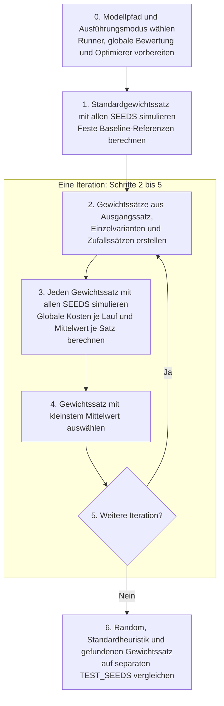

`sequential` führt die Läufe nacheinander aus; `parallel` verteilt unabhängige
Läufe derselben Phase auf einen Prozesspool. Suche, Seeds, Bewertung und
Ergebnisreihenfolge bleiben gleich. Details stehen unter
[CPU-Ausführung und Messungen](#parallele-optimierung-mit-mehreren-cpu-prozessen).

#### 0. Modell laden und Optimierung starten

<a id="optimierung-starten"></a>

##### Anwendung starten

```console
.\.venv\Scripts\python.exe -m streamlit run sources/apps/heuristic_optimization_app.py
```

1. **Modell prüfen:** Die Oberfläche zeigt den Dateinamen. Standard ist
   `EXAMPLE_FILE = "example-5.py"` in
   [heuristic_optimization_app.py](sources/apps/heuristic_optimization_app.py).
2. **Execution mode wählen:** **Sequential (previous execution)** läuft
   ohne Prozesspool; **Parallel (process pool)** ist voreingestellt.
3. **Start optimization drücken:** Startknopf und Moduswahl bleiben bis zum
   Ende gesperrt. Der Lauf hat keine 3D-Animation. Modell und Code währenddessen
   nicht ändern.

##### Produktionsbeispiel für den Steuerungsvergleich

[example-5.py](sources/examples/normal/example-5.py) enthält 24 Jobs aus acht
Aufträgen, drei Endprodukte, zwölf Operationstypen und zwölf Maschinen in drei
Seitenkorridoren. Bearbeitungswege, Werkzeuge, Puffer, Defektrisiken und Termine
bieten unterschiedliche Entscheidungen. Erst Schritt 6 prüft, ob die Suche hilft.

<a id="beteiligte-dateien"></a>
<a id="technische-einbindung-modellladen-worker-thread-und-fortschrittsanzeige"></a>

##### Modell und Hintergrundlauf vorbereiten

Oberfläche und Hintergrundthread laufen im selben Python-Prozess.
Die Worker des Prozesspools sind eigene Prozesse.

- **Oberfläche:** Startet den Hintergrundthread und liest Fortschritt und
  Ergebnisse aus `state`.
- **Hintergrundthread:** Koordiniert Baseline, Suche und Testvergleich.
  Globale Bewertung und Mittelwerte werden hier berechnet, nicht im Pool.
- **Direkter Modus:** [ModelLoader.py](sources/SpineML/SimulationExecution/ModelLoader.py)
  lädt Layout und Szenario. `SimulationRunner` führt die Policies nacheinander aus.
- **Paralleler Modus:** `ParallelSimulationRunner` erhält den Modellpfad.
  Beim ersten Laufstapel startet der Spawn-Pool. Jeder Worker lädt das Modell
  einmal; jeder Auftrag erhält eine neue Policy, Bridge und Salabim-Umgebung.
- **Abschluss:** Der Hintergrundthread schließt den Pool auch bei Fehlern.
  Erst danach meldet er das Ende. Fehler erscheinen in der Oberfläche.

Die zugehörigen Aufrufe im Code:

| Aufruf | Aufgabe im Ablauf |
| --- | --- |
| `_start_optimization()` | Setzt alte Anzeigeergebnisse zurück und startet den Hintergrundthread. |
| `worker()` | Koordiniert Vorbereitung, Baseline, Gewichtssuche, Testvergleich und Abschluss. |
| `create_optimizer()` | Erstellt Runner, globale Bewertung und Optimierer; startet noch keine Simulation. |
| `load_layout_and_scenario()` | Liefert `layout` und `scenario`: direkt bei der Vorbereitung, im Pool einmal beim Workerstart. |
| `optimizer.optimize_iteratively(...)` | Führt die Schritte 2 bis 5 aus. |
| `_benchmark_policies()` | Führt nach der Suche den Steuerungsvergleich aus Schritt 6 aus. |

Weitere [Zuständigkeiten](#projektstruktur-und-zuständigkeiten) stehen oben.
Die Suche steht in
[LocalHeuristicWeightOptimizer.py](sources/SpineML/Control/HeuristicPolicy/WeightOptimization/LocalHeuristicWeightOptimizer.py).

##### Suchparameter

Aktuelle Einstellungen in [heuristic_optimization_app.py](sources/apps/heuristic_optimization_app.py):

| Parameter | Aktueller Wert | Bedeutung |
| --- | --- | --- |
| `SEEDS` | `[1, 2]` | Gemeinsame Simulations-Seeds für Baseline und jeden Gewichtssatz. |
| `TEST_SEEDS` | `[101, 102, 103, 104, 105]` | Separate Seeds nur für den abschließenden Steuerungsvergleich. |
| `ITERATIONS` | `2` | Höchstens zwei Suchiterationen. |
| `INITIAL_WEIGHT_STEP` | `0.40` | Anfangs addierter beziehungsweise abgezogener Betrag, keine prozentuale Änderung. |
| `EXPLORATION_CANDIDATES` | `3` | Zusätzliche zufällige Gewichtssätze pro Iteration. |
| `RESTART_AFTER_NO_IMPROVEMENT` | `2` | Nach zwei erfolglosen Iterationen die Schrittweite zurücksetzen. |
| `STOP_AFTER_NO_IMPROVEMENT` | `4` | Nach vier aufeinanderfolgenden erfolglosen Iterationen stoppen. |
| `MAX_WORKERS` | Verfügbare logische Prozessoren, höchstens `20` | Obergrenze gleichzeitiger Prozesse im parallelen Modus. |

<a id="1-produktion-mit-standardgewichten-simulieren"></a>

#### 1. Produktion mit dem Standardgewichtssatz simulieren

1. **Baseline simulieren:** `HeuristicWeights()` wird einmal pro Seed aus
   `SEEDS` simuliert, aktuell mit `1` und `2`. Diese Vergleichsläufe bilden
   die Baseline. Sie laufen je nach Modus nacheinander oder parallel.
2. **Feste Referenzen berechnen:** Für jede [Zeitkennzahl](#produktionskennzahlen)
   wird der Baseline-Mittelwert gespeichert. Ein Referenzwert von `0` führt
   zum Fehler und wird nicht ersetzt.
3. **Suche starten:** Erst danach beginnt `optimize_iteratively()`.

- **Beispiel:** `9` und `11` Stunden Produktionsdauer ergeben die Referenz
  `(9 + 11) / 2 = 10` Stunden. Ihre Verwendung zeigt das
  [Rechenbeispiel in Schritt 3](#globale-gewichte-in-optimizationpy).
- **Gültigkeit:** Die Referenzen bleiben für alle folgenden Läufe fest,
  einschließlich des
  [Abschlussvergleichs](#6-gefundenen-gewichtssatz-mit-standardheuristik-und-zufall-vergleichen).

<a id="baseline-technik"></a>

##### Technische Umsetzung: Seeds

Ein Seed ist der Startwert für die Zufallszahlengeneratoren. Der Runner setzt
ihn vor jedem Lauf. Damit werden Zufallsziehungen reproduzierbar.

Im Lauf wiederholt sich:

`Zustand → Policy entscheidet → Simulation führt Aktion aus → neuer Zustand`

Auch Geschwindigkeitsschwankungen und Defekte beeinflussen den Zustand:

`Neuer Zustand = bisheriger Zustand + Auswirkungen der gewählten Aktion + gegebenenfalls Zufallseinflüsse`

Mit demselben Seed werden etwa die anfänglichen Maschinengeschwindigkeiten
für zwei Gewichtssätze gleich ausgelost. Andere Entscheidungen können danach
andere Zustände erzeugen. Der Zufall bleibt also erhalten; verglichen werden
die [Produktionsergebnisse](#produktionskennzahlen) unter denselben Seeds.

<a id="2-varianten-der-lokalen-gewichte-erstellen"></a>

#### 2. Varianten des lokalen Gewichtssatzes erstellen

Ausgangspunkt ist zunächst
[HeuristicWeights()](sources/SpineML/Control/HeuristicPolicy/HeuristicWeights.py).
`optimize_iteratively()` erzeugt daraus vollständige Gewichtssätze auf zwei Arten:

1. **Einzelne Gewichte verändern: `neighboring_weights()`**

   Der Ausgangssatz bleibt enthalten. Für jedes Gewicht entstehen zwei Varianten:
   eine mit `Gewicht − Schrittweite`, eine mit `Gewicht + Schrittweite`.
   Alle anderen Gewichte bleiben gleich. Geänderte Werte werden auf
   `0.000001` bis `1.0` begrenzt.

   **Beispiel mit Schrittweite `0.4`:** Gezeigt sind
   `pick_short_transport_time_weight` und `target_store_free_capacity_weight`.
   Die übrigen **23 Gewichte bleiben unverändert**.

   | Gewichtssatz | Transportzeitgewicht | Kapazitätsgewicht |
   |---|---|---|
   | Ausgangssatz | `0.3` | `0.2` |
   | Nur Transportzeitgewicht verringern | `0.000001` | `0.2` |
   | Nur Transportzeitgewicht erhöhen | `0.7` | `0.2` |
   | Nur Kapazitätsgewicht verringern | `0.3` | `0.000001` |
   | Nur Kapazitätsgewicht erhöhen | `0.3` | `0.6` |

   `0.3 − 0.4` und `0.2 − 0.4` liegen unter der Grenze und werden deshalb
   durch `0.000001` ersetzt.

2. **Weitere Gewichtssätze zufällig zusammenstellen: `random_local_weight_candidates()`**

   Hier wird jedes Gewicht neu gezogen. Alle Werte können also gleichzeitig
   abweichen: zwischen `0.000001` und `1.0`, für `wait_action_weight` nur
   zwischen `0.000001` und `0.1`.

   **Erste Iteration:** `EXPLORATION_CANDIDATES = 3` erzeugt drei Zufallssätze.
   Gezeigt sind drei von jeweils 25 neu gezogenen Werten, auf vier Nachkommastellen
   gerundet. Auch die übrigen 22 Werte werden neu gezogen.

   | Zufallssatz | Transportzeitgewicht | Kapazitätsgewicht | `wait_action_weight` |
   |---|---|---|---|
   | 1 | `0.5113` | `0.4766` | `0.0758` |
   | 2 | `0.9666` | `0.8050` | `0.0434` |
   | 3 | `0.5079` | `0.7066` | `0.0448` |

**Wie viele Gewichtssätze entstehen insgesamt?**

Bei aktuell 25 Gewichten entstehen zunächst:

`1 Ausgangssatz + 2 × 25 Einzelvarianten + 3 Zufallssätze = 54 erzeugte Gewichtssätze`

- **Doppelte entfernen:** Bei vollständig gleichen Sätzen bleibt nur der erste.
  In Iteration 1 bleiben aktuell 53 unterschiedliche Sätze.
- **Umfang:** Zwei Iterationen prüfen höchstens `53 + 54 = 107` Sätze,
  jeweils mit allen Seeds. Mit Baseline und Testvergleich sind das höchstens
  `2 + 107 × 2 + 15 = 231` Simulationen. Die tatsächliche Zahl steht im Laufbericht.
- **Fortschritt:** Gezählt werden nur tatsächlich geprüfte, unterschiedliche Sätze.
  Sie werden in [Schritt 3](#3-produktion-mit-jedem-gewichtssatz-einmal-pro-seed-simulieren-und-bewerten)
  bewertet. Den nächsten Ausgangssatz bestimmt [Schritt 5](#5-weitere-iteration-ausführen).

<a id="3-produktion-mit-jedem-gewichtssatz-mehrfach-simulieren-und-bewerten"></a>

#### 3. Produktion mit jedem Gewichtssatz einmal pro Seed simulieren und bewerten

Jeder Gewichtssatz aus [Schritt 2](#2-varianten-des-lokalen-gewichtssatzes-erstellen)
wird mit jedem Seed aus `SEEDS` vollständig simuliert. Mit `[1, 2]` gilt:

1. Mit Seed `1` simulieren und die [globale Bewertungszahl](#globale-bewertungszahl) berechnen.
2. **Denselben Gewichtssatz** unabhängig mit Seed `2` simulieren und bewerten.
3. Aus **diesen beiden Bewertungszahlen** den [Mittelwert](#mittelwert-über-die-seeds)
   bilden: Summe geteilt durch `2`.

Direkt laufen die Simulationen nacheinander. Parallel bilden alle
Gewichtssatz-Seed-Paare einer Iteration einen Laufstapel. Sie dürfen in anderer
Reihenfolge fertig werden. Sobald alle Seeds eines Satzes vorliegen, berechnet
der Elternprozess dessen Bewertungszahlen und Mittelwert. Erst nach allen
Sätzen wird der beste ausgewählt.

##### Gewichtssätze mit denselben Seeds vergleichen

Jede Diagrammzeile zeigt einen Gewichtssatz mit derselben [Seedliste](#baseline-technik).
Jeder Zweig ist ein vollständiger Lauf. Sein Ergebnis geht nur in den
[Mittelwert seines Gewichtssatzes](#mittelwert-über-die-seeds) ein.

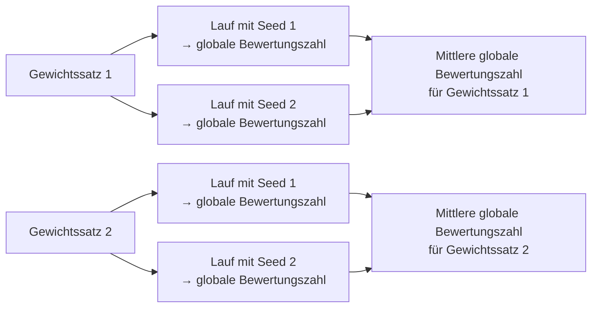

##### Simulationslauf und Produktionskennzahlen

1. `HeuristicPolicyFactory` erstellt aus Gewichtssatz und Seed eine frische Policy.
2. `SimulationRunner.run_policy()` setzt den Seed, baut die Simulation neu auf
   und führt sie aus, direkt oder im Poolprozess. Die Policy entscheidet über
   Aktionen; ihr Gewichtssatz bleibt unverändert.
3. `collect_global_metrics()` sammelt die Kennzahlen als `GlobalSimulationMetrics`.
   Der Runner gibt sie an den Optimierer zurück. Unfertige Jobs beim Laufende
   führen stattdessen zu einem Fehler.

###### Produktionskennzahlen

Die Bewertung verwendet sieben Kennzahlen; die vier Zeitkennzahlen werden
in Stunden erfasst.

- **Produktionsdauer (`makespan`):** Zeit vom frühesten vorgesehenen
  Auftragsstart (`earliest_start_time`) bis zum letzten Jobabschluss.
  Der gespeicherte Abschlusszeitpunkt liegt nach dem Absenken am Endlager,
  aber vor der letzten Einlagerungszeit und der tatsächlichen Ablage.
- **Gesamtverspätung (`total_tardiness`):** Summe der positiven Verspätungen
  aller abgeschlossenen **Jobs**. Für jeden Job gilt
  `Jobverspätung = max(0, completed_time − Deadline des zugehörigen Auftrags)`.
  Jobs desselben Auftrags zählen einzeln; frühe Abschlüsse verringern die Summe
  nicht. Beispiel: Bei Deadline `10` und Jobabschlüssen
  `8`, `12` und `15` ist die Gesamtverspätung `0 + 2 + 5 = 7`.
  Im Interface heißt diese Kennzahl **Total job tardiness**.
- **Transportzeit (`total_transport_time`):** Summe der Bewegungszeiten für
  X, Y und Z aller Roboter. Ein- und Auslagerungswartezeiten zählen nicht mit.
- **Werkzeugwechselzeit (`tool_change_time`):** Summe der Zeiten aller
  Maschinen für Werkzeugmontage (`mounting`) und -demontage (`unmounting`).
- **Nacharbeitsquote (`rework_rate`):** `rework_job_count / total_jobs`.
  Jeder abgeschlossene Job mit `rework_count > 0` zählt einmal.
  `total_rework_count` zählt dagegen alle gewählten Nacharbeiten, auch mehrere
  beim selben Job.
- **Ausschussquote (`scrap_rate`):** `scrap_job_count / total_jobs`.
  Gezählt werden abgeschlossene Jobs mit `general_state == "scrap"`,
  nicht ihre internen Entscheidungszähler.
- **Herabstufungsquote (`downgrade_rate`):** `downgraded_job_count / total_jobs`.
  Gezählt werden abgeschlossene Jobs mit `general_state == "intact"` und
  `downgraded == True`. Sie zählen nicht zusätzlich unter `intact_jobs`.

`total_jobs` ist jeweils die Gesamtzahl aller Jobs. Davon getrennt summiert
`total_defect_count` alle `job.defect_count`: drei Defekte bei einem Job und
zwei bei einem anderen ergeben fünf Fälle. Diese Ereigniszahl wird nicht
zusätzlich global bewertet.

##### Globale Bewertungszahl

`GlobalSimulationEvaluation` verbindet Zeitaufwand und Qualitätsfolgen zu
einer Zahl pro Lauf. So lässt sich etwa eine kurze Produktionsdauer gegen
viel Ausschuss abwägen. Anders als beim Aktionsscore gilt: **Kleiner ist besser.**

1. **Zeiten umrechnen:** Jede der vier Zeitkennzahlen wird durch ihren eigenen
   [Baseline-Referenzwert](#1-produktion-mit-dem-standardgewichtssatz-simulieren)
   geteilt. `8` Stunden bei Referenz `10` ergeben `0.8`. Der Wert `1` bedeutet
   dieselbe Zeit wie die Referenz; kleiner bedeutet kürzer.
2. **Quoten übernehmen:** Nacharbeits-, Ausschuss- und Herabstufungsquote
   werden nicht durch Baseline-Werte geteilt. Zum Beispiel ergeben `20`
   abgeschlossene Ausschussjobs bei `100` Jobs `20 / 100 = 0.2`.
   Nacharbeit zählt als zusätzlicher Aufwand neben den Zeiten.
3. **Beiträge addieren:** Jeden Wert mit seinem
   [globalen Gewicht](#globale-gewichte-in-optimizationpy) multiplizieren,
   dann die Produkte addieren:

`Globale Bewertungszahl = Summe(umgerechneter Kennzahlwert × globales Gewicht)`

Es wird **nicht durch die Gewichtssumme geteilt**. Globale Gewichte und
Baseline-Referenzen bleiben für alle Gewichtssätze gleich.

<a id="globale-gewichte-in-optimizationpy"></a>

###### Globale Gewichte in `heuristic_optimization_app.py`

Die Tabelle verwendet die globalen Gewichte aus dem Code für Gewichtssatz A
mit Seed `1`. Laufdaten und Referenzen sind erfundene Beispieldaten, keine
Messergebnisse. Zeiten stehen in Stunden. Von `100` abgeschlossenen Jobs
wurden `10` nachgearbeitet, `20` als Ausschuss behandelt und `10` herabgestuft.

| Kennzahl | Umrechnung im Beispiel | Globales Gewicht | Beitrag zur Bewertungszahl |
| --- | --- | --- | --- |
| Produktionsdauer (`makespan`) | `8 / 10 = 0.8` | `5.0` | `4.0` |
| Gesamtverspätung | `2 / 4 = 0.5` | `4.0` | `2.0` |
| Transportzeit | `6 / 8 = 0.75` | `1.0` | `0.75` |
| Werkzeugwechselzeit | `1 / 2 = 0.5` | `1.0` | `0.5` |
| Nacharbeitsquote | `10 / 100 = 0.1` | `3.0` | `0.3` |
| Ausschussquote | `20 / 100 = 0.2` | `4.0` | `0.8` |
| Herabstufungsquote | `10 / 100 = 0.1` | `3.0` | `0.3` |

Die letzte Spalte ergibt zusammen:

`4.0 + 2.0 + 0.75 + 0.5 + 0.3 + 0.8 + 0.3 = 8.65`

Ein höheres globales Gewicht verstärkt den Einfluss der Kennzahl.
Steigt nur die Ausschussquote um `0.1`, steigt die Bewertungszahl bei
Gewicht `4.0` um `0.4`.

##### Mittelwert über die Seeds

Aus den Bewertungszahlen aller Seeds **desselben Gewichtssatzes** berechnet
der Optimierer im Elternprozess den Vergleichswert:

`mean_global_cost = Summe(globale Bewertungszahl je Seed) / Anzahl der Seeds`

Für A gilt oben bei Seed `1` der Wert `8.65`. Angenommen, A erreicht mit
Seed `2` den Wert `9.55`, B dagegen `8.9` und `8.7`:

| Gewichtssatz | Bewertungszahl bei Seed `1` | Bewertungszahl bei Seed `2` | Mittelwert `mean_global_cost` |
| --- | --- | --- | --- |
| A | `8.65` | `9.55` | `(8.65 + 9.55) / 2 = 9.1` |
| B | `8.9` | `8.7` | `(8.9 + 8.7) / 2 = 8.8` |

A ist bei Seed `1` besser, B aber im Mittel. Deshalb gewinnt B in
[Schritt 4](#4-gewichtssatz-anhand-der-mittleren-produktionsergebnisse-auswählen).

##### Fortschritt und Ergebnisdiagramme

- **Fortschritt:** `progress` meldet Iteration und ursprünglichen Kandidatenindex;
  die Oberfläche zählt fertige Sätze separat. `Optimization: iteration 1, 9/53
  candidates completed` heißt: neun von 53 Sätzen dieser Iteration sind mit
  allen Seeds geprüft.
- **X-Achse `Candidate`:** Alle folgenden Diagramme nummerieren Gewichtssätze
  fortlaufend über alle Iterationen, in Eingabe- statt Fertigstellungsreihenfolge.
- **Punkte und Linien:** Ein Punkt setzt alle Seed-Ergebnisse voraus.
  Später eingereichte fertige Sätze warten in der Anzeige auf ihre Vorgänger.
  Linien verbinden die Eingabereihenfolge; Kandidat `1` bleibt die Vergleichsbasis.

###### Bedeutung der Kostenkurve

**Mean global cost** zeigt auf der Y-Achse `mean_global_cost`, also die
[mittlere Bewertungszahl](#mittelwert-über-die-seeds) je Gewichtssatz.
„Kosten“ sind hier kein Geldbetrag. Kleiner ist besser.

Die Kurve zeigt alle Versuche, nicht nur Verbesserungen. Sie muss nicht
stetig sinken; ein schlechterer Versuch ersetzt den besten Satz nicht.

###### Einzelne Produktionskennzahlen

**Mean metrics per candidate** zeigt für jede der sieben
[Kennzahlen](#globale-bewertungszahl) den Seed-Mittelwert mit eigener Y-Skala:
Zeiten in Stunden, Quoten in Prozent. Kürzere Zeiten können etwa mit mehr
Ausschuss einhergehen. Die globale Bewertungszahl wägt solche Zielkonflikte ab.

###### Abweichung gegenüber dem ersten Gewichtssatz

**Metric deviation from candidate 1** zeigt Änderungen der Kennzahlmittelwerte:
Zeiten in relativen Prozent, die drei Quoten getrennt davon in Prozentpunkten.

- **Vergleichsbasis:** Kandidat `1` ist der erste eingereichte Satz der gesamten
  Suche, aktuell der Standardgewichtssatz. Er wechselt nicht je Iteration und
  wird nicht nach Fertigstellungszeit bestimmt.
- **Zeitkennzahlen:** Für einen Ausgangswert ungleich `0` gilt:

`Abweichung (%) = (Kennzahlmittelwert − Ausgangswert) / |Ausgangswert| × 100`

- **Zeitbeispiel:** Sinkt die mittlere Produktionsdauer von `10` auf `8`
  Stunden, ist die Abweichung `(8 − 10) / 10 × 100 = −20 %`.
- **Quoten:** Prozentwerte werden direkt voneinander abgezogen.
  Von `0 %` auf `5 %` ergibt `+5` Prozentpunkte;
  von `10 %` auf `20 %` ergibt `+10` Prozentpunkte, nicht `+100` Prozentpunkte.
- **Zeit-Ausgangswert `0`:** Dafür ist keine relative Änderung berechenbar.
  Statt einer Kurve erscheint ein Hinweis im Diagrammtitel, kein künstlicher
  Wert `0 %`. Quoten ab `0 %` bleiben als Prozentpunktdifferenz darstellbar.
- **Vorzeichen:** Negativ bedeutet weniger, positiv mehr.
- **Beurteilung:** Weniger Nacharbeit kann mehr Ausschuss bedeuten.
  Entscheidend bleibt die [mittlere globale Bewertungszahl](#mittelwert-über-die-seeds).
  Die unveränderten Rohmittelwerte stehen im [Kennzahlendiagramm](#einzelne-produktionskennzahlen).

#### 4. Gewichtssatz anhand der mittleren Produktionsergebnisse auswählen

`select_best_local_weight_set_across_seeds()` wählt den kleinsten
[Seed-Mittelwert](#mittelwert-über-die-seeds) dieser Iteration.
Bei Gleichstand gewinnt der erste Satz in Eingabereihenfolge, nicht der
zuerst fertige. Im Beispiel gewinnt B mit `8.8` gegen A mit `9.1`.
Ob B den bisherigen besten Satz ersetzt, entscheidet [Schritt 5](#5-weitere-iteration-ausführen).

<a id="weitere-iterationen-neustart-vorzeitiges-ende-und-rückgabewerte-im-code"></a>

#### 5. Weitere Iteration ausführen?

`optimize_iteratively()` vergleicht den Iterationssieger mit dem bisher besten
Mittelwert. Nur ein kleinerer Wert verbessert ihn; Gleichstand genügt nicht.

- **Erste Iteration oder Verbesserung:** Satz und Mittelwert speichern,
  Schrittweite halbieren, beide Zähler auf `0` setzen.
- **Sonst:** Besten Satz behalten, beide Zähler um `1` erhöhen.

Die beiden Zähler steuern die Suche bei ausbleibender Verbesserung:

- **Neustart-Zähler (`iterations_without_improvement`):** Zählt erfolglose Iterationen
  seit Verbesserung oder Neustart. Bei `2` (`RESTART_AFTER_NO_IMPROVEMENT`)
  werden die Schrittweite auf `INITIAL_WEIGHT_STEP = 0.4` und dieser Zähler
  auf `0` gesetzt. Gesucht wird weiter um denselben besten Satz, nur mit größeren Schritten.
- **Abbruch-Zähler (`total_iterations_without_improvement`):** Zählt erfolglose
  Iterationen seit der letzten Verbesserung. **Ein Neustart setzt ihn nicht zurück.**
  Bei `4` (`STOP_AFTER_NO_IMPROVEMENT`) endet die Suche vor einem weiteren Neustart.

- **Weiter oder Ende:** Zurück zu [Schritt 2](#2-varianten-des-lokalen-gewichtssatzes-erstellen),
  solange der Abbruch-Zähler unter `4` liegt und `ITERATIONS` nicht erreicht ist.
  Sonst folgt der
  [Abschlussvergleich in Schritt 6](#6-gefundenen-gewichtssatz-mit-standardheuristik-und-zufall-vergleichen).
- **Diagramm:** Verbesserung in Iteration 3, Neustart in 5, Abbruch in 7.
- **Aktueller Lauf:** `ITERATIONS = 2` beendet die Suche nach zwei Iterationen,
  bevor die Zählergrenzen greifen können.

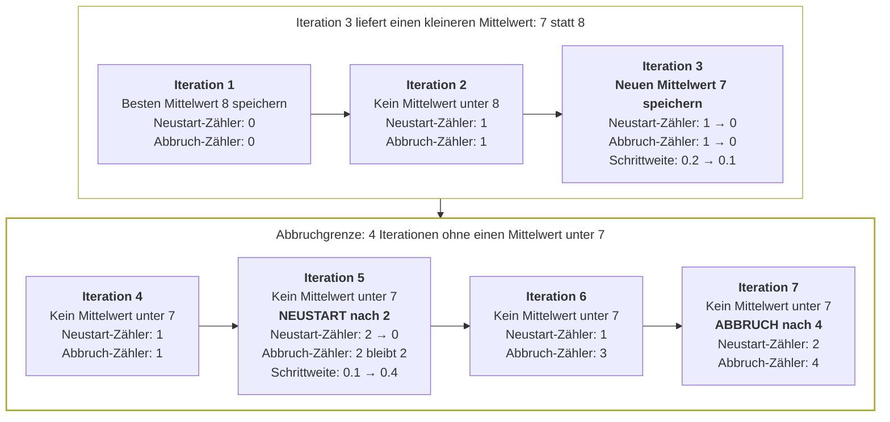

Zurückgegeben werden `best_weights` und `best_mean_global_cost`.
`optimize_iteratively().evaluations` enthält nur die erste beste Bewertung
und spätere Verbesserungen. Die Oberfläche zeigt dagegen alle geprüften Sätze.

<a id="5-gefundenen-gewichtssatz-mit-standardheuristik-und-zufall-vergleichen"></a>

#### 6. Gefundenen Gewichtssatz mit Standardheuristik und Zufall vergleichen

Jede dieser Steuerungen wird einmal pro Test-Seed aus
`TEST_SEEDS = [101, 102, 103, 104, 105]` simuliert:

| Anzeige im Interface | Verwendete Steuerung |
| --- | --- |
| `Random` | [Zufällige Nicht-Warteaktion](#randompolicy-zufällige-vergleichssteuerung); Warten nur als Fallback. |
| `Heuristic (default)` | Die heuristische Steuerung mit dem Standardgewichtssatz `HeuristicWeights()`. |
| `Heuristic (optimized)` | Dieselbe heuristische Steuerung mit dem besten Gewichtssatz aus der Suche. |

- **Bedingungen:** Gleiches Layout und Szenario, gleiche Test-Seeds, globale
  Gewichte und feste Baseline-Referenzen. Der gefundene Gewichtssatz ändert sich nicht.
- **Ausführung:** 15 Läufe, fünf pro Steuerung. Parallel gehen sie gemeinsam
  an denselben Pool; direkt laufen sie nacheinander.
- **Auswertung:** Der Elternprozess berechnet Kosten und Mittelwerte.
  Die Tabelle zeigt je Steuerung die sieben Kennzahlmittelwerte und die
  mittlere Bewertungszahl. Diagramme zeigen einzelne Test-Seeds in Eingabereihenfolge.
- **Urteil:** Der kleinere Kostenmittelwert ist besser. Erst hier zeigt sich,
  ob `Heuristic (optimized)` die anderen übertrifft. Fünf Seeds desselben Modells
  belegen weder ein globales Optimum noch einen Vorteil in beliebigen Fabriken.

## SimulationExecution: Simulationsläufe ausführen

[SimulationExecution](sources/SpineML/SimulationExecution) lädt Modelle und
führt Läufe aus. Ein Runner erhält Policy und Seed und liefert Kennzahlen.
**Die Policy wählt Aktionen; die Simulationskomponenten führen sie aus.**
Zufall, Standardheuristik, optimierte Heuristik und RL nutzen denselben
Simulationskern. Nur die Aktionsauswahl unterscheidet sich.

### Modell laden: `ModelLoader.py`

[`load_layout_and_scenario("example-5.py")`](sources/SpineML/SimulationExecution/ModelLoader.py)
liefert `layout` (Fabrikaufbau) und `scenario` (Produktionsaufträge):

1. `_resolve_model_path()` findet die Python-Datei.
2. `_load_model()` führt sie zum Erstellen der Konfiguration aus.
3. `_find_layout_and_scenario()` gibt `layout` und `scenario` als Tupel zurück.

Das Laden startet noch keinen Produktionslauf.

### Einen vollständigen Lauf ausführen: `SimulationRunner.py`

[`SimulationRunner`](sources/SpineML/SimulationExecution/SimulationRunner.py)
läuft ohne 3D-Anzeige:

1. `runner = SimulationRunner(layout, scenario)` speichert die Konfiguration.
2. `metrics = runner.run_policy(policy, seed)` startet mit einer bereits
   erstellten Policy und wartet bis zum Ende.
3. `metrics` enthält dann die [Produktionskennzahlen](#produktionskennzahlen)
   als `GlobalSimulationMetrics`.

`run_policy()` führt intern diese Schritte aus:

1. Der Seed setzt den Python-Zufallsgenerator, den Salabim-Zufall und
   den Qualitäts-Seed der Maschinen.
2. Eine neue Salabim-Umgebung, `SimulationBridge`, `SimLayout` und `SimScenario`
   werden erstellt.
3. Die Bridge fordert Entscheidungen an; Jobs, Roboter und Maschinen führen sie aus.
4. `collect_global_metrics()` sammelt deren Ergebnisse.

`SimulationRunner(layout, scenario, till=...)` begrenzt die **Simulationszeit**.
Ohne Grenze läuft die Simulation bis zum regulären Abschluss.
Unfertige Jobs beim Ende führen zum Fehler, nicht zu einem gültigen Ergebnis.

### Mehrere Läufe beauftragen: `ParallelSimulationRunner.py`

[`ParallelSimulationRunner`](sources/SpineML/SimulationExecution/ParallelSimulationRunner.py)
verteilt unabhängige vollständige Läufe auf zusätzliche Python-Prozesse.
Jeder **Worker-Prozess** bearbeitet jeweils einen Lauf; zusammen bilden sie
den **Prozesspool**. Jeder Worker erstellt seinen `SimulationRunner` einmal
und verwendet ihn weiter. Das Diagramm zeigt einen solchen Worker.

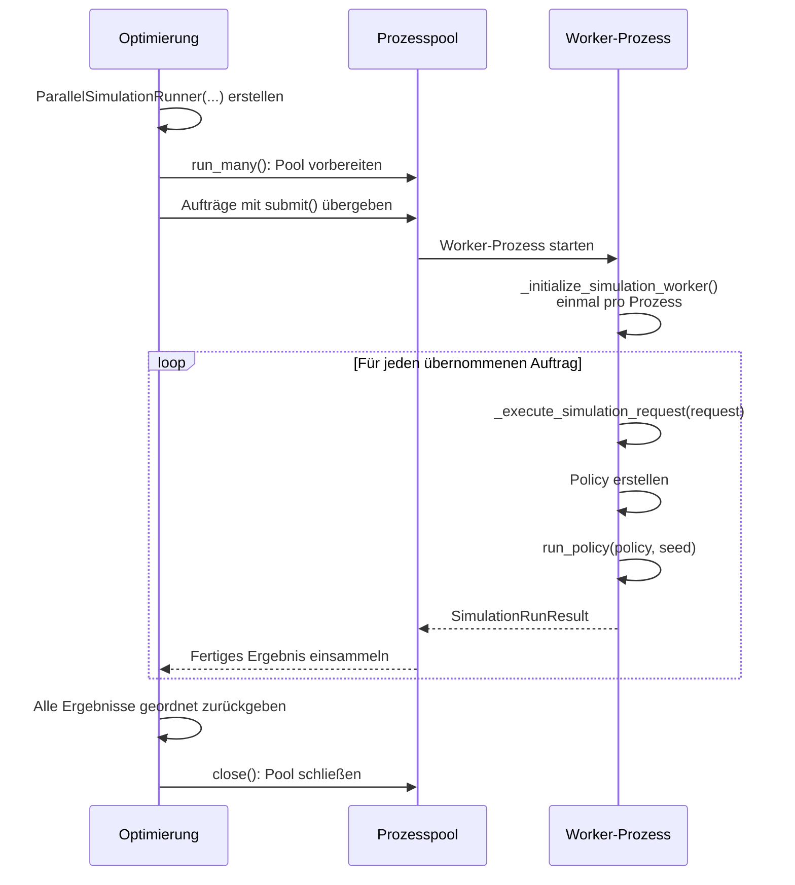

1. **Parallelen Runner erstellen:**
   `runner = ParallelSimulationRunner(model_file, max_workers=20)`
   legt Modell und höchstens 20 gleichzeitige Worker fest, startet aber noch keinen Pool.

2. **Policy-Factory bereitstellen:** `policy_factory(seed)` erstellt eine neue
   Policy. Beispielsweise speichert
   [`HeuristicPolicyFactory(weights)`](sources/SpineML/Control/HeuristicPolicy/HeuristicPolicyFactory.py)
   einen Gewichtssatz und erzeugt daraus die heuristische Policy.

3. **Laufaufträge zusammenstellen:**
   `SimulationRunRequest(policy_factory, seed)` beschreibt einen Lauf.
   Ein Gewichtssatz mit zwei Seeds braucht zwei Aufträge.

4. **Läufe ausführen:** `results = runner.run_many(requests)` startet beim ersten
   nicht leeren Aufruf den Pool. Jeder Worker lädt das Modell einmal.
   Je Auftrag erstellt er eine neue Policy und ruft `SimulationRunner.run_policy()` auf.

5. **Ergebnisse erhalten:** Nach allen Aufträgen liefert `run_many()` ein
   `tuple` von `SimulationRunResult` in Auftrags- statt Fertigstellungsreihenfolge.

6. **Pool schließen:** `runner.close()` wartet auf laufende Aufträge und beendet
   den Pool. Alternativ einen `with`-Block verwenden. Danach sind keine neuen Aufträge möglich.

Jedes `SimulationRunResult` enthält:

| Feld | Bedeutung |
| --- | --- |
| `metrics` | Die Produktionskennzahlen dieses Laufs als `GlobalSimulationMetrics`. |
| `elapsed_seconds` | Die verstrichene Zeit im Worker für Policy-Erstellung, Simulation und Kennzahlensammlung. Das vorherige Modellladen und der Poolstart sind darin nicht enthalten. |
| `worker_pid` | Die Betriebssystem-ID des ausführenden Prozesses, nicht die Nummer eines CPU-Kerns. |

`run_many(..., on_completed=...)` meldet nach jedem fertigen Lauf Auftragsindex
und Ergebnis an die Fortschrittsfunktion im aufrufenden Programm.

Die Factory muss zwischen Prozessen übertragbar sein. Die vorhandenen
Factory-Klassen eignen sich dafür, Lambdas und lokal definierte Funktionen nicht.

### Produktionskennzahlen weiterverwenden

Der Runner sammelt Kennzahlen, bewertet sie aber nicht:

- **Einen Lauf bewerten:**
  [`GlobalSimulationEvaluation`](#globale-bewertungszahl) berechnet aus
  den Kennzahlen eine globale Bewertungszahl.
- **Gewichtssätze vergleichen:** [`LocalHeuristicWeightOptimizer`](#optimierungsvorgang)
  beauftragt Läufe pro Satz und Seed, bildet den [Kostenmittelwert](#mittelwert-über-die-seeds)
  und steuert weitere Iterationen.
- **RL schrittweise ausführen:** [`SpineRLEnv`](#rlpolicy-erste-rl-umgebung)
  steuert den Lauf selbst und wartet an Auswahlpunkten auf `step()`.
  Sie nutzt denselben Modelllader und `collect_global_metrics()`, für diese
  schrittweisen Episoden aber weder `run_policy()` noch `run_many()`.

### Parallele Optimierung mit mehreren CPU-Prozessen

**Parallel (process pool)** verwendet `MAX_WORKERS` aus
[heuristic_optimization_app.py](sources/apps/heuristic_optimization_app.py)
– die Zahl logischer Prozessoren, begrenzt auf 20 gleichzeitige Worker.

Dabei sind [Hintergrundthread](#modell-und-hintergrundlauf-vorbereiten)
und Poolprozesse getrennt:

- **Hintergrundthread:** Koordiniert im Oberflächenprozess Baseline, Suche und Test.
- **Worker-Prozesse:** Führen die einzelnen Produktionsläufe aus.

**Beispiel:** 53 Gewichtssätze mit zwei Seeds ergeben `53 × 2 = 106` Aufträge.
Bei 20 Workern laufen höchstens 20 gleichzeitig. Freie Worker übernehmen weitere Aufträge.

Der Pool bleibt für Baseline, Suche und Test erhalten. Die Phasen warten
aufeinander; ebenso jede Iteration auf die vorherige Auswertung.
20 Worker sind daher nicht ständig beschäftigt: Die Baseline hat nur zwei
Aufträge, und am Stapelende können weniger als 20 übrig sein.

Der verwendete Intel Core i7-13700H hat 14 physische Kerne und 20 logische
Prozessoren. Windows verteilt die Prozesse darauf; Worker sind keinem
bestimmten logischen Prozessor fest zugeordnet.

Parallelisierung soll die **Gesamtzeit vieler Läufe** verkürzen.
Ein einzelner Lauf kann unter Last sogar länger dauern.
Simulierte Produktionszeit wird in Stunden gemessen, reale Rechenzeit in Sekunden.

<a id="rechenzeit-eines-simulationslaufs-messen"></a>

#### Laufstapel mit verschiedenen Workerzahlen messen

[measure_simulation_runtime.py](sources/tools/measure_simulation_runtime.py)
misst denselben Stapel vollständiger Example-5-Läufe mit verschiedenen
Workerzahlen. Es verwendet Standardgewichte, keine Gewichtssuche.

```console
.\.venv\Scripts\python.exe sources/tools/measure_simulation_runtime.py --seeds 1 2 3 4 5 6 7 8 9 10 11 12 13 14 15 16 17 18 19 20 --workers 1 14 20 --output simulation_times.json
```

Der Befehl prüft dieselben 20 Seed-Läufe mit einem, dann 14, dann 20 Poolprozessen.

- **Gesamtzeit:** Einschließlich Poolstart, Modellladen, Läufen und Poolende.
  Auch `--workers 1` nutzt einen Poolprozess, nicht den direkten Runner.
- **Wiederholungen:** `--repeats 2` verdoppelt die Seedliste innerhalb jedes
  Stapels, nicht die Zahl unabhängiger Gesamtzeitmessungen.
- **Prüfung:** Alle Kennzahlen je Auftrag müssen exakt zur Referenz passen:
  ein Poolprozess, falls angefordert, sonst die erste angeforderte Workerzahl.
- **Bericht:** `--output` speichert Zeiten, Kennzahlen und Prozesse als JSON.
  `--profile` untersucht zusätzlich den Zeitverbrauch eines direkten Laufs.
  Dieser zählt nicht zur Stapelzeit.

<a id="gemessener-vergleich-für-example-5"></a>

#### Gemessener Vergleich für Example 5: 20 Läufe

Frühere Messung auf diesem Rechner mit Seeds `1` bis `20` und Standardgewichtssatz:

| Poolprozesse | Gesamtzeit inklusive Poolstart und -ende | Beschleunigung gegenüber einem Poolprozess |
| --- | ---: | ---: |
| `1` | `211.6 s` | `1.00×` |
| `14` | `42.4 s` | `4.99×` |
| `20` | `39.2 s` | `5.40×` |

Damals wurden die Kennzahlen je Seed auf Gleichheit geprüft.
Der Rohbericht liegt nicht im Repository. Dies ist keine neue Messung des aktuellen Codes.

**Die `39.2 s` betreffen nur diesen Stapel von 20 Läufen, nicht die
vollständige Optimierung.**

<a id="vollständige-optimierung-vorher-und-jetzt-vergleichen"></a>

#### Vollständige Optimierung: vorher und jetzt vergleichen

[compare_optimization_runtime.py](sources/tools/compare_optimization_runtime.py)
führt die gesamte Optimierung sequenziell und parallel aus, nacheinander
in frischen Python-Programmen. Standardmäßig beginnt der sequenzielle Lauf.

```console
.\.venv\Scripts\python.exe sources/tools/compare_optimization_runtime.py
```

Beide übernehmen Modell und Parameter der App: Baseline, alle Suchiterationen
und Testvergleich der drei Steuerungen.

- **Sequenziell:** Der direkte Runner führt einen Lauf nach dem anderen aus.
- **Parallel:** Der Prozesspool bearbeitet unabhängige Läufe gleichzeitig.
- **Prüfung:** Konfiguration, Quellstand, Produktions-/Optimierungsergebnisse
  und Laufanzahl müssen übereinstimmen. Nur dann wird der Zeitvorteil berechnet.
- **Zeit:** Vom Start des Hintergrundlaufs bis zum geschlossenen Pool.
  Vorheriger Programmstart und Importe sowie spätere Berichterstellung und
  JSON-Ausgabe zählen nicht mit.
- **Bericht:** `optimization_timing_comparison.json` enthält beide Ablaufberichte
  und den Vergleich. Fertige Teilberichte bleiben bei späteren Fehlern erhalten.

Im Webinterface: `Execution mode` wählen, **Start optimization** drücken,
danach den anderen Modus unverändert ausführen. Die Historie zeigt Phasen-
und Gesamtzeiten; der JSON-Download enthält die Berichte.

Während der Messung keine anderen Simulationen oder Optimierungen starten.
`--order parallel-first` kehrt die CLI-Reihenfolge um.

<a id="gemessene-gesamtzeit-der-vollständigen-optimierung"></a>

#### Gemeldete Gesamtzeit der vollständigen Optimierung

Für `example-5.py` wurden im Webinterface diese Gesamtzeiten gemeldet,
einschließlich Baseline, Suche, Testvergleich und Poolende:

| Ausführungsart | Gesamtzeit | Ungefähr in Minuten |
| --- | ---: | ---: |
| `Sequential (previous execution)` – ohne Prozesspool | `4291.7 s` | `71.5 min` |
| `Parallel (process pool)` – bis zu 20 Prozesse | `1399.5 s` | `23.3 min` |

`4291.7 / 1399.5 ≈ 3.07`: Parallel dauerte dieser Vergleich ungefähr ein Drittel so lange.

Ohne exportierte Rohberichte ließ sich nachträglich nicht prüfen, ob Aufgaben
und Ergebnisse identisch waren. Der obige Vergleichsbefehl dokumentiert und
prüft neue Läufe.

**Frühere Einzelmessungen garantieren keine Beschleunigung.** Modell, Umfang
und Rechnerlast beeinflussen die Zeit. Der Vorteil des 20-Läufe-Stapels gilt
nicht automatisch für die vollständige Optimierung.

<a id="rlcontrol-erste-rl-umgebung"></a>
<a id="rlpolicy-erste-rl-umgebung"></a>

## RLPolicy: neuronale Kandidatenauswahl und Training

Die Dateien sind nach ihrer Aufgabe getrennt:

- **[DQN](sources/SpineML/Control/RLPolicy/DQN):** das DQN-Lernverfahren.
- **[MonteCarlo](sources/SpineML/Control/RLPolicy/MonteCarlo):** das Monte-Carlo-Lernverfahren.
- **[Shared](sources/SpineML/Control/RLPolicy/Shared):** gemeinsamer Netzaufbau, Simulationsanbindung, Beobachtungen, Belohnung und Laden trainierter Netze. Beide Verfahren verwenden diese Bausteine.

**RL** steht für **Reinforcement Learning**. Die RL-Steuerung verwendet ein
neuronales Netz, um aus den Aktionen des [ActionGenerators](#actiongenerator)
eine auszuwählen. Das Netz soll durch viele Simulationsläufe lernen, welche
Entscheidungen zu günstigeren Produktionsergebnissen führen.

**Unterschied zur Heuristik:** Bei der [heuristischen Optimierung](#optimierungsvorgang)
werden lokale `HeuristicWeights` für fest programmierte Bewertungsregeln gesucht.
Bei RL werden stattdessen die **internen Parameter des neuronalen Netzes**
trainiert: die Zahlenwerte, mit denen es seine Auswahl berechnet.
Das Netz schätzt für jede angebotene Aktion einen **Q-Wert**: die erwartete
spätere Belohnung, wenn diese Aktion jetzt gewählt wird. Der heuristische
Evaluator wird dabei nicht verwendet. Heuristik und `RandomPolicy` bleiben
für den Vergleich verfügbar.

Ein gestarteter Simulationslauf heißt beim RL **Episode**. Der reguläre
Abschluss ist erreicht, wenn **alle Jobprozesse beendet sind**.

Für RL-Versuche gibt es zusätzlich Sicherheitsgrenzen für die Anzahl der
Entscheidungen (`max_decisions`) und die simulierte Zeit (`max_simulation_time`).
Ein noch untrainiertes Netz könnte beispielsweise immer wieder Warten wählen.
Die Grenzen verhindern, dass ein solcher Versuch unbegrenzt weiterläuft.
Wird eine Grenze erreicht, obwohl Jobs noch unfertig sind, gilt die Episode
als **abgebrochen, nicht als erfolgreich abgeschlossen**. Die genauen
[Abbruchbedingungen](#reward-und-episodenende) sind unten beschrieben.

**Überblick: Agent–Environment-Kreislauf**

Im Training gibt es dieselbe Rückkopplung wie im üblichen RL-Grundmodell:
Der **Agent** wählt eine Aktion; das **Environment** liefert eine Beobachtung
und eine Belohnung zurück.

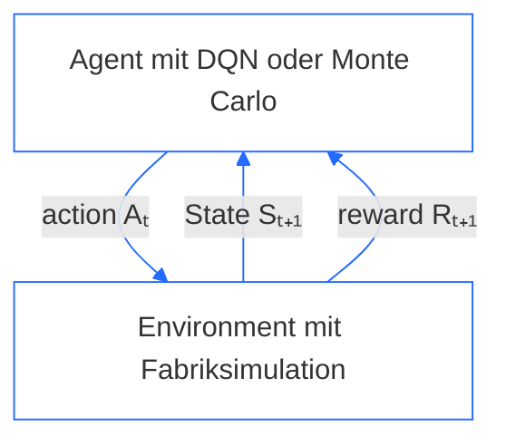

- **Agent:** Das Kandidatennetz berechnet die Q-Werte der angebotenen Aktionen.
  Zum Lernen kann [DQN](#neuronales-netz-und-dqn) oder
  [Monte Carlo](#monte-carlo-aus-vollständigen-episoden-lernen) verwendet werden.
  Beide Verfahren nutzen dieselben Eingabemerkmale und denselben Netzaufbau;
  sie unterscheiden sich darin, wie sie Lernziele berechnen und das Netz anpassen.
- **Environment:** `SpineRLEnv` implementiert die Gymnasium-Schnittstelle
  mit `reset()` und `step()`. Im Hintergrund simuliert Salabim die Fabrik.
  Gymnasium ist hier der Schnittstellenstandard, nicht der Fabriksimulator.
- **Action:** Der Agent übergibt die Nummer eines angebotenen Kandidaten.
  `RLCandidatePolicy` übernimmt diesen Index und stellt die ausgewählten
  Aktionen über die Bridge zur Ausführung bereit. Die möglichen Aktionen
  stammen vom `SpineActionGenerator`.
- **State (Beobachtung):** `RLObservationEncoder` übersetzt Zustandsdaten und
  angebotene Kandidaten in Zahlenfelder und Masken. Diese erhält das Netz
  als Eingabe, nicht die laufenden Salabim-Objekte.
- **Reward:** Solange die Episode weiterläuft, liefert `SpineRLEnv` die
  Belohnung `0`. Am Episodenende berechnet `RLReward` den Wert
  `1 / (1 + global_cost)` bei regulärem Abschluss oder `-1` bei einem Limitabbruch.
  Diese Belohnung wird zum Lernen verwendet; sie ist kein zusätzliches
  Eingabefeld der Beobachtung.

Wann das Netz angepasst wird, hängt vom gewählten Lernverfahren ab:
DQN lernt aus einzelnen gespeicherten Übergängen. Monte Carlo verwendet
vollständige Episoden, wartet dabei aber nicht auf alle Worker. Während der
zentrale Prozess trainiert, können andere Worker ihre Episoden weiter ausführen.
Die Regeln des Simulationskerns bleiben beim Lernen unverändert.

**Während einer Episode: Aktionen auswählen und ausführen**

1. Die [RL-Umgebung `SpineRLEnv`](sources/SpineML/Control/RLPolicy/Shared/SpineRLEnv.py)
   startet die Simulation. Sobald eine Auswahl aus mehreren Aktionen nötig ist,
   wartet sie auf die Entscheidung des Netzes.
2. Der [Encoder](#numerische-beobachtung-und-aktionsmaske) übersetzt die
   Zustandsdaten und angebotenen Aktionen in Zahlenfelder. Daraus berechnet
   das Netz seine Auswahl.
3. Steht die Auswahl für alle wartenden Objekte fest, gibt die Policy die
   Aktionen an die Bridge zurück. Die Simulationskomponenten führen sie aus.
   Bei den nächsten Auswahlpunkten entscheidet das Netz erneut.
4. Sind alle Jobprozesse beendet, werden die Produktionskennzahlen
   ausgewertet und in eine **Belohnung** umgerechnet. Ein günstigerer
   vollständiger Produktionslauf erhält eine höhere Belohnung.

Solange die Episode noch läuft, ist die Belohnung eines Entscheidungsschritts
`0`. Das bedeutet **nicht „schlechte Entscheidung“**, sondern: Für diesen
Schritt gibt es noch keine Abschlussbelohnung für den Produktionslauf.

**Beim Training: das Netz anhand gesammelter Daten verändern**

- **DQN:** Speichert Übergänge in einem **Replay Buffer**, also einem
  Erfahrungsspeicher, und verwendet sie mehrfach. Das Lernziel enthält bei
  laufender Episode eine Schätzung des [Zielnetzes](#neuronales-netz-und-dqn).
- **Monte Carlo:** Sammelt vollständige Episoden und berechnet daraus die
  tatsächlich beobachtete spätere Belohnung, den **Return**, für jede besuchte
  Entscheidung. Ein Episodenspeicher bewahrt diese Erfahrungen auf. Beim
  Wiederverwenden älterer Netzstände wird ihr Einfluss durch eine
  [Off-Policy-Korrektur](#monte-carlo-aus-vollständigen-episoden-lernen) angepasst.

Die Abschlussbelohnung entsteht bei beiden Verfahren erst am Episodenende.
Die Befehle und Einstellungen stehen unter [Training starten](#training-starten).

**Nach dem Training: das gespeicherte Netz einsetzen**

Die gespeicherte RL-Policy trifft weiter Aktionsentscheidungen, verändert
ihre Netzparameter dabei aber nicht mehr. Ob sie bessere Produktionsergebnisse
erzielt, wird mit dem [Vergleich auf getrennten Test-Seeds](#auf-getrennten-test-seeds-vergleichen)
geprüft.

### Was wählt die RL-Policy aus?

Das Netz erfindet keine Aktionen. Es wählt einen **Index**, also die Nummer
einer Aktion in der aktuell angebotenen Liste.

**Beispiel:** Ein Job hat Defektschweregrad `0.2`; eine Nacharbeit wurde noch
nicht gewählt. Seine [Defektmaschine ist verfügbar](#nacharbeitskandidaten),
eine Alternativroute fehlt. Der Generator bietet diese drei Aktionen an:

| Index für `step(index)` | Angebotene Aktion |
| --- | --- |
| `0` | `job_rework_on_defect_machine`: Nacharbeit auf der Defektmaschine. |
| `1` | `downgrade_product`: Produkt herabstufen. |
| `2` | `wait_job`: Zunächst warten. |

Mit `step(0)` wird in diesem Beispiel die Nacharbeit auf der Defektmaschine
gewählt. Bei der nächsten Entscheidung kann Index `0` eine andere Aktion
bezeichnen. Die [Aktionsmaske](#numerische-beobachtung-und-aktionsmaske)
kennzeichnet, welche Indizes gerade gewählt werden dürfen.

### Vom Bridge-Aufruf zur Kandidatenentscheidung

Die [Bridge](#simulationbridge) ruft `make_decision()` der
[`RLCandidatePolicy`](sources/SpineML/Control/RLPolicy/Shared/RLCandidatePolicy.py)
auf. Diese Policy verbindet den gemeinsamen Generator mit der RL-Auswahl:

1. **Wartende Objekte prüfen:** Die Policy liest die Zustandskopie, den
   Snapshot, und bearbeitet die Objekte in der gespeicherten Reihenfolge.
2. **Aktionen erzeugen:** Der `SpineActionGenerator` liefert die Kandidaten.
   Pick-Aktionen enthalten bereits die EDD-basierte `queue_priority`.
   Ein in diesem Aufruf bereits für eine Pick-Aktion reservierter Job wird
   nicht erneut zum Pick angeboten.
3. **Auswahl anfordern:** Bei nur einem Kandidaten ist keine Auswahl nötig.
   Bei mehreren wird ein `DecisionRequest` mit Zustand, Kandidaten und
   bisher gewählten Aktionen an die Auswahlfunktion übergeben. Diese Daten
   sind Kopien; ihre Veränderung ändert nicht die auszuführenden Aktionen.
4. **Gewählte Aktion vormerken:** Während des Trainings liefert das Netz
   seinen Index über `SpineRLEnv.step(index)`. Die Policy speichert die
   Auswahl und prüft das nächste wartende Objekt.
5. **Aktionen zustellen:** Erst wenn alle wartenden Objekte bearbeitet sind,
   gibt die Policy eine vollständige `PolicyDecision` an die Bridge zurück.
   Die Bridge stellt die Aktionen den Simulationskomponenten zu.

Deshalb bedeutet ein `step()` nicht immer, dass die Simulation schon Zeit
weitergelaufen ist: Zunächst können mehrere Objekte nacheinander eine Auswahl
benötigen. Bereits vorgemerkte Aktionen und reservierte Pick-Jobs sind in den
Netzeingaben berücksichtigt. Die vorgemerkten Aktionen stehen außerdem in
`info["pending_actions"]`.

Bei direkter Nutzung von `RLCandidatePolicy` kann `expose_forced_actions=True`
auch einzelne Kandidaten an die Auswahlfunktion melden. Die Trainingsumgebung
`SpineRLEnv` übernimmt einzelne Kandidaten dagegen automatisch.

### Numerische Beobachtung und Aktionsmaske

Das Netz erhält keine Salabim-Objekte. Der
[`RLObservationEncoder`](sources/SpineML/Control/RLPolicy/Shared/RLObservationEncoder.py)
übersetzt die Zustandsdaten und Kandidaten in Zahlenfelder fester Größe.
Eine Zeile beschreibt ein Objekt oder eine Aktion. Nicht benötigte Zeilen
werden mit Nullen aufgefüllt; das heißt **Padding**. Zusätzliche Felder, die
**Masken**, kennzeichnen die tatsächlich belegten Zeilen.

Für `A = max_actions` und `E = max_entities` enthält die Beobachtung:

| Feld | Form | Bedeutung |
| --- | --- | --- |
| `context` | `(24,)` | Zeit, aktuell entscheidendes Objekt und zusammengefasste Job-/Entscheidungsdaten. |
| `entities` | `(E, 49)` | Merkmale der Jobs, Roboter und Maschinen, einschließlich vorgemerkter Aktionen und Pick-Reservierungen. |
| `entity_mask` | `(E,)` | `1` für eine echte Objektzeile, `0` für Padding. |
| `candidates` | `(A, 58)` | Aktionsart, beteiligte IDs sowie Job-, Routen-, Maschinen-, Werkzeug- und Puffermerkmale je Kandidat. |
| `action_mask` | `(A,)` | `1` für einen aktuell angebotenen Kandidaten, `0` für Padding. |

Standardmäßig sind bis zu `256` Objekte und `256` Kandidaten vorgesehen.
Merkmale werden als `float32` im Bereich `[-1, 1]` gespeichert, Masken als
`int8` mit `0` oder `1`. Die Methode `action_masks()` liefert die Aktionsmaske
als `True`-/`False`-Werte: Nur `True`-Einträge dürfen gewählt werden.
Die technische Prüfung einer Aktion übernimmt der Generator, nicht die Maske.

Die Merkmale umfassen beispielsweise Termindruck, Produktdaten, konfigurierte
Operationsdauer, Maschinenbelegung, verwendete Defektwahrscheinlichkeit und
Werkzeugzustand. Ihre Reihenfolge ist in `CONTEXT_FEATURE_NAMES`,
`ENTITY_FEATURE_NAMES` und `CANDIDATE_FEATURE_NAMES` festgelegt. Objektzeilen
sind nach ID sortiert; Aktionen behalten die Reihenfolge der Kandidatenliste.

Beim ersten vollständigen Snapshot werden die IDs in sortierten Listen
gespeichert und Zahlenwerten größer als `0` zugeordnet. Diese Zuordnung bleibt
beim Neustart einer Episode erhalten. Eine fehlende ID wird als `0` dargestellt.
Sind mehr Objekte oder Kandidaten vorhanden als vorgesehen, bricht der Encoder
mit einem Fehler ab; er lässt keine Kandidaten stillschweigend weg.
Auch andere IDs oder ein geänderter Objektaufbau benötigen eine neue Umgebung
beziehungsweise einen neuen Encoder.

Die Netzeingaben enthalten nicht alle internen Simulations- und Qualitätsdaten.
Ob damit jede Entscheidung ausreichend beschrieben ist, muss noch untersucht
werden. Die zusätzlichen Angaben in `info`, etwa `candidates` und
`policy_observation`, helfen bei der Fehlersuche; sie werden nicht an das Netz
weitergegeben.

### Gymnasium-API und Reward

Die Bibliothek **Gymnasium** stellt die gemeinsame Schnittstelle bereit,
über die das Lernverfahren die Simulation startet und Aktionen übergibt.
`SpineRLEnv(model_file, global_evaluation, ...)` bildet die Simulation als
solche RL-Umgebung ab.

Vor dem Start benötigt die Umgebung eine `GlobalSimulationEvaluation` mit
festen positiven Referenzwerten aus
[vollständigen Standardheuristik-Läufen](#kalibrierung-seeds-und-gespeicherte-konfiguration).
[`RLReward`](sources/SpineML/Control/RLPolicy/Shared/RLReward.py) übernimmt eine Kopie
dieser Werte und der nichtnegativen globalen Zielgewichte. Diese
Bewertungsvorgaben bleiben während der Episode unverändert; sie werden nicht gelernt.

- **`reset(seed=...)`:** Beendet eine gegebenenfalls laufende Episode und
  startet eine neue Simulation. An ihrem ersten Auswahlpunkt gibt die Methode
  `(observation, info)` zurück: die Netzeingaben und zusätzliche Informationen.
- **`step(index)`:** Übernimmt den gewählten Listenindex. Bei der nächsten
  Auswahl oder am Episodenende liefert die Methode
  `(observation, reward, terminated, truncated, info)` zurück.
  `terminated=True` bedeutet regulären Abschluss, `truncated=True` einen
  Abbruch wegen eines Limits.
- **`info`:** Enthält Informationen für die Auswertung und Fehlersuche,
  etwa Kandidaten, aktuelles Objekt, Simulationszeit und vorgemerkte Aktionen.
  Am Ende kommen die Kennzahlen `metrics`, die Bewertungszahl `global_cost`
  und der Abschlussgrund `reward_reason` hinzu.

#### Reward und Episodenende

**Reward** bedeutet hier **Belohnung**: eine Zahl, mit der das Lernverfahren
eine Rückmeldung über das Produktionsergebnis erhält. Der aktuelle Code gibt
nicht jeder einzelnen Aktion eine eigene Belohnung:

- **Episode läuft weiter:** `reward = 0`.
- **Alle Jobprozesse sind beendet:** Die globale Bewertungszahl `global_cost`
  wird in `reward = 1 / (1 + global_cost)` umgerechnet. Die Kennzahlen,
  Referenzen und globalen Zielgewichte sind dieselben wie bei der
  [heuristischen Optimierung](#globale-bewertungszahl).
- **Abbruch wegen eines Limits:** `reward = -1`.

Bei der globalen Bewertungszahl ist kleiner besser, bei der Belohnung größer.
Beispielsweise ergeben Kosten von `3` die Belohnung `1 / 4 = 0.25`, Kosten
von `1` dagegen `1 / 2 = 0.5`. Das günstigere vollständige Ergebnis erhält
also die höhere Belohnung. Ein regulär beendeter Lauf kann auch Ausschuss
oder herabgestufte Jobs enthalten; diese gehen in seine globale Bewertung ein.

| Ende | Rückgabe und Beobachtung |
| --- | --- |
| Alle Jobprozesse beendet | `terminated=True`, `truncated=False`; alle Zahlenfelder und Masken der Beobachtung sind mit `0` gefüllt. |
| Entscheidungsgrenze: Nach `max_decisions` beantworteten Auswahlen wird eine weitere Auswahl nötig | `truncated=True`; die Beobachtung dieser unbeantworteten Auswahl bleibt erhalten. Noch nicht zugestellte Aktionen des aktuellen Bridge-Aufrufs werden verworfen (`pending_batch_discarded=True`). |
| Zeitgrenze `max_simulation_time` erreicht, Jobs noch nicht fertig | `truncated=True`; globale Zustandsmerkmale bleiben erhalten, jedoch ohne aktuell entscheidendes Objekt. Kandidatenfeld und Aktionsmaske sind mit `0` gefüllt. |

Die Tabelle beschreibt die direkte Umgebung und ihre Auswertung. Nach einem
Abbruch darf kein weiterer `step()` ausgeführt werden, auch wenn noch Kandidaten
in der letzten Beobachtung stehen. Andere Lernverfahren könnten diesen Zustand
verwenden, um eine mögliche spätere Belohnung zu schätzen. Das heißt
**Value-Bootstrapping**; die abgebrochene Episode wird damit nicht fortgesetzt.

Für das DQN- und Monte-Carlo-Training gelten beide Limits als endgültiger Fehlschlag.
Die Zusatzklasse `EpisodeSeedWrapper` in
[`TrainingSupport.py`](sources/SpineML/Control/RLPolicy/Shared/TrainingSupport.py)
meldet sie deshalb an Stable-Baselines3 (SB3) als `terminated=True` und
`truncated=False`. `info["training_limit_terminated"]` und der Abbruchgrund
halten fest, dass tatsächlich ein Limit erreicht wurde. So rechnet SB3 zur
Strafe `-1` keine geschätzte spätere Belohnung hinzu.

Ein Timeout oder ein Simulationsfehler wird dagegen als Ausnahme gemeldet.
Es handelt sich dabei nicht um einen der regulären Limitabbrüche aus der Tabelle.

### Neuronales Netz und DQN

**DQN** bedeutet **Deep Q-Network**: Ein neuronales Netz lernt Q-Werte für
die angebotenen Aktionen. Ein höherer Q-Wert bedeutet eine höhere erwartete
spätere Belohnung, nicht eine höhere Auswahlwahrscheinlichkeit.

Der gemeinsame Netzaufbau für DQN und Monte Carlo steht in
[`CandidateQNetwork.py`](sources/SpineML/Control/RLPolicy/Shared/CandidateQNetwork.py).
`CandidateFeaturesExtractor` verarbeitet Kontext, Objektzeilen und
Kandidatenmerkmale. `CandidateQNetwork` bewertet jeden Kandidaten mit demselben Teilnetz.
Die Netzparameter gehören damit nicht fest zu einer bestimmten Indexnummer.
Padding-Zeilen zählen nicht mit. `embedding_dim=32` und `hidden_dim=64`
bestimmen die Breite der internen Netzschichten.

[`CandidateDQNPolicy`](sources/SpineML/Control/RLPolicy/DQN/CandidateDQNPolicy.py)
erstellt daraus die beiden Q-Netze für DQN:

- **Online-Q-Netz:** Berechnet die aktuellen Q-Werte und wird anhand der
  Erfahrungen im Replay Buffer angepasst.
- **Ziel-Q-Netz:** Liefert die Schätzung für den Folgezustand. Seine Parameter
  werden in größeren Abständen aus dem Online-Netz übernommen. So bleibt
  das Lernziel zwischen diesen Übernahmen stabiler.

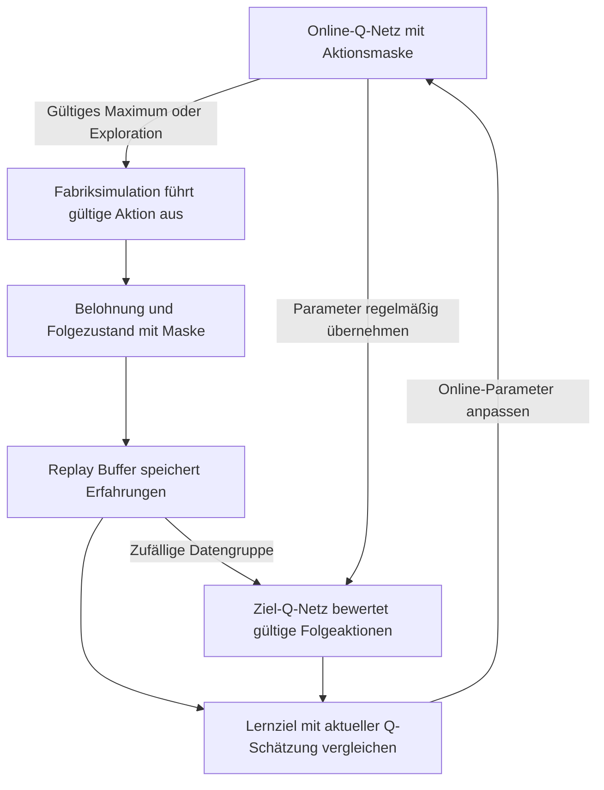

Für einen nicht beendeten Übergang lautet das Lernziel vereinfacht
`reward + gamma × max(Q_Ziel(Folgezustand, gültige Folgeaktion))`.
Bei einem regulären Abschluss oder einem endgültigen Limitfehlschlag ist
das Lernziel nur die erhaltene Belohnung. Es wird dann kein Folgewert addiert.
Im vorhandenen Training ist `gamma=1.0`; zusätzliche Entscheidungsschritte
schwächen die spätere Belohnung also nicht ab.

Damit das Netz nicht nur seine bisher beste Aktion wiederholt, verwendet
DQN **Epsilon-Greedy**: Mit Wahrscheinlichkeit `epsilon` wird ein gültiger
Kandidat zufällig gewählt, sonst der gültige Kandidat mit dem höchsten Q-Wert.
Zu Beginn werden auch während der Aufwärmphase ausschließlich gültige
Kandidaten zufällig gewählt. Die Maske gilt ebenso bei der normalen Auswahl
und beim Maximum des Zielnetzes. Aufgefüllte Kandidatenplätze können daher
weder ausgeführt werden noch das Lernziel erhöhen.

[`CandidateDQN`](sources/SpineML/Control/RLPolicy/DQN/CandidateDQN.py) erweitert
dafür DQN aus Stable-Baselines3. Es gibt keinen Actor und keine
gelernten Auswahlwahrscheinlichkeiten. Das globale Produktionsziel, die
Belohnungsformel und die Regeln der Simulation bleiben unverändert.

### Monte Carlo: aus vollständigen Episoden lernen

[`CandidateMonteCarlo`](sources/SpineML/Control/RLPolicy/MonteCarlo/CandidateMonteCarlo.py)
trainiert ein einzelnes Kandidaten-Q-Netz mit **asynchron gesammelten Episoden
und einem Replay Buffer**. Anders als DQN verwendet es
**kein Zielnetz und keine geschätzten Q-Werte des nächsten Zustands als Lernziel**.

Die Worker-Ausführung steht in
[`AsyncEpisodeRunner.py`](sources/SpineML/Control/RLPolicy/MonteCarlo/AsyncEpisodeRunner.py):

1. **Episode starten:** Jeder Worker übernimmt den neuesten fertig trainierten
   Netzstand und dessen Explorationswert `epsilon`. Diese beiden Werte bleiben
   während seiner Episode unverändert.
2. **Ergebnis abgeben und sofort neu starten:** Nach dem Episodenende übergibt
   der Worker seinen Verlauf und fragt erneut den neuesten Netzstand ab.
   Ist noch keine neue Version verfügbar, verwendet er die bisherige. Er wartet
   nicht darauf, dass andere Worker ihre Episoden beenden. Eine neue Episode
   startet nur, solange vom festgelegten Episodenbudget noch eine übrig ist.
3. **Fertige Episoden speichern:**
   [`EpisodeReplayBuffer.py`](sources/SpineML/Control/RLPolicy/MonteCarlo/EpisodeReplayBuffer.py)
   speichert Zustände, gewählte Aktionen, Belohnungen, damalige
   Auswahlwahrscheinlichkeiten und die Netzversion. Nur vollständige Verläufe
   gehen in den Replay Buffer ein, einschließlich regulärer Limitabbrüche mit
   Endbelohnung `-1`.
4. **Zentral trainieren:** Nach `--mc-train-every-episodes` neu eingetroffenen
   Episoden werden bis zu `--mc-replay-sample-episodes` gespeicherte Episoden
   ausgewählt. Das zentrale Netz wird damit `--epochs`-mal trainiert. Die
   Worker können währenddessen mit ihren festen lokalen Netzkopien weitersimulieren.
5. **Neuen Netzstand bereitstellen:** Nach der Lernphase wird die neue Version
   veröffentlicht. Sie gilt für danach gestartete Episoden, nicht rückwirkend
   für bereits laufende Simulationen.

Es gibt keine gemeinsame Episodenbarriere. Ein voller Übergabepuffer kann
Worker vorübergehend bremsen, damit nicht unbegrenzt große Verläufe im
Arbeitsspeicher warten. Die Zahl gleichzeitig laufender Worker und die Zeit
zum Lernen bestimmen gemeinsam den tatsächlichen Durchsatz.

**Returns berechnen:** Für jede besuchte Entscheidung werden die tatsächlich
beobachteten Belohnungen bis zum Episodenende zusammengefasst. Im Trainingsskript
gilt `gamma=1.0`. Da nur am Ende eine Belohnung entsteht, ist der Return entlang
einer Episode gleich ihrer Endbelohnung.

**Beispiel:** Eine Episode enthält `S1 → Nacharbeit → S2 → Transport → Ende`.
Die Zwischenbelohnungen sind `0`, die Endbelohnung ist `0.8`. Dann lautet
der Lernzielwert sowohl für die besuchte Entscheidung `S1, Nacharbeit`
als auch für `S2, Transport` jeweils `0.8`. Die Zwischenbelohnungen bleiben
trotzdem `0`; der Return ist das Ergebnis des weiteren Episodenverlaufs,
nicht eine eigene unmittelbare Belohnung der Aktion.

Auch Monte Carlo wählt nur gültige Kandidaten: mit Wahrscheinlichkeit
`epsilon` zufällig, sonst den Kandidaten mit dem höchsten Q-Wert. Für dieses
Off-Policy-Training müssen Anfangs- und Endwert von `epsilon` positiv sein:
Jeder gültige Kandidat benötigt eine mögliche Auswahlchance.

**Ältere Episoden wiederverwenden:** Ein alter Return beschreibt den Verlauf
der damaligen Policy. Er wird nicht einfach als unveränderte Aussage über die
neueste Policy behandelt. Vor jeder Lernphase berechnet der Trainer für die
gespeicherten Aktionen deren Auswahlwahrscheinlichkeiten unter dem aktuellen,
für diese Lernphase festgehaltenen Netzstand. Für `Q(Zustand, Aktion)` wird
das Verhältnis der neuen zur damaligen Wahrscheinlichkeit über die
**nachfolgenden Aktionen** multipliziert; die bereits fest vorgegebene Aktion
dieses Q-Werts wird nicht noch einmal gewichtet.

Diese [Importance-Sampling-Gewichte](https://hankyang.seas.harvard.edu/OptimalControlReinforcementLearning/value-rl.html#off-policy-control) werden logarithmisch berechnet und über
die ausgewählten Trainingsdaten normiert. Trainiert wird ein gewichteter
quadratischer Fehler:

`Fehler = Summe(normiertes Gewicht × (Q-Schätzung − Return)²)`

Die Targets bleiben tatsächliche vollständige Returns; es wird kein nächster
Q-Wert hinzugefügt. Die Normierung vermeidet numerischen Überlauf, beseitigt
aber nicht die möglichen starken Gewichtsunterschiede langer Episoden.
Bei endlich vielen Daten ist diese selbstnormalisierte Regression nicht
unverzerrt. Eine bessere oder stabilere Steuerung ist dadurch nicht garantiert.
`last_importance_ess` zeigt, wie viele gleich stark gewichtete Beispiele dem
jeweiligen Gewichtsprofil ungefähr entsprechen; ein kleiner Wert weist auf
wenige dominierende Beispiele hin.
Die Entscheidungen innerhalb einer Episode sind dabei nicht unabhängig;
dieser Kennwert misst die Gewichtskonzentration, nicht die Zahl unabhängiger Episoden.

Der Episodenspeicher ist durch Episodenzahl und Übergangszahl begrenzt.
Alte Episoden werden als ganze Verläufe entfernt. Überschreitet eine einzelne
Episode das Übergangslimit, bleibt sie allein vollständig erhalten, statt nur
einen unvollständigen Rest zum Lernen zu verwenden.

Die Dateien `RLObservationEncoder`, `RLReward` und `SpineRLEnv` werden von
beiden Lernverfahren verwendet.

Die direkten Lernziele machen Monte Carlo für die reine Endbelohnung zu
einer Vergleichsmöglichkeit. Ob es mit demselben Simulationsbudget bessere
Produktionsergebnisse lernt als DQN, muss der Test zeigen.

### Kalibrierung, Seeds und gespeicherte Konfiguration

Vor dem Training führt
[`TrainingSupport.calibrate_references()`](sources/SpineML/Control/RLPolicy/Shared/TrainingSupport.py)
vollständige Simulationsläufe mit der Standardheuristik aus. Diese Läufe bilden
die **Baseline**, also die Vergleichsbasis. Für Makespan, Gesamtverspätung,
Transportzeit und Werkzeugwechselzeit wird jeweils der Mittelwert berechnet.
Diese Werte bleiben anschließend die festen Referenzen der globalen Bewertung.

Dieser Vorbereitungsschritt heißt hier **Kalibrierung**. Er trainiert noch
kein Netz; seine Rechenzeit wird getrennt erfasst. Ist ein Referenzwert null,
bricht die Vorbereitung mit einem Fehler ab, weil die spätere Bewertung
diesen Wert als Divisor benötigt.

Die globalen Zielgewichte und die voreingestellten Baseline- und Test-Seeds
stammen aus der Optimierungsanwendung. Ein [Seed](#seed-und-reproduzierbarkeit)
bestimmt die reproduzierbaren Zufallsfolgen eines Simulationslaufs:

- **Baseline:** standardmäßig `SEEDS = [1, 2]`; änderbar über
  `--baseline-seeds`.
- **Training:** Seeds `1` bis `10`, änderbar über `--train-seeds`. Jeder
  Simulationsprozess durchläuft diese Liste wiederholt, beginnt aber an einer
  anderen Stelle. Der separate Parameter `--seed` (Standard `0`) steuert
  die Anfangsparameter des Netzes und die Zufallsentscheidungen des Lernverfahrens.
- **Abschließender Test:** `TEST_SEEDS = [101, 102, 103, 104, 105]`, änderbar
  über `--evaluation-seeds`. Diese Seeds dürfen weder im Training noch in
  der Baseline verwendet werden. Baseline und Training dürfen dagegen
  dieselben Seeds enthalten. Innerhalb einer Liste sind keine Duplikate erlaubt.

Bei asynchronem Monte Carlo bestimmen zusätzlich Betriebssystem und Laufzeiten,
in welcher Reihenfolge Episoden eintreffen und neue Netzversionen übernommen
werden. Gleiche Seeds allein garantieren deshalb keinen bitgenau identischen
Trainingsverlauf. Die Auswertung eines fest gespeicherten Netzes ist davon
zu unterscheiden: Dabei wird nicht weitertrainiert.

Das Training speichert im Ausgabeordner:

| Datei | Inhalt |
| --- | --- |
| `manifest.json` | Trainingseinstellungen, Netzaufbau, Paketversionen, Seed-Listen, Baseline-Ergebnisse sowie verwendetes Fabrikmodell und globale Bewertungsvorgaben. |
| `model.zip` | Gespeicherter Netzstand und Einstellungen des gewählten Lernverfahrens nach dem Training oder einer Unterbrechung mit `Strg+C`. |
| `checkpoint_*.zip` | DQN-Zwischenstände nach standardmäßig `10000` weiteren Entscheidungen, zum Beispiel `checkpoint_10000.zip`. |
| `checkpoint_episodes_*.zip` | Monte-Carlo-Zwischenstände nach standardmäßig `10` weiteren Episoden, zum Beispiel `checkpoint_episodes_10.zip`. `--checkpoint-every` ändert bei beiden Verfahren den Abstand. |
| `replay_buffer.pkl` | Optionaler Erfahrungsspeicher am Trainingsende, nur mit `--save-replay-buffer`: Übergänge bei DQN, vollständige Episoden bei Monte Carlo. |
| `episodes.jsonl` | Pro beendeter Episode: Seed, Belohnung, Kosten, Kennzahlen, Entscheidungszahl und Abschluss- oder Abbruchstatus; bei Monte Carlo zusätzlich Netzversion und Worker. Die Datei entsteht beim ersten Episodenende. |
| `progress.csv` | Protokoll der Trainingswerte des gewählten Lernverfahrens. |
| `training_report.json` | Status, Umfang und Rechenzeiten. Das angeforderte Budget steht bei DQN unter `requested_timesteps`, bei Monte Carlo unter `requested_episodes`. `actual_timesteps` zählt bei beiden die gesammelten Entscheidungen. |

**Fabrikmodell und Netz unterscheiden:** Das Fabrikmodell ist die Python-Datei
mit Layout und Produktionsaufträgen. `model.zip` enthält dagegen den gelernten
Netzstand. `manifest.json` verbindet beides: Die Datei speichert den Pfad und
eine SHA-256-Prüfsumme der Fabrikdatei sowie Eingabemerkmale, Objekt- und
Aktionsarten, Zielgewichte, Referenzen und Umgebungsgrenzen. Die Prüfsumme
erkennt, ob sich die Fabrikdatei verändert hat.

Beim Laden werden diese Angaben und die Größen der Zahlenfelder geprüft.
Es gelten die gespeicherten Bewertungsvorgaben, nicht nachträglich geänderte
App-Einstellungen. `--model` erlaubt eine identische Dateikopie an einem
anderen Speicherort, aber kein anderes Fabrikmodell.

Manifestversion und Algorithmus müssen zum gespeicherten Netzstand passen.
Der Loader wählt anhand des Manifests DQN oder Monte Carlo. Alte
PPO-Netzstände sind nicht kompatibel und werden mit einer Fehlermeldung
abgewiesen. Vorhandene Dateien werden weder umgewandelt noch gelöscht;
für jeden Trainingslauf ist ein neuer, leerer Ausgabeordner zu verwenden.

Nur eigene oder vertrauenswürdige Netzstände laden: SB3-Dateien enthalten
Python-Objekte und sind nicht als unbedenkliche Datendateien zu behandeln.
Das gilt ebenso für die optionale Replay-Datei. `model.zip` enthält nicht den
großen Erfahrungsspeicher. Ein CLI-Befehl zum Fortsetzen eines Trainings mit
gespeichertem Replay Buffer ist noch nicht vorhanden.

### Training starten

Für das Training werden zusätzlich Gymnasium, PyTorch und Stable-Baselines3
benötigt. Die optionale Paketgruppe `rl-training`
installiert diese Bibliotheken:

```console
.\.venv\Scripts\python.exe -m pip install -e ".[rl-training]"
```

**DQN trainieren:**

```console
.\.venv\Scripts\python.exe sources/tools/train_rl_policy.py --algorithm dqn --output rl_runs/dqn --steps 100000 --workers 4
```

**Monte Carlo trainieren:**

```console
.\.venv\Scripts\python.exe sources/tools/train_rl_policy.py --algorithm monte-carlo --output rl_runs/monte_carlo --episodes 100 --workers 4 --epochs 4
```

Ohne `--model` verwendet
[`train_rl_policy.py`](sources/tools/train_rl_policy.py) die unter `EXAMPLE_FILE`
eingestellte Fabrikdatei, derzeit [example-5.py](sources/examples/normal/example-5.py).
`--algorithm` wählt das Lernverfahren; ohne Angabe gilt `dqn`.
`--output` bestimmt den Ausgabeordner; ohne Angabe gilt je nach Verfahren
`rl_runs/dqn` oder `rl_runs/monte_carlo`. Der Ordner muss neu oder leer sein,
damit kein vorhandenes Netz überschrieben wird. `--help` zeigt die verfügbaren Optionen,
ohne eine Simulation oder ein Training zu starten.
Optionen des anderen Lernverfahrens werden mit einer Fehlermeldung abgewiesen:
`--steps` gehört zu DQN, `--episodes` zu Monte Carlo.

**Wer simuliert, wer lernt?** Der Trainer startet `--workers` getrennte
Simulationsprozesse. Jeder Worker führt seine eigene Simulation aus. Das
gemeinsam trainierte Netz und das Lernverfahren liegen im übergeordneten
Trainingsprozess. Bei DQN berechnet dieser auch die Aktionsauswahl für die Worker.
Bei Monte Carlo entscheidet jeder Worker mit seiner lokalen, während einer
Episode unveränderten Netzkopie und liefert danach den vollständigen Verlauf.

**DQN: Wann wird das Netz verändert?** Zunächst sammelt DQN Erfahrungen, ohne das
Netz anzupassen (`--learning-starts`). Danach wechseln sich Sammeln und Lernen
ab: `--train-freq` bestimmt die Anzahl gemeinsamer Worker-Schritte je
Sammelphase. Anschließend werden `--gradient-steps` Netzanpassungen ausgeführt.
Jede verwendet eine zufällige Datengruppe mit `--batch-size` Einträgen aus
dem Replay Buffer. Ältere Erfahrungen können erneut ausgewählt werden.

Eine Sammelphase ist kein vollständiger Simulationslauf. Sie kann mitten in
einer Episode enden oder mehrere Episoden berühren. Beim Training zählen nur
Auswahlpunkte mit mehreren Kandidaten als externe Entscheidungen;
automatisch übernommene Einzelkandidaten zählen nicht mit.

**Monte Carlo: Wann wird das Netz verändert?** Nach jeweils
`--mc-train-every-episodes` neu eingetroffenen Episoden, ohne auf die übrigen
Worker zu warten. Bis zu `--mc-replay-sample-episodes` ganze Episoden aus dem
Speicher werden mit korrigierten Gewichten `--epochs`-mal zum Lernen verwendet.
Die übrigen Worker laufen währenddessen weiter. Sind am regulären Trainingsende
weniger neue Episoden übrig, lösen sie trotzdem eine letzte Lernphase aus dem Replay Buffer aus. Den Ablauf erklärt
[Monte Carlo: aus vollständigen Episoden lernen](#monte-carlo-aus-vollständigen-episoden-lernen).

**Monte Carlo: Wie viele Simulationen werden ausgeführt?** Bei regulär beendetem
Training führt `--episodes 100` genau `100` Trainingsepisoden aus, verteilt auf die Worker. Jede gestartete
Episode läuft bis zum regulären Ende oder einem eingestellten Sicherheitslimit.
Alle Ergebnisse werden abgeholt; es werden keine zusätzlichen Episoden gestartet.
Eine am Sicherheitslimit beendete Episode zählt ebenfalls zum Budget und erhält
die Endbelohnung `-1`. Bei einem Fehler oder `Strg+C` kann das Training vorher enden.
Die Baseline-Läufe zählen nicht zu diesen `100` Trainingsepisoden.
Die Zahl der Entscheidungen je Episode darf unterschiedlich sein und wird nur
zusätzlich protokolliert. Sie bestimmt nicht das Monte-Carlo-Trainingsbudget.

| Einstellung | Standard | Bedeutung |
| --- | --- | --- |
| `--algorithm` | `dqn` | `dqn` oder `monte-carlo` als Lernverfahren verwenden. |
| `--steps` | `100000` | Nur DQN: mindestens so viele externe Kandidatenauswahlen insgesamt sammeln. |
| `--episodes` | `100` | Nur Monte Carlo: genau so viele vollständige Trainingsepisoden ausführen und auswerten. |
| `--workers` | höchstens `4`, begrenzt durch `os.cpu_count()` | Anzahl getrennter Simulationsprozesse; bei Monte Carlo höchstens so viele wie das Episodenbudget. |
| `--buffer-size` | `5000` | Nur DQN: Maximale Kapazität des Replay Buffers insgesamt über alle Worker, auf ein Vielfaches der Workerzahl abgerundet. Alte Einträge werden bei voller Kapazität überschrieben. |
| `--learning-starts` | `1000` | Nur DQN: Zunächst so viele externe Entscheidungen ohne Netzanpassung sammeln. |
| `--train-freq` | `4` | Nur DQN: Gemeinsame Worker-Schritte je Sammelphase. Bei vier Workern entstehen dabei `4 × 4 = 16` neue Übergänge. |
| `--gradient-steps` | `4` | Nur DQN: Netzanpassungen nach einer Sammelphase. |
| `--epochs` | `4` | Nur Monte Carlo: Trainingsdurchgänge über die ausgewählten Replay-Episoden. |
| `--mc-replay-episodes` | `8` | Nur Monte Carlo: maximale Zahl vollständig gespeicherter Episoden. |
| `--mc-replay-transitions` | `10000` | Nur Monte Carlo: zusätzliches Übergangslimit des Episodenspeichers; eine einzelne größere Episode wird allein vollständig behalten. |
| `--mc-train-every-episodes` | `4` | Nur Monte Carlo: nach so vielen neu eingetroffenen Episoden lernen. |
| `--mc-replay-sample-episodes` | `4` | Nur Monte Carlo: höchstens so viele ganze Episoden je Lernphase auswählen. |
| `--batch-size` | `64` | DQN: zufällige Übergänge pro Netzanpassung. Monte Carlo: höchstens so viele Entscheidungen je Datengruppe aus den ausgewählten Episoden. |
| `--learning-rate` | `0.0001` | Schrittweite bei der Anpassung der Netzparameter. |
| `--target-update-interval` | `1000` | Nur DQN: Ungefährer Abstand für die Übernahme ins Zielnetz, gezählt in externen Entscheidungen insgesamt. |
| `--exploration-fraction` | `0.3` | Anteil des geplanten Trainings, über den `epsilon` linear sinkt: bei DQN nach Entscheidungen, bei Monte Carlo nach eingetroffenen Episoden. |
| `--exploration-initial-eps` / `--exploration-final-eps` | `1.0` / `0.05` | Anfangs- und Endwahrscheinlichkeit einer zufälligen gültigen Auswahl; bei Monte Carlo müssen beide positiv sein. |
| `gamma` | `1.0` | Spätere Belohnung nicht abschwächen. Für beide Verfahren im Trainingsskript festgelegt. |
| `tau` | `1.0` | Nur DQN: vollständige Parameterübernahme ins Zielnetz. Im Trainingsskript festgelegt. |
| `--max-decisions` / `--max-simulation-time` | `10000` / `10000.0` | Höchstens so viele externe Auswahlen beziehungsweise simulierte Stunden je Trainingsepisode. |
| `--max-actions` / `--max-entities` | `256` / `256` | Feste Zeilenkapazitäten für Kandidaten und Objekte. |
| `--device` | `cpu` | Rechengerät des zentralen Netzes und seiner Anpassung. Salabim und die lokalen Monte-Carlo-Netzkopien bleiben auf der CPU. |
| `--save-replay-buffer` | aus | Erfahrungsspeicher zusätzlich am Trainingsende speichern. Das Skript bietet noch keinen Befehl zum Fortsetzen eines Trainings. |
| `--checkpoint-every` | DQN: `10000`; Monte Carlo: `10` | Abstand gespeicherter Zwischenstände: bei DQN in Entscheidungen, bei Monte Carlo in Episoden. |

**DQN-Beispiel mit vier Workern:** Eine Sammelphase liefert `4 × 4 = 16`
neue Übergänge. Nach der Aufwärmphase folgen vier Netzanpassungen mit jeweils
64 zufällig gezogenen Übergängen aus dem Speicher. Das Zielnetz übernimmt
standardmäßig nach ungefähr 1000 externen Entscheidungen die Online-Parameter.
Bei mehreren Workern erfolgt die Übernahme an einem gemeinsamen Worker-Schritt.

Bei DQN liefern mehr Worker bei unverändertem `--train-freq` mehr neue Erfahrungen,
erhöhen aber nicht automatisch `--gradient-steps`. Jeder Worker benötigt
Speicher für sein eigenes Layout, Szenario und seine Simulation, nicht für
ein eigenes trainierendes Netz. Zusätzlich benötigt der zentrale Replay
Buffer Platz für die aktuellen und nächsten Beobachtungen. Wegen der festen
Objekt- und Kandidatenfelder kann dieser Speicher groß werden. Kleinere
Minibatches verkleinern den gesamten Replay Buffer nicht. Mehr Worker
garantieren deshalb keine kürzere Laufzeit.

Monte Carlo speichert vollständige Episoden mit Beobachtungen, Aktionen,
Belohnungen, Auswahlwahrscheinlichkeiten und Netzversionen. Zusätzlich besitzen
laufende Worker eigene Verläufe und lokale Netzkopien. Dieser Speicher kann bei
langen Episoden und vielen Workern groß werden. Episoden- und Übergangslimit
begrenzen den Replay Buffer; sie begrenzen nicht automatisch alle gleichzeitig
laufenden Simulationen oder deren Übergabepuffer. Mehr Worker garantieren auch
hier keine kürzere Trainingszeit. Für den Rechner mit 20 logischen Prozessoren
kann `--workers 20` geprüft werden; der zentrale Lernprozess benötigt ebenfalls
CPU-Zeit und Arbeitsspeicher.

Salabim läuft immer auf der CPU. `--device cuda` oder `auto` kann nur die
Netzberechnung und die Netzanpassungen auf eine passende GPU verlagern.
`cuda` ohne verfügbare CUDA-GPU führt zu einem Fehler. Für das vorhandene
kleine Netz ist `cpu` voreingestellt.

### Auf getrennten Test-Seeds vergleichen

```console
.\.venv\Scripts\python.exe sources/tools/evaluate_rl_policy.py --run-dir rl_runs/dqn
.\.venv\Scripts\python.exe sources/tools/evaluate_rl_policy.py --run-dir rl_runs/monte_carlo
```

[`evaluate_rl_policy.py`](sources/tools/evaluate_rl_policy.py) lädt den
gespeicherten Netzstand aus `model.zip` und die Einstellungen aus `manifest.json`.
Das Manifest bestimmt, ob DQN oder Monte Carlo geladen wird. Jeder Befehl
vergleicht den angegebenen Netzstand mit `RandomPolicy` und Standardheuristik.
Alle verwenden dieselben reservierten Test-Seeds und dieselbe globale Bewertung.
Der Bericht bezeichnet das geladene Netz als `RL (DQN)` oder `RL (Monte Carlo)`.
Die Netzparameter
werden dabei nicht weiter verändert.

- **Standardauswahl:** Die RL-Policy nimmt den gültigen Kandidaten mit der
  höchsten Q-Schätzung. Diese Auswahl ist deterministisch.
- **`--explore`:** Verwendet Epsilon-Greedy mit dem im Netzstand gespeicherten
  `epsilon`. `--stochastic` bleibt als Alias verfügbar. Auch eine zufällige
  Auswahl berücksichtigt die Aktionsmaske.
- **`--skip-comparisons`:** Führt nur die RL-Policy aus.
- **`--seeds`:** Wählt andere Test-Seeds. Sie dürfen weder im Training noch
  in der Baseline verwendet worden sein.

Alle Steuerungen verwenden das gespeicherte Simulationszeitlimit.
Für die RL-Policy gilt zusätzlich ihr gespeichertes Entscheidungslimit.

Die Ergebnisdatei `evaluation.json` enthält Kennzahlen, globale Kosten,
Abschluss- oder Abbruchstatus und die reale Rechenzeit jedes Laufs. Ein
Mittelwert wird für eine Policy nur ausgegeben, wenn alle angeforderten
Testläufe abgeschlossen sind. Sonst steht dort `null`, also kein gültiger
Mittelwert. So wird ein unfertiger Lauf nicht als scheinbar gutes Ergebnis gewertet.
Bei Fehlern wird der bis dahin erfasste Teilbericht gespeichert.

`--checkpoint checkpoint_10000.zip` lädt einen DQN-Zwischenstand statt `model.zip`.
Bei Monte Carlo heißt ein solcher Zwischenstand beispielsweise
`checkpoint_episodes_10.zip`.
`--output` bestimmt den Berichtspfad. Mit `--optimized-weights gewichte.json`
kommt eine vierte Steuerung hinzu: die Heuristik mit einem optimierten lokalen
Gewichtssatz. Die JSON-Datei darf direkt ein `HeuristicWeights`-Dictionary
enthalten oder die Felder `best_weights` beziehungsweise
`optimization_result.best_weights` verwenden. Aus Zeitvergleichsberichten mit
verschachtelten `measurements` müssen die Gewichte vorher separat exportiert werden.

Erst die vollständigen Testläufe zeigen, wie die trainierte Steuerung abschneidet.
Ein gespeicherter Zwischenstand oder ein kurzer Trainingsprobelauf allein
belegt keine Verbesserung.

### Trainiertes Netz im normalen Runner einsetzen

[TrainedCandidatePolicy](sources/SpineML/Control/RLPolicy/Shared/TrainedPolicy.py)
verbindet das gespeicherte Netz mit derselben `make_decision()`-Schnittstelle
wie die anderen Steuerungen. Deshalb kann der normale `SimulationRunner`
die RL-Policy direkt verwenden. Eine eigene Schleife mit `reset()` und
`step()` muss dafür nicht geschrieben werden:

```python
from SpineML.Control.RLPolicy.Shared.TrainedPolicy import TrainedCandidatePolicy
from SpineML.SimulationExecution.ModelLoader import load_layout_and_scenario
from SpineML.SimulationExecution.SimulationRunner import SimulationRunner

policy = TrainedCandidatePolicy("rl_runs/dqn")
layout, scenario = load_layout_and_scenario(policy.model_path)
runner = SimulationRunner(
    layout, scenario,
    till=policy.artifact_context["environment"]["max_simulation_time"],
)
metrics = runner.run_policy(policy, seed=101)
```

Für ein Monte-Carlo-Netz wird stattdessen
`TrainedCandidatePolicy("rl_runs/monte_carlo")` verwendet. Die weitere
Ausführung bleibt gleich.

Für die Simulation wird die unter `policy.model_path` gespeicherte Fabrikdatei
geladen. Mit `model_file=...` darf eine identische Kopie an einem anderen Ort
angegeben werden. Standardmäßig erfolgt die Netzauswahl deterministisch auf
der CPU und nimmt den gültigen Kandidaten mit dem höchsten Q-Wert. Mit
`deterministic=False, seed=101` wird stattdessen Epsilon-Greedy mit dem im
Netzstand gespeicherten Explorationswert verwendet. Die Policy isoliert ihre
Zufallszustände von den Python-, NumPy- und PyTorch-Zufallsfolgen der Simulation.
Einzelne Kandidaten werden ohne Netzauswahl übernommen.

Für mehrere Läufe erstellt
[`TrainedPolicyFactory`](sources/SpineML/Control/RLPolicy/Shared/TrainedPolicy.py)
jeweils eine neue Policy-Instanz: zunächst
`factory = TrainedPolicyFactory("rl_runs/dqn")`, dann `factory(seed)` pro Lauf.
Diese Factory kann auch in einem `SimulationRunRequest` an den Prozesspool
übergeben werden. Der Pool muss dieselbe gespeicherte Fabrikdatei verwenden.

Auch bei diesem Einsatz überwacht die RL-Policy ihre gespeicherten Zeit- und
Entscheidungsgrenzen. Wird ein Limit erreicht oder bleiben Jobs unfertig,
wird ein Fehler gemeldet. Ein solcher Lauf gilt nicht als gültiges
Optimierungsergebnis.

<a id="optionale-installation-und-cli-test"></a>

### Umgebung ohne Training prüfen

Die RL-Umgebung kann auch ohne neuronales Netz geprüft werden. Dafür reicht
die optionale Paketgruppe `rl`; PyTorch und die Lernverfahren werden nicht benötigt.
Der folgende Befehl startet einen solchen Prüflauf und trainiert oder lädt
kein Netz:

```console
.\.venv\Scripts\python.exe -m pip install -e ".[rl]"
.\.venv\Scripts\python.exe sources/tools/run_rl_episode.py --seed 1 --output rl_environment_result.json
```

- **Vorbereitung:** [`run_rl_episode.py`](sources/tools/run_rl_episode.py)
  übernimmt die globalen Zielgewichte und Baseline-Seeds aus
  `heuristic_optimization_app.py`. Vollständige Standardheuristik-Läufe
  liefern die Referenzwerte für die Belohnungsberechnung. Ihre Rechenzeit
  wird getrennt ausgewiesen.
- **Auswahlverfahren:** `--policy random` wählt zufällig unter den gültigen
  Nicht-Warteaktionen und wartet nur, wenn keine solche Aktion angeboten wird.
  `--policy heuristic` verwendet den heuristischen Evaluator und Selector.
  Beide Verfahren wählen aus den RL-Kandidaten, ohne ein Netz zu verwenden.
- **Fabrik und Zufall:** `--model` bestimmt die Fabrikdatei. Ohne diese Angabe
  gilt `EXAMPLE_FILE` aus der Optimierungsanwendung. `--seed` muss nichtnegativ sein.
- **Grenzen:** `--max-decisions` zählt Auswahlen aus mehreren Kandidaten.
  Der Standard ist hier `100000`, wie bei direkter Nutzung von `SpineRLEnv`;
  das Trainingsskript verwendet dagegen `10000`. `--max-simulation-time`
  begrenzt die simulierte Zeit standardmäßig auf `10000.0` Stunden.
  Ungültige Befehlsparameter werden vor den Baseline-Läufen abgewiesen.
- **Ausgabe:** Terminal und optionale JSON-Datei zeigen Status, Belohnung,
  Kosten, Kennzahlen und Rechenzeiten. Die JSON-Datei enthält außerdem den
  Namen und die SHA-256-Prüfsumme der Fabrikdatei. `--help` zeigt nur die
  Hilfe an; dafür ist Gymnasium nicht erforderlich.

Die Auswahl `--policy random` in diesem Prüfskript ist nicht dieselbe
Implementierung wie die eigenständige `RandomPolicy`. Sie verwendet die
RL-Kandidaten, übernimmt Einzelkandidaten automatisch und behält die
EDD-Priorität des Generators bei. Die Abläufe müssen daher nicht identisch sein.

### Ressourcen und Parallelität

- **Umgebung schließen:** Bei eigener Nutzung `close()` in einem
  `finally`-Block aufrufen. Die Methode beendet eine aktive Episode und wartet
  auf deren Simulationsthread. Dieser Thread führt die Salabim-Simulation
  innerhalb des jeweiligen Python-Prozesses aus.
- **Fehler behandeln:** Ungültige Indizes, überschrittene Zeilenkapazitäten,
  geänderte ID-Zuordnungen, Timeouts und Simulationsfehler werden als Fehler
  gemeldet. Endet ein Lauf schon vor der ersten Kandidatenauswahl, kann auch
  `reset()` keine Anfangsbeobachtung liefern und meldet einen Fehler.
- **Simulationen trennen:** Salabim und der Python-Zufall verwenden gemeinsame
  Zustände innerhalb eines Prozesses. Dort darf deshalb nur eine RL-Umgebung
  simulieren; andere Simulationen dürfen nicht gleichzeitig laufen.
  Parallele Läufe benötigen getrennte Prozesse.
- **Training ausführen:** Das Trainingsskript startet die Umgebungen über
  `SubprocVecEnv` mit `spawn`, auch bei nur einem Worker. Es schließt sie
  auch im Fehlerfall. Große Diagnoseangaben werden vor der Weitergabe an den
  Trainer aus `info` entfernt; Abschlusskennzahlen und Abbruchgründe bleiben erhalten.
