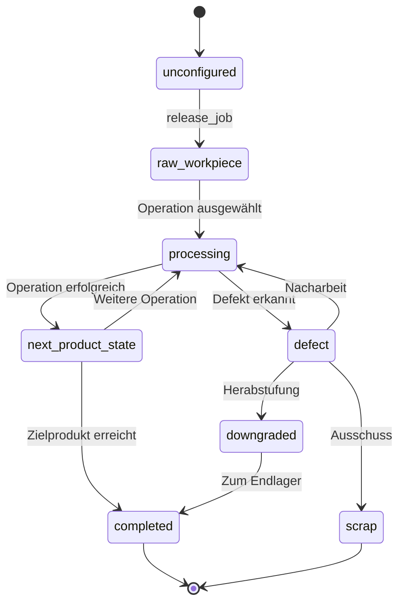
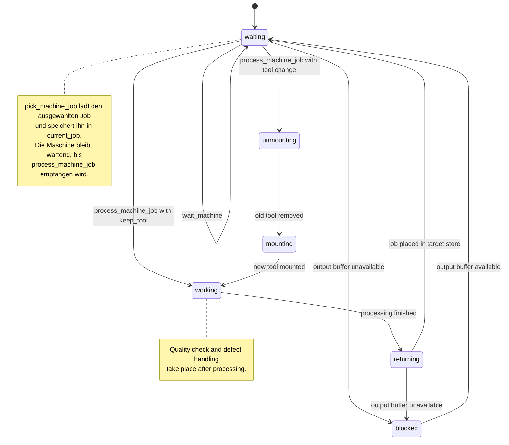
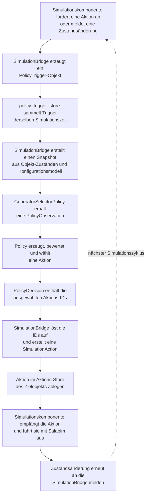
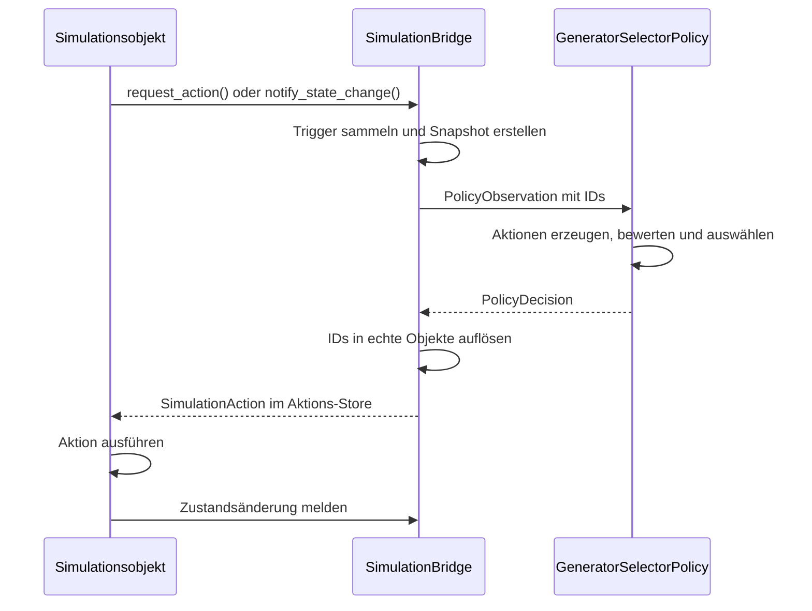
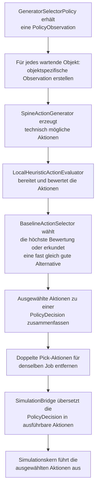
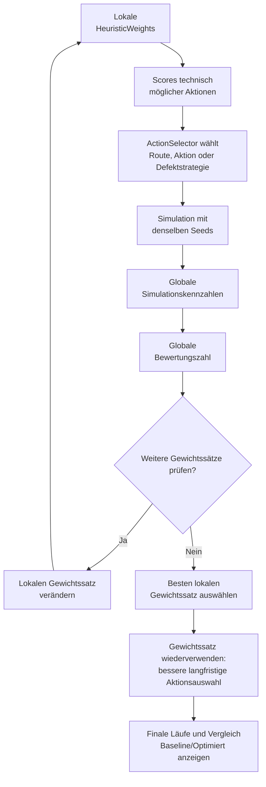
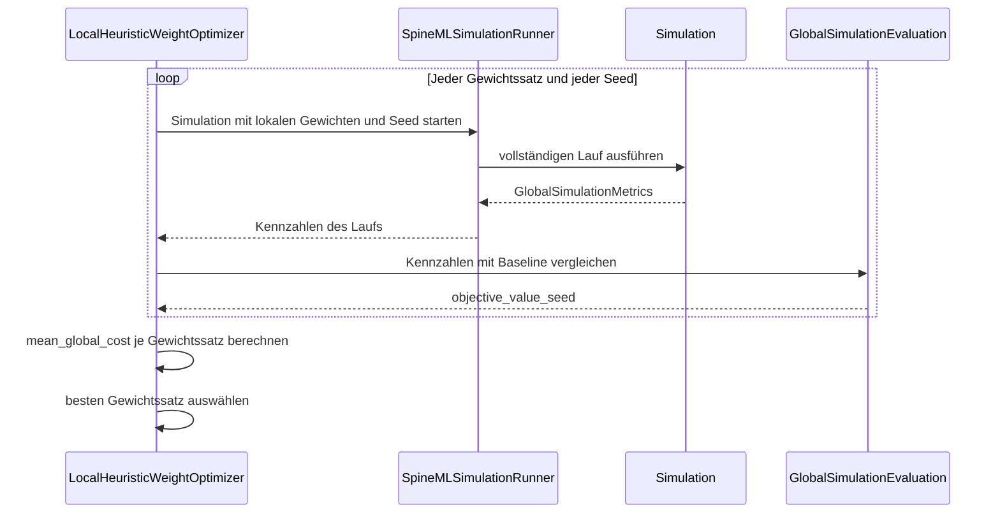

# Fabrikkonfiguration

Dieser Abschnitt beschreibt die Konfigurationsklassen und die Eigenschaften,
mit denen die Fabrik genauer beschrieben werden kann.

## `Layout.py`

`Layout` beschreibt das Fabriklayout und seine Korridore. Zusätzlich zu den
Ein- und Auslagerungszeiten besitzt ein Layout die
`storage_capacity`. Sie gibt an, wie viele Jobs das Startlager und das
Endlager jeweils aufnehmen können. Bei `storage_capacity=10` kann jedes dieser
Lager höchstens zehn Jobs aufnehmen.

## `Machine.py`

`Machine` beschreibt eine konkrete Maschine. Sie gehört zu einem
`MachineType` und einem Korridor und kann unabhängig konfiguriert werden.

### Getrennte Maschinenpuffer

`input_storage_capacity` und `output_storage_capacity` legen die Kapazität
des Eingangs- beziehungsweise Ausgangspuffers fest. Beide Werte werden
getrennt gespeichert und dürfen unterschiedlich sein.

### Erlaubte Werkzeugtypen

Mit `tool_types` wird das Werkzeugmagazin der konkreten Maschine angegeben.
Zwei Maschinen desselben `MachineType` können dadurch unterschiedlich
ausgestattet sein:

```python
Machine("CNC A", cnc_type, ..., tool_types=[turning_tool, milling_tool])
Machine("CNC B", cnc_type, ..., tool_types=[milling_tool])
```

Wird `tool_types` nicht angegeben, werden die Werkzeugtypen weiterhin aus den
Operationen des `MachineType` abgeleitet. Mit einer expliziten Liste kann eine
Maschine jedoch nur die Werkzeuge besitzen, die in ihrem eigenen Magazin
vorhanden sind. Dadurch müssen nicht alle Maschinen desselben Typs dieselben
Operationen und Werkzeuge haben.

### Verarbeitungsgeschwindigkeit

`processing_speed_factor` beschreibt die Verarbeitungsgeschwindigkeit der
Maschine und beeinflusst die Verarbeitungsdauer des Jobs bei der Ausführung
seiner Operation.

## Schutzwerkzeugzeiten

Das Schutzwerkzeug (`dummy_tool`) ist ein Platzhalterwerkzeug der Maschine.
Es ist kein Produktionswerkzeug. Die Maschine startet damit in einem
definierten Zustand. Vor der ersten Verarbeitung wird es entfernt und das
benötigte Produktionswerkzeug montiert. Nach dem Simulationslauf wird das
Produktionswerkzeug wieder entfernt und das Schutzwerkzeug montiert.

Für jede Maschine werden beim Erzeugen intern die Standardzeiten
`dummy_tool_mount_time=1.0` und `dummy_tool_unmount_time=1.0` für das
Schutzwerkzeug angelegt.

Diese Werte werden bei der Montage beziehungsweise Demontage des
Schutzwerkzeugs verwendet. Sie sind derzeit keine zusätzlichen Argumente des
`Machine`-Konstruktors.

Das Schutzwerkzeug sorgt dafür, dass jede Maschine zu Beginn und am Ende
einen eindeutig definierten Werkzeugzustand besitzt. Ohne diesen Platzhalter
müsste die Maschine mit `tool_type = None` starten und beendet werden. Für die
Produktionsplanung ist das Schutzwerkzeug nicht zwingend erforderlich; es
modelliert den vollständigen Werkzeuglebenszyklus einschließlich Montage und
Demontage.

# Diskrete Simulation

Jobs, Maschinen und Roboter planen keine Route mehr selbst, sondern melden
ihren Zustand an die
`SimulationBridge`, erhalten eine Aktion von der Steuerung und führen genau
diese Aktion aus.

## `SimLayout.py`

`SimLayout` ist eine Salabim-Komponente und bildet ein konfiguriertes
`Layout` als Simulationslayout ab. Dabei werden die Lagerkapazitäten der
Konfiguration an die Salabim-Stores weitergegeben:

- Start- und Endlager verwenden `layout.storage_capacity`.
- Jeder Korridor erhält drei Stores mit `corridor.storage_capacity`.
- Das maximale Produktgewicht und -volumen werden aus den Aufträgen ermittelt
  und an die Maschinen für die Laufzeitberechnung weitergegeben.
- `SimLayout` reicht die `SimulationBridge` an die Laufzeitkomponenten weiter.
  Die jeweiligen Komponenten registrieren sich beim Erzeugen selbst: Der
  Main-Roboter, jeder Korridorroboter, jede Maschine und jeder Job registrieren
  ihre eigene ID. Komponenten registrieren außerdem – soweit vorhanden – die
  Stores, die sie selbst besitzen oder verwalten.

## `SimCorridor.py` und `SimCorridorArm.py`

`SimCorridor` erzeugt die drei Korridor-Stores, registriert den Korridor
zusammen mit diesen Stores bei der `SimulationBridge` und erzeugt den linken
und rechten Korridorarm. `SimCorridorArm` erzeugt die zugehörigen
`SimMachine`-Komponenten und den Korridorroboter. Die Werte
`max_product_weight` und `max_product_volume` werden von `SimLayout` aus dem
Szenario ermittelt und an jede Maschine weitergegeben.

Die erzeugten Laufzeitkomponenten registrieren sich selbst mit ihren
IDs und – soweit vorhanden – ihren eigenen Stores. Ein- und Ausgangspuffer der
Maschinen bleiben getrennte Stores.

## `SimOrder.py` und `SimOrderJob.py`

`SimOrder` erzeugt für jedes einzelne bestellte Produktstück eine eigene
`SimOrderJob`-Komponente. Ein `SimOrderJob` beschreibt deshalb genau ein
Werkstück.

Die Steuerung entscheidet über die `SimulationBridge`, welche Operation auf
welcher Maschine ausgeführt wird. Der Job speichert diese Auswahl und seinen
aktuellen Zustand.

Über Aktionen kann die Steuerung den Job freigeben oder warten lassen,
Nacharbeit auf einer Maschine oder einer alternativen Maschine anfordern, den
Job herabstufen, ihn als Ausschuss markieren oder ihn abschließen. Dafür werden
unter anderem die Aktionen `release_job`, `wait_job`,
`job_rework_on_defect_machine`, `job_rework_on_alternative_machine`,
`downgrade_product`, `job_scrap` und `complete_job` verwendet.

## Laufzeitstatus eines `SimOrderJob`

Jeder `SimOrderJob` besitzt einen beobachtbaren Laufzeitstatus. Nicht alle
Attribute werden von der Steuerung gesetzt: Einige entstehen direkt durch ein
Simulationsereignis, andere werden aus einer Aktion übernommen.


| Attribut                      | Bedeutung                                                                                    | Umsetzung im Simulationskern und Quelle der Eingabe                                                                                                                                            | Warum wird es benötigt?                                                                                |
| ------------------------------- | ---------------------------------------------------------------------------------------------- | ------------------------------------------------------------------------------------------------------------------------------------------------------------------------------------------------ | --------------------------------------------------------------------------------------------------------- |
| `released`                    | Gibt an, ob der Job bereits für die Produktion freigegeben wurde.                           | `SimOrderJob` übernimmt `released` aus der `release_job`-Aktion und speichert den Wert. Die Freigabeauswahl kommt aus der Steuerung.                                                          | Ein Job darf erst nach seiner Freigabe weiterlaufen.                                                    |
| `queue_priority`              | Priorität beim Einfügen des Jobs in einen Salabim-Store.                                   | Die Steuerung liefert die Priorität im Pick-Payload. Simulationsroboter und Maschine übernehmen sie und verwenden sie beim`to_store(...)`.                                                   | Jobs werden in einer Warteschlange nach der vorgegebenen Priorität behandelt.                          |
| `completed_time`              | Tatsächlicher Zeitpunkt, zu dem der Job abgeschlossen wurde.                                | `SimRobotMain` ruft beim Ablegen im Endlager `mark_finished()` auf; der Simulationskern speichert `env.now()`.                                                                                 | Grundlage für Terminstatus, Tardiness und Makespan.                                                    |
| `process_finished`            | Gibt an, ob der Jobprozess beendet werden darf.                                              | `SimOrderJob` setzt das Flag, wenn die Aktion `finish_process=True` enthält. `SimCompletionWatcher` liest es.                                                                                 | Der Jobprozess kann beendet und die Simulation automatisch gestoppt werden.                             |
| `location`                    | Aktueller Aufenthaltsort des Jobs, zum Beispiel Store oder Roboter.                          | Die Laufzeitobjekte aktualisieren den Ort nach Pick und Place. Der Zielort wird von der Steuerungsaktion vorgegeben.                                                                           | Der Aufenthaltsort wird der nächsten Beobachtung bereitgestellt.                                       |
| `selected_operation`          | Nächste ausgewählte Operation.                                                             | `SimOrderJob` übernimmt die Operation aus dem Aktions-Payload und speichert sie; die Steuerung liefert die Auswahl.                                                                           | Die Maschine weiß, welche Operation ausgeführt werden soll.                                           |
| `selected_machine`            | Maschine für die ausgewählte nächste Operation.                                           | `SimOrderJob` übernimmt die Maschine aus dem Aktions-Payload und speichert sie; die Steuerung liefert die Auswahl.                                                                            | Transport und Verarbeitung werden zu dieser Maschine geführt.                                           |
| `processing_state`            | Aktueller Produktzustand, zum Beispiel`unconfigured` oder ein Produkttyp.                    | Der Simulationskern initialisiert`unconfigured`, übernimmt bei Recovery den im Payload angegebenen Ausgangszustand und setzt nach erfolgreicher Verarbeitung den erzeugten Produkttyp.         | Die weitere Produktionsroute hängt vom aktuellen Produktzustand ab.                                    |
| `general_state`               | Aktueller Qualitäts- und Produktionsstatus:`intact`, `defect` oder `scrap`.                  | Der Simulationskern initialisiert`intact`, setzt bei `mark_defective()` auf `defect`, setzt nach erfolgreicher Verarbeitung wieder `intact` und übernimmt `scrap` aus der Scrap-Aktion. | Der Status bestimmt, welcher nächste Aktionspfad beobachtet werden kann.                               |
| `due_state`                   | Terminstatus, zum Beispiel`on-time` oder `late`.                                             | `SimOrderJob` übernimmt den von der Steuerung berechneten Wert aus der Abschlussaktion.                                                                                                       | Der einzelne Job erhält seinen Terminstatus.                                                           |
| `downgraded`                  | Gibt an, ob das Produkt herabgestuft wurde.                                                  | `SimOrderJob` übernimmt das Flag aus der Herabstufungsaktion. Die Entscheidung und der Wert im Payload kommen aus der Steuerung.                                                              | Herabgestufte Jobs dürfen nicht mehr die normale Zielroute verwenden.                                  |
| `downgrade_product_type`      | Produkttyp, mit dem der herabgestufte Job abgeschlossen wird, zum Beispiel weiterhin `poliert`. | `SimOrderJob` übernimmt den Produkttyp aus der Herabstufungsaktion; der Job wird nicht auf den vorherigen Produkttyp zurückgesetzt.                                                        | `downgraded=True` markiert die geringere Qualität; der Job benötigt keine weitere normale Operation und wird zum Endlager weitergeleitet.                       |
| `defect_detected_time`        | Zeitpunkt der Defekterkennung.                                                               | `SimOrderJob.mark_defective()` speichert `env.now()` des Simulationskerns.                                                                                                                     | Der Defektzeitpunkt bleibt für Diagnose und Auswertung erhalten.                                       |
| `defect_operation`            | Operation, die den Defekt verursacht hat.                                                    | `SimMachine` übergibt die gerade ausgeführte Operation an `mark_defective()`, das sie im Job speichert.                                                                                      | Die historische Defektursache bleibt bekannt.                                                           |
| `defect_machine`              | Maschine, auf der der Defekt entstanden ist.                                                 | `SimMachine` übergibt sich selbst an `mark_defective()`, das die Maschine im Job speichert.                                                                                                   | Die historische Defektmaschine wird für Recovery und Kennzahlen benötigt.                             |
| `defect_product_state_before` | Produktzustand vor der fehlerhaften Operation.                                               | `SimMachine` speichert den `consumes_product_type` der ausgeführten Operation über `mark_defective()`.                                                                                       | Die Nacharbeit startet wieder bei diesem Zustand, zum Beispiel bei Produkt A.                           |
| `defect_product_state_target` | Produktzustand, den die fehlerhafte Operation erzeugen sollte.                               | `SimMachine` speichert den `produces_product_type` der ausgeführten Operation über `mark_defective()`.                                                                                       | Nach erfolgreicher Nacharbeit soll dieser Zielzustand wieder erreicht werden, zum Beispiel Produkt B.   |
| `defect_severity`             | Schweregrad des Defekts im Bereich von`0.0` bis `1.0`.                                       | `SimMachine` erzeugt ihn mit einem aus Simulations-Seed und Jobdaten abgeleiteten `quality_rng` und speichert ihn bei einem Defekt.                                                            | Bei`0.001` bis `<0.6` kann die Steuerung Nacharbeit anbieten; ab `0.6` bleibt nur Scrap.                |
| `defect_recovery_strategy`    | Ausgewählte Strategie, zum Beispiel Nacharbeit oder Ausschuss.                              | `SimOrderJob` speichert die Strategie aus dem Aktions-Payload; bei einem neuen Defekt löscht `mark_defective()` die alte Strategie. Die Auswahl kommt aus der Steuerung.                      | Die nächste Simulation beobachtet, welche Defektbehandlung aktiv ist.                                  |
| `recovery_in_progress`        | Gibt an, dass eine ausgewählte Recovery-Strategie noch transportiert oder ausgeführt wird. | `SimOrderJob` setzt es beim Empfang einer Nacharbeitsaktion auf `True`. `SimMachine` setzt es nach der Nacharbeit auf `False`.                                                     | Verhindert eine neue Recovery-Entscheidung, solange die laufende Recovery noch nicht abgeschlossen ist. |
| `defect_count`                | Anzahl erkannter Defekte dieses Jobs.                                                        | `mark_defective()` erhöht den Zähler im Simulationskern.                                                                                                                                     | Wird für Qualitätskennzahlen und Diagnosen gezählt.                                                  |
| `rework_count`                | Anzahl ausgelöster Rework-Aktionen.                                                          | `SimOrderJob` erhöht den Zähler, wenn eine Rework-Aktion ausgeführt wird.                                                                                                                   | Wird für Kennzahlen und den nächsten Quality-Key verwendet.                                           |
| `scrap_count`                 | Anzahl der Scrap-Entscheidungen.                                                             | `SimOrderJob` erhöht den Zähler, wenn eine `job_scrap`-Aktion ausgeführt wird.                                                                                                              | Wird als globale Qualitätskennzahl ausgewertet.                                                        |

### UML-Zustandsdiagramm eines Jobs

Das Diagramm zeigt die wichtigsten Zustände des Produktprozesses. Die konkreten
Produktzustände zwischen den Operationen hängen vom jeweiligen Modell ab.



`downgraded` ist im Diagramm als eigener Ablaufzustand dargestellt. Im Code
wird er nicht als eigener `general_state` gespeichert, sondern durch
`downgraded=True` und den erreichten Produktzustand gekennzeichnet.

## `SimRobot.py`, `SimRobotMain.py` und `SimRobotCorridorArm.py`

`SimRobot` stellt die gemeinsame Bewegungslogik bereit. Er interpoliert die
Positionen auf den X-, Y- und Z-Achsen, führt ausgewählte Jobs aus Stores ab
und meldet Lade- und Bewegungszustände.

### `SimRobotMain.py` und `SimRobotCorridorArm.py`

- **Aktionen der Steuerung:**
  - Main-Roboter: `pick_main_robot`, `place_main_robot`, `wait_main_robot`.
  - Korridorarm: `pick_corridor_arm_robot`, `place_corridor_arm_robot`,
    `wait_corridor_arm_robot`.
- **Simulationskern:** Führt den Transport des im Payload ausgewählten Jobs
  aus. Die Roboter wählen keinen Ersatzjob und keine neue Route. Die feste
  Grundgeschwindigkeit wird in `SimRobotMain.py` auf `2.0` und in
  `SimRobotCorridorArm.py` auf `1.5` gesetzt.
- **Seed/Reproduzierbarkeit:** `SimRobot.py` erzeugt bei jedem Aufruf von
  `move_x`, `move_y` oder `move_z` einen neuen Faktor zwischen `0.95` und
  `1.05`. Die effektive Geschwindigkeit berechnet sich als
  `Grundgeschwindigkeit × Zufallsfaktor`. Dadurch sind die
  Geschwindigkeitsschwankungen und die Bewegungsdauer für X, Y und Z bei
  gleichem Seed reproduzierbar.
- **Zustandsmeldung:** Nach Pick und Place werden Jobstandort, Beladung und
  Roboterzustand über die Bridge gemeldet. Beim Ablegen im Endlager wird
  außerdem `completed_time` gesetzt.

### `SimMachine` (Maschine)

`SimMachine` ist eine Salabim-Komponente für genau eine konfigurierte
Maschine. Sie führt keine eigene Produktionsplanung durch. Die Steuerung
liefert über die `SimulationBridge` die konkrete Aktion;
`SimMachine` führt diese Aktion im Simulationskern aus und meldet danach den
neuen Zustand zurück.

- Die Steuerung richtet die Aktion an die ausgewählte Maschine und sendet in
  der Aktions-Payload den ausgewählten Job, die Operation und das Werkzeug.
  `SimMachine` nimmt diese Werte entgegen und führt genau diese Auswahl aus.
  Sie entscheidet nicht selbst über den nächsten Job, die nächste Operation
  oder das nächste Werkzeug. Ist der ausgewählte Job nicht verfügbar, führt sie
  keine automatische Ersatzsuche durch; die Steuerung muss eine neue Aktion
  senden.
- `SimLayout` ermittelt aus allen Aufträgen das größte Produktgewicht und
  -volumen. Diese beiden Referenzwerte werden an jede `SimMachine` übergeben;
  dadurch wird die Größe jedes verarbeiteten Produkts relativ zum Szenario
  bewertet und die Verarbeitungsdauer angepasst.
- Jede konkrete Maschine besitzt eine eigene Werkzeugliste. Bei einer
  `process_machine_job`-Aktion montiert oder demontiert sie entsprechend
  `tool_setup_action` das benötigte Werkzeug und verbraucht während der
  Operation `consumed_life_units`. Erst der separate Abschlussprozess
  `SimMachineShutdown` entfernt nach dem Simulationslauf ein noch montiertes
  Produktionswerkzeug und montiert wieder das Schutzwerkzeug.
- Zu Beginn jeder Prozessschleife meldet `SimMachine` ihren Zustand über
  `bridge.request_action(self)`. Danach empfängt sie mit `bridge.action(self)`
  eine konkrete Aktion. Nach der Verarbeitung legt sie den aktualisierten Job ab,
  setzt `current_job` zurück und meldet den Zustand beim nächsten
  `request_action()` erneut.
- `SimMachine` aktualisiert am Job die Attribute `job.location`,
  `job.queue_priority`, `job.processing_state` und `job.general_state`. Bei
  einem Defekt schreibt `mark_defective()` außerdem
  `job.defect_count`, `job.defect_detected_time`, `job.defect_severity`,
  `job.defect_operation`, `job.defect_machine`,
  `job.defect_product_state_before` und `job.defect_product_state_target`.
  Nach der Verarbeitung setzt sie `job.selected_operation` und
  `job.selected_machine` auf `None`, beendet mit
  `job.recovery_in_progress = False` eine laufende Recovery-Markierung und
  entfernt bei einem intakten Ergebnis die alte Rework-Strategie aus
  `job.defect_recovery_strategy`.
- Der Runner setzt mit `random.seed(seed)` den Startwert für den globalen
  Python-Zufallszahlengenerator. Dadurch sind
  `SimMachine.processing_speed_factor`, `SimMachine.processing_variation`,
  `SimMachine.startup_delay`,
  `SimRobot.movement_speed_multiplier` und die zufälligen Entscheidungen des
  `ActionSelector` reproduzierbar. `sim.Environment(random_seed=seed)` setzt
  zusätzlich den Seed für Salabim.
- Der Runner legt zu Beginn des Simulationslaufs den Seed fest. Die
  Qualitätsprüfung verwendet denselben Seed zusammen mit den Daten des
  Szenarios, Auftrags, Jobs, der Operation und des Rework-Durchlaufs. Dadurch
  erhält derselbe Job bei gleicher Ausgangslage immer dieselbe Entscheidung,
  ob ein Defekt entsteht, und denselben `defect_severity`. Wird der Seed oder
  der Kontext geändert, kann auch das Qualitätsergebnis anders ausfallen.
- `Machine` verwendet den neutralen Basiswert `1.0`. Beim Aufbau von
  `SimMachine` wird dieser nach dem gesetzten Seed mit einem Zufallsfaktor
  zwischen `0.45` und `2.0` multipliziert. Dadurch ist der resultierende
  `SimMachine.processing_speed_factor` bei gleichem Seed reproduzierbar.

#### Aufbau und Laufzeitdaten

- `self.machine` verweist auf die Fabrikkonfiguration der Maschine.
- `store_in` und `store_out` sind getrennte Eingangs- und Ausgangspuffer mit
  den konfigurierten Kapazitäten.
- `max_product_weight` und `max_product_volume` sind die größten Werte aller
  Produkte im Szenario. Sie werden für die Größenanpassung der
  Verarbeitungsdauer verwendet.
- `self.tool_types` ist eine eigene Kopie der Werkzeugliste der konkreten
  `Machine`. Dadurch kann die Simulation ihre Laufzeitliste unabhängig von der
  unveränderten Fabrikkonfiguration verwalten. Für jeden Werkzeugtyp verwaltet
  `SimMachine` vier Werte:
  `remaining_life_units` ist der aktuelle Restwert,
  `remaining_life_units_t` dessen gültiger Simulationszeitpunkt,
  `remaining_life_units_next` der erwartete Restwert nach der laufenden
  Operation und `remaining_life_units_next_t` der Zeitpunkt, an dem dieser
  erwartete Wert erreicht wird.
- Zu Beginn gilt `self.dummy_tool_mounted = True`, während
  `self.tool_type = None` und `self.current_job = None` sind. Das bedeutet:
  Das Schutzwerkzeug ist montiert, aber noch kein Produktionswerkzeug und kein
  Job geladen.
- `self.processing_speed_factor` entsteht aus dem Basiswert `1.0` und einem
  einmaligen Zufallsfaktor zwischen `0.45` und `2.0`. `self.processing_variation`
  wird einmalig zufällig zwischen `0.90` und `1.10` erzeugt und multipliziert
  später die Verarbeitungsdauer. `self.startup_delay` wird einmalig zwischen
  `0` und `4` Zeiteinheiten erzeugt und nur vor der ersten Verarbeitung
  angewendet; `_startup_delay_applied` verhindert eine Wiederholung bei
  weiteren Jobs.

#### Prozess und Aktionen

Der Prozess läuft wiederholt ab:

1. Ist der Ausgangspuffer voll, setzt die Maschine den Zustand `blocked`,
   sonst `waiting`.
2. Die Maschine meldet ihren Zustand mit `bridge.request_action(self)` und
   wartet auf die von der Steuerung gelieferte Aktion.
3. Bei `pick_machine_job` nimmt sie genau den im Payload genannten Job aus dem
   genannten Store. Sie aktualisiert dessen `location`, übernimmt die
   `queue_priority` und speichert den Job in `self.current_job`.
4. Bei `process_machine_job` führt sie genau die übergebene Operation mit dem
   übergebenen Werkzeug aus.
5. Bei `wait_machine` wartet sie eine Simulationszeiteinheit und fordert
   anschließend eine neue Aktion an.

Die Maschine wählt weder selbst einen Job noch eine Operation oder ein
Werkzeug. Fehlt der ausgewählte Job im angegebenen Store, wird die Pick-Aktion
ohne Verarbeitung beendet.

#### Werkzeugwechsel und Lebensdauer

Die `process_machine_job`-Payload enthält unter anderem `operation`,
`tool_type`, `total_life_units`, `consumed_life_units`,
`remaining_life_units_before_operation`, `tool_setup_action` und
`target_store`.

Die Lebensdauer- und Zielwerte bedeuten:

- `total_life_units`: vollständige Lebensdauer des verwendeten Werkzeugs.
- `consumed_life_units`: Lebensdauer, die die aktuelle Operation verbraucht.
- `remaining_life_units_before_operation`: verbleibende Lebensdauer vor Beginn
  der Operation.
- `tool_setup_action`: Anweisung, ob das Werkzeug beibehalten, montiert,
  demontiert oder ersetzt wird.
- `target_store`: Ausgangspuffer, in den die Maschine den Job nach der
  Verarbeitung ablegt.

Je nach `tool_setup_action` führt die Maschine folgende Schritte aus:

- `keep_tool`: Das aktuelle Werkzeug bleibt montiert.
- `unmount_dummy_tool_and_mount_tool`: Das Schutzwerkzeug wird entfernt und
  das Produktionswerkzeug montiert.
- `unmount_and_mount_tool`: Das bisherige Produktionswerkzeug wird entfernt
  und das neue Werkzeug montiert.
- `replace_tool_same_type`: Das verbrauchte Werkzeug wird entfernt und durch
  ein Werkzeug desselben Typs ersetzt.

Wenn die verbleibende Lebensdauer für den Verbrauch der Operation nicht
ausreicht, wird beim Werkzeugwechsel ein neues Werkzeug mit
`total_life_units` angenommen. Nach der Operation wird die Lebensdauer um
`consumed_life_units` reduziert. Während der Verarbeitung wird der erwartete
Restwert anhand der geplanten Dauer geführt. Nach dem Abschluss wird er auf den
tatsächlichen Restwert gesetzt.

#### Verarbeitungsdauer

Zuerst werden relative Größenwerte gebildet:

```python
weight_ratio = product.weight / max_product_weight
volume_ratio = product_volume / max_product_volume
size_factor = 1.0 + 0.5 * weight_ratio + 0.5 * volume_ratio
```

Bei Werten zwischen `0` und `1` liegt `size_factor` zwischen `1.0` und `2.0`.
Die endgültige Dauer wird danach so berechnet:

```python
duration = operation.duration * size_factor / processing_speed_factor
duration *= processing_variation
```

Damit beeinflussen die Operationsdauer, die Produktgröße, die
Maschinengeschwindigkeit und eine kleine zufällige Laufzeitabweichung die
Verarbeitungsdauer.

#### Defektprüfung und Recovery

Nach Ablauf der Verarbeitungsdauer erzeugt die Maschine einen deterministischen
Qualitätszufallszahlengenerator. Sein Schlüssel enthält den Simulations-Seed,
das Szenario, den Auftrag, den Job, die Operation und den `rework_count`.
Die erste Zufallszahl wird mit `operation.defect_probability` verglichen. Nur
bei einem Defekt wird eine zweite Zufallszahl als `defect_severity` erzeugt.

```python
defect = quality_rng.random() < operation.defect_probability
defect_severity = quality_rng.random() if defect else None
```

Bei gleichem Seed und gleichem Kontext entstehen dadurch dieselbe
Defektentscheidung und derselbe Schweregrad. Ein relevanter Defekt ab
`0.001` wird mit `job.mark_defective()` gespeichert. Dabei werden Operation,
Maschine, Produktzustand vor der Operation, Zielzustand und Schweregrad im Job
festgehalten. Ohne relevanten Defekt setzt die Maschine den erzeugten
Produktzustand und den allgemeinen Zustand auf `intact`.

Nach abgeschlossener Nacharbeit wird
`recovery_in_progress` zurückgesetzt. Die alte Auswahl von Operation und
Maschine wird gelöscht, damit die Steuerung die nächste Aktion neu bestimmen
kann. Die Auswahl der Recovery-Strategie selbst kommt aus der Steuerung; die
Simulation speichert sie nur und entfernt eine erledigte Rework-Strategie.

#### Abschluss der Verarbeitung und Zustände

Nach der Verarbeitung wird der Job mit seiner Priorität in den im Payload
genannten Zielstore gelegt und seine `location` wird aktualisiert. Danach wird
`current_job` auf `None` gesetzt; die Maschine ist wieder frei und meldet ihren
neuen Zustand mit der nächsten `request_action()`-Anfrage.

Die wichtigsten Maschinenzustände sind:

- `waiting`: Die Maschine wartet auf eine Aktion.
- `blocked`: Der Ausgangspuffer kann keinen fertigen Job aufnehmen.
- `unmounting`: Ein Schutz- oder Produktionswerkzeug wird entfernt.
- `mounting`: Ein Produktions- oder Schutzwerkzeug wird montiert.
- `working`: Die Operation wird ausgeführt.
- `returning`: Die Verarbeitung ist beendet und der Job wird abgelegt.

Am Ende eines vollständigen Laufs kann `SimMachineShutdown` als eigene,
einmalige Salabim-Komponente das noch montierte Produktionswerkzeug entfernen
und wieder das Schutzwerkzeug montieren. Sie ist eine eigene Komponente, weil
`SimMachine` die Jobs in einer wiederholten `while`-Schleife verarbeitet,
während dieser Abschlussprozess genau einmal nach dem Lauf ausgeführt wird.
Die benötigte Zeit wird als
Werkzeugwechselzeit erfasst; der Makespan bleibt auf den letzten Jobabschluss
bezogen.

#### UML-Zustandsdiagramm von `SimMachine`

Das Diagramm zeigt die Zustände der Maschine während eines normalen
Simulationslaufs. Die Jobauswahl erfolgt weiterhin durch die Steuerung über
die `SimulationBridge`.



## `SimScenario.py` und `SimCompletionWatcher`

`SimScenario` erzeugt für jeden Auftrag ein `SimOrder`-Objekt. Dieses erzeugt
für jedes bestellte Produktstück ein `SimOrderJob`-Objekt. Die
`SimulationBridge` wird an diese Objekte weitergegeben, damit sie Aktionen
empfangen und Zustände melden können.

Zusätzlich erstellt `SimScenario` den `SimCompletionWatcher`. Dieser prüft, ob
alle Jobs abgeschlossen sind, und beendet dann die Simulation.

### Automatisches Simulationsende

`SimScenario` erstellt beim Aufbau des Szenarios den
`SimCompletionWatcher`. Der Watcher ist eine Salabim-`sim.Component`; seine
`process()`-Methode läuft als Simulationsprozess. Sie sammelt einmalig alle
Jobs aus den erzeugten Aufträgen und prüft regelmäßig, ob jeder Job das Flag
`process_finished=True` besitzt. Das Flag wird durch eine Abschlussaktion mit
`finish_process=True` gesetzt. Sobald alle Jobs abgeschlossen sind, löst der
Watcher `sim.SimulationStopped` aus. Der Simulationsrunner fängt dieses Signal
ab und sammelt anschließend die globalen Kennzahlen.

# SimulationBridge

Jobs, Maschinen, der Main-Roboter und die Korridorarm-Roboter registrieren sich
bei der `SimulationBridge`, weil sie Aktionen von der Policy anfordern und
ausführen. Korridore und Stores werden zusätzlich für die ID-Auflösung
registriert. `SimLayout`, `SimScenario` und `SimCompletionWatcher` benötigen
keine eigenen Aktionen und werden deshalb nicht als aktionsfähige Objekte
registriert.

Der wiederkehrende Ablauf eines aktionsfähigen Simulationsobjekts besteht
darin, mit `request_action(self)` seinen aktuellen Zustand an die Bridge zu
melden und eine neue Policy-Entscheidung anzufordern. Anschließend empfängt es
mit `action(self)` die ausgewählte Aktion.

Die Bridge trennt die für die Policy sichtbaren IDs von den echten
Salabim-Komponenten:

- Die Policy arbeitet mit IDs für Jobs, Maschinen, Operationen, Werkzeuge und
  Stores. Sie erhält keine direkten Simulationsobjekte.
- Bei der Registrierung ordnet die Bridge jeder Policy-ID genau eine
  Simulationskomponente zu und erstellt für diese Komponente einen eigenen
  Aktions-Store.
- Beispiel: Die Policy sendet `selected_machine_id: "machine_1"`. Die Bridge
  löst diese ID intern in das echte `SimMachine`-Objekt der Maschine 1 auf.
  Dadurch bleibt die Policy vom Simulationskern entkoppelt. IDs und die
  zugehörigen einfachen Daten können außerdem leicht gespeichert, als JSON
  übertragen oder später über ein Webinterface verwendet werden.
- Eine Policy-Aktion enthält ebenfalls nur IDs. Die Bridge löst diese IDs in
  die echten Simulationsobjekte und Stores auf und legt die ausführbare Aktion
  nur im Aktions-Store des Zielobjekts ab.
- Eine Zustandsänderung ruft `notify_state_change(self)` auf. Dabei erzeugt die
  Bridge ein internes `PolicyTrigger`-Objekt mit Sender-ID, Simulationszeit
  und Zustandsversion und legt es in den zentralen `policy_trigger_store`.
- Die Bridge ist selbst eine Salabim-`sim.Component`. Ihre `process()`-Methode
  wartet auf diesen Store, sammelt weitere Trigger derselben Simulationszeit
  und löst anschließend die Erstellung eines Snapshots aus. Der Snapshot
  enthält die aktuellen Zustände aller registrierten Simulationsobjekte sowie
  das ID-basierte Konfigurationsmodell der Fabrik. Die Triggerobjekte selbst
  werden nicht an die Policy übergeben;
  ihre Ereignis- und Sender-IDs können nur als Metadaten in der Observation
  enthalten sein.
- Die Bridge ruft danach die Policy mit einer `PolicyObservation` auf. Die
  Policy liefert eine `PolicyDecision` mit ausgewählten Aktionen und IDs.
  Vor der Verwendung prüft die Bridge, ob die `state_version` des Snapshots
  noch dem aktuellen Simulationszustand entspricht. Falls sich der Zustand
  während der Policy-Entscheidung geändert hat, erstellt sie den Snapshot und
  die Entscheidung erneut. Dadurch erhält die Policy nur einen aktuellen
  Snapshot.
  Die Bridge löst diese IDs in echte Simulationsobjekte auf und legt jede
  ausführbare `SimulationAction` im persönlichen Aktions-Store des jeweiligen
  Zielobjekts ab.

Für jedes aktionsfähige Simulationsobjekt gilt: Es meldet seinen aktuellen
Zustand, wartet auf die Entscheidung der Steuerung, führt diese Entscheidung
mit Salabim aus und meldet danach die Zustandsänderung wieder an die Bridge.
Die Simulation wählt dabei keine Ersatzaktion und keine Produktionsroute selbst.

Der Ablauf zwischen Bridge, Steuerung und Simulationskomponenten ist:



## UML-Sequenzdiagramm eines Simulationszyklus



Als `Simulationskomponente` treten dabei `SimOrderJob`, `SimMachine`,
`SimRobotMain` und `SimRobotCorridorArm` auf. Jede Komponente durchläuft diesen
Ablauf unabhängig; die Bridge gibt die Aktion nur an die jeweils anfragende
Komponente zurück.

# GeneralControl

`GeneralControl` wird sowohl bei einem normalen Simulationslauf als auch bei der Optimierung verwendet.

## Ablauf der GeneralControl



## GeneratorSelectorPolicy

Aus Sicht der Simulation ist `GeneratorSelectorPolicy` die Policy. Sie ist
hauptsächlich eine Hülle: Die eigentliche Aktionslogik liegt in drei
austauschbaren Bausteinen, die sie miteinander verbindet:

- `ActionGenerator` erzeugt aus der Beobachtung die technisch möglichen
  Aktionen für das aktuell betrachtete wartende Simulationsobjekt.
- `ActionEvaluator` bewertet diese Aktionen anhand gewichteter
  Dispatching-Regeln, zum Beispiel EDD-Termindruck, Queue-Priorität,
  Transportzeit, Verarbeitungszeit, Werkzeugzustand und Defekt-Recovery.
- `ActionSelector` wählt normalerweise die Aktion mit dem höchsten Score aus.
  Der `BaselineActionSelector` kann gelegentlich auch eine fast gleich gute
  Alternative zur Exploration auswählen.

Die Policy prüft im Snapshot, welche Simulationskomponenten auf eine Aktion
warten. Für jedes wartende Objekt erstellt sie eine objektspezifische
`PolicyObservation`, lässt mögliche Aktionen erzeugen, bewerten und auswählen
und sammelt die Ergebnisse in einer `PolicyDecision`. Doppelte Pick-Aktionen
für denselben Job werden anschließend entfernt.

Bei einem normalen Simulationsstart ohne Optimierung verwendet die Hülle
`SpineActionGenerator`, `BaselineActionSelector` und
`LocalHeuristicActionEvaluator` mit einem festen `HeuristicWeights`-Satz.

### Ablauf von `make_decision()`

1. Die Policy liest aus dem Snapshot alle Simulationskomponenten, die auf eine
   Aktion warten.
2. Für jedes wartende Objekt wird eine eigene `PolicyObservation` mit seiner
   `current_object_id` erstellt.
3. `ActionGenerator` erzeugt die technisch möglichen Aktionen dieses Objekts.
4. `ActionSelector` lässt diese Kandidaten durch den `ActionEvaluator` bewerten
   und wählt normalerweise die Aktion mit dem höchsten Score aus.
5. Die ausgewählten `SelectedObjectAction`-Objekte werden zu einer
   `PolicyDecision` zusammengefasst und an die Bridge zurückgegeben.
6. Ein Job darf nicht gleichzeitig von mehreren Pick-Aktionen ausgewählt
   werden; solche doppelten Picks entfernt die Policy vor der Rückgabe.

## ActionGenerator

`SpineActionGenerator.generate_actions()` erzeugt für ein einzelnes wartendes
Simulationsobjekt eine Liste technisch möglicher Aktionen. Die Generierung
erfolgt in zwei Schritten: zuerst einfache Zustandsregeln, danach die
Erzeugung mehrerer Kandidaten für die zutreffende Situation.

### Einfache Zustandsregeln

`_generate_actions()` prüft zuerst den Typ und den aktuellen Zustand des
Objekts. Die Verzweigung für einen Job entspricht dabei dieser Reihenfolge:

**Job:**

- `completed_time` vorhanden und `due_state` noch nicht gesetzt
  - `complete_job` (Beispiel: Der Job liegt im Endlager und erhält
    `finish_process=True`.)
- `general_state == "defect"`
  - `recovery_in_progress == True` → nur `wait_job`.
  - Rework technisch nicht möglich → nur `job_scrap`.
  - Nacharbeit technisch möglich → Nacharbeitsaktionen, `downgrade_product`
    und `wait_job`.
- `downgraded == True`
  - Keine normale weitere Produktionsroute; der erreichte Produktzustand bleibt
    erhalten und der Job wird zum Endlager transportiert.
- `released == False`
  - `release_job` und zusätzlich `wait_job`.
- Alle anderen Jobzustände
  - `wait_job`.

Für Roboter und Maschinen gelten einfache Zustandsregeln:

**Main-Roboter oder Korridorarm:**

- `current_job_id == None` → Pick-Kandidaten.
- `current_job_id != None` → Place-Kandidaten.

**Maschine:**

- `current_job_id == None` → Pick-Kandidaten.
- `current_job_id != None` und Ausgangspuffer hat Kapazität →
  `process_machine_job`.
- `current_job_id != None` und Ausgangspuffer ist voll → `wait_machine`.

Diese Regeln schränken den Lösungsraum ein: Fehlende Kapazität, ungültige
Routen oder nicht verfügbare Maschinen erzeugen keinen Aktionskandidaten.

### Mehrere Kandidaten pro wartendem Objekt

Wenn die Zustandsregel mehrere Möglichkeiten zulässt, erzeugt der Generator
alle diese Kandidaten gleichzeitig in einer Liste. „Gleichzeitig“ bedeutet
hier dieselbe Auswahlrunde, nicht parallele Ausführung in der Simulation. Der
`ActionSelector` bewertet anschließend die gesamte Liste und wählt genau eine
Aktion aus.
Die folgenden Payloads zeigen jeweils nur ein Beispiel aus dieser Liste; die
Kandidaten werden gemeinsam erzeugt, aber nicht gemeinsam ausgeführt.

**Defekter Job mit technisch möglicher Nacharbeit:**

1. `job_rework_on_defect_machine` (wenn die Defektmaschine verfügbar
   ist).
2. `job_rework_on_alternative_machine` (für jede gefundene
   Alternativroute).
3. `downgrade_product`.
4. `wait_job`.

Wenn Nacharbeit technisch nicht möglich ist, wird stattdessen ausschließlich
`job_scrap` erzeugt.

Eine Herabstufung kann nach jeder fehlerhaften Operation erfolgen. Der dabei
verwendete Produkttyp ist der vorgesehene Produkttyp dieser Operation und kann
deshalb auch ein Zwischenprodukt sein; er muss nicht dem endgültigen
Auftragsziel entsprechen. Der Job bleibt in diesem Produktzustand, wird aber
zusätzlich mit `downgraded=True` als qualitativ herabgestuft markiert.

Beispiel für eine Herabstufungsaktion:

```json
{
  "action_type": "downgrade_product",
  "payload": {
    "selected_operation_id": null,
    "selected_machine_id": null,
    "processing_state": "produkt_b",
    "general_state": "intact",
    "downgraded": true,
    "downgrade_product_type_id": "produkt_b",
    "defect_recovery_strategy": "downgrade_product"
  }
}
```

**Pick:**

1. Eine eigene `pick_*`-Aktion für jeden auswählbaren Job im Store (Beispiel:
   zwei Jobs erzeugen zwei Pick-Kandidaten).
2. Zusätzlich eine `wait_*`-Aktion.

Beispiel für eine Pick-Aktion des Main-Roboters:

```json
{
  "action_type": "pick_main_robot",
  "payload": {
    "target_type": "start_storage",
    "target_store_id": "start",
    "selected_job_id": "auftrag_1:1",
    "storage_out_time": 1.0
  }
}
```

**Place:**

1. Eine eigene `place_*`-Aktion für jede technisch mögliche Route und jeden
   freien Zielstore (Beispiel: zwei freie Zielrouten erzeugen zwei
   Place-Kandidaten).
2. Zusätzlich eine `wait_*`-Aktion.

Beispiel für eine Place-Aktion des Main-Roboters:

```json
{
  "action_type": "place_main_robot",
  "payload": {
    "target_type": "sim_corridor_store_arm_input",
    "selected_operation_id": "operation_1",
    "selected_machine_id": "machine_1",
    "sim_corridor_id": "corridor_1",
    "target_store_id": "corridor_1_left",
    "storage_in_time": 1.0
  }
}
```

**Maschine:**

1. Eine eigene `pick_machine_job`-Aktion für jeden auswählbaren Job im
   Eingangspuffer.
2. Für einen geladenen Job `process_machine_job` bei freiem Ausgangspuffer;
   bei fehlender Kapazität `wait_machine` (Beispiel: voller Ausgangspuffer).

Beispiel für eine Verarbeitungsaktion:

```json
{
  "action_type": "process_machine_job",
  "payload": {
    "operation_id": "operation_1",
    "planned_machine_id": "machine_1",
    "tool_type_id": "tool_1",
    "total_life_units": 100,
    "consumed_life_units": 5,
    "remaining_life_units_before_operation": 80,
    "tool_setup_action": "keep_tool",
    "target_store_id": "machine_1_out"
  }
}
```

Die Hilfsmethoden lesen dafür den aktuellen Snapshot, das ID-basierte
Konfigurationsmodell, Store-Kapazitäten und mögliche Operations- und
Maschinenrouten. `generate_actions()` entfernt danach nur exakt doppelte
Kandidaten. Damit ist gemeint: gleicher `action_type` und gleicher Payload.
Unterschiedliche Routen oder Zielstores bleiben erhalten. Erst anschließend
übernimmt der `ActionSelector` die Bewertung und Auswahl.

## ActionSelector

Der `ActionSelector` erhält die gesamte Kandidatenliste eines wartenden
Objekts. Er erzeugt keine neuen Aktionen, sondern lässt jeden Kandidaten vom
`ActionEvaluator` vorbereiten und bewerten. Der Standard-
`BaselineActionSelector` arbeitet dabei in folgenden Schritten:

1. Gibt es für das wartende Objekt keine Aktion, gibt er eine leere
   `PolicyDecision` zurück.
2. Für jede vorhandene Aktion ergänzt der `ActionEvaluator` zunächst die
   benötigten Payload-Werte und berechnet danach ihren Score.
3. Der höchste Score wird gesucht. Alle Aktionen mit genau diesem Score gelten
   als beste Aktionen.
4. Zusätzlich gelten Aktionen als fast gleich gut, wenn ihr Score höchstens
   `0.05` unter dem höchsten Score liegt. Bei einem Höchstwert von `0.80`
   werden zum Beispiel auch Aktionen ab `0.75` als fast gleich gut gesammelt.
5. **Exploration:** Exploration bedeutet, gelegentlich bewusst nicht die
   aktuell beste Aktion zu verwenden, sondern eine fast gleich gute Alternative
   auszuprobieren. Mit `EXPLORATION_EPSILON = 0.10` geschieht das mit einer
   Wahrscheinlichkeit von `10 %`. Wenn möglich, wird dabei eine ausführbare
   Aktion statt einer reinen Warteaktion verwendet. So können andere
   Produktionswege getestet werden, ohne deutlich schlechtere Aktionen zu
   wählen.
   Diese Exploration betrifft nur die Aktionsauswahl während eines
   Simulationslaufs. Sie verändert keine lokalen Gewichtssätze, kann aber den
   weiteren Simulationsverlauf und dadurch die globalen Kennzahlen beeinflussen.
   Das ist bei der Optimierung nützlich, weil dadurch auch fast gleich gute
   Produktionsentscheidungen ausprobiert werden und sich die Simulation nicht
   dauerhaft auf eine möglicherweise ungünstige lokale Aktionswahl festlegt.
   Die Verwendung derselben
   Seeds und die Mittelung über mehrere Seeds halten diesen Einfluss
   reproduzierbar und vergleichbar.
   Die Exploration verändert dabei keine Scores und keine Gewichte. Ob zum
   Beispiel `job_rework_on_defect_machine` gegenüber
   `job_rework_on_alternative_machine` bevorzugt wird, entscheidet die
   normale Score-Berechnung aus den lokalen Teilwertgewichten.
6. **Keine Exploration:** In den übrigen Fällen wählt der Selector zufällig
   eine der exakt besten Aktionen. Diese Zufallsauswahl löst nur Gleichstände
   auf und bleibt mit demselben Simulations-Seed reproduzierbar.

Die ausgewählte Aktion wird anschließend als `PolicyDecision` für das
Zielobjekt an die `GeneratorSelectorPolicy` zurückgegeben.

# HeuristicControl

### Ziel von `HeuristicControl`

`HeuristicControl` bewertet im aktuellen Simulationszustand alle vom
`ActionGenerator` erzeugten Aktionskandidaten. Für jeden Kandidaten berechnet
es einen Score; erst der `ActionSelector` wählt daraus die nächste Aktion aus.
So wird die Produktion laufend gesteuert und die verfügbaren Ressourcen werden
berücksichtigt.

### Was bedeutet „heuristisch“?

„Heuristisch“ bedeutet, dass eine vereinfachte Entscheidungsregel verwendet
wird. Aktuelle Kriterien werden bewertet, um schnell eine gute, aber nicht
zwingend optimale Entscheidung zu finden.

### Welches Problem wird gelöst?

Bei der **dynamischen Produktionsplanung** wird die nächste Entscheidung nicht
einmal für die gesamte Produktion festgelegt. In jedem Simulationszustand
können mehrere Jobs, Maschinen, Routen und Aktionen möglich sein. Außerdem
ändern sich die Bedingungen laufend, zum Beispiel wenn eine Maschine frei
wird, ein Store voll ist oder ein Defekt auftritt. Deshalb wird die nächste
Aktion jeweils auf Grundlage des aktuellen Zustands bewertet, anstatt alle
zukünftigen Zustände vollständig vorauszuplanen.

### Wie wird das Problem heuristisch gelöst?

1. Der `ActionGenerator` erzeugt die technisch zulässigen Aktionskandidaten.
2. `HeuristicControl` bewertet jeden Kandidaten anhand des aktuellen
   Simulationszustands.
3. Aus den Kriterien werden Teilwerte und ein Gesamtscore berechnet.
4. Der `ActionSelector` vergleicht die Scores und wählt eine Aktion aus.
5. Nach der Ausführung entsteht ein neuer Zustand, für den der Ablauf erneut
   beginnt.

`HeuristicControl` erzeugt keine Aktionen und führt keine Aktion selbst in der
Simulation aus.

### Heuristische Aspekte

Die Bewertung berücksichtigt unter anderem Termindruck, Bearbeitungs- und
Transportzeiten, Maschinenverfügbarkeit, Werkzeugreserve, Pufferkapazität
sowie Defekt- und Nacharbeitsmöglichkeiten. Diese Kriterien beschreiben den
aktuellen Zustand; sie ersetzen keine vollständige Zukunftsplanung.

## ActionEvaluator

Der `ActionEvaluator` beantwortet die Frage: **Wie gut ist ein bereits
erzeugter Aktionskandidat für den aktuellen Simulationszustand?** Er erzeugt
keine Aktionen und führt keine Aktion aus. Er berechnet nur einen Score für
jeden Kandidaten.

Der Evaluator verwendet dabei vier Begriffe: Eine **Bewertungsgröße** ist der
Rohwert eines Kriteriums (zum Beispiel Transportzeit oder
Warteschlangenlänge). Ein **Teilwert** ist die daraus berechnete Bewertung im
Bereich `0` bis `1` (zum Beispiel `inverse_scale(Transportzeit)`). Ein
**Gewicht** beschreibt die relative Wichtigkeit dieses Teilwerts (zum Beispiel
`pick_short_transport_time_weight`). Der **Aktionsscore** ist schließlich der
gewichtete Gesamtscore der Aktion und wird von `calculate_action_score()`
berechnet.

### Aufgabe des Evaluators

Eine Dispatching-Regel ist eine lokale Prioritätsregel für bereits verfügbare
Jobs oder Aktionen. `EDD` (Earliest Due Date) bevorzugt beispielsweise den Job
mit dem frühesten Fälligkeitstermin. Weitere Regeln können kurze Transporte,
kurze Operationen, eine hohe Warteschlangenpriorität oder einen günstigen
Werkzeugzustand bevorzugen.

Der `ActionEvaluator` verbindet mehrere solcher Regeln zu einem Score. Der
`ActionSelector` arbeitet damit greedy: Er wählt in der aktuellen
Entscheidungsrunde die am besten bewertete Aktion und wartet nicht auf eine
vollständige Zukunftsplanung. Nach der ausgeführten Aktion entsteht ein neuer
Simulationszustand; aus diesem Zustand werden erneut Kandidaten erzeugt und
bewertet. Dieses Vorgehen ist schnell und anpassungsfähig, garantiert aber
nicht die global optimale Produktionsreihenfolge.

### Ablauf einer Bewertung

Der `LocalHeuristicActionEvaluator` arbeitet in zwei Schritten:

1. `prepare_action_candidate()` bereitet eine Kopie des Kandidaten vor. Bei
   jeder Pick-Aktion berechnet er aus aktueller Zeit und Deadline die aktuelle
   EDD- beziehungsweise Queue-Priorität und ergänzt sie im Payload.
2. `evaluate_action()` erkennt den `action_type` und leitet ihn an die
   passende Bewertungsregel weiter. Das Ergebnis ist ein numerischer Score;
   ein höherer Score bedeutet eine bevorzugtere Aktion.

### Bewertungslogik

Die lokale Aktionsbewertung läuft in folgenden Schritten ab:

1. **Aktuelle Kandidaten betrachten:** Bewertet werden nur die Aktionen, die
   für den aktuellen Zustand bereits erzeugt wurden. Der Evaluator plant nicht
   den gesamten zukünftigen Produktionsablauf.
2. **Aktion aus passenden Blickwinkeln bewerten:** Je nach Aktionsart fließen
   zum Beispiel Termindruck, Transportzeit, Maschinenwarteschlange oder
   Werkzeugzustand ein. Jeder berücksichtigte Aspekt erhält einen Teilwert.
3. **Bedeutung der Aspekte gewichten:** Jeder Teilwert hat ein eigenes Gewicht.
   Es beschreibt, wie wichtig dieser Aspekt im Vergleich zu den anderen
   Aspekten derselben Aktionsbewertung ist.
4. **Aktionsscore berechnen und vergleichen:** Der Evaluator fasst die
   gewichteten Teilwerte zu einem Aktionsscore zusammen. Der `ActionSelector`
   vergleicht die Scores und wählt daraus eine Aktion aus.
5. **Bezug zu den übergeordneten Zielen:** Die Auswahl soll im aktuellen
   Zustand Ziele wie Termintreue, kurze Durchlaufzeiten, geringe Wartezeiten und
   kostengünstige Defektbehandlung unterstützen. Sie plant jedoch nicht den
   gesamten Ablauf voraus und garantiert keine global optimale Planung.

### Bewertungsmodell

#### Von der Bewertungsgröße zum Teilwert

Die Bewertungsgrößen haben unterschiedliche Einheiten und Skalen. Damit sie
gemeinsam in einen Aktionsscore eingehen können, bildet der Evaluator sie vor
der Gewichtung auf dimensionslose Teilwerte zwischen `0` und `1` ab.
Kontinuierliche Messgrößen skaliert er dafür oder setzt sie ins Verhältnis zu
einem Konfigurationsmaximum. Kriterien wie die Werkzeugpassung, die bereits
eine Ja/Nein-Entscheidung darstellen, ordnet er direkt `1` oder `0` zu.

**EDD-Priorität**

1. Setze `t = Deadline − aktuelle Zeit`.

   - Bei `t ≥ 0` ist noch Zeit bis zur Deadline:
     `EDD = 0.5 × Inverse-Skalierung(t)`.
   - Bei `t < 0` ist der Job überfällig:
     `EDD = 0.5 + 0.5 × Direktskalierung(−t)`.

   Bei `t = 0` liegt die Priorität bei `0.5`. Pünktliche Jobs liegen darunter;
   überfällige Jobs darüber. Die Priorität nähert sich bei sehr großer Restzeit
   `0` und bei sehr großer Überfälligkeit `1`.

   ```mermaid
   xychart-beta
       title "EDD-Priorität nach Zeit bis zur Deadline"
       x-axis "Zeit bis Deadline (negativ = überfällig)" [-4, -3, -2, -1, 0, 1, 2, 3, 4]
       y-axis "EDD-Teilwert" 0 --> 1
       line [0.9, 0.875, 0.833, 0.75, 0.5, 0.25, 0.167, 0.125, 0.1]
   ```

Weitere Kriterien verwenden konkrete Größen wie Entnahmezeit, Transportzeit,
Operationsdauer oder Warteschlangenlänge. Zeiten und Warteschlangen werden
bevorzugt, wenn sie kleiner sind; freie Kapazität und Werkzeugreserve sind
vorteilhafter, wenn sie größer sind. Die folgenden Skalierungen zeigen, wie
diese Rohwerte in Teilwerte umgerechnet werden.

2. **Je kleiner der Rohwert, desto besser: Inverse-Skalierung**

   `Inverse-Skalierung(x) = 1 / (1 + x)`

   Im Code heißt die Funktion `inverse_scale()`. Sie liefert bei `x = 0` den
   Wert `1`; für endliche Rohwerte liegt sie im Bereich `(0, 1]`. Mit wachsendem
   `x` sinkt der Wert und nähert sich `0`. Kleine Rohwerte erhalten dadurch einen
   höheren Vorteil. Sie verwendet keine beobachteten Minimal- und
   Maximalwerte und ist keine klassische Min-Max-Normalisierung.

   ```mermaid
   xychart-beta
       title "Inverse-Skalierung: je kleiner x, desto höher der Vorteil"
       x-axis "Rohwert x" [0, 1, 2, 3, 4, 5]
       y-axis "Teilwert" 0 --> 1
       line [1, 0.5, 0.333, 0.25, 0.2, 0.167]
   ```
3. **Je größer der Rohwert, desto besser: Direktskalierung**

   `Direktskalierung(x) = x / (1 + x)`

   Im Code heißt die Funktion `direct_scale()`. Sie liefert bei `x = 0` den
   Wert `0`; für endliche Rohwerte liegt sie im Bereich `[0, 1)`. Mit wachsendem
   `x` steigt der Wert und nähert sich `1`. Sie ist die Ergänzung der
   Inverse-Skalierung, denn
   `Direktskalierung(x) = 1 − Inverse-Skalierung(x)`.

   ```mermaid
   xychart-beta
       title "Direktskalierung: je größer x, desto höher der Vorteil"
       x-axis "Rohwert x" [0, 1, 2, 3, 4, 5]
       y-axis "Teilwert" 0 --> 1
       line [0, 0.5, 0.667, 0.75, 0.8, 0.833]
   ```

Weitere Teilwertberechnungen, die nicht bereits bei EDD und den
Skalierungsformeln beschrieben wurden, sind:

- **Freie Zielkapazität:** freie Plätze geteilt durch die Gesamtkapazität des
  Stores. Das Verhältnis wird auf `[0, 1]` begrenzt.
- **Werkzeugpassung:** `1`, wenn das benötigte Werkzeug montiert ist, sonst `0`.
- **Werkzeugreserve:** Wenn die geplante Operation Werkzeuglebensdauer
  verbraucht, vergleicht der Evaluator den vorhandenen Vorrat mit dem Verbrauch
  dieser Operation. Beispiel: Bei `4` verbleibenden und `2` benötigten
  Lebensdauereinheiten ergibt der Vergleich `4 / 2 = 2`. Die Direktskalierung
  dieses Verhältnisses ergibt den Teilwert `2 / (1 + 2) ≈ 0.67`. Eine größere
  Reserve im Verhältnis zum Bedarf ergibt einen höheren Teilwert.

4. **Teilwert und Gewicht sind verschieden**

   Eine Dispatching-Regel oder Skalierung liefert einen Teilwert. Der Teilwert wird mit dem passenden Eintrag aus
   `HeuristicWeights` multipliziert. Das Gewicht beschreibt, wie wichtig dieser
   Bewertungsaspekt im Verhältnis zu den anderen Aspekten derselben Aktion ist.
5. **Aktionsscore aus den gewichteten Teilwerten**

   `Aktionsscore = Summe(Teilwert × Gewicht) / Summe(aktive Gewichte)`

   Diese Berechnung erfolgt in `calculate_action_score()` in
   `LocalHeuristicActionEvaluator.py`.

   **Warum wird durch die Gewichtssumme geteilt?** Die Division setzt die
   aktiven Gewichte zueinander ins Verhältnis. Ein Gewicht beschreibt damit
   die relative Wichtigkeit eines Bewertungsfaktors gegenüber den anderen
   Faktoren derselben Aktion. Aus jedem Gewicht wird ein relativer Anteil am
   Gesamtgewicht. Die Summe dieser Anteile ist `1`; deshalb werden die
   Teilwerte zu einem gewichteten Durchschnitt verbunden. Ein Kriterium mit
   Gewicht `0.6` zählt dabei doppelt so stark wie eines mit Gewicht `0.3`.
   Werden alle Gewichte beispielsweise verdoppelt, bleiben ihre relativen
   Wichtigkeiten unverändert. Durch die Division bleibt dann auch der
   Aktionsscore unverändert. Ohne Division würde sich der Aktionsscore allein
   wegen der größeren Gewichtssumme ändern, obwohl die relative Bewertung
   unverändert geblieben ist.

   ```mermaid
   flowchart LR
       A["Teilwerte xᵢ zwischen 0 und 1"] --> C["Teilwert × Gewicht"]
       B["Aktive Gewichte wᵢ > 0"] --> C
       C --> D["Gewichtete Teilwerte addieren"]
       B --> E["Aktive Gewichte addieren"]
       D --> F["Zähler ÷ Nenner"]
       E --> F
       F --> G["Aktionsscore zwischen 0 und 1"]
   ```

    Die folgende Kurve zeigt beispielhaft den Aktionsscore, wenn ein Teilwert
    variiert wird. Der zweite Teilwert `0.2` sowie die Gewichte `1.0` und `0.5`
    bleiben dabei fest.

    ```mermaid
    xychart-beta
        title "Aktionsscore bei variablem Teilwert"
        x-axis "Teilwert x₁" [0, 0.25, 0.5, 0.75, 1]
        y-axis "Aktionsscore" 0 --> 1
        line [0.067, 0.233, 0.4, 0.567, 0.733]
    ```

   Mathematisch kann man jedes Gewicht durch die Summe aller aktiven Gewichte
   teilen. So entstehen relative Anteile `αᵢ = wᵢ / Summe(w)`, deren Summe `1`
   ist. Der Aktionsscore ist damit `Summe(xᵢ × αᵢ)`. Er liegt zwischen dem
   kleinsten und dem größten Teilwert. Da die Teilwerte im Evaluator zwischen
   `0` und `1` liegen, liegt auch dieser gewichtete Durchschnitt zwischen `0`
   und `1`.

   Beispiel mit Gewichten aus dem erlaubten Bereich: Teilwerte `0.8` und `0.2`
   mit Gewichten `1.0` und `0.5` ergeben
   `(0.8 × 1.0 + 0.2 × 0.5) / (1.0 + 0.5) = 0.6`. Die relativen Anteile sind
   `2/3` und `1/3`; daher liegt der Score näher bei `0.8`. Ohne Division wäre
   das Ergebnis von der bloßen Größe der Gewichte abhängig. Bei mehreren
   Teilwerten könnte die gewichtete Summe außerdem über `1` steigen.

   Der Evaluator berechnet den Score für jede einzelne Aktion. Anschließend
   vergleicht der `ActionSelector` die Scores der möglichen Aktionen. Da die
    Gewichtskonfiguration positive Gewichte vorsieht, ist die Summe der aktiven
    Gewichte im normalen Ablauf größer als `0`.

### Bewertungsregeln nach Aktionsart

- `complete_job` (`evaluate_action()`):

  1. **Abschluss-Teilwert:** `1 × complete_job_weight`.
- `release_job` bewertet zwei Teilwerte:

  1. **Termindruck:** `EDD × release_edd_weight`.
     `EDD` beschreibt, wie dringend die Freigabe des Jobs im aktuellen
     Simulationszeitpunkt ist. `release_edd_weight` beschreibt die relative
     Wichtigkeit dieses Termindrucks innerhalb der Freigabebewertung.
  2. **Durchschnittliche Routenverarbeitungszeit:**
     `Inverse-Skalierung(erwartete Verarbeitungszeit) × release_average_route_duration_weight`.
     Die erwartete Verarbeitungszeit ist der Durchschnitt der Gesamtzeiten aller
     möglichen Operationsrouten, weil beim Freigeben noch keine Route feststeht.
     Kürzere durchschnittliche Routen erhalten durch die Inverse-Skalierung
     einen höheren Teilwert. `release_average_route_duration_weight` beschreibt
     die relative Wichtigkeit dieses Kriteriums.
- Normale Warteaktionen (`wait_*`, in `evaluate_action()`):

  1. **Warte-Teilwert:** Für einen wartenden Job oder ein beladenes Objekt
     wird `0.01 + 0.98 × (1 − EDD)` berechnet. Bei hohem Termindruck wird
     Warten dadurch unvorteilhafter. Der Teilwert liegt dadurch zwischen
     `0.01` und `0.99`.
  2. **Gewichtung:** Der Teilwert wird mit `wait_action_weight` bewertet. Das
     Standardgewicht ist `0.1`, sodass dieser Bewertungsfaktor aktiv bleibt.
- Roboter-Pick (`pick_main_robot`, `pick_corridor_arm_robot`, in
  `evaluate_robot_pick_action()`):

  1. **EDD-/Queue-Priorität:** `EDD × queue_priority_weight`. Eine höhere
     Priorität macht den Job für den Pick dringlicher.
  2. **Entnahmezeit (`storage_out_time`):** Das ist die Zeit, die der
     Quell-Store benötigt, um den Job für den Pick bereitzustellen bzw.
     herauszunehmen. Bewertet wird
     `Inverse-Skalierung(Entnahmezeit) × pick_source_storage_time_weight`.
     Kürzere Entnahmezeiten erhalten einen höheren Teilwert. Dieser Teilwert
     wird nur erzeugt, wenn `storage_out_time` im Aktions-Payload vorhanden ist.
  3. **Transportzeit:** `Inverse-Skalierung(Transportzeit) × pick_short_transport_time_weight`. Kürzere Wege zum Pick-Ziel erhalten
     einen höheren Teilwert.
- Maschinen-Pick (`pick_machine_job`, in `evaluate_machine_pick_action()`):

  1. **EDD-/Queue-Priorität:** `EDD × queue_priority_weight`. Eine höhere
     Priorität macht den Job für die Verarbeitung auf der Maschine dringlicher.
  2. **Operationsdauer:** `Inverse-Skalierung(Operationsdauer) × machine_pick_operation_duration_weight`. Kürzere Operationen erhalten
     einen höheren Teilwert.
  3. **Werkzeugpassung:** `Werkzeugpassung × machine_pick_tool_match_weight`. Der Teilwert ist `1`, wenn das benötigte
     Werkzeug bereits montiert ist, sonst `0`. Dieser Teilwert wird nur bei
     werkzeugpflichtigen Operationen erzeugt.
  4. **Werkzeuglebensdauer:** Dieser Teilwert wird nur erzeugt, wenn die
     Operation ein Werkzeug benötigt und Werkzeuglebensdauer verbraucht. Der
     Evaluator bildet zuerst das Verhältnis
     `verbleibende Lebensdauer / geplanter Verbrauch` und berechnet daraus
     `Direktskalierung(Verhältnis) × machine_pick_tool_reserve_weight`.
     Beispiel: Bei `4` verbleibenden Einheiten und einem Verbrauch von `2`
     beträgt das Verhältnis `4 / 2 = 2`; die Direktskalierung ergibt
     `2 / (1 + 2) ≈ 0.67`. Je größer die verbleibende Reserve im Verhältnis
     zum geplanten Verbrauch ist, desto höher ist dieser Teilwert.
- Place (`place_main_robot`, `place_corridor_arm_robot`, in
  `evaluate_place_action()`):

  1. **Freie Zielkapazität:** `Anteil der freien Zielkapazität × target_store_free_capacity_weight`. Ein größerer Anteil freier Plätze
     erhält einen höheren Teilwert.
  2. **Transportzeit:** `Inverse-Skalierung(Transportzeit) × place_short_transport_time_weight`. Kürzere Transporte erhalten einen
     höheren Teilwert.
  3. **Einlagerungszeit:** `Inverse-Skalierung(Einlagerungszeit) × place_target_storage_time_weight`. Dieser Teilwert wird nur erzeugt,
     wenn die Einlagerungszeit im Payload vorhanden ist.
  4. **Maschinenwarteschlangenlänge:**
     `Inverse-Skalierung(Maschinenwarteschlangenlänge) × place_machine_queue_length_weight`. Kürzere Warteschlangen erhalten
     einen höheren Teilwert. Dieser Teilwert wird nur bei einer ausgewählten
     Zielmaschine erzeugt.
  5. **Operationsdauer der nächsten Job-Operation:**
     `Inverse-Skalierung(Operationsdauer) × place_operation_duration_weight`.
     Bewertet wird die im Place-Payload ausgewählte nächste Operation des Jobs.
     Je kürzer diese Operation dauert, desto höher ist ihr Teilwert.
- Defektaktionen (in `evaluate_defect_action()`): Die Bewertung hängt von der
  konkreten Aktion ab:

  - `job_rework_on_defect_machine`:
    1. **Warteschlange der Nacharbeitsmaschine:**
       `Inverse-Skalierung(Maschinenwarteschlangenlänge) × defect_recovery_machine_queue_length_weight`.
    2. **Werkzeugpassung:** `Werkzeugpassung × defect_recovery_tool_match_weight`, wenn die Operation ein Werkzeug
       benötigt.
    3. **Werkzeugreserve:** `Direktskalierung(verbleibende Lebensdauer / geplanter Verbrauch) × defect_recovery_tool_reserve_weight`, wenn die
       Operation Werkzeuglebensdauer verbraucht.
    4. Wenn keine Restzeit bis zur Deadline bleibt (`remaining_time <= 0`),
       wird zusätzlich `rework_defect_machine_deadline_penalty_weight`
       abgezogen.
  - `job_rework_on_alternative_machine`:
    1. **Warteschlange der Nacharbeitsmaschine:**
       `Inverse-Skalierung(Maschinenwarteschlangenlänge) × defect_recovery_machine_queue_length_weight`.
    2. **Transportzeit zur Nacharbeitsmaschine:**
       `Inverse-Skalierung(Transportzeit) × defect_recovery_transport_time_weight`.
    3. **Werkzeugpassung:** `Werkzeugpassung × defect_recovery_tool_match_weight`, wenn die Operation ein Werkzeug
       benötigt.
    4. **Werkzeugreserve:** `Direktskalierung(verbleibende Lebensdauer / geplanter Verbrauch) × defect_recovery_tool_reserve_weight`, wenn die
       Operation Werkzeuglebensdauer verbraucht.
    5. Wenn keine Restzeit bis zur Deadline bleibt, wird zusätzlich
       `rework_alternative_machine_deadline_penalty_weight` abgezogen.
  - `downgrade_product`:
    1. **Defektschweregrad:** `defect_severity × product_downgrade_defect_severity_weight`. Ein höherer Schweregrad
       macht die Herabstufung gegenüber einer Nacharbeit attraktiver.
    2. **Ersatz für nicht mögliche Nacharbeit:** Wenn Nacharbeit nicht mehr
       zulässig ist, zusätzlich `1 × rework_not_allowed_downgrade_bonus_weight`.
  - `wait_job`:
    1. **Warten bei Defekt:** Der Teilwert ist `1 − EDD`. Bei geringem
       Termindruck ist Warten damit attraktiver; bei hohem Termindruck wird der
       Teilwert kleiner. Dieser Teilwert wird mit
       `wait_defect_job_weight` gewichtet.
    2. **Deadline-Strafe:** Ist die Deadline erreicht oder überschritten,
       wird nach der Berechnung des Aktionsscores
       `deadline_missed_wait_penalty_weight` abgezogen. Der fertige Score wird
       nicht kleiner als `0`.
  - `job_scrap`:
    Diese Aktion wird nur erzeugt, wenn Nacharbeit technisch nicht möglich ist.
    Sie steht dann allein und wird nicht zusammen mit Nacharbeits-,
    Herabstufungs- oder Warteaktionen angeboten.
    1. **Scrap-Grundwert:** `1 × job_scrap_weight`. Das
       `job_scrap_weight` ist `0.1`, damit auch der Grundwert aktiv bleibt.
    2. **Termindruck:** `EDD × deadline_pressure_scrap_bonus_weight`.
- `process_machine_job` (in `evaluate_process_action()`):

  1. **Neutraler Teilwert:** Der Evaluator gibt fest `0` zurück. Die Aktion
     wird also nicht zusätzlich heuristisch bevorzugt.
- Nicht erkannter `action_type`: Der Evaluator gibt ebenfalls `0` zurück.

## HeuristicWeights

`HeuristicWeights` enthält für jede Teilbewertung ein Gewicht im Bereich
`(0, 1]`. Es beschreibt die relative Wichtigkeit dieses Kriteriums gegenüber
den anderen Teilbewertungen derselben Aktionsart. Je höher das Gewicht, desto
stärker beeinflusst der Teilwert den Aktionsscore. Gewichte `0` oder größer als
`1` werden abgelehnt.

# Optimierungsvorgang

## Optimierungsvorgang – Übersicht

Die Optimierung bildet einen äußeren Rückkopplungszyklus. Der
`LocalHeuristicWeightOptimizer` testet verschiedene lokale
`HeuristicWeights`-Sätze und prüft die Auswirkungen jeweils in einem
vollständigen Simulationslauf. Die lokalen Gewichte bestimmen, wie stark die
einzelnen Teilwerte in den Aktionsscores zählen. Der `ActionSelector` vergleicht
mit diesen Scores die technisch möglichen Aktionen. Ein geänderter
Gewichtssatz kann dadurch über viele Entscheidungen hinweg andere
Place-Routen oder Defektstrategien bevorzugen.

Ob daraus insgesamt eine Verbesserung entsteht, wird nicht an einer einzelnen
Aktion, sondern an den globalen Simulationskennzahlen und der daraus
berechneten globalen Bewertungszahl beurteilt. Jeder lokale Gewichtssatz wird
dazu mit denselben Seeds simuliert; die Ergebnisse dieser Läufe werden
zusammengefasst. Ein Seed ist kein einzelner Simulationszustand, sondern ein
fester Startwert für die Zufallszahlen. Er legt damit den Zufallsverlauf des
Laufs fest und macht die daraus entstehenden Zustandsverläufe reproduzierbar.
Je mehr Seeds verwendet werden, desto mehr unterschiedliche Zufallsverläufe
und damit unterschiedliche Simulationszustände werden bewertet. Dadurch hängt
die globale Bewertungszahl weniger stark von einem einzelnen Zufallsverlauf ab.



### UML-Sequenzdiagramm des Optimierungsablaufs



## Optimierungsvorgang – detailliert

Das folgende Diagramm zeigt, was optimiert wird: Der
`LocalHeuristicWeightOptimizer` verändert lokale `HeuristicWeights`. Für jeden
lokalen Gewichtssatz werden vollständige Simulationsläufe mit denselben Seeds
ausgeführt. Die globalen Simulationskennzahlen werden anschließend zu einer
Vergleichszahl zusammengeführt; der lokale Gewichtssatz mit dem niedrigsten
Wert wird ausgewählt.


### Ablauf und beteiligte Dateien

Der Optimierungsvorgang ist auf mehrere Python-Dateien verteilt. Zuerst werden
die beteiligten Dateien genannt; anschließend folgt die ausführliche Erklärung
zu jeder Datei.

1. `optimization.py` startet den
   Streamlit-Webserver und steuert Modellladen, Baseline, Optimierung und
   Ergebnisanzeige.
2. `SpineMLSimulationRunner` führt für einen
   lokalen Gewichtssatz und einen Seed einen vollständigen Simulationslauf aus.
3. `LocalHeuristicWeightOptimizer` erzeugt,
   simuliert, bewertet und vergleicht lokale Gewichtssätze.
4. `GlobalSimulationEvaluation` berechnet aus
   den globalen Simulationskennzahlen und den festen globalen Gewichten die
   globale Bewertungszahl.
5. `HeuristicWeights` definiert und prüft die lokalen
   Teilwertgewichte.

### optimization.py – Streamlit-Webserver

1. Die Datei startet den Streamlit-Webserver und lädt über
   `SPINEML_MODEL_FILE` das ausgewählte Beispielmodell.
2. Das Modell kann mehrere Layouts und Szenarien enthalten. Beim Einlesen
   unterdrückt `_suppress_model_visualization()` den direkten
   `simulate(...)`-Aufruf. Danach wählt `_find_layout_and_scenario()` das im
   Aufruf angegebene Layout-Szenario-Paar aus.
3. `create_optimizer()` erstellt den
   `SpineMLSimulationRunner` und verbindet ihn über die Funktion
   `run_simulation(weights, seed)` mit dem
   `LocalHeuristicWeightOptimizer`. Zusätzlich wird die
   `GlobalSimulationEvaluation` mit dem
   `LocalHeuristicWeightOptimizer` verbunden, damit die Ergebnisse jedes
   Simulationslaufs global bewertet werden können.
4. Beim Klick auf den Optimierungsbutton setzt `_start_optimization()` den
   Streamlit-Zustand zurück und startet die Optimierung in einem Worker-Thread.
   Dadurch bleibt das Streamlit-Interface während der laufenden Simulation
   bedienbar.
5. Zuerst wird mit den unveränderten lokalen `HeuristicWeights` die Baseline
   für alle Seeds berechnet. Die gemittelten globalen Kennzahlen dienen als
   Referenz für die später getesteten lokalen Gewichtssätze.
6. Danach startet `LocalHeuristicWeightOptimizer` die Suche nach einem besseren
   lokalen `HeuristicWeights`-Satz in einem Worker-Thread. Während der Worker
   die Gewichtssätze simuliert, bleibt das Streamlit-Interface aktiv. Der
   `progress`-Callback schreibt nach jeder Bewertung die aktuelle
   Optimierungsiteration (Runde), die Nummer des getesteten lokalen
   Gewichtssatzes innerhalb dieser Runde (`Kandidat x/y`), Status,
   Fortschrittsbalken und Zwischen-Diagramme in den gemeinsamen Zustand; das
   Interface liest diesen Zustand parallel aus. „Kandidat“ bezeichnet hier
   jeweils einen lokal getesteten Gewichtssatz.
7. Erst wenn die Gewichtssuche beendet ist, wird der beste lokale
   `HeuristicWeights`-Satz noch einmal vollständig mit jedem Seed ausgeführt.
   Dieser zusätzliche Lauf dient nur dem abschließenden Vergleich mit der
   Baseline. Danach werden die finalen globalen Kennzahlen als `Baseline` und
   `Optimiert` im Streamlit-Interface angezeigt.

### SpineMLSimulationRunner

1. Der Runner erhält genau einen vollständigen `HeuristicWeights`-Satz und
   einen Seed.
2. Er setzt Python-Zufall und `SimMachine.QUALITY_SEED`, damit der Lauf mit
   gleicher Konfiguration und gleichem Seed reproduzierbar bleibt.
3. Für den lokalen Gewichtssatz wird eine neue Salabim-Umgebung erstellt.
   Anschließend werden Evaluator, `GeneratorSelectorPolicy`, `SimulationBridge`, Layout,
   Maschinen, Roboter, Stores und Jobs aufgebaut.
4. `env.run(...)` führt die diskrete Simulation aus. Die Bridge verbindet die
   Simulationszustände mit der Policy; die Policy bewertet und verteilt die
   Aktionen mit dem getesteten lokalen Gewichtssatz.
5. Erkennt `SimCompletionWatcher`, dass alle vorhandenen Jobs beendet sind,
   kann der Lauf kontrolliert vor der maximalen Endzeit beendet werden.
6. `collect_global_metrics()` sammelt danach unter anderem Makespan,
   Verspätung, Transportzeit, Werkzeugwechsel, Blockierzeit, Nacharbeit,
   Ausschuss, Defekte, Herabstufungen und unfertige Jobs.

### LocalHeuristicWeightOptimizer

`LocalHeuristicWeightOptimizer` führt mit seiner Methode
`optimize_iteratively()` die Suche nach einem guten lokalen Gewichtssatz
durch. Der Ablauf ist:

1. **Startpunkt festlegen:** In der ersten Optimierungsrunde übernimmt die
   Methode den initialen lokalen `HeuristicWeights`-Satz und die für alle
   lokalen Gewichtssätze verwendeten Seeds. Für jede folgende Runde verwendet
   sie den besten bisher gefundenen lokalen Gewichtssatz als neuen
   Ausgangspunkt. Das ist normalerweise der beste Gewichtssatz der vorherigen
   Runde; ohne Verbesserung bleibt der zuletzt verbesserte Satz erhalten.
2. **Lokale Gewichtssätze für eine Optimierungsrunde erzeugen:**
   `neighboring_weights()` nimmt den aktuellen lokalen Gewichtssatz und erzeugt
   den unveränderten Satz sowie für jedes Teilwertgewicht eine kleinere und eine
   größere Variante. `random_local_weight_candidates()` ergänzt zusätzliche
   reproduzierbare Zufallssätze. Diese zufälligen Gewichtssätze sind die
   Exploration des `LocalHeuristicWeightOptimizer` und sind von der
   Aktions-Exploration des `ActionSelector` getrennt.
   Dadurch wird keine einzelne Aktion direkt verbessert. Es werden lokale
   Teilwertgewichte getestet, die für bestimmte Aktionsarten gelten. Führt ein
   Gewichtssatz zum Beispiel dazu, dass Nacharbeit auf der Defektmaschine
   gegenüber der Nacharbeit auf einer Alternativmaschine häufiger zu besseren
   globalen Ergebnissen führt, kann dieser Gewichtssatz ausgewählt werden.
3. **Jeden lokalen Gewichtssatz über alle Seeds ausführen:**
   `select_best_local_weight_set_across_seeds()` ruft für jeden lokalen
   `evaluate_local_weights_across_seeds()` auf. Diese Methode übergibt denselben
   lokalen Gewichtssatz nacheinander mit jedem Seed an den
   `SpineMLSimulationRunner`. Nach jedem Lauf gibt der Runner die globalen
   Simulationskennzahlen dieses Laufs zurück. Diese Kennzahlen werden als ein
   `GlobalSimulationMetrics`-Objekt pro Seed in `metrics_by_seed` gespeichert.
   Dieses Objekt enthält die globalen Kennzahlen eines vollständigen Laufs für
   einen lokalen Gewichtssatz und genau diesen Seed. Darin stehen unter anderem
   Makespan, Gesamtverspätung, Transportzeit, Werkzeugwechselzeit, Blockierzeit
   sowie Nacharbeit, Ausschuss, fertige, unfertige, intakte, defekte und
   herabgestufte Jobs. Anschließend übergibt
   `evaluate_local_weights_across_seeds()` diese Werte an die
   `GlobalSimulationEvaluation`.
4. **Globale Bewertung mit `GlobalSimulationEvaluation`:** Diese Klasse nimmt
   die globalen Kennzahlen eines Laufs mit dem lokalen Gewichtssatz und berechnet daraus eine
   Bewertungszahl für genau diesen Seed:

   1. Die Zeitkennzahlen des Laufs mit dem lokalen Gewichtssatz werden durch
      die entsprechenden Baseline-Referenzwerte geteilt. Dadurch entstehen
      dimensionslose Verhältniswerte, die unabhängig von der ursprünglichen
      Zeiteinheit verglichen werden können. Bei diesen zu minimierenden
      Zeitkennzahlen bedeutet `1` gleich der Baseline, ein Wert kleiner als `1`
      besser und ein Wert größer als `1` schlechter. Beispiel: Beträgt der
      Baseline-Makespan `10` Stunden und der Lauf mit dem lokalen Gewichtssatz
      benötigt `8` Stunden, ergibt sich `8 / 10 = 0.8`. Bei `12` Stunden ergibt
      sich `12 / 10 = 1.2`.
   2. Qualitäts- und Fertigstellungsraten werden direkt übernommen. Beispiel:
      Eine Ausschussrate von `0.10` bleibt `0.10`; sie wird nicht noch einmal
      durch einen Baseline-Wert geteilt. Eine geringere Ausschussrate von `0.05`
      erhält dadurch direkt den kleineren Strafwert.
   3. Jeder Teilwert wird mit seinem globalen Gewicht multipliziert.
   4. Alle gewichteten Teilwerte werden addiert. Das Ergebnis ist die globale
      Bewertungszahl für diesen Seed.
   5. **Globale Bewertungszahl speichern:** Der Code ruft dafür
      `GlobalSimulationEvaluation.calculate_weighted_sum_of_metrics_relative_to_baseline()`
      auf. Die Methode liefert die globale Bewertungszahl für diesen Seed.
      Diese Bewertungszahl wird in `objective_values` und die Rohkennzahlen in
      `metrics_by_seed` gespeichert.
   6. **Mittelwert für den lokalen Gewichtssatz bilden:** Für einen lokalen
      Gewichtssatz werden anschließend alle Werte aus `objective_values`
      gemittelt. Dieser Mittelwert wird als `mean_global_cost` im
      `WeightEvaluation`-Objekt abgelegt und ist die eine Vergleichszahl dieses
      lokalen Gewichtssatzes:

   ```text
   mean_global_cost =
       (objective_value_seed_1 + objective_value_seed_2 + ... + objective_value_seed_n)
       / Anzahl_der_Seeds
   ```
5. **Besten lokalen Gewichtssatz der aktuellen Optimierungsrunde bestimmen:**
   `select_best_local_weight_set_across_seeds()` vergleicht die Vergleichszahlen
   beziehungsweise `mean_global_cost` aller lokalen Gewichtssätze und gibt den
   lokalen Gewichtssatz mit dem niedrigsten Mittelwert zurück.
6. **Nächste Runde festlegen:** Ist dieser lokale Gewichtssatz besser als das bisher beste
   Ergebnis, wird er zum neuen Ausgangspunkt und die Änderungsschrittweite wird
   halbiert. Ohne Verbesserung zählt die Methode die erfolglosen Runden.
7. **Neustart oder Ende:** Nach mehreren erfolglosen Runden wird die lokale
   Suche am letzten verbesserten Gewichtssatz neu gestartet. Wird die maximale
   Zahl erfolgloser Runden erreicht, endet die Optimierung und gibt den besten
   gefundenen lokalen Gewichtssatz zurück.

### GlobalSimulationEvaluation

Die Datei berechnet zuerst aus der Baseline Referenzwerte für die globalen
Zeitkennzahlen. Dazu gehören Makespan (Gesamtdauer bis zum letzten Abschluss),
Gesamtverspätung, Transportzeit, Werkzeugwechselzeit und Blockierzeit. Für
jeden lokalen Gewichtssatz werden diese Werte sowie Qualitäts- und
Fertigstellungsquoten relativ dazu bewertet und mit den globalen Gewichten
zusammengeführt. Eine kleinere globale Bewertungszahl ist besser. Ein höheres
globales Gewicht macht das zugehörige Kriterium in dieser Bewertungszahl
wichtiger; diese Gewichte sind unabhängig von den lokalen Teilwertgewichten der
Aktionsbewertung.

Die aktuell in `optimization.py` eingestellten globalen Gewichte zeigen die
Prioritäten der globalen Bewertung:

- **Unfertige Jobs:** `20.0`. Das ist die stärkste Strafe, falls ein Lauf nicht
  alle Jobs fertigstellt; bei einem gültigen vollständigen Lauf ist dieser Wert
  `0`.
- **Makespan:** `5.0`. Eine kürzere Gesamtdauer wird stark bevorzugt.
- **Gesamtverspätung und Ausschussquote:** jeweils `4.0`. Weniger Verspätung
  und weniger Ausschuss verbessern die globale Bewertungszahl deutlich.
- **Nacharbeit, Defektquote, nicht intakte Jobs und Herabstufungen:** jeweils
  `3.0`. Diese Qualitäts- und Recovery-Folgen werden ebenfalls deutlich
  bestraft.
- **Transportzeit, Werkzeugwechselzeit und Blockierzeit:** jeweils `1.0`.
  Diese Betriebskosten fließen ein, haben aber im aktuellen Satz eine geringere
  relative Bedeutung.

Die Gewichtung bedeutet keine feste Reihenfolge einzelner Aktionen. Sie legt
fest, welche globalen Folgen bei der Auswahl des lokalen Gewichtssatzes stärker
berücksichtigt werden.

# Optimierung starten

Die Optimierung wird über das Streamlit-Webinterface gestartet.

1. Den Webserver aus dem Projektordner starten:

   ```bash
   streamlit run sources/optimization.py
   ```

2. Die Anwendung verwendet standardmäßig das Beispielmodell
   `example-3.py`. Oben im Interface wird deshalb `Beispiel: example-3.py`
   angezeigt. Soll ein anderes Beispielmodell verwendet werden, muss es vor
   dem Start über `SPINEML_MODEL_FILE` festgelegt werden.
3. Auf **Optimierung starten** klicken. Zuerst wird die Baseline mit den
   unveränderten lokalen `HeuristicWeights` für alle Seeds berechnet.
4. Danach werden die lokalen Gewichtssätze iterativ geprüft. Währenddessen
   zeigt das Interface live die aktuelle Runde, den getesteten Gewichtssatz
   (`Kandidat x/y`), den Fortschrittsbalken und die Diagramme an.
5. Nach dem Ende der Suche wird der beste lokale Gewichtssatz nochmals mit
   allen Seeds ausgeführt. Anschließend zeigt das Interface den abschließenden
   Vergleich zwischen `Baseline` und `Optimiert`.

## Bedeutung der Kostenkurve

Die Kurve **Mittlere globale Kosten** zeigt die Bewertung der bisher geprüften
lokalen Gewichtssätze:

- Die **X-Achse** (`Kandidat`) gibt die Reihenfolge der geprüften lokalen
  Gewichtssätze an. Die Nummerierung läuft über die bisher bewerteten Sätze und
  wird nicht bei jeder Runde zurückgesetzt.
- Die **Y-Achse** (`Mittlere globale Kosten`) zeigt den jeweiligen
  `mean_global_cost`. Dieser Wert ist der Mittelwert der globalen
  Bewertungszahlen über alle Seeds für genau diesen lokalen Gewichtssatz.
- Jeder Punkt entsteht erst, nachdem dieser lokale Gewichtssatz mit allen
  Seeds simuliert und bewertet wurde.
- Ein niedriger Punkt ist besser, weil die globale Bewertungszahl minimiert
  wird. Ein hoher Punkt bedeutet, dass dieser lokale Gewichtssatz im Mittel
  schlechtere globale Simulationsergebnisse liefert.
- Die Linie verbindet die Punkte nur in ihrer Prüf-Reihenfolge. Sie stellt
  keine zusätzliche Berechnung zwischen den Gewichtssätzen dar.

Die aktuelle Runde und der Fortschritt innerhalb dieser Runde stehen zusätzlich
oberhalb der Diagramme, zum Beispiel `Optimierung: Runde 1, Kandidat 9/58`.
